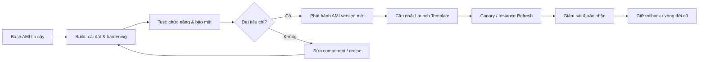
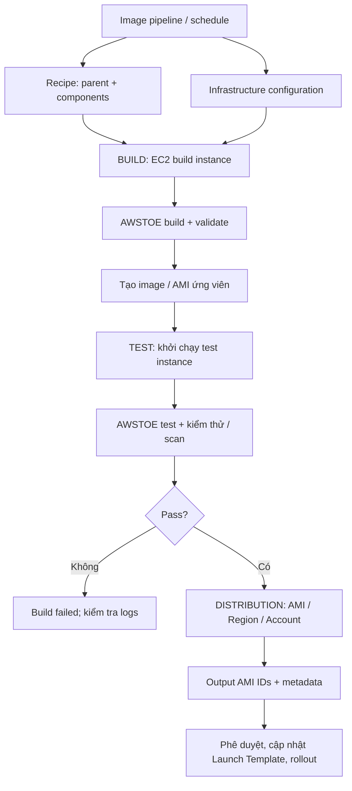
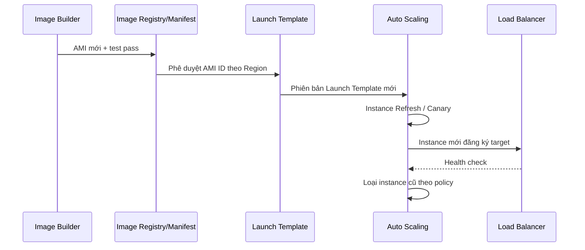

# AMI, EC2 Image Builder và quản lý image trên AWS

> **Chương:** Máy chủ EC2  
> **Module:** `CLOUD_PROVIDERS_AWS`  
> **Phạm vi:** Xây dựng, lựa chọn, kiểm thử, phân phối và quản lý vòng đời Amazon Machine Image (AMI) cho máy chủ EC2, hướng tới triển khai nhất quán, bảo mật, giám sát được, có khả năng phục hồi và kiểm soát chi phí.

## Mục tiêu học tập

Sau bài này, người học có thể:

1. Giải thích AMI là gì, thành phần nào được ghi vào AMI và phân biệt **AMI**, **EC2 instance**, **EBS snapshot**, **Launch Template** và **User Data**.
2. Chọn AMI phù hợp theo Region, kiến trúc CPU, hệ điều hành, nguồn phát hành, quyền truy cập, yêu cầu bảo mật và hỗ trợ vận hành.
3. Tạo AMI thủ công từ một EC2 instance có EBS, nhận biết các rủi ro về tính nhất quán dữ liệu và quyền chia sẻ.
4. Thiết kế pipeline **EC2 Image Builder** gồm image recipe, component, infrastructure configuration, distribution configuration và build/test/distribution workflow.
5. Tổ chức **golden image**, phát hành version, thay thế instance bằng image mới và chuẩn bị phương án rollback.
6. Quản lý vòng đời image: kiểm tra lỗ hổng, giám sát build, deprecate, disable, deregister, dọn snapshot và tối ưu chi phí.

## 1. AMI là gì và có vai trò thế nào?

**Amazon Machine Image (AMI)** là mẫu cấu hình phần mềm mà Amazon EC2 dùng để khởi tạo một **instance**. Khi tạo EC2 mới, bạn phải chọn một AMI phù hợp. AMI xác định hệ điều hành, phần mềm và cấu hình đã được ghi vào image; instance được tạo từ AMI sau đó có vòng đời, trạng thái và dữ liệu riêng.

Ví dụ, một đội phát triển ứng dụng Java có thể tạo AMI chuẩn chứa:

- Hệ điều hành Amazon Linux 2023 đã cập nhật.
- Amazon Corretto 21 và các thư viện hệ thống được phê duyệt.
- Tác nhân giám sát hoặc logging phù hợp.
- Thiết lập bảo mật nền tảng, tài khoản hệ thống và cấu hình máy chủ.
- Các bước kiểm tra khởi động và tính tương thích với ứng dụng.

Khi mở rộng một Auto Scaling group, các EC2 instance mới sử dụng AMI này có nền tảng tương đồng. Điều đó giúp giảm sai khác cấu hình giữa các máy và rút ngắn một phần thao tác cài đặt lúc khởi động.

### 1.1 AMI, snapshot, instance và Launch Template khác nhau

| Khái niệm | Chức năng | Điều cần nhớ |
|---|---|---|
| **AMI** | Mẫu khởi chạy EC2, bao gồm metadata và tham chiếu dữ liệu ổ đĩa cần thiết | Có ID dạng `ami-...`, được dùng khi khởi tạo instance mới |
| **EBS snapshot** | Bản sao dữ liệu volume EBS tại một thời điểm; snapshot EBS mang tính gia tăng ở tầng lưu trữ | AMI **EBS-backed** thường tham chiếu một hoặc nhiều snapshot |
| **EC2 instance** | Máy ảo đang hoặc từng chạy, có network interface và trạng thái riêng | Instance được tạo từ AMI **không tự nhận thay đổi** khi có AMI mới |
| **Launch Template** | Mẫu tham số khởi chạy: AMI ID, loại máy, security group, IAM instance profile, user data... | Phiên bản Launch Template giúp kiểm soát rollout |
| **User Data** | Dữ liệu/script cung cấp khi khởi chạy instance, thường do cloud-init xử lý trên Linux | Phù hợp cấu hình phụ thuộc môi trường; không thay thế toàn bộ image build |
| **EC2 Image Builder image** | Tài nguyên và kết quả một lượt build trong Image Builder | Có ARN riêng; khi output là AMI sẽ tạo ra **AMI ID** dùng với EC2 |

Một điểm dễ nhầm: **AMI ID** (ví dụ `ami-0123456789abcdef0`) **khác** với ARN tài nguyên trong EC2 Image Builder (ví dụ `arn:aws:imagebuilder:ap-southeast-1:123456789012:image/java-base/1.0.0/1`). Kết quả build có thể phân phối thành nhiều AMI ID khác nhau tại các Region và Account.

### 1.2 Những gì thường được lưu trong một EBS-backed AMI

Với EBS-backed AMI, EC2 tạo snapshot cho root EBS volume và các EBS volume đủ điều kiện được đính kèm trong quá trình tạo image. AMI còn có metadata như root device, block device mapping, architecture, virtualization type, boot mode, tên, mô tả và quyền khởi chạy.

**Không nên coi AMI là bản sao toàn bộ mọi trạng thái đang chạy:**

- **RAM**, kết nối TCP đang mở và tiến trình đang chạy không trở thành trạng thái sống khi instance mới khởi động.
- Dữ liệu trên **instance store** không được duy trì như dữ liệu của EBS-backed AMI.
- Security group, subnet, địa chỉ private/public IP, IAM instance profile và phần lớn lựa chọn mạng được xác định khi khởi chạy instance.
- Nội dung đã ghi trên ổ đĩa có thể bị đưa vào image, kể cả token, khóa, log, tập tin tạm hoặc dữ liệu nhạy cảm nếu người xây dựng không dọn trước.

Dữ liệu người dùng thay đổi thường xuyên (đơn hàng, upload, phiên làm việc) nên nằm trên dịch vụ lưu trữ thích hợp như RDS, DynamoDB, S3 hoặc EFS theo yêu cầu; **không** nên đưa dữ liệu vận hành động vào AMI cơ sở.

### 1.3 AMI có phạm vi Region và các ràng buộc tương thích

AMI là tài nguyên **Regional**. AMI ID tại `ap-southeast-1` không tự dùng được để khởi tạo EC2 ở `ap-northeast-1`; cần sao chép AMI hoặc phân phối một bản sang Region đích. Khi copy, AMI đích có **ID riêng**.

Ngoài Region, cần kiểm tra:

- **CPU architecture:** `x86_64` (nhiều instance Intel/AMD) hay `arm64` (AWS Graviton); binary/runtime phải tương thích.
- **Operating system và boot:** Linux/Windows, UEFI/Legacy BIOS theo tổ hợp AMI và instance type.
- **Virtualization và device:** đa số AMI hiện đại sử dụng HVM; kiểm tra ENA, driver, NVMe và yêu cầu hệ điều hành.
- **License và quyền truy cập:** AMI cộng đồng, Marketplace, AMI private và AMI do AWS quản lý có quy định sử dụng khác nhau.
- **Mã hóa EBS/KMS:** khi chia sẻ hoặc sao chép giữa Account/Region, khóa KMS và quyền sử dụng khóa phải phù hợp.

Đừng dùng “latest AMI” một cách không kiểm soát. AMI mới có thể thay kernel, package hoặc runtime gây khác biệt cho ứng dụng. Trong production, nên ghi nhận **AMI ID + version + kết quả test** của bản đã được phê duyệt.

## 2. Lựa chọn AMI gốc an toàn

Bạn có thể bắt đầu từ:

1. **AWS-provided AMI**, chẳng hạn Amazon Linux hoặc Windows do AWS phát hành.
2. **AMI từ nhà cung cấp tin cậy** có quy trình quản lý bản vá, support và license rõ ràng.
3. **AMI nội bộ (golden image)** đã được tổ chức dựng và kiểm thử từ một base image được phê duyệt.
4. **AMI Marketplace**, cần kiểm tra publisher, chi phí phần mềm, điều khoản sử dụng và mức tin cậy.

### 2.1 Checklist chọn base AMI

| Câu hỏi | Vì sao quan trọng |
|---|---|
| Ai là **owner/publisher**? | Tránh chọn nhầm image giả mạo hoặc đã hết duy trì |
| AMI ở đúng **Region** không? | Tránh lỗi `InvalidAMIID.NotFound` |
| Hệ điều hành và kiến trúc có phù hợp instance type? | Tránh lỗi boot hoặc chạy binary sai kiến trúc |
| Image được cập nhật đến mức nào? | Giảm cửa sổ tồn tại lỗ hổng đã công bố |
| Có quyền launch/share/copy theo license không? | Tránh lỗi quyền và vi phạm điều khoản |
| Root volume có mã hóa không? | Đảm bảo yêu cầu dữ liệu và luồng KMS |
| Có kế hoạch vòng đời và thay image không? | Tránh sử dụng AMI cũ vô hạn |

Có thể dùng AWS Systems Manager public parameters cho một số AMI do AWS phát hành để tìm image gốc theo kiến trúc/phiên bản. Tuy nhiên, **tham chiếu động** đến bản mới nhất có thể khiến hai lượt triển khai dùng base AMI khác nhau. Pipeline nên lưu lại AMI thực sự đã chọn, recipe version và kết quả kiểm thử để có khả năng tái hiện.

### 2.2 Golden image và nguyên tắc immutable infrastructure

**Golden image** là AMI chuẩn được xây dựng và phê duyệt để tái sử dụng. Khi cần thay bản vá hoặc runtime, quy trình tốt là **build AMI mới → test → triển khai instance mới → chuyển traffic → loại bỏ instance cũ**.



Cách vận hành này được gọi là **immutable infrastructure**: hạn chế sửa tay các máy production lâu dài. Không có nghĩa rằng mọi dữ liệu đều bất biến; dữ liệu cần lưu bền được tách khỏi instance.

## 3. Tạo AMI thủ công bằng EC2

### 3.1 Khi nào phù hợp?

Tạo AMI thủ công phù hợp cho mục đích học tập, một image đặc biệt hoặc tình huống ít thay đổi. Khi cần lặp lại hằng tuần, áp dụng nhiều môi trường hoặc chứng minh lịch sử build, **EC2 Image Builder** thường giúp tự động hóa tốt hơn.

Quy trình tổng quát:

1. Chọn EC2 instance nguồn đúng Account/Region và đã cài đặt cấu hình mong muốn.
2. Dọn secret, cache, tập tin tạm không cần thiết và các định danh cần tạo lại khi instance mới boot.
3. Đưa ứng dụng/file system tới trạng thái nhất quán; với database đang ghi liên tục, dùng cơ chế backup/snapshot thích hợp thay vì chỉ chụp máy.
4. Tạo AMI; EC2 mặc định thực hiện reboot trong quá trình tạo image nhằm hỗ trợ tính nhất quán.
5. Đợi AMI chuyển sang `available` và thử khởi động instance từ AMI mới.
6. Kiểm tra OS, application startup, mã hóa, networking, quyền và logs trước khi phê duyệt.

### 3.2 Ví dụ AWS CLI tạo AMI

> **Ví dụ thao tác thay đổi hạ tầng:** Các lệnh dưới đây chỉ để minh họa. Thay `i-0123456789abcdef0` bằng instance của bạn, xác nhận Region/Account và kế hoạch nhất quán trước khi thực thi.

```bash
# Kiểm tra danh tính AWS hiện tại
aws sts get-caller-identity

# Xem instance nguồn và AMI gốc
aws ec2 describe-instances \
  --region ap-southeast-1 \
  --instance-ids i-0123456789abcdef0 \
  --query 'Reservations[].Instances[].{Instance:InstanceId,Image:ImageId,State:State.Name,AZ:Placement.AvailabilityZone}'

# Tạo EBS-backed AMI mới, mặc định cho phép reboot
aws ec2 create-image \
  --region ap-southeast-1 \
  --instance-id i-0123456789abcdef0 \
  --name "java-base-2026-11-20-v1" \
  --description "Base image for Java application; tested before release"
```

Lệnh cuối trả về `ImageId` (ví dụ `ami-0123456789abcdef0`). Để chờ image sẵn sàng:

```bash
aws ec2 wait image-available \
  --region ap-southeast-1 \
  --image-ids ami-0123456789abcdef0
```

Sau khi tạo, **phải test bằng cách launch instance mới**. Trạng thái `available` cho biết AMI có thể sử dụng theo góc nhìn EC2, không bảo đảm ứng dụng đã qua kiểm thử.

### 3.3 Vì sao cẩn thận với `--no-reboot`?

`create-image` có tùy chọn `--no-reboot` để không yêu cầu reboot instance nguồn. Cách này có thể giảm gián đoạn nhưng **không bảo đảm dữ liệu trên nhiều volume hoặc ứng dụng đang ghi là nhất quán**. Hệ điều hành và database có thể còn dữ liệu trong cache/buffer.

Nếu cần chụp hệ thống đang chạy, cân nhắc đóng băng hệ thống tệp, flush dữ liệu, tạm dừng ghi, checkpoint hoặc cơ chế backup theo ứng dụng. Chỉ dùng `--no-reboot` khi đã xác minh phương pháp bảo đảm tính nhất quán phù hợp. Reboot cũng không thay thế một backup database được thiết kế đúng.

## 4. EC2 Image Builder giải quyết vấn đề gì?

**EC2 Image Builder** là dịch vụ AWS giúp tự động xây dựng, tùy biến, kiểm thử và phân phối image. Nó hỗ trợ cả **AMI** cho EC2 và **container images** cho ECR; bài này tập trung vào AMI.

Nếu xây dựng image bằng cách đăng nhập SSH rồi cài từng gói thủ công, bạn dễ gặp:

- Mỗi thành viên thực hiện một bộ lệnh khác nhau, khó tái hiện.
- Quên bản vá hoặc thiếu kiểm thử dịch vụ sau khi thay base image.
- Không biết image nào đang được dùng ở production và tài nguyên nào còn phụ thuộc.
- Phải copy AMI thủ công sang Region hoặc Account khác.
- Tích lũy snapshot và AMI cũ, phát sinh chi phí và rủi ro bảo mật.

Image Builder biến quy trình thành cấu hình có thể quản lý phiên bản và chạy lặp lại. Nó sử dụng các EC2 instance trong tài khoản để build/test; việc dùng dịch vụ Image Builder để tạo AMI không có phí riêng theo mức giá AWS công bố, nhưng **EC2, EBS snapshots, S3 logs, Inspector, data transfer và các dịch vụ tích hợp** vẫn có thể tính phí.

## 5. Các thành phần của pipeline Image Builder

| Thành phần | Vai trò | Ví dụ |
|---|---|---|
| **Base image / parent image** | Ảnh gốc khởi đầu | Amazon Linux 2023 x86_64 |
| **Image recipe** | Chỉ định parent image, component, block device và cấu hình build | `java-base` version `1.0.0` |
| **Component** | Tài liệu AWSTOE mô tả bước build/validate/test | Cài Corretto 21, kiểm tra lệnh `java -version` |
| **Infrastructure configuration** | Instance type, subnet, security group, instance profile và thiết lập môi trường build/test | EC2 builder đặt trong subnet có đường tới repository |
| **Distribution configuration** | Cách phân phối kết quả đến Region/Account, tên AMI và các thiết lập output | Phân phối đến `ap-southeast-1` và `ap-northeast-1` |
| **Image pipeline** | Kết hợp recipe, hạ tầng, phân phối, lịch/chế độ kích hoạt và workflow | Pipeline chạy định kỳ |
| **Image Builder image** | Kết quả một lần build có ARN và thông tin output AMI | Một bản build phát hành ra một hoặc nhiều AMI ID |
| **Lifecycle policy** | Quy tắc deprecate/disable/delete bản image lỗi thời và tùy chọn xử lý output | Giữ một số bản ổn định gần nhất |

**Recipe là tài nguyên bất biến (immutable).** Sau khi tạo một phiên bản recipe, bạn không sửa nội dung ngay trong phiên bản ấy; muốn thay đổi parent image, component hay cấu hình recipe, tạo **recipe version mới**. Cần phân biệt phiên bản **recipe** với các lần **build image** sử dụng recipe đó.

Infrastructure configuration là tài nguyên riêng, được pipeline tham chiếu. Thay đổi cấu hình này có thể áp dụng cho build tiếp theo, không làm sửa các AMI đã tạo.

### 5.1 Luồng mặc định: Build → Test → Distribution



- **Build:** Image Builder khởi chạy instance build, thực hiện các bước cài đặt/cấu hình và tạo ảnh ứng viên.
- **Test:** Sử dụng một instance để xác minh image mới có thể khởi động và đáp ứng yêu cầu; có thể bổ sung kiểm tra bảo mật/lỗ hổng.
- **Distribution:** Copy hoặc chia sẻ output theo cấu hình Region/Account, metadata và các tích hợp liên quan.

AWS còn cung cấp **managed/custom workflows**, bao gồm các lựa chọn tối ưu thời gian và tích hợp scan. Để production dùng image đạt chuẩn, cần định nghĩa rõ điều kiện pass/fail; **build thành công** không đồng nghĩa ứng dụng production tự hoạt động đúng.

### 5.2 Phân biệt `image recipe` và `container recipe`

| Loại recipe | Output | Mục tiêu sử dụng |
|---|---|---|
| **Image recipe** | Amazon Machine Image (AMI) | Khởi tạo EC2 bằng AMI |
| **Container recipe** | Container image | Lưu trữ image container trong Amazon ECR |

Một pipeline phục vụ EC2 chạy Java bằng AMI không cần cấu hình ECR nếu không dùng container. Ngược lại, một container image không thể đưa trực tiếp vào trường AMI ID của Launch Template.

## 6. Component và AWS Task Orchestrator and Executor (AWSTOE)

**Component** định nghĩa các thao tác cấu hình và kiểm thử qua tài liệu YAML theo định dạng **AWSTOE**. Một component có thể chứa các phase:

- `build`: cài đặt package, tạo thư mục, cấu hình OS.
- `validate`: kiểm tra trên môi trường build trước khi tạo image ứng viên.
- `test`: kiểm tra trên môi trường chạy từ image mới trong giai đoạn test.

Trong Image Builder, phase `build`/`validate` thuộc build stage; phase `test` thực thi trong test stage theo quy tắc component tương ứng. Không chia sẻ trạng thái từ một phase build sang test như thể chúng chạy trên cùng một phiên làm việc; dùng test độc lập và tự kiểm chứng.

### 6.1 Ví dụ component cài Corretto 21 trên Amazon Linux 2023

Ví dụ dưới đây mô tả **tài liệu component**, chưa phải tệp cấu hình pipeline. Package và lệnh áp dụng cho môi trường Amazon Linux 2023 tương ứng; cần xác nhận repository/base image cụ thể khi thực thi.

```yaml
name: InstallCorretto21
description: Install and validate Java 21 on Amazon Linux 2023
schemaVersion: 1.0

phases:
  - name: build
    steps:
      - name: InstallJava
        action: ExecuteBash
        inputs:
          commands:
            - dnf -y install java-21-amazon-corretto-headless

  - name: validate
    steps:
      - name: VerifyJavaInstalled
        action: ExecuteBash
        inputs:
          commands:
            - java -version
            - rpm -q java-21-amazon-corretto-headless
```

Component test sau có thể được quản lý **riêng** và gắn vào phần test của image recipe:

```yaml
name: TestJava21
description: Verify that the image can run Java after launch
schemaVersion: 1.0

phases:
  - name: test
    steps:
      - name: VerifyJavaRuntime
        action: ExecuteBash
        inputs:
          commands:
            - java -version
            - test -x "$(command -v java)"
```

Các bước trên là phép kiểm tra tối thiểu. Với ứng dụng thực tế, test còn nên xác nhận package version được phê duyệt, quyền file, dịch vụ hệ thống, hiệu năng khởi động và khả năng gọi dependency. Có thể dùng **managed components** do AWS cung cấp hoặc **custom components** có version quản lý.

### 6.2 Component tốt cần có đặc điểm gì?

**Idempotent:** chạy lặp lại trên môi trường phù hợp không gây cấu hình trùng hoặc lỗi không cần thiết. Ví dụ tạo thư mục nên dùng `mkdir -p`; cài package dùng package manager theo OS.

**Quản lý version:** khóa version package/recipe/component khi cần tái hiện. Khi muốn lấy bản vá mới, thực hiện build/test mới và ghi nhận dependency thay đổi.

**Có điều kiện thất bại:** nếu bước kiểm thử sai, pipeline phải fail; tránh nuốt lỗi bằng `|| true` khi lỗi ảnh hưởng chất lượng image.

**Không chứa secret:** không ghi access key, password, private key hay token trực tiếp trong YAML, script, AMI hoặc log. Dùng IAM role và dịch vụ quản lý secret phù hợp tại **thời điểm chạy** khi có thể. Nếu một bước build bắt buộc dùng credential ngắn hạn, kiểm soát cấp phát, log, xóa dữ liệu và quyền truy cập image sau build.

**Tách build-time với runtime:** phần cài runtime/phần mềm ổn định có thể được “bake” vào image; cấu hình riêng cho môi trường như endpoint DB, feature flag, secret, DNS nội bộ nên được cung cấp lúc deploy/boot qua cơ chế quản lý cấu hình thích hợp.

## 7. Thiết kế infrastructure configuration an toàn

Image Builder khởi chạy EC2 build/test instance trong tài khoản. Cần thiết kế các yếu tố:

1. **IAM instance profile:** chỉ cấp quyền SSM, logging, lấy artifact hoặc truy cập repository thực sự cần. Không trao quyền quản trị toàn tài khoản cho máy build.
2. **Subnet/security group:** build instance cần đường tới repository, SSM endpoint và các API liên quan. Nếu ở private subnet, có thể dùng NAT Gateway hoặc VPC endpoints phù hợp theo dịch vụ và khả năng hỗ trợ.
3. **Instance type và capacity:** đủ CPU/RAM/ổ đĩa để install/test; đảm bảo quota EC2/vCPU và yêu cầu kiến trúc AMI.
4. **Logging:** gửi logs đến Amazon S3/CloudWatch theo cách thiết kế, bảo vệ bucket, mã hóa và đặt retention hợp lý.
5. **EBS encryption/KMS:** đảm bảo snapshots và output AMI đạt yêu cầu mã hóa; cân nhắc quyền cross-account khi distribution.
6. **Vận hành:** kiểm soát thời gian chạy, lỗi build, cleanup và hạn chế phát sinh chi phí cho instance build/test.

Với pipeline có quyền cao, phải xem xét **software supply chain**: nguồn package, hash/signature artifact, giới hạn outbound, quyền của scripts và artifact đã được kiểm tra. Script build lấy nội dung từ URL không kiểm soát có thể làm suy yếu toàn bộ golden image.

### 7.1 Ví dụ đường kết nối cần có

```text
Image Builder pipeline
      |
      v
EC2 build instance trong private subnet
      |-- Systems Manager / dịch vụ AWS qua VPC endpoint phù hợp
      |-- Package repository qua NAT / đường riêng phù hợp
      |-- S3 artifact hoặc log bucket theo chính sách
      |-- EBS volume và KMS để tạo snapshot/output
      |
      v
AMI ứng viên -> EC2 test instance -> phân phối AMI
```

Không mặc định mọi VPC endpoint, service API hoặc repository đều hỗ trợ đường mạng riêng như nhau. Cần kiểm tra DNS, route table, NACL, security group, IAM, bucket policy và key policy theo từng chặng.

## 8. Phân phối AMI sang Region và Account khác

AMI là tài nguyên Regional. Khi sản phẩm triển khai nhiều Region, một lần build có thể tạo **nhiều output AMI**, mỗi output có ID khác nhau. Distribution configuration quyết định nơi phân phối, cách đặt tên/tags và các thuộc tính liên quan.

Ví dụ kiến trúc phát hành:

| Môi trường | Account | Region | AMI ID minh họa | Vai trò |
|---|---|---|---|---|
| Build | `111122223333` | `ap-southeast-1` | `ami-01111111111111111` | Xây dựng và test bản phát hành |
| Production Singapore | `444455556666` | `ap-southeast-1` | `ami-02222222222222222` | Instance app tại Singapore |
| Disaster recovery Tokyo | `777788889999` | `ap-northeast-1` | `ami-03333333333333333` | Dự phòng tại Region khác |

Các Account/AMI ID trên **chỉ là dữ liệu giả định**. Nhất quán cấu hình hệ điều hành không đồng nghĩa ID trùng nhau. Nên duy trì một **manifest phát hành** như:

```json
{
  "imageVersion": "java-base/1.0.0-build.12",
  "recipeVersion": "1.0.0",
  "architecture": "x86_64",
  "approved": true,
  "outputAmiIds": {
    "ap-southeast-1": "ami-01111111111111111",
    "ap-northeast-1": "ami-03333333333333333"
  }
}
```

Manifest trong ví dụ chỉ là bản ghi minh họa, không phải AWS API schema.

### 8.1 KMS và chia sẻ AMI mã hóa

Khi image dựa trên EBS snapshots mã hóa:

- Xác định **customer managed KMS key** phù hợp để chia sẻ image với tài khoản khác.
- Nếu snapshot dùng khóa mặc định AWS managed key, bạn **không thể chia sẻ AMI đó giữa các tài khoản theo cách thông thường**; cần sao chép/mã hóa lại bằng customer managed key theo quy trình phù hợp.
- Account nhận phải có quyền sử dụng KMS key liên quan, bên cạnh quyền khởi chạy AMI và quyền sử dụng EC2/EBS.
- Copy sang Region khác cần xem xét key trong Region đích và quy định mã hóa/lifecycle ở đó.

Không bật chia sẻ AMI công khai trừ khi có yêu cầu rõ ràng và đã đánh giá loại dữ liệu, license, policy cũng như cơ chế chặn public access. Với ứng dụng nội bộ, thường giới hạn sharing cho Account/OUs được tin cậy.

## 9. Từ AMI đã test đến EC2 production

**Image Builder tạo AMI không mặc định thay tất cả EC2 đang chạy.** Các instance hiện tại tiếp tục dùng dữ liệu/OS từ thời điểm chúng được khởi chạy và các thay đổi về sau. Muốn áp dụng image mới cho ứng dụng chạy thật, cần một kế hoạch **rollout instance mới**.

### 9.1 Quy trình phát hành với Launch Template và Auto Scaling

1. Chạy build/test và quét lỗ hổng; chỉ phê duyệt bản đáp ứng tiêu chí.
2. Xác định **AMI ID của đúng Region/Account** theo manifest.
3. Tạo phiên bản **Launch Template** mới, tham chiếu AMI ID cùng cấu hình instance type, IAM role, user data và network settings.
4. Thử trên nhóm canary/staging trước.
5. Đặt Launch Template version mới cho Auto Scaling group và dùng **Instance Refresh** hoặc chiến lược thay instance đã kiểm soát, kết hợp health check và giới hạn số lượng máy thay đồng thời.
6. Theo dõi latency, error rate, CPU/RAM, log, healthy targets của load balancer và hành vi business.
7. Nếu phát hiện lỗi, rollback về Launch Template/AMI ID đã biết tốt và **thay những instance bị ảnh hưởng**. Chỉ đổi cấu hình template thường không tự đảo ngược những instance đã được tạo.



Khi ứng dụng quản lý session hoặc dữ liệu trạng thái local, phải thiết kế chuyển trạng thái (stateless, session store, drain connection, DB migration) trước khi thay instance.

### 9.2 AMI và các lớp khác trong kiến trúc

| Lớp | Vai trò |
|---|---|
| AMI | Cấu hình hệ điều hành và phần mềm nền |
| Launch Template/ASG | Khởi tạo và thay instance theo cấu hình mới |
| IAM | Quyền của EC2 instance và quy trình build |
| VPC/SG/NACL | Đường mạng và kiểm soát truy cập |
| S3/RDS/DynamoDB/EFS | Dữ liệu bền và dữ liệu dùng chung |
| CloudWatch/CloudTrail | Quan sát hoạt động, thay đổi và lịch sử API |
| AWS Budgets/Cost Explorer | Theo dõi chi phí xây dựng, lưu trữ và vận hành |

Giá trị của golden image nằm ở khả năng **lặp lại và kiểm soát** toàn bộ chu kỳ thay máy, chứ không chỉ tạo được một AMI mới.

## 10. Quản lý vòng đời AMI

Theo thời gian, tài khoản có thể tích lũy hàng chục hoặc hàng trăm image. Cần phân biệt thao tác **deprecate**, **disable** và **deregister**.

| Trạng thái / thao tác | Điều xảy ra | Instance đã khởi chạy | EBS snapshots |
|---|---|---|---|
| **Available** | Image đang có thể dùng theo quyền và cấu hình | Không thay đổi | Tiếp tục tồn tại |
| **Deprecate** | AMI lỗi thời; thường bị ẩn khỏi danh sách tìm kiếm mặc định | Không bị dừng/xóa | **Vẫn còn** và vẫn có phí lưu trữ |
| **Disable** | Không thể khởi chạy EC2 mới bằng AMI cho đến khi được enable trở lại | Không bị dừng/xóa | **Vẫn còn** |
| **Deregister** | Hủy đăng ký AMI; không thể dùng nó khởi chạy instance mới | Không xóa instance đã tạo | **Không mặc định xóa**; có thể yêu cầu xóa snapshot liên kết nếu phù hợp |

**Deprecate không phải delete.** Với AMI đã deprecate, người có ID và quyền phù hợp vẫn có thể sử dụng để launch trong các trường hợp AWS hỗ trợ; launch template/ASG có thể tiếp tục tham chiếu. Khi cần chặn image cũ khởi chạy, cân nhắc disable hoặc thay quyền theo chính sách.

**Deregister không tự thu hồi các máy đã chạy** từ AMI đó. Đồng thời, nếu còn snapshot không dùng, chi phí lưu trữ có thể tiếp diễn. Tùy API và điều kiện, có thể tùy chọn xóa snapshot gắn với AMI trong thao tác deregister; snapshot dùng chung với AMI khác không phải lúc nào cũng xóa được.

### 10.1 Image Builder lifecycle policies

EC2 Image Builder cung cấp **lifecycle policies** để quản lý image theo tuổi hoặc số lượng bản giữ lại. Policy có thể:

- **Deprecate** image đã vượt thời gian sử dụng dự kiến.
- **Disable** image để hạn chế tạo instance mới bằng image cũ.
- **Delete** image resource và, nếu cấu hình, xử lý output AMI/snapshot/container tương ứng.
- Áp dụng các điều kiện loại trừ theo tag, Region, shared account hoặc trường hợp cần giữ lại.

Quan trọng: hành động lifecycle trên **Image Builder image resource** không mặc nhiên áp dụng cho **tất cả output AMI/snapshot** nếu chưa bật tùy chọn liên quan. Chính sách cũng không tự phân tích mọi dependency downstream như Launch Template hoặc Auto Scaling group; **phải kiểm tra image còn được tham chiếu không** trước khi xóa.

Ví dụ nguyên tắc retention nội bộ (chỉ là chính sách gợi ý, không phải giá trị mặc định của AWS):

- Giữ 2–3 bản production đã được phê duyệt để rollback.
- Đánh dấu deprecated bản cũ sau một thời gian được thống nhất.
- Disable bản không còn được phép sử dụng.
- Chỉ deregister và xóa snapshot khi chắc chắn không còn triển khai hoặc nhu cầu phục hồi phụ thuộc.

Image Builder lifecycle policies chạy theo lịch dịch vụ quản lý; không nên giả định hành động xóa xảy ra ngay đúng thời điểm một image đủ tuổi.

### 10.2 Amazon Data Lifecycle Manager khác gì Image Builder?

**Amazon Data Lifecycle Manager (DLM)** có thể tự động hóa chu kỳ tạo, giữ, copy, deprecate/deregister của EBS-backed AMI và snapshot theo policy. Nó hữu ích khi mục tiêu chính là snapshot/AMI lifecycle từ các instance có sẵn.

**EC2 Image Builder** tập trung vào việc xây dựng image mới theo recipe, chạy component và test, rồi phân phối cùng quản lý vòng đời. Hai công cụ có thể bổ trợ nhưng không thay thế hoàn toàn nhau. Không coi DLM là giải pháp tự cài runtime, harden và kiểm thử phần mềm nếu chưa có quy trình khác.

## 11. Kiểm thử chất lượng, bảo mật và lỗ hổng

Một image có thể boot được nhưng vẫn không đủ điều kiện đưa vào production. Nên đặt **quality gates**:

| Nhóm kiểm tra | Ví dụ | Hành động nếu thất bại |
|---|---|---|
| **Boot** | Instance chạy và EC2 status checks phù hợp | Chặn phát hành |
| **Runtime** | Java 21 cài đúng, service có quyền chạy | Chặn phát hành |
| **Functional smoke test** | HTTP health check, gọi luồng nghiệp vụ đơn giản | Chặn phát hành |
| **Security** | Patch, package cấm, cấu hình SSH, quyền file, không lộ secret | Chặn phát hành theo mức nghiêm trọng và policy |
| **Vulnerability** | CVE của OS/package qua Amazon Inspector hoặc công cụ tổ chức | Đánh giá severity và ngoại lệ có thời hạn |
| **Compatibility** | x86_64/arm64, agent, hệ thống theo dõi, thư viện native | Chặn phát hành nếu workload đích không tương thích |
| **Operational** | Logs, metrics, startup time, cleanup được kiểm chứng | Sửa trước rollout nếu thiếu quan sát |

Amazon Inspector hỗ trợ những hình thức quét AMI/workload theo cấu hình và có thể được tích hợp vào workflow của Image Builder. **Scanning phải được bật/cấu hình đúng**, kiểm tra phạm vi và khả năng hỗ trợ; không giả định Image Builder mặc định loại bỏ tất cả CVE. Việc quét có thể phát sinh chi phí Inspector.

**Nguyên tắc bảo mật quan trọng:** không “bake” access key hoặc secret ứng dụng vào AMI. Khi khởi chạy EC2, cấp IAM instance profile với quyền tối thiểu; lấy secret tại runtime qua nguồn quản lý phù hợp. Trước khi share AMI, rà lại shell history, logs, cached credentials, SSH host keys và metadata riêng của nguồn theo hướng dẫn hệ điều hành.

## 12. Giám sát và khắc phục sự cố pipeline

### 12.1 Cần quan sát những gì?

- **Pipeline status và image build history:** build nào pass/fail, recipe/parent/component version nào đã dùng.
- **Component logs/AWSTOE logs:** lệnh nào thất bại, exit code, giai đoạn build/validate/test.
- **Image Builder và EC2 API events:** phục vụ audit bằng AWS CloudTrail theo cấu hình.
- **S3/CloudWatch logs, EventBridge/SNS:** ghi nhận kết quả và gửi thông báo khi có build mới hoặc lỗi nếu đã cấu hình tích hợp.
- **AMI distribution:** output có xuất hiện trong đúng Region/Account và đáp ứng quyền launch/KMS.
- **Chi phí:** EC2 build/test, snapshot, S3 logs, Inspector, NAT Gateway/data transfer khi tải package.

### 12.2 Các lỗi thường gặp

| Biểu hiện | Nguyên nhân cần kiểm tra | Hướng xử lý |
|---|---|---|
| Build instance không truy cập được SSM hoặc repository | Subnet không có NAT/VPC endpoint, DNS, route, security group/NACL chưa phù hợp | Kiểm tra hạ tầng build và kết nối theo từng đích |
| Component `ExecuteBash` thất bại | Lệnh dùng package manager sai OS, thiếu package, quyền hoặc sai cú pháp YAML | Xem AWSTOE logs, kiểm tra base OS và thử trên môi trường tương đương |
| Build pass nhưng test fail | Dịch vụ không tự khởi động, test chạy trên instance mới, cấu hình chưa đầy đủ | Tách nguyên nhân build-time và runtime; kiểm tra boot logs |
| Không thể launch AMI mới | Sai Region, instance architecture/boot mismatch, quyền launch, KMS hoặc license | Đọc lỗi EC2 thực tế, đối chiếu AMI attributes và policy |
| Copy/distribution sang Account khác lỗi | AMI share permission, customer managed KMS key hoặc quyền tại Account đích chưa đủ | Kiểm tra distribution, key policy và các điều kiện của snapshot |
| Production vẫn dùng image cũ | Launch Template version chưa được cập nhật/ASG chưa được refresh | Kiểm tra version tham chiếu và thực hiện rollout có kiểm soát |
| EC2 còn chạy sau khi deregister AMI | Deregister chỉ tác động tới khả năng khởi chạy instance mới | Theo dõi vòng đời instance độc lập |
| Xóa AMI nhưng hóa đơn EBS vẫn cao | Snapshot chưa xóa, snapshot vẫn được AMI khác sử dụng, hoặc còn volume/dữ liệu khác | Kiểm kê EBS snapshots, volume và retention |
| Pipeline tiếp tục tạo nhiều AMI cũ | Chưa có lifecycle policy hoặc policy không tác động output resources | Kiểm tra lifecycle rules, execution logs, exclusions và các output option |

### 12.3 Chiến lược phản ứng khi build lỗi

1. Xác nhận Account/Region, pipeline ARN và image build version.
2. Xác định stage thất bại: **build, test hay distribution**.
3. Đọc logs theo stage; tìm error code đầu tiên có ý nghĩa thay vì chỉ xem thông báo cuối.
4. Nếu do hạ tầng, kiểm tra quota EC2, instance profile, mạng, KMS, S3 và khả năng khởi chạy build instance.
5. Nếu do component, cập nhật mã nguồn/component version, chạy lại kiểm thử; giữ lại logs để điều tra.
6. Nếu do distribution, kiểm tra quyền và Region/Account/KMS; AMI tại build Region có thể đã thành công nhưng bản phân phối chưa đạt.
7. Chỉ dùng phiên bản đã được phê duyệt cho production; duy trì đường rollback.

## 13. AWS CLI thực hành: kiểm kê image và pipeline

**Yêu cầu:** AWS CLI v2 được cấu hình quyền phù hợp. Các lệnh trong mục này chỉ **đọc thông tin**; không tạo, thay đổi hay xóa tài nguyên. Ví dụ dùng Region `ap-southeast-1` và các ID minh họa.

### 13.1 Xem tài khoản và liệt kê AMI bạn sở hữu

```bash
aws sts get-caller-identity

aws ec2 describe-images \
  --owners self \
  --region ap-southeast-1 \
  --query 'Images[].{Id:ImageId,Name:Name,Created:CreationDate,State:State,Architecture:Architecture}' \
  --output table
```

Nếu danh sách dài, thêm filter `Name=name,Values=...` hoặc tag để giới hạn theo dự án. Chỉ dùng `--owners self` khi muốn kiểm kê AMI do tài khoản sở hữu, không phải tất cả AMI do AWS hoặc bên thứ ba chia sẻ.

### 13.2 Tra metadata của một AMI cụ thể

```bash
aws ec2 describe-images \
  --image-ids ami-0123456789abcdef0 \
  --region ap-southeast-1 \
  --query 'Images[].{Id:ImageId,Name:Name,Owner:OwnerId,Architecture:Architecture,Root:RootDeviceType,SnapshotMappings:BlockDeviceMappings}' \
  --output json
```

Tra AMI ID cụ thể hỗ trợ việc kiểm chứng image đã deprecated nhưng còn sử dụng được theo quyền; trạng thái và khả năng nhìn thấy phụ thuộc chính sách AWS và ngữ cảnh người gọi.

### 13.3 Liệt kê pipeline và recipe Image Builder

```bash
aws imagebuilder list-image-pipelines \
  --region ap-southeast-1 \
  --query 'imagePipelineList[].{Name:name,Arn:arn,Status:status}' \
  --output table

aws imagebuilder list-image-recipes \
  --region ap-southeast-1 \
  --query 'imageRecipeSummaryList[].{Name:name,Version:version,Arn:arn}' \
  --output table
```

Nếu có pipeline thật, lấy ARN từ kết quả và đọc chi tiết:

```bash
aws imagebuilder get-image-pipeline \
  --image-pipeline-arn arn:aws:imagebuilder:ap-southeast-1:123456789012:image-pipeline/java-base \
  --region ap-southeast-1
```

Account ID và tên pipeline trong lệnh là giả định; thay theo kết quả đọc của bạn. Lưu ý lệnh `get-image-pipeline` trả về cấu hình, không đồng nghĩa lần build gần nhất đã thành công.

### 13.4 Liệt kê kết quả build của pipeline

```bash
aws imagebuilder list-image-pipeline-images \
  --image-pipeline-arn arn:aws:imagebuilder:ap-southeast-1:123456789012:image-pipeline/java-base \
  --region ap-southeast-1 \
  --query 'imageSummaryList[].{Arn:arn,Version:version,Status:state.status,Created:dateCreated}' \
  --output table
```

Sau đó dùng `get-image` với **image build version ARN thực tế** để xem output resources, trong đó có AMI ID theo Region nếu build đã thành công và output được tạo. Không dùng nhầm pipeline ARN như tham số image build version ARN.

### 13.5 Liệt kê lifecycle policies

```bash
aws imagebuilder list-lifecycle-policies \
  --region ap-southeast-1 \
  --output json
```

Dùng kết quả để xác định policy đã được bật hay chưa và tài nguyên nào thuộc phạm vi quản lý. Khi cần xác minh dọn dẹp, đọc cả lifecycle execution history cùng output AMI/snapshot thực tế.

## 14. Ví dụ tổng hợp: Golden image Java cho hệ thống đặt hàng

Giả sử một nhóm đang triển khai hệ thống `orders-api` trên EC2 Auto Scaling tại Singapore, có kế hoạch DR ở Tokyo. Mục tiêu là chuẩn hóa Java runtime, giảm lỗi drift và triển khai bản vá định kỳ.

### 14.1 Thiết kế đề xuất

| Thành phần | Quyết định | Lý do |
|---|---|---|
| Base AMI | Amazon Linux 2023, kiến trúc `x86_64` hoặc `arm64` đúng với instance type | Môi trường hệ điều hành được duy trì |
| Recipe | `orders-java-base` với version cụ thể | Dễ truy vết |
| Build component | Cài Corretto 21, cấu hình thời gian, logging agent, OS hardening | Đồng nhất máy |
| Test component | Kiểm tra Java, boot, health endpoint thử nghiệm | Bắt lỗi trước production |
| Infrastructure | EC2 build/test ở VPC riêng, IAM role tối thiểu | Cô lập, ghi log, kiểm soát truy cập |
| Distribution | Copy đến Region/Account đích, xử lý KMS | Triển khai đa Region |
| Release | Manifest AMI ID theo Region, cập nhật Launch Template | Kiểm soát production rollout |
| Monitoring | Image Builder logs + EC2 health + ứng dụng + chi phí | Phân biệt lỗi build/deploy và phát hiện chi phí |

Giả sử application artifact thay đổi nhanh hơn bản vá hệ điều hành. Có hai lựa chọn:

- **Đưa application artifact vào AMI:** image chứa đủ app + runtime. Dễ triển khai nhất quán, nhưng mỗi bản app mới cần build/test AMI mới.
- **Chỉ bake runtime, lấy application artifact lúc deploy:** giảm tần suất build image khi app cập nhật, nhưng cần cơ chế tải artifact và bảo đảm version, integrity, observability. Nếu dùng cách này, không để EC2 tùy ý lấy “latest” artifact chưa được phê duyệt.

Tổ chức cần chọn phương án phù hợp với tốc độ phát hành, ràng buộc bảo mật, thời gian khởi động và quy trình rollback.

### 14.2 Ví dụ một lượt cập nhật bảo mật

1. Nhà cung cấp công bố bản vá OS/Java; đội hạ tầng tạo recipe/component version mới nếu cần.
2. Image Builder tạo AMI ứng viên, chạy cài đặt, validate, test và scan theo policy.
3. Kết quả build/test được lưu; output AMI tại Singapore/Tokyo được ghi vào manifest.
4. Dev/staging kiểm thử với traffic mẫu, migration và hệ thống phụ trợ.
5. Chạy canary một phần nhỏ ASG; quan sát lỗi/tỷ lệ thành công.
6. Rollout phần còn lại; giữ bản AMI trước đó cho rollback.
7. Đánh dấu deprecated và dọn image cũ theo policy **sau khi** không còn Launch Template/ASG hoặc nhu cầu khôi phục phụ thuộc.

### 14.3 Những quyết định giúp giảm rủi ro

- Tách Account **build** và **production** khi quy mô/quy định phù hợp.
- Cố định dependency hoặc kiểm soát version; tránh lấy package tùy ý từ URL không xác minh.
- Không đóng gói secret hoặc dữ liệu khách hàng vào image.
- Đảm bảo image đích phù hợp x86_64/arm64, driver và license.
- Thiết kế kiểm thử rollback, health checks và khả năng thay instance tự động.
- Quan sát chi phí snapshot/EC2 build/test/Inspector và kiểm tra lifecycle policies định kỳ.

## 15. Câu hỏi và bài tập tự kiểm tra

**Câu 1 — Phân biệt tài nguyên.** Khi tạo một EC2 từ AMI, các dữ liệu nào thuộc AMI, và những tham số nào thường được quyết định bởi Launch Template/VPC lúc khởi chạy? Có nên đưa password kết nối database vào AMI không?

**Câu 2 — Region.** Một AMI đã được test ở `ap-southeast-1`. Có thể dùng nguyên AMI ID để launch EC2 ở `ap-northeast-1` không? Khi phân phối, cần thêm điều gì nếu AMI mã hóa bằng customer managed KMS key?

**Câu 3 — Chu kỳ build.** Sắp xếp các thành phần: image recipe, component, infrastructure configuration, distribution configuration, pipeline; phân biệt thời điểm chạy `build`, `validate` và `test`.

**Câu 4 — Thay image production.** Image Builder tạo bản AMI mới thành công, nhưng ASG vẫn chạy bản cũ. Bước triển khai nào còn thiếu? Nếu rollback chỉ chuyển Launch Template về ID cũ, các instance đã thay có tự đổi không?

**Câu 5 — Dọn dẹp.** Một AMI bị deprecate và sau đó deregister. Tại sao hóa đơn EBS snapshot vẫn có thể phát sinh? Có thể xóa snapshot ngay mà không kiểm tra dependency không?

**Câu 6 — Security.** Build pipeline có component tải script từ địa chỉ ngoài, chạy với quyền root và ghi token vào log. Hãy nêu ít nhất ba biện pháp giảm rủi ro.

<details>
<summary>Gợi ý trả lời</summary>

1. AMI lưu cấu hình phần mềm/ổ đĩa; Launch Template/EC2 launch quyết định instance type, IAM role, subnet, security group và nhiều tham số runtime. Không lưu password trong AMI.
2. Không; AMI Regional nên cần bản copy/distribution và AMI ID đích. Kiểm tra KMS key, key policy và quyền tại Account/Region đích.
3. Recipe chọn parent image và component; infrastructure configuration tạo môi trường; pipeline điều phối; distribution configuration định nghĩa output. `build`/`validate` chạy trong build stage, `test` trên test stage.
4. Cần cập nhật Launch Template/ASG và thay instance (Instance Refresh hoặc tương đương). Đổi template không đổi dữ liệu của instance đã chạy.
5. Deregister không mặc định xóa toàn bộ snapshot liên quan; snapshot dùng chung cũng cần kiểm tra. Không xóa khi chưa biết dependency hoặc retention.
6. Pin/checksum/signature của script, IAM role tối thiểu, network egress control, quản lý secret an toàn, không ghi token ra log, quét/test image, review component theo version.

</details>

## 16. Checklist trước khi đưa AMI vào production

- [ ] Đã xác nhận Account, Region, kiến trúc CPU, AMI owner, license và cơ chế mã hóa.
- [ ] Base AMI và recipe/component có version rõ ràng, có thể truy vết.
- [ ] Không lưu secret hoặc dữ liệu nhạy cảm trong AMI, script hoặc logs.
- [ ] Pipeline có bước build, validate, test, tiêu chí pass/fail và log phục vụ điều tra.
- [ ] Image đã được kiểm tra patch, security baseline và lỗ hổng theo chính sách.
- [ ] Output AMI ID/KMS permission được xác minh tại từng Region/Account.
- [ ] Launch Template version và ASG/Instance Refresh được kiểm soát; có canary và rollback.
- [ ] Dữ liệu có trạng thái được tách khỏi lifecycle EC2 instance; health check/monitoring đầy đủ.
- [ ] Lifecycle policy có xét dependency, retention và snapshot cleanup.
- [ ] Chi phí EC2 build/test, EBS snapshot, S3 logs, Inspector và data transfer được theo dõi.

## Tài liệu AWS chính thức

- [Amazon EC2 — Amazon EC2 AMI lifecycle](https://docs.aws.amazon.com/AWSEC2/latest/UserGuide/ami-lifecycle.html)
- [Amazon EC2 — Create an Amazon EBS-backed AMI](https://docs.aws.amazon.com/AWSEC2/latest/UserGuide/creating-an-ami-ebs.html)
- [Amazon EC2 — Copy an AMI](https://docs.aws.amazon.com/AWSEC2/latest/UserGuide/CopyingAMIs.html)
- [Amazon EC2 — Deprecate an AMI](https://docs.aws.amazon.com/AWSEC2/latest/UserGuide/ami-deprecate.html)
- [Amazon EC2 — Deregister an AMI](https://docs.aws.amazon.com/AWSEC2/latest/UserGuide/deregister-ami.html)
- [EC2 Image Builder — What is Image Builder?](https://docs.aws.amazon.com/imagebuilder/latest/userguide/what-is-image-builder.html)
- [EC2 Image Builder — Image recipes](https://docs.aws.amazon.com/imagebuilder/latest/userguide/manage-recipes.html)
- [EC2 Image Builder — Components and AWSTOE](https://docs.aws.amazon.com/imagebuilder/latest/userguide/manage-components.html)
- [EC2 Image Builder — Build, test and distribution workflows](https://docs.aws.amazon.com/imagebuilder/latest/userguide/manage-image-workflows.html)
- [EC2 Image Builder — Infrastructure configurations](https://docs.aws.amazon.com/imagebuilder/latest/userguide/manage-infra-config.html)
- [EC2 Image Builder — Distribution configurations](https://docs.aws.amazon.com/imagebuilder/latest/userguide/manage-distribution-settings.html)
- [EC2 Image Builder — Lifecycle policies](https://docs.aws.amazon.com/imagebuilder/latest/userguide/manage-image-lifecycles.html)
- [EC2 Image Builder — Security best practices](https://docs.aws.amazon.com/imagebuilder/latest/userguide/security-best-practices.html)

**Điểm cần ghi nhớ:** AMI là **mẫu khởi chạy**, Image Builder là **quy trình tạo và kiểm thử image có thể lặp lại**, còn quản lý image là **chu kỳ phát hành, triển khai, thu hồi và dọn tài nguyên**. Chỉ khi kết hợp cả ba, đội vận hành mới duy trì được EC2 nhất quán, an toàn, dễ phục hồi và có chi phí kiểm soát được.

