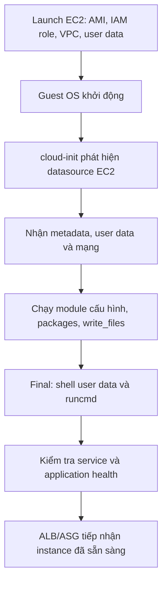

# Khởi tạo instance với user data và cloud-init

> **Chương:** Máy chủ EC2 · **Mô-đun:** `CLOUD_PROVIDERS_AWS`

## 1. Vì sao phải tự động hóa khởi tạo EC2?

Một ứng dụng Java trên Amazon EC2 cần nhiều bước sau khi chọn Amazon Machine Image (AMI), instance type và nhấn **Launch instance**: cài runtime hoặc web server, lấy artifact đúng phiên bản, tạo file cấu hình, thiết lập service, ghi logs và xác minh ứng dụng đã sẵn sàng. Nếu đội vận hành phải SSH vào từng máy để làm những việc này, rất khó lặp lại chính xác khi Auto Scaling tạo thêm instance, thay máy lỗi hoặc phục hồi sau sự cố Availability Zone (AZ).

**EC2 user data** cho phép truyền dữ liệu cấu hình lúc launch. Trên Linux AMI có **cloud-init**, user data thường là shell script hoặc cấu hình YAML giúp tự động chuẩn bị hệ điều hành và ứng dụng trong quá trình boot. Việc này giảm thao tác thủ công, nhất quán giữa môi trường và giúp mở rộng bằng Launch Template/Auto Scaling Group (ASG).

Trong phạm vi mô-đun `CLOUD_PROVIDERS_AWS`, khởi tạo EC2 cần kết hợp **Region/AZ, IAM instance role, VPC subnet, compute, S3/Secrets Manager, giám sát CloudWatch, khả năng khôi phục và kiểm soát chi phí**. Một script chạy thành công vẫn chưa chứng minh hệ thống phục vụ được request: ứng dụng có thể thiếu network, sai quyền IAM, lỗi kết nối cơ sở dữ liệu hoặc chưa vượt qua health check của load balancer.

Sau bài học, người học có thể:

1. Phân biệt user data, cloud-init, AMI, Launch Template và tự động hóa sau khi boot.
2. Mô tả các giai đoạn cloud-init, tần suất chạy và tác động của reboot/stop-start.
3. Viết user data dạng Bash và `#cloud-config` cho Amazon Linux 2023.
4. Khởi tạo và kiểm tra EC2 bằng Console/AWS CLI, hiểu giới hạn và Base64.
5. Đọc logs, xác định lỗi boot và áp dụng phương án phục hồi có kiểm soát.
6. Thiết kế bootstrap bảo mật, có tính lặp lại và phù hợp VPC private, ASG và ngân sách.

## 2. Các thành phần và trách nhiệm

### 2.1. EC2 user data

**User data** là một thuộc tính của EC2 instance, nhận payload khi launch. Dữ liệu này có thể mang lệnh shell, chỉ thị cloud-init, tham số môi trường hoặc URL artifact. EC2 lưu và cung cấp payload; **EC2 không tự diễn giải tùy ý mọi lệnh**. Cần thành phần bên trong guest OS như cloud-init (Linux) hoặc EC2Launch (Windows) xử lý.

Giới hạn EC2 user data là **16 KiB dữ liệu thô trước khi mã hóa Base64**. Khi gọi EC2 API trực tiếp, payload phải được Base64-encode; EC2 Console hoặc AWS CLI lệnh `run-instances --user-data` có thể mã hóa giúp người dùng từ plain text. Vì thế, không nhúng cả project, file nhị phân hay script quá lớn; hãy đưa artifact lên kho có kiểm soát rồi tải bằng IAM role hoặc tạo AMI đã đóng gói dependencies.

### 2.2. Cloud-init

**Cloud-init** là bộ công cụ khởi tạo Linux chạy trên nhiều cloud, hỗ trợ:

- Nhận datasource và metadata của EC2, cấu hình mạng và hostname.
- Tạo người dùng, SSH authorized keys, file và quyền filesystem.
- Cập nhật hoặc cài package, gọi các script và cấu hình dịch vụ.
- Theo dõi trạng thái thực thi và ghi log để chẩn đoán lỗi.

**Amazon Linux 2023 (AL2023)** có bản cloud-init được AWS tùy chỉnh; không nên giả định mọi AMI Linux hoặc AMI do doanh nghiệp tự xây đều có module và cú pháp giống AL2023. Nếu dùng Ubuntu, RHEL hoặc image riêng, đối chiếu tài liệu image đó. **Windows EC2** có agent và user data syntax riêng; các ví dụ Bash trong bài chỉ dành cho Linux.

### 2.3. So sánh với các công cụ triển khai khác

| Công cụ | Trách nhiệm chính | Ứng dụng |
| --- | --- | --- |
| **AMI** | Hình ảnh hệ điều hành và phần mềm nền đã được đóng gói. | Tạo máy từ base image đã kiểm thử. |
| **User data + cloud-init** | Cấu hình ban đầu theo môi trường lúc instance khởi động. | Tạo file, cài vài package, cấu hình ứng dụng, tải artifact. |
| **Launch Template** | Lưu cấu hình launch, có phiên bản: AMI, instance type, SG, user data, IAM instance profile. | Tạo instance nhất quán; tích hợp ASG. |
| **Auto Scaling Group** | Duy trì số lượng instance, nhân bản hoặc thay máy lỗi. | Mỗi instance mới phải tự hoàn thành bootstrap. |
| **AWS Systems Manager** | Vận hành, chạy lệnh, quản lý patch/cấu hình trên máy đã chạy. | Điều tra và cập nhật mà không cần SSH công khai. |
| **CloudFormation / CDK / Terraform** | Mô tả hạ tầng bằng mã, gồm EC2, IAM, VPC, SG, ASG. | Lặp lại việc tạo hạ tầng với review/version control. |
| **EC2 Image Builder / Packer** | Tạo AMI chứa dependencies và thành phần ứng dụng. | Giảm thời gian boot, tăng tính nhất quán khi scale. |

Mẫu production thường là **AMI được kiểm thử + user data gọn + Launch Template có phiên bản + ASG + health check**. User data chỉ đóng vai trò bootstrap, không phải hệ thống quản lý toàn bộ vòng đời ứng dụng.

## 3. Vòng đời thực thi khi EC2 boot



Cloud-init chia quá trình boot thành các giai đoạn:

| Giai đoạn | Việc tiêu biểu | Ý nghĩa |
| --- | --- | --- |
| **Detect** | Nhận diện nền tảng và quyết định có dùng cloud-init. | AMI phải hỗ trợ EC2 datasource. |
| **Local** | Tìm datasource, chuẩn bị cấu hình network nền. | Tránh truy cập repository trước khi network sẵn sàng. |
| **Network** | Xử lý dữ liệu mạng và user data, chạy module giai đoạn đầu. | Lấy metadata từ IMDS theo cấu hình của image. |
| **Config** | Chạy module cloud-config; `runcmd` tạo nội dung script. | Chưa đồng nghĩa `runcmd` đã chạy xong. |
| **Final** | Hoàn tất cài package và thực thi shell scripts/`scripts-user`. | Đây thường là bước kéo dài nếu cài package hoặc tải artifact. |

**Chi tiết quan trọng:** `runcmd` ghi script để chạy sau; module `scripts-user` thực thi nó ở **Final stage**. Thứ tự module chi tiết và module frequency có thể phụ thuộc bản cloud-init, hệ điều hành và `cloud.cfg`.

### 3.1. Khởi động lần đầu, reboot và stop/start

- Theo mặc định, user data shell script và phần lớn cloud-init module dành cho cấu hình instance chạy **trong lần boot đầu tiên của instance**.
- **Reboot hoặc stop/start** cùng instance thường **không tự chạy lại** user data shell script mặc định.
- Với **EBS-backed EC2**, có thể stop instance rồi chỉnh user data; tuy nhiên chỉ sửa thuộc tính **không** làm cloud-init mặc định chạy lại script mới ở lần start tiếp theo.
- **Một instance mới** được ASG tạo thay máy cũ có instance ID khác và sẽ nhận/xử lý user data theo Launch Template được chọn.
- Cloud-init có các module với frequency như **once-per-instance**, **once** và **always**. Tác vụ cần chạy mỗi lần boot nên dùng cơ chế thích hợp, thường là **systemd service**, thay vì mong user data được chạy lại tự động.

Có lệnh `cloud-init clean` để xóa trạng thái đã chạy trước khi boot lại, hoặc `cloud-init single` cho module riêng. Các thao tác này có thể làm chạy lại script khởi tạo và ghi đè cấu hình; **chỉ dùng trong môi trường thử nghiệm có kiểm soát**, không chạy bừa bãi trên production hoặc golden AMI.

### 3.2. EC2 running chưa có nghĩa ứng dụng ready

Khi EC2 báo trạng thái `running`, cloud-init có thể vẫn đang tải package. Khi `cloud-init status` báo hoàn tất, web server có thể đã chạy nhưng ứng dụng Java vẫn lỗi kết nối RDS hoặc health endpoint. Cần phân biệt:

1. **Instance state/system status:** EC2 và hệ điều hành đang hoạt động.
2. **Bootstrap completion:** cloud-init/modules thực thi xong, không có lỗi nghiêm trọng.
3. **Application readiness:** service, dependencies và endpoint `/health` đáp ứng.
4. **Traffic readiness:** ALB target group đánh giá healthy; ASG grace period/warmup phù hợp với thời gian bootstrap.

## 4. Chuẩn bị thực hành Amazon Linux 2023

Bài này dùng AMI **Amazon Linux 2023**, DNF (`dnf`), systemd và cloud-init. Đừng lấy nguyên lệnh `amazon-linux-extras` dành cho Amazon Linux 2 áp dụng cho AL2023.

| Yếu tố | Điều kiện | Tác động khi thiếu |
| --- | --- | --- |
| AMI | AL2023 đúng Region/CPU architecture; có cloud-init. | Payload không được nhận diện hoặc package khác tên. |
| Subnet | Có outbound theo yêu cầu: public IP + IGW, private + NAT, hoặc endpoints/repo nội bộ thích hợp. | `dnf` hoặc tải artifact thất bại vì không truy cập được nguồn. |
| DNS | DNS của VPC và resolver ứng dụng hoạt động. | Domain của repo/S3/API không resolve. |
| SG/NACL | Cho egress cần thiết; ingress web server chỉ từ nguồn phù hợp. | Bootstrap không tải được gói hoặc test từ ngoài không tới. |
| IAM instance profile | Gắn role least privilege nếu bootstrap gọi AWS API. | Lỗi `AccessDenied`; tuyệt đối không nhúng access key cố định. |
| Root EBS volume | Đủ dung lượng để cài gói, ghi file/log. | `No space left on device` giữa quá trình cài. |
| Kênh quản trị | Session Manager hoặc SSH được bảo vệ; IMDSv2 theo chuẩn bảo mật. | Khó xem log và chẩn đoán khi boot lỗi. |

**Lưu ý về private subnet:** Nếu instance không có Internet egress, việc cài package và tải artifact phải dùng repository/endpoint riêng mà AMI và VPC được cấu hình hỗ trợ, hoặc xây AMI sẵn dependencies. VPC endpoint cho một dịch vụ AWS không thay thế được mọi URL/package repository. Khi tạo lab, gắn tag owner, environment, mục đích; có kế hoạch dừng hoặc terminate tài nguyên có phí.

### 4.1. Nhập user data trong EC2 Console

1. Chọn Region và mở **EC2 → Instances → Launch instances**.
2. Chọn AMI AL2023, instance type phù hợp, VPC/subnet, security group và quyền truy cập quản trị.
3. Gắn **IAM instance profile** nếu script cần S3, Secrets Manager hoặc AWS APIs.
4. Mở **Advanced details → User data** và dán **toàn bộ** shell script hoặc cloud-config.
5. Nếu nhập plain text, để Console thực hiện **Base64 encoding**; chỉ chọn tùy chọn “already base64 encoded” khi dữ liệu thực sự đã được mã hóa.
6. Launch, quan sát trạng thái EC2, chờ cloud-init hoàn tất và kiểm tra ứng dụng. Dọn lab khi không sử dụng.

## 5. Cách 1: shell script user data

Một shell script cho Linux bắt đầu bằng `#!/bin/bash`, từ đó cloud-init có thể nhận diện và chạy. Theo mặc định, user data shell script EC2 chạy dưới quyền **root**, không có terminal tương tác. Vì vậy không cần `sudo` trong script và phải dùng tùy chọn không yêu cầu người gõ như `dnf install -y`. File được tạo thường thuộc root nếu không đổi owner.

### 5.1. Ví dụ cài Apache HTTP Server trên AL2023

```bash
#!/bin/bash
set -Eeuo pipefail

# Log riêng phục vụ chẩn đoán; không ghi bí mật vào log.
exec > >(tee -a /var/log/bootstrap-web.log) 2>&1
trap 'echo "Bootstrap failed at line $LINENO" >&2' ERR

echo "Starting EC2 bootstrap"
dnf install -y httpd

install -d -m 0755 /var/www/html
cat > /var/www/html/index.html <<'HTML'
<!doctype html>
<html lang="vi">
<head><meta charset="UTF-8"><title>EC2 bootstrap</title></head>
<body><h1>EC2 đã được khởi tạo bằng user data</h1></body>
</html>
HTML
chmod 0644 /var/www/html/index.html

systemctl enable --now httpd
curl --fail --silent --show-error --max-time 10 http://127.0.0.1/ > /dev/null
echo "Bootstrap completed successfully"
```

**Giải thích:**

- `set -Eeuo pipefail` giúp phát hiện nhiều lỗi sớm; lệnh được phép thất bại phải được xử lý chủ động để không dừng toàn bộ script ngoài ý muốn.
- `exec > >(tee ...) 2>&1` ghi stdout/stderr vào log riêng; `cloud-init-output.log` cũng có thể chứa đầu ra từ user data.
- `dnf install -y httpd` cần repository, network/DNS và dung lượng; đây là nguyên nhân lỗi phổ biến khi EC2 ở private subnet.
- `systemctl enable --now httpd` bật khởi động cùng OS và chạy dịch vụ hiện tại.
- `curl --fail` kiểm tra trang nội bộ; việc truy cập từ Internet còn phụ thuộc IP/IGW/ALB/SG.

Không chạy ứng dụng production dài hạn dưới root chỉ vì user data chạy root. Nếu cần chạy Spring Boot, hãy tạo service account hạn quyền và một **systemd unit có `User=appuser`**, rồi để systemd quản lý vòng đời tiến trình.

### 5.2. Kiểm tra sau khi boot

Kết nối bằng AWS Systems Manager Session Manager hoặc kênh quản trị được bảo vệ, sau đó chạy:

```bash
sudo cloud-init status --long
sudo systemctl status httpd --no-pager
sudo test -f /var/www/html/index.html
curl --fail --silent --show-error http://127.0.0.1/
sudo tail -n 100 /var/log/bootstrap-web.log
sudo tail -n 100 /var/log/cloud-init-output.log
```

Lab có thể dùng EC2 public IP và SG mở TCP 80 **chỉ từ nguồn thử nghiệm được phép**. Production nên cân nhắc **internet-facing ALB HTTPS** tại public subnets, còn EC2 ở private subnets và chỉ nhận traffic từ security group của ALB.

## 6. Cách 2: `#cloud-config` khai báo cấu hình

Cloud-config là YAML bắt đầu bằng dòng **`#cloud-config`**. Nó mô tả các bước chuẩn thay vì viết toàn bộ bằng lệnh shell. Trên AL2023, ví dụ tương đương:

```yaml
#cloud-config
package_update: true
packages:
  - httpd

write_files:
  - path: /var/www/html/index.html
    owner: root:root
    permissions: '0644'
    content: |
      <!doctype html>
      <html lang="vi">
      <head><meta charset="UTF-8"><title>cloud-init</title></head>
      <body><h1>Xin chào từ cloud-config</h1></body>
      </html>

runcmd:
  - [systemctl, enable, --now, httpd]
  - [curl, --fail, --silent, --show-error, --max-time, '10', 'http://127.0.0.1/']
```

| Chỉ thị | Tác dụng | Cần chú ý |
| --- | --- | --- |
| `#cloud-config` | Header xác định định dạng. | Đặt đúng dòng đầu; không phải file YAML bất kỳ đều thành cloud-config. |
| `package_update` | Cập nhật metadata của repository. | Phụ thuộc mạng/package source. |
| `packages` | Cài package theo hệ điều hành. | Tên package và phiên bản phụ thuộc AMI. |
| `write_files` | Tạo file, owner và permission. | `'0644'` nên là chuỗi có dấu nháy để giữ giá trị mode. |
| `runcmd` | Khai báo lệnh giai đoạn cuối. | Module `scripts-user` thực thi script ở Final stage. |

YAML nhạy với thụt lề, dấu hai chấm (`:`), dấu `#` và quote. Một giá trị có ký tự đặc biệt cần được quote; các lệnh phức tạp có thể dùng block scalar `|` hoặc list form `[command, arg1, ...]`. Module `write_files` tạo file trước khi lệnh `runcmd` chạy, nhưng đừng tự suy ra mọi module trên mọi distro dùng cùng thứ tự. Với cấu hình phụ thuộc thứ tự phức tạp, tham khảo module reference và thử nghiệm trên đúng AMI.

### 6.1. So sánh hai cách viết

| Tiêu chí | Bash user data | Cloud-config |
| --- | --- | --- |
| Cách diễn đạt | Lệnh thực thi theo thứ tự. | Chỉ thị khai báo cho module cloud-init. |
| Có điều kiện, retry, vòng lặp | Linh hoạt, nhưng phải tự bảo vệ. | Có thể dùng `runcmd` hoặc script được gọi thêm. |
| Cài package/tạo file phổ biến | Tự viết `dnf`, `mkdir`, `chmod`. | Dùng `packages` và `write_files`. |
| Debug | Log shell, exit code, `set -Eeuo pipefail`. | Kiểm tra cú pháp YAML, cloud-init logs và trạng thái module. |
| Rủi ro | Tác vụ không idempotent, lộ secrets qua shell/logs. | Sai cấu trúc YAML, hiểu nhầm frequency và thứ tự module. |

Khi bootstrap cần logic nghiệp vụ lớn, cân nhắc đặt script đã **versioned, được kiểm tra checksum và tải từ kho đáng tin cậy**, chỉ giữ user data như điểm bắt đầu. Đừng tự tải mã chưa xác minh rồi thực thi bằng quyền root.

## 7. Truyền user data bằng AWS CLI và Launch Template

### 7.1. AWS CLI: tạo EC2 với tệp bootstrap

Trong một máy đã cài **AWS CLI v2** và có quyền tạo EC2 tương ứng, ví dụ lệnh khởi tạo sau dùng một tệp local `bootstrap.sh` chứa Bash user data của mục 5:

```bash
aws sts get-caller-identity

aws ec2 run-instances \
  --region ap-southeast-1 \
  --image-id ami-xxxxxxxxxxxxxxxxx \
  --instance-type t3.small \
  --count 1 \
  --subnet-id subnet-xxxxxxxxxxxxxxxxx \
  --security-group-ids sg-xxxxxxxxxxxxxxxxx \
  --iam-instance-profile Name=EC2BootstrapRole \
  --metadata-options HttpTokens=required \
  --user-data file://bootstrap.sh \
  --tag-specifications 'ResourceType=instance,Tags=[{Key=Name,Value=bootstrap-lab},{Key=Environment,Value=lab}]'
```

**Đây là lệnh minh họa**, không chạy nguyên văn: AMI ID, subnet ID, SG ID, instance profile và tên tệp phải tồn tại tại đúng Region và tài khoản. Một số cấu hình có thể đòi hỏi thêm tham số như key pair, block device mappings hoặc tùy chọn mạng. EC2 launch và các tài nguyên liên quan có thể phát sinh chi phí ngay sau khi chạy.

Với `run-instances --user-data file://bootstrap.sh`, **AWS CLI tự Base64-encode payload**. Không mã hóa thủ công thêm một lần trước khi gửi bằng cách này, vì instance có thể nhận dữ liệu đã mã hóa hai lần và cloud-init không hiểu. Tuy nhiên, khi gọi **EC2 API/SDK** hoặc cấu hình **Launch Template/UserData** ở những định dạng yêu cầu chuỗi Base64, phải tuân theo hợp đồng cụ thể của công cụ (ví dụ CloudFormation thường dùng `Fn::Base64`).

### 7.2. Kiểm tra thông tin instance sau khi tạo

```bash
aws ec2 describe-instances \
  --region ap-southeast-1 \
  --filters Name=tag:Name,Values=bootstrap-lab \
  --query 'Reservations[].Instances[].{Id:InstanceId,State:State.Name,AZ:Placement.AvailabilityZone,PrivateIP:PrivateIpAddress,PublicIP:PublicIpAddress}' \
  --output table
```

Lệnh chỉ xác minh EC2 instance và mạng; kết quả `State=running` **không chứng minh user data đã chạy thành công**. Để xem giá trị user data của một instance, tài khoản có quyền quản trị tương ứng có thể dùng EC2 console hoặc API `DescribeInstanceAttribute` (thuộc tính `userData`). Kết quả API được trả về dưới dạng Base64 trong trường dữ liệu thích hợp; **không gửi nội dung đó vào logs hoặc ticket công khai** vì user data có thể lộ thông tin hạ tầng nhạy cảm.

### 7.3. Launch Template và Auto Scaling Group

Khi tạo instance lặp lại, thường lưu user data trong **EC2 Launch Template**. Chỉnh sửa Launch Template tạo **version mới**, không tự thay đổi user data trên các instance đang chạy. Auto Scaling Group có thể tham chiếu một version cụ thể hoặc version được cấu hình, và các instance mới được tạo theo cấu hình ASG hiện hành.

Quy trình rollout an toàn:

1. Gắn version cụ thể cho AMI, artifact và user data; lưu thay đổi trong IaC/repository được review.
2. Tạo version mới của Launch Template, kiểm tra IAM profile, subnet, SG, EBS, metadata options và user data.
3. Tạo một instance thử hoặc dùng ASG staging; xác minh cloud-init, application health, bảo mật và chi phí.
4. Cập nhật ASG sang version mong muốn, dùng **Instance Refresh** hoặc cơ chế rollout phù hợp khi muốn thay cả instance cũ.
5. Đặt **health check grace period** và warmup hợp lý với thời gian bootstrap; theo dõi target health và tỷ lệ lỗi.
6. Có kế hoạch quay về **Launch Template version** trước đó, thay instance lỗi và xử lý dữ liệu trạng thái tách khỏi máy EC2.

Một ASG với user data “có vẻ chạy” vẫn có thể liên tục thay instance nếu `cloud-init` quá lâu, không mở đúng cổng hoặc backend không vượt ALB health check. Chỉ tăng grace period khi hiểu rõ nguyên nhân; không che giấu lỗi bootstrap bằng cách nới health check vô thời hạn.

### 7.4. MIME multi-part: kết hợp Bash và cloud-config

Thông thường một user data payload bắt đầu bằng **một kiểu nội dung**. Khi cần kết hợp `#cloud-config` và shell script trong cùng payload, có thể sử dụng **MIME multipart** với content type phù hợp:

```text
Content-Type: multipart/mixed; boundary="EC2-BOUNDARY"
MIME-Version: 1.0

--EC2-BOUNDARY
Content-Type: text/cloud-config; charset="us-ascii"
MIME-Version: 1.0
Content-Transfer-Encoding: 7bit

#cloud-config
write_files:
  - path: /opt/bootstrap-origin.txt
    content: "Created from cloud-config"

--EC2-BOUNDARY
Content-Type: text/x-shellscript; charset="us-ascii"
MIME-Version: 1.0
Content-Transfer-Encoding: 7bit

#!/bin/bash
set -Eeuo pipefail
echo "Shell script part ran" > /var/log/bootstrap-part.log

--EC2-BOUNDARY--
```

Đây là ví dụ **kết hợp các phần độc lập**, không cần giả định thứ tự side effect khi nội dung của nhiều module chạy ở các giai đoạn khác nhau. MIME phải có boundary, header và dòng trống đúng định dạng; vì payload vẫn bị giới hạn 16 KiB thô, chỉ dùng khi có nhu cầu rõ ràng. Trường `#cloud-config` ở đầu nội dung của phần `text/cloud-config` khác với header MIME ở đầu payload.

## 8. Bảo mật user data: không chứa secrets, dùng IAM role và IMDSv2

### 8.1. Vì sao không được nhúng secrets?

EC2 user data **không phải kho lưu bí mật**. Người có quyền thích hợp có thể xem thuộc tính user data qua quản trị EC2; mã chạy bên trong instance có thể đọc user data từ **Instance Metadata Service** tùy cấu hình và quyền truy cập cục bộ. Tài liệu AWS cảnh báo user data không được bảo vệ bằng cơ chế xác thực/mã hóa của chính metadata; script còn có thể tồn tại trong thư mục cloud-init sau lần boot đầu.

**Không ghi** mật khẩu database, private key, AWS access key, session token, API key thanh toán, chứng chỉ riêng hay dữ liệu khách hàng vào user data. **Base64 chỉ là biểu diễn mã hóa, không phải encryption.** Không dùng `echo`, `set -x` hoặc output logs để vô tình ghi secrets.

Thay vào đó:

1. Gắn **IAM role** cho EC2 thông qua **instance profile**; quyền chỉ đủ đọc artifact/cấu hình bí mật cần thiết.
2. Lưu secret trong **AWS Secrets Manager** hoặc **Systems Manager Parameter Store SecureString** và quản lý bằng KMS theo yêu cầu.
3. Lấy secret ở thời điểm cần thiết, hạn chế thời gian giữ trong bộ nhớ, file và log; không đưa secret vào command arguments dễ lộ qua process listing.
4. Dùng encryption at rest, TLS, file permission và service account phù hợp; theo dõi CloudTrail cho hoạt động API.
5. Thu hồi/rotate secrets và rà soát chính sách IAM khi thay môi trường hoặc offboarding.

Ví dụ IAM policy **chỉ cho phép EC2 role tải một artifact S3** (bucket/key đều là ví dụ):

```json
{
  "Version": "2012-10-17",
  "Statement": [
    {
      "Sid": "DownloadVersionedJar",
      "Effect": "Allow",
      "Action": "s3:GetObject",
      "Resource": "arn:aws:s3:::example-app-artifacts/releases/app-1.0.0.jar"
    }
  ]
}
```

Nếu object sử dụng SSE-KMS với customer-managed key, role còn có thể cần quyền `kms:Decrypt` đối với key và cần đáp ứng key policy. Việc có IAM permission **chưa đủ** nếu bucket policy, VPC endpoint policy hoặc SCP có explicit deny. Không thêm `s3:*` trên `*` chỉ để vượt lỗi `AccessDenied`.

### 8.2. IMDSv2

**Instance Metadata Service v2 (IMDSv2)** yêu cầu lấy token phiên qua HTTP PUT trước khi truy cập metadata. Có thể bật yêu cầu token tại launch bằng:

```text
--metadata-options HttpTokens=required
```

Ví dụ chỉ đọc instance ID **từ bên trong EC2** để xác minh hoạt động IMDSv2:

```bash
TOKEN=$(curl --fail --silent --show-error --max-time 2 \
  -X PUT "http://169.254.169.254/latest/api/token" \
  -H "X-aws-ec2-metadata-token-ttl-seconds: 21600")

curl --fail --silent --show-error --max-time 2 \
  -H "X-aws-ec2-metadata-token: $TOKEN" \
  "http://169.254.169.254/latest/meta-data/instance-id"
```

Token không phải dữ liệu người dùng cần lưu trong user data. IMDSv2 giúp giảm một số nguy cơ truy cập metadata ngoài ý muốn nhưng **không biến instance bị xâm nhập thành an toàn tuyệt đối**. Cần giữ IAM role tối thiểu quyền, cập nhật OS và kiểm soát người/process được phép truy cập instance. Nếu ứng dụng trong container cần metadata, đánh giá hop limit và đường truy cập đúng theo kiến trúc; tránh nới cấu hình metadata tùy tiện để “sửa” lỗi quyền.

### 8.3. Security group và VPC private

Ví dụ Spring Boot chạy trên EC2 private subnet không cần public IPv4:

- ALB ở public subnets nhận HTTPS từ Internet; security group EC2 chỉ nhận TCP 8080 từ **security group ALB**.
- EC2 gọi Amazon S3 qua **S3 gateway endpoint** hoặc egress được quản lý; việc tải package từ repository còn cần đường mạng phù hợp.
- Kết nối RDS qua private IP/DB endpoint, SG RDS chỉ cho TCP 5432 từ SG ứng dụng; không dùng Internet Gateway/NAT cho traffic cùng VPC.
- EC2 gửi logs/metrics qua CloudWatch agent và endpoint/egress phù hợp, với IAM role chỉ có quyền ghi cần thiết.
- Không mở SSH 22 từ `0.0.0.0/0` chỉ vì cần xem lỗi bootstrap; sử dụng Session Manager khi có thể.

Kiểm tra cả **route table, DNS, security group, NACL, VPC endpoint policy, IAM và network của repository**. Một user data sai mạng không thể tự khắc phục bằng lệnh `dnf` hoặc thêm `sudo`.

## 9. Khởi tạo ứng dụng Java bằng systemd: mẫu thiết kế

Một Spring Boot JAR nên được **build, kiểm thử và lưu sẵn** ở kho artifact trước khi tạo EC2. User data sẽ lấy artifact theo version cố định, tạo user chạy app và đăng ký service qua systemd. Tránh khởi động bằng `java -jar ... &` trong user data rồi trông đợi cloud-init quản lý tiến trình mãi mãi.

Mẫu Bash dưới đây mang tính **tham khảo có điều kiện**: cần AMI AL2023, package Corretto phù hợp, IAM role được cấp quyền đọc object, network tới repo/S3 (qua NAT/endpoint) và một JAR thực sự nghe trên TCP 8080 với `/actuator/health` trả HTTP 2xx. Nếu ứng dụng không có Actuator endpoint, thay health path bằng endpoint tương ứng:

```bash
#!/bin/bash
set -Eeuo pipefail
exec > >(tee -a /var/log/bootstrap-java.log) 2>&1
trap 'echo "Java bootstrap failed at line $LINENO" >&2' ERR

# Xác minh lại tên package và version được hỗ trợ tại Region/AMI.
dnf install -y java-21-amazon-corretto-headless
id appuser >/dev/null 2>&1 || \
  useradd --system --no-create-home --shell /sbin/nologin appuser

install -d -o appuser -g appuser -m 0755 /opt/app

# AWS CLI cần sẵn có trong AMI; role cho phép đọc đúng object.
aws s3 cp \
  s3://example-app-artifacts/releases/app-1.0.0.jar \
  /opt/app/app.jar
chown appuser:appuser /opt/app/app.jar
chmod 0644 /opt/app/app.jar

cat > /etc/systemd/system/app.service <<'UNIT'
[Unit]
Description=Spring Boot application
After=network-online.target
Wants=network-online.target

[Service]
Type=simple
User=appuser
Group=appuser
WorkingDirectory=/opt/app
ExecStart=/usr/bin/java -jar /opt/app/app.jar
Restart=on-failure
RestartSec=5
Environment=SPRING_PROFILES_ACTIVE=prod

[Install]
WantedBy=multi-user.target
UNIT

systemctl daemon-reload
systemctl enable --now app.service

ready=false
for attempt in 1 2 3 4 5 6 7 8 9 10 11 12; do
  if curl --fail --silent --show-error --max-time 3 \
    http://127.0.0.1:8080/actuator/health >/dev/null 2>&1; then
    ready=true
    break
  fi
  sleep 5
done

if [ "$ready" != "true" ]; then
  echo "Application health check did not pass" >&2
  exit 1
fi
echo "Java bootstrap completed"
```

**Phân tích thiết kế:**

- `appuser` là tài khoản chạy ứng dụng không có shell đăng nhập; không cho ứng dụng chạy root.
- `systemd` tự quản lý restart process sau sự cố và boot lại, **không cần chạy lại toàn bộ user data khi reboot**.
- `s3://.../app-1.0.0.jar` dùng artifact gắn version thay cho `latest` bất định; production nên bổ sung kiểm tra checksum/signature và policy phát hành.
- Thư mục/tệp có owner, permission rõ ràng; cấu hình, chứng chỉ và secrets nên được cấp qua cơ chế bảo mật thích hợp thay vì nhúng vào script.
- Vòng kiểm tra local health đợi tối đa khoảng một phút rồi báo lỗi, không coi “Java process đã xuất hiện” là sẵn sàng xử lý traffic.
- Boot có thể thất bại nếu thiếu AWS CLI trong AMI, không có `GetObject`, thiếu endpoint/NAT, thiếu disk hoặc JAR không tương thích. Cần preflight điều kiện trước khi chạy trên production.

Trong môi trường thật, có thể đặt cấu hình Java `-Xms/-Xmx` theo RAM instance, JVM flags, endpoint DB và chuẩn logging phù hợp. Việc chạy **database migration** có thể cần orchestrate riêng để tránh nhiều EC2 trong ASG cùng chạy migration một lúc.

## 10. Kiểm tra và chẩn đoán cloud-init

Khi user data không tạo được kết quả mong đợi, trước tiên tách câu hỏi: **payload có được nhận hay không; cloud-init có phân tích được không; lệnh có chạy không; hay ứng dụng đã chạy nhưng không kết nối được?**

### 10.1. Tín hiệu quan trọng

| Nguồn | Nội dung | Cách xem |
| --- | --- | --- |
| `cloud-init status` | Trạng thái thực thi cloud-init và các lỗi ghi nhận. | `sudo cloud-init status --long` |
| `/var/log/cloud-init.log` | Logs chi tiết các stage/module cloud-init. | `sudo less /var/log/cloud-init.log` |
| `/var/log/cloud-init-output.log` | stdout/stderr của user scripts và modules. | `sudo tail -n 200 /var/log/cloud-init-output.log` |
| `journalctl` | Trạng thái các unit systemd liên quan. | `sudo journalctl -u cloud-final.service -b --no-pager` |
| `cloud-init analyze` | Phân tích thời gian boot và module chậm. | `sudo cloud-init analyze blame` |
| `systemctl` | Service thực sự hoạt động hay lỗi. | `sudo systemctl status app.service --no-pager` |
| `EC2 Console → Get system log` | Một phần output boot/console từ phía EC2. | Xem khi chưa vào được instance; không bảo đảm chứa toàn bộ logs cloud-init. |

Chuỗi lệnh chỉ đọc thường dùng sau khi đã đăng nhập vào instance:

```bash
sudo cloud-init status --long
sudo tail -n 200 /var/log/cloud-init.log
sudo tail -n 200 /var/log/cloud-init-output.log
sudo journalctl -u cloud-final.service -b --no-pager
sudo cloud-init analyze blame
sudo systemctl --failed
```

Nếu một tác vụ kiểm tra độc lập cần **đợi cloud-init hoàn tất**, có thể dùng:

```bash
sudo cloud-init status --wait
```

**Không đặt `cloud-init status --wait` bên trong user data đang chạy bởi cloud-init**: script sẽ tự chờ chính giai đoạn Final của mình kết thúc và có nguy cơ kẹt. Dùng `--wait` từ một tiến trình bên ngoài (ví dụ lệnh kiểm thử sau boot) hoặc dùng cơ chế phụ thuộc systemd được thiết kế đúng.

### 10.2. Các bước khoanh vùng nguyên nhân

1. **Xác minh đúng instance và AMI:** Region, instance ID, hệ điều hành, việc cloud-init có được cài/bật hay không.
2. **Kiểm tra payload:** header `#!/bin/bash` hoặc `#cloud-config`, giới hạn dung lượng, newline, encoding, YAML indentation và cách Base64.
3. **Xem giai đoạn thất bại:** `cloud-init.log` báo lỗi datasource/YAML/module hay `cloud-init-output.log` báo lỗi lệnh?
4. **Kiểm tra network và IAM:** route table, IGW/NAT/VPC endpoint, DNS, SG/NACL, role gắn với instance và `AccessDenied` đối với AWS APIs.
5. **Kiểm tra dependency và hệ điều hành:** DNF repo, tên package, kiến trúc CPU, version Java, disk, memory, file permissions.
6. **Kiểm tra service và readiness:** `journalctl -u app.service`, listener TCP, local HTTP health, ALB target health, DB connectivity và application logs.
7. **Khắc phục có phiên bản:** sửa bootstrap trong repository, kiểm thử trên instance mới, tạo Launch Template version mới trước khi rollout.

### 10.3. Bảng lỗi thường gặp

| Hiện tượng | Nguyên nhân có thể | Hướng xử lý |
| --- | --- | --- |
| User data không chạy, không có log script. | Thiếu shebang/header; dữ liệu bị mã hóa hai lần; AMI không có cloud-init hoặc module bị tắt. | Đối chiếu cấu hình AMI/user data và `cloud-init.log`. |
| `cloud-config` không tạo file. | YAML sai indentation, module không hỗ trợ key, đường dẫn/mode sai. | Dùng công cụ kiểm tra schema theo version cloud-init và xem log module `write_files`. |
| `dnf` thất bại hoặc timeout. | Không có route/DNS/egress, repository không sẵn, thiếu dung lượng. | Kiểm tra mạng, DNS, DNF log và EBS usage. |
| `aws s3 cp` báo `AccessDenied`. | Thiếu instance profile/role, thiếu `s3:GetObject`, bucket/endpoint/KMS policy từ chối. | Kiểm tra identity, resource ARN và các lớp policy; cấp tối thiểu quyền. |
| `systemctl start` thất bại. | Unit lỗi, binary/JAR không tồn tại, cổng đã bị dùng, permission hoặc cấu hình sai. | `systemctl status`, `journalctl -u app.service` và kiểm tra đường dẫn/user. |
| EC2 `running` nhưng ALB target unhealthy. | App chưa listening, sai health path/port, SG thiếu rule, bootstrap kéo dài. | Kiểm tra local curl, target group, SG và thời gian warmup. |
| Reboot xong script không chạy lại. | Mặc định user data thực thi trong lần boot đầu. | Dùng systemd cho service thường trực; chỉ cấu hình per-boot nếu có yêu cầu riêng. |
| Chỉnh user data rồi start máy nhưng không đổi cấu hình. | Việc sửa thuộc tính không tự chạy lại once-per-instance modules. | Tạo EC2 mới với user data/AMI đã versioned hoặc áp dụng thay đổi qua công cụ quản lý phù hợp. |
| ASG liên tục thay EC2. | Health check quá sớm hoặc bootstrap/ứng dụng thực sự lỗi. | Phân tích cloud-init/app logs, đặt grace period hợp lý và sửa nguyên nhân. |
| Bootstrap thành công nhưng EC2 vẫn không ra Internet. | Route/SG/NACL/DNS, public IP hoặc NAT/endpoint không đúng. | Kiểm tra VPC path; script không thay thế kiểm soát mạng. |

### 10.4. Kiểm tra cú pháp trước khi launch

Với shell script, có thể kiểm tra cú pháp Bash từ máy Linux hoặc môi trường phát triển tương thích:

```bash
bash -n bootstrap.sh
```

Với cloud-config, có thể dùng CLI của **phiên bản cloud-init tương thích** (khi lệnh được bản cài hỗ trợ):

```bash
cloud-init schema --config-file cloud-config.yml
```

Kiểm tra cú pháp **không thay thế** integration test: YAML có thể hợp lệ nhưng package không tồn tại, IAM policy từ chối, mạng private không có egress hoặc service không hoạt động. Thực hiện smoke test trên **đúng AMI và cấu hình VPC gần production**.

## 11. Tính lặp lại, an toàn khi chạy lại và quản lý thay đổi

**Idempotency** nghĩa là chạy tác vụ lại (theo tình huống đã thiết kế) không tạo duplicate hoặc làm sai trạng thái. Dù user data mặc định chỉ chạy lần đầu, hành vi có thể bị kích hoạt lại qua rebuild, tạo instance mới hoặc phục hồi AMI; script càng nhất quán thì khả năng phục hồi càng tốt.

### 11.1. Mẫu và phản mẫu

| Hành động | Dễ gặp lỗi | Cách cải thiện |
| --- | --- | --- |
| Cài package | Mỗi lần boot tải phiên bản mới không kiểm soát. | Chọn AMI/repository/package version được kiểm thử; cân nhắc image baking. |
| Ghi cấu hình | `echo ... >> config` lặp lại tạo nhiều dòng. | Ghi toàn bộ cấu hình qua file được versioned; cập nhật có kiểm soát và so sánh hash. |
| Tạo user | `useradd appuser` lỗi khi user đã có. | Kiểm tra user hoặc dùng module cloud-init `users` phù hợp. |
| Tải artifact | Trỏ tới `latest.jar` có thể thay đổi bất ngờ. | Dùng release ID cố định, checksum/signature và quyền S3 giới hạn. |
| Khởi động service | Script tự chạy app nền không quản lý được. | Dùng systemd, health checks và retry có giới hạn. |
| Schema migration | Nhiều ASG instances cùng chạy migration. | Điều phối migration ở quy trình độc lập với kiểm soát lock/version. |
| Xử lý lỗi | Script bỏ qua exit code và báo thành công. | `set -Eeuo pipefail` có xử lý lỗi chủ động; kiểm tra postconditions. |

Không ghi marker “đã thành công” trước khi hoàn thành tất cả kiểm tra. Nếu sử dụng file marker, ghi marker bằng cách atomic và chỉ sau khi verify. Một cách tốt hơn trong kiến trúc thay instance là **khởi tạo từ image/version chuẩn và đưa instance mới vào traffic khi health check đạt**, thay vì sửa dần các instance đã chạy lâu.

### 11.2. Golden AMI và trạng thái cloud-init

Khi tạo AMI từ một EC2 đã từng chạy user data, file hoặc trạng thái cloud-init ở `/var/lib/cloud/` có thể vẫn tồn tại trong image. Các script user data có thể được lưu dưới thư mục instance và nên được đánh giá kỹ trước khi tạo image để tránh lưu lại dữ liệu không cần thiết. Quy trình image baking cần:

1. Không ghi credentials/secrets vào user data hoặc file tạm.
2. Kiểm tra những gì được đưa vào AMI snapshot, kể cả logs, caches và file tạo bởi scripts.
3. Chuẩn bị trạng thái cloud-init cho instance **mới** theo tài liệu build AMI và phần mềm đã cài.
4. Kiểm thử tạo instance từ AMI mới để xác minh bootstrap, SSH/SSM, network và user data.

Chỉ dùng `cloud-init clean --logs` (hoặc tùy chọn tương ứng) sau khi hiểu ảnh hưởng và trong pipeline tạo AMI đã thử nghiệm; thao tác này xóa trạng thái/logs cloud-init và có thể khiến các module chạy lại ở boot sau. Không dùng nó làm “sửa lỗi tự động” trên production.

### 11.3. User data không thay thế quy trình bảo trì dài hạn

User data phù hợp việc chuẩn bị **instance mới**. Sau đó, cấu hình có thể được cập nhật qua:

- **Immutable deployment:** xây AMI mới, cập nhật Launch Template version và thay instance bằng ASG Instance Refresh.
- **AWS Systems Manager:** Patch Manager/State Manager/Run Command theo chính sách tổ chức cho các thay đổi phù hợp.
- **Configuration management:** Ansible hoặc công cụ tương ứng, có quy trình kiểm toán và rollback.
- **Ứng dụng được đóng gói container:** cân nhắc ECS/EKS nếu bài toán phù hợp, EC2 dùng làm compute dưới một lớp điều phối khác.

Lựa chọn mô hình dựa trên loại ứng dụng, thời gian boot cho phép, quy mô đội ngũ, yêu cầu an toàn, khả năng khôi phục và chi phí.

## 12. Giám sát, dự phòng và chi phí bootstrap

### 12.1. Quan sát đủ ba lớp

- **EC2:** status checks, CPU, mạng, disk, trạng thái instance và sự kiện AWS Health liên quan hạ tầng.
- **Cloud-init/OS:** thời gian thực thi, exit status, logs, systemd units, dung lượng EBS, lỗi DNF.
- **Ứng dụng:** error rate, latency, HTTP readiness, số kết nối database, ALB target health, metrics/logs CloudWatch.

Lưu log bootstrap trên instance chỉ giúp debug khi máy còn hoạt động; nếu ASG terminate instance lỗi, log cục bộ có thể mất cùng EBS root volume. Đối với production, cân nhắc **CloudWatch Agent** hoặc giải pháp gửi log tập trung khi mạng, agent và IAM đã được cấu hình. Không thu thập secrets qua log và thiết lập retention phù hợp.

### 12.2. Thiết kế phục hồi khi bootstrap có lỗi

Nếu AZ A gặp sự cố, ASG triển khai instance ở AZ B có thể tạo máy mới với cùng Launch Template. Nhưng bootstrap ở AZ B vẫn có thể thất bại nếu private subnet phụ thuộc NAT zonal ở AZ A hoặc hệ thống lưu artifact chỉ sẵn ở một chỗ. Do vậy:

1. Phân bố compute qua hai hoặc nhiều AZ phù hợp và chọn subnets còn khả dụng.
2. Thiết kế outbound egress có dự phòng (NAT phù hợp/Regional NAT hoặc private endpoints).
3. Đảm bảo kho artifact và các API cần thiết sẵn sàng theo yêu cầu; tránh phụ thuộc vào laptop hoặc server thủ công.
4. Bảo vệ dữ liệu trạng thái ngoài EC2; app có khả năng kết nối lại sau RDS failover.
5. Kiểm thử từ instance **mới** trong từng AZ, đo thời gian từ launch đến healthy và đặt warmup hợp lý.
6. Dùng IAM instance profile và policies nhất quán trên các instance thay thế.

### 12.3. Các hạng mục chi phí

| Nguồn chi phí | Vì sao liên quan | Hướng kiểm soát |
| --- | --- | --- |
| **EC2 compute** | Instance bắt đầu phát sinh phí compute theo trạng thái và loại máy; bootstrap dài làm tăng thời gian chưa tạo giá trị. | Xây AMI gọn, hạn chế build/install phức tạp lúc boot. |
| **EBS** | Root EBS, snapshot hoặc volume dữ liệu có thể tiếp tục bị tính phí theo vòng đời riêng. | Dọn lab và snapshot/volume dư, chọn kích thước hợp lý. |
| **Public IPv4** | AWS tính phí public IPv4 theo chính sách giá hiện hành. | Tránh cấp public IP cho backend không cần thiết. |
| **NAT Gateway / data transfer** | Tải dependencies và artifact qua NAT có phí giờ và dữ liệu; có thể thêm phí liên AZ. | Dùng VPC endpoints khi phù hợp, cache/bake dependencies, định tuyến đúng AZ. |
| **CloudWatch Logs/metrics** | Log bootstrap và ứng dụng được thu thập, lưu và truy vấn. | Chọn retention và mức log vừa đủ; không lộ secrets. |
| **ALB/ASG** | ALB có phí riêng; ASG điều phối EC2, số instance, EBS và lưu lượng tạo chi phí. | Bám mục tiêu capacity/SLO, đặt min/max/schedule đúng nhu cầu. |

**Bài học vận hành:** Mỗi lần ASG thay máy có thể khiến user data chạy lại trên **instance mới**. Nếu script tải hàng GB artifacts hoặc chạy full update mỗi lần, bạn sẽ trả thêm chi phí network và kéo dài thời gian phục hồi. Đầu tư vào AMI/release artifact chuẩn hóa thường mang lại hiệu quả cả về độ tin cậy và ngân sách.

## 13. Bài tập thực hành và tình huống đánh giá

### Bài tập 1 — Khởi tạo web server từ một AMI mới

**Yêu cầu:** Dùng một EC2 Amazon Linux 2023 trong tài khoản lab có quyền được cấp, nhập shell user data ở mục 5 và kiểm tra:

1. EC2 ở trạng thái `running` và cloud-init kết thúc.
2. File `/var/www/html/index.html` tồn tại với nội dung đã đặt.
3. Dịch vụ `httpd` có `active (running)` và được bật lúc boot.
4. `curl http://127.0.0.1/` trả HTTP thành công.
5. `/var/log/cloud-init-output.log` và `/var/log/bootstrap-web.log` không có lỗi chưa xử lý.
6. Reboot instance trong lab, xác minh `httpd` tự khởi động, đồng thời xác định **user data script không mặc nhiên chạy lại**.

**Đầu ra:** lưu ảnh hoặc văn bản (đã loại thông tin nhạy cảm) của trạng thái cloud-init, kết quả HTTP và mô tả sự khác biệt giữa `systemd` và user data. Khi hoàn tất, dọn instance và kiểm tra các tài nguyên có phí còn lại.

### Bài tập 2 — So sánh Bash và cloud-config

Tạo hai bản user data từ mục 5 và 6, dùng cùng AMI, subnet và security group. Hãy lập bảng:

| Tiêu chí | Bash | Cloud-config |
| --- | --- | --- |
| Cách cài `httpd` | Điền lệnh tương ứng. | Điền key tương ứng. |
| Cách tạo file HTML | Điền lệnh tương ứng. | Điền key tương ứng. |
| Điểm chạy health check | Nêu thứ tự và thời điểm. | Nêu module/giai đoạn. |
| Cách xem lỗi | Nêu tên log và command. | Nêu tên log và command. |
| Cách xử lý reboot | Nêu điều gì chạy lại. | Nêu điều gì chạy lại. |

**Câu hỏi:** Tại sao một đoạn cloud-config sai indentation có thể khiến máy vẫn chạy nhưng trang web không được tạo? `runcmd` chạy thực tế ở giai đoạn nào?

### Bài tập 3 — Private subnet không tải được package

Một backend Java được tạo từ Launch Template trong `private-app-a`. `dnf install` trong user data timeout; máy vẫn được EC2 báo `running` và ALB target là unhealthy. Tài nguyên không có public IPv4.

Hãy phân tích có hệ thống:

1. Những route, DNS, SG/NACL, NAT, VPC endpoints và package repository nào phải được kiểm tra?
2. Thông tin ở `cloud-init.log` khác gì `cloud-init-output.log`?
3. Nếu network egress bị hạn chế theo quy định, kiến trúc **AMI bake sẵn Java + artifact S3 qua endpoint** có giải quyết được mọi dependency không? Nêu điều kiện còn thiếu.
4. Nên điều chỉnh ASG grace period trước hay sau khi xác định nguyên nhân script lỗi? Vì sao?
5. Làm thế nào để kiểm thử bootstrap trong cả hai AZ mà không thay đổi trực tiếp production?

### Bài tập 4 — Bảo vệ credentials

Một script hiện có chứa:

```bash
#!/bin/bash
export DB_PASSWORD='hard-coded-example-password'
echo "DB password is: $DB_PASSWORD"
java -jar /opt/app/app.jar
```

Hãy chỉ ra ít nhất **năm vấn đề** về user data, log, process management, rotation, IAM và quyền chạy ứng dụng. Thiết kế lại thành mô hình IAM instance profile + Secrets Manager/Parameter Store, một process `systemd` chạy bằng user ít quyền và không ghi secrets vào stdout/stderr. Mô tả cách thu hồi quyền khi máy bị nghi ngờ xâm nhập.

### Bài tập 5 — Triển khai qua Auto Scaling

Một ASG chạy EC2 ở hai AZ, có ALB health check. Phiên bản mới của user data tải JAR từ S3. Hãy mô tả cách tạo Launch Template version mới, thử instance trong staging, thực hiện Instance Refresh, theo dõi health check, và rollback khi bản JAR lỗi. Nêu vì sao **đổi user data trong Launch Template không khiến mọi EC2 đang chạy tự cập nhật**, và vì sao chạy migration schema từ mọi instance mới là rủi ro.

### Câu hỏi tự kiểm tra

1. Vì sao EC2 `running` chưa chứng minh user data đã thành công?
2. Giới hạn **16 KiB** áp dụng với dữ liệu thô hay Base64? Khi nào AWS CLI mã hóa giúp?
3. Vai trò của `#!/bin/bash` và `#cloud-config` khác nhau như thế nào?
4. `runcmd` được khai báo ở stage nào và thực thi ở stage nào?
5. Vì sao reboot EC2 thường không làm user data script chạy lại?
6. Làm thế nào để một ứng dụng Java tiếp tục chạy sau reboot mà không chạy lại toàn bộ bootstrap?
7. Vì sao không đưa mật khẩu database hay access key vào user data ngay cả khi đã Base64-encode?
8. Vì sao instance profile và IAM role tốt hơn access key tĩnh trong script?
9. Cách phân biệt lỗi package repository, lỗi IAM `AccessDenied` và lỗi application health?
10. Những khoản phí nào có thể tăng nếu ASG liên tục tạo instance mới và cài lại dependencies?
11. Khi nào nên dùng golden AMI thay vì cài toàn bộ phần mềm từ đầu mỗi lần boot?
12. `cloud-init status --wait` có nên gọi từ chính script user data đang chạy hay không? Vì sao?

## 14. Tài liệu chính thức để đối chiếu

Các tài liệu sau là nguồn tra cứu vận hành. Giao diện Console, AMI, module cloud-init và policy AWS có thể thay đổi; khi triển khai, đối chiếu phiên bản đang dùng trong Region của bạn:

- [Amazon EC2 — Run commands on your Linux instance at launch (user data)](https://docs.aws.amazon.com/AWSEC2/latest/UserGuide/user-data.html)
- [Amazon Linux 2023 — Customized cloud-init](https://docs.aws.amazon.com/linux/al2023/ug/cloud-init.html)
- [cloud-init — Boot stages](https://docs.cloud-init.io/en/latest/explanation/boot.html)
- [cloud-init — Module reference (`packages`, `write_files`, `runcmd`, `scripts-user`)](https://docs.cloud-init.io/en/latest/reference/modules.html)
- [cloud-init — CLI commands](https://docs.cloud-init.io/en/latest/reference/cli.html)
- [Amazon EC2 — Instance metadata and user data](https://docs.aws.amazon.com/AWSEC2/latest/UserGuide/ec2-instance-metadata.html)
- [Amazon EC2 — Configure instance metadata options](https://docs.aws.amazon.com/AWSEC2/latest/UserGuide/configuring-instance-metadata-options.html)
- [Amazon EC2 — IAM roles for EC2 instances](https://docs.aws.amazon.com/AWSEC2/latest/UserGuide/iam-roles-for-amazon-ec2.html)
- [Amazon EC2 — Launch Templates](https://docs.aws.amazon.com/AWSEC2/latest/UserGuide/ec2-launch-templates.html)
- [Amazon EC2 Auto Scaling — Instance refresh](https://docs.aws.amazon.com/autoscaling/ec2/userguide/instance-refresh-overview.html)
- [AWS Systems Manager — Session Manager](https://docs.aws.amazon.com/systems-manager/latest/userguide/session-manager.html)
- [Amazon VPC — VPC endpoints](https://docs.aws.amazon.com/vpc/latest/privatelink/vpc-endpoints.html)
- [AWS Secrets Manager — User Guide](https://docs.aws.amazon.com/secretsmanager/latest/userguide/intro.html)
- [Amazon CloudWatch Agent — Collect metrics, logs and traces](https://docs.aws.amazon.com/AmazonCloudWatch/latest/monitoring/Install-CloudWatch-Agent.html)

**Ghi nhớ:** User data là đầu vào khởi tạo instance, cloud-init thực thi cấu hình theo giai đoạn, còn **systemd + health checks + IAM + VPC + monitoring** quyết định ứng dụng có chạy ổn định và an toàn hay không. Với production, chuẩn hóa AMI và artifact, triển khai qua Launch Template/ASG, kiểm thử trên instance mới, giám sát quá trình boot và giữ bí mật bên ngoài user data.
