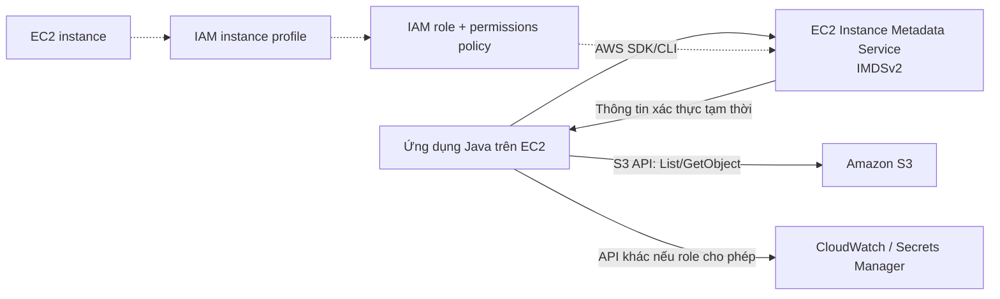
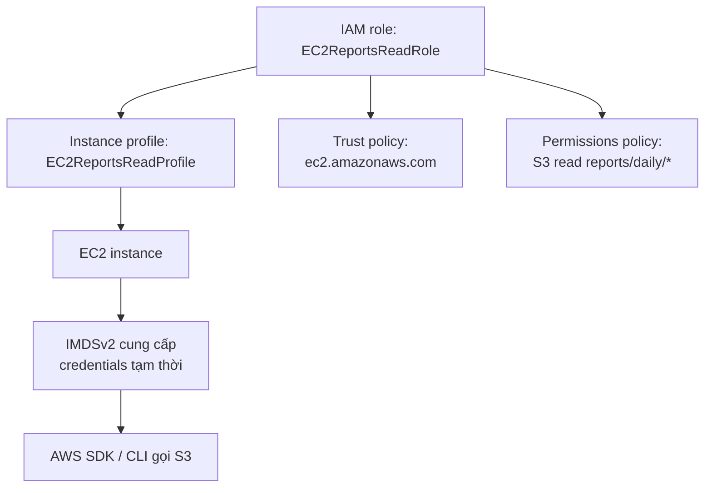
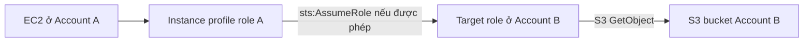
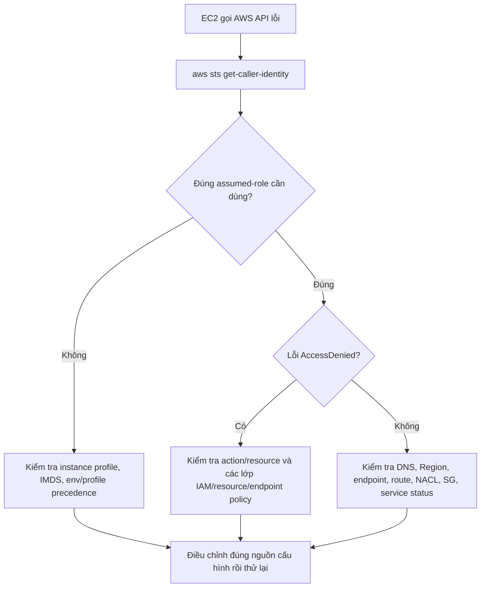

# Instance profile và truy cập dịch vụ từ EC2

> **Học phần:** CLOUD_PROVIDERS_AWS  
> **Chương:** Máy chủ EC2  
> **Chủ đề:** IAM role, instance profile, thông tin xác thực tạm thời, Instance Metadata Service và cách ứng dụng trên Amazon EC2 gọi các dịch vụ AWS.

## 1. Bối cảnh: ứng dụng EC2 cần gọi AWS API

Giả sử nhóm triển khai một ứng dụng Java/Spring Boot trên **Amazon EC2** trong một VPC. Ứng dụng xử lý yêu cầu qua HTTP, đọc tệp báo cáo trong **Amazon S3**, lưu dữ liệu vào **Amazon RDS**, gửi log đến **Amazon CloudWatch** và có thể đọc bí mật kết nối từ **AWS Secrets Manager**.

Để gọi một API AWS, ứng dụng cần có **danh tính được AWS chấp nhận** và **quyền thực hiện hành động đó**. Nếu lập trình viên chép access key của IAM user vào tệp `application.yml` hoặc một biến môi trường lưu lâu dài, thông tin này có thể bị lộ qua mã nguồn, nhật ký, ảnh máy chủ hoặc quy trình bàn giao.

Cách thường được khuyến nghị cho ứng dụng chạy trực tiếp trên EC2 là **gắn IAM role cho instance thông qua instance profile**. AWS cung cấp **temporary security credentials** cho instance; AWS CLI và AWS SDK có thể tự tìm và làm mới các credentials đó.



Sơ đồ là mô hình khái niệm: SDK dùng metadata nội bộ để lấy credentials; các yêu cầu đến S3 hay dịch vụ khác vẫn phải đi qua đường mạng và được các chính sách IAM/tài nguyên kiểm tra.

Sau bài học, bạn có thể:

1. Phân biệt **IAM role**, **instance profile** và **role session credentials**.
2. Tạo policy quyền tối thiểu để EC2 đọc một thư mục trong S3.
3. Gắn hoặc thay instance profile khi khởi chạy EC2 hay khi instance đang hoạt động.
4. Giải thích luồng **EC2 → IMDSv2 → credentials tạm thời → AWS SDK/API**.
5. Xác minh role thực sự được sử dụng bằng AWS CLI và mã Java SDK for Java 2.x.
6. Chẩn đoán lỗi thiếu credentials, thiếu quyền, thiếu kết nối mạng và cấu hình sai Region.
7. Áp dụng những biện pháp bảo mật, vận hành và kiểm soát chi phí phù hợp.

## 2. Phân biệt ba khái niệm dễ nhầm

| Khái niệm | Là gì? | Vai trò |
|---|---|---|
| **IAM role** | Một IAM identity có **trust policy** và các **permissions policy**. | Cho phép một đối tượng tin cậy sử dụng bộ quyền AWS xác định. |
| **Instance profile** | Tài nguyên IAM dùng để **đưa một role vào EC2**. | Cầu nối cấu hình giữa IAM role và EC2 instance. |
| **Temporary security credentials** | `AccessKeyId`, `SecretAccessKey`, `SessionToken` có thời hạn. | Chứng thực các API request của phiên role; AWS tự cấp và luân chuyển. |

Tên role và tên instance profile **có thể giống nhau nhưng không phải cùng một tài nguyên**. Nếu tạo role qua IAM Console bằng use case **EC2**, AWS thường tạo instance profile liên quan với cùng tên. Nếu thao tác bằng IAM API hoặc CLI, bạn thường phải **tạo profile rồi thêm role vào profile** một cách riêng biệt.

Một instance profile chỉ chứa **một IAM role tại một thời điểm**; mỗi EC2 instance có thể gắn tối đa **một instance profile** tại một thời điểm. Để thay quyền, bạn có thể chỉnh policy của role hoặc thay association với instance profile phù hợp, theo quy trình kiểm soát thay đổi.

### 2.1. IAM role không phải IAM user

IAM user có thể mang access key dài hạn nếu người quản trị tạo. IAM role không sử dụng một access key dài hạn cố định cho workload; một **phiên role** sử dụng credentials tạm thời.

| Tiêu chí | IAM user access key lưu trong app | EC2 instance role |
|---|---|---|
| Thời hạn credentials | Thường dài hạn đến khi xoay/xóa. | Tạm thời, được tự động làm mới. |
| Cấp phát vào ứng dụng | Phải đưa key vào nơi chạy ứng dụng. | EC2 cung cấp qua cơ chế IAM role và metadata. |
| Nguy cơ lộ secret khi commit code | Cao nếu xử lý sai. | Giảm nhu cầu lưu key vào mã/config. |
| Thu hồi quyền | Xóa/khóa key hoặc đổi policy. | Đổi role policy, association và quản lý phiên đã cấp. |
| Phân quyền theo tài nguyên | Có. | Có; nên dùng least privilege. |
| Khuyến nghị cho EC2 | Tránh sử dụng làm danh tính workload. | Mô hình phổ biến và phù hợp. |

**Lưu ý:** Sử dụng IAM role không làm thông tin xác thực trở nên vô hại. Nếu kẻ tấn công chiếm quyền thực thi lệnh trên EC2 và truy cập được instance metadata, họ có thể lấy credentials hiện có của role. Cần bảo vệ host, hạn chế quyền role và cấu hình IMDSv2.

### 2.2. Trust policy và permissions policy khác nhau như thế nào?

**Trust policy** trả lời: “Dịch vụ hoặc principal nào có thể *assume* role này?”. Với EC2, principal được tin cậy là dịch vụ `ec2.amazonaws.com`.

```json
{
  "Version": "2012-10-17",
  "Statement": [
    {
      "Sid": "AllowEc2ToAssumeRole",
      "Effect": "Allow",
      "Principal": {
        "Service": "ec2.amazonaws.com"
      },
      "Action": "sts:AssumeRole"
    }
  ]
}
```

**Permissions policy** trả lời: “Sau khi dùng role, ứng dụng được phép thực hiện API nào, đối với tài nguyên nào?”. Chẳng hạn, cho phép `s3:GetObject` trên một prefix của một bucket.

Trust policy phía trên **không tự cấp quyền truy cập S3**. Ngược lại, gắn policy cho phép S3 vào role nhưng trust sai principal cũng làm EC2 không thể dùng role theo cách mong muốn.

### 2.3. Instance profile trong thực tế

Ví dụ các tài nguyên minh họa:

```text
AWS Account: 123456789012
IAM Role:           EC2ReportsReadRole
Instance Profile:   EC2ReportsReadProfile
EC2 Instance:       i-0123456789abcdef0
S3 Bucket:          learning-reports-demo-123456789012
S3 Prefix:          reports/daily/
Region:             ap-southeast-1
```

Các giá trị trên là **ví dụ**, phải thay bằng thông tin thực của môi trường mà bạn sở hữu. Với cùng một role, có thể cấu hình instance profile theo nhu cầu quản trị; nên đặt tên rõ vai trò và phạm vi.



## 3. Credentials đến EC2 từ đâu?

Khi EC2 được gắn instance profile có role hợp lệ, hạ tầng AWS cung cấp thông tin xác thực tạm thời của role thông qua **Instance Metadata Service (IMDS)**. IMDS thường khả dụng tại địa chỉ link-local IPv4 `169.254.169.254` bên trong instance. Một số môi trường hỗ trợ địa chỉ IPv6 của IMDS theo cấu hình riêng.

Luồng sử dụng:

1. Ứng dụng gọi AWS SDK hoặc AWS CLI mà **không chỉ định access key thủ công**.
2. Credential provider chain tìm credentials từ các nguồn được hỗ trợ theo thứ tự ưu tiên.
3. Nếu không có nguồn ưu tiên hơn, EC2 instance profile credentials provider truy vấn **IMDS**.
4. SDK nhận bộ credentials tạm thời, ký yêu cầu bằng cơ chế AWS Signature Version 4.
5. AWS kiểm tra quyền IAM của phiên role và các resource policies liên quan.
6. Khi credentials gần hết hạn, SDK có thể tự làm mới; không cần vận hành script xoay IAM user key.

**Quan trọng:** SDK và CLI **không phải lúc nào cũng lấy role EC2**. Nếu có biến môi trường `AWS_ACCESS_KEY_ID`/`AWS_SECRET_ACCESS_KEY`, cấu hình profile cục bộ hoặc một credential provider ưu tiên hơn, ứng dụng có thể sử dụng **danh tính khác**. Đây là nguồn gốc phổ biến của câu hỏi “đã gắn role nhưng vẫn thấy dùng sai account”.

### 3.1. AWS Instance Metadata Service: IMDSv1 và IMDSv2

**IMDSv2** yêu cầu một phiên metadata có token:

1. Workload gửi HTTP `PUT` tới `/latest/api/token` để xin token.
2. IMDS trả token có thời hạn do client yêu cầu, tối đa thời hạn AWS cho phép.
3. Các lần gọi metadata tiếp theo gửi header `X-aws-ec2-metadata-token`.
4. SDK lấy metadata/credentials theo cơ chế được hỗ trợ và xử lý refresh.

IMDSv2 tăng cường bảo vệ trước một số tình huống **server-side request forgery (SSRF)** và lớp trung gian cấu hình sai. Đây là lớp phòng vệ bổ sung, **không thay thế bảo vệ ứng dụng và hệ điều hành**.

Các tùy chọn metadata đáng chú ý:

| Tùy chọn | Ý nghĩa | Gợi ý |
|---|---|---|
| `HttpEndpoint` | Bật hoặc tắt metadata endpoint. | Bật khi ứng dụng cần role credentials; tắt nếu chắc chắn không cần metadata. |
| `HttpTokens` | `required` bắt buộc IMDSv2; `optional` vẫn cho phép IMDSv1. | Ưu tiên `required` cho workload hỗ trợ IMDSv2. |
| `HttpPutResponseHopLimit` | Giới hạn hop của phản hồi token IMDSv2. | Giữ mức thấp phù hợp kiến trúc; với container cần kiểm tra đường mạng trước khi điều chỉnh. |
| Metadata tags | Cho phép hoặc không cho phép truy vấn instance tags qua metadata. | Chỉ bật nếu có nhu cầu và đã đánh giá dữ liệu lộ ra cho ứng dụng. |

Nếu chạy container **trên EC2 trực tiếp**, cấu hình hop limit có thể ảnh hưởng đường đi metadata đến container. Với **ECS**, thường nên cấp quyền bằng **task role**; với **EKS**, xem xét **EKS Pod Identity/IRSA** cho pod. Tránh cấp quyền rộng ở instance role để mọi container trên cùng host đều nhận được quyền đó.

### 3.2. Credentials tạm thời gồm những gì?

AWS API cần bộ ba:

```text
AccessKeyId
SecretAccessKey
SessionToken
```

và thông tin hết hạn `Expiration`. Không lưu bộ giá trị này vào tài liệu hướng dẫn, nhật ký, ticket, script gắn vào AMI hoặc kênh chat. **Không cần tự đọc hoặc in credentials** chỉ để kiểm tra role hoạt động; lệnh `aws sts get-caller-identity` đủ để xác minh danh tính thực sự.

## 4. Thiết kế least privilege cho EC2 đọc Amazon S3

Giả sử ứng dụng chỉ cần liệt kê và đọc báo cáo trong prefix:

```text
s3://learning-reports-demo-123456789012/reports/daily/
```

Ứng dụng **không** cần quyền tạo/xóa bucket, ghi đè báo cáo, đọc tất cả bucket hoặc quản trị IAM.

Permissions policy mẫu gắn vào `EC2ReportsReadRole`:

```json
{
  "Version": "2012-10-17",
  "Statement": [
    {
      "Sid": "ListOnlyDailyReports",
      "Effect": "Allow",
      "Action": "s3:ListBucket",
      "Resource": "arn:aws:s3:::learning-reports-demo-123456789012",
      "Condition": {
        "StringLike": {
          "s3:prefix": [
            "reports/daily/",
            "reports/daily/*"
          ]
        }
      }
    },
    {
      "Sid": "ReadOnlyDailyReportObjects",
      "Effect": "Allow",
      "Action": [
        "s3:GetObject"
      ],
      "Resource": "arn:aws:s3:::learning-reports-demo-123456789012/reports/daily/*"
    }
  ]
}
```

Phân tích chính sách:

- `s3:ListBucket` áp dụng trên **bucket ARN**, không phải object ARN.
- `s3:GetObject` áp dụng trên **object ARN**, ở đây chỉ thuộc `reports/daily/*`.
- Không có `s3:PutObject` hoặc `s3:DeleteObject`, nên role không được cấp quyền ghi/xóa qua policy này.
- Điều kiện `s3:prefix` kiểm soát prefix dùng khi **liệt kê**, không thay thế giới hạn object ARN của `GetObject`.
- Nếu object mã hóa bằng **SSE-KMS** qua customer managed key, role có thể cần `kms:Decrypt` và key policy tương ứng; policy S3 bên trên **chưa đủ**.
- Bucket policy, VPC endpoint policy, permissions boundary, SCP hoặc explicit deny vẫn có thể hạn chế request dù identity policy có `Allow`.

Vì vậy, “role có quyền S3” chỉ là bước đầu. Quyền thực tế được AWS đánh giá theo **tổng các lớp policy có liên quan**, áp dụng nguyên tắc explicit deny thắng allow.

### 4.1. Không nhầm quyền AWS API với quyền SSH hay quyền hệ điều hành

IAM role của EC2 **không mặc định** cấp cho người dùng hệ điều hành quyền `root`/`sudo` hay cho phép SSH vào instance. Nó cấp quyền để **ứng dụng trên instance gọi AWS API**. Ngược lại, một người đăng nhập được vào EC2 thông qua SSH hoặc Session Manager cũng **không mặc định được cấp quyền IAM quản trị account**, nhưng có thể truy cập credentials của instance role nếu môi trường không phân tách thích hợp.

Không sử dụng instance role có `AdministratorAccess` để “giải quyết nhanh” lỗi gọi S3. Quyền đó sẽ mở rộng hậu quả nếu workload hoặc host bị xâm nhập.

### 4.2. Khi cần nhiều dịch vụ

Cùng một role có thể chứa các policy cho một số dịch vụ, miễn là quyền bám sát nhiệm vụ thực tế:

| Nhu cầu | Hành động IAM thường gặp | Phạm vi gợi ý |
|---|---|---|
| Đọc báo cáo S3 | `s3:ListBucket`, `s3:GetObject` | Một bucket và prefix cụ thể. |
| Đọc secret | `secretsmanager:GetSecretValue` | ARN secret cụ thể; thêm quyền KMS nếu yêu cầu. |
| Đọc DynamoDB | `dynamodb:GetItem`, `dynamodb:Query` | Bảng/index cần thiết. |
| Ghi log ứng dụng lên CloudWatch Logs | `logs:CreateLogStream`, `logs:PutLogEvents` | Log group/log stream phù hợp. |
| Kết nối RDS qua IAM Database Authentication | `rds-db:connect` | DB user resource ARN thích hợp; database phải hỗ trợ/cấu hình IAM auth. |

**Phân biệt:** IAM role trên EC2 không tự cấp quyền đăng nhập PostgreSQL/MySQL qua username/password thông thường. Chỉ khi bật và cấu hình **IAM DB authentication** hoặc tích hợp phù hợp, chính sách như `rds-db:connect` mới tham gia quá trình xác thực DB.

## 5. Tạo IAM role và instance profile trên AWS Console

### 5.1. Tạo IAM role cho EC2

1. Mở **IAM Console → Roles → Create role**.
2. Ở **Trusted entity type**, chọn **AWS service**; ở use case, chọn **EC2**.
3. Kiểm tra trust policy nhận diện `ec2.amazonaws.com`.
4. Gắn policy quyền tối thiểu cho nghiệp vụ. Với bài lab, có thể tạo **customer managed policy** theo ví dụ S3 ở mục 4 và chọn policy đó.
5. Đặt tên role dễ nhận diện, ví dụ `EC2ReportsReadRole`, kiểm tra nội dung rồi chọn **Create role**.
6. Mở lại trang role để xác nhận **Trust relationships** và **Permissions** đã đúng.

IAM là dịch vụ toàn cục ở cấp account (dù một số dịch vụ/vùng có khác biệt hỗ trợ). Các ARN của S3 bucket, role và account cần đúng cấu trúc; tên policy dễ đọc giúp rà soát quyền hiệu quả hơn.

### 5.2. Gắn role khi tạo EC2 instance

1. Vào **EC2 Console → Instances → Launch instances**.
2. Chọn AMI, instance type, SSH/Session Manager, VPC, subnet, storage và security group phù hợp.
3. Mở **Advanced details → IAM instance profile**.
4. Chọn instance profile liên kết với role `EC2ReportsReadRole`.
5. Kiểm tra cài đặt **Metadata version/IMDSv2**; ưu tiên yêu cầu IMDSv2 nếu workload tương thích.
6. Khởi chạy instance và xác minh trạng thái **Running**, instance status checks đạt yêu cầu.
7. Từ bên trong instance, dùng AWS CLI kiểm tra identity và quyền S3 theo mục 7.

Nhớ rằng lựa chọn **IAM instance profile** khác với **security group**. Security group kiểm soát kết nối mạng; instance profile cung cấp IAM identity.

### 5.3. Gắn hoặc đổi role cho EC2 đang chạy

Không cần luôn tạo lại instance. Trong EC2 Console:

1. Chọn **Instances → instance cần chỉnh**.
2. Chọn **Actions → Security → Modify IAM role**.
3. Chọn IAM role/profile được hiển thị trong giao diện.
4. Chọn **Update IAM role** và kiểm tra thông tin tại instance.
5. Kiểm chứng từ bên trong instance bằng `aws sts get-caller-identity` và thao tác S3 hợp lệ.

Đối với môi trường Production, xem xét ảnh hưởng nếu thay từ role cũ sang role mới khiến các ứng dụng đang sử dụng permissions khác bị lỗi. Quyền và association có thể có **độ trễ lan truyền**; không suy ra cấu hình sai chỉ vì kiểm tra ngay trong vài giây đầu.

## 6. Cấu hình bằng AWS CLI (dành cho người vận hành)

Ví dụ này minh họa các thành phần riêng biệt để hiểu vì sao CLI có **hai tên**: `role-name` và `instance-profile-name`. Chỉ chạy trong account/sandbox do bạn quản lý, bằng danh tính có quyền IAM/EC2 phù hợp.

### 6.1. Chuẩn bị trust và permissions policy

Lưu JSON trust policy tại tệp cấu hình do bạn quản lý, ví dụ `ec2-trust.json`; nội dung:

```json
{
  "Version": "2012-10-17",
  "Statement": [
    {
      "Effect": "Allow",
      "Principal": { "Service": "ec2.amazonaws.com" },
      "Action": "sts:AssumeRole"
    }
  ]
}
```

Lưu JSON permissions policy ở mục 4 vào `s3-read-policy.json`. Đây là hai tệp **ví dụ trong môi trường lab của học viên**, không phải tệp bổ sung được tạo trong module tài liệu.

### 6.2. Tạo role và profile

```bash
# Tạo role và trust policy.
aws iam create-role \
  --role-name EC2ReportsReadRole \
  --assume-role-policy-document file://ec2-trust.json

# Gắn inline permissions policy đã chuẩn bị.
aws iam put-role-policy \
  --role-name EC2ReportsReadRole \
  --policy-name ReadDailyReports \
  --policy-document file://s3-read-policy.json

# Tạo instance profile riêng.
aws iam create-instance-profile \
  --instance-profile-name EC2ReportsReadProfile

# Thêm IAM role vào instance profile.
aws iam add-role-to-instance-profile \
  --instance-profile-name EC2ReportsReadProfile \
  --role-name EC2ReportsReadRole
```

IAM profile **chứa một role tại một thời điểm**. Thay đổi thành viên role trong profile hoặc association ở EC2 có thể cần thời gian để lan truyền; đừng chạy lặp lệnh tạo chỉ vì kết quả chưa xuất hiện ngay lập tức.

Kiểm tra read-only:

```bash
aws iam get-role --role-name EC2ReportsReadRole

aws iam get-instance-profile \
  --instance-profile-name EC2ReportsReadProfile
```

### 6.3. Associate profile với một instance đã tồn tại

Khi instance **chưa có profile**:

```bash
aws ec2 associate-iam-instance-profile \
  --instance-id i-0123456789abcdef0 \
  --iam-instance-profile Name=EC2ReportsReadProfile \
  --region ap-southeast-1
```

Để kiểm tra association:

```bash
aws ec2 describe-iam-instance-profile-associations \
  --filters Name=instance-id,Values=i-0123456789abcdef0 \
  --region ap-southeast-1
```

Nếu instance **đã có profile**, không thể gắn thêm profile thứ hai bằng `associate-iam-instance-profile`. Khi cần chuyển role, xem API `replace-iam-instance-profile-association` với **association ID hiện có**, hoặc thực hiện qua Console.

Ví dụ, với association ID do lệnh `describe-iam-instance-profile-associations` trả về:

```bash
aws ec2 replace-iam-instance-profile-association \
  --association-id iip-assoc-0123456789abcdef0 \
  --iam-instance-profile Name=EC2ReportsReadProfile \
  --region ap-southeast-1
```

Các ID ở ví dụ là giả lập. Thực hiện thao tác thay thế theo kế hoạch thay đổi ở môi trường Production.

### 6.4. Quyền của người gắn profile

Người vận hành muốn cấp role cho EC2 cần các quyền EC2 thích hợp như `ec2:RunInstances`, `ec2:AssociateIamInstanceProfile` hoặc `ec2:ReplaceIamInstanceProfileAssociation`, và thường cần **`iam:PassRole` đối với role được chuyển giao cho EC2**. Một số thao tác Console còn cần quyền đọc `iam:GetRole` hoặc `iam:ListInstanceProfiles`.

**`iam:PassRole` không phải thao tác gọi STS từ ứng dụng**. Nó là cơ chế IAM kiểm soát **ai được chuyển một role cho dịch vụ AWS sử dụng**, nhằm ngăn người dùng có quyền tạo/chỉnh EC2 tự gắn role quá mạnh.

Ví dụ chính sách giới hạn quyền pass role:

```json
{
  "Version": "2012-10-17",
  "Statement": [
    {
      "Sid": "PassOnlyEC2ReportsReadRole",
      "Effect": "Allow",
      "Action": "iam:PassRole",
      "Resource": "arn:aws:iam::123456789012:role/EC2ReportsReadRole",
      "Condition": {
        "StringEquals": {
          "iam:PassedToService": "ec2.amazonaws.com"
        }
      }
    }
  ]
}
```

Đây mới là một phần quyền cần thiết cho người triển khai; không tự thay thế các quyền EC2/IAM khác mà Console/API yêu cầu.

## 7. Xác minh trên chính EC2 instance

Giả sử instance chạy Amazon Linux, đã có AWS CLI và bạn có quyền thao tác trong máy thông qua SSH hoặc **AWS Systems Manager Session Manager**.

### 7.1. Kiểm tra credentials source và ARN của phiên role

```bash
# Đọc thông tin các nguồn credential mà AWS CLI nhận diện.
aws configure list

# Kiểm tra danh tính thực sự dùng để gọi AWS.
aws sts get-caller-identity
```

Kết quả kỳ vọng của `get-caller-identity` khi instance role được sử dụng:

```json
{
  "UserId": "AROAXAMPLE:i-0123456789abcdef0",
  "Account": "123456789012",
  "Arn": "arn:aws:sts::123456789012:assumed-role/EC2ReportsReadRole/i-0123456789abcdef0"
}
```

Đây chỉ là **mẫu minh họa**, chuỗi `UserId` và session name thực tế có thể khác. Điều quan trọng là:

- `Account` là account mong muốn.
- `Arn` mang dạng `assumed-role/EC2ReportsReadRole/...`.
- `aws configure list` không chỉ ra credentials đang đến từ một IAM user/profile/biến môi trường khác mà bạn quên xóa.

**Không cần** chạy `aws configure` để điền access key thủ công lên EC2. Cũng không lưu `AccessKeyId/SecretAccessKey/SessionToken` vào `~/.aws/credentials` nếu ứng dụng có thể dùng role.

### 7.2. Kiểm tra S3 bằng một lệnh read-only

```bash
aws s3api list-objects-v2 \
  --bucket learning-reports-demo-123456789012 \
  --prefix reports/daily/ \
  --max-items 10 \
  --region ap-southeast-1
```

Nếu policy cho phép đúng hành động và bucket có thể truy cập, lệnh trả danh sách object (hoặc kết quả rỗng nếu không có object). Lệnh thành công **không cần ghi key vào máy**.

Để kiểm tra đọc một object, sử dụng tên object thật thuộc prefix cho phép:

```bash
aws s3api head-object \
  --bucket learning-reports-demo-123456789012 \
  --key reports/daily/example.csv \
  --region ap-southeast-1
```

Lưu ý: `HeadObject` thường được kiểm tra theo quyền `s3:GetObject`, nhưng kết quả `404`/`403` còn phụ thuộc object có tồn tại hay không và quyền liệt kê bucket. Dùng key tồn tại để đánh giá permission hợp lý.

### 7.3. Kiểm tra IMDSv2 mà không in credentials

Chỉ chạy lệnh sau **bên trong EC2** với quyền phù hợp. Endpoint metadata dùng HTTP link-local; không chạy từ máy cá nhân để truy vấn instance ở xa.

```bash
# Xin một token IMDSv2, thời hạn 60 giây, lưu trong biến shell.
TOKEN=$(curl --silent --show-error --fail -X PUT \
  "http://169.254.169.254/latest/api/token" \
  -H "X-aws-ec2-metadata-token-ttl-seconds: 60")

# Đọc metadata về instance profile; không truy vấn nội dung credentials.
curl --silent --show-error --fail \
  -H "X-aws-ec2-metadata-token: $TOKEN" \
  "http://169.254.169.254/latest/meta-data/iam/info"

unset TOKEN
```

Kết quả metadata có thể bao gồm `InstanceProfileArn`, `InstanceProfileId` và trạng thái liên quan. Nếu `iam/info` không sẵn có, cần kiểm tra instance đã gắn profile chưa, metadata endpoint có bật không, IMDSv2/hop limit, firewall/proxy và môi trường container.

**Không thực hiện** lệnh đọc toàn bộ `/latest/meta-data/iam/security-credentials/<role-name>` chỉ để “kiểm tra”: đường dẫn đó trả về secret và session token thật. SDK/CLI có khả năng lấy và làm mới tự động; con người nên xác minh danh tính qua STS.

### 7.4. Kiểm tra metadata options từ phía quản trị

```bash
aws ec2 describe-instances \
  --instance-ids i-0123456789abcdef0 \
  --query 'Reservations[].Instances[].{InstanceId:InstanceId,IamInstanceProfile:IamInstanceProfile.Arn,MetadataOptions:MetadataOptions}' \
  --region ap-southeast-1
```

Khi cần yêu cầu IMDSv2 cho một instance hiện có, người quản trị có thể dùng:

```bash
aws ec2 modify-instance-metadata-options \
  --instance-id i-0123456789abcdef0 \
  --http-tokens required \
  --http-endpoint enabled \
  --region ap-southeast-1
```

Đây là thao tác **thay đổi cấu hình**. Trước khi áp dụng trong Production, xác nhận AMI, AWS CLI, agent và mọi ứng dụng cần metadata đều hỗ trợ IMDSv2; nếu không, phần mềm cũ có thể không còn lấy được credentials.

## 8. Ứng dụng Java/Spring Boot dùng AWS SDK for Java 2.x

### 8.1. Default credentials provider chain

AWS SDK for Java 2.x có **DefaultCredentialsProvider** tìm credentials từ nhiều nguồn, bao gồm Java system properties, biến môi trường, web identity token, shared config/credentials files, container credentials và cuối cùng có thể là **EC2 instance profile credentials qua IMDS**.

Vì vậy, đoạn Java sau **không cần** `accessKeyId` hoặc `secretAccessKey` trong mã:

```java
import software.amazon.awssdk.auth.credentials.DefaultCredentialsProvider;
import software.amazon.awssdk.regions.Region;
import software.amazon.awssdk.services.s3.S3Client;
import software.amazon.awssdk.services.s3.model.ListObjectsV2Request;
import software.amazon.awssdk.services.s3.model.ListObjectsV2Response;

public final class DailyReportsReader {
    public static void main(String[] args) {
        try (S3Client s3 = S3Client.builder()
                .region(Region.AP_SOUTHEAST_1)
                .credentialsProvider(DefaultCredentialsProvider.create())
                .build()) {

            ListObjectsV2Request request = ListObjectsV2Request.builder()
                .bucket("learning-reports-demo-123456789012")
                .prefix("reports/daily/")
                .maxKeys(10)
                .build();

            ListObjectsV2Response response = s3.listObjectsV2(request);
            response.contents().forEach(object ->
                System.out.println(object.key() + " (" + object.size() + " bytes)")
            );
        }
    }
}
```

Để biên dịch, thêm dependency module `software.amazon.awssdk:s3` và dùng BOM AWS SDK for Java **2.x** với phiên bản được dự án quản lý. Mã sử dụng API của AWS SDK v2, không phải SDK v1. Khi chạy trên EC2 đã gắn role đúng và không bị override bởi credentials khác, SDK tự lấy temporary credentials từ IMDS.

**Cấu hình ứng dụng Production** nên tách bucket name, prefix và Region ra ngoài mã, ví dụ biến môi trường hoặc cấu hình Spring Boot. Không đặt access key trong `application.properties`, `application.yml` hay Docker image.

### 8.2. Cùng mã có thể chạy local và trên EC2

| Môi trường | Credential source khuyến nghị | Có cần sửa mã Java không? |
|---|---|---|
| Laptop nhà phát triển | IAM Identity Center (SSO) hoặc profile được cấp phép. | Không; cấu hình profile hợp lệ. |
| EC2 | Instance profile role qua IMDSv2. | Không. |
| AWS Lambda | Execution role được dịch vụ cung cấp. | Thường không. |
| Amazon ECS | ECS task role. | Thường không. |
| Amazon EKS | Pod Identity hoặc IAM roles for service accounts phù hợp. | Thường không. |

Đây là lợi ích của **default credentials provider chain**: mã ứng dụng phụ thuộc vào giao diện credentials chuẩn, còn môi trường chạy chịu trách nhiệm cấp danh tính thích hợp.

### 8.3. Ví dụ cấu hình Spring Boot

Với ứng dụng Java/Spring Boot, cấu hình thông thường chỉ cần thông tin **không bí mật** và danh tính do hạ tầng cung cấp:

```yaml
app:
  reports:
    bucket: learning-reports-demo-123456789012
    prefix: reports/daily/
aws:
  region: ap-southeast-1
```

Đây chỉ là YAML ứng dụng minh họa; tên cấu hình tùy vào cách lập trình viên ánh xạ `@ConfigurationProperties`. **Không tự có nghĩa Spring Boot hoặc AWS SDK đọc khóa `aws.region` trong file này**. Người triển khai phải nối giá trị đó vào `S3Client.builder().region(...)` hoặc sử dụng một cơ chế cấu hình Region chuẩn do ứng dụng thiết kế.

## 9. Truy cập dịch vụ khác và kiến trúc mạng

IAM cho phép **ai** được gọi API và gọi **hành động gì**; VPC quyết định **đường đi mạng có đến được dịch vụ hay không**. Một instance role được cấp `s3:GetObject` đúng vẫn có thể thất bại nếu VPC/subnet không có đường mạng phù hợp tới endpoint S3, DNS gặp lỗi hoặc endpoint policy từ chối.

### 9.1. EC2 trong private subnet truy cập S3

Có hai mô hình quen thuộc:

- **NAT gateway** (hoặc đường mạng ra ngoài phù hợp) cho instance trong private subnet truy cập các endpoint public khi route, SG/NACL và DNS cho phép.
- **Gateway VPC endpoint cho S3** để đi đến S3 qua đường kết nối nội bộ AWS trong các Region/cấu hình được hỗ trợ, với route table và endpoint policy phù hợp.

Gateway VPC endpoint cho S3 thường không có phí theo giờ hoặc GB xử lý **của riêng gateway endpoint**, nhưng sử dụng S3 và dữ liệu vẫn có thể có phí theo cơ chế của S3; NAT gateway có cấu trúc phí riêng. Không suy ra tất cả API AWS đều truy cập được qua cùng một gateway endpoint; nhiều dịch vụ dùng **interface VPC endpoint** (AWS PrivateLink) với cơ chế phí khác.

### 9.2. Kịch bản truy cập AWS Secrets Manager

Giả sử Spring Boot cần đọc secret `prod/course-db`. EC2 role có thể được cấp:

```json
{
  "Version": "2012-10-17",
  "Statement": [
    {
      "Sid": "ReadDatabaseSecret",
      "Effect": "Allow",
      "Action": "secretsmanager:GetSecretValue",
      "Resource": "arn:aws:secretsmanager:ap-southeast-1:123456789012:secret:prod/course-db-*"
    }
  ]
}
```

ARN ở trên là ví dụ; ARN secret thật có hậu tố do AWS tạo. Nếu secret được mã hóa bằng customer managed KMS key, cần đánh giá quyền `kms:Decrypt` và key policy. Ứng dụng vẫn cần đường mạng tới Secrets Manager endpoint (qua NAT hoặc interface VPC endpoint phù hợp).

Không ghi giá trị secret vào log ứng dụng, response HTTP hoặc exception stack trace. IAM role chỉ là một phần của toàn bộ thiết kế bảo vệ bí mật.

### 9.3. Truy cập liên tài khoản từ EC2

Nếu role ở **Account A** cần đọc S3 bucket hoặc tài nguyên thuộc **Account B**, ngoài chính sách identity-based của EC2 role, cần xem xét **resource policy của Account B** hoặc cơ chế **assume role liên tài khoản bằng AWS STS**, cộng với KMS policy nếu có.

Ví dụ:



Role đích ở B phải có **trust policy** tin cậy role nguồn ở A, còn role nguồn cần quyền `sts:AssumeRole` đối với role đích. Sau khi nhận credentials của role đích, ứng dụng dùng chúng để truy cập tài nguyên theo chính sách role đích. Đối với nhà cung cấp bên thứ ba, có thể cần thêm điều kiện **external ID** để giảm rủi ro *confused deputy*. Không dùng cách chia sẻ access key của Account B cho ứng dụng tại A.

## 10. Lỗi thường gặp và cách chẩn đoán

| Hiện tượng | Nguyên nhân có thể | Bước kiểm tra phù hợp |
|---|---|---|
| `Unable to load credentials from any of the providers in the chain` | Chưa gắn profile, metadata endpoint bị tắt, SDK/CLI cũ không hỗ trợ IMDSv2 hoặc ứng dụng không tới được metadata. | Kiểm tra association, IMDS options, SDK/CLI và môi trường mạng/container. |
| `sts get-caller-identity` trả một IAM user thay vì role EC2 | Biến môi trường, credentials file hoặc profile khác được ưu tiên. | Chạy `aws configure list`, kiểm tra nguồn credentials và quy trình chạy ứng dụng. |
| `AccessDenied` khi gọi `s3:ListBucket` | Role thiếu quyền list bucket, `s3:prefix` không khớp, SCP/bucket/endpoint policy deny. | Kiểm tra ARN bucket, prefix, IAM policy và các explicit deny. |
| `AccessDenied` khi gọi `s3:GetObject` | Role thiếu quyền object ARN, bucket policy từ chối hoặc cần KMS decrypt. | Đối chiếu object key/prefix, S3 policy, KMS key policy. |
| `iam:PassRole` bị từ chối khi launch/associate profile | Người triển khai không được chuyển role đó cho EC2. | Xem quyền của người vận hành và condition `iam:PassedToService`. |
| Role có quyền nhưng CLI bị lỗi mạng/timeout | Private subnet thiếu NAT/VPC endpoint, DNS lỗi, SG/NACL/route chặn. | Kiểm tra route table, endpoint, DNS, Network ACL và kết nối tới dịch vụ. |
| Cấu hình IAM vừa sửa nhưng ứng dụng vẫn lỗi trong vài phút | IAM hoặc association chưa lan truyền; SDK đang giữ phiên tạm thời hoặc metadata chưa làm mới. | Kiểm tra lại profile/role và nguồn credentials sau thời gian hợp lý; không cố “khắc phục” bằng cấp admin. |
| Không tìm thấy role trong phần IAM instance profile | Role không có instance profile, tên khác nhau hoặc thiếu quyền đọc. | Kiểm tra `get-instance-profile`, role association và quyền Console. |
| S3 trả thông báo Region/endpoint không khớp | SDK client chọn Region không đúng với bucket và endpoint. | Xác nhận Region của bucket và cấu hình `S3Client`. |
| `aws sts get-caller-identity` thành công nhưng gọi API vẫn thất bại | Có danh tính hợp lệ nhưng thiếu quyền API hoặc không có đường mạng tới dịch vụ. | Xác định API bị lỗi, ARN tài nguyên, policy và kết nối. |

### 10.1. Quy trình kiểm tra theo thứ tự



Cách tiếp cận hiệu quả là phân biệt **lỗi xác thực/nguồn credentials**, **lỗi phân quyền**, **lỗi mạng**, và **lỗi xử lý nghiệp vụ**. Ví dụ, tăng quyền S3 không giải quyết được DNS lookup thất bại; thêm route NAT không giải quyết được `AccessDenied` do bucket policy.

### 10.2. Một số câu lệnh đọc nhanh

```bash
# Trên EC2: danh tính đang dùng.
aws sts get-caller-identity

# Trên EC2: nguồn credentials theo CLI.
aws configure list

# Từ môi trường quản trị: role nào nằm trong profile?
aws iam get-instance-profile \
  --instance-profile-name EC2ReportsReadProfile

# Từ môi trường quản trị: profile gắn với instance?
aws ec2 describe-iam-instance-profile-associations \
  --filters Name=instance-id,Values=i-0123456789abcdef0 \
  --region ap-southeast-1
```

Tránh sử dụng lệnh kiểu `env` hoặc `printenv` rồi gửi toàn bộ output lên ticket/debugging tool vì môi trường có thể chứa thông tin bí mật. Chỉ trích xuất những biến **không nhạy cảm** cần thiết để chẩn đoán.

## 11. Bảo mật và vận hành instance profile

### 11.1. Các nguyên tắc nên áp dụng

1. **Bắt buộc IMDSv2 khi tương thích.** Kiểm tra AMI, SDK/CLI, agent và container trước khi thay đổi.
2. **Không hard-code credentials dài hạn.** Sử dụng EC2 IAM role cho workload; dùng Identity Center/role thích hợp cho người vận hành.
3. **Chỉ cấp quyền AWS API cần thiết.** Dùng policy riêng cho S3, secret, log, database; tránh `s3:*`, `*:*` và tài nguyên `*` khi có thể thu hẹp.
4. **Hạn chế `iam:PassRole` của người triển khai.** Một IAM user có thể tạo EC2 nhưng không nên được phép gắn bất kỳ role quyền cao nào.
5. **Cập nhật phần mềm và kiểm soát truy cập host.** IAM role vẫn có thể bị lạm dụng nếu máy chủ bị chiếm quyền.
6. **Tách nhiệm vụ khi nhiều ứng dụng chia sẻ host.** Với EC2 chạy nhiều service/container, một instance role cấp quyền quá rộng tạo phạm vi ảnh hưởng lớn. Tách instance hoặc dùng cơ chế role theo workload thích hợp.
7. **Giám sát AWS CloudTrail.** Theo dõi những thay đổi liên quan IAM role/profile, `PassRole` và hành động API do assumed role thực hiện. Với S3 object-level access, cấu hình **CloudTrail data events** nếu cần; lưu ý chi phí.
8. **Lập quy trình thu hồi.** Khi không còn cần quyền, sửa permissions policy, đổi association hoặc ngừng/xóa role theo quy trình. Kiểm tra các credentials tạm thời đã phát và thời gian hiệu lực; không giả định bỏ trust/association lập tức vô hiệu mọi session cũ.
9. **Giới hạn đích mạng và dữ liệu đầu ra.** Sử dụng security group, route, VPC endpoint policies và mã hóa để bổ sung cho IAM.
10. **Kiểm thử ở sandbox trước Production.** Xác nhận ứng dụng có quyền vừa đủ và vẫn hoạt động khi thay policy hoặc role.

### 11.2. Giám sát và khôi phục

Đối với dịch vụ cần phục hồi nhanh, nên kết hợp instance profile với:

- **Launch template** và **Auto Scaling group**: instance thay thế được khởi chạy với profile/metadata options đã chuẩn hóa.
- **Systems Manager Session Manager**: truy cập điều hành có kiểm soát khi đã có SSM Agent, role và endpoint/kết nối cần thiết.
- **CloudWatch**: metrics, logs, alarms cho ứng dụng và EC2.
- **CloudTrail**: audit các thao tác thay đổi IAM/EC2; mở data events khi cần theo dõi hành động trên object.
- **Infrastructure as Code**: khai báo role, policy, instance profile, launch template để giảm cấu hình thủ công và phát hiện lệch cấu hình.

Khi một instance lỗi và được thay mới, hãy kiểm tra instance mới **thực sự nhận đúng profile** và hoạt động với IMDSv2. Một AMI không chứa access key riêng sẽ giúp việc khôi phục/scale an toàn hơn.

### 11.3. Về chi phí

Bản thân việc gắn IAM role/instance profile không tạo một loại phí IAM riêng theo số lần role được gắn. Tuy nhiên, **các dịch vụ được ứng dụng gọi vẫn tính phí theo quy tắc của chúng**:

| Thành phần | Điểm cần lưu ý |
|---|---|
| EC2 | Thời gian máy chạy, loại instance, EBS và các chi phí liên quan. |
| S3 | Lưu trữ, request, truy xuất và truyền dữ liệu tùy dịch vụ/cấu hình. |
| NAT gateway | Có thể tính phí theo giờ và dữ liệu xử lý nếu dùng. |
| VPC interface endpoints | Có cơ chế phí theo giờ và dữ liệu; khác với S3 gateway endpoint. |
| CloudWatch / CloudTrail | Ingestion, lưu giữ, query và một số loại events có thể phát sinh phí. |
| Secrets Manager / KMS | Có biểu phí theo tài nguyên và API usage tùy trường hợp. |

Cấp quyền ít nhất cần thiết còn giúp **hạn chế khả năng phát sinh chi phí do API bị gọi ngoài mục đích**, nhưng IAM policy không phải giới hạn ngân sách cứng. Nên thiết lập AWS Budgets, phân quyền truy cập billing và theo dõi Cost Explorer.

## 12. Bài thực hành tổng hợp: EC2 đọc báo cáo S3

**Bối cảnh:** Nhóm vận hành ứng dụng quản lý khóa học Java/Spring Boot trên một EC2 trong private subnet tại `ap-southeast-1`. Ứng dụng đọc tệp trong `s3://learning-reports-demo-123456789012/reports/daily/` và ghi nhật ký về CloudWatch. Nhóm muốn tránh lưu AWS access key trong ứng dụng.

**Yêu cầu thực hiện:**

1. Vẽ sơ đồ gồm IAM role, instance profile, EC2, IMDSv2, AWS SDK, VPC endpoint/NAT và S3.
2. Viết **trust policy** chỉ cho phép dịch vụ EC2 assume role.
3. Viết **permissions policy** giới hạn `ListBucket` theo prefix và `GetObject` đúng `reports/daily/*`. Không cấp quyền Put/Delete.
4. Dùng IAM Console tạo role `EC2ReportsReadRole`; xác minh profile được tạo/gắn hoặc tự tạo profile qua CLI khi áp dụng.
5. Gắn profile vào instance sandbox đã có và kiểm tra ARN bằng `aws sts get-caller-identity`.
6. Cấu hình IMDSv2 yêu cầu token nếu workload tương thích, kiểm tra metadata profile bằng endpoint `iam/info` mà **không in credentials**.
7. Chạy lệnh đọc S3 và Java SDK v2 sử dụng `DefaultCredentialsProvider`; mô tả nguồn credentials thực tế và kết quả.
8. Thử trong sandbox trường hợp role thiếu `s3:ListBucket`: ghi lại lỗi và chỉ ra lớp IAM cần sửa. Hoàn nguyên cấu hình sau khi kiểm tra.
9. Xác định đường truy cập S3 của EC2 private subnet và đánh giá khi nào dùng gateway endpoint thay NAT.
10. Mô tả cách cấu hình launch template/Auto Scaling để instance mới tiếp tục có profile, và cách audit các lần dùng quyền S3 nếu có yêu cầu.

**Tiêu chí đạt:** Không có access key nhúng vào mã/config; role trust đúng EC2; permissions chỉ gồm hành động/tài nguyên cần thiết; profile thực sự gắn vào instance; STS hiển thị đúng assumed role; CLI và SDK có thể đọc đúng prefix; người học phân biệt lỗi quyền và lỗi mạng.

### 12.1. Câu hỏi tự kiểm tra

**1. Instance profile và IAM role có phải cùng tài nguyên không?**  
Không. Instance profile là tài nguyên cho phép EC2 sử dụng IAM role, còn role mang trust policy và permissions policy.

**2. Vì sao role đã gắn vào EC2 nhưng Java SDK vẫn có thể dùng IAM user?**  
Vì credential provider chain ưu tiên một số nguồn credentials khác trước IMDS, ví dụ biến môi trường hoặc credentials file.

**3. Vì sao dùng `aws sts get-caller-identity` thay vì in dữ liệu từ metadata security credentials?**  
Vì STS cho biết danh tính đang dùng mà không tiết lộ secret/session token.

**4. IMDSv2 có bảo đảm ứng dụng không thể bị khai thác để lấy role credentials không?**  
Không. IMDSv2 giảm một số rủi ro nhưng không thay thế việc vá lỗi ứng dụng, bảo vệ host và cấp quyền tối thiểu.

**5. Có cần `iam:PassRole` trong policy của ứng dụng Java để gọi S3 không?**  
Không. `iam:PassRole` là quyền thường cần cho **người/dịch vụ gắn role vào EC2**, không phải quyền đọc object S3 của ứng dụng.

**6. Nếu S3 bucket nằm ở account khác thì quyền `s3:GetObject` của EC2 role đã đủ chưa?**  
Chưa chắc. Cần thêm resource policy/cơ chế assume role liên tài khoản phù hợp, cùng các điều kiện KMS/endpoint nếu có.

**7. EC2 trong private subnet không truy cập được S3 thì nên tăng quyền role ngay?**  
Không. Trước hết cần tách lỗi IAM `AccessDenied` với lỗi mạng: route, DNS, NAT/VPC endpoint, endpoint policy và Region.

**8. Dùng profile tại thời điểm launch có thuận lợi gì cho phục hồi hệ thống?**  
Launch template/Auto Scaling có thể khởi chạy instance mới với cấu hình IAM và metadata nhất quán, giảm thao tác cấp key thủ công.

## 13. Tài liệu AWS chính thức

Các tài liệu sau hỗ trợ tra cứu khi xây dựng ứng dụng EC2 và khi giao diện Console/API thay đổi:

- [Amazon EC2 — IAM roles for Amazon EC2](https://docs.aws.amazon.com/AWSEC2/latest/UserGuide/iam-roles-for-amazon-ec2.html)
- [IAM — Using instance profiles](https://docs.aws.amazon.com/IAM/latest/UserGuide/id_roles_use_switch-role-ec2_instance-profiles.html)
- [Amazon EC2 — Attach or replace an IAM role for an instance](https://docs.aws.amazon.com/AWSEC2/latest/UserGuide/replace-iam-role.html)
- [Amazon EC2 — Configure the Instance Metadata Service](https://docs.aws.amazon.com/AWSEC2/latest/UserGuide/configuring-instance-metadata-service.html)
- [Amazon EC2 — Configure IMDS options for existing instances](https://docs.aws.amazon.com/AWSEC2/latest/UserGuide/configuring-IMDS-existing-instances.html)
- [Amazon EC2 — Retrieve security credentials from instance metadata](https://docs.aws.amazon.com/AWSEC2/latest/UserGuide/instance-metadata-security-credentials.html)
- [IAM — Granting a user permissions to pass a role to an AWS service](https://docs.aws.amazon.com/IAM/latest/UserGuide/id_roles_use_passrole.html)
- [AWS SDK for Java 2.x — Default credentials provider chain](https://docs.aws.amazon.com/sdk-for-java/latest/developer-guide/credentials-chain.html)
- [Amazon S3 — Policy actions, resources, and condition keys](https://docs.aws.amazon.com/AmazonS3/latest/userguide/using-with-s3-policy-actions.html)
- [Amazon VPC — Gateway endpoints for Amazon S3](https://docs.aws.amazon.com/vpc/latest/privatelink/vpc-endpoints-s3.html)
- [AWS IAM — Temporary security credentials in IAM](https://docs.aws.amazon.com/IAM/latest/UserGuide/id_credentials_temp.html)
- [AWS CloudTrail — Logging data events](https://docs.aws.amazon.com/awscloudtrail/latest/userguide/logging-data-events-with-cloudtrail.html)

> **Ghi nhớ:** Với ứng dụng chạy trên EC2, hãy cấp quyền bằng **IAM role**, đưa role vào instance qua **instance profile**, dùng **temporary credentials** do AWS cung cấp và để **SDK/CLI tự quản lý việc lấy/làm mới credentials**. Hãy kết hợp quyền tối thiểu, IMDSv2, cấu hình VPC phù hợp, giám sát và quy trình thu hồi quyền để vận hành ứng dụng an toàn, dễ phục hồi và kiểm soát chi phí.
