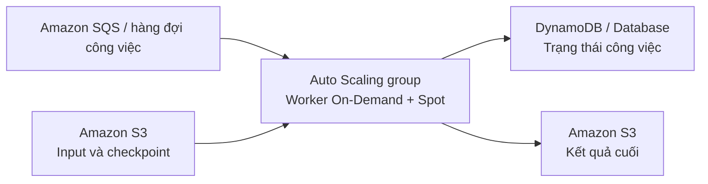

# On-Demand, Spot và lựa chọn năng lực tính toán

## 1. Bài toán lựa chọn năng lực EC2

Một ứng dụng thương mại điện tử có lượng truy cập ổn định trong giờ hành chính, tăng mạnh khi chạy chiến dịch bán hàng và cần duy trì thanh toán liên tục. Bên cạnh đó, công ty có các tác vụ tạo ảnh sản phẩm, phân tích log và kiểm thử tự động; những công việc này có thể chạy lại nếu máy chủ bị gián đoạn. Nếu tất cả cùng chạy trên Amazon EC2 với một cách mua năng lực tính toán, hệ thống có thể **trả phí cao hơn cần thiết** hoặc **không đáp ứng được yêu cầu sẵn sàng**.

Amazon EC2 cung cấp nhiều **loại instance** và **lựa chọn mua năng lực tính toán (purchase options)**. Hai lựa chọn cơ bản cần nắm vững là:

- **On-Demand Instances:** sử dụng năng lực EC2 theo nhu cầu, không cần cam kết sử dụng dài hạn; phù hợp với workload cần chạy liên tục hoặc khó chịu được gián đoạn.
- **Spot Instances:** sử dụng năng lực EC2 còn dư với giá có thể thấp hơn đáng kể, đổi lại AWS có thể thu hồi khi cần năng lực đó hoặc khi điều kiện giá đã đặt không còn phù hợp.

Bài học thuộc chương **Máy chủ EC2** của lộ trình **CLOUD_PROVIDERS_AWS**. Năng lực tính toán phải được chọn cùng với **Region/AZ, VPC, IAM, EBS, database, giám sát, phục hồi và kiểm soát chi phí**, vì một lựa chọn rẻ ở lớp EC2 vẫn có thể đắt nếu gây mất dữ liệu, gián đoạn API hoặc phát sinh nhiều lần chạy lại.

Sau khi học, bạn có thể phân biệt On-Demand và Spot, đánh giá mức độ chịu gián đoạn của workload, lựa chọn instance family/kích thước/Region phù hợp, phối hợp năng lực qua Auto Scaling, thiết kế xử lý Spot interruption và dự toán các thành phần chi phí liên quan.

## 2. Ba quyết định khác nhau khi triển khai EC2

Khi chọn EC2, cần tách **loại tài nguyên**, **cách trả phí**, và **cách đảm bảo có năng lực sẵn sàng**:

| Quyết định | Câu hỏi phải trả lời | Ví dụ |
| --- | --- | --- |
| **Loại và kích thước instance** | Ứng dụng cần bao nhiêu vCPU, RAM, GPU, băng thông, lưu trữ và kiến trúc CPU? | `m6i.large`, `c7g.xlarge`, instance có GPU |
| **Purchase option** | Sẵn sàng trả theo giá On-Demand hay chấp nhận Spot bị gián đoạn để giảm chi phí? Có cam kết sử dụng để nhận chiết khấu không? | On-Demand, Spot, Savings Plans, Reserved Instances |
| **Khả năng cấp phát capacity** | Khi cần khởi chạy, có đủ capacity ở AZ/instance type tương ứng không? Có phải đặt chỗ trước không? | On-Demand Capacity Reservation, Zonal Reserved Instance, Capacity Blocks trong phạm vi hỗ trợ |

**Giảm giá** và **dự trữ năng lực** là hai mục tiêu khác nhau. Chẳng hạn một **Savings Plan** thường giảm chi phí cho mức sử dụng đủ điều kiện nhưng **không đặt trước** một máy chủ EC2 cụ thể trong AZ. Ngược lại, một **On-Demand Capacity Reservation** giúp giữ năng lực khởi chạy phù hợp trong một AZ, nhưng năng lực đặt chỗ có thể bị tính phí dù chưa được dùng.

```text
Yêu cầu ứng dụng
    |
    +-- Hiệu năng: vCPU / RAM / GPU / network / storage -> Chọn instance type
    |
    +-- Có thể gián đoạn? -----------------------------+-> On-Demand hay Spot
    |                                                  |
    +-- Dự báo sử dụng dài hạn? -----------------------+-> Savings Plans / RI
    |
    +-- Bắt buộc có capacity đúng AZ/thời điểm? --------> Capacity Reservation
    |
    +-- Tải thay đổi theo thời gian? -------------------> Auto Scaling
```

## 3. On-Demand Instances: linh hoạt và ít ràng buộc

**On-Demand** cho phép tạo, vận hành, dừng hoặc chấm dứt EC2 instance khi cần. Người dùng trả phí theo mô hình On-Demand và quy tắc tính tiền của hệ điều hành, instance type, Region và trạng thái instance. Bạn không phải cam kết một hoặc ba năm chỉ để bắt đầu dùng instance.

### 3.1. Khi nào On-Demand phù hợp?

- Máy chủ web/API có **yêu cầu sẵn sàng cao**, đặc biệt phần năng lực tối thiểu phải luôn phục vụ người dùng.
- Hệ thống có nhu cầu thay đổi, chưa biết thời gian sử dụng hoặc chưa có đủ dữ liệu để cam kết chi phí lâu dài.
- Workload trạng thái (*stateful*) khó checkpoint hoặc khó chạy lại, ví dụ một số tác vụ xử lý giao dịch, ứng dụng cũ lưu trạng thái trên máy.
- Môi trường thử nghiệm hoặc tác vụ cần máy ngay, chạy trong khoảng ngắn mà giá trị linh hoạt quan trọng hơn chiết khấu.
- Phần **năng lực nền (baseline)** của một Auto Scaling group, sau đó có thể xem xét chiết khấu qua Savings Plans hoặc Reserved Instances.

Ví dụ một hệ thống API cần tối thiểu hai EC2 instance chạy trên hai Availability Zone để tránh phụ thuộc vào một AZ. Bạn có thể dùng On-Demand cho hai instance nền này và chỉ dùng Spot cho các instance bổ sung khi tăng tải, với điều kiện ứng dụng xử lý được việc mất các instance bổ sung.

### 3.2. Những hiểu lầm về On-Demand

**On-Demand không đồng nghĩa đặt trước capacity.** Nếu một AZ thiếu năng lực cho loại instance được chọn, yêu cầu khởi chạy On-Demand vẫn có thể gặp lỗi *InsufficientInstanceCapacity*. Hãy cân nhắc nhiều AZ/instance type hoặc cơ chế Capacity Reservation khi yêu cầu khởi chạy đúng thời điểm là bắt buộc.

**On-Demand không đồng nghĩa luôn rẻ.** Instance chạy nhàn rỗi hoặc kích thước quá lớn vẫn có thể tạo chi phí đáng kể. Ngoài phần tính toán, còn có thể phát sinh phí **EBS volumes, snapshots, dữ liệu truyền, địa chỉ IPv4 công cộng, Load Balancer và dịch vụ đi kèm**. Khi EC2 dừng, phí tính toán cho instance thường ngừng theo quy định loại instance/OS, nhưng volume EBS và các tài nguyên còn tồn tại vẫn có thể phát sinh phí.

**On-Demand không loại trừ sự cố hạ tầng.** Instance có thể lỗi phần cứng, AZ có thể gặp sự cố, ứng dụng có thể hỏng và thao tác quản trị có thể chấm dứt nhầm máy. Tính sẵn sàng cần Auto Scaling, load balancing, triển khai nhiều AZ, backup và quy trình khôi phục, chứ không đến từ purchase option đơn lẻ.

## 4. Spot Instances: giảm chi phí bằng năng lực còn dư

**Spot Instances** tận dụng năng lực EC2 chưa được sử dụng của AWS. Giá Spot thay đổi theo thời gian dựa trên cung và cầu năng lực; mức tiết kiệm có thể đáng kể so với On-Demand cho cùng loại instance và Region. Tuy nhiên, **AWS có thể ngắt Spot Instance** khi cần thu hồi năng lực hoặc vì điều kiện giá tối đa đã đặt không còn đáp ứng. Vì thế Spot phù hợp với workload **chịu lỗi và có thể gián đoạn**.

### 4.1. Spot có thể bị gián đoạn như thế nào?

Khi Spot Instance bị gián đoạn, hành động có thể là **terminate**, **stop** hoặc **hibernate**, tùy cấu hình và khả năng hỗ trợ. `Terminate` là hành vi thường gặp và mặc định trong nhiều luồng khởi chạy. `Stop` giữ lại những tài nguyên như EBS theo quy tắc của cấu hình, còn `hibernate` lưu trạng thái RAM sang EBS để có thể khôi phục khi tiếp tục, nhưng đòi hỏi instance/AMI/root volume hỗ trợ và có các điều kiện riêng.

AWS cung cấp **Spot Instance interruption notice** thường khoảng **hai phút trước** khi Spot Instance bị *terminate* hoặc *stop*. Đối với *hibernate*, quá trình có thể bắt đầu ngay, không có khoảng chuẩn bị hai phút như trên. Hơn nữa, ứng dụng **không được giả định lúc nào cũng có đủ hai phút** để xử lý, vì lỗi hạ tầng hoặc tình huống khác vẫn có thể khiến tiến trình dừng đột ngột.

Spot Instance có thể nhận **rebalance recommendation** khi AWS nhận thấy năng lực tăng nguy cơ bị thu hồi. Tín hiệu này có thể xuất hiện trước interruption notice nhưng **không được bảo đảm**. Nếu đặt trong EC2 Auto Scaling group đã bật **Capacity Rebalancing**, group có thể chủ động tìm và khởi chạy instance thay thế trước khi Spot hiện tại bị ngắt.

### 4.2. Công việc nên và không nên dùng Spot

| Nhóm workload | Mức phù hợp với Spot | Điều kiện thiết kế |
| --- | --- | --- |
| Job xử lý ảnh/video hoặc ETL theo lô | **Rất phù hợp** | Chia tác vụ nhỏ, lưu checkpoint, retry và idempotency |
| CI/CD build/test, batch simulation | **Phù hợp** | Có thể chạy lại job khi executor mất |
| Worker tiêu thụ hàng đợi SQS | **Phù hợp** | Message visibility timeout, retry, dead-letter queue, xử lý trùng lặp |
| Web/API **stateless** có Auto Scaling | **Có thể phù hợp** | Có baseline On-Demand, load balancer, nhiều AZ, drain và healthy capacity |
| Huấn luyện ML có checkpoint | **Có thể phù hợp** | Lưu model/checkpoint ra nơi bền vững, tính toán chi phí chạy lại |
| Database chính lưu trạng thái trên máy | **Thường không phù hợp** | Khó chấp nhận mất instance và cần tính nhất quán dữ liệu |
| Máy chủ duy nhất của ứng dụng trọng yếu | **Không phù hợp** | Bất kỳ interruption nào cũng gây downtime |
| Công việc phải hoàn tất ở thời điểm chính xác | **Không phù hợp nếu chỉ dựa vào Spot** | Cần đủ capacity ổn định hoặc phương án dự phòng |

Spot có thể dùng cho một phần web/API nếu **khả năng phục vụ người dùng không phụ thuộc vào sự tồn tại của một Spot Instance cụ thể**. Một API có trạng thái phiên chỉ lưu trong RAM trên một máy sẽ cần sửa kiến trúc (ví dụ chuyển session sang một kho chia sẻ) trước khi tăng tỷ trọng Spot.

### 4.3. Spot price, max price và khả năng có capacity

Spot price không phải một giá cố định được bảo đảm trong toàn bộ vòng đời instance. Bạn có thể tra lịch sử Spot price theo instance type, Region/AZ và nền tảng hệ điều hành; dữ liệu lịch sử **không phải** cam kết về giá hay capacity tương lai. Có thể đặt **maximum price** cho Spot request, nhưng AWS thường khuyến nghị **không đặt max price quá thấp** vì điều này làm tăng nguy cơ Spot bị gián đoạn khi giá thay đổi; giá tối đa mặc định thường bám theo mức On-Demand tương ứng.

Điều cần lưu ý: một instance type có Spot price thấp **không có nghĩa** luôn có đủ Spot capacity để khởi chạy. Khả năng cấp phát phụ thuộc từng **Spot capacity pool** (thường gắn với instance type và Availability Zone). Do đó lựa chọn chỉ một loại instance trong một AZ có thể thất bại khi quy mô tăng, ngay cả lúc giá trên bảng hiển thị rất hấp dẫn.

## 5. So sánh On-Demand, Spot và các phương án liên quan

| Lựa chọn | Mục tiêu | Khả năng gián đoạn do thu hồi Spot | Cam kết/đặt chỗ | Ví dụ phù hợp |
| --- | --- | --- | --- | --- |
| **On-Demand** | Linh hoạt, trả theo mức sử dụng | Không chịu cơ chế thu hồi Spot | Không cam kết dài hạn; không tự giữ capacity | API baseline, ứng dụng khó gián đoạn |
| **Spot** | Giảm chi phí nhờ năng lực dư | **Có**; có thể bị terminate/stop/hibernate | Không bảo đảm capacity liên tục | Batch, CI, worker stateless |
| **Compute Savings Plans** | Giảm chi phí cho usage EC2 đủ điều kiện và một số compute service khác | Phụ thuộc loại usage được chiết khấu; không biến On-Demand thành Spot | Cam kết **chi tiêu theo giờ** trong 1 hoặc 3 năm; không giữ capacity | Tải tính toán có mức sử dụng nền ổn định |
| **EC2 Instance Savings Plans** | Chiết khấu cho EC2 thuộc family và Region cam kết | Không làm phát sinh thu hồi Spot | Cam kết chi tiêu theo giờ; không giữ capacity | Nhu cầu EC2 ổn định theo family/Region |
| **Reserved Instances (RI)** | Chiết khấu cho usage phù hợp | Không phải Spot | Cam kết thời hạn; **Zonal RI** còn có lợi ích đặt chỗ capacity phù hợp ở AZ, **Regional RI** không | Usage EC2 ổn định, phù hợp điều kiện RI |
| **On-Demand Capacity Reservation** | Giữ capacity cho cấu hình instance nhất định trong AZ | Không phải Spot | Đặt chỗ capacity, có thể tính phí cho năng lực chưa dùng | Sự kiện cần bảo đảm có máy đúng thời điểm |

**Savings Plans và Reserved Instances về cơ bản là mô hình cam kết/chiết khấu**, khác với quyết định workload có chịu được sự gián đoạn của Spot hay không. Có thể sử dụng chiết khấu phù hợp cho phần On-Demand có nhu cầu nền ổn định, trong khi vẫn dùng Spot cho phần tải linh hoạt. Các quy tắc áp dụng chiết khấu, phạm vi dịch vụ và tính năng Capacity Reservation có điều kiện cụ thể; cần kiểm tra loại sản phẩm và hợp đồng thực tế.

### 5.1. Capacity Reservation không đồng nghĩa tiết kiệm chi phí

**On-Demand Capacity Reservation** giữ năng lực theo cấu hình cụ thể, ví dụ instance type, nền tảng, tenancy và AZ. Nếu tài nguyên đặt trước chưa được instance tương thích sử dụng, bạn có thể vẫn chịu phí năng lực giữ chỗ theo quy tắc tính tiền. Chính sách quản trị cần xác định khi nào hủy đặt chỗ để tránh lãng phí.

Một số workload đặc thù như GPU/ML có thể sử dụng **EC2 Capacity Blocks for ML** khi loại tài nguyên và điều kiện đặt lịch được hỗ trợ; đây là cơ chế đặt năng lực cho một khoảng thời gian theo điều kiện dịch vụ, không nên gộp với Spot hoặc giả định mọi instance đều dùng được.

## 6. Chọn instance type trước khi so giá

Nhiều quyết định “On-Demand hay Spot?” trở nên sai lệch nếu instance ban đầu quá lớn hoặc không phù hợp workload. EC2 có các **instance family** được tối ưu cho những đặc điểm khác nhau:

| Nhóm | Ví dụ family | Đặc điểm và workload thường gặp |
| --- | --- | --- |
| General purpose | `M`, `T` | Cân bằng CPU/RAM; web app, dịch vụ nghiệp vụ; `T` dùng cơ chế CPU credits |
| Compute optimized | `C` | Tác vụ xử lý CPU cao như encode, build, tính toán |
| Memory optimized | `R`, `X` | Cache, phân tích in-memory, một số cơ sở dữ liệu |
| Storage optimized | `I`, `D`, `H` (tùy thế hệ/khả dụng) | Tải I/O cao hoặc nhu cầu lưu trữ cục bộ đặc thù |
| Accelerated computing | `G`, `P`, `Inf`, `Trn` | GPU, inference, training và các bộ tăng tốc đặc thù |

Các ký tự family chỉ là **định hướng**, không thay thế việc đọc thông số từng instance type. Cần kiểm tra generation, số vCPU, bộ nhớ, hiệu năng EBS, băng thông mạng, kiến trúc CPU, khả năng cung cấp tại Region/AZ và phần mềm có tương thích hay không. Chẳng hạn một AMI x86_64 và phần mềm biên dịch riêng cho x86 có thể không chạy trực tiếp trên instance **Graviton (Arm64)**; phải chọn AMI/container image và dependency theo kiến trúc tương ứng.

### 6.1. Right sizing dựa trên số liệu

Một quy trình chọn kích thước hợp lý:

1. Thu thập số liệu thực: CPU, RAM (qua CloudWatch Agent hoặc giải pháp phù hợp), network, EBS throughput/IOPS, request latency, queue depth và các chỉ số nghiệp vụ.
2. Phân biệt **mức sử dụng trung bình** với **giờ cao điểm** và biến động theo ngày/tuần. Không giảm size chỉ vì CPU trung bình thấp nếu ứng dụng có đỉnh RAM hoặc network sát giới hạn.
3. Chọn vài instance type có tỷ lệ CPU/RAM phù hợp, cùng kiến trúc/AMI và khả năng đặt ở nhiều AZ; chạy benchmark với tải đại diện.
4. Đo lại SLO, chi phí trên mỗi giao dịch hoặc mỗi job, khả năng mở rộng và hành vi khi một instance biến mất.
5. Điều chỉnh số lượng qua Auto Scaling, thay vì luôn tăng instance size. Với ứng dụng khó scale ngang, có thể phải tăng size hoặc sửa kiến trúc.

**Instance T-series** có cơ chế CPU credits; ở chế độ Unlimited, việc sử dụng CPU vượt baseline có thể phát sinh phí bổ sung theo điều kiện dịch vụ. Nếu ứng dụng luôn chạy CPU cao, việc chọn T-series chỉ vì giá niêm yết thấp có thể không tối ưu so với một family compute/general-purpose phù hợp hơn.

### 6.2. Dò loại instance và khả năng cung cấp bằng CLI

Ví dụ các lệnh **chỉ đọc**, dùng trong tài khoản và Region đã cấu hình:

```bash
# So sánh thông số một số instance type; giá không được trả về trong API này
aws ec2 describe-instance-types \
  --instance-types m6i.large m6a.large m5.large \
  --region ap-southeast-1 \
  --query 'InstanceTypes[*].[InstanceType,VCpuInfo.DefaultVCpus,MemoryInfo.SizeInMiB]' \
  --output table

# Kiểm tra type nào được AWS chào trong từng AZ của Region
aws ec2 describe-instance-type-offerings \
  --location-type availability-zone \
  --filters Name=instance-type,Values=m6i.large,m6a.large,m5.large \
  --region ap-southeast-1 \
  --output table
```

**Offered in an AZ không có nghĩa ngay lúc đó còn đủ capacity**, nhất là với Spot. Các truy vấn cũng không tính giá instance, EBS, IPv4 hay truyền dữ liệu; cần dùng bảng giá/Cost Explorer/Billing và kết quả triển khai thực tế cho tính toán chi phí.

## 7. Lựa chọn capacity theo yêu cầu của workload

Trước khi quyết định tỷ lệ Spot, phân loại workload theo *độ quan trọng*, *khả năng khôi phục* và *tính đàn hồi*:

| Tiêu chí | Câu hỏi cần hỏi nhóm ứng dụng | Hệ quả khi chọn Spot |
| --- | --- | --- |
| **Tính trạng thái** | Trạng thái người dùng/tiến trình có lưu trên máy không? | Nếu có, cần chuyển trạng thái ra dịch vụ bền vững hoặc dùng On-Demand |
| **Khả năng chạy lại** | Job dừng giữa chừng có thể retry an toàn không? | Nếu không idempotent, Spot làm tăng nguy cơ dữ liệu sai |
| **Thời hạn hoàn thành** | Có deadline cứng hay có thể chờ nguồn capacity khác? | Deadline cứng cần On-Demand/capacity dự phòng thích hợp |
| **Khả năng scale ngang** | Có thể thêm/bớt nhiều instance nhỏ không? | Scale ngang dễ đa dạng instance type và AZ hơn |
| **Nhu cầu nền** | Mức tải tối thiểu phải luôn có là bao nhiêu? | Giữ baseline On-Demand, Spot cho phần vượt baseline |
| **Yêu cầu SLO/RTO** | Mất một worker ảnh hưởng API hay dữ liệu thế nào? | Cần load balancer, retry, queue và thiết kế multi-AZ |
| **Phụ thuộc AZ** | Có cần đặt cùng subnet/AZ với database hoặc thiết bị khác? | Ít AZ đồng nghĩa ít lựa chọn capacity pool hơn |

### 7.1. Quy tắc ra quyết định thực tế

**Ưu tiên On-Demand** khi tài nguyên phải ổn định ngay cả lúc thiếu Spot, không thể restart an toàn hoặc là mắt xích đơn trong đường xử lý trọng yếu. **Ưu tiên Spot** cho những worker có thể ngắt và chạy lại, có thể phân phối trên nhiều pools và có cơ chế đảm bảo kết quả không bị mất.

**Kết hợp cả hai** cho web/API stateless, hệ thống xử lý sự kiện hoặc batch có yêu cầu kết thúc đúng thời hạn: giữ phần nền trên On-Demand, phân phối phần tăng thêm lên Spot và có phương án mở rộng On-Demand khi Spot không cấp được. Không đặt tỷ lệ Spot cố định trước khi biết SLO và tỷ lệ gián đoạn chấp nhận được.

## 8. Thiết kế ứng dụng chịu được Spot interruption

### 8.1. Tách trạng thái khỏi vòng đời của instance

Một Spot Instance phải được xem là tài nguyên **có thể biến mất bất kỳ lúc nào**. Không lưu nguồn dữ liệu duy nhất trong local filesystem hay **instance store** của Spot Instance; dữ liệu trên instance store không phải nơi lưu trữ bền vững qua việc chấm dứt instance. Với EBS, phải hiểu **DeleteOnTermination**, chính sách snapshot và hành vi khi terminate. Dù có EBS độc lập, việc tái tạo instance khác cũng cần có quy trình gắn volume hoặc khôi phục dữ liệu thích hợp.

Mẫu kiến trúc thường gặp:



Worker lấy việc từ queue, xử lý từng phần và cập nhật checkpoint vào S3/DynamoDB. Nếu một Spot Instance bị terminate, worker thay thế có thể nhận lại công việc và chạy tiếp hoặc chạy lại an toàn.

**Idempotency** rất quan trọng: một message có thể được xử lý hơn một lần do timeout/retry. Nếu job thực hiện thanh toán hoặc cập nhật dữ liệu, phải có idempotency key, transaction/conditional write hoặc cơ chế chống thực thi trùng lặp thích hợp, chứ không chỉ dựa vào việc queue thường chạy một lần.

### 8.2. Xử lý tín hiệu Spot trong thời gian ngắn

Một quy trình xử lý khi có **interruption warning**:

1. Nhận tín hiệu qua **Amazon EventBridge** hoặc **EC2 Instance Metadata Service (IMDS)** theo đường tích hợp đang dùng.
2. Ngừng nhận công việc mới; đặt worker vào trạng thái *draining* hoặc giảm quyền nhận request của load balancer.
3. Ghi checkpoint và trạng thái job ra nơi bền vững; gia hạn/điều chỉnh trạng thái của message theo mô hình queue phù hợp.
4. Kết thúc hoặc chuyển giao các kết nối đang xử lý trong giới hạn thời gian còn lại.
5. Để Auto Scaling hoặc orchestration tạo instance thay thế; kiểm tra tính toàn vẹn kết quả sau khi khởi động lại.

**Không dựa vào một shutdown script duy nhất** như cách đảm bảo mất mát bằng không: tín hiệu có thể tới muộn, việc ghi checkpoint có thể thất bại và spot hibernation không có thời gian cảnh báo như stop/terminate. Các job nên tự ghi checkpoint định kỳ, không đợi đến phút cuối.

Lấy thông tin spot interruption từ **IMDSv2** ngay bên trong EC2 instance minh họa:

```bash
# Chạy bên trong EC2 instance; không dùng từ laptop thông thường
TOKEN=$(curl -fsS -X PUT \
  'http://169.254.169.254/latest/api/token' \
  -H 'X-aws-ec2-metadata-token-ttl-seconds: 60')

# Nếu chưa có interruption action, endpoint thường trả HTTP 404
curl -fsS \
  -H "X-aws-ec2-metadata-token: $TOKEN" \
  'http://169.254.169.254/latest/meta-data/spot/instance-action'
```

Đây là lệnh **đọc metadata** để học cách tìm trạng thái, không phải cơ chế xử lý hoàn chỉnh. Trong ứng dụng thật, nên dùng agent/SDK hoặc EventBridge, thêm logic xử lý 404, timeout, kiểm soát số lần gọi và thử nghiệm hành vi gián đoạn. Tránh bật IMDSv1 vì tiện phát triển; với EC2 mới nên dùng IMDSv2 và chính sách bảo vệ instance metadata phù hợp.

### 8.3. Capacity Rebalancing và thay thế chủ động

Nếu chạy Spot qua **EC2 Auto Scaling**, bật **Capacity Rebalancing** để group có thể khởi động instance thay thế khi nhận **rebalance recommendation**, trước khi instance cũ thực sự bị gián đoạn. Đảm bảo group có nhiều lựa chọn capacity pool và có cơ chế xử lý **instance termination lifecycle** phù hợp khi cần drain kết nối.

Capacity Rebalancing **không đảm bảo luôn có Spot capacity mới**, cũng không bảo đảm không có gián đoạn. Nếu việc mất Spot làm giảm capacity dưới mức tối thiểu phục vụ SLO, phải thiết kế phần On-Demand nền hoặc chiến lược dự phòng rõ ràng.

## 9. Kết hợp On-Demand và Spot bằng EC2 Auto Scaling

**EC2 Auto Scaling group (ASG)** có thể quản lý số lượng EC2 instance theo `min`, `desired`, `max` và chính sách scaling. Với **mixed instances policy**, ASG có thể dùng nhiều instance type và phối hợp On-Demand với Spot theo tỷ lệ được đặt.

```text
                   Application Load Balancer
                            |
              +-------------+-------------+
              |                           |
          AZ A / subnet                AZ B / subnet
       +----------------+            +----------------+
       | On-Demand      |            | On-Demand      |
       | Spot           |            | Spot           |
       +----------------+            +----------------+
              \                           /
               +---- EC2 Auto Scaling ----+
                     mixed capacity
```

Mục tiêu là giữ **năng lực nền có độ tin cậy cao** và tận dụng Spot cho phần thay đổi theo tải. Các AZ và instance types cần đa dạng; nếu một pool bị thiếu Spot capacity, ASG có thể tìm pool khác theo chiến lược phân bổ và các override đã cấu hình.

### 9.1. Các thông số quan trọng

| Thông số | Vai trò | Ví dụ minh họa |
| --- | --- | --- |
| `MinSize` | Ngưỡng số instance tối thiểu của ASG | `2` |
| `DesiredCapacity` | Số instance/capacity mong muốn tại thời điểm đó | `6` |
| `MaxSize` | Giới hạn mở rộng của group | `12` |
| `OnDemandBaseCapacity` | Phần capacity nền dùng On-Demand trước | `2` |
| `OnDemandPercentageAboveBaseCapacity` | Phần trăm capacity **vượt nền** sử dụng On-Demand | `50` |
| `SpotAllocationStrategy` | Cách chọn Spot capacity pool | `price-capacity-optimized` |
| `CapacityRebalance` | Chủ động thay Spot khi có rebalance recommendation | `true` |

Trong ví dụ đơn giản, `DesiredCapacity=6` với đơn vị mỗi instance có cùng trọng số, `OnDemandBaseCapacity=2` và `OnDemandPercentageAboveBaseCapacity=50` sẽ có mục tiêu **4 On-Demand + 2 Spot**: hai máy nền On-Demand và bốn máy vượt nền chia đôi giữa On-Demand/Spot. Các kết quả thực tế có thể khác tạm thời do thay đổi trong quá trình scaling, capacity availability, chiến lược chọn instance hoặc cách tính weighted capacity.

### 9.2. Ví dụ mixed instances policy

Giả sử có một **launch template** đã cấu hình AMI x86_64 phù hợp, IAM instance profile, security group, user data và EBS. File ví dụ `mixed-instances-policy.json`:

```json
{
  "LaunchTemplate": {
    "LaunchTemplateSpecification": {
      "LaunchTemplateId": "lt-0123456789abcdef0",
      "Version": "$Latest"
    },
    "Overrides": [
      { "InstanceType": "m6i.large" },
      { "InstanceType": "m6a.large" },
      { "InstanceType": "m5.large" }
    ]
  },
  "InstancesDistribution": {
    "OnDemandBaseCapacity": 2,
    "OnDemandPercentageAboveBaseCapacity": 50,
    "SpotAllocationStrategy": "price-capacity-optimized"
  }
}
```

Các instance type trong ví dụ đều thuộc x86_64 với profile CPU/RAM cùng nhóm; **không được thay tùy tiện bằng Arm64/GPU/instance có yêu cầu AMI khác** khi chưa kiểm tra compatibility. AWS có thể không hỗ trợ mọi type ở tất cả AZ/Region. ID `lt-...` là placeholder; file chỉ là một **mảnh cấu hình** và cần một launch template thật.

Sau khi chọn hai subnet thuộc các AZ khác nhau và thiết lập target group của Application Load Balancer, cú pháp AWS CLI tạo group có thể như sau:

```bash
aws autoscaling create-auto-scaling-group \
  --auto-scaling-group-name shop-api-asg \
  --min-size 2 \
  --max-size 12 \
  --desired-capacity 6 \
  --vpc-zone-identifier 'subnet-11111111111111111,subnet-22222222222222222' \
  --mixed-instances-policy file://mixed-instances-policy.json \
  --target-group-arns 'arn:aws:elasticloadbalancing:ap-southeast-1:123456789012:targetgroup/shop-api/0000000000000000' \
  --health-check-type ELB \
  --capacity-rebalance \
  --region ap-southeast-1
```

**Không chạy nguyên ví dụ trên**: launch template, subnets, target group ARN và account ID đều phải được tạo/thay bằng tài nguyên có thật. Lệnh còn cần quyền IAM phù hợp và quota EC2/Auto Scaling đủ lớn. Trước khi triển khai, kiểm tra lại subnet AZ, AMI architecture, instance profile, target group health check, khả năng tự khởi động ứng dụng và cách tải secrets từ dịch vụ được quản lý.

### 9.3. Chọn Spot allocation strategy

- **`price-capacity-optimized`:** lựa chọn Spot pools bằng cách cân nhắc đồng thời mức giá và khả năng có capacity; đây là một lựa chọn phù hợp cho nhiều workload mới.
- **`capacity-optimized`:** ưu tiên pools có capacity thuận lợi để giảm nguy cơ interruption, có thể chấp nhận mức giá khác nhau.
- **`lowest-price`:** ưu tiên giá thấp; có thể tập trung vào pool dễ bị gián đoạn hơn và không nhất thiết cho tổng chi phí thấp nhất khi tính cả việc chạy lại.
- **Diversification:** cung cấp nhiều instance type tương đương trên nhiều AZ; tránh cố định một lựa chọn chỉ vì giá hiện tại thấp.

Các chiến lược hỗ trợ khác nhau theo công cụ EC2 Fleet/Spot Fleet/Auto Scaling và loại request. Không nên sao chép tham số từ ví dụ Spot Fleet sang ASG mà không đối chiếu API. Với ASG mixed instances policy, kiểm tra tên chiến lược hợp lệ và **thử khả năng cấp phát thực tế** trong Region đang dùng.

## 10. Tính thử chi phí và hiệu quả thật của Spot

Xét một hệ thống web cần trung bình **10 instance** chạy liên tục trong 30 ngày. Giả sử một instance On-Demand có giá **0,10 USD/giờ** và Spot trong thời gian quan sát có **giá trung bình giả định 0,04 USD/giờ**. Đây là **con số giả định để luyện phương pháp**, không đại diện cho giá niêm yết tại Region/instance type cụ thể.

| Kịch bản | Tính toán cho 720 giờ | Chi phí compute giả định |
| --- | --- | ---: |
| 10 On-Demand | `10 × 720 × 0,10` | **720,00 USD** |
| 10 Spot | `10 × 720 × 0,04` | **288,00 USD** |
| 4 On-Demand + 6 Spot | `(4 × 720 × 0,10) + (6 × 720 × 0,04)` | **460,80 USD** |

Trong điều kiện lý tưởng, kịch bản phối hợp tiết kiệm `720 − 460,80 = 259,20 USD`, tương đương **36% chi phí EC2 compute** so với toàn bộ On-Demand. Nhưng phép tính này **chưa tính**:

- Thời gian Spot không cấp phát đủ, chi phí chờ hoặc On-Demand bổ sung.
- Lần xử lý lại khi Spot interruption, job lỗi, băng thông, EBS và snapshot còn tồn tại.
- Load balancer, dữ liệu truyền giữa AZ/ra Internet, log, địa chỉ IPv4 công cộng và dịch vụ khác.
- Các khoản Savings Plans/RI đang áp dụng cho usage On-Demand, làm thay đổi mức so sánh chi phí biên.
- Giá Spot biến động theo thời gian và các instance được Auto Scaling thay đổi theo giờ.

Một cách tính tốt hơn là đo **chi phí trên kết quả hữu ích**: USD/1.000 request thành công, USD/1.000 ảnh xử lý hoàn tất, USD/giờ batch tính toán hiệu quả, kèm **SLO về độ trễ và tỷ lệ lỗi**. Nếu giá Spot thấp nhưng khiến job xử lý lại ba lần, mức tiết kiệm trên hóa đơn compute chưa chắc phản ánh chi phí thực.

## 11. Quota, Region/AZ và rủi ro thiếu capacity

Không thể khởi chạy vô hạn instance chỉ bằng cách tăng `DesiredCapacity`. AWS có các **Service Quotas** về vCPU EC2 theo nhóm, thường phân biệt giữa usage On-Demand và Spot theo phạm vi quota tương ứng. Ngoài quota, mỗi **Region/AZ và capacity pool** có mức năng lực sẵn sàng riêng ở thời điểm yêu cầu.

Ba tình huống cần phân biệt:

| Hiện tượng | Nguyên nhân thường gặp | Hướng giải quyết |
| --- | --- | --- |
| `VcpuLimitExceeded` hoặc lỗi quota tương đương | Vượt quota áp dụng cho nhóm instance/loại sử dụng | Xem Service Quotas đúng account/Region, yêu cầu tăng quota khi hỗ trợ |
| `InsufficientInstanceCapacity` | AZ/type không đủ capacity tại thời điểm khởi chạy | Thêm AZ, chọn instance type khác, thời điểm khác hoặc Capacity Reservation phù hợp |
| Spot request không được đáp ứng hoặc bị ngắt thường xuyên | Thiếu Spot capacity trong pools đang chọn | Đa dạng hóa types/AZ, dùng chiến lược phân bổ phù hợp, giảm phụ thuộc vào Spot đơn lẻ |

**Quota tăng không làm xuất hiện capacity vật lý ngay lập tức**. Ngược lại, một loại instance sẵn capacity vẫn có thể bị chặn vì quota của account chưa đủ. Với những đợt phát hành quan trọng, kiểm tra cả hai lớp này sớm; đồng thời đánh giá liệu workload có thật sự cần instance size/AZ cụ thể hay có thể thiết kế linh hoạt hơn.

### 11.1. Ví dụ kiểm tra Spot price và quota

```bash
# Xem một phần lịch sử giá Spot tại Region đã chọn;
# lịch sử giá không phải tín hiệu đảm bảo capacity tương lai.
aws ec2 describe-spot-price-history \
  --instance-types m6i.large \
  --product-descriptions 'Linux/UNIX' \
  --max-results 10 \
  --region ap-southeast-1

# Xem quota áp dụng/có thể điều chỉnh của EC2 trong phạm vi Region
aws service-quotas list-service-quotas \
  --service-code ec2 \
  --region ap-southeast-1
```

Giá, quota và khả năng hỗ trợ các instance type đều cần được kiểm tra trên môi trường thực; đừng dùng ví dụ giả định trong bài làm cấu hình mặc định cho production.

## 12. Giám sát, bảo mật và vòng đời instance

### 12.1. Giám sát capacity và interruption

Hệ thống sử dụng Spot cần đo cả **dịch vụ đang chạy tốt hay không** lẫn **năng lực có thể thay thế hay không**:

| Tín hiệu | Công cụ phù hợp | Mục đích |
| --- | --- | --- |
| ASG desired/in-service capacity, lỗi khởi chạy instance | EC2 Auto Scaling metrics, scaling activities | Phát hiện không đạt capacity mục tiêu |
| CPU, network, disk và bộ nhớ khi cài agent | Amazon CloudWatch / CloudWatch Agent | Right sizing, scaling policy, tìm nghẽn |
| Spot interruption warning | EventBridge / EC2 metadata | Drain/ghi checkpoint/chuyển job |
| EC2 rebalance recommendation | EventBridge / EC2 metadata, ASG Capacity Rebalancing | Chuẩn bị thay instance có nguy cơ gián đoạn |
| Số job retry, thời gian chờ hàng đợi | Application metrics, SQS/worker telemetry | Xem Spot ảnh hưởng mục tiêu kinh doanh thế nào |
| Lỗi API, latency, tỷ lệ unhealthy targets | Load Balancer, application monitoring | Đánh giá SLO khi Spot bị thu hồi |
| Chi phí và bất thường | Cost Explorer, AWS Budgets và công cụ phân tích chi phí | Đảm bảo tiết kiệm thực và phát hiện tài nguyên bỏ quên |

Không có ngưỡng duy nhất phù hợp mọi workload. Ví dụ, cảnh báo ASG đang thiếu nhiều instance khi production traffic tăng cần được ưu tiên hơn sự kiện một Spot worker batch bị thay mà không ảnh hưởng tiến độ.

### 12.2. IAM, networking và dữ liệu vẫn cần bảo vệ

- **IAM role theo nguyên tắc quyền tối thiểu** thay vì đặt access key trong user data, AMI hoặc source code. Bảo vệ Instance Metadata Service bằng IMDSv2 và kiểm soát đường truy cập metadata.
- **Security group/NACL và VPC routes** quyết định đường mạng giữa EC2, Load Balancer, database và dịch vụ khác; chọn On-Demand hay Spot không làm thay đổi yêu cầu này.
- **EBS encryption, secrets management, backup/snapshot** và quyền đọc dữ liệu cần được thiết kế độc lập. EBS có thể tồn tại sau khi instance bị dừng/chấm dứt tùy cấu hình; kiểm soát volume mồ côi và phí lưu trữ.
- Với Spot worker, **không dùng instance local disk làm nguồn dữ liệu duy nhất**. Với workload stateful, kiểm tra liệu kiến trúc hiện tại có phù hợp Spot hay nên chuyển dữ liệu sang dịch vụ được quản lý.
- **CloudTrail** ghi nhận hoạt động quản trị AWS API liên quan; application log và health metrics vẫn cần thiết để hiểu nguyên nhân job thất bại hoặc tự thay thế.

### 12.3. Stop, terminate và chi phí ẩn

Khi EC2 instance **stop**, trạng thái RAM thông thường bị mất; instance vẫn có thể giữ EBS root volume theo cấu hình. Khi **terminate**, instance bị chấm dứt và các EBS volumes có `DeleteOnTermination=true` thường bị xóa; những volume không tự xóa và snapshots có thể tiếp tục phát sinh phí. Hành vi của Spot `stop`/`hibernate` có điều kiện riêng và **không nên dựa vào nó như phương án lưu trữ duy nhất**.

Auto Scaling có thể tạo instance mới khi instance cũ bị mất; dữ liệu, cấu hình khởi tạo, ứng dụng và thông tin xác thực phải được đưa về một cơ chế **tái tạo tự động** như AMI/launch template, user data, IaC, image registry và dịch vụ secrets, thay vì cấu hình thủ công trên từng máy.

## 13. Ba tình huống thực tế để ra quyết định

### Tình huống A — API bán hàng có đỉnh lưu lượng

Ứng dụng chạy sau Application Load Balancer, xử lý request stateless, dùng RDS Multi-AZ và lưu session ở dịch vụ chia sẻ. Tải ban đêm thấp, tăng gấp nhiều lần khi có chiến dịch.

**Thiết kế hợp lý:** giữ On-Demand baseline đủ đáp ứng tải tối thiểu và khả năng phục vụ khi Spot giảm; dùng ASG mixed instances để bổ sung Spot cho tải tăng thêm. Đặt instance trên nhiều AZ, bật Capacity Rebalancing và cấu hình ALB draining/health check. Nếu nhu cầu nền đã ổn định nhiều tháng, đánh giá Compute/EC2 Instance Savings Plans để giảm chi phí On-Demand tương ứng. Đo tỷ lệ lỗi, latency khi một AZ hoặc Spot pool mất năng lực.

### Tình huống B — Xử lý 2 triệu ảnh mỗi đêm

Mỗi job lấy một ảnh từ S3, tạo thumbnail và ghi kết quả trở lại S3. Có thể xử lý song song, mỗi ảnh có ID duy nhất và nếu job dừng giữa chừng thì chạy lại được.

**Thiết kế hợp lý:** ưu tiên Spot workers trong ASG hoặc nền tảng batch hỗ trợ Spot, lấy việc từ SQS, có checkpoint/đánh dấu hoàn tất và chống xử lý trùng. Cho phép nhiều instance type/AZ, lưu số job lỗi và độ trễ hàng đợi. Khi deadline gần tới hoặc Spot khan hiếm, thêm On-Demand để đảm bảo tiến độ. **Đừng lấy chi phí một giờ Spot làm tiêu chí duy nhất**; đo tổng thời gian và số lần retry.

### Tình huống C — Cơ sở dữ liệu cũ chạy trên một EC2

Hệ thống quản lý kế toán lưu trạng thái trên một EC2 và dữ liệu ghi ra volume; chưa có cơ chế failover tự động hoặc tái tạo instance an toàn. Dù Spot rẻ, một interruption vẫn có thể gây mất dịch vụ và nguy cơ nhất quán dữ liệu.

**Thiết kế hợp lý:** ưu tiên On-Demand cho workload hiện tại; xây dựng backup, khôi phục và khả năng HA. Có thể đánh giá dịch vụ database được quản lý nếu đáp ứng yêu cầu. Khi mức sử dụng đã ổn định, xem Savings Plans/RI hoặc Capacity Reservation theo nhu cầu, nhưng không chuyển trực tiếp database chính sang Spot chỉ vì tiết kiệm giá giờ.

## 14. Checklist trước khi đưa hệ thống vào production

1. **Xác định SLO/RTO và dữ liệu:** workload có chịu mất instance bất kỳ lúc nào không; dữ liệu đã đặt ở nơi bền vững chưa?
2. **Right sizing:** đo CPU, RAM, storage/network, tương thích AMI/CPU architecture và khả năng cung cấp ở các AZ.
3. **Tách baseline và burst:** phần tối thiểu dùng On-Demand bao nhiêu; Spot tối đa bao nhiêu; khi thiếu Spot sẽ xử lý như thế nào?
4. **Đa dạng hóa capacity pools:** nhiều instance type và AZ có cùng đặc tính ứng dụng; tránh phụ thuộc một pool.
5. **Tự thay thế:** ASG hoặc công cụ điều phối có thể khởi chạy instance mới và đưa vào load balancer/queue mà không thao tác thủ công.
6. **Spot handling:** có interruption/rebalance monitoring, drain, checkpoint, retry và idempotency; thực hành mô phỏng mất instance.
7. **Quotas và capacity:** kiểm tra giới hạn vCPU, instance availability, nhu cầu đặt chỗ và thời gian yêu cầu tăng quota.
8. **Bảo mật:** IAM role, IMDSv2, VPC security, EBS encryption, secrets và CloudTrail phù hợp.
9. **Chi phí toàn bộ:** tính cả EBS, IP, ALB, network, backup, retries, Savings Plans/RI và chi phí nền của On-Demand.
10. **Giám sát:** đo ASG health/capacity, Spot interruption, SLO, số job retry, chi phí trên mỗi giao dịch và phương án ứng phó.

## 15. Câu hỏi tự kiểm tra

**Câu 1.** Một API không chịu downtime có nên chạy toàn bộ trên Spot vì giá rẻ hơn On-Demand không?

**Gợi ý:** Không nên nếu chưa có kiến trúc chịu interruption. Có thể giữ baseline On-Demand, dùng Spot bổ sung khi ứng dụng stateless, có nhiều AZ, Auto Scaling và cơ chế drain/phục hồi.

**Câu 2.** Đã mua Compute Savings Plan thì AWS có cam kết luôn còn `m6i.large` tại `ap-southeast-1a` vào giờ cao điểm không?

**Gợi ý:** Không. Savings Plans là cam kết/chiết khấu sử dụng, không phải Capacity Reservation. Nếu cần chắc chắn có capacity trong AZ theo cấu hình tương thích, đánh giá Capacity Reservation.

**Câu 3.** Spot báo hai phút trước khi bị terminate có nghĩa job được bảo đảm có hai phút để lưu dữ liệu không?

**Gợi ý:** Không. Hãy checkpoint định kỳ và thiết kế retry/idempotency. Thông báo có thể không đủ cho shutdown, đặc biệt trường hợp hibernate hoặc lỗi bất ngờ.

**Câu 4.** ASG dùng hai Spot instance types trong cùng một AZ, nhưng liên tục không cấp được capacity. Cải tiến quan trọng nhất là gì?

**Gợi ý:** Mở rộng danh sách instance types tương đương trên nhiều AZ, dùng chiến lược `price-capacity-optimized` hoặc chiến lược phù hợp, kết hợp On-Demand khi cần đảm bảo SLO.

**Câu 5.** Một Spot worker SQS bị ngắt khi đang xử lý đơn hàng. Vì sao cần idempotency?

**Gợi ý:** Message có thể được giao lại. Không có idempotency, retry có thể ghi trùng đơn hàng, gửi thông báo nhiều lần hoặc phát sinh giao dịch hai lần.

**Câu 6.** AWS báo `VcpuLimitExceeded` trong khi Dashboard hiển thị một AZ có Spot price thấp. Có thể khắc phục bằng cách chỉ chờ giá Spot giảm không?

**Gợi ý:** Không. Đây là lỗi quota, cần kiểm tra Service Quotas và mức sử dụng vCPU. Giá Spot không thay đổi quota đã áp dụng.

## 16. Ghi nhớ

**On-Demand** phù hợp khi cần linh hoạt và tránh cơ chế thu hồi Spot, nhưng không tự đảm bảo capacity hoặc loại bỏ nhu cầu HA. **Spot** giúp giảm chi phí đáng kể cho workload có thể gián đoạn, song phải xây dựng checkpoint, retry, idempotency, capacity diversification và tự thay thế. **Savings Plans/Reserved Instances** phục vụ tối ưu chi phí cho phần sử dụng ổn định; **Capacity Reservation** giải quyết nhu cầu giữ sẵn năng lực khi phù hợp.

Trong kiến trúc thực tế, lựa chọn tốt đến từ việc kết hợp **đúng instance type + đúng purchase option + Auto Scaling + thiết kế nhiều AZ + giám sát và bảo vệ dữ liệu**. Đánh giá trên **chi phí cho kết quả ứng dụng đạt SLO**, thay vì chỉ so sánh giá một giờ giữa On-Demand và Spot.

### Tài liệu AWS tham khảo

- [Amazon EC2 On-Demand Instances](https://docs.aws.amazon.com/AWSEC2/latest/UserGuide/ec2-on-demand-instances.html)
- [Amazon EC2 Spot Instances](https://docs.aws.amazon.com/AWSEC2/latest/UserGuide/using-spot-instances.html)
- [Spot Instance interruption notices](https://docs.aws.amazon.com/AWSEC2/latest/UserGuide/spot-instance-termination-notices.html)
- [Amazon EC2 instance types](https://docs.aws.amazon.com/AWSEC2/latest/UserGuide/instance-types.html)
- [Mixed instances groups in EC2 Auto Scaling](https://docs.aws.amazon.com/autoscaling/ec2/userguide/ec2-auto-scaling-mixed-instances-groups.html)
- [Capacity Rebalancing for EC2 Auto Scaling](https://docs.aws.amazon.com/autoscaling/ec2/userguide/ec2-auto-scaling-capacity-rebalancing.html)
- [EC2 Auto Scaling Spot allocation strategies](https://docs.aws.amazon.com/autoscaling/ec2/userguide/allocation-strategies.html)
- [Amazon EC2 Reserved Instances](https://docs.aws.amazon.com/AWSEC2/latest/UserGuide/ec2-reserved-instances.html)
- [Savings Plans overview](https://docs.aws.amazon.com/savingsplans/latest/userguide/what-is-savings-plans.html)
- [Amazon EC2 On-Demand Capacity Reservations](https://docs.aws.amazon.com/AWSEC2/latest/UserGuide/ec2-capacity-reservations.html)
- [Amazon EC2 Service Quotas](https://docs.aws.amazon.com/AWSEC2/latest/UserGuide/ec2-resource-limits.html)
