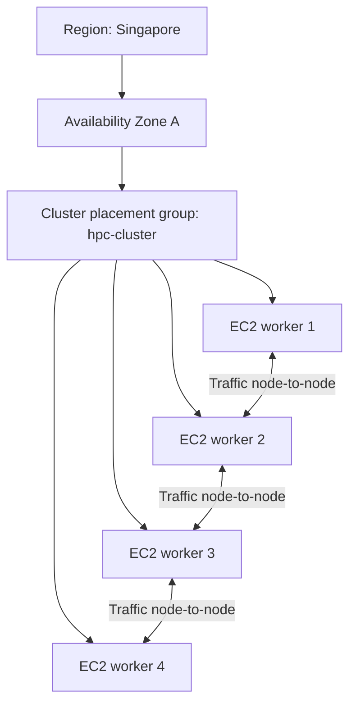
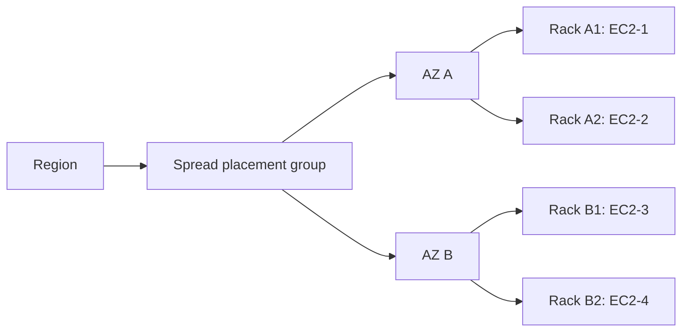
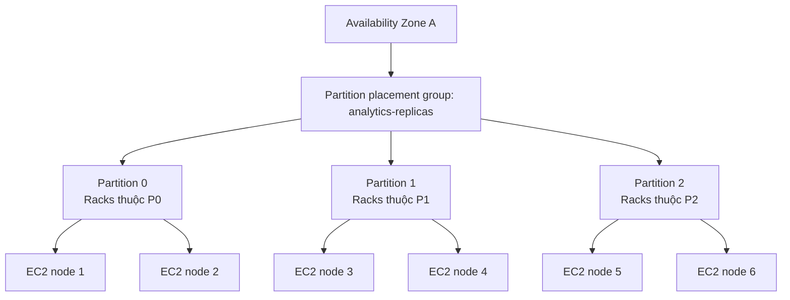
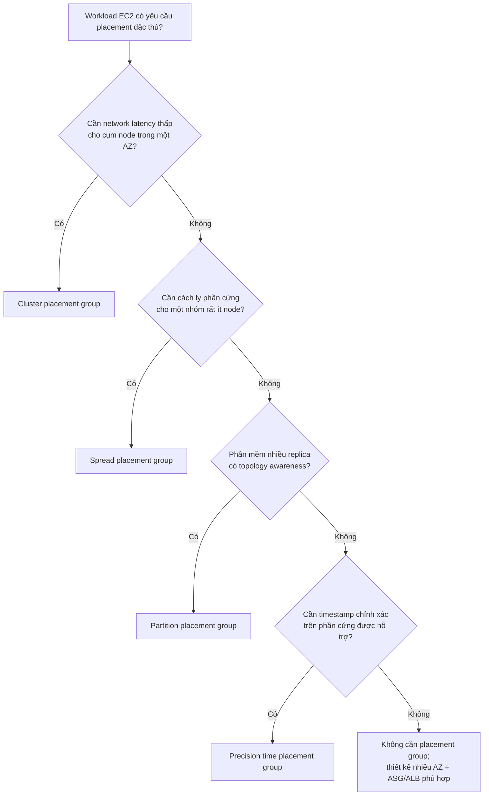
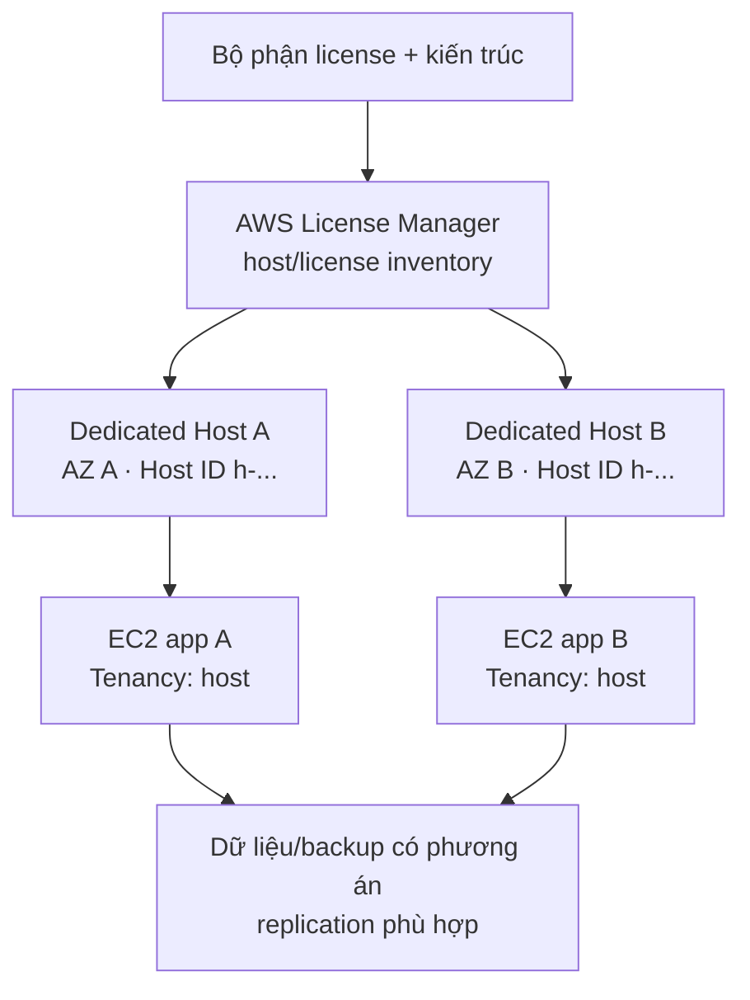

# Placement group, tenancy và Dedicated Host trong Amazon EC2

> **Chương:** Máy chủ EC2  
> **Module:** CLOUD_PROVIDERS_AWS  
> **Mục tiêu:** hiểu cách bố trí EC2 trên hạ tầng vật lý AWS, lựa chọn mức độ dùng chung máy chủ, đáp ứng yêu cầu độ trễ, dự phòng, giấy phép phần mềm và tối ưu chi phí.

## 1. Vì sao cần phân biệt placement group và tenancy?

Khi triển khai máy chủ trên Amazon EC2, việc chọn **instance type**, **AMI**, **subnet**, **security group** mới chỉ quyết định một phần cấu hình. Hai yếu tố khác cũng ảnh hưởng kiến trúc:

- **Placement group:** hướng dẫn AWS đặt các EC2 *gần nhau hoặc tách xa nhau* trên hạ tầng vật lý để đạt mục tiêu mạng, giảm lỗi đồng thời hay hỗ trợ đồng bộ thời gian độ chính xác cao.
- **Tenancy:** xác định EC2 có chạy trên hạ tầng vật lý dùng chung với khách hàng khác, trên phần cứng dành riêng cho một tài khoản, hay trên một máy chủ vật lý riêng mà bạn kiểm soát bằng **Dedicated Host**.

Ví dụ tại AWS Region Singapore:

1. Một cụm xử lý dữ liệu khoa học có các EC2 liên tục trao đổi dữ liệu với nhau, cần **độ trễ thấp và băng thông cao**.
2. Hai máy quản trị đóng vai trò quan trọng, cần tránh cùng bị ảnh hưởng khi **một rack** gặp sự cố.
3. Một hệ thống Kafka/Cassandra có nhiều node, cần **chia replica sang những nhóm rack độc lập**.
4. Doanh nghiệp có giấy phép phần mềm ràng buộc theo **số core, socket hoặc máy chủ vật lý**, muốn biết host ID và vị trí triển khai.
5. Một web API thông thường chỉ cần **Auto Scaling trên nhiều Availability Zone (AZ)** và không có yêu cầu đặc biệt đối với phần cứng vật lý.

Năm trường hợp này không nên dùng một cấu hình EC2 giống nhau. Bài học sẽ giải thích **chọn đúng cơ chế theo mục đích**, cùng các giới hạn và chi phí phải kiểm tra.

### 1.1. Ba lớp vị trí cần nhớ

| Lớp | Chức năng | Ví dụ |
|---|---|---|
| **Region** | Địa bàn triển khai AWS, phạm vi vận hành tài nguyên EC2 | `ap-southeast-1` — Singapore |
| **Availability Zone** | Ranh giới cách ly lỗi bên trong Region | `ap-southeast-1a`, `ap-southeast-1b` theo tài khoản |
| **Hạ tầng vật lý/rack/host** | Vị trí máy chủ thật bên trong AZ | Được AWS kiểm soát; người dùng thường không chọn rack bằng ID |

**Placement group** cung cấp chính sách sắp xếp instance tương đối với nhau. **Dedicated Host** cung cấp quyền kiểm soát một máy chủ vật lý dành riêng. Không có nghĩa một placement group tạo ra AZ mới, và cũng không có nghĩa tenancy dành riêng sẽ giúp hệ thống tự động chịu lỗi AZ.

## 2. Placement group là gì?

**Amazon EC2 placement group** là nhóm logic với **placement strategy** để ảnh hưởng cách AWS bố trí các instance. Nó không phải subnet, VPC, security group, Auto Scaling group hay tập máy chủ vật lý được bạn sở hữu.

Một placement group:

- Là tài nguyên có phạm vi **Region**; chiến lược cụ thể quyết định cách dùng một hoặc nhiều AZ.
- Có thể được tham chiếu lúc khởi tạo EC2 để đặt instance theo chiến lược.
- Một EC2 chỉ nằm trong **một placement group tại một thời điểm**.
- Là tùy chọn; không phải mọi workload EC2 đều cần placement group.
- Việc tạo placement group **không có phí riêng**; tài nguyên EC2, dung lượng dự phòng và truyền dữ liệu vẫn tính phí tương ứng.
- Có các giới hạn về instance type, AZ, số node và phần cứng khả dụng; cần kiểm tra trước khi triển khai.

Tài liệu AWS hiện mô tả **bốn chiến lược**:

| Chiến lược | Mục tiêu chính | Kiểu bố trí | Tình huống tiêu biểu |
|---|---|---|---|
| **Cluster** | Độ trễ mạng thấp, băng thông giữa các node cao | Gom instance trong **một AZ**, trên mạng có độ kết nối cao | HPC, tính toán song song, ứng dụng node-to-node cần hiệu năng mạng |
| **Spread** | Tránh các instance quan trọng cùng hỏng do phần cứng chung | Tách từng instance trên những rack độc lập (rack-level tại Region) | Một số node quan trọng cần tách phần cứng |
| **Partition** | Cách ly các nhóm node/replica theo cụm rack | Chia EC2 thành **partition**; mỗi partition dùng tập rack riêng | Kafka, Cassandra, HDFS, HBase, hệ thống phân tán có nhận biết topology |
| **Precision time** | Đồng bộ thời gian và dấu thời gian chính xác hơn | Đặt trên phần cứng hỗ trợ nguồn thời gian độ chính xác cao | Giao dịch, đo độ trễ, ứng dụng yêu cầu timestamp chính xác |

**Cảnh báo tên gọi:** “cluster” trong placement group chỉ là **chiến lược bố trí vật lý/mạng**. Nó không tự cài Kubernetes, MPI, Hadoop, cơ chế replication hoặc health check.

## 3. Cluster placement group: tối ưu giao tiếp giữa các node

### 3.1. Cách hoạt động

**Cluster placement group** gom các EC2 vào cùng một AZ, ở khu vực hạ tầng có kết nối mạng băng thông cao. Mục tiêu là giảm độ trễ, tối ưu throughput giữa các instance có sự trao đổi dữ liệu mạnh.



Khác với một nhóm EC2 đặt rải trong Region, các instance của cluster placement group được triển khai trong **một AZ**. AWS cố gắng cung cấp môi trường mạng phù hợp cho ứng dụng cần trao đổi dữ liệu nhanh, nhưng **hiệu năng thực tế vẫn bị giới hạn bởi loại instance, network interface, traffic pattern và ứng dụng**.

### 3.2. Khi nào nên dùng?

- **High Performance Computing (HPC):** chương trình song song liên tục trao đổi thông điệp giữa các node.
- Các tác vụ phân tích lớn, mô phỏng hoặc xử lý phân tán **nhạy với độ trễ node-to-node**.
- Workload cần tối ưu lưu lượng ngang giữa các EC2 trong cùng AZ.

**Không nên mặc định dùng cho web API thông thường.** Nếu mục tiêu chính là chịu lỗi một AZ, cluster placement group không giải quyết yêu cầu đó vì nó bị giới hạn trong **một AZ**.

### 3.3. Giới hạn và đánh đổi

- Cluster placement group **không trải trên nhiều AZ**.
- Không phải mọi instance family/type đều được hỗ trợ; ví dụ một số loại **burstable** bị loại khỏi cluster strategy. Kiểm tra danh sách hiện hành trước khi chọn cấu hình.
- Khi thêm instance vào cluster có sẵn, AWS có thể trả lỗi **insufficient capacity** vì không đủ phần cứng thích hợp ở vị trí cần thiết.
- Trộn nhiều instance type có thể khiến việc tìm đủ capacity khó hơn; AWS khuyến nghị ưu tiên cùng instance type khi hợp lý.
- Cluster tăng khả năng đạt mạng hiệu năng cao nhưng các node vẫn có thể chịu rủi ro chung ở cấp AZ hoặc các phụ thuộc chia sẻ khác.
- Tạo placement group **không tự đặt trước toàn bộ EC2 capacity**. Với một số workload, có thể dùng **On-Demand Capacity Reservation** được đặt phù hợp vào cluster placement group để chuẩn bị capacity; phải kiểm tra điều kiện hỗ trợ.

**Ví dụ:** một hệ thống HPC chạy 16 node tại AZ A. Nhóm cần độ trễ thấp hơn mức bình thường nên chọn cluster; đội vận hành đồng thời phải có phương án **checkpoint dữ liệu** sang EBS/S3 hoặc vùng lưu trữ phù hợp để phục hồi khi AZ A không sẵn sàng.

## 4. Spread placement group: giảm nguy cơ cùng hỏng phần cứng

### 4.1. Cách hoạt động

Với **spread placement group**, AWS cố gắng tách từng EC2 trên **rack độc lập** ở mức rack-level trong AWS Region. Mỗi rack có nguồn điện và mạng riêng theo mô hình hạ tầng AWS, giúp giảm rủi ro nhiều instance đồng thời chịu sự cố ở cùng một rack.



Tách rack không đồng nghĩa tách mọi nguyên nhân lỗi: software bug, cấu hình sai, lỗi ứng dụng hay mất toàn AZ vẫn có thể ảnh hưởng nhiều node. Với yêu cầu chịu lỗi AZ, nên kết hợp spread với việc phân bố qua **nhiều AZ** khi được hỗ trợ.

### 4.2. Khi nào nên dùng?

- Một nhóm nhỏ các máy có vai trò **độc lập và quan trọng**.
- Các instance điều phối/điều khiển mà lỗi phần cứng đồng thời có thể gây ảnh hưởng lớn.
- Trường hợp số lượng instance ít, mong muốn tách rack rõ ràng hơn cách phân bố mặc định.

### 4.3. Giới hạn cần nhớ

- **Rack-level spread placement group** có thể trải trên nhiều AZ trong cùng Region.
- Trong AWS Region, tối đa **7 running instances trong mỗi AZ** cho một rack-level spread placement group.
- Chẳng hạn 3 AZ, về nguyên tắc có thể bố trí tối đa 21 running instances trong một spread placement group, với điều kiện capacity sẵn có và các giới hạn khác được đáp ứng.
- Khi không có đủ rack riêng, việc launch/start instance có thể thất bại.
- **Spread placement group không hỗ trợ Dedicated Instances** theo giới hạn AWS hiện hành.
- Có thể dùng nhiều spread placement group khi cần nhiều node, nhưng **không có bảo đảm tách rack giữa hai group độc lập**.

> **Cần phân biệt:** AWS Outposts có lựa chọn host-level spread với giới hạn riêng. Trong bài này, ví dụ chính là **rack-level spread ở AWS Region**.

## 5. Partition placement group: cách ly các nhóm replica

### 5.1. Partition khác AZ như thế nào?

Với **partition placement group**, AWS chia các EC2 thành nhiều **partition logic**. Mỗi partition dùng tập rack riêng; hai partition trong cùng một placement group không chia sẻ cùng rack. Tuy nhiên **mỗi partition có thể chứa nhiều EC2**.



Khác biệt:

- **AZ:** ranh giới hạ tầng lớn trong Region, gồm nhiều data center hoặc phần hạ tầng có cơ chế cách ly.
- **Partition:** nhóm rack tách biệt để ứng dụng phân tán tránh đặt replica cùng phần cứng.
- **Spread:** nhắm mục tiêu mỗi instance dùng phần cứng/rack riêng, không phải mỗi partition có nhiều instance.

Partition placement group **có thể sử dụng nhiều AZ trong một Region**. Mỗi AZ được phép tối đa **7 partition** trong một group; số instance không bị giới hạn bởi con số 7 theo cách spread, mà chịu quota/capacity khác.

### 5.2. Tình huống ứng dụng

Một ứng dụng Cassandra có ba bản sao của mỗi bản ghi. Nếu replica được đặt trên cùng rack, một lỗi rack có thể làm mất nhiều bản sao cùng lúc. Partition placement group giúp ứng dụng nhìn thấy partition của node và lập kế hoạch đặt replica sang partition khác nhau.

Tư duy tương tự áp dụng với:

- HDFS và HBase cần phân tán block/replica giữa các domain lỗi hạ tầng.
- Kafka cần phân bố broker/replica theo topology vật lý.
- Cơ sở dữ liệu phân tán do đội vận hành tự triển khai trên EC2.

**Placement group không cấu hình replica cho phần mềm.** Phải cấu hình Kafka/Cassandra/HDFS để biết vị trí partition/AZ của node, sau đó tự quyết định nơi đặt dữ liệu.

### 5.3. Giới hạn

- Tối đa **7 partition trên mỗi AZ**.
- AWS cố gắng phân bố instance tương đối đều nhưng **không bảo đảm số node bằng nhau** giữa các partition.
- Khi không còn đủ phần cứng tách biệt theo partition, launch/start có thể thất bại.
- Nếu dùng **Dedicated Instances**, partition placement group bị giới hạn tối đa **2 partition** theo tài liệu AWS.
- Capacity Reservation thông thường **không bảo đảm capacity riêng trong partition placement group**; cần đánh giá kế hoạch khởi tạo và khôi phục thực tế.

## 6. Precision time placement group: độ chính xác thời gian

AWS còn cung cấp **precision time placement group**, tập trung vào khả năng truy cập nguồn đồng bộ thời gian chính xác cao trên những hệ thống phần cứng được hỗ trợ.

Nó phù hợp khi:

- Cần timestamp có độ tin cậy cao để đo độ trễ giao dịch/mạng.
- Có yêu cầu điều phối thời gian trong ứng dụng tài chính, đo đạc hoặc log/telemetry chuyên biệt.
- Workload được triển khai trên các **instance family/generation được AWS liệt kê hỗ trợ**.

**Không nhầm với cluster placement group:** precision time hướng tới đồng bộ thời gian, không phải cam kết gom máy gần nhau nhất để giảm network latency. AWS có các điều kiện về Region, instance type và capacity hỗ trợ; phải đối chiếu tài liệu **Amazon Time Sync Service** và danh sách loại instance hiện hành. Nếu không có phần cứng đủ điều kiện, launch/start có thể thất bại.

Đối với một API web thông thường cần logging nhất quán, đồng bộ thời gian chuẩn trên EC2 có thể đã đủ; không nhất thiết yêu cầu precision time placement group.

## 7. So sánh và chọn placement strategy

| Câu hỏi | Cluster | Spread | Partition | Precision time |
|---|---|---|---|---|
| Mục tiêu ưu tiên | Network latency/throughput | Giảm lỗi phần cứng đồng thời cho **từng instance** | Tách rack theo **nhóm node/replica** | Đồng bộ thời gian chính xác |
| Số AZ | **Một AZ** | Nhiều AZ cùng Region | Nhiều AZ cùng Region | Theo điều kiện dịch vụ hỗ trợ |
| Phù hợp quy mô | Cụm xử lý giao tiếp nhiều | Nhóm ít instance quan trọng | Workload phân tán nhiều node | Instance chuyên biệt, yêu cầu timestamp |
| Cách tách/gom | Gom gần nhau | Một instance/rack | Một partition/tập rack riêng | Chọn phần cứng hỗ trợ time source |
| Rủi ro | Chung lỗi AZ, khó cấp thêm capacity | Giới hạn 7 instance/AZ và rack capacity | Cần phần mềm hiểu partition, đủ rack | Giới hạn instance type/hardware |
| Thường gặp | HPC, MPI | Nhóm node nhỏ có HA | Kafka, Cassandra, HDFS | Đo đạc thời gian chính xác cao |

### 7.1. Sơ đồ quyết định



Một workload vừa cần HPC hiệu năng cao vừa cần dự phòng nhiều AZ không thể giải quyết bằng việc đặt **cùng một cluster placement group** tại hai AZ. Phải tách yêu cầu hiệu năng trong AZ khỏi yêu cầu phục hồi mất AZ bằng kiến trúc dữ liệu, checkpoint, nhiều cụm hay giải pháp khác.

## 8. Tenancy trong EC2 là gì?

**Tenancy** cho biết cách EC2 sử dụng **phần cứng vật lý** với các khách hàng AWS khác. Với EC2 trong VPC, các giá trị chính:

| Tenancy của instance | Ý nghĩa | Độ kiểm soát host vật lý |
|---|---|---|
| `default` | Instance chạy trên phần cứng dùng chung; tài khoản AWS khác có thể sử dụng cùng máy chủ vật lý | Không chọn host cụ thể |
| `dedicated` | **Dedicated Instance:** chạy trên phần cứng dành riêng cho tài khoản của bạn, tách khỏi instance của tài khoản khác | Không có quyền chọn host ID hoặc gắn host affinity |
| `host` | EC2 chạy trên **Dedicated Host** được cấp phát, có khả năng chỉ định host/affinity và xem thông tin phần cứng | Có host ID, vị trí/thuộc tính vật lý và quản lý capacity trên host |

**Tenancy không đồng nghĩa bảo mật mạng:** EC2 `default` vẫn có cách ly ảo hóa AWS, security groups, IAM và mạng VPC. Chuyển sang `dedicated` không tự mã hóa dữ liệu, bảo vệ web app khỏi lỗi phân quyền hoặc tạo đường mạng riêng.

Tenancy cũng **không phải** ba phương án thanh toán On-Demand, Reserved Instance hay Spot. Một số cơ chế thanh toán/cấp capacity có thể tương tác với tenancy, nhưng chúng là trục lựa chọn khác.

### 8.1. Tenancy của VPC so với tenancy của instance

VPC có thuộc tính **instance tenancy**:

- VPC tenancy **`default`**: các instance mới mặc định `default`; có thể chọn tenancy chuyên biệt khi loại instance và dịch vụ hỗ trợ.
- VPC tenancy **`dedicated`**: các instance trong VPC theo mặc định chạy dạng Dedicated Instance; khả năng chọn tenancy khác bị giới hạn theo quy tắc VPC và instance.
- **`host` là tenancy của instance**, không phải giá trị tenancy dùng khi tạo VPC.

Điểm cấu hình quan trọng:

- Có thể đổi VPC từ **`dedicated` → `default`** qua API/CLI trong điều kiện được AWS hỗ trợ; các instance đang tồn tại **không tự đổi tenancy** theo VPC.
- Không thể sửa VPC từ **`default` → `dedicated`** sau khi tạo. Muốn VPC chuyên dedicated ngay từ đầu, chọn khi tạo VPC.
- Có thể thay tenancy một số **EC2 instance đang stopped** bằng API, nhưng hỗ trợ chuyển đổi phụ thuộc hệ điều hành, loại instance, license và quy định AWS; không phải mọi đường chuyển đều có thể thực hiện.

**Bài học thiết kế:** nếu chỉ có vài EC2 cần chạy dedicated, có thể cân nhắc đặt tenancy riêng cho các instance trên VPC default thay vì mặc định buộc cả VPC dedicated. Cần kiểm tra yêu cầu compliance và khả năng dịch vụ.

## 9. Dedicated Instance khác Dedicated Host ở đâu?

Hai tùy chọn đều liên quan tới phần cứng dành riêng, nhưng cấp độ kiểm soát khác nhau.

| Tiêu chí | Dedicated Instance (`dedicated`) | Dedicated Host (`host`) |
|---|---|---|
| Đơn vị quản lý | EC2 instance | Máy chủ vật lý có host ID |
| Phần cứng | Dành riêng cho một tài khoản AWS | Dedicated physical server cấp phát cho khách hàng, có thể chia capacity với tài khoản khác khi cấu hình chia sẻ |
| Người dùng xem socket/core/host ID | Không theo cách điều khiển host | Có thông tin cần thiết phục vụ quản trị license |
| Chọn chính xác host | Không | Có thể nhắm host ID hoặc để auto-placement tìm host thích hợp |
| Host affinity | Không | Có hỗ trợ |
| Tính phí cơ bản | Theo mức sử dụng instance và phụ phí/cơ chế dedicated áp dụng | Theo **thời gian máy chủ đã cấp phát**, kể cả chưa đặt đủ instance |
| BYOL theo socket/core/máy | Hạn chế hơn | Hỗ trợ toàn diện hơn theo điều kiện license |
| Reserved capacity | Có cơ chế Reserved Instance/Capacity Reservation phù hợp | Dedicated Host được cấp phát và có lựa chọn Dedicated Host Reservation cho chiết khấu, không đồng nhất EC2 Capacity Reservation |
| Trường hợp sử dụng | Cách ly vật lý khỏi tài khoản khác mà không cần chọn máy chủ | License gắn host, kiểm toán socket/core, cần host ID/affinity và điều khiển placement |

**Giới hạn quan trọng:** Dedicated Instances có thể chạy trên máy chủ chứa các instance khác **cùng tài khoản AWS**, kể cả loại không phải Dedicated Instance, theo mô tả của AWS. “Dedicated” nói về việc tách khỏi **tài khoản khách hàng khác**, không có nghĩa chỉ có duy nhất một VM trên máy.

Với Dedicated Host, chủ sở hữu có thể **chia sẻ capacity** cho tài khoản AWS khác theo cơ chế AWS Resource Access Manager được hỗ trợ. Vì vậy không nên coi “host dành riêng” đồng nghĩa chỉ một AWS account có thể dùng khi tổ chức chủ động bật chia sẻ.

### 9.1. Khi nào chỉ cần Dedicated Instance?

- Có yêu cầu chạy trên phần cứng không dùng chung với tài khoản khách hàng AWS khác.
- Không cần báo cáo socket/core hoặc chọn host ID.
- Không có phần mềm yêu cầu license gắn chặt vào một physical host.
- Muốn khả năng vận hành EC2 tương tự nhưng với tenancy riêng.

Nhược điểm: không kiểm soát máy vật lý cụ thể, không gắn host affinity, hạn chế trong BYOL; chi phí phải so sánh với lựa chọn default/Dedicated Host.

### 9.2. Khi nào nên dùng Dedicated Host?

- Có giấy phép ứng dụng/OS phụ thuộc **số physical cores, sockets, VM hoặc máy chủ vật lý** mà điều khoản cho phép BYOL trên cloud.
- Cần **host ID**, dữ liệu phần cứng, kiểm tra số instance đang chạy trên máy.
- Cần ràng buộc một workload chạy hoặc khởi động lại trên host cụ thể bằng **host affinity**.
- Cần gom các instance tương thích trên một physical server nhằm kiểm soát mức sử dụng và license.

**Không được tự suy rằng tất cả license on-prem đều hợp lệ trên Dedicated Host.** Điều kiện phần mềm của Microsoft, Oracle, các nhà cung cấp DB/OS và sản phẩm khác thay đổi theo hợp đồng, chương trình license và thời điểm. Hãy cùng bộ phận bản quyền đối chiếu giấy phép của tổ chức với hướng dẫn **AWS License Manager** và vendor trước khi triển khai.

## 10. Dedicated Host: cấp phát, placement và vòng đời

### 10.1. Dedicated Host là tài nguyên như thế nào?

Một Dedicated Host được AWS cấp phát trong **một AZ** và có:

- **Host ID** dạng `h-...`.
- AZ, trạng thái (available, released, một số trạng thái bảo trì/lỗi).
- Loại/cấu hình instance mà host hỗ trợ, số lượng capacity còn lại.
- Thông tin socket và physical cores phục vụ quản trị license.
- Tùy chọn **auto-placement**, **host affinity**, **host recovery** và **host maintenance** theo mức hỗ trợ.
- Chi phí sử dụng tính trên **host đã cấp phát**, không đơn thuần theo số EC2 đang chạy.

**Dedicated Host thuộc AZ**, không thể mang nguyên một host ID sang AZ khác. Nếu ứng dụng phải chịu lỗi AZ, cần phương án khác ở **AZ thứ hai**.

### 10.2. Auto-placement: chọn host thủ công hay để EC2 chọn?

- **Auto-placement off:** Dedicated Host chỉ nhận instance launch được **nhắm tới host ID** tương thích. Đây là cài đặt mặc định được AWS mô tả cho host mới.
- **Auto-placement on:** instance đặt tenancy `host` có thể được EC2 đặt lên Dedicated Host phù hợp còn capacity mà không phải chỉ định chính xác host ID.
- **Không có host đủ capacity:** instance launch/start có thể thất bại ngay cả khi trong Region có nhiều instance thông thường sẵn có.

Cần kiểm tra **instance family, instance size, host compatibility, AZ, AMI/OS, license constraints** và quota khi chọn host. Một Dedicated Host có thể hỗ trợ nhiều instance size trong cùng tập tương thích tùy cấu hình vật lý; không giả định mọi size đều kết hợp tự do.

### 10.3. Host affinity: gắn quan hệ instance – máy vật lý

**Host affinity** quyết định instance có duy trì mối liên hệ với Dedicated Host khi stop/start hay không:

- `host`: instance có quan hệ affinity với Dedicated Host; khi start lại sẽ tìm cách chạy trên host gắn kết theo cơ chế dịch vụ.
- `default`: không buộc duy trì quan hệ host cố định; khi start AWS có thể chọn host tương thích khác theo quy tắc, dù có thể ưu tiên host đã dùng theo best effort.

Duy trì affinity hữu ích khi điều khoản license hoặc workload yêu cầu nhất quán vị trí host. Tuy nhiên nếu host lỗi hoặc không còn capacity, affinity cũng có thể khiến recovery/start phức tạp hơn; cần thiết kế host recovery và kế hoạch vận hành.

### 10.4. Dedicated Host recovery và maintenance

AWS cung cấp các cơ chế **host recovery** và **host maintenance** cho trường hợp phù hợp:

| Khả năng | Mục tiêu | Điều cần biết |
|---|---|---|
| **Host recovery** | Phục hồi sau một số lỗi phần cứng/khả dụng không mong muốn | AWS có thể cấp host thay thế **cùng AZ**, chuyển các instance đủ điều kiện sang host mới; host ID có thể thay đổi |
| **Host maintenance** | Xử lý host bị suy giảm hoặc công việc bảo trì dự kiến | Tùy instance, AWS dùng live migration hoặc bảo trì cần reboot trên host thay thế |
| **Thiết kế đa AZ ở tầng ứng dụng** | Ứng phó việc cả AZ không sẵn sàng | Cần đặt workload/dữ liệu dự phòng trên hạ tầng **AZ khác**; host recovery cùng AZ không thay thế được |

Host recovery **không phải cơ chế sao lưu dữ liệu**. Có các trường hợp không được recovery tự động: host bị lên lịch retirement, instance stopped, một số cấu hình dùng instance store và các trường hợp AWS chưa hỗ trợ. Hãy kiểm tra tài liệu loại host/instance cụ thể và thử quy trình phục hồi.

Ví dụ một host ở AZ A xảy ra lỗi phần cứng: nếu host recovery áp dụng, EC2 có thể phục hồi các instance đủ điều kiện trên host mới **vẫn tại AZ A**, giữ các thuộc tính như instance ID/private IP/EBS attachment theo mô hình AWS. Nhưng nếu **cả AZ A** không khả dụng, phải sử dụng môi trường dự phòng ở AZ B hoặc Region khác.

### 10.5. AWS License Manager và Host resource group

**AWS License Manager** có thể hỗ trợ theo dõi license và quản lý **host resource groups** cho Dedicated Hosts:

- Quản trị vòng đời host, có các lựa chọn tự động cấp phát và giải phóng theo khả năng hỗ trợ.
- Xác định quy tắc sử dụng license và cảnh báo vi phạm khi được cấu hình.
- Gắn license constraints với những workload hoặc AMI phù hợp theo loại license được hỗ trợ.
- Phối hợp nhu cầu capacity/host khi ứng dụng thay đổi.

License Manager hỗ trợ vận hành nhưng **không thay thế việc xác nhận tính hợp lệ của hợp đồng phần mềm**. Việc host resource group, host recovery và host maintenance tương tác ra sao có các giới hạn riêng; cần đọc tài liệu AWS hiện hành trước khi bật/tắt cơ chế trong sản xuất.

## 11. Placement group và Dedicated Host có kết hợp trực tiếp không?

**Không nên coi placement group là cách chỉ định rack của Dedicated Host.** AWS hiện quy định **không thể launch Dedicated Hosts trong placement groups**. Nếu workload bắt buộc tenancy `host`, thiết kế theo **host ID, AZ, affinity, license và khả năng phục hồi** của Dedicated Host. Không cố kết hợp cả hai như thể AWS sẽ thỏa đồng thời một cluster group và một physical host cụ thể.

Những điều cần tách:

1. **Placement group** ảnh hưởng việc phân bổ EC2 theo chiến lược cluster, spread, partition hoặc precision time.
2. **Tenancy `host`** đưa EC2 lên Dedicated Host có đặc tính và quy tắc chọn host riêng.
3. **Tenancy `dedicated`** dành cho Dedicated Instances; không đồng nghĩa sở hữu/kiểm soát một Dedicated Host.
4. **AZ** vẫn là ranh giới lỗi quan trọng. Muốn tránh gián đoạn do mất AZ cần phân bố ứng dụng và dữ liệu qua AZ khác, bất kể chọn placement hay tenancy.

Đây là một giới hạn kiến trúc phải xác minh từ đầu, trước khi thiết kế workload vừa yêu cầu license theo host vừa muốn cluster placement group.

## 12. Chi phí: trả tiền cho mục tiêu nào?

### 12.1. Placement group và chi phí vận hành

AWS **không thu phí chỉ để tạo placement group**. Chi phí đến từ EC2, lưu trữ, truyền dữ liệu, capacity reservation và dịch vụ hỗ trợ. Ví dụ:

- Cluster group cần loại instance có networking tốt hơn → instance có thể đắt hơn.
- Cần **capacity reservation** để giảm rủi ro thiếu tài nguyên → có thể phát sinh phí capacity chưa dùng.
- Partition/spread cần nhiều node để duy trì replica → trả chi phí nhiều EC2 và dữ liệu sao chép.
- Thiết kế nhiều AZ có thể phát sinh **cross-AZ data transfer** theo bảng giá AWS.

Đừng đánh giá placement group chỉ bằng số USD tạo group; hãy đánh giá toàn bộ chi phí workload và nguy cơ thiếu capacity.

### 12.2. Default vs Dedicated Instance vs Dedicated Host

| Yếu tố chi phí | Default | Dedicated Instance | Dedicated Host |
|---|---|---|---|
| Cơ sở tính phí thường gặp | Mức dùng instance theo phương án thanh toán | Mức dùng instance với tenancy dedicated và điều kiện giá áp dụng | Thời gian host được **allocate**, dù chưa khai thác hết capacity |
| Rủi ro lãng phí | EC2 nhàn rỗi/chọn instance lớn | Dedicated instances ít sử dụng | Host ít instance, utilization thấp, capacity dư |
| Phạm vi tối ưu | Right-sizing, Auto Scaling, Savings Plans/RI/Spot phù hợp | Chọn đúng số dedicated instances và cơ chế tính giá | Tận dụng capacity trên host, lịch chạy, host reservation, BYOL hợp lệ |
| Chi phí bổ sung | EBS, IPv4, data transfer... | Tương tự và chi phí tenancy | Tương tự, cộng yêu cầu theo host/license |

Theo mô hình AWS, **On-Demand Dedicated Host** được tính theo thời gian host đang được cấp phát (tài liệu AWS mô tả tính theo giây, tối thiểu 60 giây), **không theo số instance đặt lên host**. Vì vậy host trống vẫn có thể phát sinh phí. Giá thay đổi theo host family, Region, phương án thanh toán và thời điểm.

**Dedicated Host Reservation** có thể giảm giá theo cam kết phù hợp, nhưng đó **không phải** cơ chế On-Demand Capacity Reservation thông thường của một EC2 instance. Cần phân biệt hai khái niệm trước khi mua cam kết.

### 12.3. Ví dụ tính hiệu quả sử dụng host

Giả sử một Dedicated Host có capacity tương thích với 8 instance cùng size cho workload, nhưng thường chỉ chạy 2 instance.

- Mức dùng capacity đơn giản = \(2/8 = 25\%\).
- Nếu chạy được 6 instance tương thích, tỷ lệ thành \(6/8 = 75\%\).
- Trong mô hình tính giá per-host, tiền host không tự giảm khi chỉ chạy 2 instance; phần capacity trống có thể làm chi phí trên mỗi workload cao.

Đây là **ví dụ mô phỏng**. Một số host hỗ trợ nhiều instance size cùng family; cách đếm slot thực tế phụ thuộc cấu hình host và giới hạn AWS, không phải lúc nào cũng là 8 slot giống nhau. Cần kiểm tra đặc tính host thực.

## 13. Mẫu kiến trúc: chọn vị trí theo yêu cầu kỹ thuật

### 13.1. Cụm tính toán HPC ưu tiên latency

**Yêu cầu:** 8 worker EC2 xử lý song song, trao đổi dữ liệu nhiều, chấp nhận khởi động lại job nếu AZ lỗi.

**Lựa chọn hợp lý:**

- Dùng **cluster placement group** tại một AZ.
- Chọn instance type có năng lực networking phù hợp, đồng nhất nếu có thể.
- Dùng EBS/S3/lưu trữ hỗ trợ để lưu checkpoint và kết quả quan trọng.
- Giám sát độ trễ và throughput, chuẩn bị kế hoạch capacity trước khi mở rộng.

**Đánh đổi:** hiệu năng mạng tốt nhưng không chịu được mất AZ chỉ bằng placement group. Muốn tiếp tục sau lỗi AZ phải có kế hoạch phục hồi job ở hạ tầng khác.

### 13.2. Ba node điều phối quan trọng

**Yêu cầu:** ba instance có vai trò độc lập, giảm nguy cơ đồng thời lỗi do rack, tiếp tục vận hành nếu một node lỗi.

**Lựa chọn:**

- Dùng **spread placement group** để cách ly hạ tầng giữa các instance.
- Phân bố node qua nhiều AZ nếu ứng dụng và mục tiêu HA cho phép.
- Cấu hình cơ chế election/quorum hoặc health check ở tầng phần mềm.
- Tính toán giới hạn 7 running instances/AZ và khả năng cấp capacity.

**Đánh đổi:** Spread không tự tạo quorum, tự thay thế node hoặc sao lưu cấu hình. Một ứng dụng cần quorum 2/3 vẫn phải tự triển khai cơ chế quorum.

### 13.3. Kafka/Cassandra có replica

**Yêu cầu:** nhiều broker/node và replica, cần giảm khả năng một lỗi rack làm mất nhiều replica.

**Lựa chọn:**

- Dùng **partition placement group**, chọn số partition theo kiến trúc.
- Truyền thông tin partition vào hệ thống topology-aware để đặt replica phù hợp.
- Có thể kết hợp trải node trên nhiều AZ; đặt replication factor/placement theo mức chịu lỗi mục tiêu.
- Giám sát rebalancing, dung lượng lưu trữ và traffic replication.

**Đánh đổi:** partition không bảo đảm ứng dụng thực sự tách replica; nếu phần mềm bỏ qua partition metadata, tính sẵn sàng có thể không cải thiện như mong muốn.

### 13.4. Ứng dụng có license gắn physical host

**Yêu cầu:** ứng dụng doanh nghiệp có license theo host/socket/core và cần báo cáo host ID.



**Lựa chọn:**

- Phân tích giấy phép và điều kiện BYOL với nhà cung cấp.
- Allocate Dedicated Host tương thích trong những AZ cần thiết.
- Launch EC2 với tenancy **`host`**, định rõ auto-placement/affinity.
- Dùng License Manager nếu phù hợp, theo dõi recovery và maintenance.
- Bố trí host, ứng dụng và dữ liệu dự phòng trong AZ khác khi có yêu cầu HA.

**Đánh đổi:** phải trả phí cho các host đã cấp phát, ngay cả lúc capacity chưa được sử dụng; chi phí HA và license ở nhiều host cần đánh giá riêng.

### 13.5. Web API thông thường cần chịu lỗi AZ

**Yêu cầu:** API phục vụ khách hàng, biến động traffic, không có ràng buộc HPC hay phần cứng dedicated.

**Lựa chọn:** EC2 default tenancy, Auto Scaling group phân bố ở nhiều AZ, Application Load Balancer, managed database Multi-AZ hoặc cơ chế dữ liệu phù hợp, IAM và giám sát CloudWatch.

Trong trường hợp này thường **không cần placement group hoặc Dedicated Host**. Cần ưu tiên ứng dụng stateless, health check, autoscaling, deploy an toàn và kiểm soát chi phí.

## 14. Thực hành quan sát bằng AWS CLI (read-only)

Các ví dụ dưới đây **chỉ truy vấn**, không tạo/chuyển/xóa EC2 hoặc host. Cần AWS CLI v2, credential/profile có quyền `ec2:Describe*` phù hợp và Region chính xác. Các ID là ví dụ giả.

### 14.1. Liệt kê placement groups

```bash
aws ec2 describe-placement-groups \
  --region ap-southeast-1 \
  --query "PlacementGroups[].[GroupName,Strategy,State,PartitionCount]" \
  --output table
```

Kết quả giúp biết tên, chiến lược và trạng thái group. `PartitionCount` chỉ có ý nghĩa với partition strategy; trường khác có thể rỗng hoặc không liên quan.

### 14.2. Xem placement và tenancy của EC2

```bash
aws ec2 describe-instances \
  --region ap-southeast-1 \
  --query "Reservations[].Instances[].[InstanceId,InstanceType,Placement.AvailabilityZone,Placement.GroupName,Placement.PartitionNumber,Placement.Tenancy,Placement.HostId,State.Name]" \
  --output table
```

Từ kết quả có thể kiểm tra:

- `Placement.AvailabilityZone`: instance nằm AZ nào.
- `Placement.GroupName`: tên placement group, nếu instance thuộc group.
- `Placement.PartitionNumber`: partition index nếu dùng partition placement.
- `Placement.Tenancy`: `default`, `dedicated` hoặc `host`.
- `Placement.HostId`: host ID khi instance chạy ở Dedicated Host.

Không suy từ việc `GroupName` trống rằng instance nằm cùng host với instance khác; chỉ xác nhận instance không khai báo placement group.

### 14.3. Xem VPC tenancy

```bash
aws ec2 describe-vpcs \
  --region ap-southeast-1 \
  --query "Vpcs[].[VpcId,CidrBlock,InstanceTenancy]" \
  --output table
```

Nếu VPC `InstanceTenancy` là `default`, vẫn có thể có instance tenancy `dedicated` hoặc `host` được cấu hình riêng. Cần truy vấn **EC2 Placement.Tenancy** để biết tình trạng của từng instance.

### 14.4. Quan sát Dedicated Hosts

```bash
aws ec2 describe-hosts \
  --region ap-southeast-1 \
  --query "Hosts[].{HostId:HostId,AZ:AvailabilityZone,State:State,AutoPlacement:AutoPlacement,Recovery:HostRecovery,Maintenance:HostMaintenance,InstanceType:HostProperties.InstanceType}" \
  --output json
```

Tùy loại host và API, một số thuộc tính có thể không có. Phải có quyền đọc Dedicated Hosts của tài khoản. Muốn biết host đang chứa EC2 nào, xem `Instances` trong kết quả đầy đủ:

```bash
aws ec2 describe-hosts \
  --region ap-southeast-1 \
  --output json
```

Thông tin host có giá trị với license audit và kiểm tra utilization, nên chỉ chia sẻ trong phạm vi được phép.

### 14.5. Kiểm tra khả dụng theo AZ (không bảo đảm capacity)

```bash
aws ec2 describe-instance-type-offerings \
  --region ap-southeast-1 \
  --location-type availability-zone \
  --filters Name=instance-type,Values=c7i.large \
  --query "InstanceTypeOfferings[].[Location,InstanceType]" \
  --output table
```

**Lưu ý:** instance type được *offered* tại AZ chưa bảo đảm có đủ capacity để launch, đặc biệt khi cần phần cứng phù hợp với cluster, spread hay partition placement.

### 14.6. Các thao tác cấu hình chỉ nên chạy trong lab được phép

Có thể nghiên cứu thêm các lệnh tạo/sửa tài nguyên sau (không chạy trong bước đọc):

- `aws ec2 create-placement-group` — tạo group với strategy hỗ trợ.
- `aws ec2 modify-instance-placement` — đổi placement/tenancy theo điều kiện hỗ trợ; thường cần stop instance trước.
- `aws ec2 allocate-hosts` — cấp phát Dedicated Host, **có thể bắt đầu tính phí**.
- `aws ec2 modify-hosts` — điều chỉnh một số thuộc tính host.
- `aws ec2 release-hosts` — giải phóng host khi đủ điều kiện, tác động đến capacity/license.

Không dùng các thao tác này trên production nếu chưa đánh giá downtime, điều khoản license và đường phục hồi.

## 15. Thay đổi placement/tenancy cho instance đang chạy

### 15.1. Chuyển instance vào hoặc ra placement group

Đối với EC2 hiện có, AWS hỗ trợ **đổi placement group khi instance ở trạng thái stopped**, theo điều kiện hỗ trợ của strategy và instance type.

Quy trình an toàn về mặt thiết kế:

1. Kiểm tra ứng dụng đã có replica/backup và có maintenance window nếu cần.
2. Xác nhận instance type, AZ, tenancy và target placement group tương thích.
3. Stop instance theo quy trình; dữ liệu **instance store** không bền qua stop và cần sao lưu thích hợp.
4. Dùng API/CLI đổi placement group, sau đó start lại.
5. Kiểm tra health, route, ENI, ứng dụng và giá trị `Placement.GroupName`.

Dù thao tác đổi placement thành công, start instance vẫn có thể **thất bại do thiếu capacity**. Với các môi trường quan trọng, cần chuẩn bị phương án rollback và giới hạn downtime.

### 15.2. Thay đổi tenancy không phải thao tác tùy ý

Đổi `default ↔ dedicated ↔ host` không luôn khả dụng. AWS đưa ra điều kiện theo OS, giấy phép, trạng thái instance và loại instance; riêng một số T3 host tenancy có hạn chế chuyển đổi đặc thù. Việc đổi tenancy VPC không tự đổi instance đang tồn tại.

**Khuyến nghị:** đặt tenancy từ thiết kế ban đầu, kiểm tra điều kiện BYOL và chi phí trước khi deploy AMI/launch template. Chỉ thay tenancy khi có kế hoạch migration và đường quay lại phù hợp.

## 16. IAM, giám sát và vận hành

### 16.1. Quyền IAM

Các quyền quản trị cần kiểm soát theo least privilege:

- `ec2:CreatePlacementGroup`, `ec2:DeletePlacementGroup`, `ec2:ModifyInstancePlacement`.
- `ec2:AllocateHosts`, `ec2:ModifyHosts`, `ec2:ReleaseHosts`.
- `ec2:RunInstances`, `ec2:StartInstances`, `ec2:StopInstances`.
- Quyền `Describe*` cần thiết cho quan sát và báo cáo.

Một developer có quyền launch EC2 không nhất thiết phải được quyền allocate Dedicated Host hoặc đổi tenancy; các thao tác này ảnh hưởng chi phí và phạm vi compliance. IAM identity policies, SCP và permission boundary có thể giới hạn đường thực thi.

### 16.2. Công cụ quan sát

| Mục tiêu | Công cụ |
|---|---|
| Ai tạo/xóa placement group hoặc thay host | **AWS CloudTrail** quản trị API |
| Trạng thái EC2, sức khỏe instance | **Amazon CloudWatch**, EC2 status checks |
| Cảnh báo bảo trì/retirement host | **AWS Health Dashboard**, EventBridge/notifications phù hợp |
| Tính phí Dedicated Hosts và utilization | **Cost Explorer**, CUR/Data Exports, EC2 console/CLI |
| Giám sát giấy phép và phân bổ host | **AWS License Manager** |
| Kiểm tra placement/host hiện tại | `describe-placement-groups`, `describe-instances`, `describe-hosts` |

**Host recovery không thay cho backup.** Với database tự quản trên EC2, vẫn phải có chiến lược EBS snapshot/backup, replication, phục hồi và kiểm thử RPO/RTO.

### 16.3. Phân tích lỗi theo triệu chứng

| Triệu chứng | Nguyên nhân khả dĩ | Cách xác minh |
|---|---|---|
| Launch vào cluster thất bại | Không đủ capacity phù hợp tại một AZ | Kiểm tra AZ, type, placement strategy và thông báo API |
| Instance thứ 8 trong spread/AZ không start | Vượt giới hạn 7 running instances mỗi AZ | Đếm instance đang chạy theo AZ/group |
| Partition group thiếu capacity | Không còn đủ rack tách biệt | Xem partition count, AZ, trạng thái instance và lỗi launch |
| EC2 không vào được Dedicated Host | Host không tương thích, sai AZ, auto-placement off hoặc không còn capacity | Xem Host ID, HostProperties, State, AutoPlacement |
| Dedicated Instance không chỉ định được host ID | Dedicated Instance không có targeted host placement | Cần Dedicated Host khi muốn chọn host |
| Host trống nhưng vẫn bị tính phí | Dedicated Host vẫn allocated | Kiểm tra trạng thái `describe-hosts` và Cost Explorer |
| Mất dịch vụ khi AZ lỗi dù dùng cluster | Cluster chỉ trong một AZ | Thiết kế ứng dụng/dữ liệu dự phòng ở AZ khác |
| Đổi placement group nhưng start lỗi | Capacity không đủ ở vị trí mục tiêu | Đọc error API, đánh giá rollback hoặc phương án AZ/type |
| License audit không thấy socket/core | Đang dùng Dedicated Instance thay vì Dedicated Host | Kiểm tra tenancy và Host ID |
| Host recovery không chạy | Cấu hình/instance không được hỗ trợ, retirement hoặc điều kiện khác | Xem Health event, HostRecovery, AWS docs |

## 17. Bài tập thực hành tư duy

### Bài 1 — Cluster và HA

Cụm xử lý HPC có 12 EC2 đặt trong **cluster placement group** ở AZ A. Người quản trị nghĩ hệ thống tự chịu lỗi một AZ vì “EC2 là dịch vụ của cả Region”. Kết luận đúng là gì?

**Đáp án:** Cluster placement group chỉ nằm trong **một AZ**, không bảo vệ trước lỗi AZ. Cần checkpoint, replica hoặc khả năng khởi động lại workload trong AZ/Region khác theo yêu cầu.

### Bài 2 — Bốn node điều phối

Có bốn instance quan trọng, không cần truyền dữ liệu lớn giữa chúng, nhưng cần hạn chế cùng hỏng vì rack. Nên cân nhắc placement nào?

**Đáp án:** **Spread placement group**, kiểm tra giới hạn bảy instance trên mỗi AZ và bố trí nhiều AZ khi cần; phần mềm vẫn phải tự hỗ trợ failover/quorum.

### Bài 3 — Hai mươi bốn broker Kafka

Hệ thống có 24 broker và muốn các nhóm replica được tách phần cứng, có thể dùng metadata topology. Spread có phù hợp hơn partition không?

**Đáp án:** **Partition placement group** thường phù hợp hơn với workload phân tán lớn, vì spread giới hạn bảy running instances trên mỗi AZ trong một group; partition cho phép nhiều instance trong các partition rack độc lập. Ứng dụng phải cấu hình replica awareness.

### Bài 4 — BYOL theo socket

Một phần mềm cần cấp phép theo socket của máy vật lý và kiểm toán host ID. Dedicated Instance đã đủ chưa?

**Đáp án:** Thông thường **Dedicated Host** phù hợp hơn vì cho phép quan sát socket/core/host ID và host affinity. Vẫn phải kiểm tra điều khoản license cụ thể với vendor.

### Bài 5 — Host không có EC2

Một Dedicated Host allocated cả tháng nhưng không có instance chạy. Hóa đơn có thể vẫn phát sinh không?

**Đáp án:** **Có.** Dedicated Host được tính theo thời gian đã allocated. Việc không chạy EC2 không đồng nghĩa không bị tính tiền host.

### Bài 6 — VPC default nhưng EC2 dedicated

Một VPC có `InstanceTenancy: default`, một EC2 trong đó lại có `Placement.Tenancy: dedicated`. Có mâu thuẫn không?

**Đáp án:** **Không.** VPC default tenancy cho phép cấu hình tenancy riêng của instance phù hợp; phải xem cả hai mức cấu hình.

### Bài 7 — Spread giữa các group

Tạo hai spread placement group, mỗi group ba instance tại cùng một AZ. Có bảo đảm cả sáu instance nằm trên sáu rack khác nhau không?

**Đáp án:** **Không.** AWS chỉ cung cấp các bảo đảm tách rack **bên trong từng group**, không mặc định tách biệt giữa hai group.

### Bài 8 — Partition và replica

Partition group có ba partition, nhưng toàn bộ replica của một dữ liệu lại đặt trong cùng partition 0. Placement group có cứu được khi rack partition 0 lỗi không?

**Đáp án:** Không. Ứng dụng phải dùng partition metadata để đặt replica vào các partition/rack tách biệt; placement group chỉ cung cấp khả năng tách hạ tầng.

### Bài 9 — Dedicated Host recovery

Host H1 ở AZ A gặp lỗi; cơ chế recovery cấp H2 cũng ở AZ A. Có xem là giải pháp phục hồi mất AZ A không?

**Đáp án:** Không. Host recovery cùng AZ xử lý một số lỗi **host**, không thay thế kiến trúc chạy trên AZ thứ hai.

### Bài 10 — Precision time

Ứng dụng đo timestamp cần nguồn thời gian rất chính xác. Nên chọn Cluster vì “đặt máy gần nhau” hay kiểm tra Precision time?

**Đáp án:** Xem xét **Precision time placement group** và các instance type hỗ trợ; cluster tối ưu mạng node-to-node nhưng không có mục tiêu chính là hỗ trợ nguồn thời gian chính xác cao.

## 18. Checklist trước khi triển khai

1. **Mục tiêu:** xác định cần hiệu năng mạng, cách ly lỗi rack, replica-awareness, timestamp chính xác hay dedicated physical host.
2. **Vị trí:** chọn Region/AZ, nhận diện giới hạn một AZ của cluster và dedicated host.
3. **Placement:** dùng cluster/spread/partition/precision time đúng workload; không tạo group chỉ vì “an toàn hơn”.
4. **Tenancy:** chọn `default`, `dedicated` hoặc `host` dựa trên yêu cầu thực tế; kiểm tra cả VPC tenancy và instance tenancy.
5. **Capacity:** kiểm tra instance family/type, AZ, quota, support và kế hoạch launch lại sau lỗi.
6. **HA:** xác định ranh giới lỗi cần chống (host, rack, AZ, Region), có replica/backup và diễn tập failover.
7. **License:** xác nhận BYOL với vendor và AWS License Manager, host affinity và số core/socket đúng hợp đồng.
8. **Chi phí:** dự toán EC2, Dedicated Instances, thời gian Dedicated Host allocated, phần capacity trống, transfer và commitments.
9. **Quyền truy cập:** hạn chế quyền tạo host/sửa placement, dùng IAM/SCP và CloudTrail.
10. **Quan sát:** giám sát sức khỏe EC2, AWS Health events, host recovery, sử dụng host và hóa đơn.
11. **Thay đổi:** kiểm tra điều kiện stop/start và khả năng thiếu capacity khi đổi placement; chuẩn bị rollback.
12. **Kiểm thử:** xác minh thực tế từ `describe-instances`, `describe-placement-groups` và `describe-hosts`.

**Kết luận kỹ thuật:** placement group trả lời câu hỏi **“các EC2 nên được bố trí tương đối như thế nào?”**; tenancy trả lời **“phần cứng vật lý có được dành riêng không?”**; Dedicated Host bổ sung **“tôi có thể quản lý và kiểm toán máy chủ vật lý nào?”**. Kết hợp hiểu biết này với IAM, VPC, lưu trữ, cơ sở dữ liệu, giám sát và kiểm soát chi phí sẽ giúp lựa chọn hạ tầng AWS dựa trên nhu cầu ứng dụng thay vì phỏng đoán.

## Tài liệu AWS tham khảo

- [Placement groups for your Amazon EC2 instances](https://docs.aws.amazon.com/AWSEC2/latest/UserGuide/placement-groups.html)
- [Placement strategies: Cluster, Spread, Partition, Precision time](https://docs.aws.amazon.com/AWSEC2/latest/UserGuide/placement-strategies.html)
- [Create an EC2 placement group](https://docs.aws.amazon.com/AWSEC2/latest/UserGuide/create-placement-group.html)
- [Change the placement for an EC2 instance](https://docs.aws.amazon.com/AWSEC2/latest/UserGuide/change-instance-placement-group.html)
- [Amazon EC2 Dedicated Instances](https://docs.aws.amazon.com/AWSEC2/latest/UserGuide/dedicated-instance.html)
- [Amazon EC2 Dedicated Hosts](https://docs.aws.amazon.com/AWSEC2/latest/UserGuide/dedicated-hosts-overview.html)
- [Dedicated Host auto-placement and host affinity](https://docs.aws.amazon.com/AWSEC2/latest/UserGuide/dedicated-hosts-understanding.html)
- [Dedicated Host recovery](https://docs.aws.amazon.com/AWSEC2/latest/UserGuide/dedicated-hosts-recovery-basics.html)
- [Dedicated Host maintenance](https://docs.aws.amazon.com/AWSEC2/latest/UserGuide/dedicated-hosts-maintenance.html)
- [Dedicated Host pricing and billing](https://docs.aws.amazon.com/AWSEC2/latest/UserGuide/dedicated-hosts-billing.html)
- [Change the instance tenancy of a VPC](https://docs.aws.amazon.com/AWSEC2/latest/UserGuide/change-tenancy-vpc.html)
- [Amazon EC2 billing and purchasing options](https://docs.aws.amazon.com/AWSEC2/latest/UserGuide/instance-purchasing-options.html)
- [Amazon Time Sync Service](https://docs.aws.amazon.com/AWSEC2/latest/UserGuide/configure-ec2-ntp.html)
