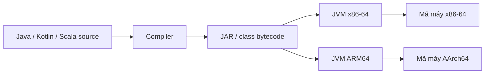
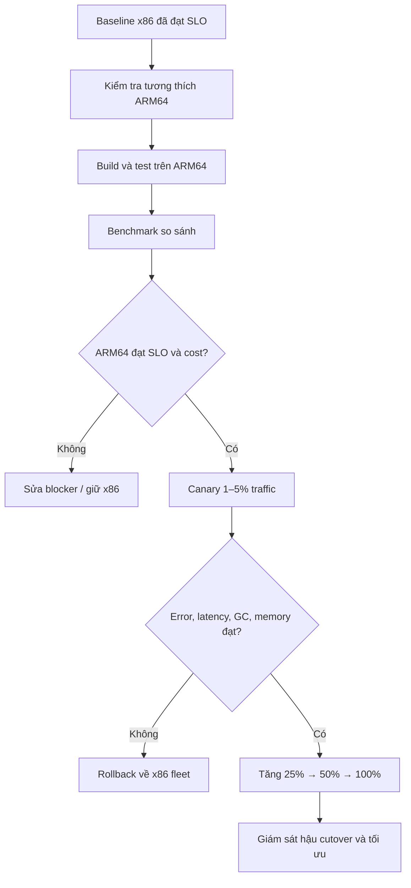

# Graviton và lựa chọn kiến trúc ARM cho workload Java

Một nhóm chạy ứng dụng Java trên Amazon EC2 `m7i.large` (kiến trúc x86-64) muốn thử `m8g.large` (AWS Graviton/ARM64) để cải thiện hiệu năng trên chi phí. Có thể chỉ cần biên dịch lại? Với ứng dụng **thuần Java**, nhiều khi cùng một tệp `.jar` có thể chạy trên cả hai kiến trúc vì JVM xử lý bytecode. Nhưng AMI, JVM, thư viện native, agent theo dõi, Docker image, cấu hình triển khai và yêu cầu latency vẫn cần tương thích.

Chủ đề này thuộc chương **Máy chủ EC2** của module **CLOUD_PROVIDERS_AWS**. Từ nền tảng AWS Region/AZ, IAM, VPC và EC2, người học sẽ biết cách đánh giá **AWS Graviton**, chọn họ instance phù hợp cho **Java workload**, di chuyển an toàn sang **ARM64**, giám sát hiệu năng/độ tin cậy và chứng minh lợi ích chi phí bằng số liệu thực tế. Những nguyên tắc này cũng hữu ích khi Java chạy trên ECS, EKS hoặc Lambda với kiến trúc ARM64.

## 1. Mục tiêu học tập

Sau bài học, bạn có thể:

1. Giải thích Graviton là gì; phân biệt **x86-64/amd64** với **ARM64/AArch64** và tác động đối với JVM.
2. Nhận diện các họ **T4g, M*g, C*g, R*g** và lựa chọn theo CPU, RAM, I/O, mạng, hình thái tải; lưu ý thế hệ mới và mức hỗ trợ của từng Region.
3. Lập **ma trận tương thích** cho JDK, Linux AMI, dependency Java, JNI/JNA, agent, container và công cụ build.
4. Di chuyển ứng dụng Java từ x86 sang Graviton theo quy trình **đánh giá → build/test → benchmark → canary → mở rộng → rollback**.
5. Benchmark công bằng bằng **throughput, p95/p99 latency, GC, RSS, CPU, cost/request** trong điều kiện SLO thực tế.
6. Thiết kế triển khai có IAM least privilege, VPC an toàn, nhiều AZ, CloudWatch và phương án vận hành/khôi phục.

## 2. AWS Graviton là gì?

**AWS Graviton** là dòng bộ xử lý do AWS thiết kế cho các dịch vụ tính toán như **Amazon EC2**, dựa trên tập lệnh **Arm 64-bit (AArch64)**. Mục tiêu là mang lại hiệu năng và hiệu quả sử dụng năng lượng tốt, từ đó có thể cải thiện **price-performance** cho nhiều nhóm workload.

### 2.1. Phân biệt thuật ngữ

| Thuật ngữ | Ý nghĩa | Khi nào gặp? |
|---|---|---|
| **x86-64**, **x86_64**, **amd64** | Kiến trúc 64-bit phổ biến của CPU Intel/AMD | AMI x86, Docker platform `linux/amd64`, thư viện native |
| **ARM64**, **arm64**, **AArch64** | Kiến trúc Arm 64-bit được Graviton sử dụng | AMI arm64, Docker platform `linux/arm64`, tên kiến trúc Linux `aarch64` |
| **AWS Graviton** | Dòng CPU AWS sử dụng Arm 64-bit | EC2 `m8g`, `c8g`, `r8g`, các thế hệ khác |
| **JVM** | Máy ảo Java thực thi bytecode và quản lý runtime | Amazon Corretto/OpenJDK bản phù hợp với arm64 |
| **JIT compiler** | Thành phần JVM dịch những đoạn mã nóng thành lệnh máy | Mã máy sinh ra riêng cho CPU đích |
| **JNI/JNA** | Cơ chế Java giao tiếp mã native hoặc thư viện hệ thống | Kết nối `.so`, nén, TLS, image processing, native database library |

Graviton **không** chạy trực tiếp một executable Linux x86-64 thông thường. Cần binary đúng kiến trúc, một runtime tương thích hoặc lớp giả lập được hỗ trợ. Đối với **Java bytecode**, JVM arm64 có thể thực thi bytecode vốn được biên dịch trên máy x86 trong nhiều tình huống; lợi thế này không áp dụng tự động cho mã native đi kèm.

### 2.2. Các thế hệ Graviton trong bối cảnh 2026

| Dòng CPU | Một số instance tiêu biểu | Ghi chú lựa chọn |
|---|---|---|
| **Graviton2** | `t4g`, `m6g`, `c6g`, `r6g` | Phù hợp nhiều workload có hệ sinh thái ARM64 tương thích; T4g có cơ chế CPU credits |
| **Graviton3 / Graviton3E** | `m7g`, `c7g`, `r7g`, `c7gn`, `hpc7g` | Thế hệ mới hơn, có biến thể phù hợp compute/mạng chuyên biệt |
| **Graviton4** | `m8g`, `c8g`, `r8g`, `x8g`, `i8g` | Lựa chọn cho nhiều workload tổng quát, tính toán, RAM hoặc lưu trữ |
| **Graviton5** | `m9g/m9gd`, `c9g/c9gd`, `r9g/r9gd` | Các dòng được công bố/phát hành trong năm 2026; tính sẵn có phụ thuộc Region, kích thước và thời điểm |

**Không chọn chỉ vì số thế hệ lớn nhất.** Dòng `m9g` có thể chưa sẵn ở Region hoặc AZ cần triển khai, còn `m8g` hay `c8g` có thể đáp ứng SLO với chi phí tốt hơn. Một số instance có chữ **`d`** sau ký hiệu `g` được trang bị **local NVMe instance store**; đây là lưu trữ gắn với vòng đời instance, không phải thay thế EBS/database lâu bền.

**Các số liệu marketing**, chẳng hạn “tăng tới X% hiệu năng/giá”, là kết quả trong điều kiện đo nhất định; không đồng nghĩa ứng dụng Java của bạn chắc chắn đạt tỷ lệ đó. Hãy đo trên chính workload và Region dự kiến.

Tài liệu cập nhật: [AWS Graviton technical guide](https://aws.github.io/graviton/); [Amazon EC2 instance type release history](https://docs.aws.amazon.com/ec2/latest/instancetypes/doc-history.html).

## 3. Vì sao Java là ứng viên tốt cho ARM64?

Java đi qua hai bước chính:



Phần lớn logic trong `.jar` chứa **bytecode không gắn với một kiến trúc CPU cụ thể**. Nếu ứng dụng sử dụng API Java phổ biến và JDK được hỗ trợ trên ARM64, việc chạy thử trên Graviton thường khả thi mà không cần sửa nhiều Java source.

Tuy nhiên, **“compile once, run anywhere” không bảo đảm mọi dependency và môi trường đều portable**. Mỗi ứng dụng cần kiểm tra:

- Bản **JDK/JRE ARM64** và phiên bản Java tương thích với source bytecode.
- **Linux distro, kernel, AMI** và phần mềm hệ thống.
- Các file native `.so`/binary và cách dependency tự chọn architecture.
- Java agent/APM, profiling, TLS provider, compression, embedded database hoặc JIT/native-image toolchain.
- Container base image và image manifest có bản `linux/arm64`.
- Các lệnh build, script shell, công cụ CI/CD, IaC và launch template.
- Sự khác biệt hiệu năng CPU, bộ nhớ, GC, I/O ở tải sản xuất.

Ví dụ, mã Java thuần tạo REST API bằng Spring Boot thường dễ di chuyển. Một ứng dụng cùng framework nhưng dùng bộ mã hóa video native chỉ phân phối x86-64 có thể cần thay thư viện hoặc giữ lại trên x86 cho đến khi có bản ARM64.

## 4. Chọn họ EC2 Graviton theo dạng workload

Các họ phổ biến thể hiện ưu tiên tài nguyên khác nhau. Đừng chọn “một kích thước ARM tương đương” mà không biết giới hạn của ứng dụng hiện tại.

| Họ instance | Mục tiêu | Workload Java phù hợp | Điểm cần kiểm tra |
|---|---|---|---|
| **T4g** | General purpose kiểu burstable | Web service nhỏ, môi trường thử nghiệm, API có CPU trung bình thấp và đỉnh ngắn | **CPU credits**, khả năng vượt baseline, phí credits theo chế độ áp dụng |
| **M6g/M7g/M8g/M9g** | Cân bằng CPU và RAM | Spring Boot API, Java microservices, batch vừa, các dịch vụ nghiệp vụ | Tỷ lệ CPU:RAM, mạng, EBS bandwidth, thế hệ/Region |
| **C6g/C7g/C8g/C9g** | Compute optimized | CPU-bound parsing, serialization, Java batch, encryption, tính toán | GC/heap, core utilization, compute throughput và latency |
| **R6g/R7g/R8g/R9g** | Memory optimized | Caching JVM, bộ nhớ lớn, analytics, service cần nhiều heap/off-heap | RSS, GC pause, native memory, chi phí theo RAM |
| **Biến thể `*gd` / I-series** | Local storage / storage optimized | Scratch space, cache cục bộ, xử lý cần NVMe nhanh | **Dữ liệu instance store không bền** sau các sự kiện vòng đời liên quan, cần sao lưu/lớp lưu trữ khác |
| **Họ mạng/HPC chuyên biệt** | Thông lượng mạng/HPC | Workload chuyên sâu về networking hoặc scientific Java | EFA/driver/toolchain, loại mạng và khả dụng Region |

### 4.1. Bài toán chọn M hay C hay R

Giả sử API Java hiện chạy x86 với:

- CPU p95 ở tải cao khoảng 85%, RAM thường dưới 40% và GC ổn định: hãy **benchmark họ C**.
- CPU trung bình và RAM sử dụng cân đối, nhiều REST/gRPC calls: **M** là điểm xuất phát dễ thử.
- Heap 24 GiB, off-heap/cache lớn, CPU chưa cao: ưu tiên thử **R** để tránh thiếu RAM.
- CPU thấp hầu hết thời gian, chỉ bùng nổ vài phút: **T4g** có thể đáng thử, song phải tính CPU credit/baseline.

**Cân nhắc điều kiện quan trọng:** không phải mọi họ đều có đúng cùng memory/vCPU ratio, EBS throughput, network bandwidth, disk và các tính năng phụ trợ. So sánh dựa trên cấu hình thật trong [EC2 Instance Types](https://aws.amazon.com/ec2/instance-types/) và [Instance Types Guide](https://docs.aws.amazon.com/ec2/latest/instancetypes/instance-types.html).

### 4.2. vCPU của Graviton và x86 không luôn tương đương

Theo tài liệu AWS, **mỗi vCPU Graviton ứng với một physical core** và không sử dụng Simultaneous Multithreading (SMT). Trong khi đó, nhiều instance x86 dùng hyperthreading, có thể có hai vCPU trên một physical core.

Vì thế, “cả hai instance có 8 vCPU” **không bảo đảm** cùng số lõi vật lý, cùng throughput hoặc cùng tốc độ xử lý mỗi request. Benchmark nên đo **tải tối đa duy trì trong SLO** và **giá để phục vụ một đơn vị công việc**, thay vì chỉ nhìn phần trăm CPU hay benchmark micro.

## 5. Kiểm tra tương thích của Java stack

Đây là bước quan trọng nhất trước khi cấp tài nguyên mới.

### 5.1. Ma trận tương thích

| Lớp | Câu hỏi kiểm tra | Kết quả cần lưu |
|---|---|---|
| **AMI / OS** | Amazon Linux 2023, Ubuntu, RHEL hoặc distro có AMI `arm64` không? Kernel/driver có phù hợp thế hệ instance? | AMI ID theo Region/architecture, phiên bản OS được hỗ trợ |
| **JVM** | Có bản Corretto/OpenJDK `aarch64` tương ứng với Java 17/21/25 hay version hiện hành? | JDK vendor, version, architecture, các JVM flags đặc biệt |
| **Framework** | Spring Boot, Quarkus, Micronaut, Kafka clients và dependencies có chạy ARM64? | Phiên bản, release notes, kết quả test tích hợp |
| **Native/JNI/JNA** | Có `.so` chỉ dùng x86, native codec, compression hoặc TLS engine không? | Tên artifact, classifier, bản ARM64 hay phương án thay thế |
| **Java agent** | APM, profiler, security agent, monitoring agent hỗ trợ Linux arm64? | Ma trận support chính thức của vendor |
| **Build / CI** | Compiler, Maven/Gradle plugin, codegen, testcontainers, script có giả định `x86_64`? | Kiến trúc runner, native build step, test matrix |
| **Container** | Mọi base image và image cuối có `linux/arm64`? Sidecar/init container thì sao? | Manifest list và digest cho cả `amd64`/`arm64` |
| **Runtime / infra** | Launch template, Auto Scaling, ECS/EKS scheduling, AMI, taints, Config và telemetry hỗ trợ? | Bản thiết kế deployment và rollback |
| **Licensing / hỗ trợ** | ISV có cấp license và hỗ trợ vận hành trên ARM64? | Cam kết hỗ trợ chính thức; danh sách rủi ro |

**Tài liệu AWS khuyến nghị** dùng JDK hiện đại, tối thiểu Java 11 và ưu tiên **Java 17 trở lên** để tận dụng tối ưu hóa phù hợp với Graviton. Java 8 có thể chạy trên ARM64 nhưng **không phải lựa chọn mặc định tốt nhất cho ứng dụng mới**. Các phiên bản Java LTS cần được xác nhận với chính sách bảo trì của tổ chức và framework.

Nguồn: [Java on AWS Graviton](https://aws.github.io/graviton/java.html).

### 5.2. Những dependency Java thường cần chú ý

| Nhóm | Vì sao có thể gặp lỗi? | Cách tiếp cận |
|---|---|---|
| **Netty native transport / TLS** | Artifact/native classifier theo OS/CPU | Nâng lên phiên bản hỗ trợ `linux-aarch_64` nếu cần và kiểm thử thực tế |
| **RocksDB JNI / LMDB** | Mang binary native đóng gói cùng Java | Xác minh `.so` ARM64, hoặc build lại từ mã nguồn phù hợp |
| **snappy, zstd, lz4, compression JNI** | Thư viện nén có native code | Dùng artifact có arm64, kiểm tra fallback Java thuần nếu hỗ trợ |
| **JNA/JNR** | Nạp thư viện hệ điều hành qua FFI | Kiểm tra ABI, cấu trúc và bản native hỗ trợ |
| **Image/video/PDF libraries** | Có thể gọi ffmpeg, font renderer hoặc các binary hệ thống | Cài đúng package AArch64, kiểm thử nội dung thực |
| **Machine learning inference** | JNI hoặc engine native như ONNX Runtime/TensorFlow | Kiểm tra bản ARM64 của engine và khả năng tăng tốc |
| **APM/security instrumentation** | Agent phụ thuộc native profiler/ebpf/binary | Tra cứu support matrix, thử metrics/traces/profiles |
| **GraalVM native-image** | Sinh executable native theo target platform, khác Java bytecode | Build và test executable ARM64 trên toolchain tương thích |

Danh sách này là **nhóm nguy cơ**, không phải khẳng định những thư viện trên luôn lỗi ARM64. Nhiều phiên bản hiện đại đã hỗ trợ AArch64. Phải kiểm tra **phiên bản cụ thể**.

### 5.3. Lệnh kiểm tra trên máy Linux

```bash
# Kiến trúc CPU/OS:
uname -m
# Thường thấy "aarch64" trên máy Linux arm64; "x86_64" trên x86.

# Kiểm tra JVM đang chạy:
java -version
java -XshowSettings:properties -version 2>&1 | grep -E 'os.arch|java.vm.name|java.version'

# Kiểm tra file native khi có:
file /path/to/libnative.so
readelf -h /path/to/libnative.so | grep Machine

# Liệt kê nội dung JAR để tìm artifact/native classifier đáng chú ý:
jar tf target/app.jar | grep -E 'aarch64|arm64|x86_64|amd64|\\.so$'
```

Các lệnh này chỉ dùng để **kiểm tra**. Một kết quả grep rỗng **không chứng minh ứng dụng hoàn toàn không có native dependency**: thư viện có thể được tải từ hệ điều hành, container layer, thư mục ngoài JAR hoặc download ở runtime. Cần bổ sung dependency tree, SBOM và test chức năng trên ARM64.

### 5.4. Xây dựng danh sách “blocker”

Đối với mỗi thành phần không có bản ARM64 hoặc chưa được vendor hỗ trợ:

1. Xác định chức năng nào thực sự dùng thành phần đó; ưu tiên theo mức độ ảnh hưởng.
2. Tìm **bản phát hành ARM64** hoặc phiên bản mới hơn với API tương thích.
3. Cân nhắc thay library, dùng Java implementation thay thế hoặc build native từ source với quy trình tin cậy.
4. Kiểm thử throughput, latency, memory, tính đúng kết quả và khả năng nâng cấp.
5. Nếu chưa thể giải quyết an toàn, giữ workload đó trên **x86** và chuyển các workload khác trước.

**Không dùng giả lập x86 như phương án mặc định cho production chỉ để “chạy được”**; lớp giả lập có chi phí hiệu năng, độ phức tạp và rủi ro hỗ trợ. Có thể dùng giả lập trong CI để kiểm tra sơ bộ, nhưng benchmark production nên chạy **native ARM64**.

## 6. AMI và cách chuyển EC2 từ x86 sang ARM64

Một sai lầm thường gặp là dừng instance x86 rồi đổi trực tiếp type từ `m7i.large` sang `m8g.large`.

**Không thể chuyển kiến trúc theo cách này.** Amazon Machine Image (**AMI**) gắn với một kiến trúc xử lý. EC2 chỉ cho đổi instance type khi tương thích với architecture của AMI hiện tại. Để chuyển x86 sang Graviton, thông thường bạn cần **khởi tạo một EC2 mới bằng AMI ARM64**, cấu hình ứng dụng tương đương và chuyển lưu lượng/dữ liệu theo kế hoạch.

Nguồn: [EC2 — Compatibility for changing instance type](https://docs.aws.amazon.com/AWSEC2/latest/UserGuide/resize-limitations.html).

### 6.1. Hai phương án triển khai

| Phương án | Mô tả | Ưu / nhược |
|---|---|---|
| **Blue/green** | Tạo nhóm ARM64 riêng với AMI/launch template mới, test, rồi chuyển traffic dần | Rollback rõ ràng, dễ so sánh x86/ARM; tốn thêm tài nguyên trong giai đoạn chuyển |
| **Rolling / instance refresh** | Thay dần fleet theo batch bằng launch template/AMI ARM64 mới | Tận dụng ASG và kiểm tra health; cần kiểm soát capacity, thời gian thay máy và cơ chế quay lại bản cũ |

Cho dịch vụ Java có SLA quan trọng, **blue/green hoặc canary tách nhóm** thường dễ đánh giá và rollback hơn. Một Auto Scaling group chỉ có **x86 AMI** không thể tùy tiện gắn loại ARM instance vào mix; cần launch template/AMI tương thích từng kiến trúc và kiểm tra khả năng hỗ trợ mixed configuration.

### 6.2. Chuẩn bị AMI ARM64

- Chọn **AMI ARM64 đã được hỗ trợ** như Amazon Linux 2023 ARM64, Ubuntu arm64 hoặc image chuẩn tổ chức.
- Cài JDK/JRE `aarch64` và agent tương thích; cố định version để tái lập kết quả.
- Cấu hình **IAM instance profile**, SSM Agent, logging, TLS, secret management và patching.
- Dùng **EBS** cho dữ liệu bền và ứng dụng có trạng thái nếu cần; hiểu vòng đời instance store.
- Thiết lập bảo mật VPC, SG, subnet, load balancer, listener, target group và health checks.
- Dùng Infrastructure as Code (Terraform/CloudFormation/CDK) để tránh sai khác cấu hình.

Một ứng dụng stateful có EBS volume hoặc local state không nên được cắt chuyển đơn giản bằng cách “copy thư mục đang chạy”. Hãy xác định cách backup/snapshot, thời điểm quiesce, consistency và đồng bộ dữ liệu trước khi thay host.

### 6.3. Lệnh AWS CLI chỉ đọc giúp kiểm tra

```bash
# Kiểm tra instance type có kiến trúc arm64 không.
# Thay Region/type theo danh mục thực tế được phép dùng.
aws ec2 describe-instance-types \
  --instance-types m8g.large \
  --region ap-southeast-1 \
  --query 'InstanceTypes[].{Type:InstanceType,Arch:ProcessorInfo.SupportedArchitectures,MemoryMiB:MemoryInfo.SizeInMiB,VCPU:VCpuInfo.DefaultVCpus}' \
  --output table

# Xem một AMI có architecture nào (thay AMI ID theo Region).
aws ec2 describe-images \
  --image-ids ami-0123456789abcdef0 \
  --region ap-southeast-1 \
  --query 'Images[].{Name:Name,Arch:Architecture,State:State}' \
  --output table
```

`ami-0123456789abcdef0` ở đây là **giá trị ví dụ**, có thể không tồn tại. Các lệnh không tạo tài nguyên và yêu cầu IAM đọc EC2 phù hợp. **Instance type không sẵn trong Region/AZ** hoặc AMI ID sai có thể trả lỗi; hãy tra vùng trước khi quyết định.

## 7. Build và đóng gói Java cho ARM64

### 7.1. Java JAR thuần thường không cần cross-compile

Ví dụ với Maven:

```bash
# Build và chạy test bằng JDK đúng version của dự án
./mvnw --batch-mode clean verify

# Đóng gói khi các test đã đạt
./mvnw --batch-mode -DskipTests package

# Kiểm tra metadata của JVM khi thử trên máy ARM64
java -XshowSettings:properties -version 2>&1 | grep os.arch
```

JAR chứa Java bytecode được build trên x86 có thể chạy dưới JVM ARM64. Nhưng **nếu quá trình build sinh mã native, nhúng classifier kiến trúc, native-image hoặc phụ thuộc công cụ OS**, build phải được thử/triển khai cho ARM64 tương ứng. Bước `-DskipTests` chỉ minh họa đóng gói sau khi kiểm thử đã đạt, không được dùng để bỏ kiểm tra trong pipeline release.

### 7.2. Docker image đa kiến trúc

Đối với Java chạy trong container, tệp JAR có thể dùng chung nhưng **base image chứa JVM phải đúng architecture**. Một image đa kiến trúc (*multi-platform*) có các lớp/lệnh phù hợp và manifest để runtime chọn platform.

Ví dụ Dockerfile cho **một Maven project** có `pom.xml` và `src`:

```dockerfile
# Giai đoạn build dùng JDK của kiến trúc builder.
FROM --platform=$BUILDPLATFORM eclipse-temurin:21-jdk AS build
WORKDIR /src
COPY pom.xml .
COPY src ./src
RUN apt-get update \
  && apt-get install -y --no-install-recommends maven \
  && rm -rf /var/lib/apt/lists/*
RUN mvn --batch-mode -DskipTests package

# Giai đoạn runtime dùng biến platform mục tiêu do BuildKit chọn.
FROM eclipse-temurin:21-jre
WORKDIR /app
COPY --from=build /src/target/app.jar /app/app.jar
USER 10001
EXPOSE 8080
ENTRYPOINT ["java", "-jar", "/app/app.jar"]
```

**Điều kiện của ví dụ:** Maven artifact phải có tên `app.jar`; thay cho đúng `artifactId/version` hoặc cấu hình `finalName`. Image chính thức, package manager và Java version có thể thay đổi; cần xác minh image được dùng hỗ trợ cả `amd64` và `arm64`, quyền chạy `USER 10001`, file writable và môi trường production. Đây là mẫu minh họa, **không phải Dockerfile production hoàn chỉnh**.

**Ranh giới quan trọng:** `FROM --platform=$BUILDPLATFORM` build bằng JVM của build host; chỉ phù hợp khi phần build sinh ra artifact **portable**. Nếu dependency sinh mã native, cần build theo `TARGETPLATFORM` hoặc CI chạy trên ARM64 tương ứng. Việc chỉ chuyển `FROM` của runtime image không biến thư viện `x86_64` thành `aarch64`.

### 7.3. Build và kiểm tra multi-arch image

```bash
# BuildKit/buildx: build image cho hai kiến trúc và đẩy lên registry được phép.
# Thay registry/repository/tag theo môi trường và chỉ chạy khi có quyền.
docker buildx build \
  --platform linux/amd64,linux/arm64 \
  --tag registry.example.com/team/java-api:1.0.0 \
  --push .

# Chỉ xem manifest của image đã đẩy:
docker buildx imagetools inspect registry.example.com/team/java-api:1.0.0

# Kiểm tra kiến trúc host và JVM bên trong container khi chạy trên ARM:
uname -m
java -XshowSettings:properties -version 2>&1 | grep os.arch
```

Khi build đa kiến trúc trên máy x86, ARM64 có thể được build/test bằng **QEMU emulation** hoặc native builder. **Kết quả benchmark khi giả lập không phản ánh hiệu năng Graviton thật**; dùng EC2 ARM64 hoặc runner native ARM64 để test performance.

Registry, Dockerfile, `USER` và dependency scanning cần được kiểm chứng trước khi triển khai. Nếu sử dụng ECR, kiểm tra architecture manifest và vòng đời image/tag; nên gắn **immutable digest** trong quy trình phát hành.

### 7.4. ECS và EKS sử dụng ARM64

- Với **Amazon ECS**, task definition có thể chỉ rõ `runtimePlatform.cpuArchitecture = ARM64` và `operatingSystemFamily = LINUX`; task và image phải tương thích capacity provider/OS. Khi dùng Fargate, kiểm tra các yêu cầu platform và task size.
- Với **Amazon EKS**, một cluster có thể có **x86 và ARM worker nodes**. Dùng label như `kubernetes.io/arch`, `nodeSelector` hoặc node affinity để điều phối pod; từng container (kể cả init/sidecar) phải có image đúng architecture.
- Với **EC2 Auto Scaling**, nên tạo launch template/AMI ARM64 riêng và quản lý rollout theo ASG hoặc cơ chế tương thích.

Ví dụ khai báo ECS **chỉ là phần trích** của task definition:

```json
{
  "runtimePlatform": {
    "operatingSystemFamily": "LINUX",
    "cpuArchitecture": "ARM64"
  }
}
```

Ví dụ Kubernetes để chỉ định pod chạy trên node ARM64:

```yaml
spec:
  nodeSelector:
    kubernetes.io/arch: arm64
```

Trong cụm hỗn hợp kiến trúc, scheduler có thể đặt pod sai nếu không có selector/affinity thích hợp hoặc image không hỗ trợ nền tảng đích. Không dùng label architecture làm biện pháp bảo mật; nó là điều kiện điều phối.

Nguồn: [ECS — Specifying ARM architecture](https://docs.aws.amazon.com/AmazonECS/latest/developerguide/ecs-arm-specifying.html), [ECS RuntimePlatform](https://docs.aws.amazon.com/AmazonECS/latest/APIReference/API_RuntimePlatform.html).

## 8. Chạy benchmark hiệu năng Java đúng cách

Chuyển sang Graviton có thể đem lại lợi ích, nhưng **quyết định production phải dựa trên phép đo tái lập được**.

### 8.1. Xác định SLO trước khi benchmark

Ví dụ API thanh toán đặt SLO:

- Tại tải 1.200 requests/giây, **p95 latency ≤ 150 ms**.
- **p99 latency ≤ 300 ms**.
- **Error rate dưới 0,1%** ở trạng thái ổn định.
- Không có lỗi correctness hay vấn đề đáng kể khi warm-up, rolling deploy và scale-out.

Nên dùng **test dữ liệu/traffic phản ánh thực tế**, ví dụ tỷ lệ truy vấn đọc/ghi, kích thước payload, cache hit, kết nối DB, TLS và burst vào giờ cao điểm.

### 8.2. Quy trình thử có tính công bằng

1. **Baseline x86:** ghi nhận phiên bản ứng dụng, JDK, instance, Region/AZ, EBS, network, heap, GC, traffic và chi phí.
2. **Giữ cấu hình tương đương:** dùng cùng ứng dụng, cùng functional behavior, source dữ liệu/test scenario; hạn chế thay cả JDK/framework lẫn architecture trong cùng lượt đo nếu mục tiêu là cô lập khác biệt CPU.
3. **ARM64 native:** chạy trên EC2 Graviton với AMI/JDK/agent/dep đúng kiến trúc, không dùng QEMU để benchmark.
4. **Warm-up JVM:** đợi JIT compilation, cache/connection pools và GC ổn định; ghi rõ warm-up time và duration.
5. **Sweep tải:** tăng dần concurrency hoặc RPS cho tới khi chạm SLO hoặc nguồn lực giới hạn; không chỉ đo một mức tải dễ.
6. **Lặp lại:** chạy nhiều lượt trong các điều kiện tương đương, báo độ biến động; điều tra anomalous runs.
7. **Thử vận hành:** rolling restart, autoscaling, network failure, AZ failover, DB throttling, traffic burst.
8. **Quyết định theo SLO + total cost:** nếu cùng đáp ứng SLO, chọn cấu hình có chi phí/khả năng vận hành tốt hơn; giữ rollback.

### 8.3. Những chỉ số phải thu thập

| Nhóm | Chỉ số | Ý nghĩa |
|---|---|---|
| Ứng dụng | RPS, transactions/s, throughput batch | Năng lực đáp ứng nghiệp vụ |
| Độ trễ | p50/p95/p99 và max, timeout | Trải nghiệm người dùng và “tail latency” |
| Chất lượng | Error rate, correctness tests, retries | Tránh đánh đổi hiệu năng lấy sai kết quả |
| CPU | CPU utilization, steal nếu có, cycles, saturation | Khả năng xử lý thực tế so với giới hạn |
| JVM | Heap used, GC pause/count, allocation rate | Phân biệt CPU xử lý ứng dụng với GC |
| Memory | RSS, native/direct buffer, OOM, page faults | Bộ nhớ ngoài heap cũng tiêu tốn RAM |
| I/O / mạng | EBS latency/IOPS, network throughput, DB time | Phát hiện bottleneck không thuộc CPU |
| Triển khai | Start-up time, ready time, scale-out time | Hiệu quả khi thay pod/instance |
| Chi phí | Giá/giờ, instance-hours, cost/1M requests hoặc cost/job | So sánh hiệu quả kinh tế |

Đối với JVM, **Java Flight Recorder (JFR)**, `jcmd`, Java metrics (Micrometer/OpenTelemetry) và **CloudWatch** có thể giúp xác định GC, lock contention, thread state, allocation và request latency. Chỉ bật profiling theo phạm vi phù hợp với overhead và chính sách dữ liệu.

### 8.4. Câu hỏi “tại sao ARM nhanh/chậm hơn?”

Nên phân loại theo bottleneck:

- **CPU-bound, nhiều threads:** có thể hưởng lợi từ khả năng xử lý vật lý và đặc điểm Graviton; vẫn cần đo ở tải cao.
- **Lock contention / synchronized hot path:** JIT, các thay đổi JVM và hành vi lock có thể tác động khác nhau.
- **GC-bound:** cách heap/collector, allocation, áp lực RAM và JDK version có thể chi phối.
- **Network-bound:** kết nối DB, API thứ ba hoặc số lượng connections có thể che lấp lợi thế CPU.
- **I/O-bound:** giới hạn EBS/instance size có thể quyết định throughput dù CPU nhàn.
- **Native dependency-bound:** bộ mã hóa/nén trên ARM64 chưa tối ưu có thể làm kết quả kém mong đợi.

**Microbenchmark** (ví dụ JMH) rất hữu ích để phân tích một hàm/hot path, nhưng **không thay** benchmark toàn hệ thống trong SLO thật.

## 9. Phân tích chi phí và price-performance

“Giá/giờ thấp hơn” chưa đủ để chứng minh **TCO** thấp hơn. Một cấu hình rẻ hơn nhưng xử lý ít đơn hàng hơn hoặc vi phạm SLO có thể gây chi phí lớn hơn.

### 9.1. Công thức thực hành

```text
cost_per_million_requests =
  total_cost_for_measurement_window
  / (successful_requests_in_window / 1,000,000)

effective_cost =
    compute instances
  + EBS / storage / snapshots
  + network / load balancer / data transfer
  + monitoring / logging / security
  + operations and migration costs (khi đánh giá TCO)
```

Đối với workload nền kéo dài, cần tính thêm **On-Demand/Savings Plans/Reserved Instances/Spot** theo mức cam kết và độ chịu lỗi. Đối với **T4g** còn cần tính cơ chế CPU credits, trạng thái unlimited nếu sử dụng. Khi so sánh chi phí, dùng **giá thực trong cùng Region, chế độ thanh toán tương đương**, bao gồm discounts/commitments thực tế của tài khoản.

### 9.2. Bảng ví dụ giả định

Đây là số **minh họa công thức, không phải giá AWS**:

| Chỉ số | x86 ứng viên A | Graviton ứng viên B |
|---|---:|---:|
| Chi phí compute/giờ giả định | 0,40 USD | 0,32 USD |
| Throughput ổn định thỏa SLO | 1.500 req/s | 1.600 req/s |
| Request thành công/giờ | 5.400.000 | 5.760.000 |
| Cost/1M requests (chỉ compute) | ~0,0741 USD | ~0,0556 USD |

Với các giả định đó, chi phí compute trên mỗi triệu request giảm khoảng **25%**. Kết luận chỉ đúng cho **điều kiện benchmark giả định**; nếu network, EBS hoặc observability chênh lệch, tổng chi phí cần tính lại.

Để ra quyết định thật, so sánh **tổng chi phí khi đáp ứng cùng SLO tại traffic forecast**, chứ không lấy một bảng thông số marketing hoặc giá instance đang khuyến mãi làm chuẩn.

### 9.3. Điểm dễ bỏ sót trong ngân sách

- Ngày chuyển đổi cần chạy **cả hai fleet** x86 và ARM64.
- AMI snapshots, EBS volumes và logs có thể tiếp tục phát sinh tiền sau khi xóa EC2.
- Load Balancer, NAT Gateway, public IPv4, dữ liệu truyền giữa AZ/Region tính phí riêng.
- **Savings Plans/RI** hiện tại có thể ảnh hưởng chi phí hiệu dụng và phạm vi sử dụng áp dụng.
- Workload có giấy phép phần mềm/agent tính theo CPU, core hoặc OS.
- Giá, ưu đãi, kích thước và chính sách Free Tier thay đổi theo Region/thời điểm.

**Không mặc định “Graviton rẻ hơn X% cho mọi Java app”.** Lợi ích thật chỉ xuất hiện nếu ứng dụng tương thích, đáp ứng SLO và tổng chi phí vận hành phù hợp.

## 10. Cấu hình JVM trên Graviton: tối ưu có kiểm chứng

Chuyển JVM qua ARM64 rồi **bắt đầu bằng cài đặt mặc định của JDK được hỗ trợ**. Chỉ sửa flags khi profiling chỉ ra bottleneck rõ ràng.

### 10.1. Version JDK và GC

- Ưu tiên **JDK được duy trì và hỗ trợ arm64** (chẳng hạn Corretto/OpenJDK phù hợp), kiểm tra cả JDK minor updates.
- **Java 17/21/25** là các lựa chọn LTS phổ biến tùy chính sách, framework và vendor. Java 8/11 legacy có thể dùng nhưng cần hiểu lifecycle và hạn chế tối ưu.
- **G1 GC** mặc định trong nhiều JDK hiện đại là điểm xuất phát hợp lý; cân nhắc ZGC hoặc collector khác nếu có nhu cầu rõ ràng và JDK hỗ trợ.
- Phân biệt **heap** với bộ nhớ native: thread stacks, direct buffers, metaspace, JIT code cache và agent.

Ví dụ flags chỉ để minh họa cách tư duy:

```bash
java \
  -XX:InitialRAMPercentage=20 \
  -XX:MaxRAMPercentage=65 \
  -XX:+UseG1GC \
  -jar app.jar
```

Các phần trăm **không phải công thức chuẩn**: thực tế phải chừa headroom cho non-heap, OS và container limits. Nếu trước đó dùng `-Xmx` tuyệt đối hoặc GC flags khác, cần điều tra tương tác trước khi thêm flags mới; không bật một loạt tối ưu “Graviton” theo lời đồn.

### 10.2. Kiểm tra flag và môi trường runtime

```bash
# JVM hỗ trợ gì và đang bật gì?
java -XX:+PrintFlagsFinal -version > jvm-flags.txt

# Trên hệ thống có JDK tools và quyền phù hợp:
jcmd -l
jcmd <PID> VM.command_line
jcmd <PID> VM.flags

# Chụp JFR có thời lượng giới hạn; chỉ khi được phép
# jcmd <PID> JFR.start name=arm-eval settings=profile duration=60s filename=/tmp/arm-eval.jfr
```

Các lệnh `jcmd` cần quyền truy cập tiến trình thích hợp và có thể ghi file/profile chứa dữ liệu nhạy cảm. Không chạy JFR tùy tiện trên production khi chưa có quy trình đo và xử lý dữ liệu.

### 10.3. AArch64 và tối ưu compiler

HotSpot JIT có thể tự tạo mã máy phù hợp AArch64. Native code của ứng dụng cần compiler/lib tương thích. Với các đoạn xử lý rất nặng sử dụng SIMD, bộ lệnh/khả năng tối ưu khác nhau giữa các đời Graviton; việc dùng cờ compiler chuyên sâu cần dựa trên hướng dẫn của phiên bản CPU và toolchain tương ứng.

Chỉ nên dùng tuning khi đã biết **bottleneck**, và lưu kết quả đo/commit để có thể rollback. Tối ưu hóa có hiệu quả trên microbenchmark có thể không cải thiện p99 latency của toàn ứng dụng.

## 11. Triển khai canary, rollback và khả năng phục hồi

Một quy trình chuyển đổi tốt bảo đảm rằng ARM64 **không làm gián đoạn sản phẩm** nếu gặp incompatibility.

### 11.1. Mẫu rollout



*Tỷ lệ canary chỉ là ví dụ; điều chỉnh theo tải, yêu cầu nghiệp vụ và công cụ triển khai của tổ chức.*

Khi chạy x86/ARM song song:

- **ALB target groups** và health checks có thể giúp chuyển lưu lượng giữa hai nhóm.
- Dịch vụ **stateless** và session lưu bên ngoài instance thường dễ rollback hơn.
- Nếu có **database schema changes**, phải đảm bảo backward compatibility cho cả phiên bản x86 lẫn ARM; rollback ứng dụng không tự đảo ngược schema dữ liệu.
- Deploy trên **nhiều AZ**, giám sát EC2/ALB/ASG status và đảm bảo mức capacity tối thiểu khi thay instance.
- Dùng **SSM Session Manager** hoặc phương án quản trị được phép; không mở SSH public cho mọi IP chỉ để debug migration.

### 11.2. Điều kiện dừng/rollback

Định nghĩa trước hành động khi một trong các tình trạng xuất hiện:

| Tín hiệu | Ví dụ điều kiện | Hành động |
|---|---|---|
| Tăng error rate | Lỗi 5xx hoặc lỗi nghiệp vụ vượt baseline/SLO | Dừng mở rộng canary, chuyển traffic về fleet ổn định |
| Vi phạm p95/p99 | Tail latency vượt ngưỡng qua các cửa sổ đo | Gỡ traffic khỏi ARM, phân tích CPU/GC/DB |
| JVM crash / native issue | `SIGILL`, `UnsatisfiedLinkError`, segmentation fault | Cô lập dependency native, giữ x86 cho tới khi sửa |
| Rò rỉ RAM | RSS hoặc native memory tăng dài hạn | Ngừng rollout, kiểm tra heap/off-heap/agent |
| Thiếu năng lực AZ | Không cấp đủ ARM instances ở AZ mục tiêu | Chuyển lựa chọn instance size/family hoặc giữ fleet cũ |
| Chi phí không đạt | Cost/request tăng hoặc commitment bị ảnh hưởng | Tính lại sizing và kế hoạch phân bổ |

**Không xóa toàn bộ x86 capacity ngay khi canary vừa xanh.** Cần cửa sổ quan sát đủ dài để bắt các công việc batch ban đêm, lịch deploy, GC dài kỳ và ngày lưu lượng cao.

## 12. Kiến trúc bảo mật và vận hành

Graviton thay đổi CPU, **không thay đổi ranh giới trách nhiệm chia sẻ** của AWS.

### 12.1. Các lớp cần kiểm soát

| Lớp | Việc cần làm |
|---|---|
| **IAM** | Instance profile theo least privilege; không nhúng static access keys vào AMI/JAR |
| **VPC / subnet** | Chọn private subnet khi phù hợp, chỉ mở SG port yêu cầu, quản lý NAT/VPC endpoints |
| **OS / patching** | Duy trì AMI ARM64, kernel, OpenSSL/glibc, JDK, agent và native packages |
| **Data security** | Mã hóa EBS/KMS, TLS, secret từ Secrets Manager/SSM Parameter Store theo quyền phù hợp |
| **Supply chain** | Kiểm tra base image kiến trúc, chữ ký/digest, SBOM, CVE scanning, provenance của native libs |
| **Observability** | CloudWatch, log structured, traces, JFR khi thích hợp, ASG/ALB health, cảnh báo chi phí |
| **Resilience** | Nhiều AZ, Auto Scaling, backup/snapshot, RTO/RPO và kiểm thử restore |

Ví dụ, một Java service chạy `c8g.large` có thể dùng S3 và RDS qua IAM role/SG phù hợp như khi chạy x86. Nhưng **SSM agent, log collector và security agent** phải có bản ARM64 được hỗ trợ. Nếu không, workload vẫn chạy nhưng đội vận hành có thể mất quan sát hoặc quyền kiểm soát dự kiến.

### 12.2. Tiêu chí giám sát sau chuyển đổi

- EC2/ASG: healthy instances, launch failures, CPU, memory agent, network/EBS throttling.
- JVM: GC pauses, CPU time, heap/off-heap, class loading, thread pools, exception rate.
- Ứng dụng: p95/p99, RPS, error budget burn, timeout, DB connection pool.
- Triển khai: thời gian startup, drain traffic, health check, rolling replacement.
- Chi phí: Cost Explorer/Budgets, account tags, compute và networking cost.
- Bảo mật: AMI/JDK CVEs, CloudTrail/Config/Security Hub theo kiến trúc tổ chức.

## 13. Quy trình chuyển đổi thực hành cho một Spring Boot API

**Bối cảnh giả định:** nhóm có Spring Boot API chạy trên EC2 x86 sau ALB, dùng RDS qua private subnet, lưu file tĩnh ở S3, xuất log qua CloudWatch. Nhóm muốn thử Graviton mà không gián đoạn người dùng.

### Giai đoạn A — Thu thập thông tin

Điền mẫu kiểm kê:

| Hạng mục | Ví dụ hiện trạng | Cần kiểm tra cho ARM64 |
|---|---|---|
| Code / framework | Spring Boot + Java 21 | Dependency tree, integration tests |
| Runtime | Corretto 21 x86 | Corretto 21 AArch64 và patch level |
| Artifact | `app.jar` | Có native `.so` hay classifier riêng không? |
| Image | Golden AMI x86 | Golden AMI ARM64 cùng chính sách patch |
| Deployment | EC2 ASG, ALB | ASG/launch template ARM64 riêng và rollback |
| Dependencies | RDS, S3, Redis | Kết nối, TLS, serialization, performance |
| Telemetry | APM agent + CloudWatch | APM/support ARM64 và chỉ số tương đương |
| SLO | p95 150 ms, error rate 0,1% | Benchmark và canary theo đúng thước đo |

### Giai đoạn B — Đánh giá tính tương thích

1. Xác nhận JVM/JDK ARM64 cùng minor version phù hợp, kernel/AMI.
2. Kiểm tra native dependencies (ví dụ Netty/OpenSSL nếu app dùng), APM, binary tools.
3. Chạy `mvn verify` trong môi trường ARM64; kiểm thử database và mọi contract API.
4. Kiểm tra ứng dụng boot, kết nối HTTPS/DB, serializer, logging, traces, signal handling, shutdown.
5. Ghi rõ blocker, người chịu trách nhiệm và tiêu chí chấp nhận.

### Giai đoạn C — Benchmark

- Chạy bài tải cùng dữ liệu, warm-up và độ dài đo như baseline.
- Giữ cùng JDK/framework version, heap và các điều kiện mạng/dữ liệu tương đương; sau đó mới thử tối ưu khác.
- Thử ít nhất một ứng viên M, và C/R nếu profile CPU/RAM cho thấy có thể tốt hơn.
- Ghi bảng throughput đạt SLO, p95/p99, GC, CPU, RAM, cost/request.

### Giai đoạn D — Triển khai

1. Tạo AMI ARM64/launch template mới, private subnet và IAM role theo chuẩn.
2. Tạo fleet/ASG riêng và kiểm tra health checks trước khi nhận traffic.
3. Bắt đầu canary nhỏ, theo dõi logs và metrics cùng baseline x86.
4. Tăng lưu lượng khi qua các cửa sổ quan sát đã định.
5. Giữ đường rollback bằng x86 fleet trong thời gian kiểm tra thích hợp.
6. Sau ổn định, tối ưu instance size, savings commitment và dọn tài nguyên không cần thiết.

### Giai đoạn E — Học từ kết quả

Nếu Graviton không đạt SLO, kết luận cần chỉ rõ nguyên nhân:

- Instance size thiếu RAM hay chỉ thiếu CPU?
- Có native dependency chưa tối ưu hoặc JVM version quá cũ?
- Có bottleneck DB/cache/network độc lập CPU?
- Chưa đủ warm-up/JIT hay profile workload sai?
- Cost model đã tính toàn bộ EBS/network/logging/commitments chưa?

Giữ x86 cũng là quyết định kỹ thuật hợp lý khi ARM64 chưa đáp ứng điều kiện nghiệp vụ.

## 14. Các tình huống đặc biệt

### 14.1. T4g có CPU credits

Dòng **T4g** được thiết kế cho tải burstable. Ứng dụng Java có CPU sử dụng cao liên tục (batch, index, compression) có thể gặp giới hạn baseline hoặc chi phí credits theo cơ chế được cấu hình. Đừng chọn T4g chỉ vì giá On-Demand trên bảng thấp hơn; cần phân tích **CPU credit balance, surplus credits**, mức CPU trung bình và mô hình sử dụng thật.

### 14.2. EC2 + Lambda cùng workload Java

AWS Lambda có tùy chọn **`arm64`** cho các runtime hỗ trợ; không phải đổi loại EC2 instance. Nếu cùng một codebase deploy cả EC2 và Lambda, phải test artifact/layer/native dependency cho kiến trúc riêng của từng môi trường. So sánh chi phí Lambda cần tính requests/duration/memory/concurrency, không dùng giá EC2 để suy ra.

### 14.3. EKS có Java sidecar và DaemonSet

Main application image hỗ trợ ARM64 **chưa đủ**. Pod có `initContainers`, sidecar, service mesh proxy, log agent hoặc CSI/network plugin dùng native binary cũng phải hỗ trợ AArch64. Trước khi chuyển node group, kiểm tra mọi container image và DaemonSet cần chạy trên ARM.

### 14.4. Java legacy không thể nâng cấp

Một ứng dụng Java 8 đi kèm native C/C++ thư viện đóng kín có thể khó chuyển sang ARM64. Có thể cô lập thành service riêng trên x86, đưa Java services mới/độc lập sang Graviton trước. Nếu ISV chỉ hỗ trợ x86, hãy ưu tiên điều kiện hỗ trợ pháp lý và vận hành, không ép chuyển chỉ để đạt mục tiêu tiết kiệm chi phí.

### 14.5. Công cụ hỗ trợ đánh giá tự động (2026)

AWS đã công bố tính năng đánh giá **Graviton readiness** và hỗ trợ remediation cho Java trong **AWS Transform continuous modernization** (khả dụng rộng rãi từ 29/10/2026 theo thông tin công bố). Công cụ có thể rà soát repository để phát hiện vấn đề ARM64 và hỗ trợ chỉnh sửa có kiểm soát. Kết quả tự động vẫn phải được **review, build và chạy test ARM64** trước khi triển khai.

Đối với hệ thống lớn, đây là một tùy chọn hỗ trợ quy trình, không phải điều kiện bắt buộc để sử dụng Graviton và không thay toàn bộ benchmark/SLO.

Tham khảo: [AWS DevOps Blog — Graviton support for Java in AWS Transform continuous modernization](https://aws.amazon.com/blogs/devops/aws-graviton-support-for-java-in-aws-transform-continuous-modernization/).

## 15. Bài thực hành và câu hỏi ôn tập

### Bài A — Quyết định ứng viên Graviton

Một tổ chức có bốn Java workloads:

| Workload | Đặc tính | Ứng viên đề xuất để thử | Vấn đề kiểm chứng |
|---|---|---|---|
| **A:** Spring Boot REST API | 400–2.000 RPS, CPU và RAM cân đối | **M** | p99 latency, GC, startup, dependency native |
| **B:** Xử lý batch PDF/JSON | CPU 90%, ít RAM, chạy theo lịch | **C** | Throughput/job, native renderer, I/O |
| **C:** Cache Java in-memory | Heap lớn, CPU trung bình | **R** | Memory headroom, GC, native/off-heap |
| **D:** Java 8 + vendor x86-only agent | Phụ thuộc binary đóng kín | **Chưa chuyển ngay** | Vendor ARM support hoặc thay agent/library |

Đây là **shortlist để benchmark**, không phải khuyến nghị loại instance cuối cùng khi chưa có số đo.

### Bài B — Tìm lỗi trong kế hoạch migration

Nhóm đề xuất:

1. Snapshot instance x86, sau đó stop EC2 và đổi type thành `c8g.large`.
2. Giữ nguyên AMI x86 vì Java portable.
3. Giữ Docker image `linux/amd64` cho cả fleet.
4. Chạy benchmark trên laptop x86 bằng QEMU.
5. Nếu ứng dụng boot được thì xóa fleet x86.

**Yêu cầu:** chỉ ra ít nhất bốn vấn đề.

**Gợi ý:** (1) AMI phải cùng architecture với instance; (2) phải tạo AMI/instance ARM64; (3) runtime image phải có `linux/arm64`; (4) QEMU không đại diện hiệu năng Graviton; (5) boot thành công chưa chứng minh SLO/chi phí/correctness và cần đường rollback.

### Bài C — Tính giá theo công việc

Có hai ứng viên giả định:

- **X:** 0,50 USD/giờ, xử lý 5.000 job/giờ, thỏa SLO.
- **A:** 0,42 USD/giờ, xử lý 4.700 job/giờ, thỏa SLO.

Tính chi phí compute cho **1.000 job**:

```text
X: 0.50 / 5000 * 1000 = 0.1000 USD / 1.000 job
A: 0.42 / 4700 * 1000 ≈ 0.0894 USD / 1.000 job
```

Với cùng điều kiện đo, **A rẻ hơn khoảng 10,6% trên mỗi 1.000 job** dù throughput thấp hơn. Quyết định thật còn cần xem tốc độ hoàn thành toàn batch, yêu cầu capacity, phí I/O và vận hành.

### Bài D — Chuẩn bị ma trận CI đa kiến trúc

Hãy mô tả pipeline gồm:

1. Static/dependency audit cho ARM64 và vulnerability scanning.
2. Build JAR và integration tests trên x86 lẫn ARM64.
3. Multi-arch image build (nếu container hóa).
4. Kiểm tra manifest và signature/digest image.
5. So sánh benchmark theo SLO ở native Graviton.
6. Canary với automatic rollback nếu lỗi vượt ngưỡng.

**Tiêu chí hoàn thành:** một application release chứng minh được cả **binary compatibility**, **functional correctness** và **performance/cost acceptance**.

### Câu hỏi tự kiểm tra

1. Vì sao Java bytecode thường portable nhưng JNI library có thể không?
2. `x86_64` và `aarch64` thường xuất hiện ở đâu trong pipeline?
3. Có thể stop một instance x86 và chọn Graviton làm type mới khi AMI vẫn x86 không?
4. Khi API có CPU cao nhưng RAM thấp, nên thử họ C hay R trước?
5. Vì sao không nên so sánh CPU utilization một mình giữa ARM và x86?
6. Các chỉ số nào quan trọng để đo “price-performance” theo SLO?
7. Tại sao phải warm-up JVM trước khi đo tải?
8. Nếu build JAR trên x86, có luôn cần build lại JAR trên ARM không?
9. Vì sao image đa kiến trúc cần kiểm tra sidecars/agents?
10. T4g có điều kiện cost/capacity nào khác M/C?
11. Vì sao rollout x86 và ARM song song hữu ích?
12. Nếu lợi ích tính bằng giá/giờ nhưng latency tăng gấp đôi thì có nên chuyển không?

**Đáp án gợi ý:** (1) bytecode được JVM biên dịch tại runtime, native binary gắn ISA/ABI; (2) AMI/OS, container images, binary metadata; (3) không; (4) C, rồi benchmark; (5) SMT và đặc điểm lõi khác nhau; (6) throughput thỏa SLO, p95/p99, lỗi và total cost/unit; (7) JIT/cache/GC chưa ổn định ảnh hưởng số đo; (8) không nếu artifact thuần Java và JDK/deps phù hợp; (9) mỗi container và agent có native dependencies riêng; (10) CPU credits; (11) có canary/rollback và đối chứng; (12) chỉ nếu vẫn thỏa SLO và phân tích lợi ích/rủi ro đầy đủ.

## 16. Checklist trước khi đưa Graviton vào production

- [ ] Đã ghi **SLO**, baseline x86 và tổng chi phí hiện tại.
- [ ] Chọn instance Graviton phù hợp CPU/RAM/network/IO và xác minh Region/AZ availability.
- [ ] Đã chọn **ARM64 AMI** và JDK ARM64 tương thích, có cơ chế patching.
- [ ] Native dependencies, APM agents, OS tools và vendor licensing đã kiểm tra.
- [ ] Build/test CI có ARM64 runner hoặc môi trường ARM64 tương đương.
- [ ] Docker image, init/sidecars/DaemonSets hỗ trợ `linux/arm64` khi cần.
- [ ] Đo benchmark trên **native Graviton**, có warm-up, điều kiện tải và nhiều lượt.
- [ ] Throughput, p95/p99, error rate, GC và memory đạt tiêu chí.
- [ ] Cost/request hoặc cost/job dựa trên giá và dữ liệu thực tế.
- [ ] IAM, SG, EBS, secret, logging, CloudWatch và SSM được cấu hình.
- [ ] Có thiết kế nhiều AZ, capacity/Auto Scaling phù hợp và kịch bản khôi phục.
- [ ] Canary/blue-green có health checks, stop condition và rollback rõ ràng.
- [ ] Đã đo tác động đến cam kết Savings Plans/RI, phí mạng và thời gian chạy song song.
- [ ] Có runbook và chủ sở hữu xử lý sự cố sau cutover.

## 17. Kết luận

**Graviton là lựa chọn ARM64 đáng đánh giá nghiêm túc cho Java workload** nhờ JVM hiện đại, hệ sinh thái Linux và nhiều loại EC2 instances. Với Java thuần, chuyển đổi thường tương đối thuận lợi; điểm cần rà soát kỹ là **native dependency, AMI, container images, Java agent và pipeline**.

Quy tắc ra quyết định quan trọng nhất là **chứng minh ứng dụng chạy đúng, đạt SLO và có chi phí/đơn vị công việc tốt hơn trong điều kiện thực tế**. Chọn M/C/R/T theo nhu cầu, dùng JDK được hỗ trợ, đo trên Graviton thật và triển khai theo canary có rollback. Cùng với IAM, VPC, CloudWatch, thiết kế nhiều AZ và quản lý chi phí, cách làm này giúp đội ngũ triển khai Java trên AWS an toàn, quan sát được và dễ mở rộng.

### Tài liệu tham khảo chính thức

1. [AWS Graviton — Getting started](https://aws.amazon.com/ec2/graviton/getting-started/)
2. [AWS Graviton technical guide](https://aws.github.io/graviton/)
3. [AWS Graviton — Java](https://aws.github.io/graviton/java.html)
4. [Transitioning workloads to Graviton](https://aws.github.io/graviton/transition-guide.html)
5. [EC2 instance type families](https://aws.amazon.com/ec2/instance-types/)
6. [EC2 instance types — document history](https://docs.aws.amazon.com/ec2/latest/instancetypes/doc-history.html)
7. [EC2 — Compatibility for changing the instance type](https://docs.aws.amazon.com/AWSEC2/latest/UserGuide/resize-limitations.html)
8. [ECS — ARM architecture task definition](https://docs.aws.amazon.com/AmazonECS/latest/developerguide/ecs-arm-specifying.html)
9. [AWS Transform — Graviton support for Java (2026)](https://aws.amazon.com/blogs/devops/aws-graviton-support-for-java-in-aws-transform-continuous-modernization/)
10. [AWS EC2 Pricing](https://aws.amazon.com/ec2/pricing/)
11. [AWS Well-Architected Framework](https://docs.aws.amazon.com/wellarchitected/latest/framework/welcome.html)
