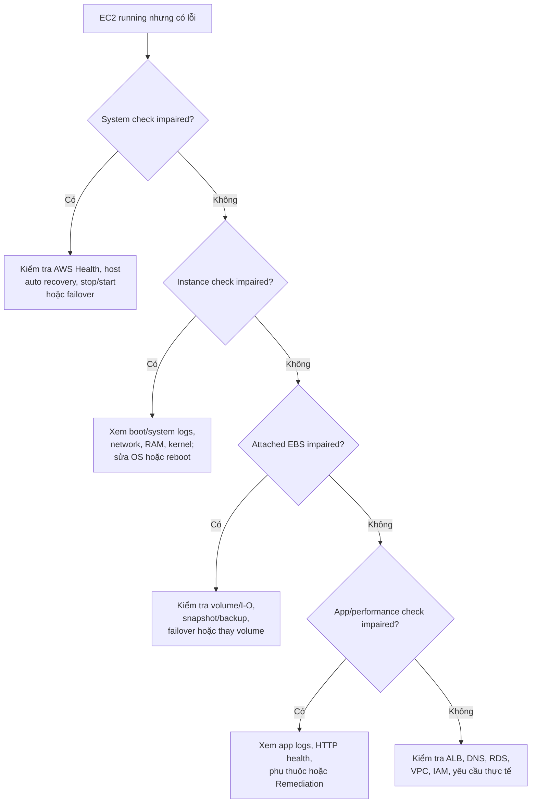
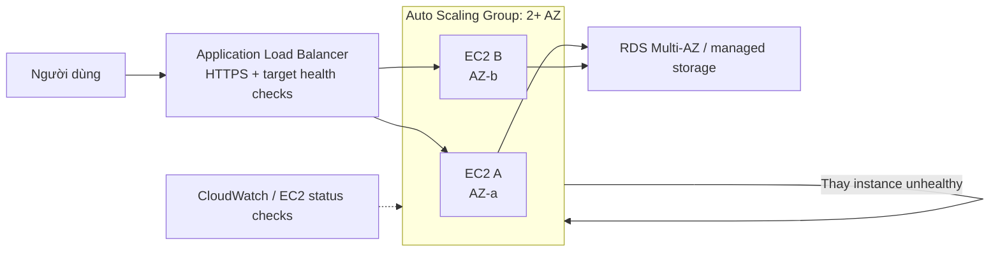

# EC2 status check và phục hồi instance

## Mục tiêu học tập

Sau bài học này, bạn có thể:

1. Phân biệt **trạng thái vòng đời** (instance state) với **trạng thái sức khỏe** (status check) của Amazon EC2.
2. Giải thích năm loại status check hiện có: **system**, **instance**, **attached EBS**, **application** và **performance**, cùng các giới hạn áp dụng.
3. Xem trạng thái bằng EC2 console, AWS CLI và CloudWatch; đọc đúng `ok`, `impaired`, `initializing`, `insufficient-data` và `not-applicable`.
4. Chọn phương án **reboot**, **stop/start**, **automatic recovery**, **thay instance** hoặc **failover** dựa trên nguồn gốc lỗi và yêu cầu dữ liệu.
5. Thiết lập cảnh báo CloudWatch cho sự cố hạ tầng, hiểu điều kiện hỗ trợ phục hồi tự động và tránh thực hiện hành động phục hồi nguy hiểm.
6. Viết runbook xử lý một EC2 không truy cập được, kết hợp log, Amazon EBS, Auto Scaling, cân bằng tải, backup và giám sát ứng dụng.

## 1. Vì sao một EC2 “running” vẫn có thể bị lỗi?

Giả sử công ty triển khai API bán hàng trên một EC2 trong private subnet. AWS console hiển thị instance ở trạng thái `running`, nhưng khách hàng nhận lỗi HTTP 503. Có nhiều nguyên nhân có thể xảy ra:

- Máy vật lý của AWS đang gặp lỗi phần cứng, mất nguồn hoặc mạng.
- Hệ điều hành trong EC2 bị treo, thiếu bộ nhớ, lỗi kernel hoặc cấu hình mạng sai.
- EBS gắn vào instance gặp sự cố I/O.
- Máy và hệ điều hành vẫn hoạt động, nhưng dịch vụ API đã dừng hoặc không còn đáp ứng yêu cầu.
- Một workload tăng tốc tính toán gặp vấn đề phần cứng GPU mà máy vẫn có thể truy cập được.

**Instance state** chỉ mô tả vòng đời máy ảo, chẳng hạn `pending`, `running`, `stopping`, `stopped`, `shutting-down` và `terminated`. Nó **không chứng minh** ứng dụng bên trong đang sẵn sàng phục vụ.

**EC2 status checks** là các kiểm tra định kỳ do AWS thực hiện để phát hiện vấn đề về hạ tầng, khả năng hoạt động của instance và các thành phần liên quan. Kết hợp status check với CloudWatch, AWS Health và kiểm tra ứng dụng giúp xác định lỗi nằm ở đâu trước khi chọn hành động phục hồi.

Trong module AWS về hạ tầng, IAM, VPC, tính toán, lưu trữ và giám sát, đây là kỹ năng thiết yếu: **khôi phục đúng lớp bị lỗi**, giảm thời gian gián đoạn và tránh làm mất dữ liệu hoặc thay đổi cấu hình không cần thiết.

## 2. Phân biệt instance state và status check

| Thuộc tính | Instance state | EC2 status check |
| --- | --- | --- |
| Câu hỏi chính | Máy đang ở giai đoạn nào của vòng đời? | Máy, hạ tầng hoặc chức năng được kiểm tra có đang khỏe không? |
| Ví dụ giá trị | `running`, `stopped`, `pending`, `terminated`. | `ok`, `impaired`, `initializing`, `insufficient-data`, `not-applicable`. |
| Nguồn dữ liệu | EC2 `DescribeInstances`. | EC2 `DescribeInstanceStatus` và metrics CloudWatch. |
| Ý nghĩa của “running” | Instance đã vào trạng thái chạy. | **Không đảm bảo** OS, EBS, API hoặc toàn bộ workload đang hoạt động tốt. |
| Ý nghĩa của “ok” | Không phải giá trị lifecycle. | Những phép kiểm tra tương ứng đã đạt; **không đảm bảo** mọi luồng ứng dụng từ người dùng đều thành công. |

Ví dụ:

```text
Instance state = running
System status = ok
Instance status = ok
Attached EBS status = ok
Application status = impaired
=> Hạ tầng cơ bản đã vượt qua các check, nhưng ứng dụng HTTP bị lỗi.
```

Đừng chỉ nhìn dấu kiểm màu xanh của EC2 rồi kết luận hệ thống kinh doanh vẫn hoạt động. Một API còn có thể phụ thuộc vào ALB, DNS, RDS, Redis, secret, IAM role và kết nối mạng ngoài.

## 3. Năm loại EC2 status check

AWS hiện mô tả **năm loại** kiểm tra. Các kiểm tra **system**, **instance** và **attached EBS** được EC2 thực hiện định kỳ cho instance đang chạy; attached EBS status check có metric trên **Nitro instances**. **Performance** chỉ áp dụng các loại instance tăng tốc được hỗ trợ. **Application** là tính năng tự cấu hình và gắn với instance cần giám sát.

Các phép kiểm tra chạy theo chu kỳ khoảng **một phút**. Khi kiểm tra thất bại, metric tương ứng tăng lên; một số giá trị sẽ là `0` (đạt) hoặc `1` (lỗi) trong CloudWatch. Trạng thái có thể tạm `initializing` sau khi khởi động hoặc `insufficient-data` khi thiếu dữ liệu.

| Loại check | Theo dõi | Nguyên nhân lỗi điển hình | CloudWatch metric |
| --- | --- | --- | --- |
| **System** | Hạ tầng AWS bên dưới instance: host, điện, kết nối phần cứng. | Host lỗi, mất kết nối mạng/hệ thống nguồn ở hạ tầng. | `StatusCheckFailed_System` |
| **Instance** | Khả năng hoạt động của instance ở mức hệ điều hành và mạng guest; EC2 kiểm tra khả năng đáp ứng từ NIC. | Lỗi boot/kernel, cấu hình mạng sai, cạn RAM, file system lỗi. | `StatusCheckFailed_Instance` |
| **Attached EBS** | EBS volumes gắn vào instance có thể liên lạc và hoàn tất I/O không. | Volume/storage subsystem hoặc đường host↔EBS gặp vấn đề. | `StatusCheckFailed_AttachedEBS` |
| **Application** | Khả năng ứng dụng phản hồi HTTP/HTTPS qua endpoint được cấu hình. | Process chết, cổng không mở, HTTP lỗi, ứng dụng treo. | `StatusCheckFailed_Application` |
| **Performance** | Sức khỏe phần cứng ảnh hưởng hiệu năng của một số instance tăng tốc. | Lỗi liên quan GPU/thiết bị tăng tốc mà máy có thể vẫn reachable. | `StatusCheckFailed_Performance` |

**System status check** và **instance status check** là hai phép quan sát khác nhau, nhưng không phải hai hệ thống hoàn toàn độc lập: khi hạ tầng host lỗi, instance status cũng có thể bị ảnh hưởng.

### 3.1. System status check: hạ tầng phía AWS

System check phát hiện vấn đề nằm ở **hệ thống hỗ trợ EC2**. Ví dụ nguồn điện, mạng hoặc phần cứng host không khả dụng. Nếu máy dùng **EBS-backed root volume**, AWS có thể thử **automatic recovery** tới host khác; một cách thủ công khác là **stop/start** để thường được cấp host khác.

Nếu system check lỗi, đừng mặc định phải sửa file cấu hình Linux bên trong máy. Trước hết hãy xem AWS Health, sự kiện EC2, khả năng auto recovery và liệu có thể chuyển tải sang AZ/instance khác.

### 3.2. Instance status check: hệ điều hành hoặc cấu hình guest

Instance check kiểm tra khả năng hoạt động của từng instance thông qua khả năng đáp ứng mạng, thường được mô tả bằng ARP tới network interface. Lỗi có thể đến từ:

- Kernel panic hoặc boot thất bại sau khi cập nhật hệ điều hành.
- Sai cấu hình network interface, route bên trong OS hoặc firewall cục bộ.
- RAM cạn khiến OS không còn đáp ứng.
- File system hỏng, không mount được phân vùng quan trọng.
- Driver ENA/NVMe không phù hợp sau khi thay instance type hoặc AMI.

**Recovery tự động khi system check lỗi không phải công cụ sửa instance check**. Nếu chỉ instance check `impaired`, thường cần xem log console/boot, OS và cấu hình; reboot có thể giúp trong một số tình huống nhưng không chữa được lỗi cấu hình tồn tại.

### 3.3. Attached EBS status check: lỗi đường lưu trữ

Kiểm tra này cho biết một hay nhiều **Amazon EBS volumes đang gắn** không thể hoàn tất I/O bình thường. Nó có thể liên quan đến hạ tầng EBS, host hoặc kết nối giữa EC2 và EBS. Metric `StatusCheckFailed_AttachedEBS` hiện chỉ có cho **Nitro-based instances**.

Ví dụ API vẫn trả kết quả nhưng ghi dữ liệu xuống volume chậm/treo; đừng chỉ xem CPU. Nên đối chiếu metric EBS của từng volume, I/O lỗi trong hệ điều hành, trạng thái attachment và nhu cầu failover. Tùy sự cố, hướng xử lý có thể là đợi AWS khắc phục, thay volume từ backup/snapshot hoặc stop/start nếu host là nguyên nhân và việc dừng máy được cho phép.

Status check này **không phải** một phép xác nhận dữ liệu trong EBS còn nhất quán về mặt ứng dụng. Cần backup, kiểm thử khôi phục và kiểm tra database/file system riêng.

### 3.4. Application status check: khả dụng của dịch vụ

Application check là tính năng **opt-in**. Bạn cấu hình đường dẫn HTTP/HTTPS, cổng và mã HTTP được xem là thành công, sau đó liên kết phép kiểm tra với instance. Dịch vụ sử dụng mạng quản lý bên trong VPC để gọi endpoint; kết quả có thể được dùng để cảnh báo hoặc tham gia cơ chế kiểm tra của Auto Scaling khi cấu hình phù hợp.

Ví dụ endpoint `GET /health/ready` nên chỉ trả thành công khi ứng dụng đủ điều kiện nhận traffic. Nếu API bị treo nhưng OS còn mạng, system và instance checks vẫn có thể `ok` trong khi application check chuyển thành `impaired`.

Ứng dụng thường còn cần **ALB target group health checks**, metrics lỗi HTTP, latency, log và synthetic monitoring. Những phép đo này không hoàn toàn thay thế nhau; một check từ trong VPC có thể đạt trong khi trải nghiệm thực tế của khách hàng từ Internet đang lỗi vì DNS, CloudFront hoặc route ở tầng khác.

### 3.5. Performance status check: thiết bị tăng tốc

Trên các loại instance tăng tốc được hỗ trợ, performance check có thể phát hiện lỗi phần cứng ảnh hưởng hiệu năng mà **không** khiến toàn bộ máy mất kết nối. `DescribeInstanceStatus` có thể trả về `PerformanceStatus.Remediation`, ví dụ khuyến nghị `reboot`.

Không thấy performance status trên instance thông thường **không có nghĩa** instance đó bị lỗi: check này chỉ áp dụng ở những cấu hình có hỗ trợ.

## 4. Đọc kết quả đúng: “impaired” không phải lúc nào cũng là “down”

| Giá trị | Ý nghĩa | Cách xử lý |
| --- | --- | --- |
| `ok` | Check đạt trong lần đánh giá tương ứng. | Theo dõi thêm ứng dụng và phụ thuộc. |
| `impaired` | Check thất bại. | Xác định **loại check** trước khi phục hồi. |
| `initializing` | Check đang khởi tạo, thường gặp sau lúc launch/reboot. | Theo dõi tiếp và xác minh thời gian khởi động bình thường. |
| `insufficient-data` | Chưa đủ dữ liệu kết luận. | Xem khoảng trống metric, cấu hình giám sát và trạng thái instance. |
| `not-applicable` | Check không áp dụng cho instance/tính năng hiện tại. | Không coi đây là lỗi nếu tính năng không được hỗ trợ/bật. |

**Không nên** đặt CloudWatch alarm hành động phá vỡ dịch vụ khi giá trị metric bị thiếu. Với các alarm có hành động EC2, AWS khuyến nghị xử lý `INSUFFICIENT_DATA` như tình trạng **thiếu dữ liệu**, không coi đó là lỗi để kích hoạt reboot/stop/recover.

### Sơ đồ tư duy chẩn đoán



Sơ đồ ưu tiên điều tra theo dấu hiệu, **không** loại trừ việc nhiều loại check cùng lỗi. Ví dụ system check bị lỗi kéo theo instance check bị lỗi là tình huống có thể xảy ra.

## 5. Xem status checks bằng AWS Console và CLI

### 5.1. AWS Management Console

Vào **EC2 → Instances → chọn instance → Status and alarms** để xem các kiểm tra sức khỏe và alarm liên quan. Tùy instance và tính năng bật, bạn thấy các mục System, Instance, Attached EBS, Application, Performance.

Đồng thời xem:

- **Instance state** tại danh sách instance.
- **Monitoring/CloudWatch metrics** cho khoảng thời gian sự cố.
- **Scheduled events** nếu có bảo trì, reboot, stop hoặc retirement.
- **AWS Health Dashboard** khi cần xác định sự cố hạ tầng, thông báo phục hồi hoặc lịch bảo trì.
- **Volume attachment** của EBS, trạng thái ALB target và log ứng dụng nếu symptom liên quan.

### 5.2. Lệnh đọc thông tin cơ bản

Các lệnh bên dưới **chỉ đọc**. ID `i-0123456789abcdef0` và Region `ap-southeast-1` là ví dụ; dùng AWS CLI đã đăng nhập bằng IAM role có quyền `ec2:Describe*` và CloudWatch cần thiết.

```bash
aws sts get-caller-identity

aws ec2 describe-instances \
  --instance-ids i-0123456789abcdef0 \
  --region ap-southeast-1 \
  --query 'Reservations[].Instances[].{Id:InstanceId,State:State.Name,Type:InstanceType,Root:RootDeviceType,AZ:Placement.AvailabilityZone,PublicIp:PublicIpAddress}'
```

Xem trạng thái check của một instance:

```bash
aws ec2 describe-instance-status \
  --instance-ids i-0123456789abcdef0 \
  --include-all-instances \
  --region ap-southeast-1 \
  --query 'InstanceStatuses[].{Id:InstanceId,State:InstanceState.Name,System:SystemStatus.Status,Guest:InstanceStatus.Status,EBS:AttachedEbsStatus.Status,Application:ApplicationStatus.Status,Performance:PerformanceStatus.Status,Events:Events}'
```

**Vì sao có `--include-all-instances`?** Mặc định `describe-instance-status` chỉ liệt kê instance ở trạng thái `running`. Thêm tùy chọn này giúp xác định cả trường hợp đã dừng, dù những status checks không còn hoạt động như khi máy đang chạy.

Để xem phần chi tiết và thời điểm suy giảm, bỏ `--query`:

```bash
aws ec2 describe-instance-status \
  --instance-ids i-0123456789abcdef0 \
  --include-all-instances \
  --region ap-southeast-1
```

Một phần kết quả minh họa:

```json
{
  "InstanceStatuses": [
    {
      "InstanceId": "i-0123456789abcdef0",
      "InstanceState": {"Name": "running"},
      "SystemStatus": {"Status": "ok"},
      "InstanceStatus": {"Status": "impaired"},
      "AttachedEbsStatus": {"Status": "ok"}
    }
  ]
}
```

Đây là **đầu ra rút gọn giả định**. Nó gợi ý điều tra OS/guest, không tự kết luận nguyên nhân chính xác chỉ từ một dòng `impaired`.

Liệt kê những instance đang impaired theo instance check hoặc system check:

```bash
aws ec2 describe-instance-status \
  --filters Name=instance-status.status,Values=impaired \
  --region ap-southeast-1

aws ec2 describe-instance-status \
  --filters Name=system-status.status,Values=impaired \
  --region ap-southeast-1
```

Hai filter riêng có thể trả danh sách khác nhau. Trên môi trường lớn, cần phân trang và quét đủ account/Region theo phạm vi quản trị.

### 5.3. Truy vấn scheduled events

```bash
aws ec2 describe-instance-status \
  --instance-ids i-0123456789abcdef0 \
  --include-all-instances \
  --query 'InstanceStatuses[].{Id:InstanceId,Events:Events}' \
  --region ap-southeast-1
```

**Scheduled event** là thông tin về công việc bảo trì hoặc sự kiện dự kiến ảnh hưởng instance; nó **khác** status check. Một scheduled reboot hoặc retirement có thể cần kế hoạch thay instance, backup và thông báo cho đội vận hành ngay cả khi tất cả health checks đang `ok`.

## 6. Các cách phục hồi EC2 và tác động của từng cách

Phục hồi cần chọn theo nguyên nhân và kiểu dữ liệu đang lưu. Bảng sau áp dụng cho **mô hình EC2 thông thường**; phải xác nhận ngoại lệ theo loại instance, root volume, Elastic IP, tính năng recovery và cấu hình của workload.

| Cách xử lý | Thường dùng khi | Giữ instance ID? | Dữ liệu/địa chỉ cần chú ý |
| --- | --- | --- | --- |
| **Reboot instance** | OS/agent tạm lỗi, cần khởi động lại guest. | Có. | Giữ EBS và dữ liệu instance store; RAM mất, OS uptime bắt đầu lại; thường trên cùng host; cần mount lại instance store nếu OS yêu cầu. |
| **Stop → Start** | Cần chuyển host, thay instance type hoặc xử lý lỗi system check ở EBS-backed instance. | Có. | EBS còn nếu không bị xóa; **instance store mất dữ liệu**; public IPv4 cấp động thường thay đổi khi start, EIP và private IP giữ theo cấu hình. |
| **Automatic instance recovery** | Lỗi **system status check** do host/hạ tầng, với instance được hỗ trợ. | Có. | Giữ AZ, attached EBS, private/public/EIP; RAM mất. Với **CloudWatch action recovery**, dữ liệu instance store mất. |
| **Replace instance** bằng ASG/AMI | Instance không phục hồi đáng tin cậy, ứng dụng stateless hoặc cần đổi cấu hình/host. | Không. | Instance mới có ID/IP khác; cần phục hồi state từ EBS, database, backup hoặc hệ thống bên ngoài. |
| **Failover** sang instance/AZ khác | Cần duy trì dịch vụ khi lỗi kéo dài hoặc vượt phạm vi một host. | Không áp dụng cho tài nguyên mới. | Cần thiết kế ALB, Auto Scaling, replicate dữ liệu và kiểm thử RTO/RPO từ trước. |

### 6.1. Reboot

`aws ec2 reboot-instances` tương đương khởi động lại hệ điều hành ở mức EC2. Nếu lỗi do process, kernel module hoặc một trạng thái tạm thời, reboot có thể giải quyết. **Không nên** reboot liên tục khi nguyên nhân là file system lỗi hoặc driver không tương thích.

Với instance store, reboot **thường giữ dữ liệu trên ổ tạm**, nhưng volume có thể phải mount lại sau khi OS khởi động. Reboot làm mất dữ liệu trong RAM chưa ghi xuống bộ nhớ bền vững.

### 6.2. Stop/start

Với instance có **EBS root**, stop/start thường đưa instance sang host khác và có thể giải quyết vấn đề host. Việc stop có thể khiến dữ liệu lưu trên instance store mất hoàn toàn. Vì thế phải kiểm tra dữ liệu ứng dụng, database và khả năng phục hồi trước khi dừng.

Lưu ý:

- Một EC2 có **instance-store root volume** thường **không thể stop** theo cách EBS-backed root; phải thay mới khi cần.
- **Public IPv4 tự cấp** có thể thay đổi sau stop/start; **Elastic IP** giúp giữ IP công khai cố định nếu vẫn liên kết đúng.
- Instance ID, private IPv4 trên primary ENI và EBS attachments thông thường được giữ.
- Khi máy stopped, phí compute thường dừng nhưng EBS, snapshot, Elastic IP/public IPv4 và các tài nguyên liên quan có thể vẫn phát sinh phí.
- Nếu instance thuộc Auto Scaling group, hành động stop thủ công có thể khiến nhóm coi máy unhealthy và **thay thế**, không chờ bạn start lại.

### 6.3. Recover

**Instance recovery** là cơ chế AWS cố gắng chuyển một EC2 bị ảnh hưởng bởi host sang host hoạt động tốt hơn mà **giữ instance identity** và phần lớn cấu hình mạng/tài nguyên:

- Giữ **instance ID**, **Availability Zone**, private/public/EIP đang dùng, instance metadata và attached EBS volumes.
- **Mất dữ liệu RAM**, OS reboot và bộ đếm uptime reset.
- Với **CloudWatch action based recovery**, dữ liệu trên instance store sẽ mất; **simplified automatic recovery** không hỗ trợ instance có instance store volumes.

Recover có thể thất bại nếu không có capacity phù hợp, instance type không hỗ trợ, có scheduled maintenance event hoặc một giới hạn khác. Không nên coi đây là cam kết phục hồi thành công mọi trường hợp.

### 6.4. Thay mới và failover

Với tầng web/API nên hướng đến **stateless instances**: AMI hoặc user data/launch template tái tạo máy, thông tin cần bền vững lưu trong RDS, S3, EBS phù hợp hoặc hệ thống được quản lý. Auto Scaling group có thể thay instance xấu bằng instance mới, còn ALB định tuyến người dùng tới những target khỏe mạnh.

Nếu workload **stateful** (ví dụ database tự quản lý trên EC2), thay mới phải có snapshot/backup, replication, kiểm tra tính nhất quán và quy trình restore. Chỉ có health check + reboot chưa đủ để đáp ứng yêu cầu RPO/RTO.

## 7. Automatic instance recovery: hai cơ chế cần phân biệt

AWS có hai cơ chế automatic recovery cho các instance được hỗ trợ:

| Khía cạnh | Simplified automatic recovery | CloudWatch action based recovery |
| --- | --- | --- |
| Bật thế nào? | Mặc định **bật** khi launch **instance được hỗ trợ**; có thể tắt/bật lại. | Phải tạo **CloudWatch alarm** và thêm hành động `recover`. |
| Kích hoạt điển hình | **System status check** thất bại do hạ tầng. | CloudWatch alarm theo metric `StatusCheckFailed_System`. |
| Điều chỉnh điều kiện | Chủ yếu do AWS quản lý. | Tùy chọn period, threshold, số lần đánh giá và SNS notification. |
| Thông báo kết quả | AWS Health event; có thể tích hợp AWS User Notifications/EventBridge. | AWS Health event và tích hợp CloudWatch/SNS theo cấu hình. |
| Metal/instance store | Có các giới hạn chặt: không hỗ trợ metal và instance có instance store volume. | Có thể hỗ trợ metal và một số loại instance store nhất định; dữ liệu instance store **mất** khi recover. |
| Áp dụng mọi instance? | Không. | Không; phải kiểm tra hỗ trợ instance type và điều kiện trước. |

Các cơ chế này hướng vào **system check failure**, không tự sửa lỗi code, database deadlock, memory leak hoặc lỗi health endpoint của ứng dụng.

### 7.1. Điều kiện hỗ trợ và giới hạn

Trước khi cấu hình, kiểm tra tài liệu AWS về instance type, root/instance store, tenancy, network và vòng đời. Những trường hợp thường **không** hỗ trợ CloudWatch action based recovery:

- Instance chạy trên **Dedicated Host** (có cơ chế Dedicated Host Auto Recovery riêng).
- Instance sử dụng **Elastic Fabric Adapter (EFA)**.
- Instance đang thuộc **Auto Scaling group**.
- Instance đang ở đợt **scheduled maintenance**.

Instance cũng cần ở trạng thái `running`, có hardware capacity thay thế và không bị các điều kiện dịch vụ khác ngăn cản. **Không có capacity** là một lý do recovery thất bại dù alarm kích hoạt đúng.

Xem instance types có hỗ trợ phục hồi (kết quả còn phụ thuộc Region):

```bash
aws ec2 describe-instance-types \
  --filters Name=auto-recovery-supported,Values=true \
  --query 'InstanceTypes[].InstanceType' \
  --region ap-southeast-1 \
  --output table
```

Không suy ra mọi instance thuộc cùng family đều có cùng hỗ trợ; cần đối chiếu **type cụ thể** và các hạn chế AWS công bố.

### 7.2. Kiểm tra cấu hình simplified recovery

```bash
aws ec2 describe-instances \
  --instance-ids i-0123456789abcdef0 \
  --query 'Reservations[].Instances[].{Id:InstanceId,AutoRecovery:MaintenanceOptions.AutoRecovery}' \
  --region ap-southeast-1
```

Giá trị `default` nghĩa là AWS sử dụng hành vi mặc định; với instance **được hỗ trợ**, simplified automatic recovery được bật. `disabled` tắt cơ chế này. Không đổi thiết lập trên production khi chưa đánh giá kế hoạch HA.

Ví dụ cú pháp để **bật lại** theo cấu hình mặc định sau khi đã được phê duyệt:

```bash
aws ec2 modify-instance-maintenance-options \
  --instance-id i-0123456789abcdef0 \
  --auto-recovery default \
  --region ap-southeast-1
```

Lệnh trên thay đổi cấu hình thật; **không** chạy trên instance được giao vận hành chỉ để thử nghiệm nội dung bài.

### 7.3. Kết quả recovery được ghi nhận ở đâu?

Ví dụ sự kiện AWS Health:

- Simplified: `AWS_EC2_SIMPLIFIED_AUTO_RECOVERY_SUCCESS` hoặc `AWS_EC2_SIMPLIFIED_AUTO_RECOVERY_FAILURE`.
- CloudWatch action based: `AWS_EC2_INSTANCE_AUTO_RECOVERY_SUCCESS` hoặc `AWS_EC2_INSTANCE_AUTO_RECOVERY_FAILURE`.

Sau khi nhận sự kiện, xác nhận instance status và **chức năng ứng dụng** đã quay lại bình thường. Recovery thành công ở hạ tầng chưa đảm bảo process ứng dụng, queue consumer, mount hoặc connection pool đã hoạt động đúng.

## 8. Thiết lập CloudWatch alarm để recover khi system check thất bại

### 8.1. Chọn đúng metric

Metric dùng cho CloudWatch action based instance recovery là:

```text
Namespace: AWS/EC2
MetricName: StatusCheckFailed_System
Dimension:  InstanceId = i-0123456789abcdef0
Giá trị:    0 = đạt; 1 = system check thất bại
```

Không dùng `CPUUtilization` hay `StatusCheckFailed_Instance` làm điều kiện **recover từ lỗi host** trong ví dụ này. Chúng chỉ phản ánh các khía cạnh khác và có thể dẫn đến sai hành động.

### 8.2. Ví dụ AWS CLI tạo alarm recover

Ví dụ dưới đây dùng instance **độc lập**, không thuộc Auto Scaling group, và chỉ thực hiện sau khi đã kiểm tra loại instance hỗ trợ. Nó **tạo CloudWatch alarm có hành động thực tế**, vì vậy chỉ chạy trong môi trường được phép.

```bash
aws cloudwatch put-metric-alarm \
  --alarm-name "recover-system-i-0123456789abcdef0" \
  --alarm-description "Recover EC2 on repeated system status failures" \
  --namespace AWS/EC2 \
  --metric-name StatusCheckFailed_System \
  --dimensions Name=InstanceId,Value=i-0123456789abcdef0 \
  --statistic Maximum \
  --period 60 \
  --evaluation-periods 2 \
  --datapoints-to-alarm 2 \
  --threshold 1 \
  --comparison-operator GreaterThanOrEqualToThreshold \
  --treat-missing-data missing \
  --alarm-actions arn:aws:automate:ap-southeast-1:ec2:recover \
  --region ap-southeast-1
```

Ý nghĩa:

- `--period 60`: sử dụng kỳ đo một phút theo status check.
- `--evaluation-periods 2` và `--datapoints-to-alarm 2`: yêu cầu hai lần đánh giá liên tiếp có giá trị lỗi; điều chỉnh theo yêu cầu vận hành.
- `--threshold 1` cùng `GreaterThanOrEqualToThreshold`: kích hoạt khi metric bằng 1.
- `--treat-missing-data missing`: không diễn giải dữ liệu thiếu thành lỗi để thực thi recovery.
- `--alarm-actions`: ARN hành động **recover** cho EC2 tại Region tương ứng.

Trong môi trường doanh nghiệp, nên kết hợp **SNS notification** hoặc EventBridge và một runbook xử lý khi tự động phục hồi thất bại; chỉ gửi cảnh báo tới topic đã được cấp quyền và có người phụ trách. Tài khoản tạo alarm cần các quyền CloudWatch/IAM thích hợp; lần đầu dùng hành động EC2 có thể cần quyền tạo service-linked role.

Kiểm tra alarm sau khi tạo:

```bash
aws cloudwatch describe-alarms \
  --alarm-names "recover-system-i-0123456789abcdef0" \
  --region ap-southeast-1
```

**Không dùng `set-alarm-state` để thử một alarm có hành động recover/reboot/terminate trên máy thật.** Với hệ thống quan trọng, kiểm tra cấu hình và diễn tập recovery trên môi trường cô lập theo quy trình của đội vận hành.

### 8.3. Vì sao alarm có thể đúng nhưng recovery vẫn thất bại?

Các nguyên nhân gồm: thiếu capacity ở AZ, instance không đủ điều kiện, AWS Health có maintenance/service event liên quan, giới hạn số lần thử recovery, hoặc tình trạng hạ tầng chưa thể khắc phục. AWS Health cho biết thành công/thất bại theo cơ chế tương ứng. Khi không thể tự phục hồi, cần phương án thủ công hoặc failover.

## 9. Auto Scaling, Load Balancer và phục hồi ở mức dịch vụ

Một API production thường không nên phụ thuộc toàn bộ vào việc recover **một** instance. Kiến trúc phù hợp hơn cho nhiều ứng dụng web:



**EC2 Auto Scaling** theo dõi tình trạng các instance trong group. Theo cấu hình health checks, ASG có thể nhận biết instance lỗi ở system/instance check và thay bằng instance mới để duy trì số lượng mong muốn. Có thể dùng thêm **ELB health checks** và các hình thức application checks được hỗ trợ để bao phủ tình trạng ứng dụng.

Điểm cần nhớ:

1. **CloudWatch action based recovery không hỗ trợ instance thuộc Auto Scaling group.** Với workload ASG, ưu tiên **thay mới và khôi phục năng lực phục vụ** bằng group/launch template; không cố áp recover action vào instance do ASG quản lý.
2. **ALB target health check** quyết định có tiếp tục gửi request cho target hay không. Nó khác system status check của EC2.
3. **Health check grace period** giúp tránh việc ASG thay instance quá sớm khi ứng dụng đang khởi động; nếu quá dài có thể làm chậm phát hiện lỗi.
4. Nếu instance chỉ chứa trạng thái trên local disk mà không có backup/replication, thay tự động có thể làm mất trạng thái. Thiết kế stateless hoặc state management là điều kiện quan trọng.
5. **Multi-AZ** giảm phụ thuộc vào một AZ nhưng không loại bỏ lỗi cấu hình chung, release lỗi hay sự cố dữ liệu. Cần rollback và khôi phục từ backup khi cần.

### Tình huống so sánh

| Hệ thống | Cơ chế thường ưu tiên |
| --- | --- |
| EC2 độc lập, EBS-backed, có ứng dụng đặc thù không thể thay tức thời | Simplified automatic recovery hoặc CloudWatch action based recovery cho **system check**, kết hợp backup/runbook. |
| Web/API stateless với ALB và ASG trải nhiều AZ | ALB/ASG health checks, thay instance không khỏe, triển khai từ launch template. |
| Database tự quản lý trên EC2 | Monitoring EBS + database, backup, replication và failover chuyên biệt; không chỉ reboot. |
| GPU batch computing | Theo dõi performance check và xử lý theo `Remediation`, kết hợp checkpoint dữ liệu/tác vụ. |

## 10. Runbook chẩn đoán khi instance mất kết nối

### Bước 1 — Xác định tác động

Ghi lại `InstanceId`, account, Region, AZ, thời điểm, dịch vụ đang chạy, khách hàng bị ảnh hưởng, và dữ liệu có nguy cơ mất. Phân biệt:

- **Mất SSH/RDP** nhưng API vẫn phục vụ?
- **API 5xx** nhưng instance check vẫn `ok`?
- **Mọi thứ mất kết nối** và system check đã `impaired`?
- **I/O bị treo** và EBS status check `impaired`?

Không nên bắt đầu bằng stop/start chỉ vì một lần SSH timeout. Đường SSH có thể lỗi ở Security Group, NACL, route, bastion/VPN, IAM hoặc chính công cụ quản trị.

### Bước 2 — Thu thập bằng chứng trước khi hành động

```bash
aws ec2 describe-instance-status \
  --instance-ids i-0123456789abcdef0 \
  --include-all-instances \
  --region ap-southeast-1

aws ec2 get-console-output \
  --instance-id i-0123456789abcdef0 \
  --latest \
  --region ap-southeast-1
```

Tùy hệ điều hành/AMI, có thể xem **Get system log**, **Get instance screenshot** hoặc **EC2 Serial Console** nếu instance type, quyền và cấu hình hỗ trợ. Với Linux, console output có thể gợi ý kernel panic, mount lỗi hay lỗi khởi động mạng; dữ liệu có thể không cập nhật liên tục.

Nếu vào được instance bằng **AWS Systems Manager Session Manager** (cần agent, IAM role và đường tới SSM endpoints phù hợp), kiểm tra các thông tin bên trong:

```bash
# Trên Linux EC2, lệnh bên trong guest
uptime
free -h
df -h
ip addr
ip route
sudo journalctl -b -p err --no-pager
sudo systemctl --failed
```

Các lệnh trên có tính chất **chẩn đoán**. Với Windows EC2, xem Windows Event Viewer, EC2Launch logs, dịch vụ Windows và Windows performance counters tương ứng.

### Bước 3 — Phân loại lỗi và hành động

| Phát hiện | Bước tiếp theo hợp lý |
| --- | --- |
| System impaired; AWS Health ghi host failure | Xác nhận simplified/CloudWatch recovery; theo dõi kết quả; nếu thất bại, lên phương án stop/start hoặc failover theo loại storage. |
| Instance impaired, system ok | Điều tra boot/kernel/network/RAM/file system. Có thể reboot sau khi lưu thông tin cần thiết; nếu không cải thiện, sửa cấu hình qua recovery workflow. |
| Attached EBS impaired | Đọc EBS CloudWatch metrics/volume status; tránh thao tác ghi có thể làm tăng rủi ro; xác định backup và hướng thay/khôi phục volume. |
| Application impaired nhưng system/instance ok | Kiểm tra process, cổng, application log, cấu hình triển khai, kết nối DB/queue/API; rollback hoặc thay instance theo workload. |
| Performance impaired | Đọc `PerformanceStatus.Remediation` và thực hiện hành động được khuyến nghị sau khi đánh giá job đang chạy. |
| Có scheduled retirement/reboot | Chuẩn bị bảo trì, chụp snapshot/backup, thay instance hoặc thực hiện hành động trong cửa sổ đã thỏa thuận. |

### Bước 4 — Xác minh sau khi phục hồi

Sau bất kỳ reboot, stop/start, recovery hay replacement nào, kiểm tra đủ:

- Instance state trở về `running` và các status checks liên quan đạt `ok`.
- API/ứng dụng trả `/health/ready` đúng, kết nối từ ALB và bên ngoài hoạt động.
- Volume EBS, mount, dữ liệu, cấu hình mã hóa và file system nhất quán.
- IAM instance profile, DNS, private/public/EIP, VPC routes và Security Group vẫn đúng.
- Log/metrics tiếp tục được gửi và các hàng đợi/task xử lý lại bình thường.
- Không có lỗi lặp lại; sự cố đã được ghi nhận để phân tích nguyên nhân gốc.

## 11. Một số ví dụ xử lý thực tế

### Tình huống A — System status impaired trên EC2 EBS-backed

**Dấu hiệu:** EC2 `running` nhưng `SystemStatus=impaired`; CloudWatch `StatusCheckFailed_System=1`. AWS Health ghi sự cố host.

**Cách xử lý:** kiểm tra auto recovery được bật và instance type hỗ trợ; theo dõi sự kiện kết quả. Nếu recovery thất bại và workload cho phép downtime, cân nhắc stop/start có kiểm soát (đánh giá data, public IPv4, phụ thuộc ứng dụng). Với hệ thống có HA, failover để tránh chờ một instance.

### Tình huống B — Instance status impaired sau khi nâng kernel

**Dấu hiệu:** System check `ok`, Instance check `impaired`, console log có kernel panic hoặc network config lỗi.

**Cách xử lý:** điều tra qua console/serial log; rollback kernel hoặc phục hồi boot volume từ snapshot/AMI theo quy trình. Reboot có thể chỉ khiến lỗi lặp lại nếu image/config không thay đổi. **Không** kỳ vọng system auto recovery sẽ sửa kernel.

### Tình huống C — EBS không hoàn tất I/O

**Dấu hiệu:** API timeout khi ghi dữ liệu, `StatusCheckFailed_AttachedEBS=1` trên Nitro instance.

**Cách xử lý:** kiểm tra metric I/O và volume status, log block device, backup/snapshot và replication. Nếu dữ liệu quan trọng, ưu tiên chiến lược phục hồi phù hợp với RPO. Việc stop/start có thể giải quyết vấn đề do host nhưng không thay thế kiểm tra EBS hay phục hồi dữ liệu.

### Tình huống D — ALB báo target unhealthy nhưng EC2 checks đều ok

**Dấu hiệu:** EC2 có system/instance checks `ok`; ALB health check nhận HTTP 500 tại `/health/ready`.

**Cách xử lý:** kiểm tra process, port, SG giữa ALB và instance, application logs và phụ thuộc database. Với ASG, cấu hình ELB health check phù hợp giúp thay các instance không phục vụ được. Nếu là lỗi trong bản release mới, **rollback** hữu ích hơn reboot hàng loạt.

### Tình huống E — GPU có performance status impaired

**Dấu hiệu:** workload machine learning vẫn chạy nhưng tốc độ giảm; performance check impaired và Remediation gợi ý reboot.

**Cách xử lý:** lưu checkpoint, xác minh tác vụ và tác động đến dữ liệu, rồi thực hiện remediation được EC2 đề xuất. Theo dõi hiệu năng sau xử lý; cân nhắc thay instance khi lỗi tái diễn.

## 12. Thiết kế cảnh báo và vận hành

### Metrics nên kết hợp

| Thành phần | Ví dụ metric/nguồn | Phát hiện |
| --- | --- | --- |
| EC2 host | `StatusCheckFailed_System` | Vấn đề hệ thống AWS bên dưới. |
| EC2 guest | `StatusCheckFailed_Instance` | Instance không đáp ứng hoặc OS/mạng guest gặp vấn đề. |
| EBS | `StatusCheckFailed_AttachedEBS`, EBS volume metrics | Đường I/O và sức khỏe volume. |
| Ứng dụng | `StatusCheckFailed_Application`, ALB target health, HTTP 5xx, latency | Ứng dụng/đường phục vụ có sẵn sàng không. |
| Accelerated computing | `StatusCheckFailed_Performance` và `Remediation` | Vấn đề hiệu năng thiết bị hỗ trợ. |
| OS | CloudWatch Agent memory/disk, kernel logs | Thiếu RAM, disk đầy, process lỗi; basic EC2 metrics **không mặc định đo hết RAM/disk**. |
| Dịch vụ AWS | AWS Health, EventBridge | Maintenance event, automatic recovery thành công/thất bại. |
| Kiểm thử từ ngoài | CloudWatch Synthetics hoặc monitoring ngoài | Kiểm tra đường đi người dùng và tính khả dụng end-to-end. |

### Tránh cảnh báo quá nhiều hoặc kích hoạt sai

1. Chọn **CloudWatch period**, evaluation periods và missing data phù hợp; một lần kiểm tra thất bại trong lúc boot chưa chắc là sự cố kéo dài.
2. Phân biệt **cảnh báo chỉ thông báo** và **cảnh báo có hành động** reboot/recover/stop/terminate.
3. Không đặt cùng một quy trình tự động phục hồi xung đột với Auto Scaling hoặc deployment tooling.
4. Gắn tag `Environment`, `Service`, `Owner`; định tuyến thông báo theo mức độ ảnh hưởng.
5. Lưu runbook, liên hệ trực vận hành và lịch sử thay đổi để phản ứng nhanh hơn.
6. Rà soát chi phí CloudWatch metrics, alarm, log retention, SNS và tài nguyên backup; không bỏ giám sát chỉ để tiết kiệm một khoản nhỏ so với nguy cơ downtime.

### Bảo mật và quyền

Người chỉ đọc status có thể được cấp `ec2:DescribeInstanceStatus`, `ec2:DescribeInstances` và quyền CloudWatch đọc metrics. Người chỉnh alarm cần quyền CloudWatch phù hợp và có thể cần `iam:CreateServiceLinkedRole`; người thao tác reboot/stop/start cần các quyền EC2 khác và phải tuân theo SCP/permission boundary.

Không dùng tài khoản root để xử lý sự cố. Dùng role có quyền tối thiểu, MFA, IAM Identity Center và audit thao tác qua AWS CloudTrail. Với môi trường production, hành động stop/start, đổi loại instance, thay volume hoặc sửa route nên theo quy trình thay đổi và phương án rollback.

## 13. Bài tập thực hành an toàn

Mục tiêu: quan sát và chuẩn bị recovery cho **một EC2 thử nghiệm** mà không cố tình làm hỏng host, storage hoặc dữ liệu.

### Phần A — Quan sát

1. Chọn một EC2 EBS-backed trong account/Region thực hành.
2. Ghi lại instance state, instance type, AZ và root device type.
3. Vào `Status and alarms`, đọc System, Instance, Attached EBS, Application/Performance nếu áp dụng.
4. Chạy `describe-instance-status` theo ví dụ mục 5, ghi nhận thời điểm và từng giá trị.
5. Vào CloudWatch, xem `StatusCheckFailed_System` và `StatusCheckFailed_Instance` theo khoảng thời gian gần đây.
6. Đối chiếu với health endpoint của một ứng dụng thử nghiệm (nếu có).

### Phần B — Thiết kế phản ứng

Cho hai giả định:

- **Kịch bản 1:** `SystemStatus=impaired` kéo dài, trong khi ứng dụng đang phục vụ khách hàng.
- **Kịch bản 2:** `SystemStatus=ok`, `InstanceStatus=ok`, nhưng ALB target bị unhealthy vì HTTP 503.

Hãy ghi **lệnh đọc thông tin**, loại dữ liệu cần bảo vệ, thông báo cho ai, và thứ tự khôi phục đề xuất. Chỉ trên **lab cô lập**, có thể thực hành tạo alarm thông báo; nếu muốn dùng recover action, phải xác nhận instance type được hỗ trợ và hiểu những tác động đã nêu.

### Phần C — Xác minh

Viết checklist xác nhận sau khi phục hồi: status checks, app health, EBS, IP/DNS, logs, RDS và người dùng. Giải thích vì sao việc status checks trở về `ok` chưa đủ để đóng incident.

## 14. Những nhầm lẫn thường gặp

**Nhầm 1: “EC2 running nghĩa là web server chắc chắn khỏe.”** Không đúng. Máy chạy nhưng ứng dụng vẫn có thể trả lỗi; cần application/ALB health checks và giám sát đầu cuối.

**Nhầm 2: “System status check và instance status check giống nhau.”** Không đúng. Một kiểm tra hạ tầng AWS; một kiểm tra sức khỏe/khả năng đáp ứng ở mức guest.

**Nhầm 3: “Automatic recovery có thể chữa mọi lỗi EC2.”** Không đúng. Recovery được thiết kế chủ yếu cho **system status failure** trên instance được hỗ trợ, không tự sửa code, kernel config hay lỗi business logic.

**Nhầm 4: “Reboot luôn tương đương stop/start.”** Không đúng. Reboot thường giữ host và dữ liệu instance store; stop/start có thể chuyển host, mất instance store, đổi public IPv4 tự cấp.

**Nhầm 5: “Recover giữ toàn bộ dữ liệu RAM và instance store.”** Không đúng. RAM bị mất; CloudWatch action based recovery làm mất dữ liệu instance store. Simplified recovery không hỗ trợ instance có instance store.

**Nhầm 6: “Tạo CloudWatch alarm recover cho instance thuộc ASG là đúng cách.”** Không đúng. CloudWatch action recovery không hỗ trợ ASG instances; ASG có cơ chế thay instance unhealthy.

**Nhầm 7: “Attached EBS status ok nghĩa là database chắc chắn không mất dữ liệu.”** Không đúng. Check chỉ đánh giá đường I/O/reachability; cần cơ chế backup và kiểm tra dữ liệu riêng.

**Nhầm 8: “Một status check not-applicable là máy đang hỏng.”** Không đúng. Một số check chỉ có trên Nitro, instance tăng tốc hoặc khi đã opt-in.

**Nhầm 9: “Alarm INSUFFICIENT_DATA nên tự kích hoạt stop/recover.”** Không đúng. Dữ liệu thiếu cần được xử lý cẩn thận, tránh hành động gây gián đoạn nhầm.

## 15. Câu hỏi tự kiểm tra

**Câu 1.** EC2 `running`, `SystemStatus=impaired`, `InstanceStatus=impaired`. Điều tra ở đâu trước?

**Đáp án:** Ưu tiên xem sự cố **hạ tầng/system** và AWS Health, vì system failure có thể kéo theo instance failure. Kiểm tra automatic recovery, capacity và phương án stop/start/failover.

**Câu 2.** EC2 `running`, System/Instance `ok`, nhưng API trả HTTP 500. Check nào giúp hơn?

**Đáp án:** Application status check, ALB target health, HTTP 5xx/latency, logs và phụ thuộc của ứng dụng. System/instance checks không xác minh đầy đủ business API.

**Câu 3.** Khi stop/start EC2 EBS-backed không dùng EIP, điều gì có thể thay đổi?

**Đáp án:** Public IPv4 tự cấp có thể thay đổi, host thường thay đổi, RAM/instance store mất; instance ID/private IP/EBS thông thường được giữ.

**Câu 4.** Metric nào nên dùng để kích hoạt CloudWatch action based recovery do host lỗi?

**Đáp án:** `AWS/EC2:StatusCheckFailed_System` với dimension `InstanceId`.

**Câu 5.** Có nên bật CloudWatch recover action cho EC2 do Auto Scaling group quản lý?

**Đáp án:** Không. Cơ chế này không hỗ trợ EC2 thuộc ASG; dùng health checks và replacement theo Auto Scaling/ALB.

**Câu 6.** Tại sao phải kiểm tra backup trước khi stop/start instance có instance store?

**Đáp án:** Dữ liệu trên instance store sẽ mất khi stop; nếu chứa trạng thái quan trọng thì phải bảo vệ hoặc chuyển dữ liệu trước.

**Câu 7.** Attached EBS check metric có mặt ở mọi EC2?

**Đáp án:** Không. `StatusCheckFailed_AttachedEBS` hiện áp dụng cho **Nitro instances**; kiểm tra cả loại instance và EBS metrics riêng.

**Câu 8.** Performance check trả về `Remediation=reboot`, bạn cần làm gì?

**Đáp án:** Xem workload tăng tốc đang chạy, lưu/checkpoint dữ liệu, thực hiện reboot có kiểm soát theo khuyến nghị, sau đó đánh giá hiệu năng và trạng thái.

**Câu 9.** CloudWatch alarm vừa chuyển `INSUFFICIENT_DATA`. Có đủ căn cứ kết luận host lỗi không?

**Đáp án:** Không. Đây là thiếu dữ liệu; kiểm tra metric, EC2 status, AWS Health và app monitoring. Không nên mặc định kích hoạt hành động recover.

**Câu 10.** Một instance được automatic recovery thành công nhưng API vẫn lỗi 503. Incident đã kết thúc chưa?

**Đáp án:** Chưa. Cần xác nhận ứng dụng, mount volumes, database, ALB target health và các chỉ số phản ánh trải nghiệm thực tế đã bình thường.

## Tài liệu tham khảo AWS chính thức

- [Amazon EC2 — Status checks for instances](https://docs.aws.amazon.com/AWSEC2/latest/UserGuide/monitoring-system-instance-status-check.html)
- [Amazon EC2 — View status checks](https://docs.aws.amazon.com/AWSEC2/latest/UserGuide/viewing_status.html)
- [Amazon EC2 — Monitor instance status and scheduled events](https://docs.aws.amazon.com/AWSEC2/latest/UserGuide/monitoring-instances-status-check.html)
- [Amazon EC2 — Troubleshoot failed status checks](https://docs.aws.amazon.com/AWSEC2/latest/UserGuide/TroubleshootingInstances.html)
- [Amazon EC2 — Automatic instance recovery](https://docs.aws.amazon.com/AWSEC2/latest/UserGuide/ec2-instance-recover.html)
- [Amazon EC2 — Configure simplified automatic recovery](https://docs.aws.amazon.com/AWSEC2/latest/UserGuide/instance-configuration-recovery.html)
- [Amazon EC2 — CloudWatch action based recovery](https://docs.aws.amazon.com/AWSEC2/latest/UserGuide/cloudwatch-recovery.html)
- [Amazon EC2 — Create alarms for stop/reboot/recover](https://docs.aws.amazon.com/AWSEC2/latest/UserGuide/UsingAlarmActions.html)
- [Amazon EC2 — Application status checks](https://docs.aws.amazon.com/AWSEC2/latest/UserGuide/application-status-checks.html)
- [Amazon EC2 Auto Scaling — Health checks overview](https://docs.aws.amazon.com/autoscaling/ec2/userguide/health-checks-overview.html)
- [AWS CLI — describe-instance-status](https://docs.aws.amazon.com/cli/latest/reference/ec2/describe-instance-status.html)
- [Amazon EBS — Monitor volume status](https://docs.aws.amazon.com/ebs/latest/userguide/monitoring-volume-status.html)

**Ghi nhớ:** Muốn phục hồi EC2 đúng cách, trước hết xác định **máy đang ở trạng thái nào**, **check nào bị lỗi** và **dữ liệu nào cần bảo vệ**. Dùng automatic recovery cho lỗi host khi được hỗ trợ, kiểm tra OS khi instance check thất bại, xử lý EBS theo chiến lược lưu trữ, và dùng ALB/Auto Scaling cùng backup để bảo vệ tính sẵn sàng của **toàn bộ ứng dụng**.
