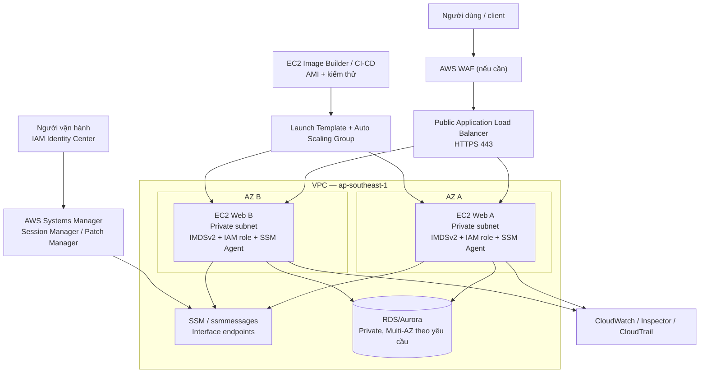
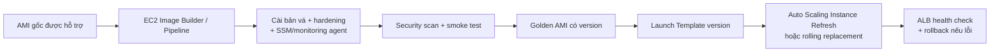
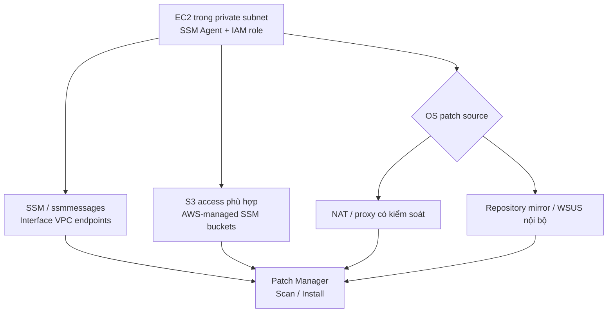
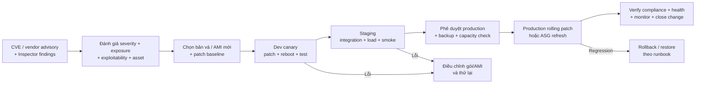
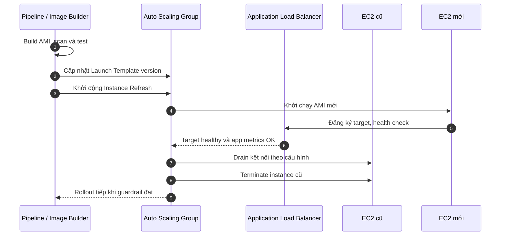
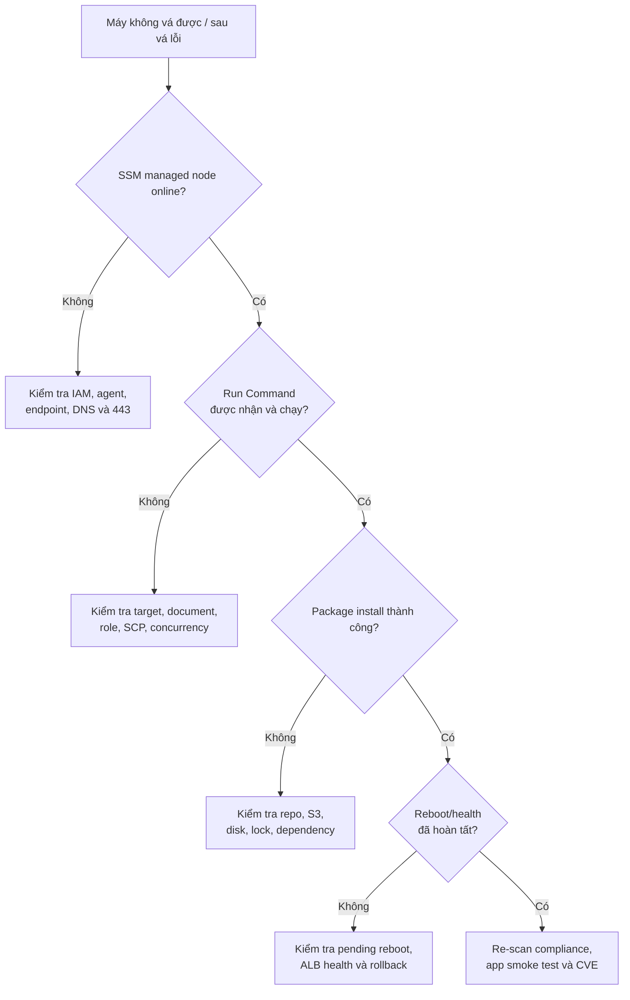

# Cấu hình máy chủ an toàn và quản lý bản vá trên Amazon EC2

Một máy chủ Amazon Elastic Compute Cloud (**Amazon EC2**) có thể được tạo chỉ trong vài phút, nhưng **khởi chạy thành công không đồng nghĩa vận hành an toàn**. Nếu EC2 mở SSH/RDP ra Internet, chạy ứng dụng bằng tài khoản đặc quyền, sử dụng AMI cũ, lưu access key trong file cấu hình hoặc không cập nhật bản vá, một lỗ hổng nhỏ có thể ảnh hưởng cả ứng dụng và dữ liệu.

Bài học thuộc chương **Máy chủ EC2**, module **CLOUD_PROVIDERS_AWS**. Trong hệ sinh thái AWS gồm Region/Availability Zone (AZ), IAM, VPC, dịch vụ tính toán, lưu trữ, database, tích hợp và serverless, EC2 là thành phần cần bảo vệ ở cả **lớp hạ tầng đám mây** lẫn **hệ điều hành và ứng dụng trong máy**. Mục tiêu là xây dựng baseline bảo mật có thể lặp lại, vận hành máy qua AWS Systems Manager, thực hiện quản lý bản vá có lịch, giám sát và có đường khôi phục khi cập nhật gây lỗi.

## 1. Mục tiêu và phạm vi bảo vệ EC2

Sau bài học, người học có thể:

1. Phân biệt trách nhiệm bảo mật của AWS với trách nhiệm của người chạy EC2.
2. Chọn AMI đáng tin cậy, cấu hình network, instance profile, IMDSv2, EBS encryption và quyền đăng nhập theo nguyên tắc ít đặc quyền.
3. Hardening Linux/Windows theo baseline được kiểm tra và quản lý bằng Infrastructure as Code (IaC).
4. Sử dụng AWS Systems Manager (SSM) để quản trị máy mà không cần mở SSH/RDP trực tiếp ra Internet trong các trường hợp được hỗ trợ.
5. Thiết kế chiến lược vá lỗi với **Patch Manager, patch baseline, scan/install, vòng kiểm thử dev → staging → production**.
6. Chọn **vá tại chỗ** hoặc **thay máy bằng AMI mới** trong Auto Scaling Group; đánh giá tác động reboot và khả năng phục hồi.
7. Theo dõi patch compliance, phát hiện lỗ hổng, tính chi phí và xử lý các lỗi thường gặp.

### 1.1. Shared Responsibility Model

AWS chịu trách nhiệm bảo vệ hạ tầng **của** đám mây: trung tâm dữ liệu, phần cứng và một số lớp hạ tầng ảo hóa do AWS quản lý. Đối với EC2 thông thường, khách hàng vẫn chịu trách nhiệm bảo mật những thứ **trong** máy chủ: hệ điều hành khách, các gói phần mềm, ứng dụng, cấu hình IAM/SG, dữ liệu, mã hóa và cách quản trị truy cập.

| Lớp | AWS chịu trách nhiệm chính | Khách hàng cần thực hiện |
|---|---|---|
| Trung tâm dữ liệu, vật lý, hạ tầng nền | Bảo vệ phần cứng và các lớp dịch vụ AWS quản lý | Chọn Region/AZ theo nhu cầu tuân thủ và phục hồi |
| Máy ảo EC2 và hệ điều hành khách | Cung cấp khả năng chạy instance/AMI và tài liệu dịch vụ | Chọn AMI tin cậy, cập nhật OS, khóa cấu hình, quản lý user |
| Truy cập VPC | Cung cấp VPC, SG, NACL và dịch vụ mạng | Thiết kế subnet, ingress/egress, nguồn quản trị và DNS |
| Quyền AWS API | Vận hành IAM/STS | Tạo role hẹp, kiểm soát PassRole/AssumeRole, bảo vệ IMDS |
| Lưu trữ | Cung cấp Amazon EBS, KMS và khả năng snapshot | Bật mã hóa phù hợp, thiết kế key policy, backup, lưu giữ dữ liệu |
| Ứng dụng | Vận hành các dịch vụ nền tảng AWS sử dụng | Bảo vệ secret, vá runtime/dependency, kiểm thử và quan sát |

Đây là trách nhiệm phân chia theo **mô hình EC2 tự quản**. Với các dịch vụ được quản lý cao hơn như AWS Lambda hoặc Amazon RDS, phạm vi vá hệ điều hành thay đổi; không áp chính sách quản trị guest OS của EC2 một cách máy móc cho mọi dịch vụ.

### 1.2. Bốn nguồn rủi ro thường gặp

| Nguy cơ | Ví dụ | Biện pháp trọng tâm |
|---|---|---|
| **Bề mặt mạng quá rộng** | Cổng 22/3389 hoặc cổng quản trị database mở `0.0.0.0/0` | Private subnet, SG hẹp, Session Manager |
| **Danh tính quá đặc quyền** | EC2 role chứa `AdministratorAccess` hoặc lưu IAM access key lâu dài | IAM instance profile ít quyền, STS temporary credentials |
| **Máy thiếu bản vá** | OS, kernel, OpenSSL, web server hoặc runtime còn CVE đã công bố | Patch policy, thử nghiệm, cập nhật AMI, theo dõi compliance |
| **Thiếu phát hiện/khôi phục** | Bản vá reboot hàng loạt, ứng dụng lỗi nhưng không có alert hay backup | Multi-AZ, rolling rollout, health check, CloudWatch, restore drill |

## 2. Kiến trúc EC2 có lớp bảo vệ phù hợp

Giả sử ứng dụng bán hàng phục vụ HTTP/HTTPS: người dùng Internet truy cập **Application Load Balancer (ALB)**; EC2 chạy web API trong **private subnet** ở hai AZ; dữ liệu quan trọng lưu trong database được quản lý. Quản trị viên vận hành EC2 qua Systems Manager.



Sơ đồ biểu diễn **luồng logic**. Các interface endpoint dùng PrivateLink cần có subnet, SG và private DNS phù hợp; việc tải bản vá còn phụ thuộc vào **kết nối đến repository và bucket S3 AWS cần thiết**, không được suy luận rằng chỉ cần tạo endpoint SSM là tải được mọi gói OS.

### Những nguyên tắc nên có ngay từ thiết kế

- **Load balancer là điểm vào công khai**, còn EC2 ứng dụng không nhất thiết có public IP.
- **Security group của EC2 chỉ mở port ứng dụng từ SG của ALB**; quyền quản trị không cần mở SSH/RDP ra Internet nếu Session Manager đáp ứng nhu cầu.
- **Dùng IAM role gắn instance profile**, không chép khóa IAM vào AMI hoặc user data.
- **IMDSv2 required** để hạn chế cách truy cập metadata không dùng session token; kiểm thử các SDK/agent trước khi siết cấu hình.
- **Mã hóa EBS, backup và tách secret** khỏi AMI/repository.
- **Tạo máy theo Launch Template/IaC** để máy mới và máy thay thế đều áp dụng cùng baseline.
- **Chia ứng dụng trên nhiều AZ**, tránh cập nhật/reboot tất cả instance cùng lúc.

## 3. Cấu hình từ nguồn AMI và vòng đời máy

### 3.1. Chọn AMI đáng tin cậy

**Amazon Machine Image (AMI)** quy định hệ điều hành và cấu hình nền của máy. Nên ưu tiên:

1. AMI chính thức của AWS, nhà cung cấp OS đáng tin cậy hoặc **golden AMI** nội bộ đã qua kiểm thử.
2. Hệ điều hành đang còn được hỗ trợ bảo mật; tránh dùng bản OS, runtime hoặc repository đã hết vòng đời hỗ trợ.
3. Phiên bản rõ ràng, có khả năng truy vết nguồn và thời điểm build, không dùng “latest” không được kiểm soát trong production.
4. AMI được quét lỗ hổng, gỡ gói không cần thiết, cấu hình logging và agent giám sát.
5. Có quy trình phát hành AMI mới sau mỗi chu kỳ vá, rollback và loại bỏ AMI không còn sử dụng.

Một AMI được cập nhật hôm nay **sẽ cũ đi** khi có CVE mới; không thể bảo đảm an toàn lâu dài chỉ bằng thao tác chọn AMI lúc tạo EC2.

### 3.2. Golden AMI và immutable infrastructure

Trong mô hình **immutable**, ta hạn chế chỉnh sửa thủ công trên EC2 đã chạy. Thay vào đó:



Với ứng dụng stateless, thay instance bằng bản AMI mới có thể dễ kiểm soát hơn việc cập nhật từng máy theo thời gian. Cần tách **state** (session, file tải lên, dữ liệu nghiệp vụ) sang nơi phù hợp như RDS, S3 hoặc shared storage. Dữ liệu chỉ nằm trên **instance store** có thể mất khi instance dừng/terminate; dữ liệu trên root EBS cũng có thể bị xóa khi terminate theo thuộc tính volume. Vì vậy cần thiết kế backup/lưu trữ trước khi chọn chiến lược thay máy.

Với máy chứa state hoặc cấu hình lịch sử khó tái tạo, **in-place patching** vẫn có chỗ đứng, nhưng cần snapshot/backup, cửa sổ bảo trì và quy trình rollback có kiểm chứng.

### 3.3. Launch Template là nguồn cấu hình chuẩn

Một Launch Template nên thể hiện rõ: AMI ID/version, instance type, IAM instance profile, security groups, network, root volume encryption, metadata options và user data bootstrap tối thiểu.

| Thành phần | Lựa chọn baseline đề xuất | Vì sao |
|---|---|---|
| AMI | AMI được duyệt/versioned | Truy vết bản vá và tái tạo máy |
| Instance profile | Role của workload + quyền SSM cần thiết | Temporary credentials và quản trị không cần khóa lâu dài |
| Security group | Chỉ ALB SG → port ứng dụng; egress tối thiểu cần thiết | Giảm bề mặt mạng |
| Public IP | Không gán cho app instance trong private subnet | Hạn chế phơi nhiễm trực tiếp |
| EBS | Mã hóa root và data volumes bằng key phù hợp | Bảo vệ dữ liệu lưu trữ và snapshot liên quan |
| Metadata | `HttpTokens=required`, hop limit phù hợp | Bắt buộc IMDSv2 |
| User data | Bootstrap nhẹ, không chứa secret cố định | Giảm lộ dữ liệu trong cấu hình |
| Tags | `Application`, `Environment`, `Owner`, `PatchRing` | Chọn target, audit và phân bổ chi phí |

Trong môi trường nhiều account, EC2 dev, staging và production nên nằm ở account hoặc ranh giới IAM phù hợp. Không cấp cho role quản trị dev quyền sửa Launch Template hoặc AMI production.

## 4. Cách ly mạng: subnet, SG, NACL và truy cập quản trị

### 4.1. VPC và subnet

**Public subnet** là subnet có route phù hợp đến Internet Gateway. **Private subnet** không có route trực tiếp như vậy; instance ở private subnet có thể dùng NAT Gateway hoặc endpoint để truy cập các dịch vụ bên ngoài theo chính sách.

Đối với web API có ALB:

| Thành phần | Vị trí | Ingress mẫu | Egress mẫu |
|---|---|---|---|
| ALB | Public subnets, ít nhất hai AZ theo yêu cầu | 443 từ nguồn client được phép | Port 8080 tới SG của web EC2 |
| EC2 app | Private subnets ở hai AZ | 8080 chỉ từ SG ALB | 443 đến dịch vụ AWS cần dùng, port DB đến SG DB |
| Database | Private/isolated subnet theo thiết kế | Port database chỉ từ SG EC2 app | Theo loại DB và nhu cầu hợp lệ |
| SSM interface endpoints | Private subnets | 443 từ SG EC2 app | Theo hành vi kết nối managed endpoints |

**Security groups là stateful:** response traffic của kết nối được phép thường được tự động cho qua. **Network ACL là stateless:** phải tính cả chiều đi, chiều về và ephemeral ports. Không tự đặt NACL deny quá rộng khi chưa mô phỏng đường đi thực tế.

### 4.2. Tránh SSH/RDP công khai khi không cần

Không nên để các rule:

```text
Inbound TCP/22    0.0.0.0/0    (SSH)
Inbound TCP/3389  0.0.0.0/0    (RDP)
```

Nếu Systems Manager Session Manager đáp ứng nhu cầu shell/PowerShell, có thể vận hành máy qua kênh đã xác thực IAM, ghi log và không mở cổng quản trị từ Internet. Nếu thực sự phải dùng SSH/RDP, hãy giới hạn nguồn quản trị, khóa/certificate, MFA ở lớp tiếp cận phù hợp, nhật ký và cơ chế thời hạn truy cập. Không coi việc chỉ đổi số port SSH là biện pháp bảo mật chính.

**Ví dụ kiểm tra security group qua AWS CLI:**

```bash
aws ec2 describe-security-groups \
  --group-ids sg-0123456789abcdef0 \
  --region ap-southeast-1
```

Từ kết quả, kiểm tra chính xác ingress, egress, nguồn là CIDR hay SG, IPv4/IPv6, port và rule không còn sử dụng. Không chỉ kiểm tra IPv4 mà bỏ qua rule `::/0` cho IPv6.

### 4.3. Quản lý egress và đường tải bản vá

Máy cần download OS patches thường phải gọi repository của nhà phân phối Linux hoặc Windows Update/WSUS; SSM Agent cần gọi SSM endpoints và các AWS-managed S3 buckets tương ứng. Việc chặn toàn bộ egress có thể khiến một máy **vẫn online về nghiệp vụ nhưng không thể vá lỗi**.

Lựa chọn hạ tầng tùy loại repository:

- NAT Gateway/proxy có kiểm soát nếu cần truy cập public package repository.
- VPC endpoints cho AWS Systems Manager; endpoint S3 phù hợp khi cần truy cập AWS-managed buckets.
- Repository mirror nội bộ, private package registry hoặc WSUS nếu tổ chức yêu cầu kiểm soát nguồn và thời điểm cập nhật.

Thiết kế egress phải cân bằng **ít đặc quyền, khả năng vá và tính sẵn sàng**. Không nên mở outbound toàn Internet vô thời hạn chỉ vì chưa kiểm tra repository mà máy thực sự dùng.

## 5. IAM: quyền cho người vận hành và quyền của EC2

### 5.1. Phân biệt hai principal

**Principal người quản trị** gọi AWS API để xem/tạo instance, mở Session Manager, chạy Run Command hoặc đặt lịch patch. **Principal của EC2** là IAM role mà ứng dụng/SSM Agent trên instance sử dụng qua instance profile.

| Principal | Cần làm gì | Không nên được mặc định cấp |
|---|---|---|
| Developer | Xem trạng thái EC2, ứng dụng và log dev | Tự đổi policy production hoặc assume admin role |
| SRE/Platform | Vận hành và vá máy trong phạm vi được giao | Quyền `iam:*` hoặc `ec2:*` toàn account không điều kiện |
| Security | Kiểm tra cấu hình, compliance, cảnh báo | Khóa API dài hạn chia sẻ với người dùng |
| EC2 application role | Đọc đúng secret/bucket/queue cần cho ứng dụng | `AdministratorAccess` hoặc quyền đến dữ liệu dự án khác |
| SSM/patch orchestration role | Chạy tài liệu SSM trên đúng target trong lịch được phê duyệt | Chạy shell tùy ý mọi production EC2 nếu không có lý do |

**Không lưu AWS access key trong source code, AMI, user data hoặc biến môi trường không kiểm soát.** Dùng IAM role và temporary credentials cấp qua STS/IMDS; định kỳ kiểm tra các quyền mà ứng dụng thật sự cần.

### 5.2. Instance profile và SSM

Để EC2 trở thành **SSM managed node**, cần SSM Agent tương thích, quyền phù hợp và khả năng kết nối tới endpoint AWS cần thiết. Hai cách cấp quyền phổ biến:

1. **Systems Manager Default Host Management Configuration** tại account/Region theo khả năng hỗ trợ. AWS khuyến nghị xem xét cách này để quản lý fleet tập trung khi phù hợp.
2. **IAM instance profile** gắn role có quyền SSM tối thiểu; AWS managed policy `AmazonSSMManagedInstanceCore` thường được dùng làm baseline khởi đầu. Bổ sung quyền CloudWatch Logs/S3 chỉ theo tính năng thực sự cần.

Trong mô hình một EC2 role vừa dùng để chạy ứng dụng vừa sử dụng SSM, phải tránh gắn mọi quyền vào cùng một policy quá rộng. Nên phân nhóm statement theo chức năng, giới hạn tài nguyên cho ứng dụng và kiểm tra luồng `iam:PassRole` của người tạo instance.

Một ví dụ identity policy **chỉ cho đọc object dưới một prefix S3** dành cho ứng dụng (không phải toàn bộ quyền SSM):

```json
{
  "Version": "2012-10-17",
  "Statement": [
    {
      "Sid": "ReadProductImages",
      "Effect": "Allow",
      "Action": "s3:GetObject",
      "Resource": "arn:aws:s3:::shop-prod-assets/products/*"
    }
  ]
}
```

Nếu ứng dụng cần `ListBucket`, phải thêm action/resource bucket riêng với điều kiện prefix phù hợp; policy trên **không tự cho phép liệt kê bucket**. Bucket policy, KMS key policy và các lớp deny vẫn có thể chặn request. Tên bucket chỉ là minh họa.

### 5.3. Session Manager thay cho quản trị trực tiếp

**AWS Systems Manager Session Manager** cho phép người được cấp quyền mở phiên quản trị EC2 mà không cần cấu hình public bastion/SSH inbound trong các trường hợp phù hợp. Có thể tích hợp IAM Identity Center, CloudTrail và ghi log phiên vào CloudWatch Logs/S3 theo khả năng và cách cấu hình.

**Lưu ý:** CloudTrail ghi hoạt động AWS API liên quan đến phiên, nhưng không tự động lưu toàn bộ câu lệnh/nội dung phiên. Cần cấu hình tính năng **session logging** riêng và hiểu giới hạn của phương thức kết nối hoặc phiên được mã hóa end-to-end.

Để cấu hình đúng, vẫn phải phân quyền `ssm:StartSession`, xác định target, kiểm soát tài liệu session được dùng, giới hạn người được sửa Session Manager preferences và kiểm tra ai có thể dùng Run Command/Automation thay thế.

## 6. Bảo vệ EC2 Instance Metadata Service (IMDS)

**Instance Metadata Service (IMDS)** cung cấp metadata của máy và có thể là đường truy cập temporary credentials của instance role. Endpoint IPv4 thường thấy là `169.254.169.254`. Nếu ứng dụng bị server-side request forgery (SSRF) hoặc workload độc hại có khả năng gọi IMDS, credentials có thể bị lạm dụng trong phạm vi role được gán.

**IMDSv2** sử dụng session token và request lấy token bằng HTTP PUT trước khi gọi metadata. AWS khuyến nghị yêu cầu IMDSv2 khi có thể để tăng mức bảo vệ.

### 6.1. Mẫu truy cập IMDSv2 từ trong máy

```bash
TOKEN=$(curl -sS -X PUT \
  "http://169.254.169.254/latest/api/token" \
  -H "X-aws-ec2-metadata-token-ttl-seconds: 21600")

curl -sS \
  -H "X-aws-ec2-metadata-token: $TOKEN" \
  "http://169.254.169.254/latest/meta-data/instance-id"
```

Ví dụ này chỉ đọc **instance ID** để minh họa protocol; không in role credentials, không ghi token vào log. Nếu OS/workload không có quyền truy cập metadata hoặc IMDS đã tắt, request có thể thất bại.

### 6.2. Bắt buộc IMDSv2 ở máy đã tồn tại

Sau khi kiểm tra ứng dụng/agent dùng SDK hỗ trợ IMDSv2 và metric `MetadataNoToken` không còn chỉ báo sử dụng IMDSv1 theo cách liên quan, có thể cấu hình:

```bash
aws ec2 modify-instance-metadata-options \
  --instance-id i-0123456789abcdef0 \
  --http-endpoint enabled \
  --http-tokens required \
  --http-put-response-hop-limit 1 \
  --region ap-southeast-1
```

Giá trị hop limit `1` chỉ là baseline minh họa cho workload thông thường. Với môi trường **container**, AWS thường khuyến nghị hop limit `2` để token response có thể đi qua các lớp mạng cần thiết. Nếu không có ứng dụng nào cần metadata, có thể xem xét tắt IMDS nhưng phải kiểm tra ảnh hưởng tới instance role/agent trước.

### 6.3. Cần kiểm tra điều gì ngoài IMDSv2?

- Instance profile chỉ có quyền AWS tối thiểu. IMDSv2 **không biến một role toàn quyền thành an toàn**.
- Không đưa temporary credentials vào application logs, crash dump hoặc debug response.
- Kiểm soát truy cập metadata từ container, tiến trình không tin cậy và cơ chế egress/filter ở guest OS khi phù hợp.
- Dùng cấu hình account-level/Launch Template/guardrail để instance mới không quay về IMDSv1 tùy chọn.
- Theo dõi cấu hình `HttpTokens`, `HttpEndpoint` và các thay đổi metadata options qua inventory/config.

## 7. Mã hóa, secret và backup dữ liệu trên EC2

### 7.1. Amazon EBS và AWS KMS

**Amazon EBS** lưu trữ block data cho nhiều EC2 instance. Nên bật **EBS encryption by default** trong từng account/Region phù hợp và xác nhận cả root/data volume được mã hóa. Có thể dùng AWS managed key hoặc customer managed KMS key theo yêu cầu kiểm soát quyền, rotation và audit.

| Thành phần | Việc cần làm | Chú ý |
|---|---|---|
| Root EBS volume | Mã hóa, chọn kích thước/loại volume theo ứng dụng | Chính sách xóa volume khi terminate, backup và AMI |
| Data EBS volume | Mã hóa, giới hạn quyền attach/detach/snapshot | EBS thuộc một AZ; phục hồi/di chuyển cần kế hoạch rõ |
| EBS snapshot | Mã hóa theo key thích hợp, quy định giữ/xóa, kiểm thử khôi phục | Snapshot chỉ là một phần của DR và có chi phí |
| KMS key | Quyền admin và quyền sử dụng tách biệt | Nếu key bị vô hiệu hóa/xóa, dữ liệu có thể không giải mã được |
| Secret ứng dụng | AWS Secrets Manager/SSM Parameter Store SecureString theo yêu cầu | Không hardcode secret trong AMI hoặc user data |
| Log | Quyền truy cập phù hợp, mã hóa và retention | Tránh ghi PII/token/secret không cần thiết |

**EBS encryption bảo vệ dữ liệu khi lưu trữ**, không tự ngăn một process trên EC2 đang chạy (có quyền đọc file) lấy dữ liệu. Hãy kết hợp IAM, OS file permissions, process isolation và kiểm soát ứng dụng.

### 7.2. Thận trọng với user data và AMI

User data thường dùng để bootstrap package, cấu hình agent và khởi động service. Không nên đặt password, API token hoặc private key vào user data vì người có quyền phù hợp có thể truy cập metadata/configuration và log của quá trình bootstrap.

Nếu cần lấy secret trong lúc chạy, instance role có thể gọi Secrets Manager/Parameter Store với quyền tối thiểu và lưu secret trong bộ nhớ hoặc vị trí được bảo vệ theo yêu cầu ứng dụng. Cần có cách xoay vòng secret và xử lý khi secret hết hạn.

Golden AMI trước khi chia sẻ/triển khai nên được kiểm tra không mang theo shell history, private key, SSH host identity sao chép sai, token, log chứa dữ liệu nhạy cảm hoặc thông tin chỉ thuộc môi trường build.

### 7.3. Backup và khả năng phục hồi

Quản lý patch luôn đi cùng rollback. Trước bản vá lớn hoặc nâng cấp OS có nguy cơ phá tương thích, có thể tạo EBS snapshot/AMI hoặc dùng AWS Backup theo policy phù hợp; nhưng **snapshot không thay thế backup nhất quán ở tầng ứng dụng** (đặc biệt database chạy trực tiếp trên EC2).

Thử **restore thật** vào môi trường riêng, xác định:

- **RPO:** chấp nhận mất bao nhiêu dữ liệu?
- **RTO:** cần phục hồi trong bao lâu?
- Backup có đủ volume, key, IAM permission, cấu hình ứng dụng và dependency để phục hồi không?
- Có thể kiểm tra dữ liệu và service health sau restore không?

Một EBS snapshot thành công không tự chứng minh ứng dụng/transaction nhất quán hoặc máy sẽ boot được sau restore.

## 8. Hardening hệ điều hành và dịch vụ trong EC2

### 8.1. Nguyên tắc baseline OS

Baseline hardening cần được version hóa, kiểm thử và áp dụng nhất quán cho Amazon Linux 2023, Ubuntu, RHEL hoặc Windows Server đang sử dụng. Có thể tham khảo **CIS Benchmarks** hoặc chuẩn nội bộ, nhưng phải điều chỉnh theo ứng dụng và policy doanh nghiệp thay vì áp mọi control không xét tác động.

| Lớp | Linux EC2 | Windows Server EC2 |
|---|---|---|
| User và đặc quyền | Disable direct root SSH login, quản lý sudo, xóa user cũ | Hạn chế local Administrators, quản lý tài khoản dịch vụ |
| Xác thực | SSH key/certificate nếu SSH thực sự cần; Session Manager khi phù hợp | Session Manager hoặc RDP hạn chế, kiểm soát đăng nhập |
| Dịch vụ | Gỡ/disable daemon và port không dùng | Disable role/feature/service không cần |
| Firewall hệ điều hành | nftables/firewalld/ufw khi phù hợp | Windows Defender Firewall |
| Logs | journald/syslog/auditd, ship log ra nơi tập trung | Windows Event Logs, Defender/agent và log tập trung |
| OS security controls | SELinux/AppArmor theo distro/ứng dụng | Defender, policies và security baselines phù hợp |
| Filesystem | Quyền file chặt, hạn chế execute trên vị trí nhạy cảm khi phù hợp | NTFS ACL, quyền service account |
| Patching | DNF/YUM/APT theo OS/version | Windows Update/WSUS/Systems Manager |

Không nên làm mất khả năng đăng nhập hoặc điều khiển SSM bằng một thay đổi firewall/sudo trước khi có đường khôi phục; hardening cần diễn tập từ dev trước khi áp dụng production.

### 8.2. Ví dụ kiểm tra cơ bản trên Amazon Linux 2023

```bash
# Kiểm tra bản phát hành và kernel
cat /etc/os-release
uname -r

# Kiểm tra dịch vụ đang lắng nghe
sudo ss -tulpn

# Kiểm tra bản vá khả dụng (dnf có thể trả mã đặc biệt khi có update)
sudo dnf check-update

# Kiểm tra danh sách gói đã cài
rpm -qa

# Xem trạng thái agent quản lý nếu có
sudo systemctl status amazon-ssm-agent
```

Lệnh trên phục vụ **điều tra/inventory**, chưa tự thay đổi cấu hình. Với Amazon Linux 2023, nên sử dụng DNF và hiểu cơ chế versioned repositories của distro; với Ubuntu dùng APT, Windows dùng cơ chế Windows Update tương ứng. Tránh sao chép lệnh `yum update`, `dnf upgrade` hoặc `apt upgrade` giữa các OS mà không xét version/kernel/dependency.

### 8.3. Tránh cấu hình “đóng băng” phá hoạt động

Ví dụ hardening có thể cần tinh chỉnh:

- Nếu tắt hoàn toàn outbound HTTPS, SSM Agent/CloudWatch Agent và patch repository có thể ngừng hoạt động.
- Nếu bật file-system mount `noexec` quá rộng, trình cài đặt/agent có thể gặp lỗi.
- Nếu đổi sysctl/SELinux policy mà không kiểm thử, ứng dụng có thể không bind port hoặc đọc file cần thiết.
- Nếu xóa user/role mặc định mà chưa hiểu AMI, Session Manager hoặc cloud-init có thể không vận hành như dự kiến.

Giải pháp là kiểm soát qua IaC/automation, scan baseline, **canary instance** và kiểm thử tính sẵn sàng trước khi phát hành cho fleet.

## 9. AWS Systems Manager: nền tảng quản lý bản vá

**AWS Systems Manager Patch Manager** giúp quét tình trạng bản vá và cài đặt các bản vá được phê duyệt cho những **managed nodes** đáp ứng điều kiện, bao gồm EC2 chạy một số hệ điều hành Linux/Windows Server được hỗ trợ. Patch Manager có thể hoạt động trong từng account/Region và cung cấp cấu hình **patch policy qua Systems Manager Quick Setup** cho nhiều account/Region khi môi trường đáp ứng yêu cầu.

Các khái niệm cần phân biệt:

| Khái niệm | Ý nghĩa | Vai trò trong vận hành |
|---|---|---|
| **SSM Agent** | Agent trên máy giao tiếp với Systems Manager | Nhận command, báo trạng thái, thực thi operation |
| **Managed node** | Máy được Systems Manager quản lý, có ID/trạng thái phù hợp | Đối tượng để scan/patch |
| **Patch baseline** | Quy tắc bản vá nào được phê duyệt/từ chối, thời gian chờ phê duyệt | Định nghĩa thế nào là “thiếu bản vá phù hợp” |
| **Patch policy** | Cấu hình từ Quick Setup quy định phạm vi, baseline và lịch scan/install | Phương pháp AWS khuyến nghị cho quản lý patch theo fleet |
| **Maintenance window** | Lịch tác vụ bảo trì trên tập target | Lựa chọn để điều phối Run Command trong khung thời gian |
| **AWS-RunPatchBaseline** | Tài liệu SSM thực hiện `Scan` hoặc `Install` | Cơ chế thực thi patch trên managed nodes |
| **Patch compliance** | Kết quả đối chiếu tình trạng máy với baseline áp dụng | Báo cáo mức tuân thủ, cần xử lý máy noncompliant |

### 9.1. Điều kiện để EC2 trở thành managed node

Trước khi chạy Patch Manager, xác minh:

1. **Hệ điều hành và phiên bản** nằm trong danh sách được tính năng Patch Manager hỗ trợ.
2. Có **SSM Agent tương thích và đang chạy**. Nhiều AMI phổ biến có thể đã tích hợp agent nhưng cần kiểm tra bản thực tế; không giả định mọi AMI tùy biến đều có sẵn.
3. Instance có quyền phù hợp qua **Default Host Management Configuration** hoặc **IAM instance profile**. Nếu dùng instance profile, `AmazonSSMManagedInstanceCore` là điểm xuất phát thông dụng cho quyền SSM cơ bản.
4. Máy có thể giao tiếp đến các Systems Manager endpoints cần thiết, qua Internet egress có kiểm soát hoặc VPC endpoints.
5. Máy có thể tải **metadata/tài nguyên từ AWS-managed S3 buckets** mà Patch Manager/SSM yêu cầu và có đường đến **OS patch repositories**.
6. Phiên bản Python/package manager và dependency phù hợp theo nền tảng; tài khoản OS thực thi patch có đủ đặc quyền cục bộ.

Một lỗi phổ biến là nhìn thấy máy trong EC2 console rồi cho rằng nó đã là **SSM managed node**. EC2 chỉ tồn tại trong AWS chưa bảo đảm SSM Agent có thể liên lạc hoặc nhận quyền.

### 9.2. Kết nối SSM trong private subnet

Khi không sử dụng NAT/public Internet, hãy đánh giá các interface VPC endpoints như:

- `com.amazonaws.<region>.ssm`
- `com.amazonaws.<region>.ssmmessages`
- `com.amazonaws.<region>.ec2messages` **nếu Region và cấu hình agent yêu cầu/hỗ trợ endpoint này**.

AWS SSM Agent và hỗ trợ endpoint có thể khác giữa các Region, đặc biệt các Region mới hơn; đọc hướng dẫn kết nối hiện hành cho Region cụ thể. Cần bật private DNS và cho phép instance kết nối TCP 443 đến SG của endpoint.

**Nhưng endpoint SSM chưa đủ để tải bản vá.** Tài liệu AWS còn yêu cầu kết nối đến một số Amazon S3 buckets do AWS quản lý và các repository phần mềm của OS. Với Linux, các gói thường được tải từ repository được cấu hình trên máy (có thể public hoặc mirror nội bộ). Với Windows, kiểm tra Windows Update/WSUS và các endpoint liên quan. VPC endpoint S3 không tự thay thế đường kết nối đến mọi repository của bên thứ ba.



Sơ đồ diễn giải các phụ thuộc cần hoạt động đồng thời, không có nghĩa dữ liệu repository luôn đi qua Systems Manager.

### 9.3. Kiểm tra managed node

Ở account/Region đang vận hành:

```bash
aws ssm describe-instance-information \
  --region ap-southeast-1
```

Kiểm tra instance ID, trạng thái kết nối/đăng ký, platform và SSM Agent version trong kết quả. Dùng tag và scope để quản trị fleet lớn. Nếu EC2 không xuất hiện, ưu tiên chẩn đoán **agent, quyền instance, DNS, endpoint/egress và đồng hồ hệ điều hành** trước khi sửa patch baseline.

## 10. Patch baseline: chính sách “bản vá nào cần áp dụng”

**Patch baseline** là tập quy tắc xác định những bản vá được phê duyệt theo hệ điều hành. Có **AWS managed predefined baselines** và **custom baselines** phù hợp với policy riêng.

Một baseline có thể mô tả:

- Hệ điều hành/nhóm sản phẩm được quản lý.
- Phân loại cập nhật (chẳng hạn bảo mật và critical theo metadata của hệ điều hành), độ nghiêm trọng và các quy tắc liên quan **trong phạm vi OS hỗ trợ**.
- Số ngày trễ trước khi bản vá được **auto-approve**.
- Danh sách bản vá được chấp thuận/từ chối thủ công khi cần kiểm soát.
- Kết quả đối chiếu compliance của từng managed node với baseline đang áp dụng.

> **Cần hiểu đúng:** “Compliant” có nghĩa máy đáp ứng **các quy tắc của baseline đã áp dụng tại thời điểm quét**. Nó không có nghĩa hệ điều hành/ứng dụng không còn CVE, không có package ngoài phạm vi scan hay không thể bị khai thác.

### 10.1. Không phê duyệt mọi bản vá ngay lập tức trên production

Ví dụ một tổ chức có ba môi trường:

| Môi trường | Chính sách phê duyệt minh họa | Mục tiêu |
|---|---|---|
| **Dev** | Scan hằng ngày; cài bản vá sớm trên instance canary | Phát hiện lỗi tương thích nhanh |
| **Staging** | Cài sau khi dev xác nhận; có dữ liệu/luồng kiểm thử đại diện | Bắt lỗi tích hợp và migration |
| **Production** | Bản vá được duyệt theo mức độ rủi ro và lịch bảo trì; có luồng khẩn cấp cho critical CVE | Cân bằng bảo mật với độ sẵn sàng |

Các mốc ngày giờ cụ thể phải là **chính sách của tổ chức**, dựa trên severity, khả năng bị khai thác, tài sản phơi nhiễm và SLO. Không nên giả định bản vá “critical” luôn phải chờ một số ngày cố định; CVE đang bị khai thác có thể cần quy trình ngoài lịch thường lệ.

### 10.2. Patch baselines khác với vulnerability scanning

| Năng lực | Patch Manager | Amazon Inspector / quét lỗ hổng phù hợp |
|---|---|---|
| Mục tiêu | Xác định và cài các bản vá được baseline chấp thuận | Phát hiện phần mềm/lỗ hổng có thể bị khai thác, ưu tiên rủi ro |
| Cơ sở | Package/patch metadata và baseline của OS | Inventory package, CVE và dữ liệu phát hiện |
| Kết quả | Patch compliance, trạng thái cài đặt | Finding/cảnh báo lỗ hổng, mức độ ưu tiên |
| Hành động chính | `Scan` / `Install` bản vá | Điều tra, cập nhật package/image hoặc biện pháp giảm thiểu |
| Giới hạn | Không xử lý mọi lỗ hổng ứng dụng/custom binary | Không tự bảo đảm mọi bản vá đã được cài thành công |

Một hệ thống an toàn cần kết hợp **patching + vulnerability management + configuration hardening** thay vì chỉ nhìn trạng thái compliant.

## 11. Cấu hình patch policy bằng Systems Manager Quick Setup

AWS khuyến nghị dùng **patch policies** của Systems Manager Quick Setup khi phù hợp để lập lịch quản lý bản vá tập trung, kể cả qua AWS Organizations nhiều account/Region.

### 11.1. Quy trình cấu hình khái quát

1. Mở **AWS Systems Manager → Quick Setup → Patch policy** trong account/Region và mô hình quản trị phù hợp.
2. Chọn **scope**: một account, các account/OUs hoặc Region theo nhu cầu và quyền Organizations.
3. Chọn baseline cho từng loại OS; tạo custom baseline nếu baseline mặc định không đáp ứng mục tiêu an ninh.
4. Chọn **schedule Scan** và **schedule Install**. Có thể scan thường xuyên hơn cài đặt.
5. Chọn target phù hợp và tùy chọn patching/reboot, concurrency/error threshold nếu được cung cấp trong cấu hình đang dùng.
6. Phân chia dev, staging, production thành những lịch hoặc policy phù hợp với quá trình promote.
7. Xem trạng thái triển khai policy, compliance report và xử lý các managed node không nhận cấu hình.

**Điểm cần nhớ:** patch policy qua Quick Setup **không bắt buộc dùng patch groups**. Đây là khác biệt với một số mô hình Maintenance Window + patch baseline truyền thống.

### 11.2. Khi nào dùng Maintenance Windows hoặc Run Command?

| Phương án | Thích hợp khi | Điểm lưu ý |
|---|---|---|
| **Quick Setup patch policy** | Fleet nhiều account/Region, cần lịch scan/install thống nhất | AWS khuyến nghị; theo dõi việc policy áp dụng tại target thực |
| **Maintenance Window + AWS-RunPatchBaseline** | Cần lịch bảo trì rõ, target tag và task có kiểm soát | Thiết kế concurrency, error threshold và quyền service role |
| **Run Command theo yêu cầu** | Điều tra, chạy thử hoặc xử lý bản vá khẩn cấp trong phạm vi hẹp | Cần approval và scope target chính xác |
| **EC2 Image Builder + rolling replacement** | EC2 stateless, có thể dựng mới từ golden AMI | Thay phiên bản Launch Template/ASG và kiểm tra health |

Maintenance Window có thể chạy document `AWS-RunPatchBaseline` theo lịch. Khi dùng tag `PatchGroup` hoặc `Patch Group` theo mô hình cũ, phải kiểm tra quy tắc tương thích với instance metadata/tag và cách baseline được gán. Không tự đồng nhất tag `PatchRing` phục vụ chọn canary với tag **patch group** có ý nghĩa riêng trong Patch Manager.

## 12. Thao tác Scan và Install bằng AWS-RunPatchBaseline

**AWS-RunPatchBaseline** nhận tham số `Operation`:

- **Scan**: kiểm tra máy có thiếu bản vá đã được phê duyệt và báo compliance. **Không cài gói và không chủ động yêu cầu reboot**.
- **Install**: cài những bản vá đã được chấp thuận nhưng chưa có, cập nhật compliance và **có thể reboot** tùy tham số `RebootOption`/trạng thái cài đặt.

### 12.1. Ví dụ quét các EC2 có tag Environment=dev

Giả sử đã có managed nodes được gắn tag `Environment=dev`, người gọi API có quyền chạy SSM document và Region `ap-southeast-1`:

```bash
aws ssm send-command \
  --document-name "AWS-RunPatchBaseline" \
  --targets "Key=tag:Environment,Values=dev" \
  --parameters '{"Operation":["Scan"]}' \
  --comment "Scan patch compliance for dev" \
  --max-concurrency "10%" \
  --max-errors "1" \
  --region ap-southeast-1
```

Lệnh trả một **CommandId**, không đảm bảo tất cả instance đã quét thành công ngay lập tức. Cần dùng command ID để kiểm tra invocation và kết quả.

```bash
aws ssm list-command-invocations \
  --command-id "<COMMAND_ID>" \
  --details \
  --region ap-southeast-1
```

Kiểm tra command status và output trên từng instance, kết hợp Systems Manager Compliance. Những máy offline/chưa đăng ký có thể **không được thực thi thành công**, dù request gọi API đã được chấp nhận.

### 12.2. Ví dụ cài bản vá ở môi trường canary

Chỉ chạy sau khi chọn đúng target và phê duyệt rủi ro reboot:

```bash
aws ssm send-command \
  --document-name "AWS-RunPatchBaseline" \
  --targets "Key=tag:PatchRing,Values=dev-canary" \
  --parameters '{"Operation":["Install"],"RebootOption":["RebootIfNeeded"]}' \
  --comment "Install approved patches on dev canary" \
  --max-concurrency "1" \
  --max-errors "0" \
  --region ap-southeast-1
```

Chú ý:

1. Tag `PatchRing=dev-canary` chỉ mang ý nghĩa **chọn target** trong ví dụ, không tự tạo patch baseline khác.
2. `RebootIfNeeded` có thể làm máy reboot; hãy bảo đảm service phía trước có health checks và capacity dự phòng.
3. `--max-concurrency 1` chỉ cho chạy đồng thời một managed node **trong command**. Nó không tự bảo đảm HA nếu ứng dụng chỉ có một instance.
4. `--max-errors 0` dừng phân phối thêm khi phát hiện lỗi theo cơ chế Run Command; các invocation đang chạy không nhất thiết dừng ngay.
5. Nếu đặt `NoReboot`, **máy không reboot trong phiên patch**, nhưng có thể vẫn **cần reboot sau đó** để kernel/system libraries có hiệu lực. Phải quản lý trạng thái reboot pending và lịch restart riêng.

**Không chạy một lệnh Install trên toàn bộ production bằng tag `Environment=prod`** khi chưa có phân nhóm, kiểm soát concurrency và phương án health check/rollback.

### 12.3. Thực thi Run Command cần IAM đúng phạm vi

Người dùng hoặc pipeline có quyền `ssm:SendCommand` có thể gây tác động lớn nếu được chạy document shell tùy ý lên mọi production EC2. Hãy giới hạn:

- Danh sách document được phép, ví dụ document patch phù hợp.
- Danh sách target theo account, ARN instance/tag được quản trị đáng tin cậy và môi trường.
- Vai trò người phê duyệt, lịch vận hành và CloudTrail.
- Quyền sửa tag dùng để chọn patch target: nếu developer có thể đổi `PatchRing=dev-canary` trên instance prod, ranh giới theo tag bị mất ý nghĩa.

Run Command cũng có thể ghi output về CloudWatch Logs/S3 theo cấu hình; phân quyền truy cập và retention của output cần tương xứng với dữ liệu.

## 13. Xây dựng lịch vá lỗi theo vòng phát hành

Lịch vá là **quy trình phát hành hạ tầng**. Nó cần owner, thời hạn xử lý, môi trường kiểm thử, chiến lược lùi bản vá và tiêu chí hoàn thành.

### 13.1. Quy trình đề xuất



Phân nhóm patch ring gợi ý:

| Ring | Thành phần | Thời điểm | Điều kiện để đi tiếp |
|---|---|---|---|
| **0 — lab/canary** | 1–2 instance đại diện, không chứa dữ liệu production | Sớm nhất sau khi baseline duyệt | Reboot, agent, app, CPU/memory/IO OK |
| **1 — dev** | Dev workload | Sau canary | Unit/integration test và service connectivity OK |
| **2 — staging** | Môi trường gần production | Sau dev | E2E, migration, background jobs, SLO-like checks OK |
| **3 — production canary** | Một nhóm nhỏ production có bảo vệ | Trong maintenance window hoặc theo emergency runbook | ALB health, business transaction, alert OK |
| **4 — production fleet** | Số instance còn lại | Rolling theo AZ/capacity | Không vượt error budget và patch compliance đạt mục tiêu |

Với bản vá CVE đang bị khai thác, có thể rút ngắn vòng chờ, ưu tiên cô lập/giảm quyền/đóng luồng mạng và tạo golden AMI mới nhanh hơn. Nhưng vẫn cần **đánh giá tác động và kiểm chứng tối thiểu**; “khẩn cấp” không có nghĩa khởi động lại toàn bộ production cùng lúc.

### 13.2. Trước khi cài bản vá

Checklist preflight nên ghi rõ:

1. **Asset inventory**: instance ID, AMI, OS version, owner, workload, SG, AZ, tag và đang nằm trong ASG hay standalone.
2. **Patch scope**: CVE, package, phiên bản hiện tại/mục tiêu, tương thích kernel/runtime và repository.
3. **Backup/rollback**: snapshot/AMI/restore point được tạo và thử phù hợp với độ rủi ro.
4. **Capacity**: nếu mất một EC2 instance, ALB/service vẫn đạt nhu cầu hay không; có đủ quota/dự phòng để rolling restart?
5. **Dependencies**: DB, DNS, load balancer, secrets, EFS/volume, network endpoint và các thành phần cùng bị ảnh hưởng.
6. **Monitoring**: dashboard, alert, error budget, người trực và liên hệ ứng cứu.
7. **Approval**: cửa sổ thời gian, target, mức concurrency, điều kiện dừng và người quyết định rollback.

### 13.3. Sau khi cài bản vá

Hoàn thành chỉ khi:

- SSM patch command và trạng thái từng node phù hợp (không chỉ status API gửi lệnh).
- OS/package version và kernel thực sự đạt mục tiêu; máy đã reboot nếu bản vá cần reboot.
- SSM Agent, CloudWatch Agent, application service, ALB target health trở lại bình thường.
- Smoke test/API transaction thành công; latency, 5xx, queue backlog, CPU/memory/IO không suy giảm bất thường.
- Inspector finding, patch compliance và exception backlog được cập nhật theo dữ liệu mới.
- Change record lưu bằng chứng, bản AMI/snapshot, nguyên nhân lỗi và hành động tiếp theo.

Nếu package đã cài nhưng kernel đang chạy vẫn là kernel cũ, hãy xem đó là trạng thái **chưa hoàn tất thay đổi** cho tới khi reboot hoặc có biện pháp patching khác được kiểm chứng.

## 14. Quản lý bản vá theo hệ điều hành

### 14.1. Amazon Linux 2023

Amazon Linux 2023 sử dụng **DNF** và cơ chế versioned repositories; quy trình cập nhật phải phù hợp phiên bản repo/AMI được đội platform kiểm soát.

```bash
# Kiểm tra phiên bản và danh sách update
cat /etc/os-release
sudo dnf check-update

# Ví dụ cài cập nhật theo repository policy của hệ thống
# Chỉ chạy trong cửa sổ bảo trì đã duyệt
sudo dnf upgrade -y

# Kiểm tra kernel đang chạy sau khi hoàn tất/reboot nếu cần
uname -r
```

Đây là ví dụ quản trị thủ công trên một máy thử nghiệm. Trong fleet, ưu tiên thực thi qua Patch Manager hoặc tạo AMI mới để tránh lệch cấu hình. Lệnh `dnf check-update` có thể trả exit code khác 0 khi tìm thấy update; không mặc định mọi exit code khác 0 là hệ thống hỏng.

### 14.2. Ubuntu Server

Ubuntu dùng APT:

```bash
sudo apt-get update
apt list --upgradable

# Minh họa cách cài bản vá trong maintenance window
sudo apt-get upgrade -y

# Tín hiệu phổ biến trên Ubuntu/Debian về reboot pending
test -f /var/run/reboot-required && echo "Reboot may be required"
```

`apt-get upgrade` có những quy tắc riêng về dependency; một số thay đổi có thể cần `full-upgrade` hoặc nâng cấp release theo quy trình khác. Không chạy major OS upgrade như một phần patch thông thường mà chưa đánh giá compatibility và rollback.

### 14.3. Windows Server

Với Windows EC2, cần phối hợp:

- Windows Update hoặc WSUS/repository theo chính sách công ty.
- AWS Systems Manager Patch Manager và baseline cho Windows Server khi OS được hỗ trợ.
- Xác định những role/feature/service phụ thuộc bản vá; kiểm tra .NET, IIS, PowerShell và driver/agent.
- Kiểm tra trạng thái reboot pending và các cập nhật chỉ có hiệu lực sau reboot.

Một số lệnh quan sát:

```powershell
# Xem hệ điều hành và build
Get-ComputerInfo | Select-Object WindowsProductName, WindowsVersion, OsBuildNumber

# Xem lịch sử hotfix đã ghi nhận (không phải toàn bộ bức tranh update)
Get-HotFix | Sort-Object InstalledOn -Descending | Select-Object -First 15

# Trạng thái dịch vụ ứng dụng minh họa
Get-Service -Name W3SVC -ErrorAction SilentlyContinue
```

`Get-HotFix` không phải công cụ quét toàn diện mọi update hay CVE. Dùng Windows Update/Patch Manager và công cụ kiểm kê để xác nhận compliance.

### 14.4. Package hệ điều hành không phải toàn bộ ứng dụng

Patch Manager cho OS **không nhất thiết cập nhật được** mọi runtime hoặc phần mềm cài thủ công: Java JDK, Node.js, ứng dụng đóng gói trong Docker image, binary chép vào `/opt`, agent của vendor hay thư viện do ứng dụng quản lý.

Ví dụ web API Java chạy trên EC2 có thể dùng:

- OS packages do DNF/APT cập nhật.
- JDK package hoặc bản phân phối JDK riêng.
- Thư viện Maven/Gradle được đóng trong application artifact.
- Container image với OS base layers và application libraries nếu EC2 là container host.

Mỗi lớp cần inventory, công cụ scan và **release path riêng**. Không kết luận ứng dụng hết lỗ hổng chỉ vì Patch Manager báo EC2 compliant.

## 15. Hai chiến lược vá: cập nhật tại chỗ và thay instance

### 15.1. In-place patching

**In-place patching** chạy cập nhật trên máy hiện có bằng SSM Patch Manager hoặc OS package manager. Nó phù hợp khi workload khó thay thế, có state cục bộ hoặc cần quản lý một máy cụ thể.

**Ưu điểm:** có thể giữ nguyên instance ID, IP riêng, cấu hình runtime và đường vận hành hiện hữu. **Rủi ro:** phiên bản gói giữa các máy có thể lệch nhau, dependency cũ còn lưu lại, reboot làm gián đoạn và rollback một phần update hệ điều hành không đơn giản.

Quy trình khuyến nghị:

1. Scan, chụp baseline phiên bản và kiểm tra tình trạng ứng dụng.
2. Backup/snapshot hoặc tạo điểm restore phù hợp, kiểm chứng đường khôi phục.
3. Drain/loại máy khỏi xử lý traffic nếu dịch vụ yêu cầu.
4. Cài patch, reboot theo nhu cầu và xác nhận kernel/package đã thay đổi.
5. Chạy health check, smoke test rồi cho máy nhận traffic trở lại.
6. Chuyển sang máy tiếp theo khi đã đủ điều kiện; không chạy đồng loạt theo mặc định.

### 15.2. Immutable AMI + Auto Scaling Instance Refresh

Với dịch vụ web stateless chạy trên **Auto Scaling Group (ASG)**, cách tiếp cận hiệu quả là:

1. Dùng **EC2 Image Builder** hoặc pipeline tương đương tạo golden AMI có bản vá mới.
2. Kiểm thử AMI ở dev/staging: boot, SSM Agent, CloudWatch Agent, ứng dụng, network và CVE scan.
3. Tạo **Launch Template version mới** tham chiếu AMI ID được phê duyệt.
4. Cập nhật ASG đến phiên bản Launch Template mong muốn và sử dụng **Instance Refresh** hoặc chiến lược rolling deployment được kiểm soát.
5. Đặt min healthy percentage/capacity, instance warmup và các thông số liên quan theo SLO; theo dõi ALB target registration/health.
6. Dừng rollout hoặc quay lại Launch Template/AMI trước nếu health hoặc business metrics vi phạm ngưỡng.



Đây là trình tự logic. Chi tiết ASG replacement, health check, warmup, termination/draining thay đổi theo ASG settings. Trường hợp cần tăng số instance tạm thời để không giảm capacity phải kiểm tra quota EC2, subnet IP, instance availability và chi phí phát sinh.

### 15.3. So sánh trước khi chọn

| Tiêu chí | In-place patch | Immutable AMI / replacement |
|---|---|---|
| Phù hợp | Máy đặc thù, stateful, không dễ tái tạo | Stateless app, ASG, IaC mature |
| Tính nhất quán fleet | Phụ thuộc trạng thái và lịch vá từng máy | Máy mới dựa trên cùng AMI version |
| Rủi ro drift | Tương đối cao nếu nhiều thay đổi thủ công | Thấp hơn khi AMI/IaC được quản lý tốt |
| Dừng dịch vụ | Cần reboot/drain tùy patch | Có thể rolling qua máy mới healthy |
| Rollback | Phức tạp với OS/package đã thay đổi | Chuyển về AMI/Launch Template đã biết tốt, nếu dữ liệu tương thích |
| Chi phí | Ít phát sinh instance tạm nếu thực hiện tuần tự | Chi phí build/test image và capacity rollout |
| Yêu cầu | Runbook update/backup/restore | Image pipeline, health checks, deploy/ASG automation |

Với workload có dữ liệu nằm trên EC2, cần **tách và bảo vệ state trước**; không dùng replacement chỉ vì thao tác triển khai đơn giản hơn trong console.

## 16. Giám sát cấu hình bảo mật và patch compliance

### 16.1. Nguồn dữ liệu cần kết hợp

| Mục tiêu | Công cụ hoặc dữ liệu | Ví dụ kiểm tra |
|---|---|---|
| Sự kiện cấu hình AWS API | AWS CloudTrail | Ai thay SG, Launch Template, instance profile, metadata options |
| Bản vá còn thiếu | Systems Manager Patch Manager / Compliance | Managed node noncompliant, failed patch operation |
| Lỗ hổng OS/package | Amazon Inspector khi hỗ trợ và được bật đúng | Finding CVE có mức độ rủi ro cao |
| Sai cấu hình tài nguyên | AWS Config / rule phù hợp | EBS chưa mã hóa, SG mở rộng, IMDSv2 chưa bắt buộc |
| Sức khỏe EC2 | CloudWatch EC2 status checks, metrics | Instance/system status check failed, CPU/network |
| Hệ điều hành và ứng dụng | CloudWatch Agent, log shipping, OpenTelemetry | Memory/disk usage, service restarts, application errors |
| Sức khỏe sau update | ALB target health, 5xx, latency, business transaction | Máy patch xong nhưng không trả request hợp lệ |
| Backup và DR | AWS Backup job/report, kiểm thử restore | Restore point có thể phục hồi và thỏa mục tiêu RTO/RPO |

**Chú ý giới hạn:** CloudWatch EC2 metrics mặc định không có đầy đủ memory và disk filesystem usage; cần cài/cấu hình CloudWatch Agent hoặc công cụ phù hợp. AWS Config/Inspector/CloudTrail có phạm vi thu thập, quyền và chi phí riêng; bật dịch vụ không đồng nghĩa mọi máy đều có đủ dữ liệu nếu agent, integration hoặc Region/account chưa cấu hình.

### 16.2. Ví dụ các cảnh báo vận hành

- Instance có `HttpTokens=optional` mới xuất hiện trong production.
- SG của EC2 ứng dụng mở TCP/22 hoặc TCP/3389 ra `0.0.0.0/0` / `::/0`.
- Một EC2 production mất trạng thái SSM managed node hoặc SSM Agent quá cũ.
- Số **noncompliant managed nodes** vượt ngưỡng theo môi trường hoặc quá SLA xử lý.
- Patch command fail hoặc nhiều máy liên tục reboot mà ALB healthy targets giảm xuống dưới mức an toàn.
- Amazon Inspector báo finding đang bị khai thác/critical trên workload Internet-facing.
- Disk gần đầy khiến package manager không tải/cài được bản vá; CPU/memory/5xx tăng sau reboot.

Giám sát phải có **owner, ngưỡng, kênh nhận và runbook**. Phát hiện một máy noncompliant mà không có người xử lý và thời hạn khắc phục chỉ tạo thêm dashboard.

### 16.3. Báo cáo tuân thủ nên thể hiện gì?

Một báo cáo hàng tuần về máy EC2 có thể có:

| Trường | Ý nghĩa |
|---|---|
| Account / Region / Environment | Biết phạm vi và chủ sở hữu quản trị |
| InstanceId / AMI ID / OS | Xác định máy và version nền |
| Managed state / SSM Agent version | Kiểm tra có thể quản trị/vá hay không |
| Patch baseline/policy | Biết tiêu chuẩn áp dụng cho máy |
| Last scan / last install / reboot status | Biết dữ liệu còn mới và patch đã có hiệu lực chưa |
| Missing/failed patches | Định lượng công việc còn thiếu |
| Inspector finding severity | Phân biệt rủi ro bảo mật với patch compliance |
| Exception expiry / owner | Quản trị máy chưa thể vá do ràng buộc nghiệp vụ |

**Trạng thái `Not Applicable`, `NonCompliant` hoặc dữ liệu chưa có cần được phân tích riêng**; không xem việc chưa xuất hiện trong báo cáo nghĩa là an toàn.

## 17. Runbook khôi phục sau bản vá gây lỗi

Không có quy trình patch an toàn nếu không biết phải làm gì khi bản vá khiến API lỗi, kernel không boot được hoặc SSM Agent mất kết nối.

### 17.1. Tình huống 1: máy vừa patch không còn healthy

Giả sử một EC2 thuộc ASG bị lỗi sau khi cài kernel mới:

1. **Phát hiện:** ALB target unhealthy, EC2 status checks fail hoặc application 5xx tăng.
2. **Khoanh vùng:** dừng phân phối thêm patch/Instance Refresh nếu ngưỡng thất bại đạt mức đã định; tránh tác động sang nhóm healthy.
3. **Giữ dịch vụ:** bảo đảm ALB chỉ gửi request đến targets healthy, sử dụng capacity dự phòng, kích hoạt scale-out từ AMI đã biết tốt nếu phù hợp.
4. **Khôi phục máy:** với immutable rollout, quay lại Launch Template version/AMI trước và thay thế instance lỗi. Với in-place, cân nhắc boot qua cơ chế recovery, restore volume/snapshot hoặc dựng máy mới; không giả định package downgrade luôn an toàn.
5. **Xác minh:** API/DB connectivity, log, metrics, dữ liệu và SSM Agent hoạt động bình thường.
6. **Phân tích:** ghi nhận package/kernel gây lỗi, báo cáo security, cập nhật baseline/AMI và thời hạn khắc phục CVE còn tồn tại.

### 17.2. Tình huống 2: bản vá tương thích OS nhưng ứng dụng lỗi

Ví dụ update thư viện TLS làm Java app không còn kết nối đến database. Rollback binary ứng dụng có thể không xử lý được sự khác biệt thư viện OS. Cần thử lại tương tác **JDK → TLS library → DB client/driver → database** trong staging và đánh giá cách cô lập dependency.

Nếu có database migration hoặc thay đổi dữ liệu cùng lúc với patch, phải tách các thay đổi đủ rõ để xác định nguyên nhân và lựa chọn rollback. Đừng hoàn nguyên dữ liệu bằng snapshot OS mà bỏ qua các giao dịch hợp lệ vừa phát sinh trong database.

### 17.3. Tình huống 3: không còn truy cập qua SSM

Nếu patch phá SSM Agent hoặc đường mạng, có thể cần:

- Kiểm tra trạng thái instance/system, SG/NACL, endpoint, IAM profile và role permissions từ AWS API.
- Dùng EC2 Serial Console hoặc quy trình phục hồi được AWS hỗ trợ **nếu instance/platform/account đã cấu hình phù hợp**.
- Tạo instance cứu hộ, attach EBS volume để kiểm tra/chỉnh sửa offline trong điều kiện kỹ thuật cho phép, chú ý AZ, mã hóa, khóa KMS và file system.
- Dựng máy mới từ AMI đã biết tốt và gắn lại dữ liệu/restore theo runbook thay vì sửa máy không ổn định vô thời hạn.

Các thao tác rescue đều cần quyền IAM, kiểm soát thay đổi và bảo vệ dữ liệu. Có backup chưa đủ; cần biết **ai có quyền dùng backup và mất bao lâu để phục hồi**.

## 18. Tình huống tổng hợp: vá đội máy bán hàng production

Một ứng dụng Shop API có cấu trúc:

- ALB công khai HTTPS ở hai AZ.
- ASG gồm ít nhất hai EC2 ở private subnets, chạy Java application, được quản lý bằng Launch Template.
- RDS/Aurora chứa đơn hàng, S3 lưu ảnh, SQS xử lý tác vụ.
- IAM role riêng đọc đúng S3 object, SQS queue và secret của ứng dụng.
- Hệ thống CloudWatch/Inspector/Systems Manager thu thập metrics, CVE và trạng thái patch.

### 18.1. Yêu cầu bảo mật đầu vào

| Hạng mục | Cấu hình kỳ vọng |
|---|---|
| AMI | Golden AMI Amazon Linux 2023 đã kiểm thử, có build ID |
| IMDS | Required IMDSv2 và hop limit theo workload |
| SSH | Không mở TCP/22 từ Internet; quản trị qua Session Manager |
| SG app | Chỉ ALB → port 8080; outbound đến DB/SQS/S3/SSM/repository theo nhu cầu |
| EBS | Root volume được mã hóa, snapshot/backup theo chính sách |
| IAM role | Chỉ quyền AWS API cần thiết, không có access key cố định |
| Agents | SSM Agent và CloudWatch Agent hoạt động đúng |
| OS | Các dịch vụ không cần thiết bị disable, baseline audit áp dụng |
| Availability | Hai AZ, target health, ASG capacity và rollback plan |
| Phát hành | Image Builder → AMI → Launch Template version → ASG Instance Refresh |

### 18.2. Kịch bản xuất hiện CVE nghiêm trọng trong thư viện OS

Đội security phát hiện CVE có bản vá cho gói OpenSSL được sử dụng trên EC2. Quy trình đề xuất:

1. **Triage:** kiểm tra OS/package version, phạm vi instance chịu ảnh hưởng, liệu ứng dụng gọi thư viện bị lỗi và có đường khai thác từ Internet hay không.
2. **Biện pháp tạm thời:** nếu cần, tăng hạn chế ingress/egress hoặc chặn đường khai thác đã biết mà không gây mất khả dụng ngoài kế hoạch.
3. **Build:** cập nhật golden AMI qua Image Builder, ghi build ID, kết quả scan và thay đổi package.
4. **Dev:** thay canary EC2 bằng AMI mới, kiểm tra app boot, IMDSv2, SSM Agent, kết nối S3/SQS/DB và smoke test.
5. **Staging:** triển khai đúng AMI version, chạy luồng “đặt hàng → thanh toán giả lập → gửi sự kiện → ghi nhận đơn”.
6. **Production canary:** tạo một số instance mới, xác nhận ALB target healthy, p95 latency và tỷ lệ tạo đơn thành công. Theo dõi đủ thời gian phù hợp với lưu lượng thực.
7. **Rolling:** refresh các instance còn lại với healthy percentage/warmup được lựa chọn theo SLO, bảo đảm có đủ dự phòng khi một AZ bị ảnh hưởng.
8. **Post-check:** xác nhận package/library và kernel đã đúng phiên bản nếu cần; Inspector finding và compliance được làm mới; ghi nhận change evidence.

Nếu ứng dụng dùng JDK hoặc thư viện riêng chứa phiên bản OpenSSL tương tự, cần kiểm tra **artifact ứng dụng/container** riêng. Vá package hệ điều hành không tự cập nhật mọi bản thư viện được đóng cùng ứng dụng.

### 18.3. Kiểm tra tác động nghiệp vụ

Một bộ smoke test nên kiểm chứng cả kỹ thuật và kết quả:

```text
Infrastructure:
  - EC2 status checks passed
  - SSM managed node online
  - ALB targets healthy >= ngưỡng tối thiểu
  - Có thể đọc secret và kết nối database

Application:
  - GET /health trả trạng thái hợp lệ
  - POST /orders (test fixture) thành công
  - SQS event được xử lý đúng
  - Không tăng bất thường 5xx, latency, queue backlog

Security:
  - IMDSv2 required
  - SG không mở SSH/RDP công khai
  - OS/package patch level đúng
  - Không phát sinh finding nghiêm trọng mới
```

Kiểm chứng patch không kết thúc ở trạng thái `Success` của SSM; nó kết thúc khi **hệ thống phục vụ đúng và bằng chứng bản vá đã có hiệu lực**.

## 19. Kiểm soát chi phí khi hardening và vá EC2

Áp dụng bảo mật tạo thêm tác vụ và tài nguyên, nhưng cũng giảm rủi ro sự cố. Cần tính chi phí theo từng lựa chọn:

| Thành phần | Chi phí/đánh đổi cần dự toán | Cách tối ưu phù hợp |
|---|---|---|
| EC2 instance hours | Giữ máy hoạt động và capacity dự phòng khi rolling | Rightsizing, ASG, lịch dừng môi trường dev nếu an toàn |
| EBS / snapshot / backup | Volume, snapshot retention và restore | Lifecycle hợp lý, kiểm tra backup nào thực sự còn dùng |
| NAT Gateway / VPC endpoints | Lưu lượng và thời gian hoạt động tùy loại | Chọn đường truy cập SSM/repository theo topology và tổng chi phí |
| CloudWatch logs/metrics | Ingestion, retention, custom metrics | Log cần thiết, retention và sampling hợp lý |
| Inspector / Config / Security Hub | Phí theo tính năng và phạm vi sử dụng | Bật theo chính sách bảo mật, theo dõi budget |
| EC2 Image Builder | Tài nguyên build/test, storage và pipeline | Lịch build theo nhu cầu; tái sử dụng image recipe |
| Rolling patch | Capacity tạm thời và công kiểm thử | Giữ đủ HA nhưng tránh tăng máy kéo dài |

**Không tự kết luận Patch Manager, Session Manager hoặc một tính năng Systems Manager là miễn phí cho toàn bộ kiến trúc.** Phí có thể đến từ advanced features, managed nodes thuộc loại khác, lưu log, kết nối VPC và tài nguyên được dùng; cần đối chiếu bảng giá hiện hành theo Region, loại tài nguyên và chính sách sử dụng.

AWS Budgets và Cost Anomaly Detection có thể phát hiện chi phí ngoài dự kiến, nhưng cảnh báo **không tự ngăn hóa đơn tăng**. Gắn tag `Environment`, `Owner`, `Application`, `PatchRing` và phân chia account giúp xác định chi phí/vấn đề nhanh hơn.

## 20. Chẩn đoán các lỗi thường gặp

| Triệu chứng | Nguyên nhân có thể | Hướng kiểm tra |
|---|---|---|
| EC2 chạy nhưng không xuất hiện trong SSM managed nodes | SSM Agent chưa chạy/quá cũ, thiếu IAM quyền hoặc mất kết nối endpoint | Agent service/log, instance profile, DNS/HTTPS endpoint, Region |
| Session Manager không kết nối | IAM permission cho người dùng/instance sai, SSM Agent offline, endpoint SG chặn 443 | `ssm:StartSession`, agent status, endpoint/private DNS |
| SSM Patch Manager báo command `Failed` | Repository không reach được, thiếu S3 access, thiếu disk, package lock/dependency | Run Command output, package manager logs, egress/path |
| Patch `Scan` chạy được nhưng `Install` lỗi | Baseline chọn gói không tương thích, local install permission hoặc repo không tải được | Snapshot baseline, package dependency, root/Admin access |
| Máy vẫn `NonCompliant` sau install | Có patch còn thiếu, lỗi repo, chưa reboot, baseline mới hoặc report chưa cập nhật | Re-scan, pending reboot, install output và baseline |
| Bản vá cài xong nhưng kernel cũ | Chưa reboot hoặc bootloader vẫn chọn kernel trước | `uname -r`, reboot plan, boot logs |
| Auto Scaling thay máy rồi ứng dụng không lên | AMI thiếu agent/runtime, user data fail, SG/role/secret sai | System/cloud-init logs, ALB health, instance profile, AMI test |
| Chuyển IMDSv2 required làm ứng dụng lỗi | SDK/script/agent cũ chỉ gọi IMDSv1 | Metric `MetadataNoToken`, nâng SDK, kiểm thử trước |
| Container không lấy được IMDSv2 token | Metadata hop limit quá thấp cho network namespace | Kiểm tra môi trường container và hop limit theo AWS guidance |
| EC2 không thể tải patch dù có SSM VPC endpoint | Endpoint SSM chỉ phục vụ management channel, repo/S3 chưa đủ đường | Kiểm tra repository URL, proxy/NAT/mirror, bucket S3 cần |
| Bản vá gây 5xx/latency | Lỗi tương thích library/JDK, reboot, backend startup hoặc mất capacity | Rolling metrics, app logs, health check và rollback |
| Inspector vẫn báo CVE sau patch | Inventory chưa cập nhật, gói khác còn lỗ hổng hoặc fix chưa áp dụng | Package version thực, refresh scan, library khác |

### Hướng điều tra theo thứ tự



Không sửa lỗi bằng cách vô điều kiện mở port 22/3389 hoặc outbound toàn Internet. Ưu tiên xác định bằng chứng ở từng lớp và giải quyết nguyên nhân hẹp nhất.

## 21. Bài tập thực hành có hướng dẫn

### Bài tập A — Đọc cấu hình và tìm rủi ro

Một instance EC2 web API ở production đang có:

```text
AMI:              Ubuntu phiên bản đã hết hỗ trợ bảo mật
Subnet:           public, gắn public IP
Security Group:   TCP/22 từ 0.0.0.0/0; TCP/8080 từ 0.0.0.0/0
IAM Instance Role: AdministratorAccess
EBS:              root volume không mã hóa
Metadata Options: HttpTokens=optional
SSM Agent:        Offline
Patch history:    Không rõ lần cài bản vá cuối
```

**Yêu cầu:** tìm ít nhất sáu rủi ro và lập thứ tự ưu tiên xử lý.

**Gợi ý hướng giải:**

1. Giảm phơi nhiễm Internet: đặt EC2 sau ALB và trong private subnet nếu kiến trúc cho phép, hạn chế SG chỉ còn nguồn/port bắt buộc.
2. Bỏ quyền admin không cần thiết khỏi instance role, chỉ cấp quyền tới tài nguyên ứng dụng thực sự dùng.
3. Chuyển sang OS/AMI còn được hỗ trợ, cập nhật package/runtime và kiểm tra tương thích.
4. Cấu hình SSM Agent/role/network để quản trị qua Systems Manager; hạn chế hoặc đóng SSH công khai sau khi đã xác nhận đường quản trị thay thế.
5. Chuyển IMDSv2 sang required sau khi kiểm tra SDK/agent; theo dõi `MetadataNoToken` trước khi siết máy hiện có.
6. Mã hóa EBS bằng quy trình tạo volume/snapshot/AMI mới hoặc migration phù hợp; không giả định chỉ bật default encryption sẽ mã hóa hồi tố mọi volume.
7. Thiết lập patch baseline, lịch scan/install, backup, monitoring và diễn tập restore.

**Tiêu chí đánh giá:** nêu cả **biện pháp giảm rủi ro ngay** và **kế hoạch sửa kiến trúc dài hạn**, không chỉ trả lời “bật firewall” hoặc “chạy update”.

### Bài tập B — Thiết kế lịch vá cho 24 EC2

Một hệ thống có 24 EC2: 8 dev, 4 staging, 12 production. Production gồm hai AZ và phục vụ đơn hàng liên tục.

**Yêu cầu:** đề xuất patch ring, tiêu chí canary, concurrency và điều kiện rollback.

Một thiết kế tham khảo:

| Ring | Target | Cách kiểm thử | Điều kiện dừng |
|---|---|---|---|
| Dev canary | 1 trong 8 máy dev | Patch/reboot, API smoke test, package version | Agent hoặc API không healthy |
| Dev còn lại | 7 máy dev | Integration test/CI regression | Tỷ lệ lỗi tăng, patch fail |
| Staging | 4 máy | E2E, DB/SQS dependency, load test đại diện | Business flow sai hoặc số lỗi vượt ngưỡng |
| Prod canary | 1–2 máy ở quy trình triển khai phù hợp | ALB target health, 5xx, p95 latency | SLO bị vi phạm |
| Prod còn lại | Rolling theo AZ/capacity | Giữ đủ healthy targets và theo dõi từng đợt | Capacity hoặc business metrics dưới ngưỡng |

Số lượng máy patch cùng lúc **không thể suy ra chỉ từ 12 máy production**. Phải dựa vào tải, yêu cầu SLO, ASG capacity, số healthy targets và khả năng mất một AZ. Nếu ứng dụng chỉ chịu được khi có ít nhất 10/12 máy healthy thì concurrency phải khác trường hợp 4/12 máy cũng đáp ứng đủ tải.

### Bài tập C — Vì sao Patch Manager không hoạt động?

Một EC2 Amazon Linux 2023 trong private subnet có:

- SSM Agent chạy; Systems Manager hiển thị managed node online.
- IAM instance profile có quyền SSM.
- VPC endpoints cho `ssm` và `ssmmessages`.
- Không có NAT/proxy và chưa cấu hình repository mirror.
- Patch Scan thành công hoặc trả được trạng thái, nhưng Install báo không tải được package.

**Câu hỏi:** nguyên nhân khả dĩ là gì?

**Gợi ý:** managed channel thông tới SSM **không đồng nghĩa** máy kết nối được repository package hoặc các AWS-managed S3 buckets cần thiết. Cần xem output của `AWS-RunPatchBaseline`, URLs repository, S3 bucket/network requirements, DNS, proxy và firewall trước khi sửa IAM thành quyền admin.

### Bài tập D — Thực hành theo quy trình trong account lab

Chỉ thực hiện trên tài nguyên thử nghiệm do bạn có quyền quản lý:

1. Tạo EC2 bằng AMI còn được hỗ trợ, root EBS mã hóa, IMDSv2 required và IAM role phù hợp.
2. Đăng ký thành công trong Systems Manager managed nodes.
3. Tạo tag `Environment=lab` và `PatchRing=lab-canary` được quản lý bởi pipeline hoặc người có quyền.
4. Dùng `AWS-RunPatchBaseline` với `Operation=Scan`, xem CommandId và compliance.
5. Chuẩn bị snapshot/backup trước khi chạy `Operation=Install` theo lịch, kiểm soát concurrency và reboot.
6. Xác nhận OS/package, SSM Agent và health sau update; chạy Scan lại.
7. Ghi lại thời gian, phiên bản trước/sau, chi phí liên quan và phương án restore.

**Kết quả cần nộp:** sơ đồ VPC/SG, cấu hình instance metadata, IAM role policy tối thiểu, log lệnh SSM, patch compliance trước/sau, ứng dụng test và bằng chứng backup/restore plan. Không đưa access key, token hoặc dữ liệu nhạy cảm vào bài nộp.

## 22. Checklist vận hành EC2 an toàn

### Cấu hình ban đầu

- [ ] AMI đến từ nguồn đáng tin cậy, OS/runtime còn hỗ trợ và có version/build ID.
- [ ] Launch Template/IaC ghi rõ network, IAM instance profile, EBS encryption và IMDSv2.
- [ ] EC2 app trong private subnet khi phù hợp; public ingress được đưa qua ALB/WAF.
- [ ] SG chỉ mở port và nguồn cần thiết; kiểm tra cả IPv4 và IPv6.
- [ ] SSH/RDP công khai đã bị hạn chế hoặc không dùng; có đường quản trị SSM được kiểm thử.
- [ ] IAM role có ít đặc quyền, không chứa access key cố định hoặc `AdministratorAccess` không cần thiết.
- [ ] IMDSv2 required; hop limit phù hợp với workload/container và SDK đang dùng.
- [ ] Root/data EBS được mã hóa, KMS permission và vòng đời snapshot được quản trị.
- [ ] Secret không nằm trong AMI/user data; có quyền lấy/rotation theo workload.
- [ ] OS services, local users, sudo/administrator, audit logs và host firewall theo baseline.

### Quản lý bản vá

- [ ] SSM Agent online và version phù hợp; máy xuất hiện là managed node.
- [ ] Đã cấp đúng quyền SSM qua Default Host Management Configuration hoặc instance profile.
- [ ] Máy có kết nối đến SSM endpoints, S3 cần thiết và OS patch repository.
- [ ] Patch baseline phù hợp OS và rủi ro; không giả định compliant đồng nghĩa hết CVE.
- [ ] Có patch policy hoặc Maintenance Window/Run Command theo mô hình được duyệt.
- [ ] Có lịch Scan, Install, phân nhóm dev/staging/prod và luồng xử lý CVE khẩn cấp.
- [ ] Có canary, concurrency/error threshold, capacity và lịch reboot phù hợp.
- [ ] Có backup, rollback/restore và kiểm thử service health sau patch.
- [ ] Máy đã reboot nếu cần; kernel/package thực sự có phiên bản đã duyệt.
- [ ] Có inventory OS, runtime, ứng dụng/container và dependency ngoài phạm vi OS patch.

### Giám sát và liên tục cải tiến

- [ ] Theo dõi patch compliance, các managed node mất kết nối và lỗi patch command.
- [ ] Kết hợp Amazon Inspector, AWS Config, CloudTrail, CloudWatch và log ứng dụng đúng phạm vi.
- [ ] Có owner/SLA xử lý noncompliant, exception có ngày hết hạn và lý do chấp nhận rủi ro.
- [ ] Có dashboard/alert cho ALB target health, 5xx, latency, disk, memory và restart.
- [ ] Có quy trình phát hành AMI/Launch Template mới, loại bỏ AMI cũ và phát hiện drift.
- [ ] Có bài diễn tập restore máy và dữ liệu, đo được RTO/RPO thực tế.
- [ ] Có báo cáo chi phí EC2, EBS, VPC endpoints/NAT, logs và security tools theo account/môi trường.

## 23. Ghi nhớ cốt lõi

**EC2 an toàn là kết quả của nhiều lớp phòng vệ đồng thời**, từ lựa chọn AMI, private network, IAM role, IMDSv2, mã hóa EBS, hardening OS đến giám sát và phục hồi. Trong vận hành, **quản lý bản vá là một quá trình phát hành có kiểm thử**, không chỉ là câu lệnh cài package.

Chu trình phù hợp cho phần lớn workload:

```text
Inventory + kiểm kê lỗ hổng
    -> Đánh giá rủi ro và chọn patch baseline
    -> Build AMI mới hoặc Scan/Install bằng SSM
    -> Canary ở dev, xác nhận staging
    -> Production rolling với capacity và health checks
    -> Reboot khi cần + xác minh bản vá có hiệu lực
    -> Cập nhật compliance, audit và runbook
```

Trong module **CLOUD_PROVIDERS_AWS**, kỹ năng này giúp người học không chỉ khởi chạy EC2 mà còn tích hợp đúng IAM, VPC, KMS/EBS, Systems Manager, CloudWatch và khả năng tự động hóa để ứng dụng **giảm bề mặt tấn công, có thể vá, có thể giám sát, phục hồi và kiểm soát chi phí** khi mở rộng.

### Tài liệu AWS tham khảo

- [AWS Shared Responsibility Model](https://aws.amazon.com/compliance/shared-responsibility-model/)
- [Amazon EC2 — Security best practices](https://docs.aws.amazon.com/AWSEC2/latest/UserGuide/ec2-security.html)
- [Amazon EC2 — Configure instance metadata options](https://docs.aws.amazon.com/AWSEC2/latest/UserGuide/configuring-instance-metadata-options.html)
- [Amazon EC2 — Require IMDSv2 for existing instances](https://docs.aws.amazon.com/AWSEC2/latest/UserGuide/configuring-IMDS-existing-instances.html)
- [AWS Systems Manager — Step 2: Verify/add permissions for Session Manager](https://docs.aws.amazon.com/systems-manager/latest/userguide/session-manager-getting-started-instance-profile.html)
- [AWS Systems Manager — Configure instance permissions](https://docs.aws.amazon.com/systems-manager/latest/userguide/setup-instance-permissions.html)
- [AWS Systems Manager — Patch Manager](https://docs.aws.amazon.com/systems-manager/latest/userguide/patch-manager.html)
- [AWS Systems Manager — Patch Manager prerequisites](https://docs.aws.amazon.com/systems-manager/latest/userguide/patch-manager-prerequisites.html)
- [AWS Systems Manager — Patch policy configurations](https://docs.aws.amazon.com/systems-manager/latest/userguide/patch-manager-policies.html)
- [AWS Systems Manager — AWS-RunPatchBaseline document](https://docs.aws.amazon.com/systems-manager/latest/userguide/patch-manager-aws-runpatchbaseline.html)
- [AWS Systems Manager — Patching schedules using maintenance windows](https://docs.aws.amazon.com/systems-manager/latest/userguide/sysman-patch-scheduletasks.html)
- [EC2 Image Builder — Patch management](https://docs.aws.amazon.com/imagebuilder/latest/userguide/security-patch-management.html)
- [EC2 Image Builder — Overview](https://docs.aws.amazon.com/imagebuilder/latest/userguide/what-is-image-builder.html)
