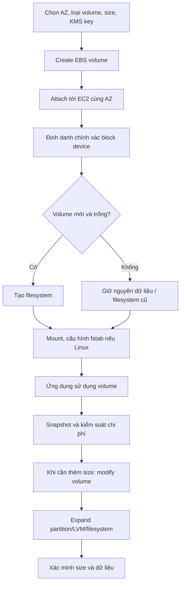
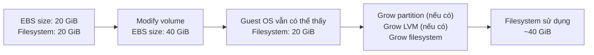
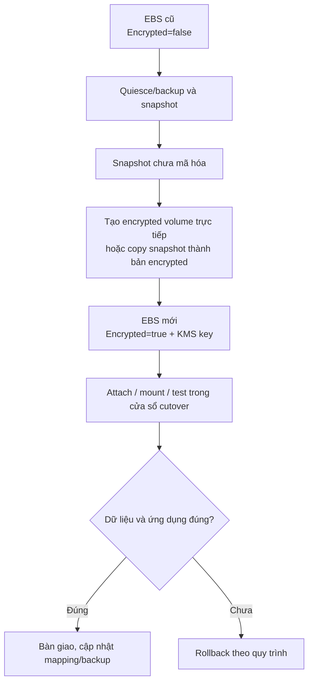
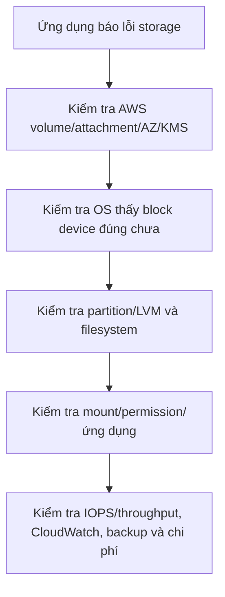

# Gắn, mở rộng và mã hóa EBS volume

**Amazon Elastic Block Store (Amazon EBS)** cung cấp ổ đĩa block bền vững cho các máy ảo **Amazon EC2**. Ổ EBS có thể chứa hệ điều hành, dữ liệu ứng dụng, log hoặc file dữ liệu của database tự quản. Khác với việc tăng dung lượng một thư mục thông thường, vận hành EBS liên quan đến **ba lớp cần phối hợp**: tài nguyên volume ở AWS, thiết bị block/partition trong hệ điều hành và file system được mount để ứng dụng sử dụng.

Bài học thuộc chương **Lưu trữ block và file** của mô-đun **CLOUD_PROVIDERS_AWS**. Nội dung kết nối kiến thức hạ tầng Region/Availability Zone, IAM/KMS, tính toán EC2, lưu trữ, cơ sở dữ liệu, giám sát, phục hồi dữ liệu và kiểm soát chi phí. Trọng tâm là **gắn volume đúng cách, mở rộng mà không làm hỏng dữ liệu và mã hóa an toàn**.

## 1. Mục tiêu học tập

Sau bài học, bạn có thể:

1. Giải thích EBS volume, snapshot, attachment, root volume, data volume và phạm vi Availability Zone.
2. Chọn loại EBS phù hợp giữa `gp3`, `gp2`, `io2` và các loại HDD khi có yêu cầu tương ứng.
3. Tạo và gắn một volume vào EC2 cùng AZ; nhận diện chính xác ổ đĩa trong Linux hoặc Windows.
4. Khởi tạo file system trên **ổ mới trống**, mount và cấu hình gắn lại sau reboot mà không ghi đè ổ đã có dữ liệu.
5. Mở rộng dung lượng ở AWS và sau đó mở rộng **partition/file system** trong hệ điều hành.
6. Giải thích mã hóa EBS bằng AWS KMS, mã hóa mặc định, lựa chọn KMS key và giới hạn khi đổi trạng thái mã hóa.
7. Mô tả quy trình chuyển **volume chưa mã hóa → volume mã hóa** bằng snapshot và chuyển đổi có kiểm soát.
8. Kiểm tra hoạt động, theo dõi hiệu năng/dung lượng, sao lưu và ước lượng chi phí vận hành.

## 2. EBS nằm ở đâu trong kiến trúc AWS?

EBS là **block storage**: hệ điều hành nhìn thấy một thiết bị block, có thể tạo partition/file system hoặc đưa vào Logical Volume Manager (LVM). EBS thường được dùng với EC2 và khác với **Amazon EFS** là dịch vụ file storage chia sẻ qua giao thức NFS.

| Công nghệ | Kiểu lưu trữ | Điểm chính | Ví dụ |
| --- | --- | --- | --- |
| **Amazon EBS** | Block | Volume nằm trong một AZ, thường gắn vào một EC2; hệ điều hành quản lý file system | Ổ boot, dữ liệu app, PostgreSQL tự quản |
| **Amazon EFS** | File | File system quản lý, nhiều EC2 có thể mount qua NFS trong kiến trúc được hỗ trợ | Thư mục dùng chung cho nhiều máy |
| **Amazon S3** | Object | Truy cập object qua API, không phải ổ block truyền thống | Backup, ảnh, log, dữ liệu tĩnh |
| **EC2 instance store** | Block cục bộ gắn với host | Dữ liệu tạm thời có thể mất khi instance dừng/chấm dứt hoặc host thay đổi | Cache, dữ liệu có thể tái tạo |

Một EBS volume được tạo tại **một Availability Zone (AZ) cụ thể**. EC2 và EBS volume muốn attach trực tiếp phải thuộc **cùng AZ**. EBS sao chép dữ liệu bên trong AZ để tăng độ bền, nhưng **không phải** một volume tự động mount trên EC2 ở AZ khác. Khi cần khôi phục ở AZ khác, có thể tạo volume mới từ **EBS snapshot** tại AZ đích trong cùng Region.

**Snapshot** lưu trạng thái dữ liệu block của volume trên hạ tầng được AWS quản lý và có thể dùng làm nguồn tạo volume mới. Snapshot và volume là hai tài nguyên khác nhau: xóa volume không đồng nghĩa xóa snapshot; backup bằng snapshot không tự cung cấp tính nhất quán của ứng dụng nếu ứng dụng đang ghi dữ liệu.

### 2.1. Các thuộc tính quan trọng của volume

| Thuộc tính | Ví dụ | Ý nghĩa |
| --- | --- | --- |
| **Volume ID** | `vol-0123456789abcdef0` | Mã tài nguyên volume trong AWS |
| **Availability Zone** | `ap-southeast-1a` | AZ chứa volume, phải trùng AZ của EC2 khi attach |
| **Volume type** | `gp3` | Ảnh hưởng giá, IOPS, throughput và yêu cầu workload |
| **Size** | `20 GiB` | Dung lượng block EBS được cấp phát |
| **State** | `creating`, `available`, `in-use` | Trạng thái tạo và attachment |
| **Encrypted** | `true` hoặc `false` | Trạng thái mã hóa được quyết định lúc tạo volume |
| **KMS key ID** | Key/ARN thuộc AWS KMS | Khóa dùng bảo vệ data key mã hóa volume |
| **Attachment** | Instance ID, device name | Volume được nối tới EC2 nào |
| **Delete on termination** | `true` hoặc `false` | Quy tắc xóa volume khi EC2 bị terminate theo block device mapping |

**Vùng miền tên dễ nhầm:** AWS EC2 Console hiển thị **EBS volume size**, trong Linux `lsblk` hiển thị kích thước block device, còn `df -hT` hiển thị dung lượng file system đã sử dụng. Chúng có thể **khác nhau sau khi vừa mở rộng** cho đến lúc bạn xử lý partition/file system.

### 2.2. Root volume và data volume

- **Root volume** chứa hệ điều hành và file system boot của một EC2 dùng EBS-backed AMI. Mất root volume có thể khiến instance không boot được.
- **Data volume** là volume bổ sung cho thư mục như `/data`, `/var/lib/postgresql`, hoặc ổ `D:` trên Windows. Tách data volume giúp quản lý lifecycle, backup và dung lượng độc lập với ổ hệ điều hành.
- **Delete on termination** thường bật cho root volume và có thể khác với data volume, tùy cấu hình lúc tạo/attach instance. Luôn kiểm tra block device mapping trước khi terminate EC2.
- Một số loại volume **io1/io2** hỗ trợ **EBS Multi-Attach** trên instance được hỗ trợ trong **cùng AZ**, nhưng đây **không** phải chức năng chia sẻ file mặc định. Hệ thống phải dùng cơ chế phối hợp ghi và clustered file system phù hợp; nhiều instance cùng ghi vào file system thông thường có thể gây hỏng dữ liệu.

## 3. Chọn loại EBS và dung lượng phù hợp

| Volume type | Đặc điểm chính | Workload ví dụ | Lưu ý |
| --- | --- | --- | --- |
| **`gp3` — General Purpose SSD** | Cấp phát dung lượng, IOPS và throughput độc lập trong giới hạn dịch vụ | Boot, ứng dụng web, database thông dụng | Thường là lựa chọn bắt đầu phù hợp cho nhiều workload |
| **`gp2` — General Purpose SSD** | Hiệu năng gắn với kích thước volume theo quy tắc của `gp2` | Hệ thống cũ đang dùng gp2 | Có thể cân nhắc chuyển gp3 sau khi đo hiệu năng |
| **`io2` — Provisioned IOPS SSD** | Hiệu năng IOPS/độ bền được thiết kế cho workload khắt khe | Database cần I/O chuyên sâu, yêu cầu độ trễ/độ bền cao | Xem giới hạn instance và chi phí provisioned IOPS |
| **`st1` — Throughput Optimized HDD** | Ưu tiên throughput tuần tự | Dữ liệu lớn quét tuần tự | Không phù hợp nhiều I/O nhỏ ngẫu nhiên; không dùng làm boot volume |
| **`sc1` — Cold HDD** | Tối ưu chi phí cho dữ liệu ít truy cập | Lưu trữ ít hoạt động | Không dùng làm boot volume |

Với `gp3`, mức hiệu năng cơ bản thường bao gồm **3.000 IOPS và 125 MiB/s throughput**; khi workload cần thêm, người quản trị có thể cấp phát hiệu năng cao hơn trong giới hạn của loại volume và instance. Cần so sánh **yêu cầu thực tế** với khả năng EC2 instance và các giới hạn của AWS, thay vì chỉ tăng IOPS trên giấy.

### 3.1. Chọn kích thước ban đầu

Ví dụ ứng dụng cần:

- Dữ liệu hiện tại: 12 GiB.
- Tăng trưởng trong một chu kỳ vận hành: 4 GiB.
- Log, index và không gian dự phòng cho ứng dụng: 6 GiB.

Dung lượng tối thiểu dự tính: `12 + 4 + 6 = 22 GiB`. Có thể chọn volume phù hợp lớn hơn để có dư địa tăng trưởng và thiết lập cảnh báo dung lượng file system.

Lưu ý: **EBS tính phí cho dung lượng đã cấp phát**, kể cả khi `df` cho thấy phần lớn ổ còn trống. EBS thường cho **tăng**, nhưng không cho **giảm trực tiếp kích thước volume** bằng Elastic Volumes. Muốn giảm dung lượng, cần tạo volume nhỏ hơn và di chuyển dữ liệu theo kế hoạch.

## 4. Luồng triển khai tổng quan



**Điểm dễ gây mất dữ liệu nhất:** thao tác format (như `mkfs.ext4`, `mkfs.xfs` hoặc **Initialize Disk** trên Windows) lên **volume có dữ liệu sẵn**. Chỉ format khi đã xác nhận đây thực sự là ổ mới trống và không có dữ liệu cần giữ.

## 5. Tạo và gắn EBS volume trên AWS Console

### 5.1. Chuẩn bị trước khi thao tác

Đảm bảo bạn biết:

1. **Account ID và Region** đang sử dụng.
2. **Instance ID và AZ** của EC2 đích.
3. Volume được tạo mới hay phục hồi từ **snapshot**.
4. Quy định loại volume, kích thước, chi phí tối đa và **encryption by default**.
5. IAM permissions như `ec2:CreateVolume`, `ec2:AttachVolume`, `ec2:DescribeVolumes` và các quyền sử dụng KMS key nếu mã hóa bằng customer managed key.
6. Có backup/snapshot phù hợp nếu thao tác trên dữ liệu hiện hữu.

Nếu chưa được cấp một sandbox hoặc instance, hãy thực hiện phần thực hành mô phỏng ở cuối bài; **không cần tạo tài nguyên tính phí** để hiểu quy trình.

### 5.2. Tạo volume trống

1. Mở [Amazon EC2 Console](https://console.aws.amazon.com/ec2/), chọn **đúng Region**.
2. Chọn **Elastic Block Store → Volumes → Create volume**.
3. Chọn `gp3` (hoặc loại thích hợp) và kích thước minh họa `20 GiB`.
4. Chọn **Availability Zone đúng với EC2** sẽ gắn volume.
5. Ở **Encryption**, bật mã hóa nếu chưa được bật mặc định và chọn KMS key theo chính sách của tổ chức.
6. Đặt tag rõ ràng, ví dụ `Name=training-data`, `Environment=lab`, `Owner=team-cloud`.
7. Kiểm tra lại loại, size, AZ, KMS key, rồi chọn **Create volume**.
8. Đợi volume sang trạng thái **`available`**.

Nếu account/Region đã bật **EBS encryption by default**, volume mới sẽ được mã hóa tự động theo mặc định của Region đó. Kiểm tra khóa đang được dùng để không tạo sự phụ thuộc sai vào khóa KMS không thuộc quyền quản trị của nhóm.

### 5.3. Gắn volume vào EC2

1. Trong **Volumes**, chọn volume vừa tạo.
2. Chọn **Actions → Attach volume**.
3. Chọn **Instance ID** của EC2 cùng AZ.
4. Chọn device name chưa sử dụng (trên Linux có thể khai báo `/dev/sdf`); xác nhận bằng **Attach volume**.
5. Kiểm tra volume chuyển từ `available` sang `in-use` và có attachment đúng instance.

**Device name mà bạn chọn trong AWS Console không nhất thiết trùng tên Linux hiển thị.** Với nhiều EC2 dùng hệ thống Nitro, EBS xuất hiện dưới dạng `/dev/nvme*n1`; thứ tự NVMe có thể thay đổi sau reboot hoặc attach thêm ổ. Do đó không dựa vào việc “ổ thứ hai chắc chắn là `/dev/nvme1n1`” trong thao tác ảnh hưởng dữ liệu.

**Một EBS volume và EC2 phải cùng AZ.** Nếu khác AZ, giải pháp là tạo **snapshot**, phục hồi thành volume ở AZ đích, rồi attach volume mới; không thể “chuyển AZ” tại chỗ bằng cách sửa một trường của volume.

## 6. Linux: nhận diện volume, tạo filesystem và mount

Phần này giả sử EC2 Linux đã gắn một **EBS data volume mới hoàn toàn và chưa format**. Tên thiết bị `/dev/nvme1n1` chỉ là ví dụ trên Nitro; người học phải thay bằng thiết bị đã được xác minh.

### 6.1. Bước kiểm tra an toàn trước khi ghi

Trên EC2, thực hiện các lệnh **chỉ đọc**:

```bash
# Hiển thị disk, partition, size, file system và mount point.
lsblk -o NAME,SIZE,TYPE,FSTYPE,MOUNTPOINTS,UUID

# Xem file system thực sự đang gắn ở các mount point.
df -hT

# Liệt kê signature/UUID của các disk có filesystem.
sudo blkid

# Đọc signature trên THIẾT BỊ ĐÃ KIỂM TRA ĐÚNG.
sudo file -s /dev/nvme1n1
```

Khi thấy thiết bị EBS trên Nitro, hãy đối chiếu **Volume ID** với serial của NVMe và/hoặc đường dẫn thiết bị ổn định mà hệ điều hành cung cấp. Trên Amazon Linux, công cụ `ebsnvme-id` có thể giúp liên hệ NVMe device với Volume ID AWS. Không nhầm với NVMe **instance store** nếu máy có cả hai loại storage.

**Dừng lại trước bước format** nếu:

- `lsblk -f` hoặc `blkid` báo đã có `ext4`, `xfs`, `ntfs`, LVM metadata hoặc dấu hiệu dữ liệu;
- thiết bị đã được mount;
- chưa xác nhận volume ID ↔ thiết bị Linux;
- volume được tạo từ snapshot hoặc từng dùng trước đó.

### 6.2. Tạo filesystem cho data volume mới, trống

Nếu đã xác minh volume **hoàn toàn trống** và cho phép ghi, ví dụ dùng **XFS trực tiếp trên cả block device** (không tạo partition):

```bash
# CHỈ CHẠY TRÊN VOLUME MỚI TRỐNG ĐÃ XÁC NHẬN.
sudo mkfs.xfs /dev/nvme1n1

# Tạo thư mục mount.
sudo mkdir -p /data

# Mount volume.
sudo mount /dev/nvme1n1 /data

# Kiểm tra.
findmnt /data
df -hT /data
sudo blkid /dev/nvme1n1
```

Bạn cũng có thể dùng `ext4` bằng `sudo mkfs.ext4 /dev/nvme1n1` nếu workload yêu cầu; khi đó các lệnh mở rộng về sau phải theo `ext4`. **Tuyệt đối không chạy đồng thời hai lệnh tạo filesystem lên cùng thiết bị.**

Một số tổ chức bắt buộc có partition table (GPT) hoặc LVM. Khi đó hãy dùng quy trình tạo partition/LVM của hệ điều hành; thao tác tương ứng sẽ tạo thiết bị như `/dev/nvme1n1p1` và không nên sao chép lệnh `mkfs` trực tiếp lên disk nếu đã chọn cách có partition.

### 6.3. Mount bền vững qua reboot bằng UUID

Mount bằng device name có thể thất bại nếu thứ tự NVMe thay đổi. Dùng **UUID** từ `blkid`, sau đó thêm vào `/etc/fstab` bằng trình soạn thảo với thông tin chính xác:

```fstab
# Ví dụ minh họa: thay UUID bằng giá trị thực từ blkid.
UUID=aaaaaaaa-bbbb-cccc-dddd-eeeeeeeeeeee /data xfs defaults,nofail 0 0
```

Sau khi lưu:

```bash
# Kiểm tra cú pháp /etc/fstab và khả năng mount.
sudo mount -a
findmnt /data
df -hT /data
```

Tùy hệ điều hành, nên dùng thêm `findmnt --verify` hoặc lệnh kiểm tra phù hợp và backup `/etc/fstab` trước khi sửa. Tùy chọn `nofail` giúp giảm nguy cơ kẹt boot nếu volume không sẵn sàng, nhưng **có thể khiến ứng dụng chạy khi /data chưa mount** nếu không thiết lập kiểm tra phụ thuộc. Với dữ liệu quan trọng, service phải có điều kiện kiểm tra mount point trước khi ghi.

### 6.4. Gắn volume đã có dữ liệu

Nếu volume được phục hồi từ snapshot hoặc chuyển từ EC2 khác, **không format**. Thay vào đó:

1. Kiểm tra filesystem hiện có bằng `lsblk -f`/`blkid`.
2. Kiểm tra tình trạng ứng dụng, quyền sở hữu file và tính nhất quán filesystem.
3. Mount tới đường dẫn an toàn; không ghi đè thư mục có dữ liệu nếu chưa hiểu hành vi mount.
4. Dùng UUID thực để cấu hình `fstab` nếu muốn tự động mount.
5. Kiểm tra ứng dụng đọc được dữ liệu và backup trước khi thay đổi thêm.

## 7. Windows: khởi tạo ổ mới và gán drive letter

Với EC2 Windows, sau khi attach volume ở AWS, vào **Disk Management** (`diskmgmt.msc`) hoặc PowerShell để tìm ổ mới.

Quy trình cho **ổ mới chưa có dữ liệu**:

1. Xác nhận disk number, size và trạng thái bằng Disk Management hoặc `Get-Disk`.
2. Chỉ khi ổ mới thật sự `RAW`/chưa khởi tạo và được chọn đúng, thực hiện **Initialize Disk** (thường GPT).
3. Tạo volume/partition, định dạng **NTFS** hoặc ReFS khi phù hợp, gán drive letter như `D:`.
4. Kiểm tra ổ xuất hiện trong File Explorer, dung lượng đúng và tài khoản dịch vụ có quyền NTFS cần thiết.

Ví dụ lệnh **chỉ đọc** trong PowerShell trên Windows EC2:

```powershell
Get-Disk | Select-Object Number,FriendlyName,Size,PartitionStyle,OperationalStatus
Get-Partition | Select-Object DiskNumber,PartitionNumber,DriveLetter,Size
Get-Volume | Select-Object DriveLetter,FileSystem,Size,SizeRemaining
```

Nếu ổ được tạo từ snapshot hoặc từng chứa dữ liệu, nó có thể đã có partition/file system; khi đó **không Initialize Disk hoặc Format**. Đối chiếu với Volume ID và thông tin thiết bị trong AWS trước khi thay đổi.

## 8. Mở rộng EBS: cần hai bước ở hai lớp khác nhau

Giả sử EBS volume ban đầu **20 GiB** và ứng dụng đã sử dụng gần hết. Bạn muốn tăng thành **40 GiB**.

**Bước 1 — AWS:** sửa kích thước EBS volume từ 20 GiB lên 40 GiB bằng **Elastic Volumes**.

**Bước 2 — Guest OS:** nếu volume có partition và filesystem, mở rộng chúng để filesystem dùng được 40 GiB. Nếu dùng LVM, còn cần mở rộng physical volume/logical volume theo topology.



**Tăng kích thước EBS ở AWS không đồng nghĩa filesystem tự tăng**. Ngược lại, chạy lệnh grow filesystem trước khi EBS/partition cung cấp thêm không gian cũng không tạo ra dung lượng mới.

### 8.1. Lưu ý trước khi tăng

- Tạo **snapshot/backup nhất quán** nếu dữ liệu có giá trị, có phương án rollback.
- Kiểm tra giới hạn loại volume, EC2 instance, IOPS/throughput và dung lượng thực cần tăng.
- Xác nhận phiên bản instance/OS hỗ trợ online modification; với nhiều instance hiện đại, có thể sửa khi volume `in-use`, nhưng một số trường hợp cũ cần detach data volume hoặc stop root volume theo hướng dẫn AWS.
- Không thể trực tiếp giảm kích thước volume bằng `Modify volume`.
- Không yêu cầu một thay đổi volume mới liên tục khi thay đổi cũ còn đang thực hiện; AWS áp dụng giới hạn tần suất và các yêu cầu sửa volume.
- Khi chuyển từ `gp2` sang `gp3`, so sánh IOPS/throughput hiện tại với các giá trị gp3 sau chuyển đổi; không giả định mọi cấu hình sẽ cho hiệu năng giống hệt.

### 8.2. Mở rộng qua Console

1. Vào **EC2 Console → Elastic Block Store → Volumes**.
2. Chọn đúng volume ID, kiểm tra attachment và tag.
3. Chọn **Actions → Modify volume**.
4. Đổi **Size** từ `20 GiB` lên `40 GiB`; giữ hoặc thay volume type/IOPS/throughput chỉ khi có lý do cụ thể.
5. Xác nhận tác động chi phí và chọn **Modify**.
6. Theo dõi **Modification state**: `modifying` → `optimizing` → `completed`.
7. Khi đã ở `optimizing` hoặc `completed`, kiểm tra hệ điều hành đã thấy kích thước block device mới; tiếp tục mở rộng partition/filesystem.

`optimizing` thường cho phép bắt đầu bước mở rộng filesystem, trong khi tối ưu hiệu năng của volume có thể còn tiếp diễn. Đừng dựa vào thời gian cố định; xác minh trạng thái từ API/Console.

### 8.3. Các lệnh AWS CLI tương ứng

Lệnh đọc trạng thái và thay đổi (thay ID/Region/profile theo môi trường thực):

```bash
# CHỈ ĐỌC: loại, size, AZ, encryption và trạng thái volume.
aws ec2 describe-volumes \
  --volume-ids vol-0123456789abcdef0 \
  --query "Volumes[].{Id:VolumeId,Size:Size,Type:VolumeType,AZ:AvailabilityZone,Encrypted:Encrypted,State:State}" \
  --region ap-southeast-1 --profile training

# CÓ THAY ĐỔI TÀI NGUYÊN: tăng volume lên 40 GiB.
aws ec2 modify-volume \
  --volume-id vol-0123456789abcdef0 \
  --size 40 \
  --region ap-southeast-1 --profile training

# CHỈ ĐỌC: theo dõi trạng thái sửa volume.
aws ec2 describe-volumes-modifications \
  --volume-ids vol-0123456789abcdef0 \
  --region ap-southeast-1 --profile training
```

Không dùng Volume ID minh họa để thao tác thật. Lệnh `modify-volume` có thể làm tăng chi phí lưu trữ theo dung lượng mới.

## 9. Linux: mở rộng partition và file system

Các ví dụ sau tiếp tục dùng **volume 20 → 40 GiB**. Trước khi chạy, xác minh thật chính xác **Volume ID → block device → partition → filesystem → mount point**.

### 9.1. Kiểm tra layout trước khi thay đổi

```bash
lsblk -o NAME,SIZE,TYPE,FSTYPE,MOUNTPOINTS,UUID
df -hT
findmnt /data
```

Có hai topology phổ biến:

| Topology | Ví dụ | Có cần `growpart` không? |
| --- | --- | --- |
| File system trực tiếp trên volume | `/dev/nvme1n1` → XFS → `/data` | **Không** có partition để grow |
| Volume có partition | `/dev/nvme1n1` → `/dev/nvme1n1p1` → ext4 → `/data` | **Có**, nếu partition chưa chiếm phần dung lượng mới |

Nếu sử dụng LVM như `/dev/mapper/vg-data`, cần xử lý bằng `pvresize`, `lvextend` và mở rộng filesystem theo đúng sơ đồ LVM; **không** áp dụng mù quáng lệnh của topology đơn giản.

### 9.2. Trường hợp A: XFS trực tiếp trên volume

Nếu file system **XFS** đang mount tại `/data` và không có partition, sau khi AWS volume đạt `optimizing`/`completed`:

```bash
# Xác nhận device đã lớn hơn nhưng filesystem chưa lớn.
lsblk -o NAME,SIZE,TYPE,FSTYPE,MOUNTPOINTS
df -hT /data

# CHỈ CHẠY nếu /data chính xác là XFS trên volume vừa mở rộng.
sudo xfs_growfs -d /data

# Xác minh dung lượng filesystem.
df -hT /data
```

`xfs_growfs` nhận **mount point** của filesystem XFS đang mount. Không chạy lệnh này cho ext4.

### 9.3. Trường hợp B: ext4 nằm trên partition số 1

Giả sử `lsblk` cho thấy disk `/dev/nvme1n1` đã thành **40 GiB**, nhưng partition `/dev/nvme1n1p1` và ext4 vẫn **20 GiB**:

```bash
# Xác minh topology trước.
lsblk -o NAME,SIZE,TYPE,FSTYPE,MOUNTPOINTS

# Nới partition 1 trên đúng disk.
sudo growpart /dev/nvme1n1 1

# Kiểm tra partition đã chiếm thêm dung lượng.
lsblk -o NAME,SIZE,TYPE,FSTYPE,MOUNTPOINTS

# Nới ext4 trong đúng partition đã xác minh.
sudo resize2fs /dev/nvme1n1p1

# Kiểm tra filesystem.
df -hT /data
```

**Chú ý cú pháp:** `growpart /dev/nvme1n1 1` có khoảng trắng giữa tên **disk** và số **partition**. Nếu instance sử dụng Xen, tên có thể là `/dev/xvdf` và partition là `/dev/xvdf1`; thay đúng tên thực tế.

Nếu filesystem là **XFS trên partition**, sau `growpart` dùng `sudo xfs_growfs -d /data`, **không** dùng `resize2fs`. Nếu partition đã lớn đủ mà filesystem còn nhỏ, bỏ qua `growpart`.

### 9.4. Root volume và trường hợp LVM

Root volume Linux có thể có mount point `/` và device như `/dev/nvme0n1p1`. Với XFS, cú pháp grow có thể là `sudo xfs_growfs -d /`; với ext4, là `sudo resize2fs /dev/nvme0n1p1` sau khi partition đã được mở rộng. **Không suy đoán** root partition là số 1 trên mọi AMI; cần đọc `lsblk` và `findmnt /`.

Với **LVM**, thứ tự mở rộng phổ biến là:

1. Mở rộng EBS volume ở AWS.
2. Mở rộng partition chứa LVM nếu có (`growpart` đúng disk/partition).
3. Mở rộng physical volume (`pvresize`).
4. Mở rộng logical volume (`lvextend`) theo kế hoạch.
5. Mở rộng ext4/XFS theo đúng device/mount point hoặc tùy chọn tích hợp có hỗ trợ.

LVM nhiều physical volume, snapshot nội bộ hoặc mã hóa LUKS có thể đòi hỏi bước riêng; cần đọc layout trước khi chọn lệnh và có backup phù hợp.

## 10. Windows: Extend Volume sau khi thay đổi size

Sau khi AWS đã tăng EBS volume:

1. Đăng nhập EC2 Windows bằng danh tính được ủy quyền.
2. Mở **Disk Management** hoặc **Server Manager** để xác định đúng disk/partition.
3. Chọn **Rescan Disks** nếu hệ điều hành chưa thấy dung lượng mới.
4. Kiểm tra **unallocated space** nằm ở vị trí có thể mở rộng partition.
5. Dùng **Extend Volume** trên đúng NTFS/ReFS volume được hỗ trợ; xác nhận size mới và ứng dụng.
6. Nếu Extend Volume bị vô hiệu hóa, xem layout partition, giới hạn file system và yêu cầu công cụ phù hợp thay vì xóa partition.

Ví dụ PowerShell chỉ đọc:

```powershell
Get-Disk | Select-Object Number,FriendlyName,Size,PartitionStyle
Get-Partition | Select-Object DiskNumber,PartitionNumber,DriveLetter,Size
Get-Volume | Select-Object DriveLetter,FileSystem,Size,SizeRemaining

# Sau khi đã xác định đúng disk/partition có thể mở rộng:
Get-PartitionSupportedSize -DiskNumber 1 -PartitionNumber 1
```

Ví dụ thao tác thực sự **chỉ sau khi xác nhận ổ đích**:

```powershell
# GIẢ ĐỊNH disk 1 / partition 1 là đúng data volume.
# Cần thay số bằng giá trị đã xác minh.
$limits = Get-PartitionSupportedSize -DiskNumber 1 -PartitionNumber 1
Resize-Partition -DiskNumber 1 -PartitionNumber 1 -Size $limits.SizeMax
```

Mở rộng EBS không phải là thao tác “Initialize Disk”; không format lại ổ vì Windows mới thấy dung lượng chưa cấp phát. Nếu volume mã hóa bằng EBS/KMS, thao tác mở rộng filesystem Windows không thay đổi trạng thái mã hóa ở AWS.

## 11. Mã hóa EBS với AWS KMS

### 11.1. Mã hóa bảo vệ điều gì?

**EBS encryption** dùng **AWS Key Management Service (AWS KMS)** để quản lý khóa mã hóa dữ liệu của EBS. Khi tạo encrypted volume, EBS mã hóa dữ liệu lưu trữ trên volume, snapshot được tạo từ volume và dữ liệu truyền giữa EC2 và volume theo cơ chế dịch vụ. EBS encryption được triển khai trong hạ tầng AWS, nên Linux/Windows nhìn thấy một block device có thể dùng bình thường khi được cấp quyền.

Mã hóa EBS **không thay thế**:

- IAM permissions và chính sách KMS key.
- Chứng thực của ứng dụng, Security Group/NACL và kiểm soát truy cập dữ liệu ở OS.
- TLS cho kết nối ứng dụng.
- Backup/snapshot, thử nghiệm phục hồi và cơ chế phát hiện ransomware.

Một instance đang chạy được phép truy cập encrypted volume vẫn có thể đọc dữ liệu rõ ở cấp hệ điều hành. Vì vậy, việc bật mã hóa không giải quyết các rủi ro do chiếm quyền bên trong máy.

### 11.2. AWS managed key và customer managed key

| Lựa chọn | Mục đích phù hợp | Lưu ý |
| --- | --- | --- |
| **AWS managed key `aws/ebs`** | Quản lý khóa EBS theo thiết lập AWS mặc định | AWS quản lý lifecycle chính, phù hợp nhiều nhu cầu trong một account |
| **Customer managed KMS key** | Cần key policy/grants, kiểm soát phân quyền, audit, tích hợp đa tài khoản | Phải quản lý key lifecycle, chi phí KMS, quyền và quy trình phục hồi |
| **EBS encryption by default** | Bảo đảm volume mới và snapshot copy trong Region được mã hóa | Cài đặt **theo account và Region**, không đổi volume đã tồn tại |

Khi chia sẻ **encrypted snapshot sang tài khoản khác**, thường cần **customer managed KMS key** và cấu hình chính sách/ quyền phù hợp; không thể sử dụng AWS managed key `aws/ebs` để chia sẻ quyền truy cập cross-account như một customer managed key.

KMS key dùng cho EBS phải là key phù hợp (symmetric) được hỗ trợ. Nếu key bị disable, chờ xóa hoặc chính sách từ chối sử dụng, thao tác tạo/attach/khởi động tài nguyên mã hóa có thể thất bại. **Không tắt/xóa key khi còn dữ liệu hoặc backup phụ thuộc vào key đó**.

### 11.3. Mã hóa mặc định theo Region

Tại EC2 Console, mục **EBS encryption** trong phần cài đặt bảo mật của tài khoản/Region cho phép xem và quản lý **encryption by default**.

Lệnh AWS CLI chỉ đọc:

```bash
aws ec2 get-ebs-encryption-by-default \
  --region ap-southeast-1 \
  --profile training

aws ec2 get-ebs-default-kms-key-id \
  --region ap-southeast-1 \
  --profile training

aws ec2 describe-volumes \
  --volume-ids vol-0123456789abcdef0 \
  --query "Volumes[].{Id:VolumeId,Encrypted:Encrypted,KmsKeyId:KmsKeyId}" \
  --region ap-southeast-1 \
  --profile training
```

Nếu bật encryption by default, volume mới/snapshot copy mới được mã hóa theo cấu hình trong Region. Thiết lập này **không mã hóa ngược** volume hoặc snapshot cũ đang không mã hóa, và không tắt encryption của một volume đã mã hóa.

### 11.4. Không thể bật/tắt encryption hay đổi KMS key trực tiếp trên volume đang tồn tại

Một hạn chế quan trọng:

- **Không thể đổi trực tiếp** volume `Encrypted=false` thành `Encrypted=true` bằng `modify-volume`.
- **Không thể giải mã** một encrypted volume hoặc encrypted snapshot bằng cách tắt một checkbox.
- **Không thể đổi KMS key in-place** cho volume/snapshot hiện có. Để sử dụng key mới, cần sao chép snapshot với khóa mới hoặc chuyển dữ liệu sang volume mới.

**Elastic Volumes hỗ trợ thay size/type/IOPS/throughput trong giới hạn cho phép, không dùng để đổi trạng thái encryption hoặc rekey tại chỗ.**

## 12. Chuyển volume chưa mã hóa sang volume mã hóa

### 12.1. Phương án dựa trên snapshot

Giả sử `vol-old` đang chứa dữ liệu ứng dụng và `Encrypted=false`. Quy trình an toàn khái quát:

1. **Khảo sát phụ thuộc:** volume ID, instance, AZ, mount point, filesystem, dữ liệu, permission của service và backup.
2. **Chọn điểm nhất quán:** bảo đảm dữ liệu ứng dụng được flush/quiesce hoặc dừng tác vụ ghi theo hướng dẫn của hệ thống, đặc biệt với database.
3. **Tạo snapshot** của volume cũ. Snapshot này giữ trạng thái mã hóa tương ứng với volume gốc; nếu gốc chưa mã hóa, snapshot gốc cũng chưa mã hóa.
4. **Tạo volume mới có mã hóa từ snapshot đó**, chọn `Encrypted=true` và KMS key phù hợp trong đúng AZ dự kiến attach. Có thể chọn cách **copy snapshot với encryption/KMS key** trước rồi tạo volume từ encrypted snapshot.
5. **Cắt chuyển có kiểm soát:** dừng ứng dụng ghi, bảo đảm dữ liệu/khôi phục không bị lệch so với snapshot; detach/unmount volume cũ theo quy trình, attach/mount volume mới.
6. **Kiểm tra:** Volume mới `Encrypted=true`, KMS key đúng, file system và dữ liệu nguyên vẹn, ứng dụng hoạt động.
7. **Kế hoạch rollback:** giữ snapshot/volume cũ theo thời hạn phù hợp cho đến khi hoàn tất xác minh; sau đó dọn dẹp với quy trình phê duyệt.

**Snapshot ở bước 3 là ảnh dữ liệu tại một thời điểm.** Nếu ứng dụng tiếp tục ghi sau thời điểm chụp và bạn chuyển sang volume mới từ snapshot cũ, các thay đổi phát sinh có thể **không có trong volume mới**. Cần xác định downtime, RPO và biện pháp đồng bộ hoặc tạo snapshot cuối cùng khi đã ngừng ghi trước khi cutover.

### Sơ đồ chuyển đổi encryption



### 12.2. AWS CLI minh họa

**Lệnh bên dưới tạo snapshot/volume và có thể phát sinh chi phí**. Đây là mẫu tham khảo cho môi trường được cấp quyền, không phải một script tự động an toàn để chạy trực tiếp ở production.

```bash
# Bước 1: tạo snapshot sau khi đã quiesce ứng dụng.
aws ec2 create-snapshot \
  --volume-id vol-0123456789abcdef0 \
  --description "migration-to-encrypted-volume" \
  --region ap-southeast-1 --profile training

# Bước 2: khi snapshot đã sẵn sàng, tạo EBS mới và bắt buộc encrypt.
# Thay snapshot ID bằng ID trả về từ bước 1.
aws ec2 create-volume \
  --snapshot-id snap-0123456789abcdef0 \
  --availability-zone ap-southeast-1a \
  --volume-type gp3 \
  --encrypted \
  --region ap-southeast-1 --profile training

# Chỉ đọc: xác nhận volume mới đã mã hóa và trạng thái available.
aws ec2 describe-volumes \
  --volume-ids vol-0fedcba9876543210 \
  --query "Volumes[].{Id:VolumeId,AZ:AvailabilityZone,State:State,Encrypted:Encrypted,KmsKeyId:KmsKeyId}" \
  --region ap-southeast-1 --profile training
```

Mẫu `create-volume` dùng **KMS key mặc định** trong Region. Khi yêu cầu customer managed key cụ thể, thêm `--kms-key-id` với key ARN đã được cấp quyền. AWS xác minh quyền KMS theo cơ chế dịch vụ, nên cần theo dõi trạng thái volume cả sau khi lệnh tạo trả kết quả. Với volume **tạo từ snapshot**, dữ liệu và filesystem được phục hồi; **không format lại**.

### 12.3. Trường hợp đổi KMS key

Để chuyển một encrypted volume từ KMS key A sang KMS key B:

1. Snapshot volume theo quy trình nhất quán.
2. **Copy snapshot**, đặt encrypted và chỉ định **KMS key B** cho bản copy.
3. Tạo volume mới từ snapshot copy đã được mã hóa bằng key B.
4. Chuyển ứng dụng sang volume mới, xác minh KMS key và khả năng truy cập.
5. Chỉ ngừng sử dụng key A sau khi chắc chắn không còn volume/snapshot/backups nào phụ thuộc vào key A.

Copy snapshot với key mới có thể tạo **bản copy đầy đủ** và phát sinh thêm chi phí snapshot. Key rotation tự động của KMS và đổi key dùng cho volume là hai khái niệm khác nhau; **không** cần thay volume chỉ vì KMS tự luân chuyển key material của cùng một key theo chính sách hỗ trợ.

## 13. Snapshot, tính nhất quán và khả năng phục hồi

### 13.1. Snapshot không tự bảo đảm nhất quán ứng dụng

EBS snapshot là ảnh dữ liệu **block-level**. Nếu ứng dụng hoặc database đang ghi, snapshot có thể phù hợp với trạng thái crash-consistent, nhưng chưa chắc là **application-consistent**. Với dữ liệu quan trọng:

- Dùng cơ chế flush/checkpoint/quiesce của ứng dụng hoặc database.
- Nếu có nhiều EBS volume tạo thành một tập dữ liệu, cân nhắc **multi-volume snapshots** nhất quán trong phạm vi instance được hỗ trợ.
- Ghi rõ thời điểm snapshot và trạng thái ứng dụng.
- Thử phục hồi ở môi trường tách biệt để xác minh tính toàn vẹn và khả năng khởi động.
- Đặt retention, lịch backup, yêu cầu mã hóa và quyền truy cập với **AWS Backup** hoặc quy trình snapshot phù hợp.

Snapshot có thể được sử dụng để khôi phục volume ở **AZ khác trong cùng Region**, hỗ trợ phương án ứng phó khi một AZ gặp sự cố. Để phục hồi sang Region khác, cần kế hoạch **copy snapshot cross-Region**, quản lý KMS key ở Region đích và chi phí copy/truyền dữ liệu.

### 13.2. Snapshot tăng dần (incremental)

EBS snapshot có cơ chế incremental: sau snapshot đầu tiên, những snapshot tiếp theo thường chỉ cần lưu các block thay đổi theo cơ chế dịch vụ. Vì thế:

- Dung lượng volume được cấp không đồng nghĩa dung lượng snapshot được lưu.
- Xóa một snapshot có thể không giải phóng tương ứng toàn bộ số GB nếu các block còn được snapshot khác tham chiếu.
- Cần giám sát tổng chi phí snapshot và chính sách retention.
- Volume mới từ snapshot có thể có **giai đoạn initialization** khi dữ liệu block được nạp, làm I/O ban đầu có độ trễ cao hơn; các tính năng tăng tốc restore có thể có chi phí riêng.

### 13.3. Đừng gộp backup và high availability

EBS chỉ nằm trong một AZ. Với ứng dụng yêu cầu **high availability nhiều AZ**, thường cần replication ở cấp ứng dụng/database hoặc dịch vụ quản lý sẵn HA; ví dụ Amazon RDS Multi-AZ cho database được hỗ trợ. Snapshot giúp **phục hồi sau sự cố**, nhưng không tự tạo phiên bản ứng dụng đang chạy tại AZ khác.

## 14. Gỡ EBS volume an toàn và vòng đời dữ liệu

Trước khi **detach** một data volume khỏi EC2:

1. Xác nhận ứng dụng không còn ghi hoặc đã chuyển lưu lượng/đóng file.
2. Tạo snapshot nếu cần bảo toàn dữ liệu.
3. Với Linux, **unmount** filesystem bằng `umount` sau khi đảm bảo không có tiến trình sử dụng; với Windows, dùng cơ chế offline/dismount phù hợp.
4. Gỡ hoặc cập nhật `/etc/fstab` và cấu hình service có phụ thuộc vào mount point.
5. Chọn **Detach volume** trong Console, đợi trạng thái `available`.
6. Chỉ **Delete volume** khi đã chắc chắn dữ liệu/backup không cần giữ và theo quy trình được phép.

Dùng **Force Detach** chỉ khi thật sự cần xử lý volume bị kẹt và đã đánh giá nguy cơ hỏng filesystem do cache chưa flush. Đây không phải cách tháo volume thường ngày.

Khi terminate EC2, xem cờ **DeleteOnTermination** của từng mapping. Volume còn lại ở trạng thái `available` vẫn **phát sinh phí dung lượng**. Đồng thời, snapshot không tự xóa khi xóa volume; cần retention và nhãn ownership để tránh tài nguyên mồ côi.

## 15. Theo dõi dung lượng, hiệu năng và chi phí

### 15.1. Phân biệt ba loại chỉ số

| Cần theo dõi | Công cụ | Lưu ý |
| --- | --- | --- |
| **Dung lượng filesystem còn trống** | `df -hT`, `Get-Volume`, CloudWatch Agent | EBS metrics không tự cho biết % filesystem đã sử dụng |
| **Hiệu năng volume** | CloudWatch EBS metrics như `VolumeReadOps`, `VolumeWriteOps`, `VolumeReadBytes`, `VolumeWriteBytes`, queue/latency phù hợp | Quan sát cùng instance limits và loại workload |
| **Trạng thái/cấu hình volume** | EC2 Volumes, `describe-volumes`, `describe-volumes-modifications`, CloudTrail | Phát hiện thay đổi size/type/encryption hoặc volume không còn attach |

CloudWatch Agent có thể thu thập metrics của hệ điều hành như `disk_used_percent`. Tạo cảnh báo khi dung lượng trống thấp, I/O bất thường hoặc backup không chạy. Một ổ EBS có hiệu năng tốt vẫn có thể hết chỗ nếu ứng dụng sinh log nhanh.

### 15.2. Chi phí EBS gồm những gì?

- **Provisioned storage (GiB/tháng)** theo loại volume, kể cả phần chưa chứa dữ liệu.
- **Provisioned IOPS/throughput tăng thêm** ở loại volume có các mức hiệu năng tính riêng.
- **Snapshots (dung lượng lưu)** và chức năng backup/copy/restore liên quan.
- **KMS customer managed key** và số lượng yêu cầu KMS nếu áp dụng bảng giá tương ứng.
- **Data transfer/cross-Region/các dịch vụ bổ sung**, tùy topology.

Ví dụ giả lập: tăng volume `gp3` từ **20 GiB lên 40 GiB** đồng nghĩa tăng dung lượng provisioned lên **20 GiB**. Chi phí tăng thêm cần tính theo **giá `gp3` của Region**, thời gian sử dụng và các khoản bổ sung khác; không đưa một mức USD cứng cho tất cả Region. Dùng [EBS pricing](https://aws.amazon.com/ebs/pricing/) và [AWS Pricing Calculator](https://calculator.aws/) để lập dự toán.

### 15.3. Checklist vận hành định kỳ

- Dung lượng file system còn đủ và đã có cảnh báo.
- Tên/tag volume thể hiện owner, environment, workload và kế hoạch lifecycle.
- Volume chứa dữ liệu nhạy cảm có encryption đúng yêu cầu.
- KMS key có chính sách và trạng thái phù hợp, không phụ thuộc cá nhân.
- Snapshot/backup chạy theo lịch và **đã thử restore**.
- `DeleteOnTermination` và volume `available` được rà soát.
- IOPS/throughput không được cấp quá nhiều hoặc quá ít so với quan sát thực tế.
- Có kế hoạch phục hồi khi instance hỏng hoặc cần chuyển AZ.

## 16. Xử lý sự cố thường gặp

| Triệu chứng | Nguyên nhân có thể | Kiểm tra an toàn |
| --- | --- | --- |
| Không attach được volume | EC2 và volume khác AZ, volume đã in-use, chạm giới hạn attachment | Kiểm tra AZ, state, loại volume và giới hạn instance |
| Attach thành công nhưng Linux không thấy `/dev/sdf` | Nitro đổi tên thiết bị sang NVMe; chưa refresh thiết bị | Dùng `lsblk`, Volume ID/NVMe serial và `ebsnvme-id` |
| Mount báo `unknown filesystem` | Disk trống chưa format, sai partition hoặc filesystem có lỗi | Đọc `lsblk -f`/`blkid` trước; tuyệt đối không format ngay khi chưa xác minh |
| Reboot mất mount `/data` | Chưa có hoặc sai UUID trong `/etc/fstab` | Kiểm tra `blkid`, `fstab`, `mount -a`, service dependencies |
| AWS báo 40 GiB nhưng `df` vẫn 20 GiB | Chưa grow partition/filesystem | Kiểm tra `lsblk` rồi dùng `growpart`/`resize2fs`/`xfs_growfs` đúng layout |
| `growpart` báo `NOCHANGE` | Partition đã chiếm hết disk hoặc EBS chưa thấy size mới | Xem `lsblk` và modification state; không cố tạo partition mới |
| `resize2fs` báo `Bad magic number` | Target không phải ext4 hoặc chọn sai device | Xem `df -hT`, `lsblk -f`; XFS dùng `xfs_growfs` |
| `xfs_growfs` báo không phải mounted XFS | Mount point hoặc filesystem sai | Dùng `findmnt` và `df -hT` |
| Không tạo/attach encrypted volume | Thiếu quyền KMS, key sai/disable/khác Region | Xem key policy, IAM grants, key state, CloudTrail |
| Bật encryption by default nhưng volume cũ vẫn không mã hóa | Mặc định không tác động ngược | Dùng snapshot và tạo volume mới được mã hóa |
| EBS metrics bình thường nhưng app báo hết đĩa | Metrics EBS khác disk usage guest | Dùng CloudWatch Agent/`df`/`Get-Volume` |
| Hóa đơn tăng dù không chạy EC2 | Volume `available` hoặc snapshot vẫn tồn tại | Kiểm tra Volumes, Snapshots, provisioned storage và retention |

### Quy trình chẩn đoán theo lớp



Bắt đầu bằng **quan sát không thay đổi dữ liệu**; chỉ áp dụng lệnh có tác động sau khi biết đúng volume ID, topology file system và có phương án phục hồi phù hợp.

## 17. Bài thực hành có hướng dẫn

**Bối cảnh:** ứng dụng Java chạy trên EC2 Linux cần một data volume mã hóa. Dung lượng ban đầu dự kiến 20 GiB, sau đó tăng lên 40 GiB. Do nhóm học tập có thể chưa có sandbox AWS, bài được thiết kế thành hai mức: **phân tích trên giấy** và **thực hành thật khi được cấp quyền**.

### Phần A. Thiết kế không tạo tài nguyên tính phí

Hãy hoàn thành bảng:

| Tiêu chí | Phương án của bạn |
| --- | --- |
| EC2 instance và AZ | Ví dụ `i-...` tại `ap-southeast-1a` |
| Volume type | `gp3`, giải thích lý do |
| Dung lượng khởi đầu | 20 GiB |
| Dung lượng sau mở rộng | 40 GiB |
| Trạng thái mã hóa | `Encrypted=true` |
| KMS key | `aws/ebs` hoặc customer managed key theo yêu cầu |
| Mount point Linux | `/data` |
| File system | XFS hoặc ext4; chọn một |
| Backup trước khi mở rộng | Snapshot application-consistent nếu có dữ liệu thật |
| Monitoring | Disk usage + EBS IOPS/throughput |
| Chi phí cần ước tính | GiB/tháng, snapshot, IOPS/throughput thêm, KMS |

Hãy trả lời: nếu chọn **XFS trực tiếp trên disk**, bước mở rộng file system khác gì so với **ext4 nằm trên partition**?

### Phần B. Kiểm tra AWS chỉ đọc

Nếu đã có tài khoản và tài nguyên do người hướng dẫn cấp, dùng AWS CLI với profile được ủy quyền:

```bash
aws sts get-caller-identity --profile training

aws ec2 describe-instances \
  --instance-ids i-0123456789abcdef0 \
  --query "Reservations[].Instances[].{Id:InstanceId,AZ:Placement.AvailabilityZone,State:State.Name}" \
  --region ap-southeast-1 --profile training

aws ec2 describe-volumes \
  --volume-ids vol-0123456789abcdef0 \
  --query "Volumes[].{Id:VolumeId,AZ:AvailabilityZone,Size:Size,Type:VolumeType,Encrypted:Encrypted,State:State,Key:KmsKeyId}" \
  --region ap-southeast-1 --profile training
```

Ghi nhận xem EC2 và EBS **cùng AZ** không; volume đã **mã hóa** chưa; size có đúng mong đợi không. **Không cần lệnh ghi dữ liệu** ở phần B.

### Phần C. Thực hành thao tác nếu có sandbox và được cấp quyền

1. Xác nhận có ngân sách/cơ chế dọn dẹp tài nguyên.
2. Tạo **data volume gp3 20 GiB encrypted**, cùng AZ với EC2.
3. Attach vào EC2; dùng `lsblk`/`blkid`/NVMe Volume ID để xác định thiết bị.
4. Chỉ khi volume **trống** và xác nhận được, tạo filesystem và mount ở `/data`.
5. Lưu một tệp **không chứa bí mật** trong `/data` rồi đọc lại để kiểm tra.
6. Nếu được phép mở rộng, tạo snapshot bảo vệ, modify EBS size thành 40 GiB; đọc `lsblk` và `df` để chứng minh hai lớp kích thước khác nhau.
7. Dùng lệnh mở rộng phù hợp với filesystem đã chọn; xác minh tệp kiểm tra vẫn còn nguyên và `df` thể hiện dung lượng tăng.
8. Rà encryption/KMS key, snapshot và chi phí; dọn dẹp theo chính sách sandbox, không xóa tài nguyên được dùng chung.

### Mẫu báo cáo thực hành

```text
Account / Region: ...
EC2 ID / AZ: ...
EBS volume ID / AZ: ...
Volume type / size before / after: ...
Encrypted: Yes / No
KMS key type: AWS managed / Customer managed
Guest OS: Linux / Windows
Device mapping verified: Yes / No
Partition/LVM layout: ...
Filesystem / mount point: ...
Filesystem size before / after: ...
Pre-change snapshot: Yes / No / N/A
Data integrity test: Pass / Fail / Not tested
Estimated storage and snapshot cost: ...
Cleanup owner and date: ...
```

**Tiêu chí hoàn thành:** người học chứng minh được rằng volume đúng AZ, được gắn vào đúng EC2, xác định chính xác thiết bị trước khi ghi, phân biệt tăng EBS size và tăng filesystem size, cấu hình encryption/KMS đúng quy định và có phương án sao lưu/kiểm soát chi phí.

## 18. Câu hỏi tự kiểm tra

1. Vì sao EBS volume ở AZ-A không thể attach trực tiếp vào EC2 ở AZ-B? Dùng snapshot giúp chuyển dữ liệu giữa AZ thế nào?
2. Tại sao tên device `/dev/sdf` trong AWS Console có thể không xuất hiện nguyên như vậy trên EC2 Nitro?
3. Khi nào lệnh `mkfs.xfs` trở thành thao tác nguy hiểm nhất trong toàn bộ bài thực hành?
4. Trình bày sự khác biệt giữa `lsblk` và `df -hT` khi EBS đã tăng từ 20 GiB lên 40 GiB nhưng filesystem chưa được mở rộng.
5. Với XFS đã mount ở `/data`, lệnh nào dùng để tăng filesystem? Với ext4 trên `/dev/nvme1n1p1`, cần xem bước partition nào?
6. Vì sao không thể giải quyết yêu cầu “giảm EBS 100 GiB xuống 50 GiB” bằng `modify-volume --size 50`?
7. Một volume có `Encrypted=false`. Bật encryption by default ở Region có khiến volume đó lập tức mã hóa không?
8. Cần làm gì để đổi KMS key của một encrypted volume? Đâu là rủi ro nếu xóa key cũ quá sớm?
9. Vì sao snapshot khi PostgreSQL đang ghi không tự bảo đảm application-consistent backup?
10. Điều gì cần được kiểm tra trước khi detach một data volume có ứng dụng vẫn ghi log?
11. Phí EBS có tiếp tục phát sinh nếu volume đã detach khỏi EC2 nhưng còn trạng thái `available` không?
12. Khi EBS volume đủ lớn nhưng ứng dụng vẫn báo hết chỗ, bạn cần kiểm tra gì ở partition/LVM/file system?

## 19. Tài liệu AWS chính thức

- [Amazon EBS: overview](https://docs.aws.amazon.com/ebs/latest/userguide/what-is-ebs.html).
- [Amazon EBS volume types](https://docs.aws.amazon.com/ebs/latest/userguide/ebs-volume-types.html).
- [Create an Amazon EBS volume](https://docs.aws.amazon.com/ebs/latest/userguide/ebs-creating-volume.html).
- [Attach an EBS volume to an EC2 instance](https://docs.aws.amazon.com/ebs/latest/userguide/ebs-attaching-volume.html).
- [Device naming on Amazon EC2](https://docs.aws.amazon.com/AWSEC2/latest/UserGuide/device_naming.html).
- [Make an EBS volume available for use (Linux)](https://docs.aws.amazon.com/ebs/latest/userguide/ebs-using-volumes.html).
- [Modify EBS volume using Elastic Volumes](https://docs.aws.amazon.com/ebs/latest/userguide/ebs-modify-volume.html).
- [Request an EBS volume modification](https://docs.aws.amazon.com/ebs/latest/userguide/requesting-ebs-volume-modifications.html).
- [Extend Linux file system after EBS resize](https://docs.aws.amazon.com/ebs/latest/userguide/recognize-expanded-volume-linux.html).
- [Extend Windows file system after EBS resize](https://docs.aws.amazon.com/ebs/latest/userguide/recognize-expanded-volume-windows.html).
- [Amazon EBS encryption](https://docs.aws.amazon.com/ebs/latest/userguide/ebs-encryption.html).
- [Enable EBS encryption by default](https://docs.aws.amazon.com/ebs/latest/userguide/encryption-by-default.html).
- [EBS encryption examples and conversion](https://docs.aws.amazon.com/ebs/latest/userguide/encryption-examples.html).
- [How Amazon EBS uses AWS KMS](https://docs.aws.amazon.com/kms/latest/developerguide/services-ebs.html).
- [Create Amazon EBS snapshots](https://docs.aws.amazon.com/ebs/latest/userguide/ebs-creating-snapshot.html).
- [Detach an EBS volume safely](https://docs.aws.amazon.com/ebs/latest/userguide/ebs-detaching-volume.html).
- [Amazon EBS pricing](https://aws.amazon.com/ebs/pricing/).

> **Ghi nhớ:** **Tăng EBS** là thay đổi tài nguyên AWS; **tăng partition/file system** là thay đổi bên trong hệ điều hành; **mã hóa EBS** cần được quyết định từ lúc tạo volume hoặc qua luồng snapshot tạo volume mới. Với cả ba thao tác, hãy xác minh đúng **volume ID, AZ, dữ liệu, quyền KMS và phương án phục hồi** trước khi thay đổi.
