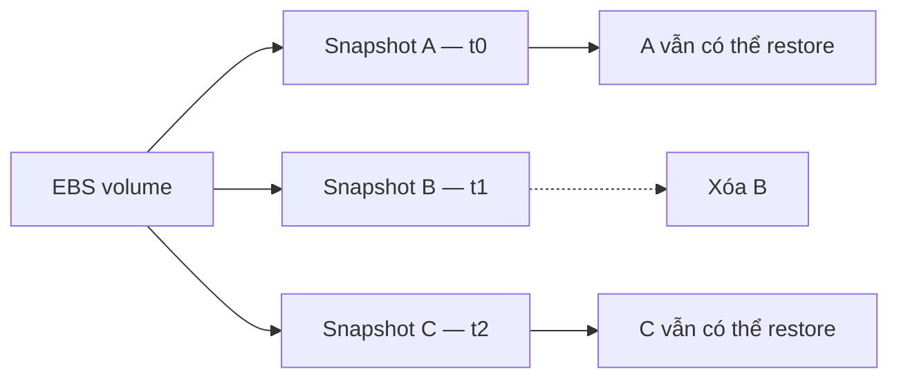
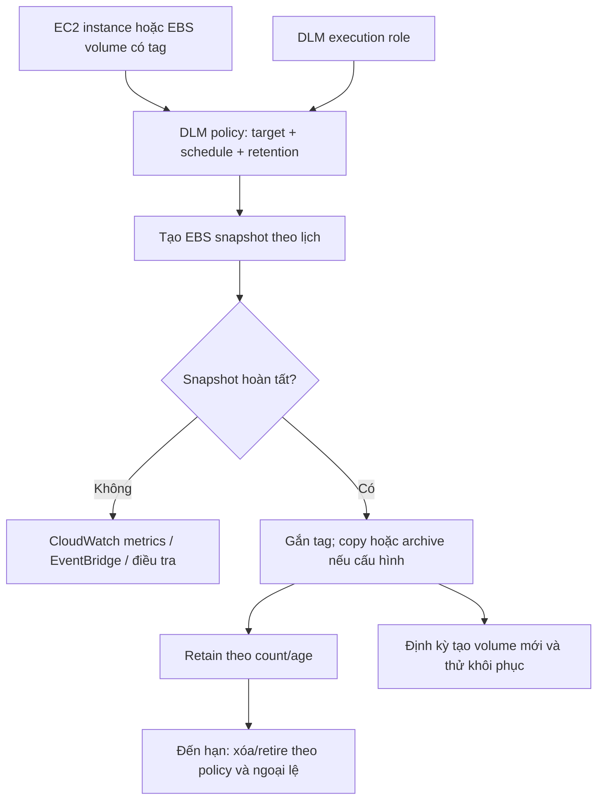
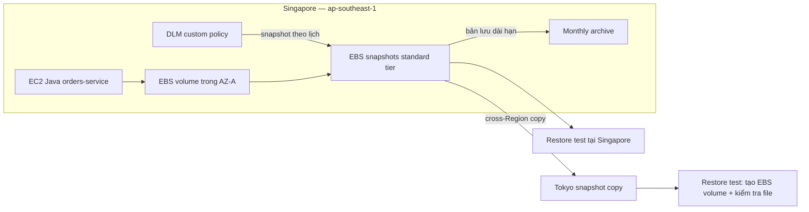

# EBS snapshot và Amazon Data Lifecycle Manager

> **Chương:** Lưu trữ block và file  
> **Module:** `CLOUD_PROVIDERS_AWS`  
> **Phạm vi:** Sao lưu, khôi phục và quản lý vòng đời Amazon EBS snapshot trong AWS; thiết kế chính sách tự động bằng Amazon Data Lifecycle Manager (DLM), phối hợp IAM, KMS, EC2, VPC, giám sát, khả năng phục hồi và tối ưu chi phí.

## Mục tiêu học tập

Sau bài này, người học có thể:

1. Giải thích EBS snapshot là gì, vì sao snapshot trong standard tier lưu dữ liệu theo mô hình **incremental** và tại sao nó khác với EBS volume, AMI hay bản sao lưu ở mức ứng dụng.
2. Tạo, kiểm tra, sao chép và **khôi phục EBS volume từ snapshot** đúng Region, Availability Zone và quyền KMS.
3. Phân biệt **crash-consistent**, **multi-volume crash-consistent** và **application-consistent**; đưa ra phương án bảo vệ cơ sở dữ liệu đang ghi liên tục.
4. Thiết kế **Amazon Data Lifecycle Manager** với policy mặc định hoặc tùy chỉnh, target tags, lịch chạy, retention, copy, archive và kiểm soát IAM.
5. Giải thích các giới hạn của lifecycle: snapshot archive, Recycle Bin, Snapshot Lock, thay đổi tag/policy, snapshot do tác nhân khác tạo và phụ thuộc dữ liệu.
6. Xây dựng quy trình thử khôi phục, theo dõi lỗi, kiểm soát RPO/RTO, tránh xóa nhầm dữ liệu hoặc duy trì snapshot không còn cần thiết.
7. Chọn giải pháp phù hợp giữa **EBS snapshot + DLM**, **AWS Backup** và backup có nhận biết ứng dụng.

## 1. Tại sao cần snapshot cho Amazon EBS?

**Amazon Elastic Block Store (EBS)** cung cấp **block storage** bền vững cho EC2. Hệ điều hành nhìn thấy EBS volume như một thiết bị lưu trữ dạng block, có thể phân vùng, format và mount. EBS volume gắn với một **Availability Zone (AZ)** theo những quy tắc attach của dịch vụ.

Khi ứng dụng Java chạy trên EC2 ghi log, tệp ứng dụng hoặc dữ liệu cục bộ vào EBS, dữ liệu không nên phụ thuộc duy nhất vào một volume đang hoạt động. Có thể xảy ra lỗi thao tác, hỏng dữ liệu logic, xóa nhầm volume, sự cố triển khai hoặc cần chuyển ứng dụng sang môi trường khác.

**EBS snapshot** là bản chụp theo thời điểm của dữ liệu trên một EBS volume. Snapshot phục vụ các nhu cầu:

- Khôi phục dữ liệu/volume tại một thời điểm trước sự cố.
- Tạo volume mới từ dữ liệu đã sao lưu trong cùng Region.
- Sao chép snapshot sang Region khác để chuẩn bị phục hồi thảm họa.
- Chia sẻ hoặc sao chép snapshot sang tài khoản khác theo kiểm soát IAM/KMS.
- Xây dựng EBS-backed AMI hoặc khôi phục một phần thành phần hệ thống khi phù hợp.
- Tự động hóa tần suất và thời hạn giữ bằng Data Lifecycle Manager.

**Snapshot không mặc nhiên là một chiến lược backup hoàn chỉnh.** Nó cần lịch tạo, retention, quyền truy cập, cách kiểm thử phục hồi, vị trí bản sao và mục tiêu kinh doanh rõ ràng. Tổ chức cũng phải bảo vệ dữ liệu và hoạt động không nằm trong EBS, như RDS, DynamoDB, S3, EFS và dữ liệu ở dịch vụ bên ngoài.

### 1.1 EBS volume, snapshot, AMI và backup khác gì nhau?

| Tài nguyên | Bản chất | Có thể sử dụng trực tiếp ra sao? | Lưu ý |
|---|---|---|---|
| **EBS volume** | Thiết bị block storage hoạt động tại AZ | Gắn vào EC2 đủ điều kiện, format/mount và đọc ghi | Thường nằm trong một AZ; tạo volume mới từ snapshot khi cần khôi phục |
| **EBS snapshot** | Bản chụp theo thời điểm của volume | Tạo volume mới, copy hoặc phục vụ quy trình image | Nằm trong Region; không mount trực tiếp như ổ đĩa |
| **EBS-backed AMI** | Mẫu khởi tạo EC2, tham chiếu một hoặc nhiều snapshot cùng metadata khởi chạy | Dùng để launch EC2 mới | AMI không phải bản sao nguyên trạng của RAM/process/network runtime |
| **Backup application-aware** | Bản sao có quy tắc nhất quán, transaction/log phù hợp ứng dụng | Khôi phục theo cơ chế của DB/app | Có thể cần phối hợp với snapshot để đạt mục tiêu RPO/RTO |
| **AWS Backup recovery point** | Bản sao được AWS Backup quản lý theo backup plan | Khôi phục bằng workflow AWS Backup | Cơ chế vòng đời, vault và quyền có thể khác DLM |

Với một EC2 lưu file upload lên EBS, snapshot có thể giúp khôi phục volume. Với cơ sở dữ liệu PostgreSQL lưu trên EBS, snapshot của block storage **không tự thay thế** thiết kế backup/WAL hoặc cơ chế backup do database hỗ trợ.

## 2. Snapshot lưu dữ liệu như thế nào?

### 2.1 EBS snapshot standard tier là incremental

Ở **standard tier**, EBS snapshot được lưu theo cơ chế **incremental**:

- Snapshot đầu tiên ghi nhận các block cần thiết để khôi phục dữ liệu tại thời điểm đó.
- Các snapshot tiếp theo thông thường chỉ bổ sung **những block đã thay đổi** kể từ snapshot trước.
- Mỗi snapshot vẫn đại diện cho một **điểm khôi phục độc lập về mặt logic** của volume. Khi tạo volume mới từ snapshot, người dùng nhận được trạng thái dữ liệu của thời điểm snapshot được tạo.
- AWS tự quản lý quan hệ giữa các block được dùng chung. Người dùng không phải tự khôi phục snapshot đầu tiên rồi lần lượt “apply” từng snapshot sau.

Hình dung:

```text
Volume 100 GiB — tại các thời điểm t0, t1, t2

t0: Snapshot A  → baseline các block đang được sử dụng
t1: Snapshot B  → ghi thêm các block thay đổi so với A
t2: Snapshot C  → ghi thêm các block thay đổi so với B

Khôi phục từ C:
AWS tạo volume với dữ liệu đầy đủ tại t2,
không yêu cầu người vận hành khôi phục A rồi B thủ công.
```

Không lấy **dung lượng volume được cấp phát** làm số tiền snapshot phải trả một cách trực tiếp. Phí lưu trữ snapshot standard tier chủ yếu phụ thuộc dữ liệu snapshot được lưu và các block còn được tham chiếu; ngoài ra còn có giá copy/restore, chuyển archive và những tính năng bổ sung nếu sử dụng. Cần xem bảng giá theo Region thực tế.

### 2.2 Xóa một snapshot ở giữa chuỗi có làm hỏng snapshot sau?

Trong mô hình standard tier, **không**. Khi bạn xóa một snapshot, EBS quản lý việc giữ những block vẫn còn cần cho các snapshot khác. Các snapshot còn lại tiếp tục có thể khôi phục dữ liệu logic ở thời điểm của chúng.

Ví dụ:



Sơ đồ mô tả khả năng khôi phục, **không biểu diễn cấu trúc block nội bộ**. Xóa snapshot B không nhất thiết tiết kiệm ngay một lượng GB bằng kích thước logic của B, vì các block cần thiết cho A/C vẫn được duy trì.

### 2.3 Snapshot được lưu ở đâu?

AWS lưu snapshot EBS trên cơ sở hạ tầng **Amazon S3 do dịch vụ quản lý**, không nằm trong một bucket S3 mà bạn có thể mở bằng S3 Console hoặc `aws s3 ls`. Snapshot có phạm vi **Region** và dữ liệu snapshot được sao lưu bền vững trên nhiều AZ trong Region đó.

Phân biệt:

- EBS volume là tài nguyên ở **một AZ**.
- Snapshot là tài nguyên có phạm vi **Region**.
- Muốn khôi phục ở AZ khác **trong cùng Region**, tạo volume mới từ snapshot và chọn AZ đích.
- Muốn khôi phục ở **Region khác**, phải copy snapshot sang Region đích trước khi tạo volume ở đó.
- Region scope khác với yêu cầu độc lập tài khoản: muốn dự phòng trước rủi ro mất/quyền truy cập Account nguồn, cần xem xét bản copy sở hữu trong Account khác và cơ chế bảo vệ phù hợp.

### 2.4 Snapshot đang được tạo có đồng bộ không?

Tạo snapshot là thao tác **bất đồng bộ**. Lệnh tạo có thể trả về snapshot ID sớm, trong khi snapshot vẫn `pending` và dữ liệu chưa chuyển xong. Dung lượng thay đổi, thông lượng và điều kiện hạ tầng ảnh hưởng thời gian hoàn thành.

Một snapshot giữ trạng thái dữ liệu được ghi vào volume tại thời điểm yêu cầu chụp; thay đổi sau đó trên volume không được nhập vào điểm phục hồi cũ. Tuy nhiên, dữ liệu còn nằm trong bộ nhớ đệm của OS/app chưa được ghi xuống block storage có thể không xuất hiện trong snapshot.

Kiểm tra `State=completed` trước khi đánh dấu điểm khôi phục là có thể sử dụng trong quy trình phục hồi đã thiết kế.

## 3. Consistency: phần quan trọng nhất khi backup dữ liệu đang ghi

Snapshot hoạt động ở tầng block; hiểu mức nhất quán giúp tránh phục hồi một volume chứa tập tin/transaction không ở trạng thái hợp lệ.

### 3.1 Crash-consistent snapshot

**Crash-consistent** nghĩa là dữ liệu tương đương hệ thống bị mất nguồn đột ngột tại thời điểm chụp: các block đã ghi xuống thiết bị được phản ánh theo mức đảm bảo của snapshot, còn dữ liệu nằm trong cache chưa flush có thể bị thiếu.

Khi khôi phục, file system journaling hoặc database crash recovery có thể xử lý lại dữ liệu theo cơ chế của nó, nhưng không bảo đảm mọi ứng dụng đều khôi phục hoàn toàn hay các thao tác business đều nhất quán.

**Ví dụ:** App Java đang ghi một tệp JSON và đồng thời cập nhật bảng DB cục bộ. Nếu snapshot diễn ra giữa hai thao tác, khi phục hồi có thể thấy file đã đổi nhưng DB chưa cập nhật hoặc ngược lại, trừ khi ứng dụng có cơ chế transaction/consistency thích hợp.

### 3.2 Multi-volume crash-consistent snapshot

Khi EC2 có nhiều EBS volume (ví dụ `/dev/xvdf` lưu dữ liệu và `/dev/xvdg` lưu transaction logs), chụp **riêng từng volume** vào các thời điểm khác nhau có thể tạo ra tập backup không đồng bộ.

AWS hỗ trợ **multi-volume snapshots** cho các volume gắn với một EC2 instance. Tính năng này giúp tạo tập snapshot **crash-consistent theo cùng một thời điểm** giữa các volume liên quan mà không cần stop instance chỉ để đạt mức crash consistency.

Điều này **không tự biến** snapshot thành application-consistent: database vẫn cần recovery logic hoặc thao tác đồng bộ ứng dụng. Khi restore, phải dùng **đầy đủ snapshot trong cùng một tập** và dựng đúng block device mapping/volume layout.

### 3.3 Application-consistent snapshot

**Application-consistent** đòi hỏi phối hợp với ứng dụng để dữ liệu và transaction ở trạng thái hợp lệ. Một luồng thường gặp:

1. Yêu cầu ứng dụng giảm hoặc tạm dừng ghi; flush buffer.
2. Đối với database, sử dụng checkpoint, quiesce, freeze, backup mode hoặc thao tác đặc thù được vendor hỗ trợ.
3. Thực hiện snapshot/multi-volume snapshot.
4. Gỡ trạng thái freeze, khôi phục hoạt động ghi.
5. Đọc trạng thái snapshot, log kết quả và kiểm thử khôi phục.

DLM **custom policies** có thể tích hợp **pre/post scripts** qua AWS Systems Manager (SSM) cho các tình huống được hỗ trợ. Việc chạy script thành công không đủ chứng minh phục hồi được; cần chạy test restore thực tế.

| Mức nhất quán | Đạt được bằng | Phù hợp khi | Điểm phải kiểm tra |
|---|---|---|---|
| Crash-consistent | Snapshot EBS thông thường | Nhiều file hoặc workload chấp nhận crash recovery | Dữ liệu đã flush, recovery của ứng dụng |
| Multi-volume crash-consistent | Snapshot đồng thời nhiều EBS volume của EC2 | App chia dữ liệu trên nhiều volume | Cùng tập snapshot và mapping |
| Application-consistent | Pre/post script, công cụ DB/app, backup phù hợp | DB giao dịch hoặc workload yêu cầu tính toàn vẹn cao | Khả năng restore, log, RPO/RTO và kiểm chứng dữ liệu |

**Nguyên tắc:** Đối với hệ quản trị cơ sở dữ liệu có nghiệp vụ quan trọng, snapshot thường là **một lớp bảo vệ**, phối hợp với cơ chế backup/restore của database. Không kết luận snapshot đầy đủ chỉ vì API trả trạng thái `completed`.

## 4. Tạo EBS snapshot và khôi phục bằng AWS CLI

Các lệnh dưới đây dùng **AWS CLI v2** và tài nguyên giả định để minh họa. Lệnh `describe` là thao tác đọc; `create-snapshot`, `copy-snapshot`, `create-volume` và `attach-volume` **tạo/thay đổi hạ tầng** nên chỉ chạy với tài nguyên được phép và quy trình thay đổi được phê duyệt.

### 4.1 Kiểm tra danh tính, Region và EBS volume

```bash
aws sts get-caller-identity

aws ec2 describe-volumes \
  --volume-ids vol-0123456789abcdef0 \
  --region ap-southeast-1 \
  --query 'Volumes[].{Id:VolumeId,AZ:AvailabilityZone,State:State,SizeGiB:Size,Encrypted:Encrypted,KmsKeyId:KmsKeyId,Attachments:Attachments}' \
  --output json
```

Lệnh trả về volume ID, AZ, kích thước, trạng thái và metadata mã hóa (khi áp dụng). Kiểm tra **Account + Region** trước mọi thao tác tạo snapshot/restore.

### 4.2 Chụp snapshot thủ công

```bash
aws ec2 create-snapshot \
  --volume-id vol-0123456789abcdef0 \
  --description "orders-data-manual-2026-11-20" \
  --region ap-southeast-1 \
  --tag-specifications 'ResourceType=snapshot,Tags=[{Key=App,Value=Orders},{Key=BackupSource,Value=Manual}]'
```

Lệnh thường trả về ID dạng `snap-0123456789abcdef0`. Thay giá trị ID và tên tag bằng tài nguyên của môi trường thực.

Theo dõi trạng thái:

```bash
aws ec2 describe-snapshots \
  --snapshot-ids snap-0123456789abcdef0 \
  --region ap-southeast-1 \
  --query 'Snapshots[].{Id:SnapshotId,State:State,Progress:Progress,Start:StartTime,VolumeId:VolumeId,SizeGiB:VolumeSize}' \
  --output table

aws ec2 wait snapshot-completed \
  --snapshot-ids snap-0123456789abcdef0 \
  --region ap-southeast-1
```

`snapshot-completed` là AWS CLI waiter: nó chờ theo số lần thăm dò mặc định, có thể dừng với lỗi nếu quá thời gian chờ. Không đồng nhất lỗi waiter với việc snapshot chắc chắn thất bại; dùng `describe-snapshots` kiểm tra trạng thái mới nhất.

### 4.3 Tạo volume mới từ snapshot

Giả sử cần khôi phục dữ liệu sang AZ `ap-southeast-1b`:

```bash
aws ec2 create-volume \
  --snapshot-id snap-0123456789abcdef0 \
  --availability-zone ap-southeast-1b \
  --volume-type gp3 \
  --region ap-southeast-1 \
  --tag-specifications 'ResourceType=volume,Tags=[{Key=App,Value=Orders},{Key=Purpose,Value=RestoreTest}]'
```

Sau đó phải:

1. Chờ volume đạt trạng thái `available`.
2. Chọn EC2 instance **cùng AZ** với volume và kiểm tra quyền/khả năng attach.
3. Attach volume vào instance.
4. Kiểm tra thiết bị thực tế trên OS, **mount** file system có sẵn và xác minh dữ liệu; tránh format vì sẽ phá dữ liệu phục hồi.
5. Kiểm tra ACL/UID/GID, nội dung dữ liệu, checksum hoặc kết quả business test.
6. Khi hoàn tất thử nghiệm, tháo volume và dọn tài nguyên thử nghiệm theo chính sách.

**Lưu ý hiệu năng:** Volume tạo từ snapshot có thể phải **initialize** các block dữ liệu khi đọc lần đầu; hiệu năng truy cập đầu tiên có thể thấp hơn. Với hệ thống cần RTO ngắn và hiệu năng ngay sau phục hồi, cân nhắc **Fast Snapshot Restore** ở AZ thích hợp hoặc **Provisioned Rate for Volume Initialization** nếu phù hợp, đồng thời tính phí bổ sung.

### 4.4 Copy snapshot sang Region khác

Để đưa snapshot sang Region `ap-northeast-1`:

```bash
aws ec2 copy-snapshot \
  --source-region ap-southeast-1 \
  --source-snapshot-id snap-0123456789abcdef0 \
  --region ap-northeast-1 \
  --description "orders-data-dr-copy"
```

Lệnh trả về snapshot ID **mới tại Region đích**. Với snapshot mã hóa, cần chọn/ủy quyền KMS key phù hợp tại Region đích và các policy liên quan. Đừng dùng snapshot ID Region nguồn như thể nó tồn tại ở Region đích.

### 4.5 Làm thế nào để không xóa nhầm?

Một lần delete snapshot có thể không thể đảo ngược nếu không có bảo vệ đã cấu hình. **Không** đưa lệnh xóa vào quy trình backup chỉ dựa vào tên hoặc ngày tạo. Trước khi xóa hãy xác minh ownership, tag/policy, khả năng khôi phục, quan hệ với AMI, các yêu cầu lưu trữ và sự tồn tại của các bản DR.

Đối với snapshot có yêu cầu bảo vệ cao, cân nhắc **EBS Recycle Bin** và **EBS Snapshot Lock** theo chính sách; đây là hai cơ chế khác nhau và không thay thế thử restore.

## 5. Mã hóa EBS snapshot và chia sẻ dữ liệu

### 5.1 EBS encryption và KMS

EBS snapshot tạo từ volume đã mã hóa sẽ giữ trạng thái mã hóa, thường sử dụng cùng AWS KMS key của nguồn theo cơ chế được hỗ trợ. Snapshot tạo từ volume chưa mã hóa là **không mã hóa**; nếu muốn bản copy được mã hóa, có thể copy snapshot sang bản được mã hóa với KMS key phù hợp.

Với backup production nên xem xét:

- Bật **EBS encryption by default** theo Account/Region phù hợp.
- Chọn **customer managed KMS key** khi cần chia sẻ/sao chép xuyên Account và kiểm soát key policy.
- Phân quyền IAM để chỉ role backup/restore cần thiết có thể tạo, copy hoặc dùng snapshot.
- Theo dõi vòng đời KMS key: mất quyền dùng key hoặc vô hiệu hóa/xóa key có thể làm dữ liệu snapshot mã hóa không thể phục hồi.

### 5.2 Cross-account và cross-Region

Quyền đọc snapshot, quyền sử dụng KMS key và quyền tạo volume từ snapshot là các lớp riêng. Khi chia sẻ snapshot:

- Chỉ chia sẻ với các **Account ID** được ủy quyền.
- Snapshot **không mã hóa** có thể chia sẻ theo quyền thích hợp.
- Snapshot được mã hóa bằng **customer managed KMS key** có thể chia sẻ khi cấu hình cả quyền snapshot và quyền KMS phù hợp.
- Snapshot được mã hóa bằng **AWS managed default key** không thể chia sẻ xuyên tài khoản theo cách thông thường; cần copy/mã hóa lại bằng customer managed key trước.
- Copy sang Region khác tạo snapshot mới tại Region đích và có thể yêu cầu KMS key tại Region đích.

Đối với backup chống mất quyền kiểm soát tài khoản nguồn, chỉ cấp quyền **share** sang Account DR chưa phải bản copy độc lập: Account đích nên **copy thành snapshot thuộc sở hữu của mình** theo chính sách. Amazon DLM có thể phối hợp cơ chế chia sẻ và **cross-account copy event policy** cho một số luồng phù hợp.

### 5.3 Không bỏ qua dữ liệu nhạy cảm

Snapshot có thể chứa dữ liệu ứng dụng, log, thông tin định danh, token đã ghi xuống volume hoặc dữ liệu cá nhân. Tag và mô tả snapshot không phải lớp mã hóa. Áp dụng IAM least privilege, KMS, chính sách chia sẻ, retention và audit bằng CloudTrail theo yêu cầu.

## 6. Amazon Data Lifecycle Manager (DLM) là gì?

**Amazon Data Lifecycle Manager** tự động hóa tạo, lưu giữ, sao chép và xóa tài nguyên backup được hỗ trợ, nhất là **EBS snapshots** và **EBS-backed AMIs**, dựa trên policy. DLM giúp xử lý câu hỏi:

> “Volume/instance nào cần backup, lúc nào tạo, giữ bao nhiêu bản hoặc bao lâu, có copy/archive không và khi hết hạn thì xử lý thế nào?”

DLM phục vụ **lifecycle của EBS/AMI**, không phải công cụ backup toàn bộ dịch vụ AWS, và không thay thế kiểm thử phục hồi dữ liệu ứng dụng.

Các khái niệm cốt lõi:

| Thành phần | Ý nghĩa |
|---|---|
| **Policy** | Định nghĩa loại backup, mục tiêu, lịch, retention và hành động bổ sung |
| **Target resources** | EBS volume hoặc EC2 instance phù hợp với loại policy |
| **Target tags** | Khóa/giá trị gắn tài nguyên nguồn để policy tùy chỉnh chọn đúng mục tiêu |
| **Schedule** | Thời gian/tần suất tạo và quy tắc lưu giữ |
| **Retention** | Giới hạn theo **số lượng** hoặc **tuổi** theo loại policy |
| **Execution role** | IAM role được DLM sử dụng để thực hiện các API cần thiết |
| **Additional actions** | Tag snapshot, copy sang Region khác, archive, FSR, script trước/sau... tùy kiểu policy |
| **Policy state** | Thường là `ENABLED`, `DISABLED` hoặc `ERROR`; cần theo dõi trạng thái thực tế |

### 6.1 DLM không tự quản lý mọi snapshot trong tài khoản

Đối với **custom policy**, DLM hướng tới tài nguyên nguồn thỏa mãn tag và quản lý snapshot được tạo theo policy đó. Snapshot tạo thủ công, bởi AWS Backup, hoặc từ chính sách khác **không mặc nhiên thuộc vòng đời** của custom policy vừa tạo.

DLM gắn system tags để nhận biết snapshot do nó tạo, như:

```text
aws:dlm:lifecycle-policy-id
aws:dlm:lifecycle-schedule-name
dlm:managed
```

Khi áp dụng retention hoặc điều tra hóa đơn, cần xác định snapshot thuộc **policy/schedule** nào. Không thiết kế xóa tự động bằng cách suy ra tất cả snapshot có cùng `VolumeId` đều thuộc một chính sách.

### 6.2 Sơ đồ luồng DLM



Sơ đồ là luồng khái quát; hành động archive/copy, thứ tự chạy và điều kiện hoàn thành thực tế phụ thuộc loại policy/lịch. **DLM tạo snapshot định kỳ không bảo đảm ứng dụng đã được backup đúng mức consistency**.

## 7. Default policy và custom policy: lựa chọn nào?

AWS cung cấp hai nhóm policy DLM chính:

### 7.1 Default policies

**Default EBS snapshot policy** hướng tới các volume chưa có backup gần đây trong Region, theo cơ chế và lựa chọn loại trừ của dịch vụ. **Default EBS-backed AMI policy** có phạm vi tương ứng với instance. DLM cho phép một default policy cho mỗi loại tài nguyên trong mỗi Account/Region.

Default policy giúp thiết lập **mức bảo vệ nền tảng** cho tài nguyên thiếu backup, nhưng có hạn chế về lịch, retention và chức năng nâng cao so với custom policy. Đặc biệt, việc “có default policy” không thay thế kế hoạch phục hồi cho ứng dụng cần RPO/RTO chặt.

### 7.2 Custom policies

**Custom EBS snapshot policy** có thể chọn các EBS volume hoặc EC2 instance có tag được chỉ định, thiết lập nhiều schedule, retention theo tuổi/số bản và thêm một số hành động nâng cao như copy, archive, FSR, pre/post scripts.

**Custom EBS-backed AMI policy** target instance để quản lý vòng đời AMI EBS-backed thay vì chỉ backup từng volume dưới dạng snapshot.

**Cross-account copy event policy** hỗ trợ một luồng copy snapshot được chia sẻ sang Account đích để tạo bản sao do Account đích quản lý.

| Tiêu chí | Default policy | Custom EBS snapshot policy |
|---|---|---|
| Mục tiêu | Phủ backup cơ bản cho tài nguyên thiếu backup gần đây | Chọn rõ workload bằng tag, volume hoặc instance |
| Mức điều khiển lịch | Giới hạn theo cơ chế mặc định | Nhiều lịch, tùy loại chu kỳ được hỗ trợ |
| Retention | Theo **tuổi** trong khung mặc định | Theo **tuổi hoặc số bản**, tùy schedule |
| Application-consistent | Không hỗ trợ pre/post script kiểu custom | Có thể tích hợp SSM pre/post scripts |
| Archive / FSR | Không có tùy chọn nâng cao như custom | Có thể cấu hình nếu đáp ứng điều kiện |
| Cross-Region copy | Có các thiết lập mặc định được hỗ trợ | Có thiết lập tùy chỉnh theo loại policy |
| Cross-account sharing | Không như custom | Có khả năng chia sẻ theo hỗ trợ của loại policy |
| Phù hợp | Baseline cho môi trường ít yêu cầu đặc thù | Workload production cần kiểm soát mục tiêu, RPO, retention |

Tài liệu AWS có thể điều chỉnh quota và khả năng trong từng loại policy. Khi áp dụng, đối chiếu trang **Default policies vs custom policies** theo Region/thời điểm triển khai.

### 7.3 Target tags: sức mạnh và rủi ro

Giả sử tổ chức dùng:

```text
Backup=Daily
Environment=Production
Application=Orders
```

Bạn có thể thiết kế một custom policy target volume gắn `Backup=Daily`. Lưu ý:

- **Tag key/value phân biệt chữ hoa/chữ thường**.
- Gắn tag trên **volume** không đồng nghĩa instance có cùng tag, và ngược lại. Policy type `VOLUME`/`INSTANCE` quyết định loại tài nguyên được dò.
- Một volume mới không có target tag sẽ bị bỏ qua.
- Khi bỏ tag mục tiêu hoặc đổi schedule name, DLM có thể **ngừng quản lý những snapshot đã tạo** theo các quy tắc được AWS mô tả. Phải có quy trình kiểm kê snapshot “mồ côi” trước và sau thay đổi policy.
- Trùng nhiều policy cùng bao phủ tài nguyên có thể tạo snapshot không cần thiết và tăng chi phí, nếu không đánh giá phạm vi trùng lặp.

Để giảm lỗi, chuẩn hóa tag qua IaC, Service Control Policies/Tag Policies nếu phù hợp và kiểm tra liên tục bằng Config hoặc các cơ chế kiểm toán nội bộ.

## 8. Thiết kế lịch và retention theo RPO/RTO

### 8.1 RPO và RTO là gì?

**Recovery Point Objective (RPO)**: lượng dữ liệu tối đa chấp nhận mất tính theo thời gian. Nếu RPO 24 giờ, tổ chức chấp nhận khả năng phải khôi phục từ một điểm sao lưu không cũ hơn 24 giờ theo yêu cầu kinh doanh và giả thiết kế hoạch đáp ứng.

**Recovery Time Objective (RTO)**: thời gian khôi phục dịch vụ tối đa được chấp nhận.

| Tình huống | Mục tiêu gợi ý | Hệ quả thiết kế |
|---|---|---|
| File cấu hình không thường xuyên thay đổi | RPO 24 giờ, RTO vài giờ | Snapshot hằng ngày, test restore định kỳ |
| App server stateless, dữ liệu ở RDS/S3 | RPO của EC2 image/volume có thể linh hoạt | Ưu tiên IaC/golden AMI, backup dữ liệu tại dịch vụ đích |
| DB giao dịch ghi liên tục trên EBS | RPO vài phút hoặc thấp hơn | Snapshot DLM riêng lẻ thường không đủ; cần backup/log shipping/PITR theo DB |
| Hệ thống cần phục hồi ở Region khác | RPO/RTO theo DR plan | Cross-Region copy, quyền KMS, bản dự phòng và diễn tập restore |

Các giá trị trong bảng **chỉ để minh họa**, không phải SLA của DLM hoặc AWS.

**Lịch “mỗi 24 giờ” không tự bảo đảm RPO chính xác 24 giờ.** DLM chạy theo cơ chế lịch, thời gian hoàn tất snapshot, khả năng dịch vụ và copy sang Region đích có thể tạo khoảng trễ. RPO thực tế phải tính từ **bản sao lưu hợp lệ đã hoàn tất**, được xác minh và có thể khôi phục.

### 8.2 Count-based và age-based retention

**Count-based:** giữ `N` snapshot theo schedule. Ví dụ giữ 14 bản thành công gần nhất của một volume được chụp hằng ngày.

**Age-based:** giữ snapshot theo tuổi, ví dụ 30 ngày. Không nên giả định giữ chính xác một số bản cố định; tần suất chạy và gián đoạn ảnh hưởng số lượng thực tế.

Một custom policy có thể có nhiều schedule (ví dụ daily/weekly/monthly), tùy giới hạn dịch vụ. Mỗi schedule có retention riêng, tạo nhiều lớp backup:

```text
Orders EBS volume  ──> Daily: giữ 14 bản
                   ├─> Weekly: giữ 8 bản
                   └─> Monthly: giữ 12 bản, có thể archive

(*) Ví dụ chính sách nghiệp vụ, không phải mặc định AWS.
```

Không có một công thức retention duy nhất cho mọi hệ thống. Thiết kế cần kết hợp chính sách dữ liệu, phục hồi thảm họa, pháp lý và ngân sách.

### 8.3 Các ngoại lệ retention quan trọng

DLM có nhiều điều kiện mà người vận hành dễ bỏ qua:

1. Khi **xóa volume** hoặc **terminate instance nguồn**, một số policy giữ lại snapshot cuối cùng; quy tắc khác nhau giữa default/custom và count/age schedule. Kiểm tra loại policy và tài liệu trước khi kỳ vọng mọi bản đều tự xóa.
2. Khi **disable/delete policy** hoặc policy chuyển `ERROR`, retention có thể **ngừng dọn** snapshot; các bản cũ vẫn tạo chi phí.
3. Khi **đổi target tags** hoặc **schedule name**, các snapshot cũ có thể mất cơ chế quản lý vòng đời bởi policy.
4. **Default policy** có tùy chọn *extended deletion* trong những tình huống được hỗ trợ; không áp dụng chung cho mọi custom policy.
5. Snapshot đã vào **Recycle Bin** hoặc được archive thủ công có quy tắc quản lý và dọn khác với snapshot standard tier do DLM đang kiểm soát.
6. Với custom policy, chuyển đổi giữa **count-based** và **age-based retention** không phải lúc nào cũng là thao tác sửa tại chỗ; có trường hợp phải tạo policy mới.

Đây là lý do phải **kiểm tra dashboard chi phí và kiểm kê snapshot** sau mỗi thay đổi lifecycle policy.

## 9. Ví dụ custom policy: snapshot volume mỗi ngày

Giả sử Account `123456789012` tại `ap-southeast-1` có EBS data volume gắn tag:

```text
Application=Orders
Environment=Production
Backup=Daily
```

Mục tiêu nội bộ: chụp snapshot **mỗi ngày**, giữ **14 bản** gần nhất và sao chép tag nguồn để phục vụ truy vết. Đây là một policy **count-based**, chưa bật archive, FSR, copy Region hoặc application-consistent script.

### 9.1 Cấu hình mô phỏng dưới dạng JSON

```json
{
  "PolicyType": "EBS_SNAPSHOT_MANAGEMENT",
  "ResourceTypes": ["VOLUME"],
  "TargetTags": [
    {"Key": "Backup", "Value": "Daily"}
  ],
  "Schedules": [
    {
      "Name": "Daily-14",
      "CopyTags": true,
      "CreateRule": {
        "Interval": 24,
        "IntervalUnit": "HOURS",
        "Times": ["02:00"]
      },
      "RetainRule": {
        "Count": 14
      },
      "TagsToAdd": [
        {"Key": "ManagedFor", "Value": "Orders"}
      ]
    }
  ]
}
```

JSON trên minh họa nội dung **PolicyDetails** của một custom policy kiểu standard theo API DLM. Trong AWS CLI, tạo policy thường truyền nội dung này qua `--policy-details file://policy-details.json`. Tệp cấu hình trong ví dụ là giả định của người thực hành, **không được tạo bởi bài viết**.

**Điểm cần xem lại khi đưa vào production:**

- `Times` là thời điểm theo **UTC** và việc DLM thực thi có thể nằm trong khung thời gian lịch định, không phải SLA chạy chính xác tới giây.
- `RetainRule.Count=14` giữ số snapshot theo schedule; lịch tạo lỗi không bảo đảm có 14 bản phục hồi hợp lệ.
- Chọn **volume** thông qua tag `Backup=Daily`, không tự backup cả ứng dụng/DB có nhiều volume.
- Khi cần đồng bộ nhiều volume trong cùng EC2, cân nhắc policy target **INSTANCE** và thiết kế consistency tương ứng.
- Ví dụ chưa kiểm soát cross-Region, cross-Account, KMS và các yêu cầu retention đặc thù. Các hạng mục này cần bổ sung có chủ đích theo RPO/RTO.

### 9.2 Lệnh AWS CLI tạo policy: minh họa

> **Lệnh dưới đây tạo hạ tầng mới và cần quyền IAM phù hợp.** Trước khi chạy thật, tạo `policy-details.json` từ mẫu, xác nhận valid schema theo AWS CLI hiện tại và kiểm tra IAM execution role.

```bash
aws dlm create-lifecycle-policy \
  --region ap-southeast-1 \
  --state ENABLED \
  --description "Daily snapshots for tagged Orders EBS volumes" \
  --execution-role-arn arn:aws:iam::123456789012:role/AWSDataLifecycleManagerDefaultRole \
  --policy-details file://policy-details.json
```

DLM cần **IAM execution role** được phép gọi EC2/EBS API liên quan và được trust bởi dịch vụ. Role `AWSDataLifecycleManagerDefaultRole` trong ví dụ phải thực sự tồn tại, có đúng permissions/trust; không giả định tên role tạo sẵn tại mọi tài khoản.

### 9.3 Một policy instance-target có gì khác?

Khi chọn target resources là **INSTANCE**, DLM snapshot policy có thể tạo tập snapshot cho các EBS volume đính kèm instance trong mỗi lần chạy. Cấu hình có thể có ngoại lệ root/data volume và tùy chọn pre/post scripts.

**Ví dụ:** EC2 `orders-db` có root volume `vol-root` và data volume `vol-data`. Nếu mục tiêu là khả năng phục hồi nhất quán giữa hai volume, dùng instance-target multi-volume snapshot phù hợp hơn tự vận hành hai policy volume-target độc lập. Tuy nhiên, vẫn cần thao tác application quiesce hoặc công cụ backup DB nếu yêu cầu **application consistency**.

### 9.4 Tính giờ, tag và retention theo một ví dụ

Giả sử schedule hàng ngày đã thành công liên tục:

| Thời điểm | Snapshot mới | Trạng thái retention |
|---|---|---|
| Ngày 1 | S1 | Giữ S1 |
| Ngày 2 | S2 | Giữ S1–S2 |
| ... | ... | ... |
| Ngày 14 | S14 | Giữ 14 bản theo policy |
| Ngày 15 | S15 | Policy có thể xử lý bản cũ nhất theo count retention |

Đây là mô hình lý tưởng hóa: xóa/retention bất đồng bộ và có thể bị ảnh hưởng bởi trạng thái policy, bản backup lỗi, Recycle Bin, archive hoặc dependency. Không viết quy trình business phụ thuộc chính xác vào việc snapshot bị xóa ngay khi lịch chạm ngưỡng.

## 10. EBS Snapshot Archive: khi nào nên dùng?

**Snapshot Archive tier** phục vụ dữ liệu ít cần truy cập và lưu dài hạn. Cần phân biệt với standard tier:

| Thuộc tính | Standard tier | Archive tier |
|---|---|---|
| Mô hình lưu | Incremental, chia sẻ block thay đổi | Snapshot **full** khi archive |
| Tạo volume trực tiếp | Có thể từ snapshot hoàn tất | **Không**; phải restore về standard tier trước |
| Thời gian lấy dữ liệu | Thường thích hợp khôi phục trực tiếp | Có thể cần **tới 72 giờ** để restore từ archive |
| Thời hạn chi phí tối thiểu | Theo lưu trữ thông thường | **Tối thiểu 90 ngày** cho archive billing |
| Đối tượng phù hợp | Daily/weekly backup có thể cần khôi phục sớm | Monthly/quarterly/yearly snapshot, yêu cầu lưu dài hạn |
| Tối ưu chi phí | Tốt khi block thay đổi tăng dần | Cần tính full snapshot, chi phí restore và mức lưu tối thiểu |

Khi archive một snapshot incremental, AWS chuyển nó thành **full snapshot**. Vì thế, archive snapshot quá thường xuyên có thể tăng chi phí so với việc giữ các incremental snapshot trong standard tier. Không quyết định chỉ dựa trên đơn giá GB/tháng.

### 10.1 Quy trình phục hồi snapshot archive

1. Xác định snapshot ở archive tier.
2. Yêu cầu **restore snapshot về standard tier** (temporary hoặc permanent theo nhu cầu).
3. Đợi restore hoàn tất; thời gian có thể kéo dài tới 72 giờ tùy kích thước/điều kiện.
4. Tạo EBS volume từ snapshot đã restore về standard tier.
5. Attach/mount/test dữ liệu; sau đó xử lý bản restore và retention theo quy trình.

**Tác động đến RTO:** Nếu dịch vụ cần phục hồi trong 1 giờ, không nên phụ thuộc **chỉ** vào archive tier cho bản backup gần nhất. Có thể giữ các bản standard tier gần đây để phục hồi nhanh, còn archive tier dành cho bản lâu dài.

### 10.2 DLM archive policy có những lưu ý nào?

Custom DLM policy có tùy chọn archive snapshot theo điều kiện được hỗ trợ. Khi thiết kế:

- Kiểm tra tương thích của schedule/retention với archive tier.
- Snapshot do DLM archive trong **Region nguồn**; việc archive snapshot và cross-Region copy có quy tắc hỗ trợ riêng, không giả định bản copy được tự archive.
- Nếu **tự archive thủ công** snapshot của policy, DLM có thể không quản lý việc xóa bản đó khi đang ở archive tier.
- Khi disable policy, snapshot archive có thể phải quản lý/dọn bằng quy trình riêng.
- Chỉ bật archive khi yêu cầu retention và RTO thực sự phù hợp với thời gian restore và mô hình giá.

## 11. Rút ngắn thời gian restore: FSR và volume initialization

Khi tạo volume từ snapshot, EBS có thể đọc các block chưa khởi tạo qua quá trình **volume initialization**. Lần truy cập đầu tiên tới block chưa được khởi tạo có thể bị tăng độ trễ.

AWS có các lựa chọn:

**Fast Snapshot Restore (FSR):** bật cho cặp **snapshot + Availability Zone** cụ thể. Volume tạo từ snapshot trong AZ đã bật FSR có thể được khởi tạo đầy đủ khi tạo, nếu điều kiện như trạng thái kích hoạt và volume creation credits đáp ứng. FSR có **chi phí theo thời gian bật**, cần giới hạn theo snapshot/AZ quan trọng.

**Provisioned Rate for Volume Initialization:** chọn tốc độ khởi tạo phù hợp khi tạo volume từ snapshot (nếu được hỗ trợ). Có thể giúp dự đoán thời gian nạp các block dữ liệu nhưng có phí và quota riêng.

**Manual initialization:** đọc các block theo quy trình phù hợp để chuẩn bị hiệu năng trước khi đưa volume vào phục vụ traffic.

Không bật FSR cho mọi snapshot chỉ vì mong muốn restore nhanh; mỗi snapshot/AZ và thời lượng bật có thể phát sinh chi phí. Cần kiểm thử RTO thực tế của ứng dụng, không chỉ đo thời gian EC2 attach volume.

## 12. Recycle Bin, Snapshot Lock và cơ chế bảo vệ dữ liệu

### 12.1 EBS Recycle Bin

**Recycle Bin** cho phép lưu giữ snapshot đã xóa (và một số loại tài nguyên được hỗ trợ) theo retention rule thay vì xóa vĩnh viễn ngay. Khi snapshot khớp rule và bị xóa, nó có thể vào Recycle Bin để được phục hồi trong thời hạn.

Cần phân biệt:

- **DLM retention** quyết định khi nào snapshot do DLM quản lý tới hạn xử lý.
- **Recycle Bin rule** quyết định snapshot bị xóa có được giữ lại để cứu nhầm hay không.

Khi một snapshot đã vào Recycle Bin hoặc được restore từ đó, vòng đời quản lý của DLM có thể thay đổi theo thời điểm và loại policy. **Không giả định** DLM sẽ tiếp tục tự xóa bản được khôi phục thủ công đúng như trước.

### 12.2 EBS Snapshot Lock

**Snapshot Lock** hỗ trợ giữ snapshot ở trạng thái không được xóa trong thời gian khóa theo mô hình được hỗ trợ. Có các chế độ và điều kiện liên quan đến khả năng thay đổi lock; lựa chọn cần phù hợp yêu cầu chống xóa nhầm hoặc chống sửa đổi.

Lock không thay thế quyền IAM/KMS, giám sát hoặc backup tại Account/Region khác. Đặt thời hạn khóa quá dài có thể khiến không thể dọn snapshot, phát sinh chi phí và cản trở yêu cầu hủy dữ liệu hợp lệ; phải phối hợp với retention policy.

### 12.3 Bảo vệ khỏi việc mất tài khoản nguồn

Đối với workload quan trọng, có thể kết hợp:

- Cross-Region snapshot copy cho sự cố cấp Region.
- Cross-Account backup copy có quyền sở hữu, IAM và KMS độc lập.
- Recycle Bin/Snapshot Lock ở phạm vi phù hợp.
- Theo dõi CloudTrail và cảnh báo khi thay đổi lifecycle policy, chia sẻ snapshot, xóa snapshot hoặc thay đổi KMS.
- Kiểm thử restore từ bản backup ở tài khoản/Region dự phòng.

Không chỉ dừng ở việc “snapshot đã được chia sẻ”; cần xác nhận Account dự phòng **thực sự có bản copy, có quyền key và có runbook restore**.

## 13. DLM, AWS Backup và giải pháp backup chuyên biệt

| Nhu cầu | EBS snapshot thủ công | Amazon DLM | AWS Backup |
|---|---|---|---|
| Chụp nhanh một volume cụ thể | Phù hợp | Có thể làm theo policy | Có thể làm on-demand theo cấu hình |
| Backup EBS/AMI theo lịch | Phải tự viết scheduling | **Phù hợp trực tiếp** | **Phù hợp** qua backup plan |
| Tự động giữ/xóa snapshot | Phải tự quản lý | Có retention theo policy | Có lifecycle của recovery point |
| Backup nhiều loại dịch vụ AWS | Không | Chủ yếu EBS/AMI | **Phù hợp hơn** khi dịch vụ được AWS Backup hỗ trợ |
| Centralized backup governance | Phải tự tổ chức | Giới hạn theo phạm vi DLM | Có backup vault, plan, policy và các tính năng quản trị phù hợp |
| Application-consistent database | Cần phối hợp DB/app | Có pre/post scripts trong custom policy nếu phù hợp | Tùy dịch vụ và workflow; vẫn cần thiết kế consistency |
| Cross-Region/Account | Copy/share thủ công hoặc automation | Có những khả năng được hỗ trợ theo policy | Có cơ chế backup copy và quản lý theo dịch vụ |
| Phục hồi và kiểm chứng | Tự xây runbook | Vẫn cần test restore thực tế | Vẫn cần test restore thực tế theo từng nguồn |

**Khi nào chọn DLM?** Khi phần lớn dữ liệu cần bảo vệ nằm ở EBS/AMI và muốn đặt lịch/retention theo tag hoặc mục tiêu EC2, đặc biệt nếu đã có cơ chế phục hồi ứng dụng rõ ràng.

**Khi nào chọn AWS Backup?** Khi tổ chức muốn thống nhất backup cho nhiều dịch vụ và tài khoản qua backup plans/vaults, kết hợp khả năng governance và kiểm toán phù hợp.

**Khi nào cần backup database chuyên biệt?** Khi ứng dụng yêu cầu point-in-time recovery, khôi phục giao dịch, RPO ngắn hoặc đảm bảo trạng thái application-consistent mà EBS snapshot một mình chưa đáp ứng.

Hai công cụ backup cùng nhắm một volume mà thiếu phối hợp có thể làm tăng số bản sao và hóa đơn. Nên có **ownership rõ ràng** cho từng backup policy.

## 14. Giám sát và xử lý lỗi DLM

### 14.1 Những gì cần đo

Vận hành backup không nên chỉ nhìn “policy ENABLED”:

- **Tỷ lệ snapshot hoàn tất:** bao nhiêu lần chạy theo lịch tạo ra snapshot `completed`?
- **Tuổi của bản backup hợp lệ gần nhất:** thực tế lâu hơn RPO cho phép chưa?
- **Policy health:** trạng thái ENABLED/DISABLED/ERROR, execution role, lỗi quyền và quota.
- **Copy/archive health:** bản DR đã xuất hiện trong Account/Region đích chưa và có restore được không?
- **Kết quả test restore:** volume attach/mount được, dữ liệu hợp lệ, thời gian restore đáp ứng RTO.
- **Chi phí:** snapshot standard/archive, copy, restore, FSR, initialization, CloudWatch logs và data transfer theo tình huống.

DLM phát hành metric/trạng thái liên quan qua **CloudWatch**, EventBridge/CloudTrail và APIs theo khả năng hỗ trợ. Với một số policy, metric như `SnapshotsCreateFailed` giúp phát hiện lỗi; cần kiểm tra namespace, dimensions và loại policy ở môi trường thật.

### 14.2 Các lỗi thường gặp

| Triệu chứng | Nguồn gốc có thể | Cách xử lý |
|---|---|---|
| Policy có nhưng không tạo snapshot | Target tag sai chữ hoa/thường, volume/instance không nằm trong phạm vi, policy disabled | Kiểm tra tag trên đúng resource type, policy state, Region và lịch |
| Snapshot đang `pending` quá lâu | Dữ liệu thay đổi lớn hoặc hoạt động snapshot kéo dài | Theo dõi tiến độ và lỗi API; xem quota, thay đổi workload |
| DLM chuyển `ERROR` | Execution role/trust, IAM/KMS, quota hoặc cấu hình policy | Đọc policy details, CloudWatch/CloudTrail và quyền liên quan |
| Có snapshot nhưng DB phục hồi không sạch | Chỉ đạt crash consistency; OS/app cache chưa flush | Thiết kế pre/post scripts, DB backup và test restore |
| Không khôi phục volume từ snapshot ở Region khác | Snapshot Regional, chưa copy sang Region đích | Copy snapshot và dùng ID mới ở Region đích |
| Không chia sẻ snapshot mã hóa cho Account DR | Dùng AWS managed default KMS key hoặc key policy chưa đúng | Copy/re-encrypt bằng customer managed key phù hợp, cấp quyền KMS |
| Snapshot cũ còn mãi dù retention đã qua | Policy disabled/deleted, đổi tag/schedule, snapshot vào archive/Recycle Bin hoặc nguồn đã xóa | Kiểm kê DLM system tags, trạng thái policy, ngoại lệ lifecycle |
| Dùng archive backup nhưng restore quá chậm | Archive cần chuyển về standard tier, có thể mất nhiều giờ | Duy trì bản standard gần đây; đánh giá RTO |
| Volume restore hoạt động nhưng đọc dữ liệu lần đầu chậm | Volume initialization | Chuẩn bị volume, dùng FSR/provisioned initialization nếu phù hợp |
| Chi phí snapshot tăng | Nhiều policy trùng, thay đổi block lớn, bản mồ côi, archive full hoặc FSR bật dài | Đối chiếu tag, cost allocation, lifecycle và kiến trúc backup |

### 14.3 Quy trình điều tra đơn giản

1. Xác định **Account, Region, volume/instance và policy ID**.
2. Xem policy state, resource type, target tags và schedule.
3. Liệt kê snapshots của nguồn, kiểm tra state, thời điểm tạo, description và DLM tags.
4. Đối chiếu thời gian snapshot completed gần nhất với RPO.
5. Nếu snapshot lỗi, xem CloudWatch metrics, CloudTrail, IAM execution role, KMS và quota.
6. Nếu snapshot thành công nhưng restore lỗi, thử tạo volume ở AZ hợp lệ và đọc dữ liệu thực tế.
7. Nếu chi phí cao, kiểm tra retention, archive, FSR, Recycle Bin và bản sao khác Account/Region.

Đừng sửa policy khi chưa biết nguyên nhân; đổi target tags hoặc schedule có thể làm DLM ngừng quản lý snapshot cũ.

## 15. AWS CLI: kiểm kê DLM và snapshot

Các lệnh trong mục này **chỉ đọc** trạng thái, phù hợp điều tra định kỳ mà không tạo/xóa tài nguyên.

### 15.1 Danh sách lifecycle policies

```bash
aws dlm get-lifecycle-policies \
  --region ap-southeast-1 \
  --query 'Policies[].{Id:PolicyId,Description:Description,State:State,Type:PolicyType}' \
  --output table
```

Chi tiết một policy:

```bash
aws dlm get-lifecycle-policy \
  --policy-id policy-0123456789abcdef0 \
  --region ap-southeast-1 \
  --output json
```

Đọc cả `PolicyDetails`, `ExecutionRoleArn`, state, target tags, rule và các tùy chọn copy/archive. Policy ID trên chỉ mang tính minh họa.

### 15.2 Kiểm kê snapshot thuộc sở hữu tài khoản

```bash
aws ec2 describe-snapshots \
  --owner-ids self \
  --region ap-southeast-1 \
  --query 'Snapshots[].{Id:SnapshotId,VolumeId:VolumeId,Start:StartTime,State:State,StorageTier:StorageTier,Tags:Tags}' \
  --output json
```

Kết quả có thể lớn trong tài khoản production. Hãy lọc theo tag, volume ID hoặc giới hạn trình bày ở bước phân tích; không bỏ qua phân trang/truncation của CLI.

### 15.3 Xem snapshots theo volume

```bash
aws ec2 describe-snapshots \
  --owner-ids self \
  --filters Name=volume-id,Values=vol-0123456789abcdef0 \
  --region ap-southeast-1 \
  --query 'Snapshots[].{Id:SnapshotId,Created:StartTime,State:State,VolumeGiB:VolumeSize}' \
  --output table
```

Mục tiêu là xác nhận snapshot gần nhất thực sự hoàn thành. **Snapshot được tạo** và **snapshot sẵn sàng phục hồi** là hai trạng thái khác nhau.

### 15.4 Tìm tag quản lý DLM

```bash
aws ec2 describe-snapshots \
  --owner-ids self \
  --filters 'Name=tag-key,Values=aws:dlm:lifecycle-policy-id' \
  --region ap-southeast-1 \
  --query 'Snapshots[].{Id:SnapshotId,State:State,Tags:Tags}' \
  --output json
```

Nếu cần chỉ định một policy cụ thể, có thể bổ sung filter theo giá trị tag (phải dùng đúng key/value do AWS gán). Không giả định mọi snapshot thiếu tag là “không quan trọng”; chúng có thể được AWS Backup, AMI hoặc quy trình khác sử dụng.

### 15.5 Kiểm tra tài nguyên phục hồi từ snapshot

```bash
aws ec2 describe-volumes \
  --region ap-southeast-1 \
  --filters Name=snapshot-id,Values=snap-0123456789abcdef0 \
  --query 'Volumes[].{Volume:VolumeId,AZ:AvailabilityZone,State:State,SizeGiB:Size}' \
  --output table
```

Lệnh cho biết volume được tạo từ snapshot theo metadata (nếu có). Không xác nhận được file system/ứng dụng đã khôi phục chính xác nếu chỉ xem API EBS.

## 16. Tình huống thực tế: dữ liệu đơn hàng trên EC2 trong hai AZ

Một nhóm triển khai ứng dụng Java `orders-service` trên EC2 trong `ap-southeast-1`. Ứng dụng giao tiếp với database quản lý riêng; một volume EBS riêng lưu tài liệu xử lý và log cần giữ trong thời gian ngắn.

Giả định:

- EBS volume dữ liệu chính có tag `Backup=Daily` và `Application=Orders`.
- Doanh nghiệp cần khôi phục file trong vòng vài giờ và chấp nhận mất tối đa khoảng một ngày dữ liệu file **theo yêu cầu nghiệp vụ**.
- Mỗi ngày tạo snapshot; giữ 14 bản gần nhất.
- Cuối tháng giữ một bản dài hạn hoặc archive khi phù hợp.
- Hệ thống production nằm ở Singapore, có kế hoạch khôi phục ở Tokyo.
- Database giao dịch dùng backup/PITR riêng; không trộn yêu cầu của DB vào chính sách snapshot file này.

### 16.1 Kiến trúc



Một snapshot có thể tạo volume mới trong **AZ-A hoặc AZ-B** của cùng Region, phù hợp mục tiêu phục hồi cục bộ. Muốn triển khai tại Tokyo, cần snapshot copy đích, cơ chế kết nối ứng dụng, quyền KMS và các thành phần khác của hệ thống (AMI/EC2/VPC/DNS/IAM).

### 16.2 Runbook phục hồi file bị xóa nhầm

1. Xác nhận lỗi logic xảy ra từ lúc nào, xác định snapshot **trước thời điểm xóa** và đã hoàn tất.
2. Tạo volume mới từ snapshot trong cùng AZ với instance thử nghiệm.
3. Gắn volume vào instance cách ly hoặc máy kiểm tra phù hợp.
4. Mount ở chế độ **read-only nếu có thể** để hạn chế thay đổi dữ liệu backup.
5. Xác minh file/directory, hash, ACL/ownership và tính nhất quán trong ứng dụng.
6. Khôi phục **đúng tệp cần thiết** về hệ thống hiện tại bằng quy trình được duyệt; không ghi đè toàn volume nếu không cần.
7. Ghi lại timestamp, người thực hiện, snapshot ID, kết quả RTO và kết quả kiểm chứng.
8. Dọn volume thử nghiệm, nhưng không xóa snapshot nguồn khi vẫn còn retention/DR requirement.

Đối với volume chứa DB, runbook có thể khác hoàn toàn: phục hồi database thông qua công cụ chính thức và transaction logs tương ứng.

### 16.3 Kiểm soát chi phí và phục hồi

- Giữ snapshot standard trong khoảng cần khôi phục nhanh.
- Đưa những snapshot dài hạn ít truy cập sang archive nếu tiết kiệm sau khi tính chi phí **full snapshot** và minimum archive period.
- Không bật FSR cho toàn bộ snapshot daily, chỉ bật theo yêu cầu RTO/AZ nếu cần.
- Tránh hai policy cùng tạo các snapshot trùng mục tiêu.
- Sử dụng AWS Budgets, Cost Explorer, tag allocation và kiểm kê snapshot để phát hiện chi phí bất thường.
- Định kỳ thử khôi phục trong **Account/Region DR**, vì bản copy tồn tại không bảo đảm mọi quyền và networking đã sẵn sàng.

## 17. Bài tập tự kiểm tra

**Bài 1 — Incremental backup.** Volume 100 GiB có snapshot A, B, C. B là incremental snapshot, vậy khi khôi phục từ C có cần tạo volume từ A rồi lần lượt “áp dụng” B/C không? Vì sao xóa B không nhất thiết tiết kiệm đúng kích thước logic của B?

**Bài 2 — Consistency.** Database sử dụng hai EBS volume: một volume dữ liệu, một volume WAL/log. Nhóm vận hành chụp hai volume bằng hai lệnh riêng cách nhau 10 phút. Có rủi ro gì? Dùng multi-volume snapshots giải quyết được đến mức nào và còn cần kiểm tra gì?

**Bài 3 — Tag policy.** DLM custom policy target `Backup=Daily` nhưng người triển khai gắn tag `backup=daily` lên volume mới. Điều gì xảy ra? Khi bỏ tag `Backup=Daily` sau 3 tháng, liệu DLM chắc chắn tiếp tục dọn tất cả snapshot cũ không?

**Bài 4 — DR.** Snapshot được tạo ở Singapore, đội DR muốn phục hồi volume trên EC2 ở Tokyo. Có thể dùng nguyên snapshot ID và KMS key của Singapore trực tiếp tại Tokyo không?

**Bài 5 — RTO.** Công ty cần khôi phục file quan trọng trong 30 phút nhưng chỉ còn snapshot ở archive tier. Yếu tố nào khiến kế hoạch khó đạt? Nên thay đổi retention như thế nào?

**Bài 6 — Chi phí.** Một DLM policy bị disable để bảo trì, sau đó đội vận hành quên bật lại. Vì sao phí snapshot vẫn có thể tiếp tục tăng? Cần giám sát metric nào và kiểm kê gì?

**Bài 7 — DLM hay AWS Backup?** Hệ thống dùng EBS, RDS, DynamoDB và EFS ở nhiều Account. Có nên dùng riêng DLM để thay thế mọi backup policy không? Đề xuất ranh giới trách nhiệm phù hợp.

<details>
<summary>Gợi ý đáp án</summary>

1. Không. Snapshot C đại diện đầy đủ trạng thái logic tại thời điểm C; AWS xử lý các block tham chiếu. Xóa B vẫn phải giữ block mà A/C còn sử dụng.
2. Hai snapshot ở hai thời điểm có thể không đồng bộ; multi-volume snapshot tạo tập crash-consistent. Nếu DB cần application consistency hoặc PITR, vẫn phải phối hợp quy trình backup/transaction log.
3. Tag phân biệt hoa thường nên volume có thể không được chọn. Khi bỏ target tag, việc quản lý snapshot cũ có thể thay đổi; cần kiểm kê và có phương án dọn thủ công nếu cần.
4. Không. Snapshot có phạm vi Region; phải copy sang Tokyo, nhận snapshot ID mới và bảo đảm quyền KMS ở đích.
5. Restore archive có thể mất nhiều giờ, phải đưa về standard tier trước khi tạo volume. Nên giữ bản standard đủ gần với RPO, luyện phục hồi và chỉ archive bản dài hạn.
6. Retention có thể ngừng hoạt động khi policy disabled; snapshot không tự biến mất. Theo dõi policy state, lần chụp thành công gần nhất, các snapshot còn lại và chi phí.
7. Không. DLM tập trung EBS/AMI; AWS Backup hoặc công cụ backup chuyên biệt phù hợp hơn để quản lý nhiều loại dịch vụ và yêu cầu dữ liệu khác nhau. Cần tránh tạo backup trùng nhau không cần thiết.

</details>

## 18. Checklist triển khai và vận hành

- [ ] Đã xác định **dữ liệu nào** thực sự nằm trên EBS, dữ liệu nào ở RDS/S3/EFS/DynamoDB hoặc dịch vụ khác.
- [ ] Đã định nghĩa **RPO, RTO** và yêu cầu pháp lý/retention cụ thể.
- [ ] Đã chọn consistency phù hợp: crash-consistent, multi-volume hoặc application-consistent.
- [ ] Đã kiểm tra **Account, Region, AZ** và phân quyền IAM/KMS của nguồn và nơi dự phòng.
- [ ] Đã quyết định default policy hay custom policy; tag mục tiêu được áp dụng chính xác.
- [ ] Đã xác định lịch, retention theo count/age, copy/archiving/FSR và các tính năng phát sinh chi phí.
- [ ] Đã kiểm thử tạo volume từ snapshot và phục hồi **dữ liệu thật** theo runbook.
- [ ] Đã theo dõi snapshot completed gần nhất, policy errors, DR copy và tình trạng chi phí.
- [ ] Đã thiết kế cơ chế chống xóa nhầm như Recycle Bin/Snapshot Lock khi cần.
- [ ] Đã có quy trình kiểm kê snapshot khi **đổi tag, đổi schedule, disable/delete policy hoặc xóa volume**.
- [ ] Đã kiểm tra thời gian restore từ archive, volume initialization và tương thích ứng dụng trước khi đưa vào production.
- [ ] Đã có kế hoạch phối hợp DLM với AWS Backup hoặc backup application-aware khi cần nhiều lớp bảo vệ.

## Tài liệu AWS chính thức để đối chiếu

- [Amazon EBS — Amazon EBS snapshots](https://docs.aws.amazon.com/ebs/latest/userguide/ebs-snapshots.html)
- [Amazon EBS — Create Amazon EBS snapshots](https://docs.aws.amazon.com/ebs/latest/userguide/ebs-creating-snapshot.html)
- [Amazon EBS — How Amazon Data Lifecycle Manager works](https://docs.aws.amazon.com/ebs/latest/userguide/dlm-elements.html)
- [Amazon EBS — DLM default policies vs custom policies](https://docs.aws.amazon.com/ebs/latest/userguide/policy-differences.html)
- [Amazon EBS — Create a custom DLM snapshot policy](https://docs.aws.amazon.com/ebs/latest/userguide/snapshot-ami-policy.html)
- [Amazon EBS — DLM pre and post scripts](https://docs.aws.amazon.com/ebs/latest/userguide/script-flow.html)
- [Amazon EBS — DLM default policies](https://docs.aws.amazon.com/ebs/latest/userguide/default-policies.html)
- [Amazon EBS — Snapshot Archive](https://docs.aws.amazon.com/ebs/latest/userguide/snapshot-archive.html)
- [Amazon EBS — Snapshot archive considerations](https://docs.aws.amazon.com/ebs/latest/userguide/snapshot-archive-considerations.html)
- [Amazon EBS — Restore archived snapshots](https://docs.aws.amazon.com/ebs/latest/userguide/restore-archived-snapshot.html)
- [Amazon EBS — Initialize EBS volumes](https://docs.aws.amazon.com/ebs/latest/userguide/initalize-volume.html)
- [Amazon EBS — Fast Snapshot Restore](https://docs.aws.amazon.com/ebs/latest/userguide/ebs-fast-snapshot-restore.html)
- [Amazon EBS — Modify DLM policies](https://docs.aws.amazon.com/ebs/latest/userguide/modify.html)
- [AWS Backup — Amazon EBS and AWS Backup](https://docs.aws.amazon.com/aws-backup/latest/devguide/multi-volume-crash-consistent.html)

**Điểm cần ghi nhớ:** EBS snapshot cung cấp **điểm khôi phục của block storage**; DLM giúp **tạo, giữ, sao chép và dọn snapshot theo chính sách**. Khả năng phục hồi thực tế chỉ được bảo đảm bởi sự kết hợp giữa consistency phù hợp, quyền IAM/KMS, bản sao ở phạm vi cần thiết, giám sát lịch backup và các lần **thử khôi phục thành công**.

