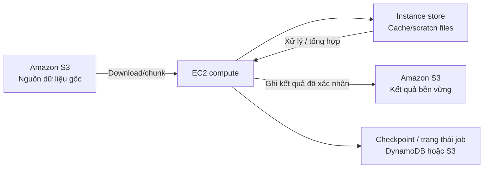
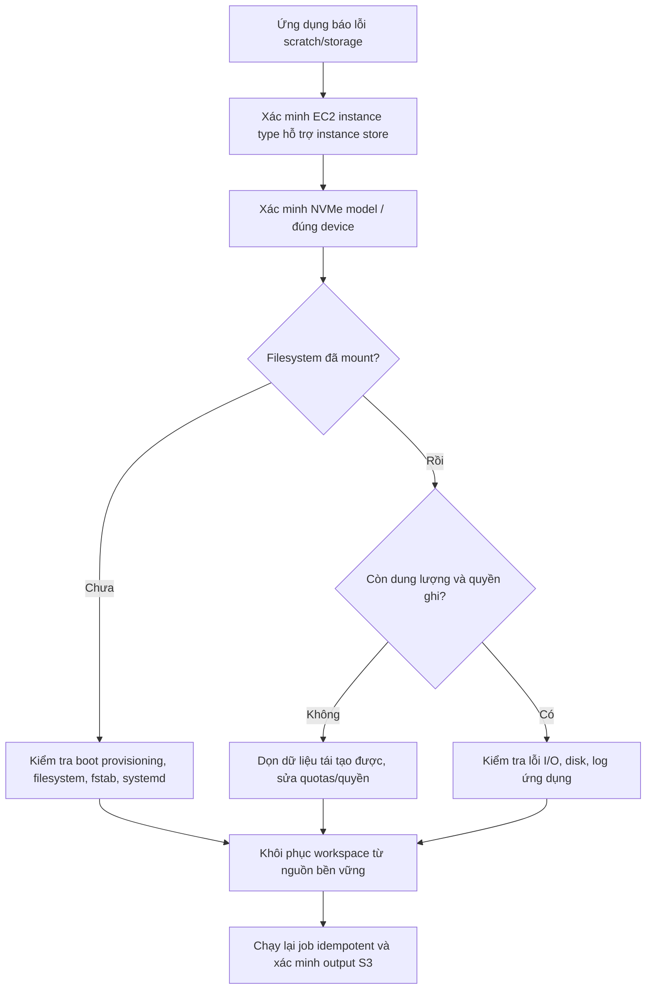

# Instance store và đặc tính dữ liệu tạm thời

> **Học phần:** CLOUD_PROVIDERS_AWS  
> **Chương:** Lưu trữ block và file  
> **Chủ đề:** Amazon EC2 instance store, vòng đời dữ liệu, lưu trữ tạm trên máy chủ, khôi phục sau sự cố và lựa chọn giữa instance store, Amazon EBS, Amazon EFS, Amazon S3.  
> **Phạm vi thực hành:** Amazon EC2 Linux, các instance type có instance store; ví dụ minh họa dùng ổ NVMe và ứng dụng Java/Spring Boot.

## 1. Vấn đề thực tế: cần ổ đĩa nhanh nhưng dữ liệu có thể mất

Một ứng dụng phân tích đơn hàng chạy trên EC2 nhận file từ S3, giải nén thành hàng triệu bản ghi, sắp xếp dữ liệu tạm, tạo báo cáo rồi ghi kết quả trở lại S3. Trong quá trình xử lý, ứng dụng cần nhiều I/O cục bộ, nhưng các tệp trung gian không cần giữ sau khi báo cáo được xuất bản.

Nếu tất cả tệp tạm được ghi lên Amazon EBS, hệ thống có thể cần trả tiền cho dung lượng và hiệu năng EBS vượt nhu cầu thực tế. Một số **EC2 instance types** có sẵn vùng **instance store** đặt gần tài nguyên tính toán, phù hợp để làm scratch space hoặc cache. Tuy nhiên, dữ liệu trên instance store chỉ tồn tại trong **vòng đời của instance**, không phải một hệ thống lưu trữ bền vững cho dữ liệu nghiệp vụ.

Câu hỏi thiết kế không chỉ là "ổ đĩa này nhanh bao nhiêu?", mà còn là:

- Nếu instance **reboot**, file tạm có còn?
- Nếu instance **stop rồi start**, điều gì xảy ra?
- Nếu **host vật lý bị lỗi** hoặc Auto Scaling thay instance, có khôi phục được dữ liệu?
- **Backup** thực sự nằm ở đâu và có kiểm chứng khả năng restore chưa?
- Các thành phần **EC2, EBS, S3, EFS**, mạng và logging đóng góp thế nào vào **chi phí tổng**?

### Kết quả học tập

Sau bài này, người học có thể:

1. Mô tả instance store là **block storage tạm thời gắn với host** của EC2.
2. Phân biệt instance store với EBS, EFS, S3 và lưu trữ root.
3. Dự đoán dữ liệu tồn tại hay mất theo từng sự kiện vòng đời EC2.
4. Xác định loại instance hỗ trợ instance store và nhận diện đúng thiết bị **NVMe instance storage**.
5. Thiết lập filesystem/mount an toàn trong môi trường lab, tránh format nhầm EBS.
6. Thiết kế cache, temporary files, ETL staging và Java workload theo hướng **rebuildable**.
7. Xây dựng luồng ghi checkpoint/backup, quan sát tình trạng ổ, thử phục hồi và kiểm soát chi phí.

## 2. Instance store là gì?

**Amazon EC2 instance store** cung cấp các **block storage volumes tạm thời**, lưu trên các ổ đĩa vật lý gắn với hoặc nằm gần host chạy EC2 instance. Kích thước, số lượng và loại ổ (SSD/HDD, NVMe hoặc thế hệ khác) phụ thuộc **instance type** và **instance size**.

Khái niệm "local" ở đây liên quan đến **vị trí gắn với host và cách cấp phát ổ**, không có nghĩa lưu trữ này là RAM. Ứng dụng nhìn thấy **block device**; hệ điều hành có thể format filesystem và mount để đọc/ghi file như các ổ block khác.

### 2.1. Những đặc tính cốt lõi

| Đặc tính | Ý nghĩa trong thiết kế |
|---|---|
| **Gắn với EC2 instance** | Chỉ một số instance types/sizes có instance store; không thể tự thêm instance store vào mọi EC2. |
| **Chỉ gắn lúc launch** | Không thể gắn thêm instance store sau khi instance đã chạy, cũng không thể tháo volume này rồi gắn sang instance khác. |
| **Dung lượng cố định theo instance type** | Muốn dung lượng khác thường cần chọn loại/kích cỡ instance khác; thao tác thay instance có thể làm mất dữ liệu cũ. |
| **Block storage cục bộ** | Có thể format, mount và dùng cho I/O file; ứng dụng phải tự quản lý dữ liệu nằm trên ổ. |
| **Dữ liệu tạm thời** | Không có cam kết giữ dữ liệu qua stop, hibernate, terminate hoặc hỏng ổ/host. |
| **Hiệu năng tùy loại ổ** | Một số instance storage SSD/NVMe có độ trễ thấp và throughput cao; cần kiểm tra thông số của instance type, không khẳng định mọi instance store đều giống nhau. |
| **Không có EBS snapshot trực tiếp** | Snapshot EBS không chụp dữ liệu instance store; muốn giữ dữ liệu phải copy sang nơi bền vững. |

Instance store phù hợp khi **mất một volume vẫn có thể tái tạo dữ liệu hoặc hoàn thành lại tác vụ**. Nếu một file chỉ tồn tại trên instance store và bị mất, AWS không thể hứa khôi phục file đó theo cách khôi phục EBS từ snapshot.

### 2.2. Các tài nguyên khác không phải instance store

- **RAM**: bộ nhớ tiến trình, mất khi tắt nguồn/reboot; thường nhanh hơn disk và giới hạn dung lượng khác.
- **Amazon EBS**: block volume qua dịch vụ lưu trữ, có vòng đời **độc lập hơn** với instance, hỗ trợ snapshot và gắn lại trong phạm vi điều kiện của EBS.
- **Amazon EFS**: hệ thống file dùng được qua mạng cho nhiều workload Linux theo mô hình NFS.
- **Amazon S3**: object storage với API theo bucket/key; không phải block device để mount như ổ đĩa thông thường nếu không có lớp bổ sung.
- **Thư mục `/tmp`**: chỉ là đường dẫn trong filesystem Linux; **không mặc định nằm trên instance store**. Trên một EC2 có EBS root, `/tmp` thường thuộc root filesystem EBS hoặc có thể là `tmpfs` tùy AMI/configuration.

**Điểm rất dễ nhầm:** EC2 "có ổ NVMe" không đủ để kết luận ổ đó là **instance store**. Trên Nitro, **EBS cũng xuất hiện dưới dạng NVMe**. Phải phân biệt loại thiết bị trước khi chạy lệnh có thể ghi đè dữ liệu.

## 3. Vòng đời dữ liệu: reboot khác stop/start

Instance store có tính **ephemeral**: sự tồn tại của dữ liệu phụ thuộc vào vòng đời instance và tình trạng hạ tầng vật lý. Đừng hiểu "temporary" là dữ liệu tự biến mất mỗi khi chương trình kết thúc hoặc sau mỗi reboot; nó có hành vi cụ thể theo sự kiện.

| Sự kiện | Dữ liệu instance store | Diễn giải |
|---|---|---|
| **Reboot instance** qua EC2 hoặc reboot hệ điều hành | **Thông thường vẫn còn** | Instance tiếp tục vòng đời; cần mount lại đúng filesystem nếu hệ điều hành chưa tự mount. |
| **Stop rồi start** với instance EBS-backed | **Mất** | Instance store bị xóa dù **EBS root volume** có thể vẫn giữ dữ liệu. |
| **Hibernate** trong cấu hình hỗ trợ | **Mất** | Dù trạng thái RAM được lưu theo cơ chế hibernation, instance store không được bảo toàn. |
| **Terminate** | **Mất** | Volume không thể tách để giữ hoặc chuyển sang instance khác. |
| **Thay instance type bằng quy trình stop/change/start** | **Mất** | Volume mới của loại instance mới không mang dữ liệu cũ. |
| **EC2 Auto Scaling thay instance** | **Mất trên instance cũ** | Instance mới nhận volume riêng; cần tải lại cache/working set. |
| **Host hoặc ổ đĩa nền bị lỗi không phục hồi** | **Có thể mất** | Không có cơ chế durability tương đương EBS cho dữ liệu instance store. |
| **Instance recovery một số hình thức** | **Có thể mất** | Không coi cơ chế khôi phục instance là bản backup của local storage. |
| **Tạo EBS-backed AMI từ instance** | **Không đưa dữ liệu instance store vào AMI** | AMI/snapshot dựa trên EBS không sao chép local data. |

**Nhớ quy tắc:** *Reboot thường giữ dữ liệu; stop/start, hibernate và terminate làm mất dữ liệu instance store.* AWS nêu rõ dữ liệu instance store bị xóa theo cơ chế mật mã khi instance stop, hibernate hoặc terminate.

Có một khác biệt lịch sử ở **instance store–backed root volume** của các instance Linux thế hệ cũ: loại root này **không hỗ trợ thao tác stop thông thường**. Phần lớn cấu hình EC2 hiện đại dùng **EBS root** và có thể đồng thời sở hữu **instance store data volumes**. Khi nói "EBS root còn sau stop/start", điều đó **không đồng nghĩa** instance store data còn.

### 3.1. Vì sao không thể tin vào reboot test duy nhất?

Giả sử ứng dụng ghi file `/mnt/instance-store/report.tmp`:

```text
Ngày 1  09:00:  ghi report.tmp lên instance store
Ngày 1  09:05:  sudo reboot                 -> file có thể vẫn còn
Ngày 2  17:00:  EC2 Stop, sau đó Start      -> dữ liệu local bị mất
Ngày 3  08:00:  Auto Scaling thay instance -> instance mới không có report.tmp
```

Một bài kiểm tra chỉ gồm `sudo reboot` có thể khiến người học **hiểu sai** rằng instance store là nơi lưu trữ an toàn. Thiết kế đúng phải giả định toàn bộ file tạm **có thể biến mất bất ngờ** và vẫn có cách chạy lại.

### 3.2. Sự cố host có thể xảy ra trước khi bạn kịp copy dữ liệu

Nếu chỉ lưu kết quả nghiệp vụ trên instance store và dự kiến "cuối ngày sẽ backup", bạn đã có một khoảng **rủi ro mất dữ liệu** từ lúc ghi đến lúc backup. Với tác vụ batch, nên ghi checkpoint hoặc kết quả trung gian quan trọng về EBS/S3 theo từng giai đoạn; với dữ liệu có giá trị lâu dài, cần ghi vào kho bền vững ngay theo yêu cầu về RPO.

- **RPO** (*Recovery Point Objective*): có thể chấp nhận mất tối đa bao nhiêu dữ liệu.
- **RTO** (*Recovery Time Objective*): cần bao lâu để phục hồi dịch vụ hoặc hoàn tất lại tác vụ.

Đối với instance store **chỉ chứa cache**, RPO có thể là "không cần giữ bất kỳ byte nào" nhưng RTO vẫn quan trọng vì cần thời gian tải dữ liệu/cấu trúc lại cache.

## 4. So sánh các lựa chọn lưu trữ AWS

| Tiêu chí | EC2 instance store | Amazon EBS | Amazon EFS | Amazon S3 |
|---|---|---|---|---|
| Mô hình | Block, local với instance | Block storage | File storage dùng qua mạng | Object storage |
| Gắn với một EC2 | **Có**, vòng đời dữ liệu phụ thuộc instance | Có thể tách/gắn lại theo hỗ trợ | Không, có thể mount từ nhiều client | Không |
| Lưu qua stop/start | **Không** | Có, nếu volume không bị xóa và cấu hình giữ phù hợp | Có | Có |
| Dữ liệu qua terminate | **Không** | Có thể giữ nếu cấu hình `DeleteOnTermination=false`; còn phụ thuộc volume/thiết lập | Có, độc lập với instance | Có, độc lập với instance |
| Snapshot/backup tự nhiên | Phải copy thủ công sang nơi khác | **EBS snapshots**, AWS Backup tùy cấu hình | **AWS Backup** và công cụ hỗ trợ | Versioning, replication, backup tùy chính sách |
| Truy cập qua nhiều EC2 | Không chia sẻ trực tiếp như một filesystem mạng | Có các giới hạn và trường hợp Multi-Attach riêng | Phù hợp chia sẻ tệp | Nhiều client qua API |
| Tình huống điển hình | Scratch, cache tái tạo được, shuffle, tệp ETL tạm | Root volume, database, application data | Shared content, home directory, file share | Dataset gốc, output, backup, artifact |

Đây là so sánh **mô hình và vòng đời**, không phải kết luận một dịch vụ luôn nhanh hoặc rẻ hơn. EBS `gp3`, `io2` và các ổ instance store có đặc tính IOPS/throughput/latency rất khác nhau; Amazon EFS và S3 giải quyết mô hình truy cập khác.

### 4.1. Chọn theo giá trị của dữ liệu

- **Dữ liệu nguồn không thể tái tạo**: dùng kho bền vững phù hợp như S3, EBS/EFS theo yêu cầu, có kế hoạch backup.
- **Cơ sở dữ liệu sản xuất**: cân nhắc các dịch vụ cơ sở dữ liệu managed hoặc cấu hình EBS và backup/replication phù hợp; **không dùng instance store làm bản lưu duy nhất**.
- **Cache Redis tự quản lý có cơ chế replica**: có thể cân nhắc instance store, nhưng cần đánh giá failover, persistence, topology và mức chấp nhận mất dữ liệu.
- **Tệp trung gian ETL**: instance store thường là ứng viên tốt nếu có thể chạy lại từ S3 và xuất kết quả bền vững.
- **Tệp chia sẻ giữa nhiều instance**: EFS hoặc S3 với cơ chế phù hợp thường tự nhiên hơn; local instance store không tự chia sẻ.
- **Log cần audit hoặc forensic**: gửi CloudWatch Logs, S3 hoặc hệ thống log độc lập; **đừng chỉ giữ trên instance store**.

## 5. Chọn loại EC2 có instance store

Không phải EC2 instance nào cũng cung cấp local instance storage. Nhiều family/size tiêu chuẩn không có instance store; một số phiên bản **có hậu tố `d` hoặc các dòng tối ưu storage** cung cấp local NVMe SSD. **Không suy luận chỉ từ hậu tố**; hãy kiểm tra bảng đặc tả instance type cụ thể, vì dòng sản phẩm thay đổi theo thế hệ.

Số volume, tổng dung lượng và công nghệ ổ đĩa được AWS xác định theo loại/kích cỡ instance. Bạn **không thể tăng số lượng volume instance store bằng cách attach thêm giống EBS**.

### 5.1. Xem thông số từ AWS CLI

Ở môi trường quản trị có AWS CLI và quyền mô tả instance types:

```bash
# Ví dụ tham khảo: kiểm tra một loại instance hỗ trợ instance store.
aws ec2 describe-instance-types \
  --instance-types i4i.large \
  --region ap-southeast-1 \
  --query 'InstanceTypes[].{Type:InstanceType,Storage:InstanceStorageInfo}' \
  --output json
```

Các giá trị như `Disks`, `SizeInGB`, `Type`, `TotalSizeInGB` trong `InstanceStorageInfo` thể hiện thông tin AWS khai báo cho loại instance. Cần kiểm tra **availability và giá tại Region** dự kiến, vì một instance type có thông số hỗ trợ không có nghĩa mọi AZ đều cho phép launch hoặc có đủ capacity.

Nếu `InstanceStorageInfo` không xuất hiện/không có dữ liệu phù hợp, hãy xem lại hỗ trợ của instance type. Khả năng lưu trữ local phụ thuộc **instance type**, không phát sinh chỉ vì bạn chọn một AMI có driver NVMe.

### 5.2. NVMe và các dòng cũ

- **NVMe instance store**: trên các instance hiện đại hỗ trợ, các volume local thường tự được expose khi instance launch.
- **Non-NVMe instance store thế hệ cũ**: có thể cần khai báo block device mapping như `ephemeral0` tại launch.
- Sau launch, phải kiểm tra **filesystem và mount**; một data volume không nhất thiết đã được format/mount để ứng dụng sử dụng.
- Khi cần mount tự động qua reboot, chuẩn bị cấu hình boot phù hợp; khi instance bị thay thế, phải khởi tạo lại với volume **mới trống**.

**Không thể** attach một instance store volume mới vào instance đang chạy, hoặc detach volume của instance cũ để attach sang instance khác. Nếu workload cần linh hoạt attach/detach hoặc thay đổi dung lượng độc lập với instance, hãy xem xét **Amazon EBS**.

## 6. Nhận diện chính xác ổ instance store trên Linux

Trước khi format, mount hay dùng RAID, phải biết **thiết bị nào là EBS root, thiết bị nào là local instance store**. Lệnh có tính phá hủy như `mkfs` hoặc `wipefs` có thể làm mất toàn bộ dữ liệu nếu chọn nhầm.

### 6.1. Lệnh đọc-only để nhận diện

Chạy trong EC2 Linux đã có instance store:

```bash
# Hiển thị device, dung lượng, kiểu filesystem và mountpoint.
lsblk -o NAME,SIZE,TYPE,FSTYPE,MOUNTPOINTS,MODEL,SERIAL

# Hiển thị các thiết bị NVMe nếu có nvme-cli.
sudo nvme list

# Kiểm tra filesystem đã có trên từng block device.
sudo blkid

# Xem tất cả mount hiện có.
findmnt -D
```

Ví dụ output **minh họa**, không đại diện cho mọi EC2:

```text
Node           Model
/dev/nvme0n1   Amazon Elastic Block Store
/dev/nvme1n1   Amazon EC2 NVMe Instance Storage
```

Ở đây:

- `/dev/nvme0n1` là **EBS**, không được format nếu đang chứa root/system hoặc dữ liệu cần giữ.
- `/dev/nvme1n1` được nhận diện là **instance storage** theo model NVMe.
- Trình tự tên `nvme0n1`/`nvme1n1` **không được bảo đảm giống nhau** trên mọi instance; nhận diện theo **model/serial**, thông tin EC2 và tình trạng filesystem/mount.

Không viết script tự chọn "ổ thứ hai" bằng cách hard-code `/dev/nvme1n1` mà bỏ qua bước xác minh. Với instance có nhiều ổ hoặc thay AMI/instance type, cách này có thể format nhầm volume.

### 6.2. Trường hợp không thấy instance store

Các nguyên nhân thường gặp:

1. Instance type đang dùng **không hỗ trợ** instance store.
2. Với dòng non-NVMe cũ, block device mapping chưa được cấu hình lúc launch.
3. Hệ điều hành thiếu driver NVMe cần thiết hoặc module không hoạt động.
4. Bạn đang kiểm tra **container** hoặc phiên người dùng không nhìn thấy thiết bị host.
5. Lệnh được chạy trên một instance khác/Region khác với tài nguyên bạn tưởng.

Kiểm tra lại type trong EC2 Console hoặc dùng lệnh mô tả instance, đối chiếu tài liệu loại instance trước khi xử lý filesystem.

## 7. Thực hành: tạo filesystem và mount một ổ local trong sandbox

> **Cảnh báo thao tác:** Mục này chứa lệnh **có thể xóa toàn bộ dữ liệu của block device**. Chỉ dùng trong môi trường lab có ổ instance store **mới, trống, đã được nhận diện chính xác**; sao lưu dữ liệu cần thiết và tuyệt đối **không chạy mkfs lên EBS/root/data volume đang sử dụng**. Ví dụ chỉ để hướng dẫn cách làm.

Giả sử bạn đã xác minh trong `sudo nvme list` rằng **`/dev/nvme1n1`** thực sự là **Amazon EC2 NVMe Instance Storage**, không có filesystem có giá trị và không đang được mount.

### 7.1. Các bước kiểm tra cuối trước khi format

```bash
# Chỉ đọc: kiểm tra đúng device và xem nó đã được mount chưa.
lsblk -f /dev/nvme1n1
sudo nvme id-ctrl /dev/nvme1n1 | head -40
findmnt --source /dev/nvme1n1
```

Nếu `findmnt` có kết quả, hoặc `lsblk` cho thấy ổ đã có filesystem/dữ liệu, **dừng lại để xác minh**, không format. Cũng không mặc định một ổ local "mới" luôn là ổ trống ở mọi AMI hoặc script khởi tạo.

### 7.2. Khởi tạo và mount (chỉ với ổ trống đã xác minh)

```bash
# PHÁ HỦY DỮ LIỆU CŨ: chỉ chạy sau khi xác minh chính xác device.
sudo mkfs.xfs -f /dev/nvme1n1

sudo mkdir -p /mnt/instance-store
sudo mount /dev/nvme1n1 /mnt/instance-store

# Kiểm tra filesystem đang được mount đúng vị trí.
findmnt /mnt/instance-store
df -hT /mnt/instance-store
```

Với ứng dụng chạy user riêng, cấp quyền **chỉ trên thư mục dành cho ứng dụng**; ví dụ:

```bash
sudo mkdir -p /mnt/instance-store/app-scratch
sudo chown ec2-user:ec2-user /mnt/instance-store/app-scratch
sudo chmod 700 /mnt/instance-store/app-scratch
```

`ec2-user` là user **ví dụ** của một số AMI Amazon Linux. Thay bằng system user thực chạy ứng dụng, tránh `chmod 777` cho toàn bộ ổ nếu không có lý do nghiệp vụ.

**Giải thích:** `mkfs.xfs` tạo filesystem XFS trên volume; `mount` làm nó có mặt tại một thư mục trong Linux. Tạo filesystem **không làm storage trở thành bền vững**. Sau stop/start hoặc thay instance, volume local mới phải được **khởi tạo và mount lại** nếu ứng dụng cần sử dụng nó.

### 7.3. Mount lại sau reboot

Trong lần reboot bình thường, dữ liệu trên instance store còn, nhưng hệ điều hành cần mount lại nếu cấu hình mount chưa tồn tại. Có thể sử dụng `/etc/fstab` theo **UUID** của filesystem sau khi đã xác minh:

```bash
# Lấy UUID; không đoán từ device path.
sudo blkid /dev/nvme1n1

# Kiểm tra fstab hiện có trước khi sửa.
cat /etc/fstab
```

Một dòng ví dụ trong `/etc/fstab`, với UUID **giả lập**:

```fstab
UUID=11111111-2222-3333-4444-555555555555 /mnt/instance-store xfs defaults,nofail,x-systemd.device-timeout=10 0 2
```

Cần thay UUID bằng giá trị thật của ổ **đã được nhận diện và format**. Tùy chọn `nofail` giúp máy khởi động được khi volume không có; nhưng **không tự khởi tạo lại instance store mới sau stop/start**. Boot script/user data hoặc config management phải nhận diện đúng ổ trống mới, tạo filesystem khi phù hợp, cập nhật mount và dựng lại working set.

**Bẫy triển khai:** Nếu mount thất bại nhưng thư mục `/mnt/instance-store` vẫn tồn tại trên EBS root, ứng dụng có thể âm thầm ghi vào root disk, khiến EBS đầy. Trước khi khởi chạy ứng dụng, cần kiểm tra:

```bash
# Có filesystem thật được mount tại đây hay không?
findmnt --mountpoint /mnt/instance-store

# Nếu không mount đúng thì chặn ứng dụng khởi chạy.
mountpoint -q /mnt/instance-store
```

Đối với dịch vụ systemd, có thể đặt dependency như `RequiresMountsFor=/mnt/instance-store` để ràng buộc dịch vụ vào mount cần thiết. Với một node hoàn toàn mới sau stop/start, cần quy trình provisioning volume trước khi ứng dụng start.

### 7.4. Kiểm chứng bằng một file marker

Trong instance lab có ổ local đã mount:

```bash
echo "ephemeral-storage-lab" \
  | sudo tee /mnt/instance-store/app-scratch/marker.txt

cat /mnt/instance-store/app-scratch/marker.txt
```

Thực hiện thử nghiệm **hai giai đoạn riêng biệt**:

1. **Reboot:** sau khi xác nhận workload cho phép, reboot instance lab và đọc lại `marker.txt`. Nếu filesystem mount thành công, file thường còn.
2. **Stop/start:** **chỉ trên instance EBS-backed, không có dữ liệu quan trọng**, xác nhận backup trước khi dừng. Sau stop/start, dữ liệu instance store cũ **không còn**; volume có thể cần format/mount lại trước khi làm bước kiểm tra mới.

Đừng dùng stop/start để "kiểm thử" trên instance có dữ liệu chưa backup hoặc một dịch vụ đang phục vụ người dùng thật. Nếu không có sandbox hỗ trợ instance store, có thể phân tích tình huống này trên giấy hoặc mô phỏng bằng cách xóa và dựng lại một **thư mục scratch thử nghiệm**; mô phỏng đó không thay thế kết quả quan sát vòng đời EC2 thật.

## 8. Sử dụng instance store đúng cách: cache và scratch

Một thiết kế an toàn coi instance store như **workspace có thể dựng lại từ nguồn dữ liệu bền vững**.



### 8.1. Các workload phù hợp

| Workload | Vì sao instance store phù hợp? | Điều kiện an toàn |
|---|---|---|
| Cache nội dung tải từ S3 | Cache có thể tải lại. | Cache miss được xử lý; không xem cache là nguồn dữ liệu duy nhất. |
| Shuffle của xử lý dữ liệu phân tán | Cần I/O cục bộ nhanh cho tệp trung gian. | Framework có thể retry/recompute sau khi node mất. |
| File giải nén/transcode video | Output trung gian có thể tạo lại. | File nguồn và output cuối cùng lưu trên S3. |
| Sắp xếp/merge các batch lớn | Giảm nhu cầu dùng EBS lớn cho scratch. | Checkpoint ở kho bền vững; đảm bảo free space. |
| Temporary build/workspace | Tạo lại được từ source và artifact repository. | Build artifact cuối cùng được publish, không chỉ nằm trên EC2. |
| Cache tìm kiếm hoặc index local | Có thể tăng tốc truy vấn. | Có cơ chế rebuild/recovery và dự phòng capacity khi cache trống. |

**Không phù hợp làm bản lưu duy nhất** của database sản xuất, file người dùng upload, chứng từ, khóa mã hóa, log bắt buộc lưu giữ, hoặc bất kỳ dữ liệu nào mà mất đi sẽ vi phạm RPO/RTO.

### 8.2. Dữ liệu được lưu ở đâu trong pipeline?

Một quy trình xử lý báo cáo nên phân lớp:

```text
S3 input (durable) -> tải về local instance store (ephemeral)
                  -> giải nén, sort, aggregate (ephemeral)
                  -> xuất ra file temp kiểm tra được
                  -> upload S3 output (durable)
                  -> xác nhận kết quả/manifest
                  -> dọn local scratch
```

Không đánh dấu job là **COMPLETED** ngay khi xử lý xong trên local disk; chỉ đánh dấu hoàn tất **sau khi output đã được ghi vào kho bền vững và được kiểm chứng**. Nếu instance bị thay mới trước bước upload, worker khác cần thể chạy lại từ input gốc.

### 8.3. Ví dụ quy trình tải và lưu dữ liệu bằng AWS CLI

EC2 có IAM role được phép `s3:GetObject` từ bucket input và `s3:PutObject` tới bucket output:

```bash
# Dùng profile IAM role gắn với EC2, không hard-code access key.
aws sts get-caller-identity

# Input gốc đã nằm trong S3.
aws s3 sync \
  s3://learning-input-demo-123456789012/datasets/ \
  /mnt/instance-store/app-scratch/input/

# Sau khi xử lý dữ liệu (lệnh ứng dụng riêng), lưu output cuối.
aws s3 sync \
  /mnt/instance-store/app-scratch/output/ \
  s3://learning-output-demo-123456789012/reports/
```

Đây là **lệnh mẫu**, bucket và prefix phải thay bằng tài nguyên của người học. Lệnh trên chỉ minh họa bước input/output; cần kiểm soát kết quả trả về, checksum/version hoặc manifest theo yêu cầu trước khi xóa file local. Tránh chạy đồng thời nhiều writer ghi cùng một key nếu không có cơ chế phối hợp.

### 8.4. Khi một job đang chạy thì instance mất dữ liệu

Giả sử một job chia dữ liệu thành 100 phần:

- Xử lý các phần 1–30, ghi **checkpoint** vào S3 hoặc cơ sở dữ liệu bền vững.
- Instance bị thay sau phần 42; dữ liệu scratch của các phần 31–42 mất.
- Worker mới tải input gốc, xem checkpoint và **chạy lại từ trạng thái đã xác nhận**.
- Ghi output theo quy tắc idempotent hoặc có version, tránh tạo kết quả trùng.

Giải pháp đúng thường gồm **checkpoint**, **idempotency**, **retry** và **durable output**, không phải chỉ tăng kích cỡ ổ local.

## 9. Ví dụ Java/Spring Boot: dùng thư mục scratch mà không phụ thuộc dữ liệu cũ

Java có thể dùng `java.nio.file.Files` để tạo file tạm tại đường dẫn instance store đã mount. Đoạn sau minh họa **phần ghi file cục bộ**, không triển khai toàn bộ pipeline S3:

```java
import java.io.IOException;
import java.nio.charset.StandardCharsets;
import java.nio.file.Files;
import java.nio.file.Path;

public final class EphemeralWorkspaceExample {
    private static final Path SCRATCH = Path.of(
        "/mnt/instance-store/app-scratch"
    );

    public static void main(String[] args) throws IOException {
        // Điều kiện triển khai: SCRATCH nằm trên filesystem instance store
        // đã được mount và ứng dụng có quyền ghi.
        if (!Files.isDirectory(SCRATCH) || !Files.isWritable(SCRATCH)) {
            throw new IllegalStateException("Scratch directory unavailable");
        }

        Path taskDir = Files.createTempDirectory(SCRATCH, "job-");
        Path draft = taskDir.resolve("summary.tmp");

        try {
            Files.writeString(
                draft,
                "intermediate result\n",
                StandardCharsets.UTF_8
            );

            // Ví dụ: phân tích draft và upload kết quả cuối tới S3.
            // Chỉ xác nhận job thành công sau khi nơi lưu bền vững xác nhận.

            System.out.println("Temporary file: " + draft);
        } finally {
            // Thực tế cần dọn đầy đủ các file con trong job directory.
            Files.deleteIfExists(draft);
            Files.deleteIfExists(taskDir);
        }
    }
}
```

**Chú ý kỹ thuật:** `Files.isDirectory(...)` chỉ xác nhận có thư mục, **không đủ** để chứng minh thư mục thuộc instance store; việc này phải do khâu provisioning/systemd kiểm tra bằng `findmnt` hoặc `mountpoint`. Nếu local mount bị mất, ứng dụng cần **fail fast** hoặc chuyển sang một phương án được thiết kế trước, tránh ghi đầy EBS root.

Trong Spring Boot, đường dẫn scratch có thể được truyền qua cấu hình ứng dụng và kiểm tra lúc startup. Nếu chạy nhiều worker/thread, tạo **workspace riêng theo job**, giới hạn dung lượng và dọn dữ liệu sau khi hoàn tất; đừng lưu dữ liệu nhạy cảm vào thư mục tạm dùng chung mà không kiểm soát quyền.

### 9.1. Khởi động lại ứng dụng có cần dữ liệu cũ?

Ứng dụng phải khởi động được khi instance store **trống hoàn toàn**. Nếu cần file cache, chương trình nên:

1. Kiểm tra mount đã sẵn sàng và thư mục có quyền ghi.
2. Tạo lại thư mục cần thiết.
3. Tải hoặc dựng lại cache từ nguồn bền vững.
4. Chỉ chuyển readiness thành **READY** khi đã có tài nguyên tối thiểu phục vụ yêu cầu.
5. Tiếp tục làm ấm cache ở nền nếu thiết kế cho phép.

Với Auto Scaling, có thể cho load balancer chỉ đưa traffic đến instance **đã qua health check**, tránh đưa người dùng đến node mới còn đang tải lại dữ liệu.

## 10. RAID và hiệu năng: tăng tốc không đồng nghĩa tăng durability

Một số instance types có **nhiều local volumes**. Có thể dùng RAID 0 để gộp dung lượng hoặc tối ưu I/O cho workload scratch, nhưng cần hiểu:

- **RAID 0** chia dữ liệu thành stripe trên nhiều disk; khi một disk hỏng, filesystem trên cả tập có thể không còn sử dụng được.
- Dùng RAID 0 **không biến dữ liệu local thành durable storage**, và có thể tăng phạm vi mất dữ liệu nếu một disk bị lỗi.
- **RAID 1/replication nội bộ cùng host** có thể giúp chịu lỗi một ổ trong một số cấu hình, nhưng không bảo vệ khỏi việc stop/terminate hoặc host mất.
- RAID đòi hỏi quản lý mdadm/filesystem/mount, giám sát và quy trình khởi tạo **ở mỗi node mới**.

Không đưa lệnh tạo RAID phá hủy dữ liệu vào script khởi tạo chung mà thiếu bước nhận diện tất cả local devices. Mỗi hệ thống nên được benchmark với workload thật (tỷ lệ đọc/ghi, block size, concurrency, IO pattern) để đánh giá lợi ích.

### 10.1. Những yếu tố ảnh hưởng đến hiệu năng

| Yếu tố | Cần quan sát |
|---|---|
| Instance family/size | Số lượng local disks, kích thước và thông số IOPS/throughput AWS công bố. |
| Loại thiết bị | NVMe SSD, SATA SSD/HDD thế hệ cũ; đặc tính latency khác nhau. |
| Filesystem | XFS/ext4, mount options, fragmentation, free space. |
| Dung lượng còn trống | Disk full gây lỗi ghi file, log hoặc checkpoint; SSD đầy có thể ảnh hưởng hiệu năng. |
| I/O pattern | Random nhỏ, sequential lớn, read/write ratio. |
| Cạnh tranh trên host | Nhiều process/container cùng dùng scratch làm giảm hiệu năng mỗi workload. |
| Chi phí phục hồi cache | Local nhanh trong steady state nhưng mất thời gian rebuild sau node replacement. |

Độ trễ thấp là **lợi thế tiềm năng**, không bảo đảm rằng instance store luôn nhanh hơn mọi cấu hình EBS. EBS provisioned IOPS và các dòng EC2 optimized storage có thông số rất khác nhau; chọn dựa trên yêu cầu và benchmark.

## 11. Giám sát và cảnh báo

Instance store thường không có một CloudWatch metric managed riêng tương đương mọi thông số EBS volume. Bạn nên giám sát từ hệ điều hành và ứng dụng, kết hợp các tín hiệu EC2/CloudWatch:

| Tín hiệu | Cách thu thập gợi ý | Vì sao quan trọng |
|---|---|---|
| Dung lượng trống/đã dùng của mount | `df -hT`, CloudWatch Agent filesystem metrics | Đĩa đầy khiến ứng dụng thất bại hoặc fallback sai sang EBS root. |
| I/O utilization/latency | `iostat`, OS metrics, giám sát ứng dụng | Nhận diện nút cổ chai. |
| Lỗi block device/filesystem | `dmesg`, journal, system logs | Phát hiện lỗi disk, mount, filesystem. |
| Mount sẵn sàng | `findmnt`, systemd dependency, health check | Không cho workload chạy khi ổ chưa mount. |
| Cache hit/miss và rebuild time | Custom application metrics | Biết chi phí hiệu năng khi node thay thế. |
| Instance status/replacement | EC2 status checks, Auto Scaling events, EventBridge | Kích hoạt phục hồi workload và kiểm tra checkpoint. |
| Backup/checkpoint success | Application logs và metric/timestamp mới nhất | Kiểm soát RPO/RTO thực tế. |

Lệnh quan sát nhanh từ EC2:

```bash
df -hT /mnt/instance-store
lsblk -o NAME,SIZE,FSTYPE,MOUNTPOINTS,MODEL
findmnt --mountpoint /mnt/instance-store
journalctl -p err -n 50
```

Với CloudWatch Agent, cần **cấu hình agent** để lấy `disk_used_percent` hoặc filesystem metrics tương đương; các chỉ số filesystem chi tiết **không mặc định xuất hiện chỉ vì đã tạo EC2**. Tạo alarm khi dung lượng còn ít hoặc khi mount/backup không hoạt động, đồng thời theo dõi tỷ lệ cache miss bất thường sau Auto Scaling replacement.

## 12. Bảo mật và phân quyền

### 12.1. Mã hóa dữ liệu

Theo tài liệu AWS, **NVMe instance storage** được mã hóa bằng phần cứng, sử dụng thuật toán **XTS-AES-256**; khóa gắn với thiết bị và bị hủy khi instance stop hoặc terminate. Người dùng không cung cấp customer managed KMS key để trực tiếp điều khiển cơ chế mã hóa local NVMe này.

Tuy nhiên, mã hóa ổ **không thay thế**:

- quyền Linux trên filesystem và quyền của process;
- bảo vệ secrets, dữ liệu cá nhân hay dữ liệu nhạy cảm khi ứng dụng chạy;
- mã hóa dữ liệu **đi đến S3/EBS/EFS** và quản lý quyền ở đích;
- cơ chế xóa dữ liệu khỏi log, dump và bản sao ở nơi khác.

Không giả định mọi ổ instance store của các thế hệ khác nhau đều có cùng cơ chế NVMe; cần đối chiếu tài liệu của instance type thực tế.

### 12.2. IAM role cho backup/checkpoint

Để ghi kết quả vào S3, EC2 nên dùng **IAM instance profile** với policy quyền tối thiểu. Ví dụ chính sách chỉ cho phép ghi vào prefix kết quả:

```json
{
  "Version": "2012-10-17",
  "Statement": [
    {
      "Sid": "WriteOnlyProcessedReports",
      "Effect": "Allow",
      "Action": "s3:PutObject",
      "Resource": "arn:aws:s3:::learning-output-demo-123456789012/reports/*"
    }
  ]
}
```

Policy trên chỉ minh họa **hành động ghi object**. Nếu pipeline cần liệt kê/đọc/ghi multipart upload hoặc dùng KMS encryption, phải xem quyền tương ứng. Các bucket policy, VPC endpoint policy, SCP và explicit deny vẫn có thể giới hạn hành động. **Không nhúng access key dài hạn** vào script backup.

### 12.3. Dọn dữ liệu và quyền file

- Tạo thư mục tạm chỉ cho user/process ứng dụng truy cập.
- Xóa file tạm khi job hoàn tất nếu không cần thiết.
- Không ghi secret hoặc credential tạm vào scratch rồi quên dọn.
- Giới hạn dung lượng mỗi job và có quy trình cleanup khi job thất bại.
- Với dữ liệu có quy định retention, xác định xem việc ghi lên local instance storage có phù hợp yêu cầu xử lý hay không.

Việc stop/terminate khiến dữ liệu local bị mất, nhưng **xóa local không đảm bảo xóa dữ liệu đã được copy sang log, S3, EBS hoặc nơi khác**. Chính sách retention phải bao phủ toàn bộ pipeline.

## 13. Chi phí và quyết định kiến trúc

Dung lượng instance store có trong **cấu hình instance type** và thường được tính trong giá EC2 tương ứng; đây không phải một EBS volume độc lập mà bạn có thể tăng/giảm dung lượng và thanh toán riêng theo GB theo cùng cách với EBS. Tuy nhiên, **instance type có local disk có thể đắt hơn lựa chọn EC2 không có local disk** phù hợp cùng workload.

Để ước lượng tổng chi phí, xem cả:

1. **EC2 compute**: instance type, hình thức mua (On-Demand, Savings Plans/Reserved Instances/Spot khi phù hợp), số giờ và capacity.
2. **Storage bền vững**: EBS/S3/EFS lưu input, output, backup và snapshot.
3. **Data transfer**: tải S3, giao tiếp AZ/Region, NAT gateway, endpoint theo thiết kế.
4. **Monitoring**: CloudWatch Agent metrics, logs, alarms và công cụ phân tích.
5. **Chi phí vận hành/khôi phục**: thời gian job chạy lại, cache warm-up, downtime và dữ liệu bị mất nếu thiết kế sai.

Ví dụ minh họa:

| Phương án | Thiết kế | Câu hỏi cần đánh giá |
|---|---|---|
| A | EC2 không instance store + EBS `gp3` cho scratch | Trả tiền EBS thêm nhưng có thể giữ data qua stop; có cần snapshot không? |
| B | EC2 có instance store + S3 lưu input/output | Có tiết kiệm EBS và tăng tốc đủ để bù giá instance/cost rebuild? |
| C | Nhiều worker EC2 có local disk + distributed checkpoint | Có khả năng retry/idempotency, tránh phụ thuộc một node? |
| D | EFS shared scratch cho nhiều instance | Có thực sự cần shared filesystem và chịu được latency/throughput profile của EFS? |

**Không thể** kết luận chọn B luôn rẻ hơn A chỉ dựa vào tên "instance store"; phải tính toán bằng giá AWS theo Region và benchmark workload thật.

### 13.1. Không nhầm persistence với backup

EBS **có thể** sống lâu hơn một EC2 instance nếu chính sách giữ volume cho phép, nhưng điều này không tự trở thành **backup**. Để phục hồi trước xóa nhầm, corruption hoặc lỗi phần mềm, vẫn cần snapshots/backup/versioning phù hợp. Tương tự, output trên S3 cần xem lifecycle/versioning nếu yêu cầu khôi phục từ thay đổi sai.

## 14. Khắc phục sự cố thường gặp

| Hiện tượng | Nguyên nhân có thể | Cách kiểm tra/xử lý |
|---|---|---|
| Không tìm thấy ổ local | Instance type không hỗ trợ hoặc driver/mapping không đúng. | Xem thông số EC2 type, `lsblk`, `nvme list` và block device mapping nếu là dòng cũ. |
| Sau reboot không thấy file | Filesystem không tự mount hoặc ứng dụng ghi sai đường dẫn. | `findmnt`, `/etc/fstab`, UUID, systemd boot logs, kiểm tra có ghi nhầm EBS root không. |
| Sau stop/start dữ liệu biến mất | **Hành vi đúng theo thiết kế ephemeral.** | Rehydrate từ S3/EBS/EFS/checkpoint; sửa quy trình provisioning. |
| Mount sai hoặc `mkfs` lỗi | Device đang được dùng, filesystem cũ hoặc chọn nhầm ổ. | **Dừng thao tác ghi**, kiểm tra `lsblk`, `nvme list`, `findmnt`, backup. |
| `No space left on device` | Local scratch quá nhiều file hoặc mount bị mất và ghi vào root. | `df -hT`, `findmnt`, job quotas, cleanup, metrics/alerts. |
| Boot chậm hoặc vào emergency mode | `fstab` yêu cầu UUID local disk không còn sau stop/start. | Sửa boot config với `nofail` và provisioning volume mới; kiểm thử trên sandbox. |
| Kết quả batch mất sau Auto Scaling replacement | Output chỉ nằm trên local disk. | Chuyển output/checkpoint sang S3 hoặc kho bền vững trước khi ACK job. |
| App Java không đọc được file | Quyền Linux sai, đường dẫn khác, service start trước mount. | Kiểm tra owner/permission, `RequiresMountsFor`, start order. |
| EBS root bất ngờ đầy | Thư mục mount trống khiến app ghi vào root EBS. | Chặn startup khi `mountpoint -q` thất bại; theo dõi root filesystem. |
| Chi phí cao dù scratch dùng instance store | Instance type lớn, S3/NAT/logging/compute vẫn tính phí. | Kiểm tra Cost Explorer và các thành phần kiến trúc thực tế. |

### 14.1. Quy trình xử lý lỗi theo thứ tự



Bắt đầu bằng kiểm tra **read-only** và nhận diện thiết bị; không chạy `mkfs`, `wipefs`, `mdadm --create` hoặc xóa filesystem chỉ vì một dòng `mount` bị lỗi.

## 15. Bài tập thực hành tổng hợp

**Tình huống:** Nhóm xây dựng hệ thống báo cáo khóa học bằng Java/Spring Boot trên AWS. Một EC2 xử lý file CSV hàng ngày: tải CSV từ S3, giải nén, sắp xếp, tạo bản tổng hợp. Trong bước sort, ứng dụng cần khoảng **80 GiB dữ liệu tạm** trong 20–40 phút; output cuối cùng khoảng 2 GiB được lưu lên S3. Instance có thể bị thay bởi Auto Scaling hoặc có thể chạy bằng Spot để giảm chi phí.

### Nhiệm vụ

1. Vẽ sơ đồ **S3 input → EC2 compute → instance store scratch → S3 output**. Chỉ rõ dữ liệu nào là **nguồn chân lý** và dữ liệu nào tái tạo được.
2. Chọn tiêu chí kiểm tra EC2 instance type có đủ local disk, IOPS/throughput và tài nguyên CPU/RAM, đồng thời xét Region/AZ và chi phí.
3. Viết bảng dự đoán file `scratch.csv` còn hay mất sau **reboot**, **stop/start**, **terminate**, **thay instance**, **host disk failure**.
4. Mô tả thao tác `lsblk`/`nvme list` để phân biệt EBS root và instance store trước khi mount.
5. Xây dựng checklist provisioning: nhận diện ổ, chỉ format khi đúng ổ trống, mount, set quyền ứng dụng, kiểm tra readiness và cấu hình auto-recovery.
6. Viết thuật toán tạo file tạm theo job, upload kết quả lên S3, ghi checkpoint và dọn tệp; giải thích cách chạy lại nếu instance bị thay.
7. Đề xuất nơi lưu **log quan trọng**, checkpoint, output và lý do không đặt chúng chỉ trên local disk.
8. Đề xuất ba metric hoặc alarm cần có cho dung lượng, mount, sức khỏe instance hoặc checkpoint.
9. So sánh phương án EC2 instance store + S3 với EC2 + EBS dựa trên hiệu năng, chi phí, RPO/RTO, khả năng phục hồi.
10. Mô tả kiểm thử trên sandbox **không làm mất dữ liệu thật**, gồm kiểm tra mount sau reboot và khôi phục sau instance replacement.

### Tiêu chí đánh giá

Bài làm đạt khi thể hiện rằng:

- Không dùng instance store làm nơi lưu duy nhất của dữ liệu quan trọng.
- Phân biệt được **reboot giữ dữ liệu** và **stop/start xóa dữ liệu**.
- Biết cách **không format nhầm EBS**, và biết rằng thư mục mount không bảo đảm mount đã hoạt động.
- Hoàn thành job chỉ sau khi kết quả lưu bền vững và có quy trình retry/idempotency.
- Chọn ổ theo **instance type** và tính **tổng chi phí** thay vì suy đoán instance store luôn miễn phí hoặc luôn nhanh hơn.

### 15.1. Câu hỏi tự kiểm tra

**1. Instance store có thể detach khỏi EC2 rồi attach vào một instance khác không?**  
Không. Instance store gắn với vòng đời của instance và chỉ được cấp tại launch.

**2. Sau `sudo reboot`, dữ liệu trên instance store chắc chắn mất?**  
Không. Reboot thông thường giữ dữ liệu; tuy nhiên hỏng ổ/host hoặc sự kiện không phục hồi có thể làm mất dữ liệu.

**3. Nếu root volume là EBS thì dữ liệu ở local instance store sẽ tồn tại qua stop/start?**  
Không. EBS root và instance store có vòng đời lưu dữ liệu khác nhau.

**4. Chụp EBS snapshot hoặc tạo EBS-backed AMI có sao lưu được mọi file trên instance store?**  
Không. Dữ liệu instance store phải được copy tới kho bền vững trước nếu cần giữ.

**5. Thấy `/dev/nvme1n1` là đủ biết đó là instance store?**  
Không. Phải kiểm tra model/serial và thông tin hệ thống; NVMe cũng có thể là EBS.

**6. `/tmp` luôn là instance store?**  
Không. Nó chỉ là đường dẫn, phụ thuộc filesystem và AMI.

**7. Có thể dùng instance store cho cache Redis tự quản lý không?**  
Có thể cân nhắc nếu hệ thống chịu được mất dữ liệu, có replica/rebuild thích hợp và đánh giá RPO/RTO; không dùng nó làm nguồn chân lý duy nhất.

**8. Instance store có giá riêng theo GB như EBS không?**  
Dung lượng local thường nằm trong giá/cấu hình instance type; vẫn phải trả chi phí instance và dịch vụ liên quan, nên cần so sánh tổng chi phí.

**9. Vì sao cần kiểm tra `mountpoint` trước khi ứng dụng ghi file tạm?**  
Để tránh ghi âm thầm vào EBS root khi local filesystem chưa được mount.

**10. Nếu Auto Scaling thay instance giữa một job đang chạy, điều gì giúp hệ thống phục hồi?**  
Nguồn dữ liệu bền vững, checkpoint, retry/idempotency và đầu ra được kiểm chứng trên S3 hoặc kho bền vững.

## 16. Tổng kết và tài liệu tham khảo

**EC2 instance store là block storage tạm thời gắn với host, phù hợp cho dữ liệu có thể tái tạo** như cache, scratch files, shuffle và dữ liệu trung gian của ETL. Lợi thế hiệu năng cục bộ cần đi kèm giả định: **dữ liệu sẽ mất khi instance stop, hibernate, terminate hoặc xảy ra sự cố không phục hồi**. Để ứng dụng an toàn và dễ phục hồi, hãy lưu dữ liệu quan trọng ở EBS/S3/EFS hoặc hệ thống managed phù hợp, kiểm chứng backup/restore, dùng IAM least privilege, giám sát local filesystem và xây dựng quy trình khởi tạo lại từ trạng thái trống.

Tài liệu AWS chính thức:

- [Amazon EC2 — Instance store temporary block storage](https://docs.aws.amazon.com/AWSEC2/latest/UserGuide/InstanceStorage.html)
- [Amazon EC2 — Data persistence for instance store volumes](https://docs.aws.amazon.com/AWSEC2/latest/UserGuide/instance-store-lifetime.html)
- [Amazon EC2 — Instance store volume limits](https://docs.aws.amazon.com/AWSEC2/latest/UserGuide/instance-store-volumes.html)
- [Amazon EC2 — Add instance store volumes](https://docs.aws.amazon.com/AWSEC2/latest/UserGuide/add-instance-store-volumes.html)
- [Amazon EC2 — SSD instance store volumes](https://docs.aws.amazon.com/AWSEC2/latest/UserGuide/ssd-instance-store.html)
- [Amazon EC2 — View block device mappings and identify NVMe volumes](https://docs.aws.amazon.com/AWSEC2/latest/UserGuide/instance-block-device-mapping.html)
- [Amazon EC2 — Storage options for instances](https://docs.aws.amazon.com/AWSEC2/latest/UserGuide/Storage.html)
- [Amazon EC2 — Root volume types](https://docs.aws.amazon.com/AWSEC2/latest/UserGuide/RootDeviceStorage.html)
- [Amazon EC2 — Stop and start EC2 instances](https://docs.aws.amazon.com/AWSEC2/latest/UserGuide/Stop_Start.html)
- [Amazon EC2 — Preserve data on termination](https://docs.aws.amazon.com/AWSEC2/latest/UserGuide/preserving-volumes-on-termination.html)
- [Amazon EBS — Snapshots](https://docs.aws.amazon.com/ebs/latest/userguide/ebs-snapshots.html)
- [Amazon CloudWatch — CloudWatch Agent metrics](https://docs.aws.amazon.com/AmazonCloudWatch/latest/monitoring/metrics-collected-by-CloudWatch-agent.html)
- [Amazon EC2 — Instance types](https://aws.amazon.com/ec2/instance-types/)

> **Lưu ý thực hành:** Những đường dẫn device, account IDs, bucket names và UUID trong bài chỉ là minh họa. Trước khi thao tác trên EC2 thật, hãy xác minh đúng volume, sao lưu dữ liệu cần giữ và kiểm tra tài liệu AWS theo Region/instance type bạn sử dụng. Không format hoặc thử stop/start trên workload có dữ liệu quan trọng.
