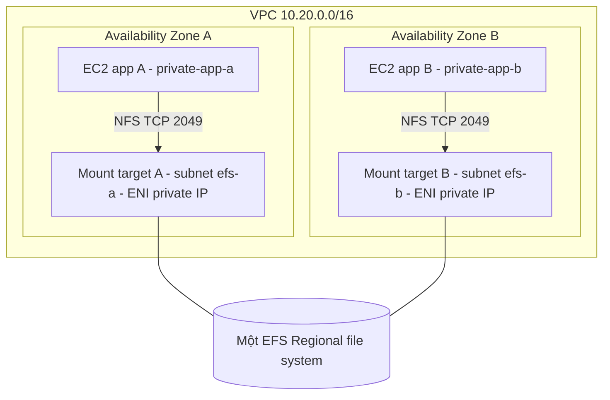
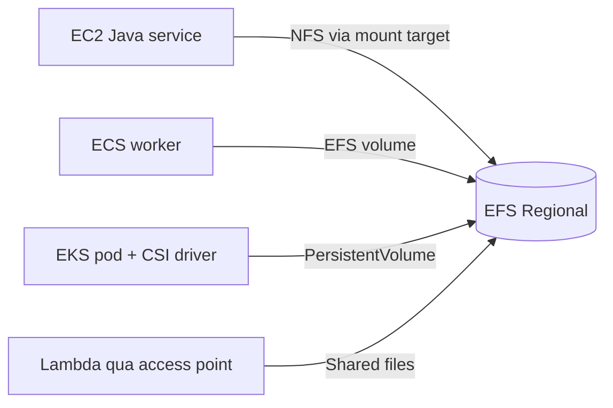
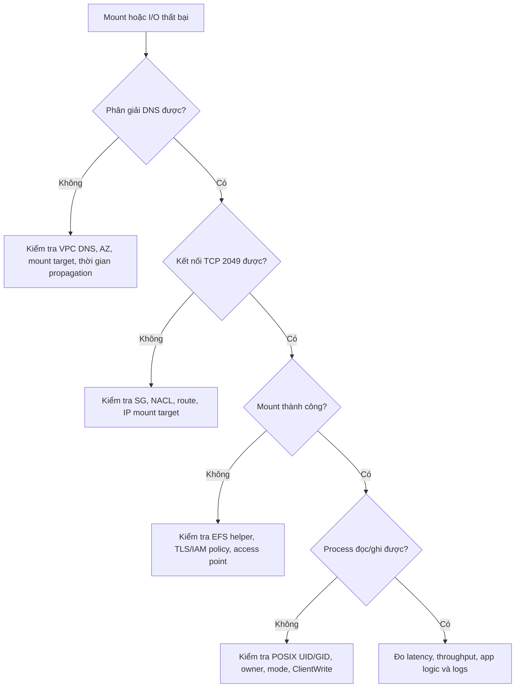

# EFS, mount target và truy cập NFS

> **Chương:** Lưu trữ block và file · **Mô-đun:** `CLOUD_PROVIDERS_AWS`

## 1. Bài toán: nhiều máy chủ cần cùng một hệ thống tệp

Hãy hình dung một ứng dụng Java chạy trên hai Amazon EC2 instance thuộc hai Availability Zone (AZ). Người dùng tải tài liệu lên ứng dụng; một worker xử lý ảnh ở AZ A và một web server ở AZ B cần nhìn thấy **cùng một đường dẫn tệp** ngay sau khi ghi. Nếu dùng ổ đĩa cục bộ của từng máy, dữ liệu không tự đồng bộ khi Application Load Balancer (ALB) chuyển request sang máy khác. Nếu một EC2 bị thay bởi Auto Scaling Group, dữ liệu chỉ nằm trong ổ máy đó có thể mất hoặc trở nên khó truy cập.

**Amazon Elastic File System (Amazon EFS)** cung cấp **hệ thống tệp được quản lý, chia sẻ qua mạng**, cho phép nhiều client Linux/Unix tương thích kết nối qua **Network File System (NFS)**. Ứng dụng làm việc với thư mục, tệp, quyền POSIX và các thao tác như `open`, `read`, `write` thay vì phải tích hợp riêng API object storage.

Trong mô-đun `CLOUD_PROVIDERS_AWS`, kỹ năng thiết kế EFS liên quan trực tiếp tới **Region/AZ, VPC, IAM, EC2, ECS/EKS, Lambda, giám sát, phục hồi và kiểm soát chi phí**. Một thiết kế đúng cần giải quyết đồng thời: dữ liệu lưu ở đâu, mạng NFS đi qua mount target nào, ai được phép kết nối, quyền đọc/ghi của process là gì, hiệu năng và giá thành có phù hợp workload hay không.

**Sau bài học, người học có thể:**

1. Phân biệt EFS với Amazon EBS và Amazon S3, chọn file storage đúng nhu cầu.
2. Giải thích kiến trúc EFS Regional/One Zone và mount target trong từng AZ/VPC.
3. Cấu hình security group, DNS và đường truyền NFS TCP 2049.
4. Mount EFS trên EC2 Linux bằng `amazon-efs-utils` với TLS, IAM authorization và access point.
5. Hiểu quyền POSIX, EFS file system policy, access point và mã hóa dữ liệu.
6. Thiết kế khả năng sẵn sàng, sao lưu, giám sát hiệu năng và dự toán chi phí.
7. Chẩn đoán lỗi mount, `Permission denied`, timeout và vấn đề latency/throughput.

## 2. EFS là dịch vụ gì, khác EBS và S3 ra sao?

EFS là **managed elastic file system**: AWS quản lý phần lưu trữ backend, tăng/giảm dung lượng sử dụng theo lượng dữ liệu thực tế, trong khi client mount vào thư mục của hệ điều hành. Client có thể là EC2 Linux, container chạy trên ECS/EKS hoặc dịch vụ hỗ trợ tích hợp EFS; việc dùng EFS trong AWS Lambda có yêu cầu VPC và access point phù hợp.

| Tiêu chí | **Amazon EFS** | **Amazon EBS** | **Amazon S3** |
| --- | --- | --- | --- |
| Kiểu dữ liệu | **File**: thư mục, path, metadata và quyền POSIX. | **Block**: volume được gắn vào EC2 để tạo filesystem hoặc dùng trực tiếp. | **Object**: bucket, key và API HTTP/SDK. |
| Cách truy cập điển hình | Mount NFS vào `/mnt/data` trên nhiều Linux clients. | Attach volume vào instance, format/mount qua OS. | `GetObject`, `PutObject` hoặc API/SDK tương thích. |
| Chia sẻ đồng thời | Thiết kế cho **nhiều clients** chia sẻ cùng filesystem. | Thông thường gắn với một EC2/AZ; EBS Multi-Attach chỉ dành cho cấu hình và loại volume được hỗ trợ, cần xử lý đồng bộ ở ứng dụng/filesystem. | Nhiều clients đọc/ghi objects qua API; không phải NFS/POSIX filesystem mặc định. |
| Phạm vi | EFS Regional có dữ liệu trên nhiều AZ; One Zone trong một AZ. | Volume thuộc một AZ; snapshot có quy trình riêng. | Dịch vụ object storage với các lớp lưu trữ và khả năng truy cập riêng. |
| Phù hợp | Shared content, upload, cấu hình/tài sản dùng chung, workload cần path và filesystem semantics. | Boot volume, database cần block storage/IOPS cụ thể, ổ đĩa ứng dụng. | Ảnh, backup, phân phối object, data lake, dữ liệu lớn theo key. |
| Cần lưu ý | Độ trễ NFS, metadata và quyền POSIX, kết nối 2049, chi phí storage/throughput. | Dung lượng/IOPS/throughput provisioned, snapshot, ràng buộc AZ. | Ứng dụng phải xử lý object API, request costs và mô hình quyền S3. |

**Quy tắc chọn nhanh:** Nếu ứng dụng cần **nhiều máy nhìn thấy cùng một thư mục POSIX** mà không muốn tự vận hành NFS server, EFS là ứng viên tốt. Nếu ứng dụng chỉ cần lưu object và truy cập qua API, S3 thường phù hợp hơn. Nếu database hoặc hệ điều hành yêu cầu block device độ trễ thấp, cần đánh giá EBS. EFS không biến một ứng dụng viết đồng thời không có khóa/transaction thành ứng dụng an toàn; client vẫn phải phối hợp concurrency đúng cách.

### 2.1. Ví dụ sử dụng EFS hợp lý

- Hai web instances chia sẻ thư mục `/srv/uploads` chứa tài liệu người dùng.
- Worker và API server chia sẻ file trung gian lớn mà framework mong đợi đường dẫn filesystem.
- Nhiều ECS tasks dùng volume chung; với EKS có thể dùng **Amazon EFS CSI driver** để cung cấp PersistentVolume theo mô hình được hỗ trợ.
- AWS Lambda truy cập file dùng chung khi cấu hình VPC, mount target và **EFS access point** phù hợp.

### 2.2. Khi EFS có thể chưa phù hợp

- Ứng dụng đọc/ghi hàng triệu file rất nhỏ với thao tác metadata dày đặc: phải benchmark latency và thông lượng metadata.
- Database kỳ vọng block device/local filesystem semantics hoặc IOPS cực thấp: không mặc định thay EBS bằng EFS.
- Web content chỉ phát công khai như ảnh/video tĩnh: cân nhắc S3 + CloudFront để có khả năng phân phối toàn cầu mà không cần NFS cho người dùng cuối.
- Workload cần offline/local-only hoặc vùng mạng không có khả năng kết nối NFS: phải giải quyết mạng hoặc thay chiến lược lưu trữ.

## 3. Kiến trúc EFS: file system và mount target

Một **EFS file system** có ID dạng `fs-xxxxxxxxxxxxxxxxx` và được tạo trong một AWS Region. Để client bên trong Amazon VPC truy cập, EFS sử dụng **mount target**. Mount target là điểm cuối mạng do EFS quản lý, có **Elastic Network Interface (ENI)**, private IP (IPv4/IPv6 tùy cấu hình) và security group trong một subnet của VPC. Client kết nối tới mount target qua **NFS**.

**Mount target không phải bản sao dữ liệu** và không phải EC2 instance mà bạn SSH vào để quản trị. Nó là đường vào dịch vụ EFS. Tạo nhiều mount targets trong các AZ không đồng nghĩa tạo nhiều hệ thống tệp độc lập: chúng cùng cho phép truy cập dữ liệu của một EFS file system.

### 3.1. Regional EFS và One Zone EFS

| Đặc điểm | **Regional file system** | **One Zone file system** |
| --- | --- | --- |
| Cách lưu dữ liệu | Dữ liệu được lưu dự phòng trên **nhiều AZ** trong Region. | Dữ liệu lưu trong **một AZ**. |
| Mount target | Có thể tạo **một mount target trong mỗi AZ** của một VPC. | Chỉ tạo **một mount target** trong **cùng AZ** chứa filesystem. |
| Tình huống | Dữ liệu dùng chung cho production đa AZ với yêu cầu chịu lỗi AZ. | Workload có thể tạo lại, test/dev hoặc đã có chiến lược backup/khôi phục chấp nhận mất AZ. |
| Rủi ro | Cần thiết kế client/mạng/backup; không đồng nghĩa DR liên Region tự động. | Sự cố nghiêm trọng tại AZ có thể khiến dữ liệu không sẵn sàng hoặc mất. |
| Chi phí | Theo giá Regional và storage class/throughput. | Có thể rẻ hơn ở một số use case; phải tính rủi ro và phí truyền dữ liệu liên AZ. |

**Phân biệt rất quan trọng:** EFS Regional duy trì dữ liệu theo kiến trúc đa AZ; mount target chỉ là **đường truy cập theo AZ**. Nếu client ở AZ B nhưng chỉ có mount target tại AZ A, nó có thể cần truy cập chéo AZ qua IP và phát sinh độ trễ/phí. Để tối ưu tính sẵn sàng và lưu lượng, hãy tạo mount target trong **mỗi AZ có clients**. Với One Zone, ứng dụng có thể phải đi qua AZ chứa dữ liệu và phải chấp nhận rủi ro tương ứng.

### 3.2. Một mount target mỗi AZ trong cùng VPC

EFS cho phép **tối đa một mount target của cùng file system trong một AZ thuộc VPC đang sử dụng**. Nếu AZ có ba subnet khác nhau, bạn chọn **một** subnet để đặt mount target; các EC2 trong những subnet khác **cùng AZ** vẫn có thể dùng mount target đó nếu route và security group cho phép. Không cần một mount target cho mỗi EC2 hoặc mỗi subnet.

Trong mô hình mount target thông thường, **các mount targets của một EFS file system thuộc một VPC tại một thời điểm**. Client từ VPC khác hoặc on-premises có thể truy cập qua phương án kết nối định tuyến (ví dụ VPC peering, Transit Gateway, VPN/Direct Connect) theo hướng dẫn AWS, có xử lý DNS/IP và policy tương ứng; không được tạo mount target tùy ý ở mọi VPC cho cùng một file system.

Ví dụ hai AZ:



Tại tầng ứng dụng, EC2 A và EC2 B có thể mount cùng EFS vào `/srv/shared`. Tệp do A tạo sẽ hiển thị với B theo semantics của NFS, nhưng ứng dụng vẫn phải quản lý ghi đồng thời, khóa, cache và tính nhất quán theo nhu cầu thực tế.

### 3.3. DNS của EFS lựa chọn mount target

Tên DNS file system thường có dạng:

```text
fs-0123456789abcdef0.efs.ap-southeast-1.amazonaws.com
```

Với điều kiện DNS của VPC và mount target đúng cấu hình, tên này **phân giải tới IP của mount target trong AZ của client**. Do vậy:

1. Kiểm tra client và file system thuộc Region phù hợp; trong mô hình phổ biến chúng cùng VPC.
2. Có mount target **available** trong **cùng AZ** với client nếu dùng file system DNS name tự động.
3. VPC bật DNS resolution và các DNS settings cần thiết; client dùng resolver phù hợp.
4. Cho đủ thời gian để mount target mới chuyển `available` và bản ghi DNS cập nhật; AWS khuyến nghị đợi sau khi tạo trước khi mount tự động.

Nếu phải mount từ mạng khác/khác AZ hoặc không thể dùng DNS tự động, có thể dùng **IP của mount target** hoặc cấu hình phân giải DNS thủ công theo AWS. Khi truy cập qua nhiều tài khoản, AZ name như `ap-southeast-1a` có thể ánh xạ khác nhau; hãy so sánh **AZ ID** khi cần biết hai subnet có cùng AZ vật lý hay không.

### 3.4. NFS sử dụng giao thức và cổng nào?

EFS hỗ trợ **NFSv4.0 và NFSv4.1**, thường khuyến nghị NFSv4.1 cho Linux clients tương thích. Đường mạng dùng **TCP 2049**. Không cần mở TCP 22/SSH, cổng RPC mountd hay NFSv3 theo mô hình kết nối EFS phổ biến. EFS **không hỗ trợ mount trực tiếp từ EC2 Windows** qua giao thức EFS mount helper; workloads Windows cần cân nhắc dịch vụ file storage phù hợp như Amazon FSx for Windows File Server.

**Không có yêu cầu public IP hoặc Internet Gateway để truyền NFS** giữa EC2 và mount target trong cùng VPC. Đây là kết nối private IP bên trong mạng AWS; nên đặt client/mount target ở subnet không phơi bày không cần thiết ra Internet.

## 4. VPC và Security Groups cho đường NFS

Một lệnh mount có thể bị timeout dù EFS đã được tạo thành công, vì **EFS storage và đường mạng tới mount target là hai lớp riêng**. Cần xác định nguồn (ENI EC2) và đích (ENI mount target), IP, AZ, route, DNS, SG và NACL.

| Vị trí | Hướng | Giao thức/cổng | Đối tượng |
| --- | --- | --- | --- |
| `sg-app` gắn vào EC2 client | **Outbound** | TCP **2049** | `sg-efs` của mount target hoặc đích IP/CIDR được kiểm soát. |
| `sg-efs` gắn vào mount target | **Inbound** | TCP **2049** | **`sg-app`** của những clients được phép mount. |

Security group là **stateful**, nên phản hồi của kết nối đã được cho phép không cần thêm rule return tương ứng. **Network ACL là stateless**: nếu có NACL hạn chế, phải cho phép cả hướng đi và TCP ephemeral ports cho luồng phản hồi. Firewall trên máy client cũng cần cho phép kết nối NFS.

**Không mở NFS 2049 từ `0.0.0.0/0` hoặc mọi security group trong VPC** khi chỉ một vài ứng dụng cần mount. Rule gắn nguồn SG cho phép quản trị theo vai trò của workload. Đối với mount target, inbound TCP 2049 từ các SG clients là điểm kiểm soát mạng quan trọng nhất.

### 4.1. Checklist về định tuyến và DNS

1. EC2 và mount target có đường đi private IP hợp lệ trong cùng VPC (`local` route) hoặc qua kết nối VPC khác được thiết kế riêng.
2. Có mount target tại AZ phù hợp, trạng thái `available`; IP type của mount target tương thích với subnet và client.
3. EC2 SG outbound TCP 2049 và mount target SG inbound TCP 2049 đúng nguồn.
4. NACL hai subnet không chặn request hoặc return traffic; firewall OS không chặn.
5. VPC DNS settings và resolver hỗ trợ tên EFS; không có private hosted zone mâu thuẫn.
6. Nếu bật IAM authorization/file system policy, client còn phải đáp ứng điều kiện chính sách ở tầng truy cập file system.

Không khắc phục lỗi mount bằng cách chuyển mount target sang public subnet hoặc tạo Internet Gateway. Lỗi kết nối cùng VPC cần được chẩn đoán theo **đường NFS private**, khác với kết nối tải package hoặc gọi API AWS từ instance.

## 5. Mount EFS trên Amazon EC2 Linux

Hai cách mount thường gặp:

- **Amazon EFS mount helper** (khuyến nghị): cài gói `amazon-efs-utils`, dùng `mount -t efs`. Hỗ trợ TLS, IAM authorization, EFS access point, tự cấu hình nhiều tùy chọn thích hợp và tích hợp khởi tạo lúc boot.
- **Linux NFS client thuần**: dùng `mount -t nfs4` cùng file system DNS name hoặc mount target IP. Cách này hữu ích trong một số môi trường, nhưng không tự có tính năng TLS/IAM của EFS mount helper.

Tài liệu bên dưới giả định **Amazon Linux 2023** trên EC2 có đường đến repository để cài package. Nếu dùng Ubuntu/RHEL/AMI custom, hãy kiểm tra công cụ cài `amazon-efs-utils` phù hợp với phiên bản và kiến trúc OS. EFS mount helper hỗ trợ những nền tảng đã được AWS công bố; không mặc định mọi hệ điều hành đều tương thích.

### 5.1. Chuẩn bị EC2 và file system

Trước khi chạy lệnh, cần có:

1. Một EFS file system `fs-0123456789abcdef0` trong Region `ap-southeast-1` (ID là **ví dụ**, thay bằng ID thật).
2. Mount target `available` thuộc đúng VPC và AZ EC2 đang chạy.
3. Security groups cho phép TCP 2049 như mục 4; DNS/VPC hỗ trợ phân giải tên EFS.
4. EC2 dùng Linux tương thích, có quyền quản trị máy bằng SSH được bảo vệ hoặc AWS Systems Manager Session Manager.
5. Nếu muốn IAM authorization, EC2 có **IAM instance profile** chứa quyền client phù hợp và file system policy cho phép.

### 5.2. Cài mount helper và mount bằng TLS

Chạy **bên trong EC2 Linux**, không chạy trên laptop:

```bash
# Amazon Linux 2023
sudo dnf install -y amazon-efs-utils

# Tạo mount point chỉ là một thư mục cục bộ trước khi mount.
sudo mkdir -p /mnt/efs

# Dùng EFS mount helper; TLS mã hóa NFS in transit.
sudo mount -t efs -o tls fs-0123456789abcdef0:/ /mnt/efs

# Kiểm tra mount hiện hữu.
findmnt /mnt/efs
df -hT /mnt/efs
```

Lệnh trên yêu cầu gói mount helper đã cài, EFS cùng Region/VPC phù hợp, DNS và mount target hoạt động. `-o tls` bật mã hóa truyền tải, là tùy chọn nên dùng với dữ liệu thực tế. Nếu EFS file system policy **yêu cầu IAM authentication** thì mount chỉ có `tls` chưa đủ; dùng `tls,iam` và role phù hợp (mục 6).

### 5.3. Thử đọc/ghi chia sẻ giữa hai máy

Chỉ thực hiện trên **file system lab đã được phép ghi**, không xóa/sửa dữ liệu production. Trên EC2 A:

```bash
# Ghi file thử nghiệm từ máy A
echo "created from EC2 A" | sudo tee /mnt/efs/efs-lab-shared.txt
sudo stat /mnt/efs/efs-lab-shared.txt
```

Trên EC2 B đã mount **cùng file system**:

```bash
cat /mnt/efs/efs-lab-shared.txt
findmnt /mnt/efs
```

Nếu B đọc được cùng nội dung, bạn đã xác nhận đường file access hoạt động giữa hai clients. Đừng xem test này là chứng minh an toàn khi **nhiều tiến trình cùng ghi một file**: trường hợp đó cần kiểm thử file locking, atomic rename và concurrency semantics của ứng dụng.

### 5.4. Mount bằng NFS client thuần

Ví dụ Linux có gói NFS client tương thích, dùng **NFSv4.1** và DNS EFS:

```bash
sudo mkdir -p /mnt/efs-nfs

sudo mount -t nfs4 \
  -o nfsvers=4.1,rsize=1048576,wsize=1048576,hard,timeo=600,retrans=2,noresvport \
  fs-0123456789abcdef0.efs.ap-southeast-1.amazonaws.com:/ \
  /mnt/efs-nfs

findmnt /mnt/efs-nfs
```

Những giá trị `rsize`/`wsize` (1 MiB), `hard`, `timeo`, `retrans` và `noresvport` là ví dụ từ hướng dẫn EFS; lựa chọn tối ưu có thể phụ thuộc kernel, workload và tình trạng network. **Đoạn NFS thuần này không bật TLS/IAM authorization của EFS mount helper.** Để đáp ứng chính sách yêu cầu TLS, dùng mount helper với `tls` thay vì sao chép ví dụ NFS thuần vào production.

**Tránh dùng `soft` một cách tùy tiện:** mount NFS loại `soft` có thể trả lỗi I/O sau timeout, khiến ứng dụng hiểu nhầm dữ liệu đã được ghi/đọc đầy đủ. `hard` có thể khiến thao tác chờ khi NFS gián đoạn; cần phối hợp timeout, giám sát, cơ chế phục hồi ứng dụng và thiết kế độ tin cậy.

### 5.5. Tự mount sau mỗi lần reboot qua `/etc/fstab`

Để tự mount bằng EFS helper với TLS, thêm entry sau vào `/etc/fstab` của **máy được phép quản trị**:

```fstab
fs-0123456789abcdef0:/ /mnt/efs efs _netdev,tls 0 0
```

`_netdev` báo đây là filesystem phụ thuộc network. Thiếu tùy chọn này có thể khiến Linux boot gặp vấn đề khi EFS chưa sẵn sàng. Khi dùng IAM authorization:

```fstab
fs-0123456789abcdef0:/ /mnt/efs efs _netdev,tls,iam 0 0
```

Đừng thêm cả hai dòng vào `/etc/fstab` cho cùng mount point; chọn **một** cấu hình đáp ứng chính sách. Sau khi chỉnh, kiểm tra:

```bash
sudo mount -a
findmnt /mnt/efs
```

Trong hệ thống cần khởi động ngay cả khi NFS tạm thời không sẵn, `nofail` có thể là một lựa chọn để tránh chặn boot, nhưng **nó không làm ứng dụng trở nên khỏe mạnh**. Nếu app bắt buộc có EFS, systemd unit của app cần phụ thuộc vào mount, ví dụ `RequiresMountsFor=/mnt/efs` và health check phải thất bại khi thư mục chưa mount, để tránh ghi nhầm dữ liệu vào thư mục local. Có thể dùng automount/lifecycle do hệ điều hành hỗ trợ khi đã thử nghiệm.

### 5.6. Phân biệt mount thành công và filesystem sẵn sàng

Sau khi mount, hãy kiểm tra:

```bash
findmnt /mnt/efs
df -hT /mnt/efs
mount | grep /mnt/efs
ls -ldn /mnt/efs
```

Đối với app thật, còn cần thử đọc/ghi **dưới user mà ứng dụng chạy** (chẳng hạn `appuser` hoặc UID của container), không chỉ dùng `sudo`. Root ghi được nhưng Java chạy với UID không đúng có thể gặp `Permission denied`; đây là vấn đề POSIX chứ không phải NFS timeout.

## 6. Bảo mật ba lớp: mạng, IAM và POSIX

**EFS không tự xác thực mọi NFS client bằng tên đăng nhập hệ điều hành.** Mặc định, một client NFS có thể gửi UID/GID của process để EFS đánh giá POSIX permissions. Vì vậy, security group giới hạn ai được tới port 2049 rất quan trọng, nhưng chưa đủ nếu nhiều ứng dụng có mức tin cậy khác nhau cùng dùng VPC.

Ba lớp cần kết hợp:

| Lớp | Câu hỏi bảo mật | Công cụ |
| --- | --- | --- |
| **Network** | Máy nào có thể kết nối NFS vào mount target? | VPC, mount target SG, EC2 SG, NACL, routing. |
| **IAM / EFS file system policy** | Danh tính AWS nào có quyền mount/ghi/root, trong điều kiện nào? | IAM instance role, file system policy, `elasticfilesystem:ClientMount`, `ClientWrite`, `ClientRootAccess`. |
| **POSIX / Access point** | Process nào được đọc/ghi file và thư mục nào? | UID, GID, file mode, EFS access point UID/GID/path. |

### 6.1. IAM authorization cho NFS clients

Để mount bằng IAM authorization trên EC2 có instance profile, dùng **EFS mount helper**:

```bash
sudo mkdir -p /mnt/efs
sudo mount -t efs -o tls,iam fs-0123456789abcdef0:/ /mnt/efs
```

IAM client actions thường gặp:

- `elasticfilesystem:ClientMount`: cho phép mount/đọc theo quyền hiệu lực.
- `elasticfilesystem:ClientWrite`: cho phép thao tác ghi qua client.
- `elasticfilesystem:ClientRootAccess`: cho phép quyền root client theo chính sách; cấp riêng khi thật sự cần.

Ví dụ **identity-based policy minh họa** cho một role chỉ cần quyền mount và ghi vào filesystem cụ thể:

```json
{
  "Version": "2012-10-17",
  "Statement": [
    {
      "Sid": "MountAndWriteOnlySelectedEFS",
      "Effect": "Allow",
      "Action": [
        "elasticfilesystem:ClientMount",
        "elasticfilesystem:ClientWrite"
      ],
      "Resource": "arn:aws:elasticfilesystem:ap-southeast-1:111122223333:file-system/fs-0123456789abcdef0"
    }
  ]
}
```

Account ID, Region và file system ID đều là placeholder. Đây là **một lớp** trong thiết kế; file system policy, explicit deny, SCP và POSIX mode vẫn có thể giới hạn hành động. Không cấp `ClientRootAccess` cho mọi workload chỉ để khắc phục lỗi quyền.

**Chú ý mặc định quan trọng:** Khi chưa gắn file system policy tùy chỉnh, EFS có **default file system policy** cho phép NFS clients có thể kết nối qua mount target truy cập như anonymous clients, theo tài liệu AWS. Vì vậy, chỉ gắn IAM role vào EC2 **không tự biến mọi mount thành IAM authenticated**. Để bắt buộc IAM/TLS hoặc giới hạn access point, phải thiết kế **file system policy** và mount options đáp ứng yêu cầu. Đối với chính sách chỉ áp dụng khi có IAM credentials, dùng `tls,iam`; chỉ dùng `tls` không thay thế IAM authentication.

### 6.2. POSIX: UID/GID và quyền thư mục

Ví dụ máy A ghi file bằng process UID `1001` GID `1001`, trong khi app trên máy B chạy UID `2001` và file mode là `0640`. App B có thể không đọc được dù network/SG và mount đều hoạt động. Tên user `appuser` trên hai máy **không đảm bảo cùng UID/GID**, vì NFS dùng numeric IDs và permissions.

Để tránh lỗi:

1. Chuẩn hóa **numeric UID/GID** của ứng dụng trên các EC2/container clients nếu không dùng access point áp đặt danh tính.
2. Gán ownership và mode cho root directory, ví dụ `0770` nếu một group được phép ghi.
3. Chỉ dùng `chmod 777` trong môi trường thực sự được phân tích rủi ro; không dùng để “sửa nhanh” mọi lỗi.
4. Kiểm tra bằng `ls -ldn` và thực hiện thao tác dưới UID/GID của process thật.

### 6.3. EFS access point: cô lập đường dẫn và POSIX identity

**EFS access point** là một entry point ở tầng filesystem, **khác mount target**:

| Thành phần | Mục tiêu | Ví dụ |
| --- | --- | --- |
| **Mount target** | Tạo endpoint IP/NFS cho clients trong một AZ/VPC. | `fsmt-...` gắn subnet và SG. |
| **Access point** | Giới hạn thư mục gốc nhìn thấy và có thể áp đặt POSIX UID/GID khi mount. | `fsap-...` root `/apps/orders`, UID 1001. |

Một access point có thể:

- Đặt **root directory** (chẳng hạn `/apps/orders`) mà client nhìn thấy như `/` của mount.
- **Enforce UID/GID** (và secondary GIDs nếu cấu hình), thay thế identity do client khai báo đối với những request thông qua access point.
- Tự tạo root directory chưa tồn tại nếu cấu hình **owner UID, GID và permissions** của thư mục lúc tạo access point. Nếu thiếu các thiết lập cần thiết, EFS không tự tạo path và mount có thể thất bại.

Ví dụ mount qua access point đã có:

```bash
sudo mkdir -p /mnt/orders
sudo mount -t efs -o tls,iam,accesspoint=fsap-0123456789abcdef0 \
  fs-0123456789abcdef0:/ /mnt/orders
```

Access point ID là minh họa. Với cấu hình trên, role còn cần `ClientMount`, `ClientWrite` nếu ghi và cần được file system policy cho phép dùng đúng access point. Nếu access point áp đặt **UID/GID 0 (root)**, IAM `ClientRootAccess` có thể được yêu cầu. Đây không phải “lối tắt” vượt tất cả POSIX permissions. Access point root directory **không phải ranh giới bảo mật duy nhất**: phải phối hợp file system policy và không cho workload yếu quyền mount trực tiếp vào root của cả file system nếu muốn tách dữ liệu.

**Một ứng dụng = một access point** là một mẫu hữu ích khi dùng chung EFS cho nhiều workload, nhưng không có nghĩa access point tự thay VPC isolation hoặc mã hóa dữ liệu. Có thể dùng điều kiện file system policy để buộc IAM principal chỉ mount qua đúng access point.

### 6.4. Mã hóa at rest và in transit

- **Encryption at rest:** thiết lập trên EFS file system, với AWS KMS key thích hợp; key policy/quyền KMS và khả năng khôi phục phải được quản lý. Quyết định mã hóa khi tạo file system theo các tùy chọn dịch vụ; cần kiểm tra chính sách hiện hành trước khi migration dữ liệu.
- **Encryption in transit:** dùng EFS mount helper với `-o tls` để mã hóa lưu lượng NFS qua TLS. Với `tls,iam`, kết nối vừa mã hóa vừa dùng IAM authorization.
- **Policy enforcement:** có thể dùng file system policy để yêu cầu secure transport, IAM principal hoặc access point phù hợp; không chỉ kiểm tra trên giấy mà phải thử một kết nối không tuân thủ bị từ chối.

Không đưa AWS access key, mật khẩu ứng dụng hoặc secrets vào `/etc/fstab`. Với EC2 nên dùng **IAM instance profile**, theo nguyên tắc least privilege.

## 7. Kết nối EFS với ECS, EKS và Lambda

EFS không giới hạn ở EC2, nhưng các dịch vụ compute khác có cách mount và lifecycle riêng:

| Compute | Tích hợp điển hình | Điều kiện/rủi ro chính |
| --- | --- | --- |
| **EC2 Linux** | Mount EFS bằng helper hoặc NFS 4.1. | Package, mount target, SG/NACL, IAM, POSIX UID/GID. |
| **Amazon ECS** | Task definition khai báo EFS volume, có thể cấu hình access point và IAM authorization. | Task role, security group, network mode và ECS/Fargate platform version hỗ trợ. |
| **Amazon EKS** | Dùng **Amazon EFS CSI driver** và Kubernetes PersistentVolume/PersistentVolumeClaim. | CSI controller/node permissions, access points, pod UID/GID, topology và node network. |
| **AWS Lambda** | Function cấu hình VPC và kết nối EFS qua **access point**. | Subnet/mount target, SG, concurrency, chi phí và quyền truy cập filesystem. |

Một ví dụ dùng chung:



Sơ đồ chỉ biểu diễn mối quan hệ lưu trữ. Mỗi client vẫn cần nằm trong network có route tới mount target thích hợp, được SG/NACL cho phép và đáp ứng file system policy/POSIX permissions. Việc dùng EFS cho container không thay thế cơ chế phân tách namespace/quyền của hệ điều hành hoặc nhu cầu quản lý image/secrets.

## 8. Hiệu năng: NFS không giống ổ đĩa cục bộ

EFS là **network filesystem**, nên mỗi thao tác có thể chịu thêm network latency và metadata latency. Ví dụ mở hàng nghìn file nhỏ trong một request có thể chậm hơn đọc một file lớn tuần tự, ngay cả khi tổng số byte tương đương. Cần đánh giá **operations/giây, byte/giây, latency, tỷ lệ đọc/ghi, số clients, kích thước file, mức truy cập metadata** thay vì chỉ đo dung lượng lưu trữ.

### 8.1. Throughput modes

| Chế độ | Nguyên tắc | Khi cân nhắc |
| --- | --- | --- |
| **Elastic Throughput** | EFS tự thích ứng với khối lượng truy cập theo quota/giới hạn dịch vụ; chi phí liên quan lượng dữ liệu I/O được đo. | Workload biến động, khó dự đoán hoặc cần tránh tự đặt throughput cố định. |
| **Provisioned Throughput** | Chọn mức throughput mong muốn, có quan hệ chi phí với mức provisioned và dữ liệu lưu trữ. | Workload có throughput đều và đã đo rõ nhu cầu; cần so sánh giá cụ thể. |
| **Bursting Throughput** | Khả năng throughput liên quan lượng dữ liệu và **burst credits**; có thể burst trong giới hạn khi còn credit. | Workload có tỷ lệ I/O phù hợp mức throughput baseline/burst và đã xác minh giới hạn. |

**Không có chế độ rẻ nhất cho mọi workload.** Elastic throughput thường thuận tiện khi I/O biến động; một workload streaming đều cần so giá thực tế với Provisioned hoặc Bursting. EFS còn có các giới hạn về operations và throughput theo Region/filesystem; xem bảng quota/performance chính thức thay vì dùng một con số cố định trong thiết kế lâu dài.

### 8.2. Metadata, locks và concurrency

- **Metadata operations** như `stat`, `readdir`, mở/đóng file rất nhỏ có thể là nút thắt, đặc biệt với nhiều client quét thư mục dày đặc.
- **NFSv4 file locking** có thể hỗ trợ phối hợp truy cập nhưng không tự thay thế transaction/database lock. Thực hành **atomic write + rename**, quản lý writer ownership và xử lý conflict ở ứng dụng nếu cần.
- **Cache** của NFS client giúp giảm request nhưng có thể ảnh hưởng thời điểm client khác nhìn thấy thay đổi; kiểm thử dựa trên semantics thực tế, tránh suy đoán rằng mọi process thấy mỗi byte ghi ngay lập tức.
- **EFS General Purpose performance mode** phù hợp phần lớn ứng dụng đòi hỏi latency thấp; các file system cũ có thể có mode khác. Kiểm tra mode hiện hành khi phân tích giới hạn.
- **EFS không phải SAN/block device:** ứng dụng quan trọng phụ thuộc fsync/locking và pattern DB cần benchmark thực tế; không thay trực tiếp volume EBS cho mọi database.

Để giảm latency có thể: đặt mount target **cùng AZ** với client, dùng read/write size phù hợp, cache dữ liệu nóng khi an toàn, gom file nhỏ khi kiến trúc cho phép, giảm scan sâu và không tạo hàng triệu file trong một thư mục mà không đo hiệu năng.

### 8.3. Quan sát bằng CloudWatch metrics

Amazon EFS cung cấp metric trong namespace **`AWS/EFS`**. Các metric tiêu biểu:

| Metric | Ý nghĩa | Tình huống |
| --- | --- | --- |
| `ClientConnections` | Số lượng kết nối client tới filesystem theo thống kê EFS. | ASG scale out nhưng không xuất hiện kết nối NFS mới. |
| `TotalIOBytes` | Lượng I/O thực tế, có phân loại read/write/metadata theo các metric liên quan. | Xác định traffic thực tế. |
| `MeteredIOBytes` | Lượng I/O dùng để tính throughput metering theo quy tắc EFS. | So sánh với mức throughput khả dụng. |
| `PermittedThroughput` | Throughput EFS cho phép theo mode và điều kiện hiện tại. | Phát hiện workload thường xuyên chạm giới hạn. |
| `PercentIOLimit` | Mức gần tới giới hạn I/O của General Purpose. | Metadata/I/O bottleneck. |
| `BurstCreditBalance` | Credit dành cho mode Bursting. | Phát hiện nguy cơ giảm throughput khi credit thấp. |
| `StorageBytes` | Dung lượng theo storage class và tổng. | Phân tích tăng trưởng, lifecycle và chi phí. |
| `TimeSinceLastSync` | Thời gian từ lần đồng bộ thành công khi dùng EFS replication. | Theo dõi độ trễ replication, kiểm tra kỳ vọng DR. |

**Đừng hiểu `ClientConnections` là số người dùng ứng dụng**; một EC2 mount có thể phục vụ nhiều requests. Với throughput, xem thời gian và statistic phù hợp, tương quan với latency của ứng dụng, host CPU/network, kernel NFS và các lỗi timeout. Nhiều metric filesystem là cấp toàn EFS, nên cần thêm logs/metrics ở EC2, ECS hoặc EKS để tìm client gây tải.

## 9. Storage classes, lifecycle và dự toán chi phí

EFS tính phí dựa trên **dữ liệu được lưu trữ theo lớp**, lựa chọn throughput và các loại truy cập/di chuyển dữ liệu áp dụng. Đối với Regional file system, những storage classes thường thấy:

| Lớp | Dành cho | Tác động cần xét |
| --- | --- | --- |
| **EFS Standard** | Dữ liệu truy cập thường xuyên, cần first-byte latency thấp. | Giá lưu trữ theo lớp Standard. |
| **EFS Infrequent Access (IA)** | Dữ liệu ít được truy cập. | Phí truy xuất/đọc-ghi có thể áp dụng; latency có thể cao hơn Standard; lưu ý minimum billable size. |
| **EFS Archive** | Dữ liệu truy cập rất hiếm, lưu dài hạn. | Có điều kiện thời gian lưu trữ tối thiểu, phí truy cập và đặc điểm độ trễ khác; không phù hợp hot files. |

**One Zone** có các lớp áp dụng riêng (như One Zone và One Zone-IA theo hỗ trợ của EFS); **Archive dành cho Regional**, không nên giả định One Zone có đầy đủ mọi storage class của Regional.

### 9.1. Lifecycle management

EFS có thể tự chuyển file theo thời gian kể từ lần truy cập gần nhất. Chẳng hạn, cấu hình đề xuất trong AWS Console hiện có thể chuyển dữ liệu từ Standard sang IA sau **30 ngày**, rồi sang Archive sau **90 ngày**, và không tự chuyển trở lại Standard trừ khi chọn chính sách thích hợp. Đây là **cấu hình mặc định của luồng Console được đề xuất tại thời điểm tra cứu**, không phải một quy tắc buộc mọi file system đều có.

Khi tạo EFS qua API/CLI, cần xem lại lifecycle policy sau khi tạo thay vì suy rằng cấu hình trùng Console. Có thể cấu hình chuyển file về Standard ở lần truy cập đầu tiên theo các tùy chọn được hỗ trợ. Với IA/Archive, AWS có thể tính phí dữ liệu tối thiểu theo **128 KiB đối với file nhỏ**, đồng thời áp dụng minimum storage duration ở những lớp nhất định (ví dụ Archive). Vì vậy, nhiều file nhỏ và truy cập thường xuyên có thể làm chi phí không giống phép tính đơn giản `dung lượng × giá GB-month`.

### 9.2. Các nhóm chi phí cần lập dự toán

| Nhóm | Phát sinh khi nào? | Cách kiểm soát |
| --- | --- | --- |
| **Dung lượng EFS** | Lưu dữ liệu tại Standard, IA, Archive hoặc lớp One Zone tương ứng. | Theo dõi `StorageBytes`; đặt lifecycle và retention theo tần suất truy cập. |
| **Throughput / requests / access** | Tùy throughput mode, mức I/O và storage class. | Benchmark, phân tích `MeteredIOBytes` và mode đang dùng. |
| **Cross-AZ data transfer** | Client truy cập mount target ở AZ khác hoặc qua mạng có tính phí truyền liên AZ. | Đặt mount target cùng AZ cho Regional clients khi phù hợp. |
| **Backup, replication** | AWS Backup storage/restore, EFS replication và data transfer theo cấu hình. | Xác định RPO/RTO, retention và chính sách lưu bản sao. |
| **Monitoring và compute** | CloudWatch logs/alarms, EC2/ECS/Lambda và đường truyền khác. | Chọn retention, alarms và số lượng clients hợp lý. |
| **Dữ liệu tồn đọng** | Workload ghi tệp tạm/log rồi quên xóa. | Thiết kế quy trình cleanup an toàn, quota logic và cảnh báo tăng trưởng. |

Không tính **mỗi mount target** như một ổ đĩa dữ liệu độc lập. Dữ liệu vẫn thuộc cùng file system; mount target chủ yếu tạo đường mạng. Tuy nhiên, số AZ và tuyến traffic ảnh hưởng tới chi phí truyền dữ liệu. Đối chiếu giá và điều kiện ở [Amazon EFS Pricing](https://aws.amazon.com/efs/pricing/) tại **Region thực tế**, không gán một giá USD cố định cho mọi Region.

### 9.3. Ví dụ lựa chọn theo workload

Một nhóm có 200 GiB tài liệu thường đọc và 2 TiB tài liệu cũ rất ít dùng. Phương án dùng EFS Standard cho dữ liệu nóng và lifecycle IA/Archive cho dữ liệu lạnh có thể giảm chi phí **nếu phí truy cập, yêu cầu latency và minimum size phù hợp**. Nếu mọi request web đọc lại hàng nghìn file cũ, việc chuyển sang IA/Archive có thể tăng latency/chi phí truy xuất, dù tiền lưu trữ thấp. Hãy đo thực tế trước khi áp dụng.

## 10. Khả năng sẵn sàng, sao lưu và phục hồi

EFS Regional tạo khả năng lưu trữ và chia sẻ trong nhiều AZ, nhưng **không giải quyết mọi sự cố ở cấp ứng dụng, con người và Region**.

### 10.1. Các lớp sự cố

| Sự cố | EFS Regional và các thành phần liên quan | Biện pháp thiết kế |
| --- | --- | --- |
| EC2 A chết, EC2 B còn chạy | Cùng EFS vẫn có thể được mount từ EC2 B. | App chạy nhiều AZ, health checks và ASG thay EC2. |
| Mount target AZ A không sẵn sàng | Client tại A có thể bị ảnh hưởng đường NFS dù dữ liệu EFS Regional còn tồn tại. | Mount target tại các AZ có client, failover workloads, retry và timeout. |
| AZ bị gián đoạn | File system Regional được thiết kế dự phòng dữ liệu đa AZ, nhưng app phải có compute/network tại AZ còn lại. | ALB/ASG/ECS/EKS phân tán AZ, kiểm thử failover. |
| Xóa nhầm file hoặc ransomware | Đồng bộ và dự phòng AZ **không tự hoàn tác việc xóa/sửa hợp lệ**. | AWS Backup, quyền POSIX/IAM, restore test và audit. |
| Sự cố hoặc mất Region | Regional file system không tự biến thành bản sao ở Region khác. | Đánh giá **EFS replication** sang Region khác hoặc backup/restore theo RPO/RTO. |
| Workload dùng EFS One Zone gặp lỗi AZ | Dữ liệu/phục vụ có thể chịu ảnh hưởng nghiêm trọng. | Chọn Regional khi cần bền vững đa AZ, backup/replicate nếu cần. |

### 10.2. Backup, replication và khôi phục

- **AWS Backup** có thể bảo vệ EFS theo lịch và retention; chính sách, vault và khả năng restore cần được xác minh. Đừng mặc định có backup chỉ vì file system là Regional.
- **EFS replication** sao chép bất đồng bộ tới file system đích theo cấu hình được hỗ trợ. Replication phục vụ một số bài toán DR nhưng **không thay thế backup trước xóa nhầm**, vì thay đổi/xóa có thể được đồng bộ. Theo dõi độ trễ và thực hành chuyển đổi ứng dụng sang đích.
- **RPO** là mức mất dữ liệu tối đa chấp nhận được; **RTO** là thời gian phục hồi tối đa. Đánh giá dựa trên yêu cầu nghiệp vụ, không suy ra bằng không chỉ vì dịch vụ được quản lý.
- Thử **restore file/thư mục nhỏ vào vị trí thử nghiệm** định kỳ, xác nhận quyền POSIX và IAM/access point, nội dung thực tế và khả năng ứng dụng đọc dữ liệu sau restore.

### 10.3. Sẵn sàng của ứng dụng phụ thuộc mount

Nếu ứng dụng Java ghi vào `/srv/shared` nhưng EFS không được mount, hệ điều hành có thể cho ứng dụng ghi vào **thư mục local trùng tên**. Khi mount thành công về sau, dữ liệu vừa ghi tại local path bị che khỏi đường nhìn thông thường và ứng dụng thấy dữ liệu EFS khác. Vì vậy:

1. Thiết lập phụ thuộc mount trước khi service Java chạy (systemd dependencies hoặc health gate phù hợp).
2. Kiểm tra `findmnt /srv/shared` trước khi chấp nhận traffic.
3. Cấu hình ALB/ASG readiness không coi instance healthy nếu shared storage bắt buộc chưa sẵn sàng.
4. Không áp dụng `nofail` chỉ để bỏ qua lỗi storage mà không thay đổi logic readiness.

## 11. Kiểm tra cấu hình EFS bằng AWS CLI (chỉ đọc)

Các lệnh sau không tạo hoặc xóa file system; cần credentials có quyền mô tả tài nguyên. Thay ID placeholder bằng ID thật và sử dụng đúng AWS Region/tài khoản.

```bash
# 1. Xác minh danh tính AWS đang dùng.
aws sts get-caller-identity

# 2. Kiểm tra file system, trạng thái, mã hóa và throughput mode.
aws efs describe-file-systems \
  --region ap-southeast-1 \
  --file-system-id fs-0123456789abcdef0 \
  --query "FileSystems[].{Id:FileSystemId,State:LifeCycleState,Mode:PerformanceMode,Throughput:ThroughputMode,Encrypted:Encrypted}" \
  --output table

# 3. Liệt kê mount targets, subnet, AZ và địa chỉ IP.
aws efs describe-mount-targets \
  --region ap-southeast-1 \
  --file-system-id fs-0123456789abcdef0 \
  --query "MountTargets[].{Id:MountTargetId,AZ:AvailabilityZoneName,Subnet:SubnetId,State:LifeCycleState,IPv4:IpAddress}" \
  --output table

# 4. Liệt kê EFS access points liên quan.
aws efs describe-access-points \
  --region ap-southeast-1 \
  --file-system-id fs-0123456789abcdef0 \
  --output table
```

Sau khi lấy được `fsmt-...` từ bước 3, có thể xem security group IDs của mount target:

```bash
aws efs describe-mount-target-security-groups \
  --region ap-southeast-1 \
  --mount-target-id fsmt-0123456789abcdef0 \
  --output json
```

Đối chiếu những group IDs đó với rule SG trong EC2 console hoặc CLI của EC2. Kiểm tra thêm file system policy và lifecycle:

```bash
aws efs describe-file-system-policy \
  --region ap-southeast-1 \
  --file-system-id fs-0123456789abcdef0

aws efs describe-lifecycle-configuration \
  --region ap-southeast-1 \
  --file-system-id fs-0123456789abcdef0
```

**Chú ý:** `describe-file-system-policy` có thể trả `PolicyNotFound` khi EFS đang áp dụng **default file system policy**. Đó không mặc nhiên là lỗi mount. Các lệnh mô tả có thể bị IAM từ chối nếu tài khoản chưa được cấp quyền; kiểm tra đúng API permission thay vì dùng AdministratorAccess để thử. Với IPv6-only/Dual-stack, tham chiếu thêm các trường địa chỉ và IP type trong cấu hình hiện hành.

## 12. Quy trình chẩn đoán lỗi mount và truy cập NFS

Khi mount hoặc I/O thất bại, hãy xác định lớp lỗi thay vì mở rộng mọi quyền:



### 12.1. Bảng lỗi và cách kiểm tra

| Hiện tượng | Nguyên nhân thường gặp | Hướng kiểm tra |
| --- | --- | --- |
| `Failed to resolve server` hoặc `Name or service not known` | Không có mount target **cùng AZ** khi dùng tên file system; DNS của VPC chưa bật; resolver hoặc hosted zone mâu thuẫn. | Kiểm tra AZ, `describe-mount-targets`, VPC DNS settings, `getent hosts` và thời gian propagation. |
| Mount treo rồi `Connection timed out` | Mount target SG chưa cho inbound TCP 2049; EC2 SG outbound/NACL chặn; IP sai hoặc network path không tồn tại. | Kiểm tra ENI, SG hai đầu, NACL và route private IP; không mở port 2049 từ Internet. |
| `mount: unknown filesystem type 'efs'` | Chưa cài `amazon-efs-utils` hoặc mount helper không sẵn có. | Kiểm tra `dnf list installed amazon-efs-utils`, package/OS tương thích. |
| `access denied by server` khi mount | File system policy/IAM role không cho `ClientMount`; yêu cầu TLS/IAM chưa được đáp ứng; access point sai. | Xem mount options `tls,iam,accesspoint=...` và policy, CloudTrail khi sử dụng IAM authentication. |
| Mount được nhưng `Permission denied` khi ghi | Process UID/GID không khớp ownership/mode; thiếu `ClientWrite` hoặc policy từ chối; access point áp identity khác. | Chạy `id` dưới service user, `ls -ldn` thư mục, kiểm tra policy và access point config. |
| Mount với access point lỗi vì thiếu thư mục gốc | Chưa tạo path và access point thiếu owner/mode để tự tạo. | Xem `RootDirectory`/`CreationInfo`, path và execute permission. |
| Mount hoạt động rồi báo `nfs: server not responding` | Gián đoạn network, thay đổi route, reconnect TCP, SG/NACL hoặc lỗi client. | Xem EFS helper/kernel logs, `noresvport`, thống kê network và AWS Health. |
| EC2 reboot bị chậm hoặc app ghi nhầm local directory | `fstab` thiếu `_netdev`; EFS chưa mount trước khi app chạy; `nofail` làm boot tiếp tục nhưng app không kiểm tra mount. | Kiểm tra `findmnt`, systemd dependencies và application readiness. |
| Nhiều app chậm khi mở file nhỏ | Metadata latency, file lock/caching, throughput/I/O limit hoặc quá nhiều concurrent operations. | Đo operations, `PercentIOLimit`, `MeteredIOBytes`, application profile, cấu trúc thư mục. |
| Chi phí cao sau khi thay đổi storage class | Access/retrieval fees, file rất nhỏ bị tính kích thước tối thiểu, tăng throughput hoặc cross-AZ traffic. | Phân tích `StorageBytes` theo class, Cost Explorer, I/O và dữ liệu truyền qua AZ. |

### 12.2. Lệnh kiểm tra an toàn trên client Linux

```bash
# Kiểm tra tên EFS có phân giải DNS hay không.
getent hosts fs-0123456789abcdef0.efs.ap-southeast-1.amazonaws.com

# Xem mount đã tồn tại và dùng loại filesystem nào.
findmnt /mnt/efs
mount | grep /mnt/efs

# Xem numeric POSIX ownership tại mount point.
ls -ldn /mnt/efs

# Xem log của EFS mount helper nếu có.
sudo tail -n 100 /var/log/amazon/efs/mount.log

# Xem các dòng NFS từ kernel journal.
sudo journalctl -k -b --no-pager | grep -i nfs
```

`getent hosts` và `tail` có thể trả kết quả trống nếu DNS/log chưa có hoặc hệ điều hành ghi log ở vị trí khác. Không kết luận mọi lỗi đều thuộc EFS từ một lệnh `grep` không ra dòng. Nếu cần kiểm tra cổng NFS trên client đã có công cụ TCP probe phù hợp, thử kết nối tới **private IP mount target** TCP 2049 theo quyền và chính sách mạng, rồi đối chiếu với SG/NACL.

### 12.3. Chẩn đoán theo tầng khi vừa có NFS vừa có IAM

Ví dụ instance có đúng SG nhưng lệnh `mount -t efs -o tls,iam` báo lỗi. Thứ tự phù hợp:

1. **Network:** EFS mount target và EC2 có đường NFS TCP 2049, DNS đúng, trạng thái mount target `available`.
2. **TLS/helper:** EFS utilities hiện hành, chứng chỉ/TLS client, đồng bộ thời gian OS và log mount helper.
3. **Authentication:** EC2 có instance profile; có thể nhận temporary credentials hợp lệ; không lộ credentials trong lệnh/log.
4. **Authorization:** `ClientMount`/`ClientWrite` ở role và file system policy, điều kiện `aws:SecureTransport` hoặc access point nếu áp dụng, không có explicit deny.
5. **POSIX:** UID/GID và permission của root directory; kiểm tra access point có áp identity/path khác.
6. **Application:** user thực tế của Java process, cách mở/khóa file, handle stale, retry và timeout.

Không sửa tất cả các lớp cùng lúc vì sẽ khó biết biện pháp nào thực sự xử lý lỗi và có thể mở rộng quyền quá mức.

## 13. Thiết kế tham khảo: ứng dụng Java chia sẻ tài liệu qua EFS

Giả sử ứng dụng Spring Boot có API upload, một worker tạo thumbnail, ALB phân phối request tới hai EC2 trong private subnets ở AZ A/B. Tài liệu người dùng nằm trên EFS Regional, còn metadata nghiệp vụ trong Amazon RDS.

### 13.1. Các tài nguyên

| Thành phần | Vị trí | Vai trò |
| --- | --- | --- |
| **ALB** | Hai public subnets ở AZ A/B. | Nhận HTTPS công khai; chuyển tiếp HTTP nội bộ tới web servers. |
| **EC2 web A/B** | Hai private app subnets. | Chạy Spring Boot, mount EFS tại `/srv/shared`. |
| **EFS Regional** | Region của ứng dụng. | Chứa các tệp chia sẻ; dùng mount targets ở AZ A và B. |
| **EFS mount target A/B** | Một subnet phù hợp trong mỗi AZ. | Private NFS TCP 2049 từ EC2 theo SG. |
| **EFS access point** | Logic của file system, root `/apps/uploads`. | Áp UID/GID ứng dụng và giới hạn entry point. |
| **RDS** | DB subnet group private/isolated, Multi-AZ nếu cần. | Metadata như filename, owner, checksum, trạng thái xử lý. |
| **IAM role** | Gắn vào EC2 instances. | Cho phép `ClientMount`/`ClientWrite` theo scope và đọc secrets nếu cần. |
| **CloudWatch + AWS Backup** | Dịch vụ vận hành. | Metrics/logs, cảnh báo và khôi phục file. |

### 13.2. Hành trình một request

1. Người dùng gọi HTTPS tới ALB, request được chuyển vào Spring Boot ở EC2 A.
2. Spring Boot xác thực user và kiểm tra quyền truy cập tài liệu ở tầng ứng dụng.
3. Service user ghi file tạm trong `/srv/shared` và rename/commit theo quy trình xử lý tranh chấp đã thiết kế.
4. Worker tại EC2 B nhìn thấy file qua **cùng EFS**, đọc để xử lý rồi cập nhật trạng thái trong RDS.
5. Lần request sau có thể đến EC2 B; dữ liệu tệp vẫn nằm trong EFS, không phụ thuộc ổ đĩa cục bộ của A.
6. Khi EC2 A bị thay, instance mới mount EFS và chỉ bắt đầu phục vụ sau khi shared directory, app và dependencies sẵn sàng.

Nên có **checksum/version** và chiến lược chống ghi đè khi nhiều writers; file storage không tự bảo đảm consistency của bản ghi RDS và file EFS thành một distributed transaction. Nếu ứng dụng cần URL download công khai trên quy mô lớn, có thể cân nhắc chuyển file đã xử lý sang **Amazon S3/CloudFront** thay vì buộc mọi lượt tải đi qua EC2 và NFS.

### 13.3. Bootstrap có kiểm tra mount trước khi chạy Java

Ví dụ dưới đây mô tả **logic chuẩn bị môi trường**, không được chạy nguyên văn khi chưa thay filesystem/access point ID và kiểm tra quyền:

```bash
#!/bin/bash
set -Eeuo pipefail

dnf install -y amazon-efs-utils
install -d -m 0755 /srv/shared

# EFS IAM/TLS + access point đã tạo sẵn trong cùng VPC/Region.
mount -t efs \
  -o tls,iam,accesspoint=fsap-0123456789abcdef0 \
  fs-0123456789abcdef0:/ /srv/shared

# Dừng bootstrap nếu chưa thực sự có NFS mount.
findmnt --mountpoint /srv/shared >/dev/null

# Chỉ bắt đầu app service khi mount bắt buộc đã sẵn sàng.
systemctl enable --now my-java-app.service
```

Điều kiện: AL2023 có repository truy cập được; EFS mount target/DNS/SG đã sẵn; IAM role + file system policy cho phép dùng access point; POSIX UID/GID đúng; `my-java-app.service` đã tồn tại và có phụ thuộc mount thích hợp. **Không mount toàn bộ EFS root cho một ứng dụng chỉ cần một thư mục nhỏ** nếu đã có access point giới hạn quyền.

### 13.4. Kiểm tra tính sẵn sàng sau sự cố AZ

Khi AZ A mất, EC2 B và mount target B có thể tiếp tục phục vụ nếu dùng Regional EFS và ứng dụng/tài nguyên phụ thuộc đã triển khai ở AZ B. Cần thực hành:

- ASG/ALB health checks và số lượng instance tối thiểu ở AZ B.
- Cách EC2 B mount qua mount target cùng AZ, không phụ thuộc IP mount target A.
- Backup/restore khi xóa nhầm dữ liệu; replication cross-Region nếu yêu cầu DR cao hơn.
- Network path tới RDS, IAM role, Secrets Manager/SSM, package/artifact repository vẫn khả dụng.
- CloudWatch alarms và runbook khi `ClientConnections` hoặc throughput giảm bất thường.

## 14. Bài tập thực hành và câu hỏi tự kiểm tra

### Bài tập 1 — Phân biệt dịch vụ lưu trữ

Với ba bài toán sau, chọn EFS/EBS/S3 và giải thích:

1. Một PostgreSQL instance cần block device có khả năng provision IOPS cụ thể.
2. Hai ứng dụng Linux ở hai AZ cần chia sẻ `/srv/uploads` và thao tác POSIX.
3. Website tải hàng triệu ảnh tĩnh thông qua CDN đến người dùng toàn cầu.

Hãy nêu rủi ro khi chọn nhầm dịch vụ và các điều kiện có thể khiến lựa chọn thay đổi.

### Bài tập 2 — Vẽ đường mount target theo AZ

Một VPC có hai AZ. AZ A có hai private subnets, AZ B có một private subnet. Bạn cần ba EC2 ở AZ A và hai EC2 ở AZ B truy cập cùng EFS Regional:

1. Cần ít nhất bao nhiêu mount target để tối ưu truy cập theo AZ? Có cần một target cho mỗi subnet không?
2. Vẽ luồng NFS TCP 2049 từ EC2 tới mount target và EFS.
3. Lập bảng security group inbound/outbound; giải thích vì sao không cần IGW.
4. Nếu chỉ có target ở AZ A, client B sẽ gặp những đánh đổi nào và DNS có thể gặp trở ngại gì?

### Bài tập 3 — Mount EFS bằng TLS/IAM

Trong AWS lab đã được cấp quyền, tạo/mượn EFS Regional và hai Linux EC2 phù hợp, sau đó:

1. Xác minh mount targets `available` ở AZ của các clients.
2. Cấu hình SG client outbound TCP 2049 và SG mount target inbound từ client SG.
3. Gắn EC2 IAM instance profile với `ClientMount` và `ClientWrite` giới hạn cho đúng file system.
4. Mount qua `sudo mount -t efs -o tls,iam ...`.
5. Ghi file từ A, đọc từ B; xác minh POSIX owner/mode.
6. Chủ động thử một user **không có quyền ghi** và ghi nhận vì sao kết quả bị từ chối.

**Đầu ra:** sơ đồ AZ, bảng SG, log/trạng thái mount và giải thích tầng nào chặn một thao tác không hợp lệ. Không thực hiện trên file system chứa dữ liệu production. Dọn tài nguyên có phí sau lab khi đã được phép.

### Bài tập 4 — Access point và process UID

Ứng dụng `orders` chạy UID 1001, ứng dụng `reports` chạy UID 1002 nhưng cùng file system. Thiết kế hai EFS access points với root directory và UID/GID riêng; mô tả ownership và mode cho mỗi directory. Sau đó giải thích:

- Vì sao hai tên username giống nhau trên hai máy vẫn có thể truy cập khác nhau?
- Khi access point root directory chưa tồn tại, những CreationInfo nào phải có?
- Tại sao không nên cấp `ClientRootAccess` đại trà?
- Access point có thay thế file system policy và SG không?

### Bài tập 5 — Hiệu năng và chi phí

Một EFS Regional có 100.000 file nhỏ ít truy cập và một kho 500 GiB dữ liệu hot. Tần suất mở/đọc file tăng mạnh vào đầu giờ:

1. Những metrics nào giúp nhận biết đang chạm throughput/I/O limit?
2. Có nên chuyển toàn bộ sang IA/Archive không? Phân tích phí truy cập, kích thước tối thiểu và latency.
3. Elastic, Bursting và Provisioned throughput khác nhau ra sao khi workload thay đổi?
4. Vì sao client ở AZ B mount target AZ A có thể tăng phí và ảnh hưởng khả năng phục hồi?

### Bài tập 6 — Phục hồi dữ liệu và ứng dụng

Tạo một runbook mô tả cách khôi phục sau khi một nhân viên xóa nhầm thư mục EFS: phát hiện qua audit/log; giới hạn quyền tác động; chọn recovery point; restore vào vị trí an toàn; so sánh checksum/ownership; cập nhật application path theo phê duyệt. Giải thích vì sao Regional replication và Multi-AZ **không thể thay AWS Backup** cho lỗi xóa hợp lệ.

### Câu hỏi tự kiểm tra

1. Mount target là nơi chứa bản sao file hay điểm vào NFS?
2. EFS Regional và One Zone khác nhau về phạm vi dữ liệu/mount target như thế nào?
3. Có cần một mount target cho **mỗi subnet** không? Vì sao?
4. Cổng mặc định để EC2 truy cập EFS qua NFS là gì?
5. Vì sao client ở private subnet vẫn mount được EFS dù không có Internet Gateway?
6. Ý nghĩa khác nhau của `-o tls` và `-o tls,iam` khi mount bằng helper?
7. Vì sao role có `ClientWrite` nhưng process vẫn gặp `Permission denied`?
8. EFS access point khác mount target ở điểm nào?
9. Khi file system policy mặc định được dùng, có thể chỉ dựa vào IAM role để giới hạn mọi anonymous NFS client không?
10. Vì sao dùng `nofail` trong `fstab` có thể dẫn tới ứng dụng ghi vào thư mục local?
11. Metrics nào giúp phát hiện vấn đề metadata/I/O và Bursting credits?
12. Vì sao One Zone không thể mặc định coi là lựa chọn phù hợp production đa AZ?

## 15. Tài liệu chính thức để tra cứu

Những đường dẫn dưới đây là tài liệu AWS cập nhật theo dịch vụ. Trước khi triển khai thật, đối chiếu **Region, loại filesystem, OS, phiên bản mount helper, phương thức IAM, throughput và giá** đang sử dụng.

- [Amazon EFS — How Amazon EFS works](https://docs.aws.amazon.com/efs/latest/ug/how-it-works.html)
- [Amazon EFS — Features and storage classes](https://docs.aws.amazon.com/efs/latest/ug/features.html)
- [Amazon EFS — Creating mount targets](https://docs.aws.amazon.com/efs/latest/ug/manage-fs-access-create-delete-mount-targets.html)
- [Amazon EFS — Managing mount targets and Availability Zones](https://docs.aws.amazon.com/efs/latest/ug/accessing-fs.html)
- [Amazon EFS — Security groups for NFS connections](https://docs.aws.amazon.com/efs/latest/ug/network-access.html)
- [Amazon EFS — Mounting file systems](https://docs.aws.amazon.com/efs/latest/ug/mounting-fs.html)
- [Amazon EFS — EFS mount helper](https://docs.aws.amazon.com/efs/latest/ug/efs-mount-helper.html)
- [Amazon EFS — Using IAM to control access](https://docs.aws.amazon.com/efs/latest/ug/iam-access-control-nfs-efs.html)
- [Amazon EFS — Mounting with IAM authorization](https://docs.aws.amazon.com/efs/latest/ug/mounting-IAM-option.html)
- [Amazon EFS — Working with access points](https://docs.aws.amazon.com/efs/latest/ug/efs-access-points.html)
- [Amazon EFS — Enforcing access point POSIX identity](https://docs.aws.amazon.com/efs/latest/ug/enforce-identity-access-points.html)
- [Amazon EFS — File and directory POSIX permissions](https://docs.aws.amazon.com/efs/latest/ug/user-and-group-permissions.html)
- [Amazon EFS — Performance specifications](https://docs.aws.amazon.com/efs/latest/ug/performance.html)
- [Amazon EFS — CloudWatch metrics](https://docs.aws.amazon.com/efs/latest/ug/efs-metrics.html)
- [Amazon EFS — Lifecycle policies](https://docs.aws.amazon.com/efs/latest/ug/enable-lifecycle-management.html)
- [Amazon EFS — Troubleshooting mount issues](https://docs.aws.amazon.com/efs/latest/ug/troubleshooting-efs-mounting.html)
- [Amazon EFS — Pricing](https://aws.amazon.com/efs/pricing/)

**Ghi nhớ:** EFS là hệ thống tệp NFS chia sẻ được quản lý; mount target là **điểm truy cập NFS theo AZ**, access point là **cách giới hạn root directory và POSIX identity**, còn IAM/POSIX/security group tạo thành các lớp phân quyền bổ sung. Một triển khai vững chắc cần mount target cùng AZ, NFS TCP 2049 đúng nguồn, TLS/IAM phù hợp, giám sát hiệu năng, kế hoạch backup/restore và dự toán chi phí theo storage class, throughput và traffic thực tế.
