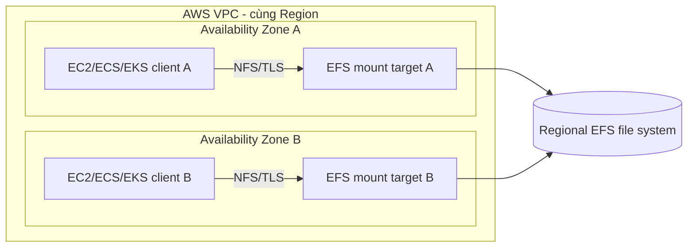
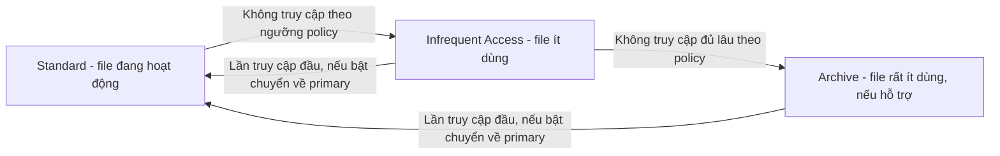
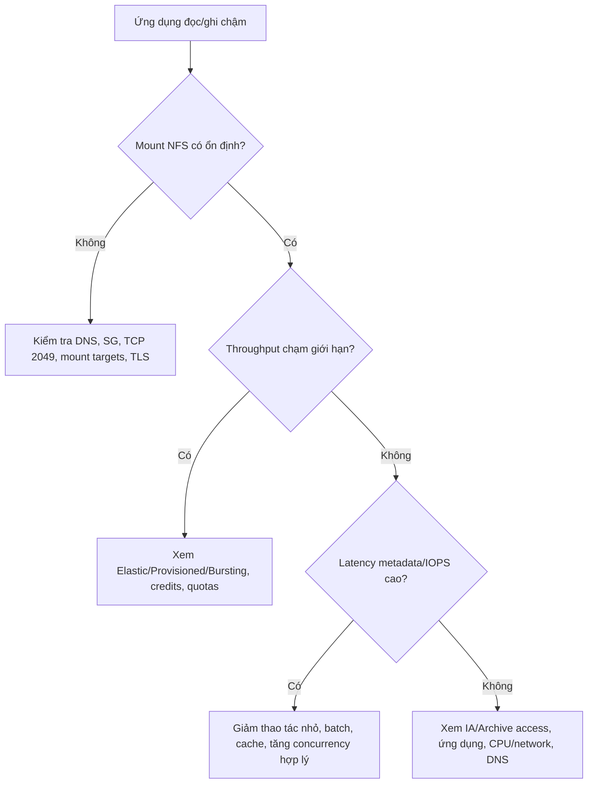

# EFS performance mode, throughput và lifecycle

## 1. Bài toán lưu trữ file trong hệ sinh thái AWS

Giả sử một công ty vận hành website và hệ thống xử lý tài liệu. Nhiều máy EC2, tác vụ Amazon ECS và ứng dụng trên Amazon EKS cần dùng chung thư mục `/uploads`; dữ liệu phải tồn tại kể cả khi một instance bị thay thế. Ban ngày hàng nghìn người dùng tải lên và đọc file; ban đêm lượng truy cập giảm; nhiều tài liệu cũ chỉ được mở lại sau vài tháng. Nếu cấu hình lưu trữ sai, ứng dụng có thể chậm do giới hạn I/O hoặc doanh nghiệp phải trả nhiều tiền để giữ các file ít dùng trong lớp lưu trữ đắt hơn cần thiết.

**Amazon Elastic File System (Amazon EFS)** là dịch vụ lưu trữ **file được quản lý**, cung cấp giao diện **NFS** cho các workload Linux tương thích. Nhiều client có thể mount cùng một file system và đọc/ghi theo quyền được cấu hình. Dung lượng dữ liệu tăng giảm theo lượng file lưu thực tế, giúp đội vận hành không phải đặt trước kích thước đĩa như nhiều mô hình block storage.

Trong chương **Lưu trữ block và file** của lộ trình **CLOUD_PROVIDERS_AWS**, lựa chọn EFS phải gắn với thiết kế Region/Availability Zone, VPC, IAM, compute, bảo mật, giám sát, phục hồi và kiểm soát chi phí. Bài này tập trung vào ba nhóm cấu hình dễ nhầm:

1. **Performance mode:** cách file system tối ưu hành vi thao tác file, nhất là độ trễ và khả năng mở rộng I/O.
2. **Throughput mode:** cơ chế cấp và tính toán khả năng truyền dữ liệu đọc/ghi theo thời gian.
3. **Lifecycle management:** quy tắc tự động chuyển file sang lớp lưu trữ thích hợp theo mức độ truy cập để tối ưu chi phí.

Sau bài học, bạn có thể giải thích các mode, chọn cấu hình cho workload thực tế, phân tích số liệu CloudWatch, viết lệnh AWS CLI đọc/cập nhật cấu hình, thiết kế lifecycle policy phù hợp và xử lý các vấn đề về hiệu năng, độ sẵn sàng, bảo mật và chi phí.

## 2. EFS trong kiến trúc lưu trữ AWS

EFS tạo một **file system** rồi cung cấp **mount targets** trên các subnet trong VPC để client truy cập qua NFS, thông thường bằng **TCP 2049**. Trên file system **Regional**, dữ liệu được lưu dự phòng trên nhiều Availability Zone (AZ) trong Region; client nên dùng mount target trong AZ của mình để tránh phụ thuộc đường mạng liên AZ khi không cần thiết. EFS cũng có tùy chọn **One Zone**, lưu trữ dữ liệu trong một AZ, với đánh đổi về khả năng chịu sự cố AZ và mức chi phí.



Những điều EFS **có thể** và **không tự làm**:

| Đặc điểm | Ý nghĩa thực tế |
| --- | --- |
| NFS, thư mục và quyền POSIX | Ứng dụng Linux truy cập file qua đường dẫn chung; phải quản lý UID/GID, quyền thư mục và ownership |
| Nhiều client đồng thời | Phù hợp file chia sẻ, content, home directory, ứng dụng container cần dữ liệu dùng chung |
| File system co giãn dung lượng | Không cần tự tăng dung lượng volume khi tổng kích thước file lớn lên |
| Regional hoặc One Zone | Chọn mức dự phòng và rủi ro gián đoạn AZ phù hợp yêu cầu RTO/RPO |
| Thông lượng và I/O có giới hạn dịch vụ | Không có nghĩa mỗi thao tác nhỏ hoặc mỗi client đạt băng thông vô hạn |
| Không phải block device | Không sử dụng thay cho EBS khi phần mềm bắt buộc có ổ đĩa block với đặc tính IOPS/latency chuyên biệt |

### 2.1. So sánh nhanh EFS, EBS và S3

| Dịch vụ | Kiểu giao diện | Nhu cầu chính |
| --- | --- | --- |
| **Amazon EFS** | File system NFS, nhiều client | Chia sẻ file giữa các workload Linux, tăng giảm dung lượng tự động |
| **Amazon EBS** | Block volume gắn với EC2 theo điều kiện loại volume/attachment | Ổ hệ điều hành, database hoặc ứng dụng cần block storage và profile IOPS cụ thể |
| **Amazon S3** | Object storage qua API | Object, dữ liệu tĩnh, backup, data lake; không phải NFS POSIX mặc định |

Đừng chọn EFS chỉ vì cần lưu file. Nếu ứng dụng chỉ gọi API đọc/ghi object mà không cần NFS hoặc ngữ nghĩa POSIX, S3 có thể phù hợp hơn. Nếu một cơ sở dữ liệu đòi hỏi block storage với đặc tính I/O cụ thể, nên đánh giá EBS hoặc dịch vụ cơ sở dữ liệu được quản lý.

## 3. Phân biệt performance mode, throughput mode và storage class

Ba khái niệm này là **các chiều cấu hình khác nhau**:

| Chiều cấu hình | Quyết định | Những lựa chọn/khái niệm thường gặp |
| --- | --- | --- |
| **Performance mode** | Tối ưu kiểu xử lý các thao tác file | General Purpose; Max I/O ở những file system/cấu hình cũ được hỗ trợ |
| **Throughput mode** | EFS cung cấp và tính toán băng thông như thế nào | Elastic, Provisioned, Bursting |
| **Storage class / lifecycle** | File được lưu ở lớp nào theo mức độ truy cập và nhu cầu sẵn sàng | Standard, Infrequent Access (IA), Archive; các biến thể One Zone được hỗ trợ |

Một file system có thể sử dụng **General Purpose + Elastic throughput + lifecycle chuyển file ít dùng sang IA/Archive**. Thay đổi lifecycle không làm đổi performance mode. Tương tự, chuyển từ Bursting sang Elastic throughput không biến file đang ở IA thành file Standard.

**Cần phân biệt thao tác có thể cập nhật:** throughput mode và lifecycle policy có thể được thay đổi theo điều kiện, giới hạn và thời gian áp dụng do AWS quy định; **performance mode được chọn khi tạo file system và không thể sửa trực tiếp về sau**. Nếu cần chuyển sang performance mode khác, giải pháp thông thường là tạo file system mới và di chuyển dữ liệu, cập nhật các client mount.

## 4. Performance mode: General Purpose và Max I/O

### 4.1. General Purpose

**General Purpose** hướng đến độ trễ thấp cho phần lớn workload file thường gặp, đặc biệt những ứng dụng tương tác có nhiều thao tác metadata, mở file, đọc/ghi file nhỏ hoặc người dùng chờ phản hồi trực tiếp. Đây là lựa chọn **mặc định và được khuyến nghị cho các triển khai EFS mới**.

Ví dụ phù hợp:

- Web application truy cập thư mục file upload dùng chung.
- Nhiều container dùng một cây thư mục cấu hình hoặc nội dung theo phiên bản.
- User home directories, môi trường phát triển, tác vụ xử lý tài liệu với độ trễ quan trọng.
- Các workload sử dụng EFS Elastic throughput cần mức hiệu năng thích hợp.

General Purpose vẫn có **giới hạn thao tác I/O và thông lượng** theo năng lực dịch vụ và phạm vi cấu hình. Độ trễ thực tế còn phụ thuộc mạng, kích thước file, nhiều thao tác metadata liên tiếp, số client, mức song song của ứng dụng và lớp lưu trữ của file.

### 4.2. Max I/O và lý do cần nhận biết

Một số tài liệu hoặc file system EFS **cũ** có thể xuất hiện **Max I/O performance mode**, được thiết kế để hỗ trợ số lượng thao tác đồng thời lớn hơn trong những tình huống phù hợp, nhưng đổi lại **độ trễ mỗi thao tác cao hơn General Purpose**. Khả năng tạo mới và kết hợp Max I/O với các lựa chọn throughput/storage hiện hành có giới hạn; cần đối chiếu tài liệu AWS trước khi lập kiến trúc mới. Không xem Max I/O là cách tăng tốc mặc định cho mọi workload.

| Tiêu chí | General Purpose | Max I/O ở hệ thống được hỗ trợ |
| --- | --- | --- |
| Hướng tối ưu | Độ trễ thao tác file thấp | Quy mô thao tác đồng thời cao hơn trong kịch bản phù hợp |
| Độ trễ | Thường phù hợp ứng dụng tương tác | Có thể cao hơn, bất lợi cho nhiều thao tác nhỏ nối tiếp |
| Khuyến nghị triển khai mới | **Ưu tiên** | Xem như cấu hình đặc thù/legacy, kiểm tra khả năng hỗ trợ |
| Thay đổi performance mode sau tạo | Không sửa trực tiếp | Không sửa trực tiếp |

Khi một ứng dụng chậm vì gọi hàng triệu thao tác `stat`, `open`, `close` tuần tự, tăng throughput hoặc đổi performance mode không bảo đảm chữa tận gốc. Có thể cần **cache metadata, giảm số file nhỏ, gom thao tác, tăng concurrency phù hợp hoặc thiết kế lại đường truy cập**.

## 5. Throughput mode: Elastic, Provisioned và Bursting

**Throughput** là lượng dữ liệu EFS phục vụ trong một đơn vị thời gian, thường biểu diễn bằng MiB/s hoặc GiB/s. Nó khác với **IOPS** (số thao tác I/O mỗi giây) và **latency** (thời gian hoàn tất một thao tác). Một ứng dụng có throughput cao vẫn có thể chậm nếu phải thực hiện nhiều thao tác metadata tuần tự.

### 5.1. Elastic throughput

Với **Elastic throughput**, EFS tự tăng giảm khả năng phục vụ theo mức đọc/ghi của workload trong giới hạn dịch vụ. Cơ chế này thường thích hợp khi tải **không dự đoán trước được**, có thời điểm đột biến hoặc khi dữ liệu lưu rất ít nhưng ứng dụng vẫn cần truyền nhiều dữ liệu. AWS khuyến nghị Elastic cho phần lớn workload EFS hiện đại trong phạm vi hỗ trợ.

Đặc điểm:

- Không cần tự đặt mức MiB/s cố định chỉ để đối phó giờ cao điểm ngắn.
- Phần chi phí throughput phụ thuộc **lượng I/O được tính theo chế độ Elastic**, bên cạnh chi phí lưu trữ; không thể kết luận chỉ nhìn dung lượng file.
- Không dùng bộ đếm **burst credits** theo cách của Bursting mode.
- Vẫn chịu hạn mức throughput/IOPS theo Region, cấu hình và khả năng dịch vụ; cần quan sát CloudWatch khi tải tăng.

**Phù hợp:** web upload/download có đỉnh theo chiến dịch, môi trường phát triển, job ETL thất thường, container ứng dụng mới chưa có mẫu tải ổn định.

### 5.2. Provisioned throughput

Với **Provisioned throughput**, bạn chỉ định một mức thông lượng được cấp phát, độc lập tương đối với lượng dữ liệu đang lưu. Lựa chọn này hữu ích nếu workload duy trì mức sử dụng **ổn định và có thể dự báo**, đặc biệt khi dung lượng EFS nhỏ nhưng nhu cầu truyền dữ liệu cao. AWS áp dụng các quy tắc và giới hạn cho thông lượng được cấu hình; phí phụ thuộc mức provisioned theo cơ chế tính giá hiện hành.

Ví dụ: một hệ thống luôn đọc file theo lô ở mức cao nhiều giờ mỗi ngày; thay vì trả theo lượng I/O Elastic, nhóm có thể đo tải và so sánh kinh tế với cấu hình Provisioned phù hợp. Không nên tự kết luận Provisioned luôn rẻ hơn, vì còn phụ thuộc **tỷ lệ đọc/ghi, dữ liệu đang lưu, mức công suất cài đặt và giá ở Region**.

**Cảnh báo:** việc đặt thông lượng cấp phát cao không biến EFS thành hệ thống đáp ứng mọi yêu cầu IOPS/latency. Ứng dụng vẫn cần đủ số luồng, client NFS hiệu quả và đường mạng đạt tốc độ tương ứng.

### 5.3. Bursting throughput

**Bursting throughput** dựa vào dung lượng dữ liệu trong lớp lưu trữ đủ điều kiện để tính **baseline throughput** và tích lũy **burst credits** khi dùng dưới mức quy định. Khi cần truyền nhanh hơn baseline, file system sử dụng credits để burst. Với file system nhỏ và tác vụ I/O kéo dài, credits có thể giảm về mức thấp, khiến throughput bị giới hạn quanh baseline sau khi hết khả năng burst.

Ví dụ: một file system ít dữ liệu nhưng chạy tác vụ quét/đọc toàn bộ liên tục có thể không có mức throughput bền vững như nhóm phát triển dự kiến. Chuyển sang Elastic hoặc Provisioned có thể là một phương án **sau khi đo** mức sử dụng và chi phí.

Không nên thiết kế dựa trên một bảng số liệu throughput/credits cố định cho mọi thời điểm: công thức, ngưỡng, mức tối thiểu và khả năng hỗ trợ thay đổi theo dịch vụ/cấu hình. Hãy kiểm tra tài liệu EFS và các metrics thực tế của file system trước khi chọn.

### 5.4. Bảng quyết định throughput mode

| Workload | Elastic | Provisioned | Bursting |
| --- | --- | --- | --- |
| Đọc/ghi thất thường, nhiều đỉnh ngắn | **Thường ưu tiên** | Có thể đặt dư, tốn phí khi nhàn rỗi | Có thể hết credits nếu đỉnh kéo dài |
| Thông lượng cao và ổn định, biết trước | Cần so tổng I/O được tính phí | **Đáng đánh giá** theo mức duy trì | Có thể thiếu throughput bền vững |
| File system nhỏ nhưng I/O thường xuyên cao | **Phù hợp để thử trước** | Phù hợp nếu tải ổn định | Dễ bị ảnh hưởng bởi baseline nhỏ |
| Kho lưu tài liệu ít truy cập | Có thể phù hợp, kiểm tra chi phí | Có thể không kinh tế nếu provision dư | Có thể phù hợp với tải nhẹ nếu mode được hỗ trợ |

**Quy trình quyết định:** bắt đầu bằng workload/SLO → đo throughput, loại I/O và peaks → xem mode được hỗ trợ → đối chiếu chi phí theo Region → thử nghiệm và so sánh. Khi không có số liệu lịch sử, Elastic là điểm xuất phát thực tiễn cho nhiều hệ thống mới.

## 6. Đọc metrics để hiểu nghẽn hiệu năng

EFS throughput không chỉ phụ thuộc một số MiB/s duy nhất. Hai ứng dụng đọc cùng lượng dữ liệu có thể có hiệu năng rất khác nhau:

```text
Ứng dụng A: 1.000 file x 10 MiB  -> ít open/close hơn, đọc khối lớn
Ứng dụng B: 1.000.000 file x 10 KiB -> nhiều open/stat/close, metadata nhiều
```

Tổng dữ liệu gần nhau, nhưng ứng dụng B có thể tốn đáng kể thời gian cho thao tác metadata, network round-trip và sự đồng bộ giữa nhiều client. Vì vậy cần đo **latency, IOPS, kích thước I/O, số file và concurrency** cùng với throughput.

### 6.1. Những CloudWatch metrics đáng quan sát

| Metric / tín hiệu | Ý nghĩa | Cách sử dụng |
| --- | --- | --- |
| `MeteredIOBytes` | Lượng I/O được EFS đo cho cơ chế throughput/tính phí tương ứng | Phân tích mẫu đọc/ghi và tải theo thời gian |
| `TotalIOBytes` | Dung lượng I/O hoạt động được báo cáo | So với `MeteredIOBytes`, xem xu hướng đọc/ghi |
| `PermittedThroughput` | Mức throughput được phép tại thời điểm đo theo cấu hình | So với I/O thực tế để tìm giới hạn |
| `BurstCreditBalance` | Số burst credits còn lại ở **Bursting** | Cảnh báo khi credits cạn dần; không dùng như chỉ báo bắt buộc cho Elastic |
| `PercentIOLimit` | Mức sử dụng so với giới hạn I/O của General Purpose ở phạm vi metric được hỗ trợ | Phát hiện nghẽn do giới hạn thao tác file |
| `ClientConnections` | Số kết nối client tới EFS | Tìm thay đổi bất thường về số kết nối |
| `StorageBytes` | Dung lượng lưu theo các phân loại được AWS báo cáo | Theo dõi mức dữ liệu Standard/IA/Archive và tác động lifecycle |

Các metric, thống kê (Average, Sum, Minimum, Maximum), đơn vị và phân loại chiều dữ liệu khác nhau. Không lấy giá trị **Average** của một metric trong 5 phút rồi kết luận hệ thống chưa từng chạm giới hạn trong 1 giây. Với throughput/I/O, hãy chọn thống kê và khung thời gian phù hợp với tài liệu metric để đọc đúng.

### 6.2. Read metering và write metering

Một số cơ chế tính throughput của EFS dùng **metered throughput** thay vì đơn thuần tổng byte vật lý. AWS áp dụng hệ số tính khác nhau cho thao tác đọc so với ghi trong các chế độ liên quan; đọc có thể được tính nhẹ hơn ghi theo quy tắc hiện hành. Vì vậy một workload **đọc nhiều** và một workload **ghi nhiều** có cùng tổng GiB truyền thực tế chưa chắc sử dụng cùng mức throughput được tính phí.

Khi so Elastic với Provisioned hoặc Bursting, hãy kiểm tra giá trị `MeteredIOBytes` và tài liệu tính throughput ở **Region/mode thực tế**, đồng thời theo dõi I/O qua từng workload. Tránh tính toán chi phí chỉ bằng kích thước thư mục hoặc tốc độ mạng mà client nhìn thấy.

## 7. Storage classes: Standard, Infrequent Access và Archive

**Lifecycle management** của EFS giúp chuyển các file ít truy cập sang lớp lưu trữ chi phí dung lượng thấp hơn, đổi lại có thể phát sinh **phí truy cập dữ liệu**, thay đổi độ trễ và một số điều kiện tính phí theo lớp.

| Lớp/nhóm lớp | Trường hợp dùng | Lưu ý |
| --- | --- | --- |
| **EFS Standard** | File thường xuyên được đọc/ghi | Hiệu năng truy cập thường phù hợp workload hoạt động |
| **EFS Infrequent Access (IA)** | File ít truy cập nhưng vẫn cần mở theo giao diện file | Chi phí lưu trữ thấp hơn; truy cập có phí/đặc tính latency theo quy định |
| **EFS Archive** | File rất ít truy cập trong những file system đủ điều kiện | Giá lưu trữ thấp hơn nhưng cần tính phí truy cập, đặc tính hiệu năng và điều kiện lưu tối thiểu |
| **EFS One Zone / One Zone-IA** | Dữ liệu lưu trong một AZ, có thể chấp nhận rủi ro mất AZ | Khả năng sẵn sàng thấp hơn Regional; kiểm tra lớp/lifecycle được hỗ trợ |

Với **Regional EFS**, có thể sử dụng các lớp phù hợp như Standard, IA và Archive theo tính năng được AWS hỗ trợ. Với **One Zone**, tập lớp lưu trữ và chính sách lifecycle không giống Regional; **không giả định Archive sẵn có cho mọi kiểu file system**.

### 7.1. Lưu trữ ít truy cập không phải lưu trữ offline

File chuyển vào EFS IA hoặc Archive vẫn được truy cập qua **đường dẫn NFS quen thuộc** khi điều kiện truy cập cho phép. Ứng dụng không cần thực hiện quy trình restore kiểu một số lớp **Amazon S3 Glacier** trước khi mở file. Tuy nhiên, phí truy cập và độ trễ lần đầu có thể khác Standard, ảnh hưởng ứng dụng yêu cầu phản hồi tức thời.

EFS lifecycle xử lý ở cấp **file**, không phải toàn bộ file system. Các file đang dùng thường xuyên có thể ở Standard, trong khi file ít dùng được chuyển sang IA/Archive. Không cần tách mount path chỉ vì file chuyển lớp, nhưng cần biết ứng dụng nào có thể bất ngờ đọc lại lượng lớn file cũ.

### 7.2. Các yếu tố ảnh hưởng hiệu quả chi phí

- **Tỷ lệ file ít dùng:** file ít đọc/ghi lâu ngày có thể tiết kiệm dung lượng khi chuyển lớp.
- **Tần suất mở lại:** nhiều lượt đọc file IA/Archive có thể làm tăng phí truy cập và giảm hiệu quả tiết kiệm.
- **File nhỏ hoặc dữ liệu lưu rất ngắn:** có thể chịu quy tắc tính dung lượng tối thiểu hoặc thời hạn tính phí tối thiểu tùy lớp; cần kiểm tra bảng giá hiện hành.
- **Thói quen truy cập của ứng dụng:** crawler, antivirus, backup hoặc job lập chỉ mục mở lại toàn bộ file cũ có thể làm tăng lượng dữ liệu được truy cập.
- **Tỷ lệ throughput đọc/ghi:** phí throughput và access charge có thể cùng tác động đến tổng chi phí.

Do đó, chính sách chuyển lớp lưu trữ tốt phải dựa trên **mẫu truy cập thật**, không chỉ giả định “file quá 30 ngày là không cần dùng nữa”.

## 8. EFS Lifecycle Management hoạt động thế nào?

EFS Lifecycle Management cho phép thiết lập khoảng thời gian **không truy cập** trước khi dịch chuyển file vào các lớp lưu trữ được hỗ trợ. AWS theo dõi hoạt động truy cập phục vụ lifecycle bằng cơ chế riêng; không nên tự suy trạng thái chuyển lớp hoàn toàn từ thuộc tính POSIX `atime` hiển thị bởi ứng dụng.

### 8.1. Những hướng chuyển lớp chính



Có thể cấu hình chính sách chuyển file sang **IA**, chuyển tiếp sang **Archive** với kiểu file system được hỗ trợ, và quy tắc **Transition to primary storage class** để đưa file trở về Standard sau khi file được truy cập lại. Cụ thể giá trị thời gian, tổ hợp lựa chọn và điều kiện dịch chuyển do AWS EFS API quy định; không phải mọi cấu hình đều hợp lệ cho mọi file system.

**Lưu ý quan trọng:** quy tắc quay về Standard sau lần truy cập đầu tiên là **tùy chọn**. Nếu bật nó, các ứng dụng quét file cũ có thể khiến lượng dữ liệu Standard tăng và chi phí thay đổi. Việc chuyển lớp do dịch vụ thực hiện, không phải một lời hứa rằng file được chuyển tức thì ngay khi hết ngưỡng hay ngay tại thời điểm `open()`.

### 8.2. Ví dụ lifecycle policy qua AWS CLI

Giả sử một **Regional EFS** có nhóm file ít dùng, bạn muốn chuyển sang IA sau 30 ngày không truy cập, và Archive sau 90 ngày không truy cập; khi file được mở lại, AWS có thể đưa nó về Standard theo chính sách quay lại lớp chính. Cấu hình ví dụ:

```json
[
  { "TransitionToIA": "AFTER_30_DAYS" },
  { "TransitionToArchive": "AFTER_90_DAYS" },
  { "TransitionToPrimaryStorageClass": "AFTER_1_ACCESS" }
]
```

Nếu lưu JSON này trong `efs-lifecycle-policy.json`, lệnh AWS CLI tương ứng:

```bash
aws efs put-lifecycle-configuration \
  --file-system-id fs-0123456789abcdef0 \
  --lifecycle-policies file://efs-lifecycle-policy.json \
  --region ap-southeast-1
```

Đây là lệnh **ghi cấu hình thật** khi được thực thi, nên chỉ sử dụng sau khi kiểm tra file system ID, loại file system, quyền IAM, khả năng hỗ trợ Archive và yêu cầu dữ liệu. `fs-0123456789abcdef0` là ID minh họa. Không sao chép lệnh vào production mà chưa phân tích chi phí truy cập và khả năng thay đổi lớp cho file đang sử dụng.

**Nếu lưu file JSON từ đoạn ví dụ:** giá trị `LifecyclePolicies` là **mảng** chính sách, đúng với tham số `--lifecycle-policies`. Không nhầm nó với tài liệu IAM policy có các trường `Version`/`Statement`; EFS lifecycle không dùng cấu trúc IAM JSON.

### 8.3. Những câu hỏi cần trả lời trước khi bật lifecycle

1. Ứng dụng nào đọc file cũ? Có batch job đọc lại cả thư mục mỗi ngày không?
2. File nào chỉ là bản tạm và có thể xóa theo retention, thay vì chuyển lớp?
3. Có phần mềm yêu cầu thời gian truy cập lần đầu rất thấp không? Những file đó nên tiếp tục ở Standard.
4. Có cần chuyển về Standard sau một lần truy cập hay giữ ở lớp tiết kiệm để hạn chế chi phí lưu trữ?
5. Dữ liệu có nghĩa vụ **retention, compliance hoặc backup** nào không? Lifecycle tối ưu lớp lưu trữ, **không thay thế chính sách backup hay xóa dữ liệu**.
6. Workload có chấp nhận được phí truy cập và thời hạn tính phí tối thiểu của IA/Archive không?

**Lifecycle policy áp dụng ở phạm vi file system** chứ không cung cấp một bộ quy tắc độc lập cho từng thư mục tùy ý. Nếu ứng dụng `hot` và `cold` yêu cầu các quy tắc trái ngược nhau, cân nhắc tách file systems hoặc tổ chức dữ liệu theo thiết kế khác để quản trị tốt hơn.

## 9. Thao tác AWS CLI: xem cấu hình, thay throughput, kiểm tra lifecycle

Đầu tiên, xác minh đúng tài khoản/Region. Các lệnh **đọc** sau hữu ích khi kiểm tra file system hiện hữu:

```bash
# Xác nhận IAM role/account đang được sử dụng
aws sts get-caller-identity

# Xem performance mode, throughput mode và trạng thái file system
aws efs describe-file-systems \
  --file-system-id fs-0123456789abcdef0 \
  --query 'FileSystems[0].[FileSystemId,PerformanceMode,ThroughputMode,ProvisionedThroughputInMibps,Encrypted,LifeCycleState]' \
  --region ap-southeast-1

# Xem lifecycle rules có hiệu lực trên file system
aws efs describe-lifecycle-configuration \
  --file-system-id fs-0123456789abcdef0 \
  --region ap-southeast-1
```

Nếu file system đang dùng mode cũ và bạn đã đo tải, phê duyệt thay đổi, có thể dùng lệnh **ghi** để chuyển sang Elastic throughput khi được AWS hỗ trợ:

```bash
aws efs update-file-system \
  --file-system-id fs-0123456789abcdef0 \
  --throughput-mode elastic \
  --region ap-southeast-1
```

Để đặt Provisioned throughput, cú pháp minh họa:

```bash
aws efs update-file-system \
  --file-system-id fs-0123456789abcdef0 \
  --throughput-mode provisioned \
  --provisioned-throughput-in-mibps 64 \
  --region ap-southeast-1
```

Giá trị `64` chỉ minh họa số MiB/s; không phải khuyến nghị mặc định. **AWS hạn chế tần suất hoặc điều kiện thay đổi throughput mode / mức Provisioned throughput**, vì vậy không nên thiết kế hệ thống chuyển mode liên tục theo từng phút. Kiểm tra quota, thông báo lỗi và thời điểm chế độ mới có hiệu lực trước khi thử tải.

Đổi **throughput mode** không tương đương đổi **performance mode**. Bạn sẽ không tìm thấy thao tác cập nhật trực tiếp từ General Purpose sang Max I/O cho file system hiện có. Nếu thay performance mode là yêu cầu bắt buộc, phải lên kế hoạch tạo file system mới, sao chép dữ liệu, xác minh quyền POSIX, chuyển mount và khôi phục nếu phát sinh lỗi.

## 10. Ví dụ thiết kế: một kho file chung cho ứng dụng nhiều AZ

Giả sử công ty có 6 EC2 instances ở 2 AZ, chạy API tạo hợp đồng và lưu chứng từ lên EFS. Dữ liệu đang hoạt động khoảng 300 GiB, mỗi ngày tạo thêm file; các hợp đồng cũ hiếm khi được xem lại sau 60 ngày. Có đợt cao điểm vào cuối tháng khiến throughput tăng mạnh, nhưng không ổn định theo giờ.

**Thiết kế đề xuất:**

1. Chọn **Regional EFS** để file được thiết kế có dự phòng nhiều AZ, thay vì đặt toàn bộ dữ liệu vào một AZ nếu ứng dụng đòi hỏi duy trì phục vụ khi AZ gặp sự cố.
2. Dùng **General Purpose** vì API có thao tác file tương tác và metadata; cân nhắc **Elastic throughput** trước do tải thay đổi mạnh theo tháng.
3. Tạo **mount targets** trong các AZ nơi client chạy; cấu hình security group cho NFS TCP 2049 chỉ từ các nhóm máy/ứng dụng được phép.
4. Dùng **EFS mount helper qua TLS**, có thể dùng EFS Access Point để chuẩn hóa đường dẫn gốc, UID/GID và giới hạn quyền theo ứng dụng.
5. Giám sát `MeteredIOBytes`, `PermittedThroughput`, số thao tác, latency ứng dụng và dung lượng từng storage class.
6. Kiểm chứng dữ liệu có ít được truy cập thật sau 60 ngày hay không; thử lifecycle sang IA/Archive trong môi trường đại diện, đánh giá chi phí truy cập và tốc độ đọc lần đầu trước khi áp dụng toàn bộ.
7. Thiết lập **AWS Backup** hoặc phương án backup/khôi phục được phê duyệt, đo thời gian khôi phục; lifecycle không bảo vệ khỏi xóa nhầm hoặc mã độc thay đổi file.

```text
                 Application Load Balancer
                        /       \
                 EC2 in AZ A   EC2 in AZ B
                     |             |
                EFS mount A   EFS mount B
                     \             /
                       Regional EFS
                       | Standard: hot files
                       | IA: infrequently used files
                       | Archive: cold files, if supported
```

**Đo thực tế mới quyết định mode:** nếu mỗi request ứng dụng thực hiện hàng trăm thao tác `stat` tuần tự trên file nhỏ, bottleneck có thể là metadata latency. Elastic throughput không xóa được độ trễ cơ bản của từng NFS operation; cần tối ưu ứng dụng và mạng nữa.

## 11. Mount và bảo mật dữ liệu EFS

### 11.1. Mount target, DNS, security group

Để mount file system EFS từ EC2 trong VPC, client cần định tuyến/DNS đúng tới mount target và **security group của mount target** cho phép **TCP 2049** từ security group hoặc nguồn IP được phê duyệt. Route table/NACL và các kết nối qua VPC peering/Transit Gateway (nếu dùng) cũng phải hỗ trợ đường đi phù hợp. Một mount target không tự cấp quyền ứng dụng thao tác trên file.

Ví dụ trên Linux đã cài **amazon-efs-utils** và có mount target/DNS phù hợp:

```bash
sudo mkdir -p /mnt/shared
sudo mount -t efs -o tls fs-0123456789abcdef0:/ /mnt/shared
```

Lệnh dùng `tls` để mã hóa dữ liệu **trên đường truyền** theo khả năng của EFS mount helper. Cần xác nhận phiên bản mount helper và khả năng tương thích hệ điều hành trước khi triển khai. Khi muốn quản lý tự động sau reboot, có thể cấu hình mount qua `/etc/fstab` hoặc công cụ điều phối theo hướng dẫn AWS.

### 11.2. IAM, Access Point, POSIX và mã hóa

EFS hỗ trợ các lớp kiểm soát khác nhau:

- **POSIX permissions:** file ownership, UID/GID, mode bits xác định thao tác `read`, `write`, `execute` của tiến trình trong file system.
- **IAM authorization và file system policy:** quản lý những principal được phép `ClientMount`, `ClientWrite`, `ClientRootAccess` theo cấu hình EFS; để dùng IAM trên mount, cần cấu hình mount option thích hợp và quyền liên quan.
- **EFS Access Points:** cung cấp điểm vào theo ứng dụng với root directory và danh tính POSIX có thể được áp đặt, hữu ích khi nhiều workload chia sẻ cùng file system.
- **Encryption at rest:** sử dụng KMS theo cấu hình file system; với in-transit, dùng TLS tại mount. Cần quản lý quyền KMS, chính sách khóa và quy trình xoay/thu hồi phù hợp.
- **Network isolation:** security groups/NACL và phạm vi VPC/endpoint phù hợp, tránh mở TCP 2049 cho mọi nguồn không cần thiết.

**Hiểu đúng:** bật TLS và KMS **không tự cấp quyền file**. Một ứng dụng có thể mount được nhưng vẫn nhận `Permission denied` khi POSIX owner/group không cho phép; ngược lại, mở quyền POSIX quá rộng không thể thay thế policy IAM, mạng và phân tách workload.

### 11.3. Độ sẵn sàng và backup

EFS Regional giúp giảm phụ thuộc vào một AZ của lớp lưu trữ, nhưng ứng dụng vẫn cần được triển khai trên nhiều AZ, có mount targets, health checks và định tuyến phù hợp. EFS One Zone có mức rủi ro khác khi toàn bộ AZ gặp sự cố; chọn nó cho dữ liệu có thể khôi phục hoặc chấp nhận RPO/RTO tương ứng.

**Lifecycle management không phải backup.** File bị xóa, bị ghi đè hoặc bị mã độc mã hóa không được khôi phục chỉ nhờ chuyển IA/Archive. Dùng AWS Backup, quy trình snapshot/khôi phục được hỗ trợ hoặc công cụ backup phù hợp để đáp ứng yêu cầu lưu giữ và thử khôi phục định kỳ.

## 12. Tính chi phí: lưu trữ và truy cập cùng quyết định

Tổng chi phí EFS cần xem ít nhất ba nhóm: **GB-tháng theo storage class**, **I/O hoặc throughput charge theo mode**, và **phí truy cập các lớp IA/Archive**, cộng các chi phí liên quan như backup, CloudWatch, truyền dữ liệu liên AZ và mạng tùy kiến trúc.

Một công thức tư duy:

\[
\text{Monthly EFS Cost} \approx
\sum_{c\in\{\text{Standard, IA, Archive}\}}
(\text{GB-month}_c\times\text{Storage Rate}_c)
+\text{Throughput Charges}
+\text{Class Access Charges}
+\text{Related Charges}
\]

Không áp dụng giá cố định trong ví dụ, vì đơn giá thay đổi theo **Region, loại file system, storage class, throughput mode, loại yêu cầu** và thời gian. Hãy lấy giá thực tế từ **AWS Pricing**, Cost Explorer/Billing hoặc AWS Pricing Calculator tại lúc thiết kế.

### 12.1. Bài toán định tính: Standard so với IA/Archive

Giả sử file system giữ **1 TiB dữ liệu**: 200 GiB được truy cập hằng ngày, còn lại chủ yếu là tài liệu lưu trữ. Nếu giữ toàn bộ tại Standard, doanh nghiệp trả chi phí Standard cho tất cả dữ liệu. Nếu lifecycle chuyển phần ít dùng sang IA/Archive, chi phí **lưu trữ** có thể giảm, nhưng những lần ứng dụng đọc lại hoặc viết vào các lớp tiết kiệm có thể phát sinh **phí truy cập**, và nếu bật chuyển về Standard thì dung lượng Standard lại tăng.

| Mẫu truy cập | Quyết định cần đánh giá |
| --- | --- |
| 200 GiB file nóng, nhiều người đọc/ghi mỗi ngày | Giữ ở Standard; tối ưu throughput/IOPS theo tải |
| File không được mở nhiều tháng | Cân nhắc IA/Archive dựa trên ngưỡng lifecycle được hỗ trợ |
| Job quét lại mọi file hàng đêm | Có thể làm giảm đáng kể lợi ích của IA/Archive; tối ưu job hoặc điều chỉnh policy |
| File xóa sau một tuần | Retention/xóa đúng hạn có thể tốt hơn chuyển lớp rồi chịu phí tối thiểu |

Một kết luận quan trọng: **storage class rẻ hơn trên mỗi GB không đồng nghĩa tổng hóa đơn rẻ hơn**, nhất là với file nhỏ, nhiều truy cập ngẫu nhiên hoặc khi có yêu cầu latency chặt.

### 12.2. Theo dõi chi phí theo tháng

Khi thay cấu hình, giữ một khoảng đo trước/sau với các chỉ số:

1. Tổng `StorageBytes` theo Standard/IA/Archive và xu hướng tăng trưởng.
2. `MeteredIOBytes` theo thời gian và tỷ lệ read/write khi có số liệu phù hợp.
3. Phí EFS storage, throughput và access theo Cost Explorer/Billing.
4. P50/P95/P99 latency tại ứng dụng, số timeout và SLO bị vi phạm.
5. Chi phí backup, dữ liệu truyền và xử lý lại công việc do performance issue.

Nếu chỉ so “EFS tháng này rẻ hơn tháng trước” mà không ghi nhận tải ứng dụng, bạn có thể nhầm hiệu quả lifecycle với việc traffic đã giảm vì ít người dùng.

## 13. Chẩn đoán lỗi hiệu năng và lifecycle

| Triệu chứng | Nghi vấn chính | Cách kiểm tra |
| --- | --- | --- |
| Lúc đầu nhanh, sau nhiều giờ chậm | Bursting credits giảm; hoặc tải vượt mode hiện tại | `BurstCreditBalance`, `PermittedThroughput`, `MeteredIOBytes`, biểu đồ peak |
| Nhiều file nhỏ chậm dù throughput thấp | Metadata IOPS/latency, thao tác tuần tự, mạng | Đo `open/stat`, concurrency, p95 latency, `PercentIOLimit` khi có |
| Không mount được EFS | Mount target/DNS, SG TCP 2049, NACL, TLS/mount helper | Kiểm tra AZ, DNS, network path, thông báo client |
| Mount được nhưng ghi file báo `Permission denied` | POSIX UID/GID, Access Point, IAM file system policy | Kiểm tra owner/mode và quyền `ClientWrite` theo cấu hình |
| Đã bật IA nhưng chi phí vẫn cao | File còn truy cập nhiều, file nhỏ/giá trị lưu tối thiểu, phí access | `StorageBytes`, Cost Explorer, kiểm tra job đọc quét |
| File cũ bị chậm khi truy cập lần đầu | File đang ở IA/Archive; latency và access behavior khác Standard | Đối chiếu lifecycle, storage class và ứng dụng đọc file |
| Vừa nâng Provisioned throughput nhưng ứng dụng không nhanh hơn | Giới hạn IOPS/latency, single-thread, client network hoặc CPU | Đo throughput thực, request concurrency và metrics EFS |
| Thay throughput mode bị từ chối | Quota, giới hạn số lần đổi mode, cấu hình không được hỗ trợ | Đọc AWS API error, xem mode/performance hiện tại |
| Nhiều AZ nhưng client đọc/ghi chậm thất thường | Client dùng mount target AZ khác, mạng hoặc DNS sai | Kiểm tra mount target, kết nối liên AZ và chỉ số ứng dụng |

### 13.1. Quy trình chẩn đoán theo tầng



Đừng vội tăng throughput mode để khắc phục mọi lỗi: điều đó có thể tăng chi phí nhưng không giải quyết nghẽn DNS, sai quyền POSIX hoặc hàng triệu thao tác metadata tuần tự.

## 14. Quy trình chọn cấu hình EFS cho production

### Bước 1 — Xác định yêu cầu

Ghi rõ workload dùng EC2/ECS/EKS/Lambda hay server trong VPC, số client đồng thời, Region/AZ, dữ liệu tăng trưởng, latency mục tiêu, khối lượng I/O, kích thước file, tần suất truy cập lại, backup và ngân sách.

### Bước 2 — Chọn loại file system và performance mode

Với ứng dụng cần HA nhiều AZ, ưu tiên xem xét **Regional EFS**. Với dữ liệu có thể tái tạo hoặc yêu cầu kinh tế phù hợp, đánh giá **One Zone** cùng rủi ro AZ. Đối với triển khai mới, **General Purpose** là điểm xuất phát hợp lý; không chọn Max I/O chỉ vì thấy chữ “Max”.

### Bước 3 — Chọn throughput mode

Nếu tải chưa có quy luật hoặc tăng giảm thất thường, thử **Elastic**. Nếu thông lượng cao và ổn định, so chi phí **Provisioned**. Nếu workload nhẹ và cân nhắc Bursting, xác định baseline/credits và kiểm tra nguy cơ giảm hiệu năng khi tác vụ kéo dài.

### Bước 4 — Thiết kế lifecycle theo truy cập thực

Đánh giá Standard/IA/Archive phù hợp, chọn ngưỡng không truy cập và quy tắc quay lại Standard. Thử trên dữ liệu đại diện và quan sát hóa đơn/access cost; không dùng lifecycle để thay retention, xóa dữ liệu hay backup.

### Bước 5 — Bảo vệ và triển khai truy cập

Tạo mount target tại các AZ có client, giới hạn NFS 2049, dùng TLS, IAM/Access Points/POSIX hợp lý, mã hóa dữ liệu at rest và tổ chức kiểm toán/backup.

### Bước 6 — Kiểm thử và đo sau triển khai

Chạy thử nghiệm đọc/ghi với tập file và mức concurrency gần production, đo throughput, IOPS, latency, lỗi mount và trạng thái chuyển lớp lưu trữ. Đặt cảnh báo khi metrics sát giới hạn hoặc lỗi ứng dụng tăng; triển khai phương án hoàn tác trước khi thay chính sách trên dữ liệu đang chạy.

## 15. Tình huống áp dụng

### Tình huống A — File system nhỏ nhưng job đọc rất lớn

Nhóm phân tích có EFS dung lượng ít nhưng mỗi đêm đọc nhiều GiB dữ liệu trong thời gian ngắn. Đang dùng Bursting và có những ngày task chạy chậm kéo dài. **Hướng xử lý:** đo `BurstCreditBalance`, `MeteredIOBytes`, peak I/O, kích thước file và mức song song; xem Elastic có phù hợp đột biến hơn không. Đánh giá chi phí và phương án đặt dữ liệu ở S3 nếu tác vụ thực tế không cần NFS.

### Tình huống B — Kho tài liệu đã lưu nhiều năm

Tổ chức lưu hàng triệu tài liệu cũ, phần lớn ít được đọc nhưng cần truy xuất qua file path khi có kiểm toán. **Hướng xử lý:** dùng lifecycle đưa file ít truy cập vào IA/Archive nếu file system hỗ trợ; kiểm tra phí đọc lại, độ trễ và thời hạn lưu tối thiểu. Nếu job lập chỉ mục đọc toàn bộ kho mỗi đêm, tối ưu lịch/quy trình đọc để tránh mất lợi ích tiết kiệm. Vẫn phải có backup và chính sách bảo toàn dữ liệu riêng.

### Tình huống C — Kubernetes application bị `Permission denied`

Pod EKS mount cùng EFS với ứng dụng khác; một pod đọc được nhưng không tạo file trong `/uploads`. **Hướng xử lý:** kiểm tra EFS Access Point, UID/GID và POSIX permissions, IAM file system policy nếu dùng IAM authorization. Việc chuyển từ Provisioned sang Elastic throughput sẽ không cấp thêm quyền ghi cho pod.

### Tình huống D — EFS Regional có ứng dụng chạy ở hai AZ

Hai nhóm EC2 ở AZ A/B cùng cần thư mục chia sẻ. **Hướng xử lý:** tạo mount targets tương ứng, kiểm tra client kết nối đúng mạng/AZ, cấu hình SG 2049 và dùng file system Regional để giảm rủi ro mất dữ liệu do sự cố một AZ. Ứng dụng vẫn cần Auto Scaling/health checks và quy trình recovery; EFS không thay thế HA ở tầng compute.

## 16. Câu hỏi tự kiểm tra

**Câu 1.** Chuyển EFS từ General Purpose sang Max I/O bằng `update-file-system` có phải cách tăng throughput nhanh khi ứng dụng chậm không?

**Gợi ý:** Không. Performance mode được chọn lúc tạo và không đổi trực tiếp. Hơn nữa Max I/O có thể làm tăng latency và có những giới hạn hỗ trợ. Cần tìm nghẽn thật và cân nhắc tạo/migrate file system nếu thật sự cần.

**Câu 2.** Một file system nhỏ nhưng traffic lên xuống mạnh giữa các ngày nên cân nhắc Elastic, Provisioned hay Bursting trước?

**Gợi ý:** Elastic là lựa chọn đáng thử vì tự co giãn theo I/O; sau đó đo chi phí/giới hạn. Bursting có thể phụ thuộc credits và Provisioned có thể kém kinh tế khi phải giữ mức cao suốt thời gian nhàn rỗi.

**Câu 3.** EFS chuyển file sang Archive thì có phải tải bản restore riêng trước khi ứng dụng dùng NFS được không?

**Gợi ý:** Không cần quy trình restore kiểu S3 Glacier cho file EFS; file vẫn ở cùng namespace NFS. Nhưng phí truy cập, latency và chính sách quay lại Standard cần được tính đến.

**Câu 4.** Vì sao throughput của EFS lớn nhưng ứng dụng mở một triệu file nhỏ vẫn chậm?

**Gợi ý:** Số thao tác metadata và các NFS round trips/latency có thể là nút thắt; thông lượng dữ liệu cao không tự làm mỗi `stat/open` nhanh hơn.

**Câu 5.** Bật lifecycle chuyển sang IA có thay thế backup không?

**Gợi ý:** Không. Lifecycle chỉ tối ưu nơi lưu file theo mẫu truy cập, không cung cấp bản sao để khôi phục file bị xóa/ghi đè. Cần backup/restore riêng.

**Câu 6.** Một container mount EFS thành công nhưng không tạo được file; có nên tăng Provisioned throughput không?

**Gợi ý:** Không. Kiểm tra POSIX UID/GID, IAM authorization, EFS Access Point và quyền thư mục, vì đây là vấn đề authorization thay vì hiệu năng.

## 17. Ghi nhớ

**Performance mode** quyết định cách EFS tối ưu hành vi I/O: **General Purpose** thích hợp cho đa số ứng dụng mới, còn Max I/O chủ yếu cần nhận biết ở những môi trường cũ/đặc thù. **Throughput mode** giải quyết lượng dữ liệu đọc/ghi theo thời gian: **Elastic** linh hoạt theo tải, **Provisioned** dành cho mức băng thông đã biết, **Bursting** liên quan baseline và burst credits. **Lifecycle management** tự động phân lớp file ít truy cập sang **IA/Archive** trong các cấu hình được hỗ trợ nhằm tiết kiệm chi phí lưu trữ, nhưng có thể tác động đến phí truy cập và độ trễ.

Muốn vận hành EFS hiệu quả, cần kết hợp **kiểm chứng workload thực, mount targets trong VPC/AZ, quyền POSIX/IAM, mã hóa, CloudWatch, backup và Cost Explorer**. Quyết định tốt nhất là quyết định bảo đảm ứng dụng đạt SLO, phục hồi được khi có sự cố và có **tổng chi phí sử dụng dữ liệu** hợp lý, thay vì chỉ chọn mode mang tên hấp dẫn.

### Tài liệu AWS tham khảo

- [Amazon EFS — User Guide](https://docs.aws.amazon.com/efs/latest/ug/whatisefs.html)
- [Amazon EFS performance](https://docs.aws.amazon.com/efs/latest/ug/performance.html)
- [Amazon EFS performance modes](https://docs.aws.amazon.com/efs/latest/ug/performance.html#performancemodes)
- [Amazon EFS throughput modes](https://docs.aws.amazon.com/efs/latest/ug/throughput-modes.html)
- [Amazon EFS storage classes](https://docs.aws.amazon.com/efs/latest/ug/storage-classes.html)
- [Managing file system lifecycle](https://docs.aws.amazon.com/efs/latest/ug/lifecycle-management-efs.html)
- [Amazon EFS CloudWatch metrics](https://docs.aws.amazon.com/efs/latest/ug/efs-metrics.html)
- [Mount Amazon EFS with the EFS mount helper](https://docs.aws.amazon.com/efs/latest/ug/efs-mount-helper.html)
- [Amazon EFS access points](https://docs.aws.amazon.com/efs/latest/ug/efs-access-points.html)
- [Amazon EFS security](https://docs.aws.amazon.com/efs/latest/ug/security-considerations.html)
- [Amazon EFS pricing](https://aws.amazon.com/efs/pricing/)
