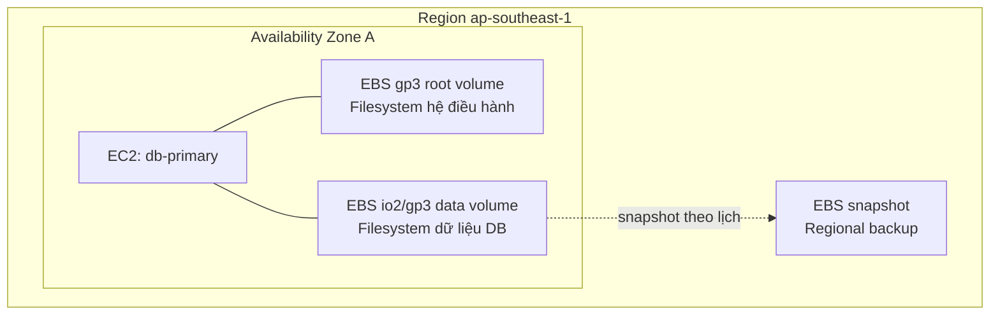
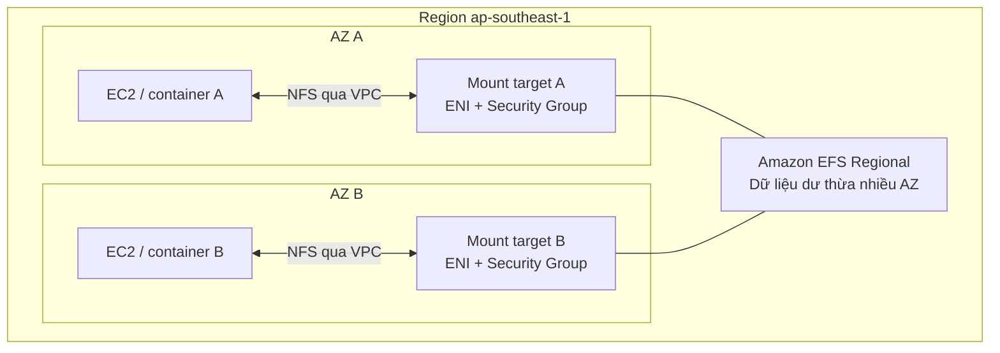
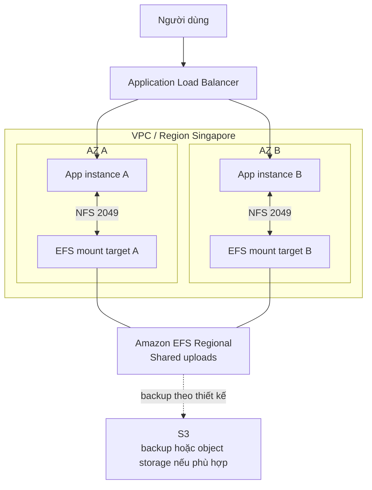
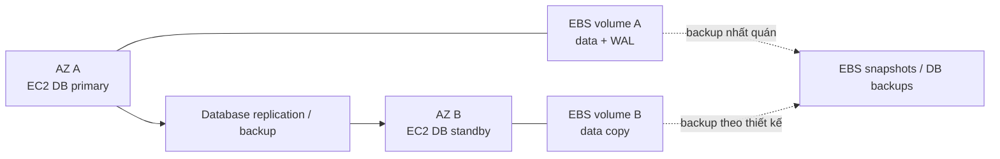
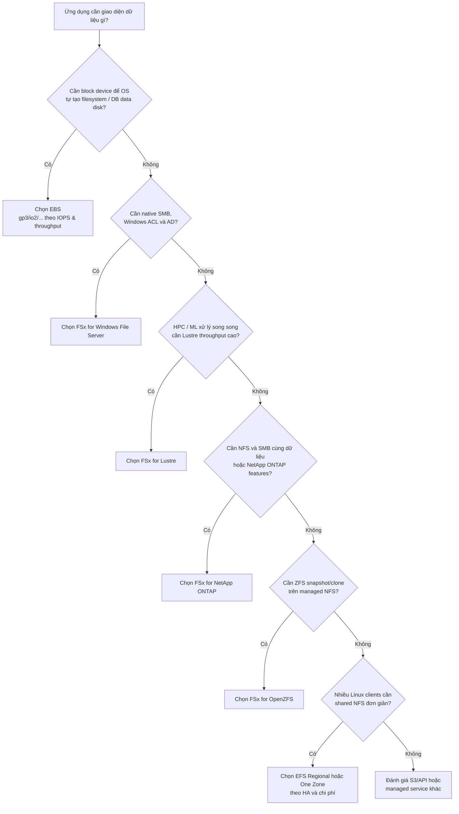

# Chọn Amazon EBS, EFS hoặc FSx theo nhu cầu ứng dụng

> **Chương:** Lưu trữ block và file  
> **Module:** CLOUD_PROVIDERS_AWS  
> **Mục tiêu:** chọn đúng hệ thống lưu trữ cho ứng dụng AWS dựa trên mô hình truy cập, hệ điều hành, hiệu năng, khả năng dùng chung, độ sẵn sàng, bảo mật, phương án phục hồi và tổng chi phí.

## 1. Vì sao cần chọn đúng loại lưu trữ?

Hãy xét ba ứng dụng đều chạy tại AWS Region Singapore:

1. Một máy **Amazon EC2** chạy PostgreSQL tự quản lý cần ổ đĩa để đặt hệ điều hành và dữ liệu có nhiều lượt đọc/ghi ngẫu nhiên.
2. Một nhóm **EC2/ECS** phục vụ web ở hai Availability Zone (AZ) cần cùng truy cập thư mục ảnh người dùng đã tải lên.
3. Một doanh nghiệp chạy **Windows Server**, dùng Active Directory (AD), chia sẻ tài liệu qua SMB với quyền truy cập NTFS; một nhóm nghiên cứu khác cần xử lý file rất lớn với thông lượng cao.

Cả ba trường hợp đều “cần lưu trữ”, nhưng không nhất thiết dùng cùng một dịch vụ. **Amazon EBS, Amazon EFS và Amazon FSx** giải quyết những kiểu nhu cầu khác nhau.

- **Amazon Elastic Block Store (EBS):** cung cấp **block device** có thể gắn vào EC2, thích hợp cho ổ hệ điều hành, ổ dữ liệu ứng dụng và cơ sở dữ liệu cần kiểm soát filesystem.
- **Amazon Elastic File System (EFS):** cung cấp **shared file system** được quản lý, truy cập qua NFS, thuận tiện cho nhiều workload Linux cùng sử dụng dữ liệu.
- **Amazon FSx:** nhóm dịch vụ **file system chuyên biệt** được AWS quản lý, với các công nghệ Windows File Server, Lustre, NetApp ONTAP và OpenZFS, đáp ứng giao thức, hiệu năng và tính năng đặc thù.

**Câu hỏi nền tảng:** ứng dụng cần một **ổ đĩa block**, một **thư mục dùng chung qua mạng**, hay một **file system có chức năng/giao thức chuyên biệt**?

Bài này đặt ba lựa chọn trong ngữ cảnh hạ tầng AWS gồm **Region/AZ, IAM, VPC, EC2, container/serverless, cơ sở dữ liệu, giám sát, phục hồi và chi phí**.

## 2. Phân biệt block, file và object trước khi so sánh dịch vụ

### 2.1. Block storage

**Block storage** cung cấp các khối dữ liệu như một thiết bị lưu trữ, tương tự ổ cứng gắn vào máy chủ. Hệ điều hành có thể tạo partition, filesystem rồi mount volume.

Ví dụ luồng với Amazon EBS:

```text
Ứng dụng PostgreSQL
    ↓ file dữ liệu, WAL
Filesystem trên EC2 (ext4, XFS, NTFS...)
    ↓ block I/O
Thiết bị /dev/nvme... được EBS cung cấp
    ↓
Amazon EBS volume trong cùng Availability Zone
```

EBS **không tự cung cấp một thư mục NFS/SMB dùng chung** cho mọi instance. Muốn dùng nó như file system, hệ điều hành hoặc ứng dụng phải quản lý filesystem. Kết quả `df -h` trong Linux có thể cho thấy filesystem nằm trên EBS, nhưng bản chất dịch vụ EBS vẫn là block.

### 2.2. File storage

**File storage** cung cấp namespace gồm thư mục, file, metadata và quyền truy cập. Client kết nối qua giao thức file system, chẳng hạn **NFS** hoặc **SMB**.

```text
EC2 A / container A ──┐
                      ├── NFS/SMB qua VPC ── Shared file system
EC2 B / container B ──┘                    ├── /shared/report.csv
                                           └── /shared/images/
```

EFS và các hệ FSx phù hợp khi nhiều máy hoặc container cần nhìn thấy **cùng đường dẫn file**. Tuy nhiên, không được suy rằng mọi ứng dụng cũ đều chạy tốt trên một network filesystem: khóa file, độ trễ, số thao tác metadata, consistency, quyền truy cập và giao thức có thể làm khác biệt đáng kể.

### 2.3. Object storage: khi nào nên nhớ đến S3?

**Amazon S3** lưu object trong bucket, được truy cập qua API (hoặc một số lớp giao diện phù hợp). S3 không phải ổ block hoặc NFS/SMB thông thường. Với ảnh upload, file backup, log, tài liệu tĩnh hoặc dữ liệu data lake mà ứng dụng dùng API được, **S3 có thể phù hợp hơn** việc duy trì file server. Điều này không làm S3 trở thành đáp án cho workload yêu cầu POSIX filesystem hoặc SMB share.

| Tiêu chí | Block (EBS) | File (EFS / FSx) | Object (S3, đối chiếu) |
|---|---|---|---|
| Giao diện chính | Block device | File/directory qua NFS, SMB hoặc giao thức khác | API object/bucket |
| Chủ thể quản lý filesystem | Hệ điều hành/ứng dụng gắn volume | Dịch vụ file system và client | Ứng dụng/SDK và S3 |
| Dùng chung nhiều máy | Có điều kiện đặc biệt, không phải mặc định | Thiết kế cho nhiều client tùy loại file system | Nhiều client qua API |
| Ví dụ | Ổ hệ điều hành, cơ sở dữ liệu trên EC2 | Thư mục dùng chung, SMB share, HPC filesystem | Ảnh, backup, object data lake |

## 3. Bức tranh so sánh EBS, EFS và FSx

| Tiêu chí | Amazon EBS | Amazon EFS | Amazon FSx |
|---|---|---|---|
| Mô hình | **Block volume** | **Shared NFS file system** | **Nhóm managed file system chuyên biệt** |
| Giao thức/client | Gắn block vào EC2; OS tự tạo filesystem | NFS v4.x, chủ yếu cho Linux/POSIX workloads | Windows: SMB; Lustre: Lustre; ONTAP: NFS/SMB và block protocol; OpenZFS: NFS |
| Phạm vi triển khai | Volume ở **một AZ** | **Regional** hoặc **One Zone** | Tùy loại FSx và deployment type, có Single-AZ/Multi-AZ được hỗ trợ |
| Truy cập đồng thời | Thông thường một EC2; **Multi-Attach** có điều kiện với io1/io2 | Nhiều client cùng mount một file system | Tùy sản phẩm, thường hỗ trợ nhiều client |
| Quy mô/hiệu năng | Chọn loại volume và provision IOPS/throughput | Chọn throughput mode, storage class và concurrency | Chọn engine, SSD/HDD/Intelligent-Tiering khi hỗ trợ và cấu hình throughput/IOPS |
| Backup/khôi phục | EBS snapshots; AWS Backup | EFS Backup/AWS Backup, replication khi cấu hình | AWS Backup/snapshot/backup engine-specific hoặc liên kết S3 tùy hệ |
| Phù hợp nhất | Boot/data disk, DB riêng trên EC2 | File share Linux, shared content, container RWX | SMB/AD, HPC, NFS+SMB hybrid, tính năng ZFS/ONTAP |

Đây là **bảng định hướng ban đầu**. Để quyết định, cần đào sâu đặc tính của từng dịch vụ, workload và mục tiêu khôi phục.

## 4. Amazon EBS: chọn khi ứng dụng cần ổ block gần EC2

### 4.1. EBS hoạt động thế nào?

EBS volume là tài nguyên lưu trữ block độc lập với vòng đời chạy/stop của EC2, được tạo trong **một Availability Zone**. Một EC2 trong AZ đó có thể gắn nhiều volume phù hợp giới hạn instance; một EBS volume thông thường chỉ gắn vào một EC2 cùng lúc.

Ví dụ:



EBS được AWS bảo vệ trước lỗi thiết bị trong cùng AZ bằng cơ chế dự phòng nội bộ; tuy vậy **volume EBS vẫn là zonal**. Nếu AZ không khả dụng, không thể trực tiếp attach volume ở AZ A vào EC2 ở AZ B.

### 4.2. Các loại EBS volume quan trọng

| Loại volume | Đặc tính | Workload phù hợp |
|---|---|---|
| **gp3 – General Purpose SSD** | Cân bằng chi phí và hiệu năng; có thể chỉnh IOPS và throughput độc lập dung lượng trong giới hạn | Boot volume, database vừa và nhỏ, ứng dụng thông thường |
| **gp2 – General Purpose SSD** | SSD thế hệ trước, đặc tính hiệu năng gắn với dung lượng và cơ chế burst | Hệ thống đang dùng gp2; cân nhắc đánh giá di chuyển sang gp3 |
| **io2 / io2 Block Express** | Provisioned IOPS SSD cho nhu cầu I/O nghiêm ngặt; khả năng hiệu năng cao tùy instance hỗ trợ | Cơ sở dữ liệu giao dịch, workload nhạy độ trễ I/O |
| **io1** | Provisioned IOPS SSD đời trước | Hệ thống cũ cần kiểm tra điều kiện nâng cấp |
| **st1 – Throughput Optimized HDD** | Tối ưu đọc/ghi tuần tự, throughput lớn | Xử lý tuần tự/log/analytics trên ổ dữ liệu |
| **sc1 – Cold HDD** | HDD chi phí thấp cho dữ liệu ít truy cập, ít yêu cầu I/O | Dữ liệu lạnh dạng block, workload ít tương tác |

**Ghi nhớ:** EBS `st1`/`sc1` không dùng làm **boot volume**. Khi chọn volume, hãy đo cả **IOPS**, **throughput (MB/s)** và **latency**, không chọn dựa trên số GiB đơn thuần.

Ví dụ, gp3 có mức hiệu năng cơ sở và có thể provision cao hơn trong giới hạn dịch vụ. Một volume 100 GiB xử lý giao dịch ngẫu nhiên có thể cần tăng IOPS; trong khi volume 2 TiB dùng quét tuần tự cần xem xét throughput nhiều hơn. Cũng phải kiểm tra **giới hạn EBS bandwidth/IOPS của EC2 instance**; volume được cấp hiệu năng cao vẫn có thể bị nghẽn tại instance.

### 4.3. EBS có dùng chung giữa nhiều EC2 được không?

**Mặc định: không.** Một EBS volume thông thường gắn với một EC2 tại một thời điểm, dù một instance có thể gắn nhiều volume.

**Ngoại lệ:** EBS **Multi-Attach** dành cho các volume **Provisioned IOPS SSD `io1`/`io2`** đủ điều kiện, cho phép một volume gắn với nhiều EC2 dựa trên Nitro System **trong cùng AZ** (giới hạn hiện được AWS tài liệu hóa là tối đa 16 instance). Có các hạn chế về hệ điều hành, instance, filesystem và vòng đời volume.

**Rủi ro then chốt:** filesystem phổ biến như **ext4** và **XFS** không được thiết kế để nhiều máy ghi đồng thời lên **cùng block device** mà không có cơ chế phối hợp. Multi-Attach **không tự tạo distributed filesystem** hoặc khóa phân tán; khi sử dụng cần **cluster-aware filesystem / ứng dụng** quản lý ghi đồng thời và I/O fencing để tránh hỏng dữ liệu. Multi-Attach cũng không chuyển volume sang AZ khác.

Nếu mục đích chỉ là cho 10 EC2 đọc/ghi chung thư mục `/uploads`, giải pháp khởi đầu thường là **EFS hoặc một hệ FSx phù hợp**, không phải EBS Multi-Attach.

### 4.4. EBS và vòng đời instance

- **Reboot:** volume vẫn được gắn, dữ liệu giữ nguyên theo cấu hình.
- **Stop/start:** EBS volume tồn tại; vẫn ở AZ cũ, có thể được instance gắn lại theo block mapping.
- **Terminate:** volume root có thể bị xóa nếu `DeleteOnTermination=true`. Data volume có thể được giữ hoặc xóa theo thiết lập; phải kiểm tra từng attachment.
- **Detach:** ngừng I/O, unmount và flush dữ liệu đúng cách trước khi tháo; tháo cưỡng bức có thể gây lỗi filesystem.
- **Resize/đổi type:** EBS Elastic Volumes hỗ trợ thay đổi một số đặc tính của volume trong điều kiện tương thích; tăng dung lượng EBS **không tự động** mở rộng partition/filesystem trong OS.

Không nhầm **EBS** với **EC2 instance store**. Instance store là lưu trữ cục bộ tạm thời của host vật lý, có đặc tính mất dữ liệu khi instance bị stop/terminate hoặc host hỏng; EBS có vòng đời và cơ chế bảo vệ khác.

### 4.5. Snapshot và phục hồi liên AZ

**EBS snapshot** là bản sao point-in-time của volume, được lưu và quản lý ở phạm vi **Region**, theo cơ chế incremental của AWS. Từ snapshot có thể tạo **volume mới ở AZ khác trong cùng Region**. Muốn có bản sao ở Region khác cần cơ chế **copy snapshot cross-Region** hoặc dịch vụ backup phù hợp.

Ví dụ cứu hộ AZ A:

1. Đã có snapshot nhất quán của volume dữ liệu tại Region Singapore.
2. Tại AZ B, tạo một volume mới từ snapshot.
3. Khởi tạo EC2 thay thế, gắn volume cùng AZ B.
4. Khôi phục cấu hình ứng dụng/database, kiểm tra tính nhất quán rồi chuyển lưu lượng.

**Snapshot không phải phép màu cho mọi database đang ghi.** Snapshot hỗ trợ trạng thái tại thời điểm được chụp; ứng dụng cần quiesce/flush hoặc sử dụng cơ chế backup đặc thù để đáp ứng tính nhất quán nghiệp vụ. **RPO** phụ thuộc tần suất và phương pháp backup, **RTO** phụ thuộc thời gian restore/khởi động/kiểm tra/đổi traffic.

## 5. Amazon EFS: một file system NFS cho nhiều workload

### 5.1. Mô hình sử dụng

Amazon EFS cung cấp **managed network file system**, truy cập bằng NFS, tự phát triển dung lượng theo dữ liệu lưu trữ. Nhiều client Linux trên EC2, ECS, EKS và các dịch vụ tích hợp tương thích có thể mount cùng file system.



Khác với EBS, EFS hướng tới các client truy cập **tên file, thư mục và POSIX metadata** trên một namespace dùng chung. Hai EC2 có thể đọc cùng `/shared/config.json`; hai container có thể ghi các file khác nhau trong `/shared/uploads`.

**Chú ý ứng dụng:** một file system dùng chung không thay thế cơ chế phối hợp dữ liệu. Nhiều tiến trình ghi vào **cùng một file** vẫn phải quản lý locking, atomic writes, conflict và quy tắc consistency phù hợp.

### 5.2. EFS Regional và One Zone

| Đặc tính | **EFS Regional** | **EFS One Zone** |
|---|---|---|
| Phạm vi lưu dữ liệu | Dữ liệu và metadata được dự phòng ở nhiều AZ trong một Region | Dữ liệu và metadata dự phòng trong **một AZ** |
| Mount target | Có thể tạo một mount target ở mỗi AZ của VPC | Chỉ **một** mount target trong AZ của file system |
| Khả năng chịu lỗi AZ | Có bảo vệ ở mức lưu trữ trước lỗi một AZ, cùng các điều kiện vận hành khác | Không nên dùng khi yêu cầu chịu lỗi mất AZ của nơi lưu trữ |
| Mục tiêu | Dữ liệu dùng chung cần tính sẵn sàng cao | Dev/test, một số dữ liệu có thể phục hồi hoặc workload chấp nhận rủi ro AZ |
| Chi phí | Mô hình giá Regional | Có thể thấp hơn tùy lớp lưu trữ và truy cập, đổi lấy phạm vi lỗi khác |

Với EFS Regional, tạo mount target trong **AZ mà client thực sự chạy** giúp giảm độ trễ và nguy cơ phí truyền dữ liệu chéo AZ. Mỗi AZ chỉ có **một mount target cho file system trong VPC**, ngay cả khi AZ có nhiều subnet. Với One Zone, client từ AZ khác vẫn có thể kết nối theo cấu hình hợp lệ, nhưng không thay đổi thực tế dữ liệu/target thuộc một AZ.

### 5.3. EFS phù hợp với những ứng dụng nào?

- **Shared web content:** nhiều web server cần nhìn cùng cây thư mục.
- **Container persistent storage:** workload trong ECS/EKS dùng thư mục dùng chung và cần mount trên nhiều node khi công nghệ tích hợp hỗ trợ.
- **Home directories/công cụ Linux:** nhiều người dùng hoặc job cần chia sẻ file POSIX.
- **Phần mềm legacy dùng đường dẫn filesystem:** ứng dụng khó sửa sang S3 API nhưng cần scale ngang.
- **Serverless workload có tích hợp EFS:** ví dụ một Lambda function được cấu hình VPC và EFS access point phù hợp.

Không nên mặc định EFS là nơi lưu hiệu quả nhất cho mọi workload ghi ngẫu nhiên yêu cầu latency rất thấp, database transactional tự quản hoặc file chứa hàng triệu thao tác metadata nhỏ trên mỗi giây. Cần benchmark ứng dụng.

### 5.4. EFS throughput và storage classes

EFS có những lựa chọn throughput phù hợp với workload thay đổi theo thời gian, chẳng hạn **Elastic Throughput**, **Provisioned Throughput** và các chế độ hiện hành tùy cấu hình. Storage classes và lifecycle policy có thể chuyển file ít truy cập sang lớp giá rẻ hơn, trong khi thời điểm/chi phí truy xuất và hiệu năng có thể khác.

Khi lập thiết kế, cần đo:

- Kích thước dữ liệu, tỷ lệ tăng và số file.
- Đọc/ghi tổng hợp (MiB/s), số lượng request và tỷ lệ read/write.
- Mức độ **burst** hoặc traffic tăng đột biến.
- Truy cập file nhỏ/metadata, hành vi mở/đóng file.
- Yêu cầu truy cập dữ liệu ở lớp **Infrequent Access/Archive** nếu dùng.

**Không nhầm giá theo GiB với tổng giá EFS:** một số lựa chọn có phí throughput hoặc phí thao tác truy cập theo lớp lưu trữ, bên cạnh dung lượng lưu.

### 5.5. EFS Access Points và quyền POSIX

**EFS Access Point** có thể giúp ứng dụng/container dùng một root directory, POSIX user/group và cấu hình quyền nhất quán. Dịch vụ còn hỗ trợ file system policy/IAM authorization cho những thao tác phù hợp và mã hóa khi truyền qua EFS mount helper.

Các lớp bảo mật gồm:

1. **VPC routes và mount targets:** client phải có đường mạng đến target.
2. **Security group:** thông thường client cần TCP **2049 (NFS)** tới mount target; inbound target chỉ mở từ SG hoặc nguồn cần thiết.
3. **IAM/EFS file system policy:** kiểm soát những client/access point được phép khi cấu hình dùng IAM authorization.
4. **POSIX ownership/mode:** user/group bên trong filesystem vẫn quyết định file nào có thể đọc/ghi.
5. **KMS và TLS:** mã hóa at rest và encryption in transit theo yêu cầu.

**Sai lầm thường gặp:** “đã được IAM cấp quyền EFS thì mọi file đều đọc được”. Thực tế filesystem permissions, connection auth và cấu hình access point vẫn có thể từ chối truy cập.

## 6. Amazon FSx: chọn engine file system theo ứng dụng

**Amazon FSx** là họ dịch vụ managed file system. Không có một “FSx chung” với một giao thức duy nhất; cần xác định rõ biến thể:

| Dịch vụ FSx | Giao thức/đặc tính trọng tâm | Bài toán phù hợp |
|---|---|---|
| **FSx for Windows File Server** | **SMB**, tích hợp **Active Directory**, Windows ACLs, DFS và tính năng Windows file server | Windows file shares, ứng dụng SMB/NTFS ACL, doanh nghiệp dùng AD |
| **FSx for Lustre** | **Lustre**, high throughput, parallel filesystem, có khả năng tích hợp dữ liệu S3 theo cấu hình | HPC, ML training, mô phỏng, render, phân tích media/dữ liệu lớn |
| **FSx for NetApp ONTAP** | **NFS + SMB** đa giao thức, **iSCSI** và một số block protocol theo hệ hỗ trợ, snapshots, tiering, replication | Doanh nghiệp hybrid NAS, migration ONTAP, dữ liệu Linux+Windows |
| **FSx for OpenZFS** | **NFS**, đặc tính ZFS như snapshot/clone/compression, quản lý volume | Ứng dụng Linux/Unix cần NFS cùng chức năng/hiệu năng của ZFS |

**Điểm khác EFS:** EFS tập trung vào **managed NFS shared storage dạng elastic**. FSx chọn **technology stack và hành vi của filesystem chuyên biệt**, đôi khi cần cấu hình capacity/throughput và quản trị nhiều tham số hơn để đạt chức năng mong muốn.

### 6.1. FSx for Windows File Server: SMB và Active Directory

Một công ty có 100 nhân viên dùng Windows, chia sẻ file `\\corp-share\finance` và kiểm soát quyền qua nhóm AD. Nhu cầu gồm:

- **SMB** để Windows mount network drive.
- **Windows ACLs** ở file/folder, duy trì mô hình phân quyền đã có.
- Tích hợp **AWS Managed Microsoft AD** hoặc **self-managed AD**.
- Dùng **Single-AZ/Multi-AZ** theo mục tiêu availability và tính năng được hỗ trợ.
- Backup, shadow copies và tính năng quản trị Windows file server phù hợp.

**FSx for Windows File Server** là lựa chọn trực tiếp. Nếu workload cần hoạt động khi một AZ lỗi, chọn deployment **Multi-AZ** tương thích; hệ thống có primary/standby file servers ở các AZ khác nhau và thực hiện failover theo mô hình AWS. Client có thể cần reconnect/retry; Multi-AZ không đồng nghĩa ứng dụng không bao giờ nhận timeout.

**EFS không cung cấp native SMB/AD ACL như Windows file server.** Chỉ vì nó “cũng lưu file” không làm nó là giải pháp thay thế trực tiếp cho mạng Windows hiện hữu.

**Cần kiểm tra VPC/AD/DNS:** hệ thống có thể mount thất bại do không phân giải DNS, không truy cập domain controller, Kerberos/time skew hoặc chặn cổng SMB/AD, kể cả khi file system có trạng thái AVAILABLE.

### 6.2. FSx for Lustre: parallel file system cho HPC/ML

Một nhóm học máy đọc hàng terabyte file training trong thời gian ngắn trên nhiều EC2 GPU. Dataset gốc được lưu ở S3; job chạy song song cần đọc/ghi file throughput rất lớn.

Với **FSx for Lustre**:

- Các node compute mount một **parallel filesystem** hiệu năng cao, thay vì mỗi node tải object và tổ chức lại dữ liệu thủ công.
- Có thể **liên kết với một S3 bucket/prefix** bằng **data repository association** khi deployment/version hỗ trợ; dùng cơ chế import/export/tác vụ repository theo cấu hình.
- Chọn **Scratch/Persistent** hoặc mô hình lưu trữ mới được hỗ trợ theo yêu cầu tính bền vững, tính sẵn sàng và chi phí.
- Chọn throughput capacity và loại lưu trữ phù hợp tốc độ xử lý.
- Kiểm tra giới hạn AZ, loại client, network interface, instance type, dataset/file count và khả năng phục hồi khi node thất bại.

**Không coi S3 liên kết tự động sao lưu mọi file Lustre mới theo thời gian thực.** Cần hiểu quy tắc import/export, tự động đồng bộ, trạng thái tác vụ và rủi ro cập nhật cùng một file ở cả hai nguồn. Một số biến thể FSx for Lustre không hỗ trợ cơ chế DRA hoặc backup theo cách người dùng kỳ vọng.

Nếu mục tiêu chỉ là file share văn phòng, FSx for Lustre thường phức tạp hơn cần thiết. Nó được tối ưu cho **data processing throughput cao**, không phải thay thế SMB file server.

### 6.3. FSx for NetApp ONTAP: đa giao thức và NAS doanh nghiệp

Một tổ chức đang dùng NetApp ONTAP on-prem, có ứng dụng Linux cần NFS, Windows cần SMB, một số workload sử dụng LUN qua iSCSI và muốn tiết kiệm dung lượng bằng **deduplication/compression/tiering**.

**FSx for ONTAP** phù hợp để xem xét vì:

- Hỗ trợ **NFS**, **SMB**, đồng thời có lựa chọn truy cập block như **iSCSI** (và NVMe/TCP trên loại hệ hỗ trợ).
- Tổ chức storage qua **Storage Virtual Machines (SVM)** và volumes; quản trị share/export theo hệ ONTAP.
- Có các tính năng **snapshot**, clone, replication và tiering phù hợp với triển khai NetApp.
- Có tùy chọn **Single-AZ/Multi-AZ** ở các thế hệ hỗ trợ; phải xác định deployment type khi tạo.
- Hỗ trợ tích hợp hệ thống quản lý/bảo mật đang dùng NetApp nếu công cụ và workflow tương thích.

Một số sản phẩm FSx có access qua nhiều giao thức, nhưng **ứng dụng đa nền tảng vẫn phải quản lý quyền/identity, lock và encoding file names**. Không suy rằng SMB + NFS trên một volume không bao giờ xảy ra xung đột.

**Điểm đáng nhớ:** ONTAP hỗ trợ một số block protocol, nhưng nếu chỉ cần EBS cho database nằm trên một EC2, không tự động chọn FSx ONTAP chỉ vì có iSCSI. Hãy đánh giá complexity, latency qua mạng, quyền truy cập và yêu cầu dùng chung.

### 6.4. FSx for OpenZFS: NFS cùng các khả năng ZFS

Một hệ thống Linux legacy cần NFS, đồng thời muốn **snapshot/clone file system**, compression và đặc tính ZFS. **FSx for OpenZFS** là ứng viên:

- Managed ZFS filesystem truy cập qua **NFS**, có quản lý volumes.
- Hỗ trợ các tính năng ZFS như snapshot, cloning, data compression theo cấu hình.
- Có các lựa chọn **Single-AZ non-HA**, **Single-AZ HA** hoặc **Multi-AZ HA** tùy Region/deployment type và storage class hiện hành.
- Có thể đáp ứng workload cần latency/throughput của managed ZFS tùy loại triển khai và client.

**Không coi OpenZFS là native SMB file server.** Windows có thể dùng NFS client trong một số trường hợp, nhưng với yêu cầu Windows production, AWS khuyến nghị đánh giá **FSx for Windows File Server** hoặc **FSx for ONTAP**.

## 7. Chọn theo giao thức: ứng dụng cần nói chuyện với storage bằng gì?

Giao thức thường là bộ lọc nhanh nhất:

| Nhu cầu ứng dụng | Ứng viên đầu tiên | Vì sao |
|---|---|---|
| EC2 cần ổ boot hoặc ổ data dạng block | **EBS** | OS nhận block device, tự định dạng filesystem |
| Linux nhiều instance/container cùng đọc ghi thư mục NFS | **EFS** | Shared NFS đơn giản, tự co giãn dung lượng |
| Windows cần SMB/AD/NTFS ACL | **FSx for Windows File Server** | Giao thức và mô hình quyền Microsoft |
| Linux+Windows cùng dataset, có chức năng ONTAP | **FSx for NetApp ONTAP** | NFS/SMB, snapshot, tiering, có block protocol |
| HPC/ML xử lý file song song, throughput lớn | **FSx for Lustre** | Parallel filesystem hiệu năng cao |
| Linux cần NFS và tính năng ZFS đặc thù | **FSx for OpenZFS** | Managed OpenZFS, snapshot/clone |
| File tĩnh truy cập qua HTTP/API, không cần POSIX | **S3** | Object storage thường phù hợp hơn |
| Database managed | **RDS/Aurora** nếu phù hợp | Dịch vụ quản lý database/backup/HA; storage bên dưới do dịch vụ quản lý |

**Lưu ý:** với **ECS/EKS**, hãy căn cứ vào **access mode** và CSI driver/storage integration được hỗ trợ. EBS thường hợp persistent volume cho workload đơn node, trong khi EFS có thể phù hợp với nhiều pod/node cùng mount. Access modes như `ReadWriteOnce`/`ReadWriteMany` trong Kubernetes phải được hiểu trong ngữ cảnh CSI driver, Pod/Node và loại volume.

## 8. Chọn theo hiệu năng: IOPS, throughput, latency và metadata

Một ứng dụng không có “hiệu năng storage” đơn nhất. Hãy đo ít nhất bốn thuộc tính:

| Thuộc tính | Ý nghĩa | Workload dễ nhạy cảm |
|---|---|---|
| **IOPS** | Số thao tác I/O block mỗi giây | Transactional database, file nhiều I/O nhỏ |
| **Throughput** | Dung lượng truyền mỗi giây (MiB/s, GiB/s) | Media processing, HPC, đọc file lớn |
| **Latency** | Thời gian đáp ứng I/O, gồm mạng/client | Database, ứng dụng tương tác |
| **Metadata operations** | Tạo/lookup/stat/rename/open nhiều file | Build system, file nhỏ, container workloads |

### 8.1. Ví dụ đọc yêu cầu workload

Một database giao dịch trên EC2 có 4 KiB random writes với yêu cầu IOPS cao. **EBS gp3/io2** là ứng viên trực tiếp, vì hệ điều hành cần block device với độ trễ có thể đo/kiểm soát.

Ngược lại, một nhóm 20 worker xử lý từng file lớn từ một shared directory trên nhiều máy có thể đánh giá **EFS** hoặc **FSx for Lustre** theo pattern đọc/ghi và throughput. FSx for Lustre thường hấp dẫn hơn khi cần parallel I/O ở quy mô HPC.

Một ứng dụng Windows với hàng triệu file nhỏ và ACL phức tạp thường phải kiểm tra **FSx for Windows File Server/ONTAP**, không chọn theo throughput lý thuyết mà bỏ qua SMB/AD.

### 8.2. IOPS không thay thế throughput

Giả sử workload ghi trung bình 16 KiB mỗi thao tác và cần 5.000 IOPS:

```text
Throughput lý thuyết theo kích thước thao tác
  = 5.000 I/O/s × 16 KiB/I/O
  = 80.000 KiB/s
  ≈ 78,1 MiB/s
```

Đây là thông lượng khối dữ liệu **ước tính**, chưa tính overhead, pattern thực và giới hạn của instance. Nếu chỉ nhìn 5.000 IOPS mà đặt throughput quá thấp hoặc EC2 bandwidth quá nhỏ, ứng dụng vẫn bị nghẽn. Ngược lại, với file 1 MiB đọc tuần tự, throughput có thể là yếu tố ưu tiên hơn IOPS.

### 8.3. Cần benchmark theo ứng dụng thực

- **EBS:** quan sát VolumeReadOps/WriteOps, throughput, queue, latency và giới hạn EBS của EC2; có thể dùng `fio` trong lab phù hợp.
- **EFS:** xem PercentIOLimit, PermittedThroughput, DataReadIOBytes/DataWriteIOBytes và các metric có trong mode đã chọn.
- **FSx:** xem NetworkThroughput/StorageThroughput, client/metadata/CPU/IOPS và metric riêng theo engine.
- **Ứng dụng:** đo p50/p95/p99 latency, throughput nghiệp vụ và tỷ lệ lỗi.

Không so sánh ấn tượng theo “GB/s tối đa” công bố của hai dịch vụ nếu kích thước file, concurrency, network, storage tier và cách mount khác nhau.

## 9. Phạm vi AZ, độ sẵn sàng và khôi phục

### 9.1. Đừng nhầm availability của compute với storage

| Câu hỏi | EBS | EFS | FSx |
|---|---|---|---|
| Nếu EC2 AZ A chết, có gắn nguyên storage sang EC2 AZ B được không? | **Không gắn trực tiếp volume EBS AZ A sang B**; dùng snapshot/replication phù hợp | **EFS Regional** có thể được mount từ AZ B qua mount target | Phụ thuộc **engine + Single/Multi-AZ** |
| Có thể nhiều EC2 ở hai AZ cùng truy cập storage không? | Không theo mô hình volume thường; Multi-Attach cũng cùng AZ | **Có** với EFS Regional và mạng/mount targets hợp lệ | Có thể nếu deployment/network/giao thức hỗ trợ; cần xét độ bền storage |
| Dữ liệu tự có bản sao cross-Region chưa? | **Chưa**; cần copy snapshot/backup/replication | **Chưa**; có thể cấu hình replication phù hợp | **Chưa**; cần replication/backup engine-specific |
| Một snapshot/backup thay thế HA online được không? | Không | Không | Không |

**FSx không có một câu trả lời HA chung.** FSx Windows Multi-AZ, ONTAP Multi-AZ và OpenZFS Multi-AZ (khi Region hỗ trợ) có cơ chế failover giữa AZ; các file systems Single-AZ/Lustre cần đánh giá cách phục hồi khác. Phải chọn **deployment type** cụ thể trước khi kết luận SLA hay mức chịu lỗi.

### 9.2. Kiến trúc web đa AZ dùng EFS Regional



Tư duy:

- Hai app instance phục vụ các request khác nhau nhưng thấy cùng upload directory.
- EFS Regional dự phòng dữ liệu qua nhiều AZ; mount target cục bộ AZ giúp client kết nối hiệu quả.
- **ALB/Auto Scaling** cần có target khỏe ở AZ còn lại nếu một AZ lỗi.
- Đừng đặt session chỉ trong bộ nhớ một EC2 nếu muốn user không mất trạng thái; dùng cơ chế session/state phù hợp.
- Backup EFS nên được cấu hình bằng **AWS Backup hoặc cơ chế hỗ trợ**, không giả định tự có bản copy sang S3 bucket do người dùng chọn.

**Quan trọng:** EFS là shared filesystem, nhưng nếu ứng dụng ghi file theo lối không hỗ trợ concurrency thì HA storage không sửa được race condition của ứng dụng.

### 9.3. Kiến trúc database EC2 dùng EBS



Đây là ví dụ **HA ở tầng database**, không phải EBS tự sao chép volume A sang AZ B. Để có replica standby cần công nghệ database tương ứng (PostgreSQL streaming replication, MySQL replication, công nghệ cluster khác) và chiến lược failover. Nếu yêu cầu kinh doanh cho phép, **Amazon RDS/Aurora Multi-AZ** thường giảm gánh nặng tự vận hành.

### 9.4. Xác định RPO và RTO

- **RPO (Recovery Point Objective):** mức mất dữ liệu tối đa chấp nhận theo thời gian.
- **RTO (Recovery Time Objective):** thời gian khôi phục dịch vụ tối đa mục tiêu.

Ví dụ ứng dụng chấp nhận **RPO = 15 phút** và **RTO = 60 phút**. Snapshot EBS mỗi 24 giờ **không đủ** đáp ứng RPO 15 phút nếu không có replication/log backup khác. Ngược lại, có EFS Regional hoặc FSx Multi-AZ cũng không tự bảo vệ trước xóa dữ liệu sai, ransomware hay lỗi logic; vẫn cần backup có khả năng khôi phục.

## 10. Bảo mật: ba dịch vụ, nhiều lớp kiểm soát

### 10.1. IAM, KMS và quyền của filesystem

| Lớp | EBS | EFS | FSx |
|---|---|---|---|
| **IAM control plane** | Quyền tạo, attach, modify volume, snapshot | Quyền tạo file system, access point, mount target, policy | Quyền tạo/sửa file system, volume, backup, share cấu hình |
| **Encryption at rest** | EBS encryption qua AWS KMS theo cấu hình | EFS encryption at rest qua AWS KMS | Encryption at rest/KMS theo loại file system |
| **Encryption in transit** | EBS là block attachment, không phải NFS/SMB mount qua VPC do user cấu hình | TLS qua EFS mount helper và cơ chế client phù hợp | Phụ thuộc giao thức/engine, ví dụ SMB/Kerberos hoặc NFS/ONTAP theo cấu hình |
| **Quyền dữ liệu** | File permissions/DB auth ở OS bên trong instance | POSIX, access points, IAM/EFS policies | Windows ACL/AD, POSIX/NFS exports, ONTAP ACL/export policies, ZFS/NFS tùy engine |
| **Lọc mạng** | Gắn EBS vào EC2 cùng AZ; kiểm soát EC2/OS và IAM API | SG ở mount target, NFS 2049 | SG, NACL, cổng SMB/NFS/Lustre/AD theo engine |
| **Audit** | CloudTrail API, OS/app logs | CloudTrail API, EFS metrics, OS/app logs | CloudTrail API, FSx metrics, log/audit engine-specific |

**Không suy luận “IAM role có `fsx:*` thì có thể đọc mọi file SMB”.** IAM control plane và quyền file-level là hai tầng khác nhau. Với FSx Windows, cần **AD credential + share permissions + NTFS ACL**. Với EFS, phải xét **POSIX permissions và security group**.

### 10.2. Ví dụ quyền EFS an toàn cho ứng dụng

Một API chạy trong private subnet cần mount `/app/uploads`:

1. Tạo EFS Regional với encryption at rest phù hợp.
2. Tạo mount targets tại AZ của ứng dụng.
3. Gắn SG cho mount targets chỉ cho phép TCP **2049** từ SG của app.
4. Tạo **EFS Access Point** cho thư mục `/app/uploads` với UID/GID phù hợp.
5. Dùng TLS/IAM authorization theo hướng dẫn client và file system policy nếu cần.
6. Giám sát mount failures, truy cập lạ và backup.

Không mở inbound `0.0.0.0/0` cho NFS. EFS được truy cập qua VPC/network connections hợp lệ; việc file system có mount target không có nghĩa nó là public Internet service.

### 10.3. KMS và khôi phục từ backup

Với EBS snapshots, EFS backups hoặc FSx backups được mã hóa, muốn phục hồi cần **quyền KMS và key còn khả dụng**, bên cạnh quyền IAM của dịch vụ. Cross-account/cross-Region backup cần đánh giá policy key, loại key và khả năng sao chép.

**Lỗi vận hành nguy hiểm:** có snapshot thành công nhưng không thể restore ở tài khoản/Region dự phòng do key policy hoặc quyền decrypt/copy không phù hợp. Hãy thử phục hồi thật trong môi trường kiểm soát.

## 11. Chi phí: so sánh tổng chi phí, không chỉ giá/GB

### 11.1. Những thành phần thường làm tăng hóa đơn

| Dịch vụ | Thành phần chi phí cần tính |
|---|---|
| **EBS** | Dung lượng provisioned (GiB-tháng), IOPS/throughput provisioned tùy type, snapshots, Fast Snapshot Restore khi bật, data transfer/EC2 liên quan |
| **EFS** | Dung lượng lưu theo storage class, lựa chọn throughput, các khoản request/access tùy lớp/chế độ, backup, transfer liên AZ nếu truy cập mount target khác AZ |
| **FSx Windows** | Dung lượng SSD/HDD, throughput capacity, SSD IOPS khi provision, backups, Multi-AZ/network-related charges |
| **FSx Lustre** | Dung lượng/cấp hiệu năng và deployment type, backup hoặc tác vụ data repository theo mô hình hỗ trợ, transfer/S3-related costs |
| **FSx ONTAP** | SSD storage, throughput/IOPS, capacity pool storage/access, backup, dữ liệu chuyển và hiệu ứng compression/dedup/tiering |
| **FSx OpenZFS** | Storage class/capacity, throughput/IOPS, backup và triển khai HA theo lựa chọn, data transfer |

Bảng giá thực tế thay đổi theo **Region, loại deployment, cấu hình và thời điểm**. Không chọn EFS thay EBS chỉ dựa trên chi phí GiB-tháng: ứng dụng có thể cần nhiều IOPS, bản sao theo AZ hoặc tăng số EC2, làm thay đổi tổng chi phí.

### 11.2. Ví dụ so sánh khối lượng dữ liệu chung

Giả sử ba EC2 chạy web, mỗi máy cần dùng **cùng bộ ảnh 100 GiB**.

- **Ba EBS volume riêng**, mỗi máy chứa một bản copy dữ liệu: tổng dung lượng data volume khoảng **300 GiB** trước phần tăng trưởng và snapshots. Cần một cơ chế đồng bộ file, giải quyết xung đột và phục hồi.
- **Một EFS Regional** chứa bộ ảnh chung 100 GiB: các máy mount cùng namespace; giảm công đồng bộ, nhưng phải trả phí theo storage class, throughput và truy cập thực.
- **Một S3 bucket** nếu ứng dụng thay đổi để đọc/ghi object trực tiếp: có thể thuận tiện hơn cho upload/static media khi kết hợp CDN, nhưng khác hẳn giao diện POSIX.

Từ ví dụ này **không thể kết luận EFS luôn rẻ hơn**. Cần đo I/O, số request, throughput, số file, transfer, chi phí vận hành và độ sẵn sàng.

### 11.3. Ví dụ capacity của EBS

Một DB cần 100 GiB dữ liệu nhưng volume được tạo 1 TiB để đạt yêu cầu thiết kế cũ. Với gp3, có thể điều chỉnh IOPS/throughput trong các giới hạn độc lập dung lượng thay vì chỉ tăng size để đạt hiệu năng như một số mô hình khác. Cần đối chiếu IOPS thực tế, storage growth, snapshot retention và chi phí provisioned để tránh cấp quá mức.

### 11.4. Giảm chi phí đúng cách

- EBS: **right-size volume**, xem gp3 nếu phù hợp, xóa volume/snapshot không dùng sau xác nhận, tự động backup retention.
- EFS: lifecycle/IA/Archive theo access pattern, throughput mode tương ứng, mount target cùng AZ khi có thể, giảm workload metadata không cần thiết.
- FSx: chọn engine đúng, deployment Single/Multi-AZ theo RTO/RPO, throughput capacity đủ dùng, tiering/dedup/compression khi hỗ trợ, chính sách backup phù hợp.
- Chú ý chi phí **data transfer giữa AZ/Region** và migration tools nếu workload truy cập file lớn nhiều lần.
- Dùng **AWS Cost Explorer**, AWS Budgets và metric CloudWatch để xác nhận tối ưu thực sự đem lại lợi ích.

## 12. Cây quyết định thực tế



Cây quyết định **không thay benchmark hoặc kiểm tra tính năng theo Region**. Một ứng dụng có thể dùng **nhiều loại lưu trữ cùng lúc**: EBS cho OS/database, EFS cho file cần dùng chung, S3 cho upload/backup, FSx Lustre cho pipeline phân tích.

### 12.1. Bảng quyết định cho tình huống phổ biến

| Tình huống | Lựa chọn khởi đầu | Điều cần xác minh thêm |
|---|---|---|
| EC2 đơn lẻ có OS + logs + DB tự quản | **EBS gp3**, cân nhắc io2 nếu cần IOPS/latency nghiêm ngặt | Backup nhất quán, AZ, EC2 EBS limit |
| Nhiều web server Linux cần upload directory chung qua AZ | **EFS Regional** | NFS concurrency, mount targets, throughput, SG |
| Website chỉ cần phục vụ ảnh tĩnh | **S3 + CDN** | Có thể sửa ứng dụng dùng object API không? |
| Windows file share cho nhân viên có AD group | **FSx Windows** | SMB/AD/DNS, Multi-AZ, ACLs |
| EC2 Linux + Windows cần cùng dữ liệu và snapshot/tiering | **FSx ONTAP** | Multiprotocol security style, NFS/SMB lock, AZ |
| ML training/HPC file throughput cao với dataset S3 | **FSx Lustre** | DRA support, lifecycle dữ liệu, throughput, compute network |
| Linux app yêu cầu OpenZFS volumes, snapshots, clones | **FSx OpenZFS** | Region/deployment type, NFS client, HA |
| K8s StatefulSet cần block RWO trên một node/AZ | **EBS CSI** | Topology/AZ affinity, access mode, backup |
| K8s nhiều pods/nodes cần cùng RWX POSIX directory | **EFS CSI**, kiểm tra hỗ trợ | POSIX UID/GID, access point, latency |
| Cần file share hỗ trợ lỗi AZ | **EFS Regional** hoặc **FSx Multi-AZ** đúng engine | RTO/RPO, khả năng client reconnect, backup |

## 13. Quan sát và vận hành với AWS CLI

Các ví dụ sau **chỉ đọc** và sử dụng AWS CLI v2. Cần credentials/profile có quyền `Describe*` thích hợp và chọn đúng Region. Các ID mẫu phải được thay bằng ID thực tế nếu muốn xem chi tiết. Không có lệnh nào dưới đây tạo hoặc xóa storage.

### 13.1. Kiểm tra EBS volume, AZ và type

```bash
aws ec2 describe-volumes \
  --region ap-southeast-1 \
  --query "Volumes[].[VolumeId,AvailabilityZone,VolumeType,Size,Iops,Throughput,State]" \
  --output table
```

Kiểm tra attachments của một volume:

```bash
aws ec2 describe-volumes \
  --region ap-southeast-1 \
  --volume-ids vol-0123456789abcdef0 \
  --query "Volumes[0].{AZ:AvailabilityZone,Type:VolumeType,SizeGiB:Size,Encrypted:Encrypted,Attachments:Attachments,MultiAttach:MultiAttachEnabled}" \
  --output json
```

**Điểm cần nhìn:** volume nằm AZ nào, type gì, có Multi-Attach hay không và đang attach với instance nào.

### 13.2. Kiểm tra EBS snapshots do tài khoản sở hữu

```bash
aws ec2 describe-snapshots \
  --region ap-southeast-1 \
  --owner-ids self \
  --query "Snapshots[].[SnapshotId,VolumeId,StartTime,State,VolumeSize]" \
  --output table
```

Snapshot có thể nhiều; nên bổ sung filter hoặc giới hạn hiển thị theo nhu cầu. Không suy từ danh sách snapshot rằng khôi phục database sẽ nhất quán khi snapshot được tạo trong lúc ứng dụng đang ghi.

### 13.3. Kiểm tra Amazon EFS

```bash
aws efs describe-file-systems \
  --region ap-southeast-1 \
  --query "FileSystems[].[FileSystemId,LifeCycleState,PerformanceMode,ThroughputMode,SizeInBytes.Value]" \
  --output table
```

Tra mount targets:

```bash
aws efs describe-mount-targets \
  --region ap-southeast-1 \
  --file-system-id fs-0123456789abcdef0 \
  --query "MountTargets[].[MountTargetId,SubnetId,IpAddress,LifeCycleState]" \
  --output table
```

Muốn biết AZ của mount target, dùng thêm `aws ec2 describe-subnets` đối chiếu `SubnetId`. Với EFS Regional, kiểm tra những AZ chạy workload có mount target hợp lệ; với One Zone, không kỳ vọng nhiều target.

### 13.4. Kiểm tra Amazon FSx

```bash
aws fsx describe-file-systems \
  --region ap-southeast-1 \
  --query "FileSystems[].[FileSystemId,FileSystemType,StorageCapacity,Lifecycle]" \
  --output table
```

Xem cấu hình đầy đủ của file system đã biết:

```bash
aws fsx describe-file-systems \
  --region ap-southeast-1 \
  --file-system-ids fs-0123456789abcdef0 \
  --output json
```

Tùy FSx engine, xem **WindowsConfiguration**, **LustreConfiguration**, **OntapConfiguration** hoặc **OpenZFSConfiguration** trong kết quả để xác định `DeploymentType`, throughput capacity, endpoints, VPC/subnets và cấu hình tương ứng. Không giả định `DeploymentType` là một field chung ở top-level cho mọi engine.

### 13.5. Dùng CloudWatch để xác minh giả thuyết

| Dịch vụ | Cần quan sát |
|---|---|
| EBS | Volume throughput/IOPS, queue, latency, status, EC2 EBS bandwidth |
| EFS | Throughput, I/O limit, storage bytes, NFS client error và mount health |
| FSx | Throughput/IOPS/CPU/cache/metadata tùy engine, capacity còn lại, trạng thái failover |
| Mạng | VPC route, security groups, NACL, DNS, Flow Logs khi phù hợp |
| Ứng dụng | p95 latency, lỗi open/read/write, IO wait, retry, data consistency |

Nếu metric chưa bật hoặc engine không xuất bản metric tên dự kiến, kiểm tra danh sách metric thực tế theo Region/file system/namespace trước khi cấu hình alarm.

## 14. Xử lý sự cố theo triệu chứng

| Triệu chứng | Hướng điều tra đầu tiên | Thường liên quan |
|---|---|---|
| EBS volume không attach được EC2 | Kiểm tra hai tài nguyên **cùng AZ** và instance attachment limit | EBS |
| Resize volume nhưng `df -h` không tăng | Chưa mở rộng partition/filesystem trong OS | EBS |
| EBS IOPS/throughput thấp dù provision cao | EC2 bandwidth cap, queue depth, I/O size, volume throttle | EBS |
| Hai EC2 không thể mount ghi đồng thời một volume | Multi-Attach không bật/không hỗ trợ; thiếu clustered filesystem | EBS |
| EC2 không mount được EFS | SG TCP 2049, mount target, NFS/TLS, DNS, IAM/POSIX | EFS |
| EFS mount được nhưng `Permission denied` | UID/GID, POSIX permission, access point hoặc policy | EFS |
| EFS latency tăng tại AZ B | Client đi qua mount target AZ khác, throughput limit, metadata workload | EFS |
| Windows không map được SMB share | AD/DNS/Kerberos/SMB 445/NTFS ACL/share permission | FSx Windows |
| FSx ONTAP Linux thấy file, Windows lại bị từ chối | Multiprotocol security style, export policy, SMB ACL/identity mapping | FSx ONTAP |
| Lustre file mới chưa thấy trong S3 | Data repository association/task/export policy chưa chạy hoặc không hỗ trợ | FSx Lustre |
| FSx OpenZFS không mount được NFS | DNS, SG, NFS export/path và client options | FSx OpenZFS |
| File system lỗi khi AZ hỏng | Chọn **Single-AZ** hoặc backend/phụ thuộc không có HA | EFS/FSx/EBS |
| Có backup nhưng không restore được | IAM/KMS permission, Region/engine compatibility, backup state | Tất cả |
| Chi phí tăng khi app ít traffic | EBS provisioned, FSx throughput/storage allocation, EFS throughput/storage class | Tất cả |

Nguyên tắc xử lý: **phân loại lỗi theo tầng** — API/định danh tài nguyên → AZ/VPC/network → mount protocol → filesystem permission → hiệu năng → ứng dụng. Đừng mở quyền `*` hoặc tắt mã hóa để “thử cho chạy” khi chưa xác định được tầng lỗi.

## 15. Migration và thay đổi công nghệ lưu trữ

### 15.1. Chuyển EBS sang EFS/FSx là thay đổi kiến trúc

Không có thao tác đơn giản “đổi volume type” để biến một EBS block device thành EFS NFS hay FSx Windows SMB. Chuyển đổi cần:

1. Kiểm kê file format, ứng dụng, quyền file, symlink, lock, ACL/xattr và throughput.
2. Chọn giao thức file system đích và đường mạng.
3. Tạo target storage, bảo mật, backup và monitoring.
4. Di chuyển dữ liệu bằng công cụ phù hợp (**AWS DataSync**, `rsync`, backup/restore hoặc công cụ vendor), kiểm tra quy tắc đồng bộ.
5. Chạy thử app, đo performance, phát hiện vấn đề permission/consistency.
6. Cắt chuyển có kiểm soát và có phương án rollback.

Không giả định copy file một lần bảo toàn mọi metadata Windows ACL, UID/GID, hard link hoặc snapshot history; cần xem công cụ/giao thức hỗ trợ gì.

### 15.2. Chuyển EBS giữa AZ hoặc Region

- **Cùng AZ:** có thể detach/attach volume giữa EC2 tương thích theo quy trình an toàn.
- **Khác AZ:** tạo volume mới từ snapshot tại AZ đích, hoặc dùng ứng dụng replication.
- **Khác Region:** copy snapshot/backup hoặc di chuyển dữ liệu theo công cụ hỗ trợ.
- **Database quan trọng:** nên có cơ chế nhất quán dữ liệu và replica/log backup riêng, không chỉ copy filesystem đang mở.

### 15.3. FSx có thể yêu cầu kiến thức nền riêng

Di chuyển Windows file shares nên đánh giá AD, SID/ACL, SMB, DFS; NetApp migration có thể liên quan SnapMirror; Lustre/S3 cần xây kế hoạch import/export và dữ liệu đang được cập nhật; OpenZFS có volume/snapshot/clone semantics. “Đã là FSx” không có nghĩa migration giữa các engine là operation trực tiếp.

## 16. Bài tập và đáp án

### Bài 1 — Cơ sở dữ liệu giao dịch trên EC2

PostgreSQL tự quản chạy trên một EC2, cần fsync ổn định và latency thấp. Bắt đầu chọn gì?

**Đáp án:** EBS gp3/io2 theo IOPS/throughput/latency đo được. Tạo filesystem phù hợp, backup nhất quán và replica nếu cần HA. Không chọn EFS chỉ vì nó có thể mount qua NFS.

### Bài 2 — Ba web server có cùng thư mục upload

Ba EC2 chạy ở AZ A và B, ứng dụng legacy luôn dùng `/var/www/uploads`. Nên khảo sát lựa chọn nào?

**Đáp án:** EFS **Regional** với mount target tại hai AZ, NFS/TLS/SG và POSIX permissions phù hợp. Đồng thời đánh giá S3 nếu có thể sửa ứng dụng dùng object API.

### Bài 3 — Windows file share có AD

Nhân viên phải mount `\\company\documents`, giữ Windows ACL theo nhóm AD.

**Đáp án:** FSx for **Windows File Server** (hoặc FSx for ONTAP nếu cần thêm đặc tính ONTAP/multiprotocol); EFS không phải SMB file server gốc.

### Bài 4 — HPC lấy dataset từ S3

Các node GPU xử lý dataset cực lớn, cần parallel file I/O, dữ liệu gốc đặt ở S3.

**Đáp án:** Đánh giá FSx for Lustre và tính năng data repository association theo deployment hỗ trợ; thiết kế import/export và kiểm tra chi phí throughput. Không giả định mọi file output tự động có bản S3 nếu chưa cấu hình.

### Bài 5 — EBS Multi-Attach và ext4

Đội vận hành gắn cùng io2 Multi-Attach volume cho hai EC2 trong AZ A, sau đó định mount ext4 read-write trên cả hai.

**Đáp án:** Đây là cách làm có nguy cơ hỏng dữ liệu. Multi-Attach yêu cầu application/cluster-aware filesystem có cơ chế phối hợp ghi và fencing; ext4/XFS thông thường không thích hợp cho multi-writer đồng thời.

### Bài 6 — Chỉ một AZ

Một app cần chịu mất AZ, nhưng đội triển khai EFS **One Zone** vì tiết kiệm phí.

**Đáp án:** Không đáp ứng mục tiêu chịu lỗi AZ đối với storage. Đánh giá EFS Regional hoặc phương án storage Multi-AZ khác, đồng thời xây backup/recovery.

### Bài 7 — Chia sẻ NFS và SMB

Ứng dụng Linux và Windows cần dùng chung dataset, tổ chức đang có kinh nghiệm NetApp.

**Đáp án:** Đánh giá FSx for NetApp ONTAP vì hỗ trợ NFS/SMB và công cụ ONTAP. Cần thiết kế identity/permissions và khóa file xuyên giao thức phù hợp.

### Bài 8 — Chi phí của storage dùng chung

Hai phương án cùng dữ liệu 200 GiB: (A) EBS riêng 200 GiB trên mỗi EC2, 4 EC2; (B) một EFS 200 GiB. Có thể chọn rẻ nhất từ dung lượng không?

**Đáp án:** Chưa đủ. A có khoảng **800 GiB EBS data volume** và chi phí đồng bộ; B có **200 GiB EFS dùng chung** nhưng phí throughput, lớp lưu trữ, truy cập, transfer. Phải đánh giá traffic và chi phí vận hành.

### Bài 9 — Khôi phục qua AZ

Một EBS volume ở AZ A có snapshot từ 10 phút trước. Có thể gắn nguyên volume vào EC2 AZ B không?

**Đáp án:** Không. Tạo **volume mới từ snapshot trong AZ B**; RPO tối thiểu cần xem xét dữ liệu thay đổi sau snapshot, RTO bao gồm restore/start/app validation.

### Bài 10 — File system có snapshot nhưng file vẫn bị xóa

Một FSx file system hỗ trợ snapshot, người dùng vô tình xóa dữ liệu và snapshot retention quá ngắn để phục hồi.

**Đáp án:** Snapshot/tính năng HA không tự thay thế chính sách backup có retention hợp lý. Thiết kế AWS Backup hoặc backup engine-specific, bảo vệ quyền xóa và kiểm thử restore.

### Bài 11 — EKS storage mode

Ứng dụng Kubernetes có 5 pods trên nhiều nodes, cần cùng đọc/ghi file trong `/shared`.

**Đáp án:** Kiểm tra EFS CSI + access point/POSIX và access mode phù hợp. EBS thông thường bị ràng buộc AZ/node và không cung cấp RWX shared filesystem như EFS.

### Bài 12 — Lỗi network hay quyền file?

EC2 kết nối TCP 2049 được đến EFS mount target, mount thành công, nhưng user `app` nhận `Permission denied` khi ghi `/shared/data`.

**Đáp án:** Ưu tiên xem UID/GID, directory mode, EFS Access Point và file system policy; nếu NFS mount đã thành công, mở rộng security group thường không giải quyết quyền POSIX.

## 17. Checklist trước khi chọn storage

1. **Giao diện ứng dụng:** block, NFS, SMB, Lustre, ZFS, ONTAP hay object API?
2. **Kiểu truy cập:** một instance hay nhiều client; đọc chung, ghi chung hay multi-writer; xử lý locking ra sao?
3. **Phạm vi địa lý:** volume ở AZ nào; EFS Regional/One Zone; FSx Single-AZ/Multi-AZ và Region nào hỗ trợ?
4. **Hiệu năng:** IOPS, throughput, p95/p99 latency, file size, metadata operations, EC2/VPC bottleneck.
5. **Dữ liệu:** khả năng nhất quán, backup, snapshot, retention, restore, replication và RPO/RTO.
6. **Bảo mật:** IAM control plane, KMS, network, POSIX/Windows ACL, AD, auth ứng dụng.
7. **Giám sát:** AWS CloudWatch metrics, CloudTrail, logs, backup job status và cảnh báo dung lượng.
8. **Chi phí:** provisioned/used storage, IOPS/throughput, class/tiering, backups, cross-AZ transfer và admin effort.
9. **Khả năng mở rộng:** auto-scale compute có cần shared namespace; file system có giới hạn/cấu hình throughput nào?
10. **Kiểm thử:** chạy thử theo pattern thật, failover một AZ, restore từ backup và tính chi phí từ số đo.
11. **Tính năng theo Region:** kiểm tra hỗ trợ instance/deployment/storage class và quota trước khi chốt kiến trúc.
12. **Phương án thay thế:** xét **S3, RDS/Aurora hoặc managed application service** nếu chúng giải quyết tốt hơn bài toán so với tự quản filesystem.

**Ghi nhớ:** **EBS** trả lời bài toán “một EC2 cần ổ block có hiệu năng kiểm soát được”; **EFS** giải quyết “nhiều workload Linux cần cùng một filesystem NFS được quản lý”; còn **FSx** dành cho yêu cầu cụ thể như **Windows SMB/AD, Lustre HPC, ONTAP đa giao thức hoặc OpenZFS**. Chọn theo đường truy cập và mục tiêu khôi phục trước, sau đó mới tối ưu hiệu năng và chi phí.

## Tài liệu AWS tham khảo

- [Amazon EBS volumes — Amazon EBS User Guide](https://docs.aws.amazon.com/ebs/latest/userguide/ebs-volumes.html)
- [Amazon EBS volume types](https://docs.aws.amazon.com/ebs/latest/userguide/ebs-volume-types.html)
- [Amazon EBS Multi-Attach](https://docs.aws.amazon.com/ebs/latest/userguide/ebs-volumes-multi.html)
- [Amazon EBS snapshots](https://docs.aws.amazon.com/ebs/latest/userguide/ebs-snapshots.html)
- [How Amazon EFS works](https://docs.aws.amazon.com/efs/latest/ug/how-it-works.html)
- [EFS Regional và One Zone file systems](https://docs.aws.amazon.com/efs/latest/ug/creating-using-create-fs.html)
- [Managing EFS mount targets](https://docs.aws.amazon.com/efs/latest/ug/accessing-fs.html)
- [EFS Access Points](https://docs.aws.amazon.com/efs/latest/ug/efs-access-points.html)
- [Amazon FSx documentation](https://docs.aws.amazon.com/fsx/)
- [FSx for Windows File Server: Single-AZ/Multi-AZ](https://docs.aws.amazon.com/fsx/latest/WindowsGuide/high-availability-multiAZ.html)
- [FSx for Lustre: S3 data repositories](https://docs.aws.amazon.com/fsx/latest/LustreGuide/fsx-data-repositories.html)
- [FSx for NetApp ONTAP: supported clients](https://docs.aws.amazon.com/fsx/latest/ONTAPGuide/supported-fsx-clients.html)
- [FSx for OpenZFS: deployment và tính sẵn sàng](https://docs.aws.amazon.com/fsx/latest/OpenZFSGuide/available-aws-regions.html)
- [Amazon EBS pricing](https://aws.amazon.com/ebs/pricing/)
- [Amazon EFS pricing](https://aws.amazon.com/efs/pricing/)
- [Amazon FSx pricing](https://aws.amazon.com/fsx/pricing/)
