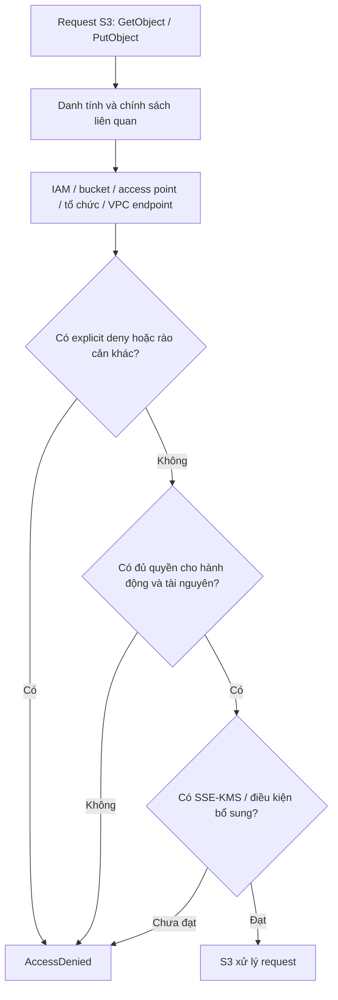
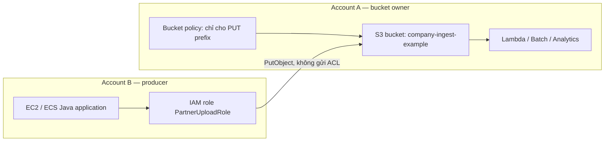
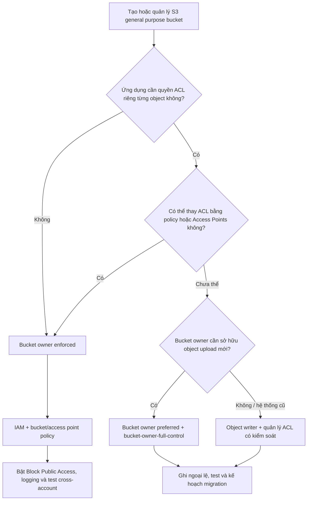

# Object Ownership và kiểm soát ACL trong Amazon S3

Giả sử nhóm xử lý dữ liệu có hai tài khoản AWS. Tài khoản **A** sở hữu bucket Amazon S3 dùng lưu hồ sơ, còn tài khoản **B** chạy ứng dụng Java trên EC2 để tải tệp lên. Ứng dụng ghi đối tượng thành công, nhưng đội vận hành tài khoản A không đọc được một số đối tượng do B tải lên. Nguyên nhân có thể nằm ở **quyền sở hữu object** và **Access Control List (ACL)** của mô hình S3 cũ.

Với S3 hiện nay, cách xử lý được AWS khuyến nghị là **S3 Object Ownership: Bucket owner enforced** — bucket owner sở hữu mọi object, ACL bị vô hiệu hóa, và việc cho phép truy cập được quản lý bằng **IAM policies, bucket policies** cùng các cơ chế kiểm soát liên quan. Hai chế độ khác vẫn tồn tại để hỗ trợ trường hợp đặc biệt hoặc hệ thống cũ.

Bài học thuộc chương **Lưu trữ đối tượng S3** của module **CLOUD_PROVIDERS_AWS**. Người học sẽ nối kiến thức về AWS account, IAM, ứng dụng trên EC2/Lambda, VPC endpoint, giám sát và kiểm soát chi phí để triển khai S3 an toàn, dễ quản trị, có khả năng kiểm toán và phục hồi.

> **Phạm vi:** Ví dụ chính dùng **S3 general purpose buckets**. **S3 directory buckets** dành cho S3 Express One Zone có một số khác biệt: chỉ sử dụng bucket owner enforced, không hỗ trợ ACL hoặc API quản lý Object Ownership tương tự general purpose bucket. Luôn kiểm tra loại bucket và API đang sử dụng.

## 1. Mục tiêu học tập

Sau bài học, bạn có thể:

1. Phân biệt **bucket owner**, **object owner**, ACL và **Object Ownership**.
2. Giải thích chính xác ba chế độ **Bucket owner enforced**, **Bucket owner preferred**, **Object writer**.
3. Biết upload nào được chấp nhận khi ACL bị tắt; nhận diện lỗi `AccessControlListNotSupported`.
4. Thiết kế cấp quyền bằng **IAM policy**, **bucket policy**, **Block Public Access** và **S3 Access Points** trong những trường hợp phù hợp.
5. Thiết kế upload **cross-account** mà bucket owner có thể quản lý dữ liệu.
6. Di chuyển bucket cũ đang phụ thuộc ACL sang mô hình dựa trên policy bằng một quy trình có kiểm chứng.
7. Kiểm tra cấu hình qua AWS CLI, SDK Java và CloudTrail, đồng thời phân tích lỗi quyền truy cập.

## 2. Vì sao S3 có bài toán quyền sở hữu object?

S3 lưu dữ liệu dưới dạng **objects** trong **buckets**. Object thường có **key**, dữ liệu (body), metadata, thuộc tính mã hóa và có thể có nhiều version khi bật S3 Versioning. Bucket được tạo và sở hữu bởi một AWS account; trong cấu hình cũ có ACL, **object có thể được sở hữu bởi account khác với bucket owner**.

Ví dụ:

| Tài nguyên | Chủ thể | Vai trò |
|---|---|---|
| Bucket `company-ingest-example` | Account A | Quản lý bucket, bucket policy, một số cấu hình bucket |
| EC2/Lambda dùng IAM role `UploadRole` | Account B | Gửi request `PutObject` tới bucket của A |
| Object `inbound/report.csv` | Phụ thuộc Object Ownership | Có thể do bucket owner A hoặc object writer B sở hữu |
| IAM và bucket policy | Hai account liên quan | Quyết định request nào được phép, theo các điều kiện xác thực/ủy quyền |
| KMS key (nếu SSE-KMS) | Account sở hữu khóa | Quyết định quyền dùng khóa mã hóa, ngoài quyền S3 |

**Quyền sở hữu object và quyền truy cập object là hai khái niệm liên quan nhưng không đồng nhất.** Một account sở hữu object vẫn có thể bị các lớp policy liên quan hạn chế một thao tác. Ngược lại, IAM principal có quyền truy cập nếu chính sách phù hợp cho phép, dù principal không phải owner.

### 2.1. Trước khi có Bucket owner enforced

Với mô hình `Object writer`, nếu account B tải một object vào bucket của A, **B thường là object owner**. Bucket owner A có thể quản lý nhiều thiết lập của bucket nhưng **bucket policy của A không tự cấp cho A mọi quyền trên object do B sở hữu**. Nếu có quyền truy cập đến từ object ACL, A phải được cấp quyền phù hợp hoặc cần thay đổi cách ingest dữ liệu.

Đây là nguyên nhân của tình huống “người quản trị bucket nhìn thấy bucket nhưng không mở được một object vừa được account đối tác upload”.

### 2.2. Bức tranh hiện tại

**Mặc định cho bucket S3 general purpose mới:** AWS sử dụng **Bucket owner enforced**; ACL bị vô hiệu hóa. Từ tháng 4/2023, AWS cũng mặc định bật **S3 Block Public Access** cho bucket mới. Hai cơ chế này độc lập về mục đích và có thể được kiểm tra riêng.

AWS khuyến nghị **giữ ACL bị tắt** cho phần lớn workload, giúp thống nhất quản trị quyền bằng policies thay vì cần phối hợp ACL trên từng object. [Nguồn: S3 Object Ownership](https://docs.aws.amazon.com/AmazonS3/latest/userguide/about-object-ownership.html).

## 3. ACL là gì và ACL có thể cấp những quyền nào?

**ACL (Access Control List)** trong S3 là danh sách các *grants* gắn với bucket hoặc object. Mỗi grant xác định **grantee** (AWS account hoặc một nhóm định nghĩa sẵn) và một quyền. ACL là cơ chế lịch sử, phạm vi biểu đạt hạn chế hơn IAM/bucket policy.

### 3.1. Các quyền ACL cơ bản

| Quyền ACL | Trên bucket | Trên object |
|---|---|---|
| `READ` | Liệt kê các object theo hành vi áp dụng | Đọc dữ liệu/metadata được phép |
| `WRITE` | Ghi và quản lý objects theo phạm vi cấp quyền của bucket ACL | Không áp dụng theo cùng ngữ nghĩa như bucket |
| `READ_ACP` | Đọc ACL của bucket | Đọc ACL của object |
| `WRITE_ACP` | Ghi/sửa ACL của bucket | Ghi/sửa ACL của object |
| `FULL_CONTROL` | Bao gồm các quyền ACL phù hợp | Bao gồm các quyền ACL phù hợp |

Các quyền ACL này **không ánh xạ một-một hoàn hảo** với toàn bộ hành động IAM. Ví dụ `s3:ListBucket` áp dụng cho tài nguyên bucket, còn `s3:GetObject` áp dụng cho object ARN. Không thể dùng một ACL để diễn đạt các điều kiện linh hoạt như khóa theo prefix, TLS, object tag, principal hay network endpoint với mức chi tiết của policy.

### 3.2. Canned ACL: nhóm quyền định nghĩa sẵn

AWS hỗ trợ một số *canned ACL* thường xuất hiện trong các ứng dụng cũ:

| Canned ACL | Ý nghĩa khi ACL được bật | Lưu ý bảo mật |
|---|---|---|
| `private` | Mặc định chỉ owner được toàn quyền ACL | Không thay thế hoàn toàn chính sách IAM |
| `public-read` | Cấp quyền đọc công khai theo cơ chế ACL | Tránh dùng cho dữ liệu riêng tư; Block Public Access có thể chặn |
| `public-read-write` | Cấp quyền đọc/ghi công khai theo phạm vi áp dụng | Rủi ro cao, không nên dùng |
| `authenticated-read` | Cấp đọc cho nhóm tài khoản AWS xác thực theo mô hình ACL | **Không đồng nghĩa** người dùng ứng dụng đã login an toàn |
| `bucket-owner-read` | Cho bucket owner đọc object do account khác sở hữu | Không phải quyền toàn phần |
| `bucket-owner-full-control` | Cấp quyền ACL full control cho bucket owner | Có vai trò đặc biệt với chế độ Bucket owner preferred |

Khi không cần quyền chi tiết theo từng object bằng ACL, mô hình **IAM/bucket policy** dễ kiểm tra, chuẩn hóa và kiểm soát thay đổi hơn.

### 3.3. ACL trên bucket và object không tự kế thừa

Bucket ACL và object ACL là hai đối tượng riêng. Việc thêm một grantee vào bucket ACL **không đồng nghĩa mọi object có ACL cho phép grantee đó đọc**. Đây là nguyên nhân các hệ thống cũ trở nên khó hiểu khi nhiều account cùng ghi object.

Khi **ACL bị vô hiệu hóa**, các grants không còn tác động đến quyết định truy cập dữ liệu. Khi đó, dùng policies để cấp quyền.

[Nguồn: AWS — ACL overview](https://docs.aws.amazon.com/AmazonS3/latest/userguide/acl-overview.html).

## 4. Ba chế độ S3 Object Ownership

**S3 Object Ownership** là cấu hình **ở cấp bucket** điều khiển cách xác định owner của object và trạng thái bật/tắt ACL.

| Chế độ | ACL | Object mới do account khác upload | Object cũ | Khi nào cân nhắc |
|---|---|---|---|---|
| **Bucket owner enforced** | **Tắt** | Bucket owner sở hữu và có full control | Bucket owner sở hữu và có full control với tất cả objects/versions | **Mặc định nên chọn** cho phần lớn workload |
| **Bucket owner preferred** | Bật | Bucket owner sở hữu **nếu upload dùng `bucket-owner-full-control`**; nếu không, writer sở hữu | Việc chuyển chế độ không tự động chuyển quyền sở hữu của mọi object cũ | Hệ thống cần tiếp tục hỗ trợ ACL và chủ động áp đặt canned ACL cho upload |
| **Object writer** | Bật | Account upload sở hữu object và full control | Phụ thuộc lịch sử sở hữu/ACL | Hệ thống cũ cần duy trì quyền sở hữu theo writer hoặc ACL từng object |

### 4.1. Bucket owner enforced — phương án mặc định

Khi bật:

- **Bucket owner sở hữu tất cả objects trong bucket**, kể cả objects và các object versions đã tồn tại.
- **ACL không còn được dùng để cho phép/từ chối truy cập**, dù metadata ACL trước đó có thể còn được giữ.
- Các API **đọc ACL** vẫn được hỗ trợ, thường cho thấy bucket owner có full control.
- Các request **tạo/sửa ACL** bị từ chối với `AccessControlListNotSupported`.
- `PutObject` được chấp nhận nếu **không gửi ACL** hoặc gửi canned ACL `bucket-owner-full-control` (hay hình thức ACL tương đương được hỗ trợ); các ACL khác bị từ chối.
- **Không tạo ra object version mới** chỉ vì chuyển sang Bucket owner enforced.

**Điều quan trọng:** nếu client vẫn gửi `--acl public-read` hoặc header `x-amz-acl: private`, upload có thể thất bại, dù bucket private và principal có `s3:PutObject`. Vì vậy, nên **bỏ cấu hình ACL khỏi SDK/CLI/pipeline** khi dùng mô hình này.

### 4.2. Bucket owner preferred — giữ ACL có điều kiện

Trong chế độ này ACL vẫn được dùng. Nếu account B tải object vào bucket của A với `bucket-owner-full-control`, **A trở thành owner của object mới**. Nếu B không gửi ACL đó, **B vẫn là object owner**.

Ví dụ:

| Request từ account B | Object owner theo Bucket owner preferred |
|---|---|
| Upload không kèm ACL | **B** |
| Upload kèm `bucket-owner-full-control` | **A** |
| Upload kèm `private` hoặc ACL khác được chấp nhận | Thường là **B**, tùy ngữ nghĩa cấu hình và quyền tương ứng |

Nếu bắt buộc duy trì chế độ này cho quy trình cũ, AWS khuyên dùng **bucket policy yêu cầu `bucket-owner-full-control`** cho uploads liên quan. Tuy nhiên, điều đó có nghĩa mọi client cần đồng bộ với header ACL và quyền phù hợp. **Không chọn Bucket owner preferred chỉ vì nghĩ nó luôn biến bucket owner thành object owner.**

### 4.3. Object writer — quyền sở hữu theo người ghi

Ở chế độ `Object writer`, AWS account ghi object là owner. Bucket owner có thể gặp vấn đề truy cập object do account khác sở hữu. Để chia sẻ, cần cấu hình ACL đúng hoặc thay đổi kiến trúc/phương án ownership.

Mô hình này có thể cần cho tích hợp cũ không thể sửa ngay, nhưng nên ghi rõ lý do ngoại lệ, người sở hữu và kế hoạch chuyển đổi.

### 4.4. Khi đổi chế độ trở lại

Nếu bật **Bucket owner enforced** rồi sau này **bật lại ACL**, các object ACL cũ (đã tồn tại trước khi tắt) có thể tiếp tục có hiệu lực như trước nếu chưa được thay thế bằng policy tương đương. Những object được tạo **trong giai đoạn Bucket owner enforced** vẫn do bucket owner sở hữu.

Việc **bật lại ACL không phải thao tác rollback vô hại**: quyền cũ, chủ sở hữu object và dữ liệu đã được tạo sau chuyển đổi có thể mang trạng thái khác nhau. Cần đánh giá toàn bộ trước khi thay đổi.

[Nguồn: AWS — Object Ownership settings](https://docs.aws.amazon.com/AmazonS3/latest/userguide/about-object-ownership.html).

## 5. ACL bị tắt thì S3 quyết định quyền truy cập ra sao?

Khi dùng **Bucket owner enforced**, các thao tác truy cập được đánh giá theo **AWS IAM, bucket policy, access point policy**, các policy ràng buộc khác và đặc thù dịch vụ. Điều này **không có nghĩa bucket tự cho phép mọi người đọc**.



*Sơ đồ tóm tắt logic kiểm tra, không thay thế thuật toán IAM đầy đủ. Quyền được đánh giá khác nhau tùy principal, quan hệ cùng/cross-account, resource policy, AWS Organizations, access point và dịch vụ mã hóa.*

### 5.1. IAM policy khác bucket policy

| Cơ chế | Gắn ở đâu? | Ví dụ |
|---|---|---|
| **IAM identity-based policy** | Role/user/group của account AWS | Cho phép role ứng dụng thực hiện `s3:PutObject` trên prefix `inbound/*` |
| **Bucket policy** | Bucket S3; resource-based | Cho role account đối tác upload vào prefix giới hạn |
| **S3 Access Point policy** | S3 Access Point | Cấp truy cập theo điểm truy cập riêng của từng ứng dụng |
| **SCP / RCP / permission boundary / session policy** | Lớp quản trị, ranh giới quyền hoặc phiên đăng nhập | Giới hạn khả năng thực hiện request dù IAM policy có allow |
| **VPC endpoint policy** | VPC endpoint S3 khi lưu lượng đi qua endpoint | Thêm lớp kiểm soát request từ mạng riêng |
| **KMS key policy / grants** | KMS key nếu dùng SSE-KMS | Cho phép principal dùng khóa khi PUT/GET được mã hóa |

**Không dùng quyền `s3:PutObjectAcl` làm cách cấp quyền đọc/ghi object khi ACL đã tắt.** Với Bucket owner enforced, quyền dữ liệu thường đi qua `s3:GetObject`, `s3:PutObject`, `s3:DeleteObject`, `s3:ListBucket` và các hành động liên quan tùy use case.

### 5.2. Phân biệt resource ARN

Hai loại ARN thường gặp:

```text
Bucket ARN: arn:aws:s3:::company-ingest-example
Object ARN: arn:aws:s3:::company-ingest-example/inbound/*
```

- `s3:ListBucket` áp dụng **bucket ARN**.
- `s3:GetObject`, `s3:PutObject` và phần lớn thao tác dữ liệu object áp dụng **object ARN**.
- Nếu muốn chỉ cho tải file vào `inbound/*`, policy phải giới hạn đúng object prefix.
- Nếu API dùng S3 Access Point, ARN và cách đánh giá policy có thể khác; kiểm tra endpoint/ARN đang sử dụng.

### 5.3. Explicit deny và các lớp ràng buộc

Ngay cả khi IAM role có `Allow` cho `s3:GetObject`, truy cập vẫn có thể bị từ chối bởi:

- Explicit `Deny` trong bucket/access point policy.
- SCP hoặc resource control policy của tổ chức trong phạm vi áp dụng.
- Permission boundary hoặc session policy.
- VPC endpoint policy khi request đi qua endpoint đó.
- Điều kiện trong bucket policy: TLS, SourceVpce, principal ARN, encryption, tags…
- Thiếu quyền trên **AWS KMS key** khi sử dụng SSE-KMS.
- S3 Block Public Access nếu request cần quyền public.
- Các yêu cầu đặc thù như Object Lock, version ID, requester pays hoặc cơ chế khác.

Vì vậy, **Object Ownership giải quyết chủ sở hữu**, không tự giải quyết mọi `AccessDenied`.

## 6. Bucket owner enforced và S3 Block Public Access

Đây là hai cơ chế **khác nhau** nhưng thường kết hợp:

| Cơ chế | Mục tiêu | Có chặn object ACL public không? | Có tự cấp quyền IAM không? |
|---|---|---|---|
| **Object Ownership: Bucket owner enforced** | Bucket owner sở hữu objects, ACL tắt | **Có**, yêu cầu ACL tạo/sửa không được chấp nhận | Không |
| **S3 Block Public Access (BPA)** | Giảm nguy cơ public access qua ACL/policy theo các tùy chọn và phạm vi áp dụng | Có các tùy chọn chặn ACL public | Không |
| **IAM / bucket policy** | Quy định quyền truy cập cụ thể | Có thể cho phép/từ chối request theo policy | Là cơ chế ủy quyền tương ứng |

**Khuyến nghị mặc định:** giữ **Bucket owner enforced**, bật **Block Public Access** theo chính sách doanh nghiệp, dùng private access qua IAM và bucket/access point policy. Để phân phối nội dung web, cân nhắc **CloudFront Origin Access Control (OAC)** hoặc presigned URL theo nhu cầu thay vì thêm `public-read` ACL.

**Directory bucket:** S3 Express One Zone directory buckets sử dụng `Bucket owner enforced` và không hỗ trợ ACL; các tùy chọn BPA cũng có khác biệt và được bật theo thiết kế bucket này. Không sử dụng lệnh `get-bucket-ownership-controls` cho directory bucket như một general purpose bucket.

[Nguồn: AWS — Block Public Access](https://docs.aws.amazon.com/AmazonS3/latest/userguide/access-control-block-public-access.html); [Working with directory buckets](https://docs.aws.amazon.com/AmazonS3/latest/userguide/directory-buckets-overview.html).

## 7. Thiết kế upload cross-account an toàn

Giả sử:

- **Account A**: bucket `company-ingest-example`, Object Ownership = `BucketOwnerEnforced`.
- **Account B**: ứng dụng Java trên EC2 hoặc ECS dùng IAM role `PartnerUploadRole`.
- Nhiệm vụ: chỉ cho phép B **upload** object dưới prefix `inbound/partner-b/`.
- Sau khi upload, tài khoản A cần đọc, xử lý bằng Lambda, sao lưu và quản lý vòng đời dữ liệu.



### 7.1. Bucket policy trên account A

Ví dụ bucket policy **minh họa**, chỉ cho IAM role đã xác định của account B ghi vào đúng prefix:

```json
{
  "Version": "2012-10-17",
  "Statement": [
    {
      "Sid": "AllowPartnerBUploadOnly",
      "Effect": "Allow",
      "Principal": {
        "AWS": "arn:aws:iam::222222222222:role/PartnerUploadRole"
      },
      "Action": "s3:PutObject",
      "Resource": "arn:aws:s3:::company-ingest-example/inbound/partner-b/*"
    }
  ]
}
```

**Cần thay** account ID, role ARN, bucket name và prefix theo môi trường thật. Không copy policy vào production khi chưa được cấp quyền và kiểm tra toàn bộ các statement hiện hữu. Chính sách minh họa chỉ cấp `PutObject`, không cấp `GetObject`, `DeleteObject` hay `ListBucket` cho role này.

### 7.2. IAM identity policy của role B

Trong môi trường **cross-account**, đội B cũng cần cấp quyền thích hợp cho principal thực sự đang dùng. Mẫu IAM identity policy tối thiểu:

```json
{
  "Version": "2012-10-17",
  "Statement": [
    {
      "Sid": "PutOnlyToAgreedPrefix",
      "Effect": "Allow",
      "Action": "s3:PutObject",
      "Resource": "arn:aws:s3:::company-ingest-example/inbound/partner-b/*"
    }
  ]
}
```

Role B phải được EC2/ECS/Lambda assume qua cơ chế tương ứng; có thể cần thêm quyền cho **multipart upload**, tags, KMS hoặc các tính năng được ứng dụng sử dụng. Các điều kiện explicit deny trong organization/policy vẫn có thể làm request thất bại.

**Không thêm `s3:PutObjectAcl` hoặc gửi header `x-amz-acl: public-read`** khi bucket dùng Bucket owner enforced.

### 7.3. Đường đi upload

1. Java service trong account B lấy temporary credentials từ IAM role.
2. Ứng dụng gọi `PutObject` vào `s3://company-ingest-example/inbound/partner-b/report.csv`, **không đặt ACL**.
3. S3 kiểm tra IAM và bucket policy, cùng các điều kiện network/KMS liên quan.
4. Nếu hợp lệ, object được ghi; **account A là owner**.
5. Ứng dụng của account A xử lý event hoặc đọc object theo quyền riêng của nó.
6. Nếu B cần đọc lại sau khi upload, A cấp rõ `s3:GetObject` theo policy phù hợp; **B không mặc nhiên giữ toàn quyền chỉ vì đã upload**.

**Không nhầm quyền sở hữu với mã hóa:** với **SSE-KMS dùng khóa do khách hàng quản lý**, KMS key policy/grants phải cho phép các principal thực hiện thao tác tương ứng. Một upload thành công nhưng sau đó `GetObject` thất bại có thể do KMS.

### 7.4. Java AWS SDK for Java v2: upload không ACL

Ví dụ với `software.amazon.awssdk:s3` của AWS SDK for Java v2:

```java
import java.nio.file.Path;
import software.amazon.awssdk.auth.credentials.DefaultCredentialsProvider;
import software.amazon.awssdk.core.sync.RequestBody;
import software.amazon.awssdk.regions.Region;
import software.amazon.awssdk.services.s3.S3Client;
import software.amazon.awssdk.services.s3.model.PutObjectRequest;

public class UploadReport {
    public static void main(String[] args) {
        String bucket = "company-ingest-example";
        String key = "inbound/partner-b/report.csv";
        Path file = Path.of("report.csv");

        try (S3Client s3 = S3Client.builder()
                .region(Region.AP_SOUTHEAST_1)
                .credentialsProvider(DefaultCredentialsProvider.create())
                .build()) {

            PutObjectRequest request = PutObjectRequest.builder()
                    .bucket(bucket)
                    .key(key)
                    .contentType("text/csv")
                    // Không sử dụng .acl(...)
                    .build();

            s3.putObject(request, RequestBody.fromFile(file));
            System.out.println("Upload completed");
        }
    }
}
```

Để chạy cần file thật, cấu hình dependency Maven/Gradle, bucket/Region đúng và IAM credentials phù hợp. **Đây là ví dụ nghiệp vụ; không có lệnh nào được chạy vào tài khoản AWS trong bài học.** Trong production cần thêm xử lý exception, retry idempotency, checksums, metric, validation dữ liệu, secret và yêu cầu encryption theo chính sách.

### 7.5. Nếu ứng dụng cũ buộc gửi ACL

Với `BucketOwnerEnforced`, **`bucket-owner-full-control` là canned ACL tương thích** được S3 chấp nhận khi PUT, dù ACL không còn dùng để cấp quyền. Điều này có thể giúp một số client cũ vẫn upload được trong quá trình chuyển đổi.

Tuy nhiên, giải pháp tốt hơn cho code mới là **bỏ hẳn yêu cầu ACL**. Đừng xem sự tương thích này là lý do tiếp tục thêm ACL trong mọi SDK request.

## 8. Khi nào còn cần Bucket owner preferred?

Một quy trình legacy có thể yêu cầu ACL vì có ứng dụng hoặc tích hợp chưa sửa được. **Bucket owner preferred** là lựa chọn chuyển tiếp nếu công ty vẫn cần object ACL cho những đối tượng nhất định.

### 8.1. Điều kiện tránh object bị writer sở hữu

Nếu đang dùng Bucket owner preferred, để account A sở hữu objects mới từ B, cần:

1. Bucket được cấu hình `BucketOwnerPreferred`.
2. Upload từ B có canned ACL `bucket-owner-full-control`.
3. Bucket policy ràng buộc uploads của B phải dùng ACL này.
4. IAM role của B được cấp quyền yêu cầu và `s3:PutObjectAcl` nếu request đặt ACL.
5. Test upload từ B rồi xác minh owner/ACL; test trường hợp thiếu header phải bị từ chối theo policy được áp dụng.

### 8.2. Policy minh họa để kiểm soát header khi bắt buộc dùng ACL

Ví dụ **deny rõ ràng** uploads từ role B **nếu thiếu hoặc sai** canned ACL mong đợi:

```json
{
  "Version": "2012-10-17",
  "Statement": [
    {
      "Sid": "DenyPartnerUploadWithoutOwnerFullControlAcl",
      "Effect": "Deny",
      "Principal": {
        "AWS": "arn:aws:iam::222222222222:role/PartnerUploadRole"
      },
      "Action": "s3:PutObject",
      "Resource": "arn:aws:s3:::company-ingest-example/inbound/partner-b/*",
      "Condition": {
        "StringNotEquals": {
          "s3:x-amz-acl": "bucket-owner-full-control"
        }
      }
    }
  ]
}
```

**Đây là statement bổ sung**, không phải toàn bộ policy triển khai. Nó phải kết hợp với cơ chế **Allow** `PutObject` thích hợp. Chỉ dùng khi bucket đã được cấu hình **Bucket owner preferred** và doanh nghiệp có nhu cầu ACL rõ ràng; **không đưa điều kiện này vào bucket Bucket owner enforced mới**, vì sẽ buộc client dùng header ACL dù không cần.

Điểm dễ nhầm: `BucketOwnerPreferred` **không tự áp đặt** `bucket-owner-full-control`; ứng dụng ghi object nếu thiếu header vẫn có thể là owner, trừ khi bucket policy ngăn. [AWS — Enforce object ownership](https://docs.aws.amazon.com/AmazonS3/latest/userguide/ensure-object-ownership.html).

## 9. Chuẩn bị di chuyển bucket cũ sang Bucket owner enforced

Khi bucket cũ đang bật ACL, **không nên đổi ngay trong production mà chưa điều tra**: việc tắt ACL khiến các quyền chỉ được cấp qua ACL **không còn hiệu lực**. Quy trình an toàn gồm kiểm kê, chuyển quyền sang policy, thử nghiệm và giám sát.

### 9.1. Bước 1 — Kiểm kê và xác định owner

Thu thập:

- Object Ownership hiện tại của bucket.
- Bucket ACL và những grant cấp cho account/nhóm bên ngoài.
- Những object ACL có grant đặc biệt, ví dụ object của đối tác.
- Ứng dụng, Lambda, ETL, logging service, CloudFront hoặc công cụ sao lưu đang truy cập.
- Các client upload có truyền `x-amz-acl` hoặc grant headers không.
- IAM/bucket policies đang có; policy nào phụ thuộc condition `s3:x-amz-acl`.
- SSE-KMS, Object Lock, replication, logging và vòng đời dữ liệu.

**S3 server access logs/CloudTrail có trường `aclRequired`** giúp tìm request từng dựa vào ACL để được cho phép. Đối với một số request, trường không hiện hoặc có giá trị đặc biệt tùy nguồn log. Không kết luận “không phụ thuộc ACL” chỉ vì một ngày log không có trường này; cần xét khoảng thời gian đại diện và phương thức logging đã bật.

### 9.2. Bước 2 — Chuyển quyền khỏi ACL

Nếu bucket ACL cấp `READ` hoặc `WRITE` cho account bên ngoài, phải **chuyển quyền đó sang bucket/access policy phù hợp** và **đặt bucket ACL về mặc định private** trước khi áp dụng Bucket owner enforced. Nếu không, S3 có thể từ chối với `InvalidBucketAclWithObjectOwnership`.

Đồng thời:

- Kiểm kê những **object ACL** cấp quyền cho người dùng hoặc dịch vụ; chuyển quyền cần thiết sang IAM/bucket/access point policy trước khi tắt ACL.
- Gỡ logic client dùng `public-read`, `private` hoặc ACL grants không được chấp nhận.
- Kiểm tra upload cross-account bằng SDK/CLI không có ACL hoặc dùng header `bucket-owner-full-control` trong quá trình tương thích.
- Thay cơ chế giao log dùng **S3 Log Delivery group ACL** bằng **bucket policy cho service principal** theo hướng dẫn AWS nếu applicable.
- Xác minh các consumer phụ thuộc object owner cũ hoặc permission ACL sẽ vẫn hoạt động.

**Cẩn thận:** AWS hướng dẫn **không xóa đồng loạt object ACL cũ** trong quá trình migration. Chúng có thể cần cho ứng dụng nếu một ngày ACL được bật lại; thay bằng policy tương đương và cân nhắc lifecycle của các quyền cũ. Mục tiêu chính là không để access path dựa vào ACL trong trạng thái mới.

[Nguồn: AWS — Prerequisites for disabling ACLs](https://docs.aws.amazon.com/AmazonS3/latest/userguide/object-ownership-migrating-acls-prerequisites.html).

### 9.3. Bước 3 — Kiểm thử trước khi thay đổi

Dùng môi trường staging có đặc tính tương tự và kiểm tra ma trận:

| Trường hợp | Kỳ vọng sau chuyển đổi |
|---|---|
| Account A đọc object cũ của B | Hoạt động theo policies, bucket owner có quyền sở hữu đầy đủ |
| Account B upload không có ACL | Thành công nếu IAM/bucket policy/KMS cho phép |
| Account B upload với `bucket-owner-full-control` | Được chấp nhận nếu đáp ứng những quyền và điều kiện liên quan |
| Account B upload với `public-read` | Thất bại với `AccessControlListNotSupported` |
| Quyền đọc từng được cấp chỉ bằng object ACL | Phải được chuyển sang policy nếu còn cần |
| Dịch vụ ghi access logs vào bucket | Hoạt động theo service principal policy phù hợp |
| Upload/GET dùng SSE-KMS | Có quyền KMS theo cả hai hướng cần thiết |
| Quy trình sao chép/replication | Kiểm tra hành vi ownership, quyền và dữ liệu sau replication |
| IaC/pipeline đổi ACL | Không còn gọi API `PutObjectAcl`/`PutBucketAcl` sai mô hình |

### 9.4. Bước 4 — Áp dụng có kiểm soát

Sau khi được chủ bucket phê duyệt và có phương án khôi phục:

1. Chuyển các grant cần thiết từ bucket ACL và object ACL sang policies.
2. Kiểm thử cross-account, dịch vụ logging và khách hàng đang sử dụng bucket.
3. Đặt bucket ACL về mặc định private nếu cần.
4. Áp dụng `BucketOwnerEnforced` bằng Console/API/IaC.
5. Xác nhận `get-bucket-ownership-controls` trả đúng chế độ.
6. Kiểm tra các tác vụ đọc/ghi đang hoạt động và theo dõi 4xx/AccessDenied.
7. Theo dõi trong chu kỳ workload đủ dài; cập nhật runbook, IaC và chính sách tổ chức.

**Lưu ý:** thao tác thay đổi cấu hình là **write** có thể ảnh hưởng production. Các ví dụ lệnh write bên dưới dành cho môi trường được quản trị viên cho phép, không phải chỉ dẫn chạy trên tài khoản sản xuất chưa kiểm thử.

## 10. AWS CLI: kiểm tra và cấu hình Object Ownership

### 10.1. Lệnh chỉ đọc

Ví dụ thay `company-ingest-example`, Region/profile theo môi trường được cấp quyền:

```bash
# Xem Object Ownership (general purpose bucket)
aws s3api get-bucket-ownership-controls \
  --bucket company-ingest-example \
  --profile learning

# Xem bucket ACL (trên BucketOwnerEnforced, đọc ACL vẫn được hỗ trợ)
aws s3api get-bucket-acl \
  --bucket company-ingest-example \
  --profile learning

# Xem một object ACL, khi có quyền
aws s3api get-object-acl \
  --bucket company-ingest-example \
  --key inbound/partner-b/report.csv \
  --profile learning

# Xem cấu hình Block Public Access
aws s3api get-public-access-block \
  --bucket company-ingest-example \
  --profile learning

# Xem bucket có đang được xem là public theo policy hay không
aws s3api get-bucket-policy-status \
  --bucket company-ingest-example \
  --profile learning
```

**Quyền IAM:** `s3:GetBucketOwnershipControls` để đọc ownership setting; các lệnh còn lại cần quyền tương ứng. Nếu nhận `AccessDenied`, đó có thể là thiếu quyền đọc, không có nghĩa cấu hình bucket bị lỗi.

Bucket rất cũ có thể chưa có bản ghi OwnershipControls nếu chưa từng được cấu hình; **không suy diễn trạng thái chỉ từ một response trống/lỗi**. Cần kiểm tra lịch sử và thực trạng ACL/ownership trước khi thay đổi.

### 10.2. Lệnh thay đổi cấu hình (chỉ minh họa)

Sau khi đã migration quyền và được cấp quyền `s3:PutBucketOwnershipControls`:

```bash
# Chỉ thực hiện trên bucket đã qua kiểm tra/quy trình thay đổi
aws s3api put-bucket-ownership-controls \
  --bucket company-ingest-example \
  --ownership-controls 'Rules=[{ObjectOwnership=BucketOwnerEnforced}]' \
  --profile admin-approved

# Readback kết quả
aws s3api get-bucket-ownership-controls \
  --bucket company-ingest-example \
  --profile admin-approved
```

Nếu bucket ACL còn grants ngoài mặc định, trước đó có thể phải đặt về private bằng lệnh sau **sau khi quyền đã được chuyển thành công**:

```bash
# Tác động tới quyền bucket, không chạy trước khi migrate/kiểm thử
aws s3api put-bucket-acl \
  --bucket company-ingest-example \
  --acl private \
  --profile admin-approved
```

Với PowerShell, macOS/Linux hay pipeline khác nhau, cần điều chỉnh trích dẫn tham số CLI khi cần. Nên quản lý thay đổi qua **IaC có review**, thay vì thay thủ công rồi để Terraform/CloudFormation sau đó ghi đè cấu hình.

### 10.3. Bảng outcome khi ACL bị tắt

| Thao tác | Kết quả mong đợi nếu có quyền API phù hợp |
|---|---|
| `PutObject` **không kèm ACL** | Được chấp nhận |
| `PutObject` kèm `bucket-owner-full-control` | Được chấp nhận theo trường hợp hỗ trợ |
| `PutObject` kèm `public-read` | **400 AccessControlListNotSupported** |
| `PutObject` kèm `private` | **400 AccessControlListNotSupported** |
| `PutObjectAcl` để đổi ACL hiện có | **AccessControlListNotSupported** |
| `GetObjectAcl` | Có thể đọc; thường thấy bucket owner có full control |
| `GetObject`/`DeleteObject` | Xét theo policies và điều kiện liên quan, không theo ACL |
| `PutBucketAcl` nhằm sửa ACL | Không được hỗ trợ khi ACL bị vô hiệu hóa |
| `PutBucketOwnershipControls` | Cần quyền quản trị và tiền điều kiện phù hợp |

[Nguồn: AWS — Object Ownership troubleshooting](https://docs.aws.amazon.com/AmazonS3/latest/userguide/object-ownership-error-responses.html).

## 11. Nhận biết lỗi phổ biến

### 11.1. `AccessControlListNotSupported`

**Dấu hiệu:** SDK/CLI trả lỗi khi upload hoặc chỉnh ACL. Ví dụ:

```text
An error occurred (AccessControlListNotSupported)
when calling the PutObject operation:
The bucket does not allow ACLs
```

**Nguyên nhân thường gặp:** bucket đang `BucketOwnerEnforced`, nhưng client gửi `--acl public-read`, `--acl private`, header grant, hoặc gọi `PutObjectAcl`.

**Cách xử lý:** loại bỏ ACL field/header trong SDK, upload tool, CI/CD hoặc IaC. Với một số client legacy, `bucket-owner-full-control` có thể là lựa chọn tương thích khi PUT nhưng không phải hướng thiết kế mới. Nếu còn lỗi, xem IAM/bucket/KMS và request thực tế.

### 11.2. `InvalidBucketAclWithObjectOwnership`

**Dấu hiệu:** đổi bucket sang `BucketOwnerEnforced` thất bại.

**Nguyên nhân thường gặp:** bucket ACL còn grant quyền ngoài mặc định cho account hoặc nhóm khác.

**Cách xử lý:** kiểm kê, chuyển quyền qua bucket policy, đặt bucket ACL về private rồi thử lại. **Không xóa grant khi chưa chuyển quyền** nếu ứng dụng còn dùng.

### 11.3. `AccessDenied` khi đọc object

Một số nguyên nhân có thể:

- Principal thiếu `s3:GetObject`.
- Bucket policy có explicit deny hoặc thiếu allow cho cross-account.
- SSE-KMS key không cho decrypt.
- VPC endpoint policy hoặc SCP/RCP giới hạn request.
- Object version/lock/requester-pays hoặc điều kiện policy không phù hợp.
- Nếu bucket còn `Object writer` hoặc `Bucket owner preferred`, object có thể thuộc account khác, bucket policy không đủ để cấp quyền trên object đó.

**Quy trình xử lý:** xác minh caller `sts:GetCallerIdentity` → xác minh bucket Object Ownership → kiểm tra IAM/bucket/access point policy → kiểm tra KMS/network/organization → CloudTrail và server access logs theo khả năng quan sát.

### 11.4. Lỗi sau khi bật lại ACL

Khi bật lại ACL, một số grants cũ có thể có hiệu lực trở lại. Hệ thống từng hoạt động nhờ policy trong giai đoạn enforced có thể bị ràng buộc bởi ownership của các object cũ. Hãy kiểm tra object owner, ACL lịch sử, policy và những tác vụ cross-account. Không đánh giá rollback chỉ dựa trên một upload mới.

### 11.5. Public read không thành công

Nếu một ứng dụng cố dùng `public-read` và nhận lỗi, **đừng tắt Block Public Access ngay để xử lý**. Xác minh nhu cầu nghiệp vụ và cân nhắc private bucket + CloudFront OAC hoặc URL ký thời hạn. Nếu trường hợp thật sự cần public content, phải thiết kế bucket/resource policy và đánh giá các cấp Block Public Access phù hợp, có phê duyệt bảo mật.

## 12. Object Ownership trong thiết kế ứng dụng và tích hợp AWS

### 12.1. Java EC2/ECS/Lambda upload dữ liệu

Với Bucket owner enforced:

- Dùng IAM role thay long-lived access keys.
- Không gọi `PutObjectAcl` hoặc đặt canned ACL khi không cần.
- Cấp `s3:PutObject` theo bucket/prefix và hành động bổ sung tối thiểu.
- Nếu dùng VPC endpoint, xem endpoint policy; với S3 gateway endpoint, cấu hình route phù hợp.
- Bật logging/metrics/error handling để nhận biết 403 và 400 khác nhau.
- Nếu dùng SSE-KMS, cấp quyền KMS cần thiết; trong cross-account cần cân nhắc key policy cho bên đọc/ghi.

### 12.2. S3 event → Lambda / EventBridge / SQS

Upload có thể kích hoạt event notification để xử lý object. **Event delivery và quyền truy cập object độc lập**: Lambda nhận event không tự có `s3:GetObject` hoặc `kms:Decrypt`. Khi bucket owner enforced, bucket owner có thể tổ chức policy đọc object đồng nhất dù người upload đến từ nhiều account.

Ứng dụng cần thiết kế **idempotency** (xử lý lại event), retries, dead-letter handling khi phù hợp và quyền theo prefix. Object Ownership không thay thế logic xử lý sự kiện.

### 12.3. CloudFront và phân phối nội dung

Với static assets/private downloads, mô hình hiện đại thường là:

- Bucket S3 private, **Bucket owner enforced**.
- **CloudFront Origin Access Control (OAC)** để CloudFront đọc origin qua bucket policy phù hợp.
- Khi cần quyền người dùng cụ thể, dùng signed URL/cookie hoặc cơ chế xác thực tại ứng dụng.
- Không cấp `AllUsers READ` bằng ACL chỉ để CDN có thể tải nội dung.

Đồng thời kiểm tra encryption, cache behavior và origin access policy phù hợp với kiến trúc.

### 12.4. Cross-Region Replication (CRR) và Same-Region Replication (SRR)

Khi dữ liệu được nhân bản sang bucket khác, ownership và ACL của **replica** có các quy tắc theo cấu hình replication, chế độ Object Ownership ở bucket đích và tùy chọn ownership override. Với **destination Bucket owner enforced**, ownership phía đích được chuẩn hóa theo bucket owner; kiểm tra IAM role replication, quyền trên KMS key và các yêu cầu dữ liệu.

**Đừng suy ra Object Ownership là công cụ sao lưu hoặc phục hồi.** Replication có thể nhân bản thay đổi hoặc xóa theo thiết kế; cần kết hợp **S3 Versioning, Object Lock**, backup, kiểm thử khôi phục và quy định retention khi cần bảo vệ dữ liệu.

## 13. Kiểm toán và giám sát Object Ownership

### 13.1. Cần ghi nhận điều gì?

| Câu hỏi kiểm toán | Công cụ/nguồn phù hợp |
|---|---|
| Bucket nào còn bật ACL? | S3 Storage Lens Object Ownership metrics, AWS Config checks/inventory, kiểm kê qua API |
| Ai đổi Object Ownership? | CloudTrail management events cho API quản lý cấu hình |
| Có yêu cầu PUT object nào kèm ACL? | CloudTrail S3 data events (nếu bật), server access logs, client logs, thống kê `aclRequired` |
| Có lỗi AccessDenied/AccessControlListNotSupported tăng? | CloudWatch/app metrics, S3 request metrics, CloudTrail/S3 server access logs theo khả năng |
| Bucket đã chặn public access chưa? | GetPublicAccessBlock, AWS Config, AWS Organizations controls |
| Cross-account role còn được phép ghi đúng prefix? | IAM/bucket policy review, access analyzer, test từ role thực tế |
| Có object yêu cầu SSE-KMS không? | S3 encryption configuration, KMS key policy, event/logging và integration tests |

**CloudTrail S3 data events không mặc nhiên bật cho mọi object request.** Hãy cấu hình phạm vi bucket/prefix, chi phí và retention theo nhu cầu bảo mật. CloudTrail management events ghi thay đổi cấu hình theo khả năng của dịch vụ; application metrics giúp nhận diện lỗi client upload có ACL.

### 13.2. Quy trình governance định kỳ

- Định nghĩa tiêu chuẩn tạo bucket mới: `BucketOwnerEnforced` + Block Public Access theo policy.
- Kiểm tra exception bucket còn dùng `BucketOwnerPreferred` hoặc `ObjectWriter`; ghi rõ lý do, owner và thời hạn chuyển.
- Theo dõi **s3:PutBucketOwnershipControls**, **s3:PutBucketAcl**, **s3:PutObjectAcl** và thay đổi bucket/access policies.
- Kiểm tra quyền theo nguyên tắc **least privilege**, tránh wildcard rộng không cần thiết.
- Dùng IaC và policy review; có thể dùng AWS Organizations SCP để hạn chế việc tạo bucket không đúng chuẩn Object Ownership nếu mô hình quản trị cho phép.
- Kiểm tra **retention**, **S3 Lifecycle**, log volume, storage class, data transfer, replication và chi phí.
- Thử truy cập thực tế từ những role liên quan sau mỗi thay đổi lớn.

## 14. Quy trình lựa chọn Object Ownership

Dùng các câu hỏi sau để quyết định:



**Quy tắc thực tế:** bắt đầu bằng `BucketOwnerEnforced`. Chỉ cân nhắc bật ACL sau khi chứng minh rõ use case không được đáp ứng bằng policy, và có quy trình quản lý ngoại lệ.

### 14.1. Bảng quyết định nhanh

| Tình huống | Lựa chọn đề xuất | Lý do |
|---|---|---|
| Bucket mới dùng cho Java API upload | **Bucket owner enforced** | Quản trị owner thống nhất, bỏ ACL |
| Account B upload vào bucket account A | **Bucket owner enforced** | A sở hữu object; A cấp Put cho B bằng policy |
| Legacy integration chỉ hỗ trợ `bucket-owner-full-control` | Ưu tiên **Bucket owner enforced** nếu tương thích; nếu cần ACL khác, đánh giá **preferred** | Giảm phụ thuộc ACL theo lộ trình |
| Bắt buộc duy trì object-level ACL khác nhau | **Bucket owner preferred** hoặc **Object writer** với ngoại lệ rõ | Phụ thuộc chức năng/ownership cũ chưa thể thay |
| Static site cần CDN | **Bucket owner enforced + CloudFront OAC** | Không cần public-read ACL |
| Bucket đã có nhiều ACL cross-account | **Migration từng bước** | Chuyển quyền trước khi tắt ACL |
| S3 Express One Zone directory bucket | **Bucket owner enforced** | ACL không được hỗ trợ |

## 15. Tình huống thực hành

### Bài A — Ba chế độ ownership

Giả sử bucket thuộc account **A**, object mới được tải lên bởi account **B** với những header sau. Hãy xác định owner:

| Chế độ | B không gửi ACL | B gửi `bucket-owner-full-control` |
|---|---|---|
| **Bucket owner enforced** | **A** | **A** |
| **Bucket owner preferred** | **B** | **A** |
| **Object writer** | **B** | **B** |

**Câu hỏi:** Trong chế độ nào request `PutObject` có `public-read` ACL sẽ bị S3 từ chối do ACL không được hỗ trợ?

**Đáp án:** `Bucket owner enforced`; lỗi điển hình là `AccessControlListNotSupported`. Các chế độ còn lại bật ACL, nhưng **Block Public Access** hoặc policy vẫn có thể chặn upload public-read.

### Bài B — Phân tích lỗi cross-account

**Bối cảnh:** Bucket `company-ingest-example` ở account A đang `BucketOwnerEnforced`. Role B có quyền `s3:PutObject` và bucket policy của A đã cho phép B ghi đúng prefix. Java SDK upload trả `400 AccessControlListNotSupported`.

**Câu hỏi:** Cần kiểm tra gì đầu tiên?

**Gợi ý:** Tìm trong request việc đặt `acl( ObjectCannedACL.PUBLIC_READ )` hoặc `acl( ObjectCannedACL.PRIVATE )`, các header `x-amz-acl` và thư viện upload wrapper. **Bỏ ACL** và thử lại; tránh đổi ownership chỉ để né lỗi client.

### Bài C — Bucket owner preferred nhưng object vẫn thuộc writer

Bucket A dùng `BucketOwnerPreferred`. Account B upload object không kèm ACL; A muốn trở thành owner.

**Đáp án:** Cần B upload với `bucket-owner-full-control` và áp đặt yêu cầu này bằng policy phù hợp. Chế độ preferred không tự đổi ownership nếu client không gửi canned ACL đó. Kiểm tra quyền `PutObjectAcl` khi request đặt ACL và thử cross-account.

### Bài D — Migration bucket cũ

Bucket có:

- Bucket ACL cấp `READ` cho account đối tác.
- Object ACL cũ cấp `READ` cho một tài khoản phân tích dữ liệu.
- Một SDK client gửi `public-read`.
- Log delivery đang phụ thuộc bucket ACL.

**Hãy đề xuất thứ tự chuyển đổi.**

**Gợi ý:**

1. Kiểm kê các grant và những request thực sự dùng ACL.
2. Thiết kế bucket/access policy thay cho bucket/object ACL grants cần giữ.
3. Thay cách cấp quyền log delivery bằng service principal policy thích hợp.
4. Gỡ `public-read` khỏi SDK upload; thử lại.
5. Đặt bucket ACL private sau khi chuyển quyền, rồi áp dụng Bucket owner enforced.
6. Kiểm tra các account/consumer, log và khả năng phục hồi; không tự xóa hàng loạt object ACL.

### Bài E — Sửa ví dụ IAM sai ARN

Một người viết:

```json
{
  "Effect": "Allow",
  "Action": ["s3:ListBucket", "s3:GetObject"],
  "Resource": "arn:aws:s3:::company-ingest-example/*"
}
```

**Vấn đề:** `s3:ListBucket` phải áp dụng bucket ARN, không phải object ARN. Cần tách hai statement hoặc Resource đúng theo từng hành động:

```json
{
  "Version": "2012-10-17",
  "Statement": [
    {
      "Sid": "ListBucket",
      "Effect": "Allow",
      "Action": "s3:ListBucket",
      "Resource": "arn:aws:s3:::company-ingest-example"
    },
    {
      "Sid": "ReadInboundObjects",
      "Effect": "Allow",
      "Action": "s3:GetObject",
      "Resource": "arn:aws:s3:::company-ingest-example/inbound/*"
    }
  ]
}
```

Nếu cần giới hạn nội dung liệt kê, có thể dùng điều kiện `s3:prefix` tương thích với cách ứng dụng gọi API.

## 16. Câu hỏi tự kiểm tra

1. S3 Object Ownership điều khiển điều gì?
2. Mặc định Object Ownership của bucket general purpose S3 mới là gì?
3. Bucket owner enforced ảnh hưởng thế nào tới object được account khác ghi từ trước?
4. Khi ACL bị vô hiệu hóa, `GetObjectAcl` có còn được hỗ trợ không?
5. Upload kèm `--acl private` vào bucket enforced có thành công không?
6. Vì sao `BucketOwnerPreferred` không bảo đảm bucket owner luôn sở hữu mọi object mới?
7. Ai là object owner trong chế độ `ObjectWriter` nếu account B upload với `bucket-owner-full-control`?
8. Làm sao một IAM role từ account B được phép `PutObject` vào bucket A?
9. Khi `GetObject` bị `AccessDenied` dù IAM role được cấp allow, còn cần kiểm tra lớp nào?
10. Vì sao Block Public Access và Object Ownership không thể dùng thay thế cho nhau?
11. Trước khi tắt ACL của bucket cũ, phải làm gì với các grants bucket ACL cấp cho account bên ngoài?
12. Lỗi `InvalidBucketAclWithObjectOwnership` thường có nguyên nhân gì?
13. Bật lại ACL sau một thời gian enforced có thể gây hậu quả gì?
14. CloudTrail management events có thay được data events khi cần kiểm tra từng upload không?
15. Directory bucket có hỗ trợ Object Ownership setting giống general purpose bucket không?

**Đáp án tóm tắt:** (1) quyền sở hữu object và trạng thái ACL; (2) Bucket owner enforced; (3) bucket owner có ownership/full control đối với objects cũ và versions; (4) có; (5) không, trừ ngoại lệ đã nêu chỉ cho upload không ACL hoặc bucket-owner-full-control; (6) cần client gửi canned ACL phù hợp; (7) B; (8) bucket policy + quyền role B và các policy liên quan; (9) explicit deny, SCP, endpoint, KMS, resource policy, mạng và điều kiện khác; (10) một bên quản lý ACL/owner, bên kia hạn chế public access; (11) migrate sang policy và đặt bucket ACL private; (12) bucket ACL không hợp lệ/chưa reset quyền; (13) ACL cũ có thể có hiệu lực lại; (14) không; (15) không, directory bucket luôn enforced và không hỗ trợ ACL.

## 17. Checklist đưa vào production

- [ ] Xác nhận **loại bucket**: general purpose hay directory.
- [ ] Bucket mới mặc định **Bucket owner enforced**; mọi ngoại lệ bật ACL đều có lý do.
- [ ] **Block Public Access** được bật theo chuẩn tổ chức.
- [ ] Ứng dụng Java/SDK/CLI không gửi ACL header nếu không cần.
- [ ] Cross-account role được giới hạn bằng IAM và bucket policy theo đúng prefix.
- [ ] Bucket owner có quyền xử lý object qua policy; consumer khác được cấp chính xác quyền cần.
- [ ] SSE-KMS key policy và role permissions được thử khi dùng encryption.
- [ ] Các trường hợp `GetObject`, `PutObject`, `ListBucket`, `DeleteObject` và multipart được kiểm tra theo nghiệp vụ.
- [ ] Không còn phụ thuộc bucket/object ACL chưa được chuyển sang policy.
- [ ] S3 server access logging/CloudTrail data events được cấu hình đúng nhu cầu và chi phí.
- [ ] Có cảnh báo lỗi API, ghi nhận thay đổi ownership controls và bucket policies.
- [ ] IaC, CI/CD, logging integrations và CloudFront OAC không phụ thuộc `public-read` ACL.
- [ ] Có kế hoạch backup/versioning/replication/restore độc lập với quyền sở hữu.
- [ ] Có owner, tài liệu vận hành và phương án rollback được đánh giá nếu đổi Object Ownership.
- [ ] Đã rà soát rủi ro mở lại ACL và quyền cũ.

## 18. Kết luận

**S3 Object Ownership** giúp xác định rõ ai sở hữu object và liệu **ACL** còn được dùng để quản trị quyền hay không. Với phần lớn ứng dụng cloud mới, **Bucket owner enforced** là lựa chọn đơn giản và an toàn hơn: bucket owner sở hữu mọi object, ACL tắt và quyền được quản lý tập trung qua policy.

**Bucket owner preferred** và **Object writer** vẫn hữu ích cho một số yêu cầu legacy, nhưng tăng độ phức tạp về owner và ACL. Khi kết nối EC2, ECS, Lambda hoặc hệ thống dữ liệu từ nhiều AWS accounts, cần đồng thời kiểm tra **IAM/bucket policy, Block Public Access, encryption/KMS, VPC endpoint, logging** và quyền consumer.

Nắm vững ranh giới **ownership – authorization – public access – encryption** là nền tảng để thiết kế lưu trữ S3 an toàn, có khả năng kiểm toán, phục hồi và kiểm soát chi phí.

### Tài liệu AWS chính thức

1. [Controlling ownership of objects and disabling ACLs](https://docs.aws.amazon.com/AmazonS3/latest/userguide/about-object-ownership.html)
2. [ACL overview](https://docs.aws.amazon.com/AmazonS3/latest/userguide/acl-overview.html)
3. [Access management in Amazon S3](https://docs.aws.amazon.com/AmazonS3/latest/userguide/access-management.html)
4. [Bucket policies for Amazon S3](https://docs.aws.amazon.com/AmazonS3/latest/userguide/bucket-policies.html)
5. [Enforcing Object Ownership for new buckets](https://docs.aws.amazon.com/AmazonS3/latest/userguide/ensure-object-ownership.html)
6. [Setting Object Ownership on an existing bucket](https://docs.aws.amazon.com/AmazonS3/latest/userguide/object-ownership-existing-bucket.html)
7. [Prerequisites for disabling ACLs](https://docs.aws.amazon.com/AmazonS3/latest/userguide/object-ownership-migrating-acls-prerequisites.html)
8. [Troubleshooting Object Ownership](https://docs.aws.amazon.com/AmazonS3/latest/userguide/object-ownership-error-responses.html)
9. [S3 Block Public Access](https://docs.aws.amazon.com/AmazonS3/latest/userguide/access-control-block-public-access.html)
10. [Getting started with Amazon S3 CLI](https://docs.aws.amazon.com/AmazonS3/latest/userguide/GettingStartedS3CLI.html)
11. [Working with directory buckets](https://docs.aws.amazon.com/AmazonS3/latest/userguide/directory-buckets-overview.html)
12. [Data protection in Amazon S3](https://docs.aws.amazon.com/AmazonS3/latest/userguide/DataDurability.html)
