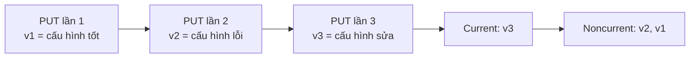
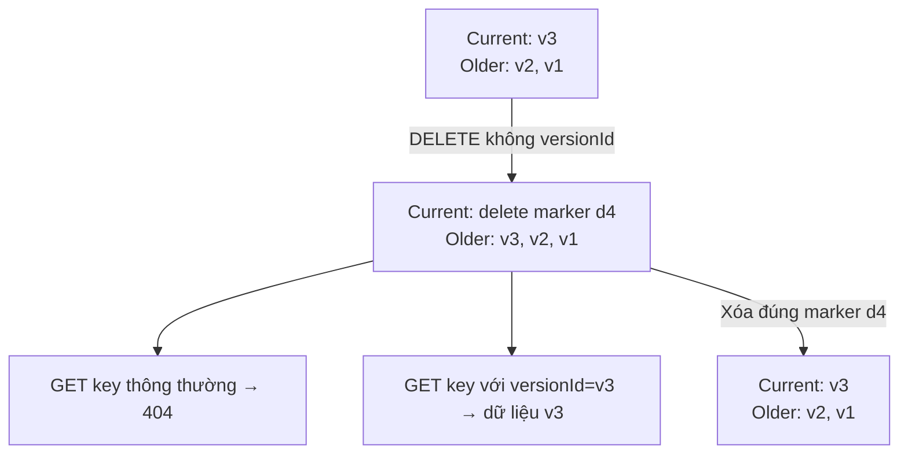

# Versioning, delete marker và bảo vệ dữ liệu

**Amazon Simple Storage Service (Amazon S3)** lưu dữ liệu dưới dạng **object** trong **bucket**. Khi ứng dụng ghi đè một object hoặc người dùng xóa nhầm, dữ liệu có thể không còn xuất hiện ở đường dẫn cũ. **S3 Versioning** giúp giữ lại các phiên bản lịch sử để khôi phục sau lỗi thao tác, lỗi ứng dụng hoặc một số sự cố bảo mật. Muốn dùng đúng, cần hiểu sự khác biệt giữa **object version**, **delete marker** và **xóa vĩnh viễn một version**.

Bài thuộc chương **Lưu trữ đối tượng S3** của học phần **CLOUD_PROVIDERS_AWS**. Kiến thức được dùng khi thiết kế ứng dụng EC2/Lambda tải object, lưu tài liệu của hệ thống nghiệp vụ, bảo vệ dữ liệu cơ sở dữ liệu xuất ra S3, tích hợp backup, IAM/KMS, giám sát phục hồi và kiểm soát chi phí trong hệ sinh thái AWS.

> **Phạm vi:** Bài này đề cập đến **S3 general purpose bucket**. S3 **directory bucket** (gắn với các tính năng như S3 Express One Zone) không hỗ trợ S3 Versioning, S3 Object Lock hoặc S3 Replication theo bộ tính năng của directory bucket. Kiểm tra loại bucket trước khi thực hành.

## 1. Mục tiêu học tập

Sau bài học, bạn có thể:

1. Phân biệt ba trạng thái **Unversioned**, **Enabled** và **Suspended** của S3 Versioning.
2. Giải thích **key**, **version ID**, **current version**, **noncurrent version**, **null version** và **delete marker**.
3. Dự đoán kết quả của `PUT`, `GET` và `DELETE` khi bucket đã bật hoặc tạm dừng versioning.
4. Khôi phục object sau khi bị ghi đè hoặc bị che bởi delete marker, tránh xóa nhầm version chứa dữ liệu.
5. Sử dụng AWS Console và AWS CLI để kiểm tra trạng thái bucket, liệt kê version và đọc phiên bản cũ.
6. Phân biệt bảo vệ bằng Versioning với **S3 Object Lock**, **MFA Delete**, **Lifecycle**, **Replication** và backup độc lập.
7. Thiết kế chính sách IAM, quy trình vận hành, giám sát và lưu giữ version phù hợp RPO/RTO.
8. Ước lượng rủi ro chi phí khi có nhiều noncurrent versions và delete markers.

## 2. S3 object và lý do cần Versioning

Một S3 object bao gồm **key** (tên định danh trong bucket), **dữ liệu** và **metadata**. Ví dụ:

```text
Bucket: app-documents-example
Key:    invoices/2026/invoice-001.pdf
URI:    s3://app-documents-example/invoices/2026/invoice-001.pdf
```

Khi không bật versioning, việc tải tệp mới cùng key thường thay thế dữ liệu hiện có tại key đó. Khi versioning được bật, S3 ghi một **phiên bản mới có version ID riêng**, đồng thời giữ lại các phiên bản cũ.

Ví dụ hệ thống hóa đơn:

- Ngày 1: tải `invoice-001.pdf`, nội dung chính xác.
- Ngày 2: lỗi ứng dụng ghi đè nội dung rỗng lên đúng key.
- Ngày 3: người vận hành phát hiện hóa đơn không đọc được.

Với Versioning đã bật **trước khi lỗi xảy ra**, hệ thống có thể tìm và khôi phục phiên bản Ngày 1, nếu phiên bản đó chưa bị xóa vĩnh viễn bởi chính sách hoặc thao tác khác.

**Versioning là một lớp phục hồi, không tự động là bản sao lưu độc lập.** Nếu người có quyền cao xóa vĩnh viễn tất cả các version hoặc Lifecycle đã xóa chúng, dữ liệu có thể không còn trong bucket. Với dữ liệu quan trọng, cân nhắc Object Lock, replication sang tài khoản/Region khác và backup độc lập.

## 3. Ba trạng thái của S3 Versioning

S3 Versioning được cấu hình ở **cấp bucket**, áp dụng cho các object trong bucket đó.

| Trạng thái | Cơ chế khi PUT cùng key | Cơ chế khi DELETE không chỉ định version ID | Khả năng phục hồi |
| --- | --- | --- | --- |
| **Unversioned** | Dữ liệu hiện tại bị thay thế theo hoạt động ghi | Xóa object; không có lịch sử version để khôi phục trong bucket | Không có bảo vệ bằng Versioning |
| **Enabled** | S3 tạo version ID mới; version cũ trở thành noncurrent | S3 chèn một **delete marker mới** làm current version | Có thể phục hồi version cũ nếu còn tồn tại và được cấp quyền |
| **Suspended** | S3 tạo hoặc ghi đè **null version**; các version có ID riêng từ trước vẫn tồn tại | S3 có thể xóa null version hiện có và đặt **null delete marker** | Version có ID riêng từ trước vẫn giữ; null version có thể mất khi bị ghi đè |

**Unversioned** là trạng thái của bucket chưa từng bật Versioning. Sau lần đầu chuyển sang **Enabled**, bucket **không thể quay trở về Unversioned**; có thể chuyển qua lại giữa **Enabled** và **Suspended**.

### 3.1. Enabled không tự tạo bản sao của mọi object cũ

Ví dụ bucket đã chứa `reports/summary.csv` từ lúc chưa bật Versioning. Object đó có version ID `null`. Khi bật Versioning:

- Object cũ vẫn có version ID `null`.
- S3 **không tự tạo thêm bản sao version khác** cho object cũ.
- Lần PUT mới vào cùng key sau khi Enabled có **version ID mới**, làm object `null` cũ trở thành một noncurrent version có thể truy cập qua version ID tương ứng.

Sau **lần đầu bật Versioning**, AWS khuyến nghị đợi khoảng **15 phút** để cấu hình lan truyền hoàn toàn trước khi thực hiện các thao tác ghi/xóa trên bucket. Trong giai đoạn chuyển đổi, yêu cầu GET đối với object vừa tạo hoặc cập nhật có thể tạm thời nhận `404 NoSuchKey`.

### 3.2. Suspended không xóa lịch sử hiện có

Tạm dừng Versioning giúp ngừng tích lũy các version có ID riêng **cho các lần ghi mới**, nhưng không xóa lịch sử đã có.

Ví dụ:

```text
Trước khi suspend:
  reports/a.json  current: v3
                  older:   v2, v1

Sau khi suspend, PUT lần đầu:
  reports/a.json  current: null  (nội dung mới)
                  older:   v3, v2, v1

Sau khi suspend, PUT thêm một lần cùng key:
  reports/a.json  current: null  (nội dung mới hơn, ghi đè null cũ)
                  older:   v3, v2, v1
```

Điểm cần nhớ: **null version được tạo khi Suspended có thể bị ghi đè vĩnh viễn**, vì bản ghi mới dùng cùng version ID `null`. Không nên coi trạng thái Suspended cung cấp mức phục hồi như Enabled.

## 4. Version ID, current và noncurrent version

Mỗi bản ghi object có một **version ID** do S3 tạo. Khi Versioning được bật, ID thường là một chuỗi opaque có thể chứa ký tự đặc biệt; không tự đặt version ID bằng timestamp hoặc số thứ tự.

| Khái niệm | Ý nghĩa | Ví dụ |
| --- | --- | --- |
| **Object key** | Tên logic của object trong bucket | `contracts/contract.pdf` |
| **Version ID** | Định danh riêng của một phiên bản (hoặc `null` trong trường hợp tương ứng) | `3Lg...Qx` |
| **Current version** | Phiên bản mới nhất tại key, cũng có thể là delete marker | `v3` |
| **Noncurrent version** | Phiên bản đã từng là current nhưng bị thay bằng version mới hoặc delete marker | `v1`, `v2` |
| **Delete marker** | Phiên bản đặc biệt không chứa nội dung object; làm key có vẻ đã bị xóa | `d4` |
| **Null version** | Phiên bản có version ID bằng `null` | Dữ liệu trước khi bật Versioning, hoặc dữ liệu ghi khi Suspended |

Một key có thể chứa nhiều **object versions**. Mỗi version object là một bản đầy đủ về mặt tính phí lưu trữ S3, **không phải bản delta giữa hai lần ghi**.

### 4.1. Dòng thời gian ghi đè

Giả sử bucket đã Enabled và đang lưu `settings/app.json`:



Sau ba lần ghi, dữ liệu tại key thông thường là version **v3**, nhưng v1/v2 vẫn tồn tại nếu chưa bị xóa. Các hoạt động GET/HEAD không có version ID thường tác động đến **current version**.

**Không nhầm byte của một object với bản diff:** ví dụ một tệp 100 MiB được ghi đè ba lần có thể tiêu thụ xấp xỉ 300 MiB dung lượng lưu trữ các version (chưa tính metadata, storage class, điều chỉnh tính phí và dữ liệu khác). Kích thước của một version không giảm chỉ vì nội dung ít thay đổi.

## 5. Delete marker: vì sao nhìn như đã xóa nhưng dữ liệu vẫn còn?

Trong bucket **Enabled**, lệnh xóa object **không chỉ định version ID** thường **không xóa dữ liệu cũ**. S3 tạo một phiên bản đặc biệt gọi là **delete marker**, trở thành **current version** của key đó.

### 5.1. Dòng thời gian xóa mềm



Một **delete marker không chứa dữ liệu của object**. Nó ghi nhận trạng thái xóa logic. Khi current version là delete marker:

- `GET` hoặc `HEAD` không có `versionId` thường trả `404 Not Found` với header `x-amz-delete-marker: true`.
- `GET` nếu **chỉ định chính version ID của delete marker** có thể trả `405 Method Not Allowed` kèm header delete marker.
- `GET` với version ID của bản dữ liệu cũ vẫn có thể lấy dữ liệu nếu quyền và các điều kiện cho phép.
- API `ListObjectsV2` không hiển thị object đang có current delete marker như một object bình thường; phải dùng `ListObjectVersions` để thấy lịch sử và marker.

**Đừng lập tức kết luận dữ liệu đã mất khi ứng dụng báo NoSuchKey.** Trước hết kiểm tra bucket Versioning, object versions và delete markers.

### 5.2. Xóa marker và xóa object version khác nhau

| Thao tác | Kết quả trong bucket Enabled | Mức độ rủi ro |
| --- | --- | --- |
| `DELETE key`, không gửi `versionId` | Tạo delete marker mới; version dữ liệu cũ vẫn còn | Có thể khôi phục nếu version cũ còn |
| `DELETE key?versionId=d4` (d4 là **delete marker**) | Xóa marker d4; version cũ tiếp theo có thể trở thành current | Là cách khôi phục xóa mềm khi đã xác minh marker đúng |
| `DELETE key?versionId=v3` (v3 là **version dữ liệu**) | **Xóa vĩnh viễn** version v3, không tạo marker để thay thế | Không thể hoàn tác bằng chính Versioning |
| PUT cùng key | Tạo version dữ liệu mới, trở thành current | Marker cũ và version cũ vẫn tồn tại; không tự xóa |

**Nguy cơ quan trọng:** Giao diện Console thường có **Show versions / List versions**. Chọn xóa một version cụ thể là thao tác xóa vĩnh viễn. Khi khôi phục, phải xác định mục được chọn là **delete marker** hay **data version** trước khi xác nhận.

### 5.3. Nhiều delete markers và thao tác xóa lặp

Nếu ứng dụng gọi `DELETE` nhiều lần trên cùng key ở bucket **Enabled**, S3 có thể thêm **nhiều delete marker** khác nhau. Xóa marker hiện tại sẽ lộ ra bản ngay sau nó trong thứ tự phiên bản; nếu bản đó cũng là delete marker, object **vẫn không xuất hiện** khi GET bình thường.

Để khôi phục chính xác, hãy xem toàn bộ **version history** và xác định trạng thái cần đạt trước khi xóa bất kỳ marker nào.

## 6. Versioning Suspended và delete marker có version ID null

Trạng thái **Suspended** có quy tắc khác với Enabled:

1. PUT tạo một **null version** mới hoặc ghi đè null version cũ ở cùng key.
2. DELETE **không chỉ định version ID** tạo **null delete marker**.
3. Nếu object có **null version dữ liệu**, S3 loại bỏ null version này khi tạo null delete marker.
4. Các version có ID khác `null` đã tạo từ lúc Enabled **vẫn được giữ** nếu chưa bị xóa vĩnh viễn.

Ví dụ:

```text
Tại thời điểm Enabled:
  invoices/a.pdf: current=v3, noncurrent=v2

Suspend rồi PUT:
  invoices/a.pdf: current=null(data), noncurrent=v3,v2

DELETE không versionId:
  invoices/a.pdf: current=null(delete marker), noncurrent=v3,v2
  → null(data) đã bị thay thế, không còn khôi phục bằng Versioning.

GET với versionId=v3:
  vẫn có thể đọc v3 nếu còn và có quyền.
```

Trong bucket Suspended, bạn vẫn có thể dùng `DELETE` kèm version ID thật để **xóa vĩnh viễn** một version cụ thể, nếu được cấp quyền và không bị cơ chế bảo vệ chặn.

**Khuyến nghị:** Không dùng Suspended như một cách “dừng phí” mà không đánh giá dữ liệu. Nó không xóa chi phí version cũ, có thể làm mất null version khi ghi đè và còn chịu ràng buộc của replication, Object Lock hoặc chính sách tổ chức.

## 7. Khôi phục sau khi ghi đè hoặc xóa nhầm

Có **hai tình huống phục hồi** chính:

- **Delete marker đang là current:** có thể xóa **chính delete marker đó** nếu được phép; version dữ liệu tiếp theo sẽ xuất hiện trở lại.
- **Một version dữ liệu mới bị lỗi:** chọn **version cũ còn tốt** và tạo một **current version mới** từ nội dung đó, thay vì xóa hàng loạt bản lịch sử.

### 7.1. Quy trình chuẩn trước khi phục hồi

1. Xác định bucket, key, AWS account, Region và nguồn yêu cầu khôi phục.
2. Xác nhận bucket đang Enabled/Suspended; kiểm tra **Show versions/ListObjectVersions**.
3. Xác định version ID, thời gian sửa, kích thước, checksum/metadata và bản nội dung mong muốn.
4. Kiểm tra quyền IAM, encryption (SSE-KMS nếu có) và Object Lock/retention.
5. Với dữ liệu quan trọng, lưu bằng chứng và cân nhắc tạo bản backup/replica trước khi thay đổi.
6. Chọn thao tác khôi phục phù hợp, thực hiện trong môi trường/khung thời gian được duyệt.
7. Kiểm tra nội dung, quyền đọc, metadata, cache/CDN và hoạt động của ứng dụng sau khôi phục.

### 7.2. Trường hợp A: xóa đúng delete marker

Giả sử lịch sử ở `reports/monthly.csv`:

| Loại | Version ID (ví dụ rút gọn) | Current? |
| --- | --- | --- |
| Delete marker | `d3` | Có |
| Object data tốt | `v2` | Không |
| Object data cũ | `v1` | Không |

Nếu xóa đúng **delete marker `d3`**, `v2` có thể trở thành current; ứng dụng dùng key thông thường đọc lại `v2`.

> **Cần thận trọng:** Lệnh xóa delete marker vẫn là một thao tác xóa **version** và cần quyền `s3:DeleteObjectVersion`. Nếu nhập nhầm `versionId=v2`, bạn sẽ xóa vĩnh viễn dữ liệu `v2`. Hãy đối chiếu trường `IsLatest` và danh sách `DeleteMarkers` trước khi thao tác.

### 7.3. Trường hợp B: phiên bản lỗi đang là current

Giả sử `v3` chứa dữ liệu lỗi nhưng là current, còn `v2` chứa nội dung đúng. Có thể dùng **S3 Console → Show versions → chọn v2 → thao tác copy về cùng key** (khi được hỗ trợ) hoặc **GET phiên bản v2 và PUT lại nội dung được kiểm chứng**. Lần PUT/copy mới ở bucket Enabled tạo version `v4`, trở thành current.

Sơ đồ:

```text
Trước phục hồi:
  current: v3 (lỗi)
  history: v2 (tốt), v1

Sau copy/PUT v2 trở thành phiên bản mới:
  current: v4 (nội dung sao chép từ v2)
  history: v3 (lỗi), v2 (tốt), v1
```

Nếu copy/download-upload, cần kiểm tra **Content-Type**, user metadata, tags, encryption, ACL/ownership, checksum và kích thước; không giả định mọi thuộc tính của object cũ tự giữ nguyên trong mọi cách khôi phục.

### 7.4. Khi version đã bị xóa vĩnh viễn

Nếu một data version đã bị xóa bằng `DELETE` có `versionId` hoặc Lifecycle `NoncurrentVersionExpiration` đã xóa nó, **S3 Versioning trong bucket không thể khôi phục version đó**. Chỉ những nguồn bảo vệ khác còn giữ dữ liệu (ví dụ backup, replica, bản xuất độc lập, hệ thống gốc) mới có thể giúp phục hồi.

Vì vậy, phiên bản cũ không nên là **lớp bảo vệ duy nhất** cho dữ liệu có yêu cầu kiểm toán hoặc RPO thấp.

## 8. Hướng dẫn AWS Console: bật Versioning và kiểm tra lịch sử

Các bước bên dưới áp dụng cho **general purpose bucket** do bạn quản trị. Tên mục giao diện có thể thay đổi theo phiên bản Console.

### 8.1. Bật S3 Versioning

1. Mở [Amazon S3 Console](https://console.aws.amazon.com/s3/), chọn đúng AWS account.
2. Vào **General purpose buckets**, chọn bucket cần quản trị.
3. Mở tab **Properties**, tìm **Bucket Versioning**.
4. Chọn **Edit → Enable → Save changes**.
5. Xác nhận trạng thái hiển thị **Enabled**.
6. Với lần đầu bật, tuân thủ khuyến nghị **chờ khoảng 15 phút** trước khi bắt đầu PUT/DELETE mới để tránh ảnh hưởng do lan truyền cấu hình.

Nếu bucket đã bật **S3 Object Lock**, việc tạm dừng Versioning không được phép. Không thay đổi cấu hình bucket production khi chưa đánh giá ảnh hưởng đến retention, replication, cost và ứng dụng.

### 8.2. Xem các object versions và delete marker

1. Vào tab **Objects** trong bucket.
2. Bật **Show versions** hoặc **List versions**.
3. Chọn key cần kiểm tra, xem các phiên bản và delete markers được hiển thị theo thời gian.
4. Xác định **version hiện hành**, version có dữ liệu, version bị đánh dấu xóa và yêu cầu phục hồi.
5. Với object còn tồn tại, kiểm tra version ID và metadata; với object đã bị che, tìm delete marker trong danh sách versions.

Không thực hiện **Delete objects** với lựa chọn các version lịch sử chỉ để “dọn màn hình”; hành động đó có thể là xóa vĩnh viễn.

## 9. AWS CLI: quan sát Versioning, versions và delete marker

Các lệnh `get`, `list`, `head`, `describe` và `sts get-caller-identity` trong phần này là các thao tác đọc theo phạm vi quyền. Dùng **AWS CLI v2** và profile từ IAM Identity Center/role; thay tên bucket ví dụ bằng tên thực được phép.

```bash
# Xác nhận tài khoản AWS đang đăng nhập.
aws sts get-caller-identity --profile training

# Kiểm tra versioning state của general purpose bucket.
aws s3api get-bucket-versioning \
  --bucket my-training-versioned-bucket \
  --profile training

# Xem tất cả versions và delete markers của một key.
aws s3api list-object-versions \
  --bucket my-training-versioned-bucket \
  --prefix reports/monthly.csv \
  --profile training

# Đọc metadata của một phiên bản dữ liệu cụ thể.
aws s3api head-object \
  --bucket my-training-versioned-bucket \
  --key reports/monthly.csv \
  --version-id "VERSION_ID_DA_XAC_MINH" \
  --profile training

# Tải một phiên bản cụ thể về máy để kiểm chứng dữ liệu.
# Chỉ chạy với object không chứa dữ liệu bí mật và có quyền tải.
aws s3api get-object \
  --bucket my-training-versioned-bucket \
  --key reports/monthly.csv \
  --version-id "VERSION_ID_DA_XAC_MINH" \
  --profile training \
  ./monthly-recovered.csv
```

Lệnh `get-bucket-versioning` có thể trả **đối tượng rỗng** khi bucket chưa từng bật Versioning; `Status: Enabled` hay `Status: Suspended` mới phản ánh trạng thái tương ứng. Trong phản hồi `list-object-versions`, phân biệt hai danh sách:

- `Versions`: các version **có dữ liệu**, có `VersionId`, `IsLatest` và thông tin khác.
- `DeleteMarkers`: các version **delete marker**, cũng có `VersionId` và `IsLatest`.

**Quan trọng:** dùng `--prefix reports/monthly.csv` có thể trả cả các key bắt đầu bằng prefix này như `reports/monthly.csv.backup`. Phải kiểm tra trường `Key` bằng chính xác key mục tiêu trước khi thao tác.

### 9.1. Lệnh thay đổi trạng thái: chỉ chạy khi đã được cấp quyền

```bash
# CÓ THAY ĐỔI CẤU HÌNH BUCKET: bật S3 Versioning.
aws s3api put-bucket-versioning \
  --bucket my-training-versioned-bucket \
  --versioning-configuration Status=Enabled \
  --profile training

# CÓ THAY ĐỔI CẤU HÌNH BUCKET: tạm dừng Versioning.
# Không chạy nếu bucket có Object Lock hoặc chính sách không cho phép.
aws s3api put-bucket-versioning \
  --bucket my-training-versioned-bucket \
  --versioning-configuration Status=Suspended \
  --profile training
```

`Status=Suspended` không đưa bucket về Unversioned, không xóa versions có ID từ trước và không bảo đảm dữ liệu mới được bảo vệ như lúc Enabled.

### 9.2. Lệnh xóa delete marker để phục hồi — thao tác nhạy cảm

Sau khi **xác minh chắc chắn** ID đang chọn là một **delete marker**, cú pháp có thể là:

```bash
# CHỈ LÀ VÍ DỤ: thay bằng VERSION ID của DELETE MARKER đã xác minh.
# Sai version ID có thể xóa vĩnh viễn dữ liệu thay vì phục hồi.
aws s3api delete-object \
  --bucket my-training-versioned-bucket \
  --key reports/monthly.csv \
  --version-id "DELETE_MARKER_VERSION_ID_DA_XAC_MINH" \
  --profile training

# Kiểm tra lại lịch sử và current version sau thay đổi.
aws s3api list-object-versions \
  --bucket my-training-versioned-bucket \
  --prefix reports/monthly.csv \
  --profile training
```

Không chạy lệnh này nếu chưa có sự cho phép của người sở hữu dữ liệu và bước xác nhận marker. Trong sản xuất, ưu tiên có kiểm tra chéo bởi người thứ hai và ghi lại sự kiện thay đổi.

## 10. IAM: ai được xem version, xóa marker, xóa version và sửa lifecycle?

**Versioning không tự chặn người có quyền xóa vĩnh viễn.** Thiết kế IAM/bucket policy cần tách rõ quyền thường ngày và quyền ứng cứu:

| Hành động | Quyền IAM thường liên quan | Nhận xét |
| --- | --- | --- |
| Đọc object hiện hành | `s3:GetObject` | Không tự cho phép đọc mọi version lịch sử |
| Đọc object version cụ thể | `s3:GetObjectVersion` | Cần phù hợp bucket policy, SCP, KMS nếu có |
| Liệt kê versions/delete markers | `s3:ListBucketVersions` | Quyền gắn lên ARN **bucket** |
| Xóa object không chỉ định version ID | `s3:DeleteObject` | Trong Enabled có thể thêm delete marker |
| Xóa data version **hoặc** delete marker theo ID | `s3:DeleteObjectVersion` | Rất nhạy cảm, có thể xóa không thể phục hồi |
| Đổi trạng thái Versioning | `s3:PutBucketVersioning` | Cần cấp cho nhóm quản trị có kiểm soát |
| Sửa Lifecycle | `s3:PutLifecycleConfiguration` | Có thể làm noncurrent versions bị xóa vĩnh viễn |
| Đọc Lifecycle | `s3:GetLifecycleConfiguration` | Hữu ích cho kiểm tra lịch sử lưu giữ |
| Đặt Object Lock retention/hold | Quyền Object Lock như `s3:PutObjectRetention`, `s3:PutObjectLegalHold` | Chỉ dành cho vai trò đã phê duyệt |

### 10.1. Ví dụ policy chỉ đọc object hiện hành và versions

Ví dụ **IAM identity policy** cho nhóm kiểm toán bucket **minh họa** `app-documents-example`, chỉ cấp quyền đọc dữ liệu:

```json
{
  "Version": "2012-10-17",
  "Statement": [
    {
      "Sid": "ListObjectsAndVersions",
      "Effect": "Allow",
      "Action": [
        "s3:ListBucket",
        "s3:ListBucketVersions"
      ],
      "Resource": "arn:aws:s3:::app-documents-example"
    },
    {
      "Sid": "ReadObjectsAndPreviousVersions",
      "Effect": "Allow",
      "Action": [
        "s3:GetObject",
        "s3:GetObjectVersion"
      ],
      "Resource": "arn:aws:s3:::app-documents-example/*"
    }
  ]
}
```

Policy này **không cấp** `s3:DeleteObjectVersion` hoặc `s3:PutBucketVersioning`. Khi triển khai, thay ARN bằng bucket thực; cần đối chiếu các policy khác của vai trò, SCP, bucket policy và KMS key policy để đánh giá quyền hiệu lực. S3 SSE-KMS có thể cần `kms:Decrypt` để đọc object.

### 10.2. Nguyên tắc bảo vệ vận hành

- Nhóm ứng dụng chỉ cần `PutObject`/`GetObject` trên prefix được giao, **không mặc định được `DeleteObjectVersion`**.
- Nhóm vận hành được đọc lịch sử, nhưng quyền phục hồi có khả năng xóa marker cần **phê duyệt và ghi log**.
- Quyền sửa Versioning/Lifecycle/Replication/Object Lock chỉ dành cho người quản trị được ủy quyền.
- Dùng **bucket policy và SCP** khi phù hợp để hạn chế hành vi xóa nhạy cảm trên toàn bộ account/tổ chức.
- Dùng **MFA cho tài khoản con người**, phiên tạm thời qua IAM Identity Center và role phù hợp; không tạo access key root cho ứng dụng.

## 11. MFA Delete: một lớp kiểm soát bổ sung với giới hạn riêng

**S3 MFA Delete** yêu cầu xác thực đa yếu tố bổ sung đối với các thao tác được bảo vệ trong bucket versioned:

- **Thay đổi trạng thái Versioning**.
- **Xóa vĩnh viễn một phiên bản object** (yêu cầu có version ID).

Điểm cần phân biệt:

1. MFA Delete **không phải** là tùy chọn bật MFA đăng nhập AWS thông thường.
2. Chỉ **root user của tài khoản sở hữu bucket** có thể bật hoặc tắt MFA Delete.
3. Không thể bật MFA Delete bằng S3 Console; phải dùng **AWS CLI hoặc API**.
4. MFA Delete **không dùng cùng S3 Lifecycle configurations**; cần xác định yêu cầu nghiệp vụ trước khi chọn.
5. Nó không thay thế Object Lock hoặc backup, và không phải cách bảo vệ mặc định cho mọi bucket.

Vì liên quan tới root credentials/MFA device và có hạn chế vận hành, bài lab **không yêu cầu bật MFA Delete**. Với môi trường doanh nghiệp, so sánh với **Object Lock** và ranh giới quyền IAM/SCP trước khi lựa chọn giải pháp.

## 12. S3 Object Lock: bảo vệ version khỏi bị xóa trong thời hạn quy định

**S3 Object Lock** bổ sung bảo vệ kiểu **Write Once, Read Many (WORM)** cho **từng object version**, dùng khi dữ liệu phải được giữ trong thời gian cố định hoặc đang có yêu cầu pháp lý.

Điều kiện quan trọng:

- Object Lock dùng cho **S3 general purpose bucket** với **Versioning Enabled**.
- Khi đã bật Object Lock cho bucket, **không thể tắt Object Lock hoặc suspend Versioning** trên bucket đó.
- Retention/Legal Hold **gắn với từng version**, không tự khóa mọi version có thể được PUT về sau.
- S3 vẫn có thể chèn **delete marker** lên trên version được khóa khi nhận DELETE không version ID; version dữ liệu được bảo vệ vẫn còn.

### 12.1. Governance, Compliance và Legal Hold

| Cơ chế | Bảo vệ | Ai có thể thay đổi? |
| --- | --- | --- |
| **Governance mode** | Ngăn phần lớn người dùng xóa/đổi retention của version | Quyền đặc biệt như `s3:BypassGovernanceRetention` và yêu cầu bypass phù hợp có thể cho phép thao tác |
| **Compliance mode** | Version không thể bị xóa/sửa retention trước ngày hết hạn, kể cả root | Không rút ngắn retention của version đã khóa; cần thiết kế thời hạn thật cẩn trọng |
| **Legal Hold** | Giữ version cho đến khi bỏ hold, không cần ngày kết thúc | Danh tính có quyền `s3:PutObjectLegalHold` có thể quản lý hold theo policy |

**Ví dụ kiểm toán:** object `audit/2026-11/report.pdf` được lưu với Compliance retention 365 ngày. Một người gọi `DELETE` có version ID của report trước hạn sẽ bị từ chối. Nếu họ gọi `DELETE` không version ID, hệ thống có thể chèn delete marker nhưng report đã khóa vẫn tồn tại; việc khôi phục cần kiểm tra version history.

### 12.2. Những lỗi thiết kế cần tránh

- Dùng Governance mode mà để quá nhiều vai trò có quyền bypass.
- Áp Compliance mode thời gian rất dài khi chưa đánh giá nghĩa vụ lưu giữ và khả năng ngừng sử dụng tài khoản.
- Cho rằng Object Lock ngăn mọi `PUT` hoặc delete marker; nó bảo vệ **version cụ thể**, các version mới vẫn có thể được tạo.
- Cho rằng bật Object Lock là đã có bản sao khác Region; cần **replication/backup** riêng nếu yêu cầu chịu sự cố toàn Region.
- Dùng Lifecycle xóa version còn đang trong retention; S3 sẽ không xóa version bị khóa cho tới khi điều kiện cho phép.

## 13. S3 Lifecycle và vòng đời của các version

Versioning giúp phục hồi, nhưng **mỗi phiên bản cũ vẫn có thể phát sinh phí lưu trữ**. **S3 Lifecycle** cho phép chuyển storage class hoặc xóa version theo quy tắc thời gian và số lượng version được giữ.

### 13.1. Các thao tác Lifecycle chính

| Cấu hình | Đối tượng áp dụng | Hiệu quả |
| --- | --- | --- |
| **Expiration** | Current data version | Với Enabled, thường **tạo delete marker**, làm current data thành noncurrent |
| **NoncurrentVersionTransition** | Noncurrent data versions | Chuyển các version lịch sử sang storage class phù hợp điều kiện |
| **NoncurrentVersionExpiration** | Noncurrent data versions | **Xóa vĩnh viễn** các version đủ điều kiện; không thể undo bằng Versioning |
| **ExpiredObjectDeleteMarker** | Delete marker hiện hành khi **không còn data version nào** bên dưới | Xóa marker đã hết ý nghĩa |
| **AbortIncompleteMultipartUpload** | Multipart upload chưa hoàn tất đủ ngày | Dọn dữ liệu upload dở để giảm chi phí |

Đặc biệt:

- **Expiration của current** trong bucket Enabled **không** tự xóa các noncurrent versions.
- Khi một key có current là delete marker và vẫn còn các version cũ, **ExpiredObjectDeleteMarker** không xóa marker đó vì nó chưa “expired” theo định nghĩa.
- **NoncurrentVersionExpiration xóa dữ liệu vĩnh viễn**. Retention phải dựa vào RPO/RTO và yêu cầu nghiệp vụ.
- Khi đặt **NoncurrentDays** cùng **NewerNoncurrentVersions**, bản cũ chỉ đủ điều kiện xóa khi **cả điều kiện tuổi và số lượng newer noncurrent versions đều vượt ngưỡng**; nếu object hiếm khi có thêm version, version cũ có thể được giữ lâu hơn dự kiến.
- Các version đang chịu Object Lock retention/Legal Hold được xử lý theo giới hạn của Object Lock.

### 13.2. Ví dụ Lifecycle JSON cho prefix lab

Ví dụ cấu hình **chỉ minh họa**: noncurrent versions của `lab/` có thể được xem xét xóa sau khi **không còn current ít nhất 30 ngày** và khi có **hơn ba newer noncurrent versions**; dọn marker nếu chỉ còn marker mà không còn data version.

```json
{
  "Rules": [
    {
      "ID": "lab-version-retention",
      "Status": "Enabled",
      "Filter": {
        "Prefix": "lab/"
      },
      "NoncurrentVersionExpiration": {
        "NoncurrentDays": 30,
        "NewerNoncurrentVersions": 3
      },
      "Expiration": {
        "ExpiredObjectDeleteMarker": true
      }
    }
  ]
}
```

Đây là cấu hình có khả năng **xóa vĩnh viễn dữ liệu khi đủ điều kiện**, không nên áp dụng vào bucket production chỉ để thử. Khi xây dựng chính sách thực tế, cần so khớp schema của AWS API, ảnh hưởng đến versions lịch sử, Object Lock, replication, minimum storage duration của storage class và chi phí.

**Ví dụ phân biệt:** nếu một file chỉ có hai noncurrent versions và không có thêm version mới, quy tắc giữ ba newer noncurrent versions trên có thể khiến các version cũ tiếp tục tồn tại dù đã quá 30 ngày. Hãy lập kế hoạch retention dựa trên **tuổi, số lượng và hành vi cập nhật thực tế**.

### 13.3. Bảo vệ dữ liệu và tối ưu chi phí bằng Lifecycle

Một cách tiếp cận thường dùng:

1. Phân loại dữ liệu: tài liệu giao dịch, log, tài liệu tạm, bản sao lưu.
2. Xác định **recovery window** (ví dụ cần phục hồi ghi đè trong 30 ngày) và yêu cầu pháp lý.
3. Ước lượng tần suất ghi đè và dung lượng mỗi version.
4. Chọn thời hạn noncurrent theo từng prefix/tag phù hợp và storage class thích hợp.
5. Review Lifecycle bằng người sở hữu dữ liệu và nhóm bảo mật trước khi bật.
6. Theo dõi số noncurrent versions thực tế qua S3 Storage Lens/Inventory.
7. Thử khôi phục trong phạm vi lịch sử được giữ để xác thực thiết kế.

Không nên dùng một Lifecycle xóa mọi version sau cùng số ngày cho cả **tài liệu cần lưu giữ** và **file cache tái tạo được**.

## 14. Replication và backup: vượt ra ngoài phạm vi một bucket

**Versioning bảo vệ nhiều phiên bản trong cùng bucket**, nhưng không bảo đảm tồn tại bản sao độc lập khỏi các quyền và sự cố chung. Các cơ chế mở rộng:

### 14.1. S3 Replication

S3 Replication có thể sao chép object sang bucket đích cùng Region (**SRR**) hoặc khác Region (**CRR**) theo rule. Thông thường:

- Bucket nguồn và bucket đích phải bật **Versioning**.
- Vai trò replication cần quyền đọc/ghi phù hợp; với SSE-KMS còn phải xem KMS permissions.
- Dùng cross-account/cross-Region replication khi muốn tách ranh giới chịu sự cố hoặc quyền quản trị.
- Thiết lập replication **không tự backfill toàn bộ object cũ** trong mọi trường hợp; có thể cần **S3 Batch Replication** để xử lý object đã tồn tại.
- Replication có **độ trễ và chi phí**; không giả định bằng chứng đã backup chỉ vì rule tồn tại.

### 14.2. Delete marker replication

Với quy tắc replication kiểu mới, **delete marker không được replicate mặc định**. Có thể cấu hình replicate delete marker ở quy tắc đủ điều kiện, nhưng cần cân nhắc hệ quả:

| Cấu hình | Khi nguồn DELETE không version ID | Tác động tại đích |
| --- | --- | --- |
| **Delete marker replication Disabled** | Nguồn tạo delete marker | Đích không tự nhận marker này; có thể tiếp tục phục vụ version dữ liệu |
| **Delete marker replication Enabled** | Nguồn tạo delete marker do tác động đủ điều kiện | Đích nhận marker theo quy trình replication; key có thể bị che tại đích |
| **DELETE một version với version ID** | Nguồn xóa vĩnh viễn một version | S3 thường **không replicate thao tác xóa version cụ thể** sang đích |

Lưu ý: delete marker do **S3 Lifecycle Expiration** tạo **không được replicate** theo cơ chế delete marker replication. Cấu hình replication dùng **tag filter** không hỗ trợ replicate delete markers. Vì vậy, nếu cần ứng xử nhất quán giữa các bucket, phải kiểm tra đúng loại rule, nguồn phát sinh marker và thời điểm nhận replication.

### 14.3. AWS Backup và bản sao độc lập

Với dữ liệu trọng yếu, cân nhắc **AWS Backup for S3** hoặc hệ thống backup khác, chính sách retention và quyền quản trị riêng. Nếu cần chống xóa ác ý hoặc ransomware, kết hợp bản sao độc lập, Object Lock/backup immutability và IAM/SCP.

**Không nhầm replication với backup:** replication thường sao chép nhanh thay đổi (và tùy rule có thể sao chép marker), còn backup có lịch lưu giữ/khôi phục độc lập theo chính sách được thiết kế. Kế hoạch tốt cần mô tả **RPO** (mất tối đa bao nhiêu dữ liệu theo thời gian) và **RTO** (khôi phục tối đa trong bao lâu), sau đó kiểm tra thực tế.

## 15. Bảo mật dữ liệu S3: Versioning chỉ là một lớp

Một kiến trúc bảo vệ object thường gồm nhiều lớp:

| Lớp | Biện pháp | Lý do |
| --- | --- | --- |
| **Truy cập** | IAM least privilege, bucket policy, SCP | Ngăn thao tác xóa/ghi trái phép |
| **Đăng nhập** | IAM Identity Center, MFA, temporary credentials | Giảm nguy cơ lộ thông tin xác thực |
| **Mã hóa** | SSE-S3 mặc định, SSE-KMS khi cần kiểm soát khóa | Bảo vệ dữ liệu lưu và kiểm soát giải mã |
| **Version history** | S3 Versioning Enabled | Có đường phục hồi sau ghi đè/xóa mềm |
| **Immutability** | S3 Object Lock retention/Legal Hold | Ngăn xóa vĩnh viễn version được bảo vệ |
| **Bản sao phục hồi** | Replication, AWS Backup, cross-account/cross-Region | Giảm phụ thuộc một bucket/một tài khoản |
| **Giám sát** | CloudTrail S3 data events, S3 Storage Lens, AWS Config, Security Hub khi dùng | Phát hiện thay đổi và hành vi đáng ngờ |
| **Chi phí** | S3 Lifecycle, S3 Storage Lens, Budgets | Kiểm soát tăng trưởng của noncurrent versions |

Mã hóa **không thay thế quyền truy cập**: nếu vai trò ứng dụng có `s3:DeleteObjectVersion`, dữ liệu có mã hóa vẫn có thể bị xóa version nếu không có chính sách/retention ngăn lại. Ngược lại, Object Lock không giúp phục hồi phiên bản chưa bao giờ được tạo hoặc đã bị xóa trước khi áp dụng retention.

### 15.1. Mô hình quyền đề xuất

- **Ứng dụng ghi dữ liệu:** cho `s3:PutObject`/`s3:GetObject` theo prefix; tránh `DeleteObjectVersion` nếu không cần.
- **Người vận hành đọc lịch sử:** cho `ListBucketVersions`/`GetObjectVersion`, không tự có quyền sửa retention.
- **Người phục hồi:** role được cấp theo quy trình, có quyền đọc version và thao tác cần thiết để tạo version phục hồi; nếu phải xóa marker thì cần kiểm soát riêng.
- **Quản trị bảo mật:** quản lý lifecycle, retention, replication và cấu hình bucket theo thay đổi đã phê duyệt.
- **Auditor:** quyền đọc configuration, logs và evidence, tránh quyền thay đổi hoặc xóa.

## 16. Quan sát và kiểm toán Versioning/delete marker

### 16.1. Theo dõi lịch sử dữ liệu và chi phí

**S3 Storage Lens** có các chỉ số giúp hiểu nguồn chi phí:

- **Current version storage bytes**.
- **Noncurrent version storage bytes/count**.
- **Delete marker object count/bytes**.
- Tổng dung lượng, số object, incomplete multipart uploads, các chỉ số khác tùy gói.

**S3 Inventory** có thể cung cấp báo cáo danh sách object và phiên bản (theo tùy chọn cấu hình), hữu ích cho rà soát số lượng lớn. Cả Storage Lens và Inventory có phạm vi/độ trễ cập nhật; chúng không phải danh sách thời gian thực của mọi API vừa diễn ra.

### 16.2. Theo dõi thao tác xóa và thay cấu hình

Để điều tra ai đã xóa key hoặc sửa trạng thái Versioning:

1. Với thay đổi cấu hình bucket, tra **AWS CloudTrail management events** liên quan như `PutBucketVersioning` hoặc `PutBucketLifecycleConfiguration`.
2. Với `PutObject`, `DeleteObject` trên object cụ thể, cần bật **CloudTrail S3 data events** cho phạm vi bucket/prefix phù hợp; data events thường không được ghi mặc định trong mọi trail và có thể phát sinh phí.
3. Kiểm tra principal/role, source IP, request parameters, object key, version ID, thời điểm sự kiện và kết quả API.
4. Đối chiếu với lịch sử version trong S3, S3 Storage Lens/Inventory và log ứng dụng.
5. Thiết lập cảnh báo cho thay đổi Lifecycle/Versioning trái phép và chuỗi xóa bất thường theo yêu cầu vận hành.

**Không dựa duy nhất vào HTTP 404 của ứng dụng** để kết luận bị xóa: 404 có thể do delete marker, sai key/Region, quyền truy cập hoặc vấn đề ứng dụng. Xác nhận bằng phiên bản/CloudTrail với quyền phù hợp.

## 17. Phân tích chi phí khi bật Versioning

### 17.1. Vì sao chi phí có thể tăng nhanh?

S3 tính phí theo **dung lượng của từng version**, không lưu version như một bản diff tự động.

Ví dụ giả lập: ứng dụng lưu một tệp dữ liệu `100 MiB` và ghi đè **mỗi ngày** trong 30 ngày. Nếu không có xóa version hay chuyển storage class, số bản lưu có thể lên tới khoảng **30 phiên bản**, tổng dung lượng xấp xỉ **3.000 MiB (~2,93 GiB)** cho cùng một key.

Đây là ví dụ để ước lượng, **không phải hóa đơn chính xác**. Hóa đơn còn phụ thuộc thời gian lưu của từng version, storage class, region, request, replication, inventory và các chi phí tối thiểu/khôi phục của lớp lưu trữ tương ứng.

### 17.2. Delete marker có tốn phí không?

**Có.** Delete marker không chứa payload object nhưng có metadata và key name. Chi phí lưu trữ của delete marker thường rất nhỏ so với object lớn, nhưng có thể đáng kể về số lượng/quản trị khi ứng dụng tạo hàng triệu marker. Nhiều marker cũng có thể ảnh hưởng hiệu năng của một số tác vụ liệt kê/quản lý version.

### 17.3. Những đòn bẩy chi phí cần cân nhắc

- Dùng **Lifecycle** phù hợp RPO/retention để xóa noncurrent versions hết hạn theo chính sách.
- Chọn **storage class** của noncurrent data có tính đến phí truy xuất, thời gian lưu tối thiểu và yêu cầu khôi phục.
- Dọn **expired object delete markers** sau khi không còn version dữ liệu, theo rule đúng.
- Giảm tần suất **ghi lại toàn bộ object lớn** nếu ứng dụng có thể thiết kế dữ liệu thành các object/bản ghi hợp lý.
- Kiểm tra phí **replication**, data transfer, Storage Lens nâng cao, CloudTrail data events, Inventory và KMS.
- Theo dõi **AWS Budgets**/Cost Explorer và người chịu trách nhiệm dọn tài nguyên thử nghiệm.

**Suspend Versioning không tự xóa các noncurrent versions hiện có**. Nếu bucket đã tích lũy nhiều lịch sử, hóa đơn không tự giảm chỉ vì chuyển status từ Enabled sang Suspended.

## 18. Bảng tình huống nhanh: thao tác nào còn phục hồi được?

| Tình huống | Kết quả | Có thể khôi phục từ Versioning? |
| --- | --- | --- |
| Ghi đè key khi Enabled | Version cũ thành noncurrent | **Có**, nếu version cũ còn |
| DELETE không `versionId` khi Enabled | Tạo delete marker | **Có**, xóa đúng marker hoặc tạo version mới |
| DELETE có `versionId` của data version | Xóa vĩnh viễn version đó | **Không**, cần nguồn bảo vệ khác |
| DELETE có `versionId` của delete marker | Xóa marker; có thể lộ version trước | **Có thể khôi phục hiển thị**, nhưng phải xác minh version ngay dưới |
| PUT cùng key khi Suspended | Ghi đè null version cũ | **Không** thể khôi phục null version đã bị ghi đè chỉ bằng Versioning |
| Lifecycle xóa noncurrent version | Xóa vĩnh viễn version đủ điều kiện | **Không**, trừ khi còn backup/replica |
| Xóa object version đang Object Lock Compliance retention | S3 từ chối xóa version trước hạn | Version được giữ; có thể có marker che |
| Delete marker là version duy nhất còn lại | Không có data version cũ ở key | **Không có dữ liệu để phục hồi** từ bucket |
| Bucket có replica/backup khác account | Có bản sao khác nếu replication/backup hoàn tất | **Có thể**, cần kiểm tra nguồn phục hồi |

## 19. Thực hành: mô phỏng lỗi ứng dụng và phương án khôi phục

**Bối cảnh:** dịch vụ Java chạy trên EC2/ECS/Lambda ghi object `reports/daily.json` vào bucket `my-training-versioned-bucket` đã bật Versioning. Bạn được giao thiết kế cách phục hồi khi bản dữ liệu bị ghi đè hoặc bị xóa nhầm.

### 19.1. Bài A: mô phỏng trên giấy, không tạo tài nguyên

Cho chuỗi thao tác:

| Thời điểm | Thao tác | Version ID | Nội dung |
| --- | --- | --- | --- |
| T1 | PUT `reports/daily.json` | `v1` | `{"total":100}` |
| T2 | PUT cùng key | `v2` | `{"total":0}` do lỗi |
| T3 | DELETE không version ID | `d3` | Delete marker |

Trả lời:

1. Sau T2, current version là gì? Version `v1` còn không?
2. Sau T3, `GET` không version ID trả dữ liệu gì?
3. `GET` có `versionId=v1` có thể truy xuất gì?
4. Nếu muốn làm current version trở lại bản T1 mà **không xóa lịch sử**, bạn sẽ làm gì?
5. Nếu chỉ xóa marker `d3`, current có phải `v1` không? Giải thích.
6. Nếu xóa vĩnh viễn `v1`, có thể phục hồi `v1` bằng chính Versioning không?

**Gợi ý kết quả:** sau khi xóa marker `d3`, current sẽ là `v2` (bản lỗi) vì nó là phiên bản ngay dưới marker; muốn phục hồi `v1` làm nội dung hiện hành, cần copy/PUT từ `v1` để tạo version mới.

### 19.2. Bài B: đọc AWS Console/CLI nếu có bucket sandbox

Chỉ thực hiện nếu được cấp một **bucket general purpose dùng học tập** và quyền phù hợp:

1. Xác nhận account và bucket đang thuộc quản lý của bạn.
2. Đọc trạng thái Versioning bằng `get-bucket-versioning`.
3. Liệt kê versions và delete markers trên một key thử nghiệm.
4. Ghi lại current version, noncurrent data versions và marker cùng ID đã **rút gọn** trong báo cáo nếu quy định yêu cầu.
5. Nếu được phép và tệp không chứa bí mật, tải **một version cũ** bằng `get-object --version-id` để đối chiếu nội dung.
6. Trình bày lệnh/procedure khôi phục dự kiến **nhưng không thực hiện xóa version thật** nếu chưa được phê duyệt.
7. Xem S3 Lifecycle/Storage Lens để giải thích chi phí của những version vẫn được giữ.

### 19.3. Bài C: thiết kế chính sách dữ liệu an toàn

Yêu cầu nhóm tự chọn một ứng dụng như **hóa đơn điện tử**, **tài liệu nội bộ** hoặc **file upload tạm thời** và hoàn thành:

| Mục thiết kế | Câu trả lời mong đợi |
| --- | --- |
| Dữ liệu nào cần giữ version? | Những key/prefix chứa dữ liệu quan trọng; lưu ý Versioning bật theo **bucket**, policy có thể lọc lifecycle theo prefix |
| Recovery window | Số ngày phải có thể khôi phục sau lỗi ghi đè |
| Quyền DeleteObjectVersion | Nhóm rất hạn chế, có phê duyệt |
| Cần Object Lock? | Có/Không, chọn governance/compliance và retention nếu cần |
| Cần replication? | Cùng Region/khác Region/account khác hoặc không, cùng lý do |
| Lifecycle | Tuổi noncurrent, số newer versions giữ, trạng thái delete marker |
| Giám sát | CloudTrail data events/Storage Lens/Budgets tùy mức dữ liệu |
| Cách thử khôi phục | Tạo object thử nghiệm, xác minh GET/copy và khôi phục trước khi mở rộng |
| Owner và chi phí | Nhóm chịu trách nhiệm và ngân sách dự kiến |

### 19.4. Mẫu báo cáo (không chứa thông tin nhạy cảm)

```text
AWS account / Region: ...
Bucket type: General purpose / Other
Bucket Versioning: Unversioned / Enabled / Suspended
Object key tested: ...
Current version type: Data / Delete marker
Current version ID (redacted): ...
Noncurrent data versions count: ...
Delete markers count: ...
Recovery approach: Remove verified marker / Copy verified old version / Backup
Expected recovery window: ...
Lifecycle noncurrent policy: ...
Object Lock / retention: ...
Replication / backup: ...
IAM role with DeleteObjectVersion: Restricted / Review needed
Monitoring and cost owner: ...
Evidence and reviewer date: ...
```

**Tiêu chí hoàn thành:** người học phân biệt được **xóa mềm** bằng marker với **xóa vĩnh viễn một version**, chỉ rõ cách khôi phục đúng bản dữ liệu, giải thích giới hạn của Suspended và có đề xuất bảo vệ/retention/chi phí phù hợp. Không cần tạo bucket có phí hoặc thực hiện lệnh DELETE để đạt yêu cầu kiến thức.

## 20. Câu hỏi tự kiểm tra

1. Tại sao cùng một key có thể chiếm dung lượng lớn hơn kích thước của current object?
2. Sau khi bật Versioning, object được tải lên trước đó có tự nhận một version ID mới không?
3. Khi `DELETE key` trong bucket Enabled, dữ liệu có lập tức bị xóa vĩnh viễn không?
4. Vì sao `GET key` trả 404 trong khi `ListObjectVersions` vẫn thấy các data versions?
5. Lệnh xóa có `versionId` của **delete marker** khác gì lệnh xóa có `versionId` của **data version**?
6. Trạng thái Suspended có còn tạo unique version ID mới cho mọi PUT không? Điều gì có thể xảy ra với null version cũ?
7. Tại sao người chỉ có quyền đọc object hiện hành chưa chắc được xem các object versions cũ?
8. S3 Object Lock Governance và Compliance khác nhau ở đâu? Retention trên v1 có ngăn tạo v2 không?
9. MFA Delete có được bật bằng S3 Console không? Có dùng chung Lifecycle được không?
10. Với Lifecycle giữ ba newer noncurrent versions và NoncurrentDays=30, nếu object chỉ có hai noncurrent versions thì dữ liệu có tự hết hạn sau 30 ngày không?
11. Replication có tự sao chép mọi delete marker và mọi lệnh xóa version cụ thể không?
12. Nếu ứng dụng bị ransomware có quyền `DeleteObjectVersion`, chỉ bật Versioning đã đủ bảo vệ chưa?
13. Những dữ liệu và chỉ số nào giúp điều tra một delete marker được tạo bởi người dùng hay Lifecycle?
14. Thiết kế thế nào để giảm chi phí noncurrent version mà vẫn đáp ứng RPO/RTO?

## 21. Tài liệu AWS chính thức

1. [S3 Versioning — Tổng quan](https://docs.aws.amazon.com/AmazonS3/latest/userguide/Versioning.html).
2. [How S3 Versioning works](https://docs.aws.amazon.com/AmazonS3/latest/userguide/versioning-workflows.html).
3. [Enable Versioning on a bucket](https://docs.aws.amazon.com/AmazonS3/latest/userguide/manage-versioning-examples.html).
4. [Working with delete markers](https://docs.aws.amazon.com/AmazonS3/latest/userguide/DeleteMarker.html).
5. [Manage delete markers and undelete objects](https://docs.aws.amazon.com/AmazonS3/latest/userguide/ManagingDelMarkers.html).
6. [Delete object versions](https://docs.aws.amazon.com/AmazonS3/latest/userguide/DeletingObjectVersions.html).
7. [Objects in a versioning-suspended bucket](https://docs.aws.amazon.com/AmazonS3/latest/userguide/VersionSuspendedBehavior.html).
8. [Deleting objects from versioning-suspended buckets](https://docs.aws.amazon.com/AmazonS3/latest/userguide/DeletingObjectsfromVersioningSuspendedBuckets.html).
9. [Configure S3 MFA Delete](https://docs.aws.amazon.com/AmazonS3/latest/userguide/MultiFactorAuthenticationDelete.html).
10. [S3 Object Lock](https://docs.aws.amazon.com/AmazonS3/latest/userguide/object-lock.html).
11. [S3 Object Lock considerations](https://docs.aws.amazon.com/AmazonS3/latest/userguide/object-lock-managing.html).
12. [S3 Lifecycle rule elements](https://docs.aws.amazon.com/AmazonS3/latest/userguide/intro-lifecycle-rules.html).
13. [Lifecycle examples for versioning-enabled buckets](https://docs.aws.amazon.com/AmazonS3/latest/userguide/lifecycle-configuration-examples.html).
14. [Replication requirements](https://docs.aws.amazon.com/AmazonS3/latest/userguide/replication-requirements.html).
15. [Replicating delete markers between buckets](https://docs.aws.amazon.com/AmazonS3/latest/userguide/delete-marker-replication.html).
16. [S3 Storage Lens metrics glossary](https://docs.aws.amazon.com/AmazonS3/latest/userguide/storage_lens_metrics_glossary.html).
17. [Differences for S3 directory buckets](https://docs.aws.amazon.com/AmazonS3/latest/userguide/s3-express-differences.html).
18. [Amazon S3 pricing](https://aws.amazon.com/s3/pricing/).

> **Ghi nhớ:** **Versioning lưu lịch sử; delete marker che key mà không tự xóa data versions; xóa theo version ID có thể xóa vĩnh viễn.** Muốn bảo vệ dữ liệu S3 thật sự, hãy phối hợp **quyền IAM tối thiểu, S3 Object Lock/backup khi cần, Lifecycle có kiểm soát và giám sát chi phí**.
