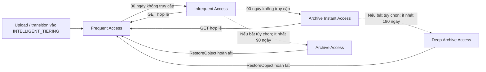
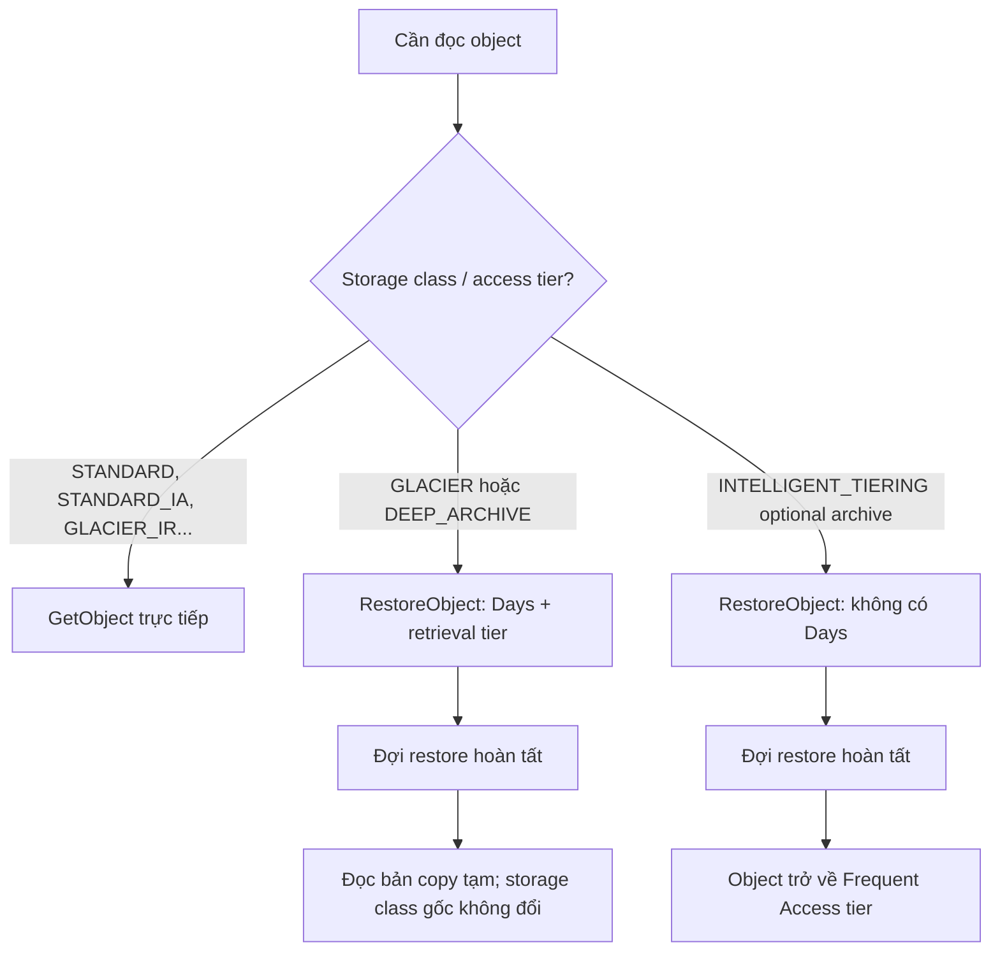
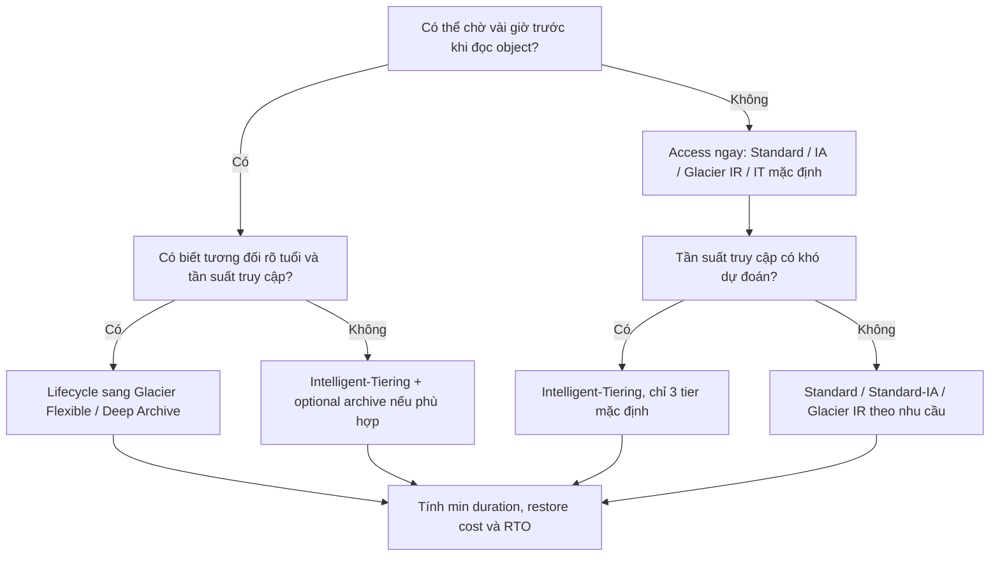

# Storage class, S3 Intelligent-Tiering và các lớp lưu trữ Glacier

> **Chương:** Lưu trữ đối tượng S3  
> **Module:** `CLOUD_PROVIDERS_AWS`  
> **Phạm vi:** Lựa chọn lớp lưu trữ Amazon S3 theo tần suất truy cập, độ trễ khôi phục, khả năng sẵn sàng, độ bền, bảo mật và chi phí; vận dụng S3 Intelligent-Tiering, S3 Glacier và S3 Lifecycle trong kiến trúc AWS có khả năng giám sát, phục hồi.

## Mục tiêu học tập

Sau bài học, người học có thể:

1. Phân biệt **S3 storage class** và **access tier** bên trong S3 Intelligent-Tiering; giải thích tại sao chúng không phải là hai khái niệm tương đương.
2. So sánh S3 Standard, Standard-IA, One Zone-IA, Intelligent-Tiering, Glacier Instant Retrieval, Glacier Flexible Retrieval và Glacier Deep Archive; nhận biết S3 Express One Zone khi độ trễ rất thấp là ưu tiên.
3. Mô tả chính xác **ba access tier tự động** và **hai archive access tier tùy chọn** của Intelligent-Tiering, bao gồm ngưỡng thời gian không truy cập và giới hạn object nhỏ.
4. Chọn giải pháp lưu trữ dài hạn giữa các lớp Glacier theo **thời gian truy xuất**, **minimum storage duration**, số lượng object và chi phí khôi phục.
5. Thiết kế **S3 Lifecycle** để chuyển lớp lưu trữ và hết hạn object; phân biệt với cơ chế chuyển tầng tự động của Intelligent-Tiering.
6. Thực hiện các lệnh AWS CLI để kiểm tra storage class, cấu hình Intelligent-Tiering, theo dõi Lifecycle và khôi phục object từ archive.
7. Xác định các kiểm soát về IAM, mã hóa, versioning, Object Lock, replication, giám sát, khôi phục dữ liệu và chi phí.

## 1. Vì sao Amazon S3 có nhiều storage class?

Amazon Simple Storage Service (Amazon S3) là dịch vụ **object storage**. Một object gồm **dữ liệu**, **object key** và **metadata** được quản lý trong bucket. Ứng dụng truy cập object qua S3 API/SDK, không thao tác nó như một block device EBS hay file system EFS truyền thống.

Các workload khác nhau có nhu cầu rất khác nhau:

- Ảnh sản phẩm của website được tải nhiều lần mỗi ngày.
- Báo cáo PDF có thể được mở vài lần mỗi tháng rồi không được xem trong thời gian dài.
- Bản backup lớn được giữ hàng năm để phục hồi khi có sự cố.
- Hồ sơ theo yêu cầu pháp lý có thể không được đọc trong nhiều năm, nhưng bắt buộc phải giữ.
- Dữ liệu phân tích truy cập thất thường, không thể dự báo được tần suất đọc.

Nếu sử dụng một storage class cho tất cả trường hợp, doanh nghiệp có thể trả nhiều phí lưu trữ không cần thiết hoặc đánh đổi khả năng truy xuất không phù hợp. **Storage class** cho phép lựa chọn sự cân bằng giữa chi phí lưu trữ, chi phí truy cập, thời gian lấy dữ liệu và khả năng sẵn sàng.

### 1.1 Storage class gắn với object, không phải mặc định cố định của cả bucket

Một **general purpose S3 bucket** có thể chứa nhiều object thuộc các storage class khác nhau:

```text
s3://orders-assets-example/
├── products/images/p001.jpg            S3 Standard
├── documents/2026/invoice-001.pdf       S3 Intelligent-Tiering
├── backups/quarterly/db-2026-q3.tar     S3 Glacier Instant Retrieval
└── compliance/2021/audit-records.gz     S3 Glacier Deep Archive
```

Các key và bucket ở trên chỉ minh họa, chưa phải tài nguyên có thật. Mỗi object có storage class của riêng nó. Khi gọi `PutObject` mà không chọn storage class, với general purpose bucket, S3 sử dụng **S3 Standard** theo mặc định.

Một số storage class có yêu cầu về loại bucket: chẳng hạn **S3 Express One Zone** sử dụng **directory bucket** và mô hình endpoint/hoạt động khác general purpose bucket. Không suy rằng mọi storage class đều dùng được với cùng loại bucket, endpoint hoặc tính năng.

### 1.2 Durability, availability và retrieval latency khác nhau

| Thuật ngữ | Câu hỏi thực tế | Ví dụ |
|---|---|---|
| **Durability (độ bền)** | Dữ liệu được thiết kế để ít có khả năng bị mất đến mức nào? | S3 Standard và nhiều storage class S3 được thiết kế cho 11 số 9 về độ bền |
| **Availability (khả năng sẵn sàng)** | Dịch vụ được thiết kế để cho phép thao tác đọc/ghi khi cần ở mức nào? | S3 Standard có mục tiêu availability khác One Zone-IA |
| **Retrieval latency** | Khi có quyền, sau bao lâu dữ liệu có thể được đọc? | Millisecond với Glacier Instant Retrieval; giờ với Deep Archive |
| **RPO** | Có thể chấp nhận mất bao nhiêu dữ liệu tính theo thời điểm? | Cần versioning/replication hoặc backup nếu muốn điểm phục hồi cũ |
| **RTO** | Tối đa bao lâu phải khôi phục dịch vụ? | Archive cần nhiều giờ có thể không đáp ứng RTO vài phút |

**Độ bền cao không đồng nghĩa không thể xóa nhầm.** Một thao tác `DeleteObject` được ủy quyền, một ransomware có quyền IAM hoặc một lifecycle rule cấu hình sai vẫn có thể làm mất quyền truy cập dữ liệu hoặc xóa bản dữ liệu hiện hành. Versioning, Object Lock và bản sao phù hợp giải quyết những rủi ro khác nhau.

## 2. Bảng so sánh các storage class phổ biến

Các giá trị bên dưới trình bày **nguyên tắc thiết kế** và những mốc tối thiểu thường được AWS công bố. Giá, quota và một số tính năng có thể thay đổi theo Region, loại bucket và thời điểm; kiểm tra tài liệu S3 và trang giá hiện hành trước khi triển khai.

| Storage class / API value | Tình huống phù hợp | Đọc dữ liệu | Minimum storage duration | Điểm cần chú ý |
|---|---|---|---|---|
| **S3 Standard** / `STANDARD` | Dữ liệu được truy cập thường xuyên | Trực tiếp, mili giây | Không có | Lưu nhiều AZ; mặc định cho object mới ở general purpose bucket |
| **S3 Intelligent-Tiering** / `INTELLIGENT_TIERING` | Tần suất truy cập không biết trước hoặc thay đổi | Trực tiếp ở ba tầng mặc định; cần restore ở hai tầng archive tùy chọn | Không có minimum duration của storage class | Monitoring/automation fee cho object đủ điều kiện; object nhỏ không tự chuyển tầng |
| **S3 Standard-IA** / `STANDARD_IA` | Object ít đọc nhưng khi đọc phải có ngay | Trực tiếp, mili giây | 30 ngày | Minimum billable size 128 KB; phí retrieval |
| **S3 One Zone-IA** / `ONEZONE_IA` | Dữ liệu có thể tạo lại, chấp nhận rủi ro mất một AZ | Trực tiếp, mili giây | 30 ngày | Chỉ một AZ; minimum billable size 128 KB; phí retrieval |
| **S3 Glacier Instant Retrieval** / `GLACIER_IR` | Lưu dài hạn, hiếm đọc nhưng cần lấy ngay | Trực tiếp, mili giây | 90 ngày | Minimum billable size 128 KB; phí retrieval |
| **S3 Glacier Flexible Retrieval** / `GLACIER` | Backup/archive ít được đọc, chấp nhận đợi | **Restore trước**, từ phút đến giờ | 90 ngày | Có các chế độ Expedited/Standard/Bulk; overhead metadata |
| **S3 Glacier Deep Archive** / `DEEP_ARCHIVE` | Lưu nhiều năm, hiếm truy xuất, RTO dài | **Restore trước**, thường nhiều giờ | 180 ngày | Không có Expedited; overhead metadata |
| **S3 Express One Zone** / `EXPRESS_ONEZONE` | Ứng dụng rất nhạy độ trễ trong một AZ | Trực tiếp, độ trễ mili giây một chữ số | Không có | Directory bucket, một AZ; API/tính năng khác general purpose bucket |

**Minimum storage duration** là thời gian **tính phí tối thiểu**, không phải lệnh bắt buộc giữ object. Xóa hoặc overwrite object sớm hơn thời hạn này có thể phát sinh phí cho phần thời gian còn lại. Cần phân biệt với retention cưỡng chế bởi **S3 Object Lock**.

### 2.1 S3 Standard và Standard-IA

**S3 Standard** thích hợp cho ảnh đang hiển thị trên website, Java service đọc object thường xuyên, dữ liệu streaming hoặc dữ liệu cần mức sẵn sàng cao.

**S3 Standard-IA** (Infrequent Access) cho phép đọc ngay nhưng có giá lưu trữ khác và phát sinh **data retrieval charge**. Lớp này phù hợp object sống đủ lâu, kích thước đáng kể và tần suất đọc thấp. Nếu app tải toàn bộ object mỗi giờ, Standard-IA thường không đem lại lợi ích mong đợi do phí truy xuất.

### 2.2 S3 One Zone-IA và S3 Express One Zone

Hai lớp này đều có điểm chung là **một AZ**, nhưng mục tiêu khác:

- **One Zone-IA**: tối ưu lưu trữ dữ liệu ít đọc, có thể tái tạo và chấp nhận mất một AZ. Không phù hợp làm bản sao duy nhất của dữ liệu không thể thay thế.
- **Express One Zone**: tối ưu hiệu năng/độ trễ với directory bucket, hướng tới truy cập thường xuyên và hiệu năng cao trong một AZ; không đơn thuần là “One Zone-IA nhanh hơn”.

Đối với dữ liệu cần khả năng chịu lỗi cấp AZ, ưu tiên mô hình lưu trên nhiều AZ hoặc có bản copy/replication phù hợp thay vì chỉ dựa vào một lớp One Zone.

## 3. S3 Intelligent-Tiering: tối ưu khi khó dự báo truy cập

**S3 Intelligent-Tiering** là một **storage class** có nhiều **access tier** bên trong. Sau khi đưa object vào storage class này, S3 có thể tự động chuyển object giữa các tầng để giảm chi phí lưu trữ dựa trên hoạt động truy cập.

Cần giữ nguyên sự phân biệt:

```text
Storage class = INTELLIGENT_TIERING
                   |
                   +-- Frequent Access
                   +-- Infrequent Access
                   +-- Archive Instant Access
                   +-- Archive Access       (tùy chọn)
                   +-- Deep Archive Access  (tùy chọn)
```

Trong quá trình chuyển giữa các access tier, giá trị **storage class vẫn là `INTELLIGENT_TIERING`**. Đó không phải thao tác S3 Lifecycle tự đổi storage class thành `STANDARD_IA` hay `GLACIER`.

### 3.1 Ba tầng tự động, không yêu cầu kích hoạt archive thủ công

| Tier | Điều kiện thông thường | Tốc độ truy cập | Có phải gọi RestoreObject không? |
|---|---|---|---|
| **Frequent Access** | Tầng mặc định khi đưa object vào Intelligent-Tiering; object đang được truy cập | Mili giây | Không |
| **Infrequent Access** | Không có truy cập phù hợp trong **30 ngày liên tiếp** | Mili giây | Không |
| **Archive Instant Access** | Không có truy cập phù hợp trong **90 ngày liên tiếp** | Mili giây | **Không** |

Ba tầng này là một phần của cơ chế thông thường của S3 Intelligent-Tiering. **Archive Instant Access không phải S3 Glacier Instant Retrieval**: tên gần giống nhau nhưng một bên là **access tier** bên trong Intelligent-Tiering, bên kia là **storage class** `GLACIER_IR`.

Một object mới bắt đầu từ Frequent Access. Nếu không được đọc, nó lần lượt đủ điều kiện chuyển xuống tầng có chi phí lưu trữ thấp hơn. Khi một object ở Infrequent Access hoặc Archive Instant Access được truy cập theo hành động được AWS coi là access, nó tự được chuyển lên Frequent Access mà không cần restore bất đồng bộ.

### 3.2 Hai archive access tier tùy chọn

Để giảm thêm chi phí cho dữ liệu **có thể đợi restore**, bạn phải chủ động bật cấu hình Intelligent-Tiering archive phù hợp cho bucket, prefix hoặc object tag.

| Optional tier | Điều kiện cấu hình | Đọc object | Ghi chú |
|---|---|---|---|
| **Archive Access** | Sau **ít nhất 90 ngày** không truy cập; có thể đặt tối đa 730 ngày | Cần `RestoreObject`; Standard thường 3–5 giờ | Cùng kiểu truy xuất với S3 Glacier Flexible Retrieval |
| **Deep Archive Access** | Sau **ít nhất 180 ngày** không truy cập; có thể đặt tối đa 730 ngày | Cần `RestoreObject`; Standard thường trong 12 giờ | Cùng kiểu truy xuất với S3 Glacier Deep Archive |

**Hai tier này không tự bật mặc định.** Bạn có thể bật một, cả hai hoặc không bật. Nếu bật Archive Access đúng mốc 90 ngày, object có thể bỏ qua Archive Instant Access để chuyển thẳng sang archive bất đồng bộ khi đủ điều kiện. Vì vậy trước khi bật phải kiểm tra **SLA/RTO của ứng dụng**.

### 3.3 Luồng chuyển tier theo thời gian



Sơ đồ đơn giản hóa các đường chuyển và mốc tính theo **lần truy cập phù hợp gần nhất**. Không đọc nó như một cam kết rằng tất cả hành động xảy ra đúng chính xác đến giây thứ 30/90/180.

### 3.4 Hoạt động nào được coi là truy cập?

Các hành động như `GetObject`, thao tác download/copy object và một số hoạt động thao tác nội dung theo tài liệu AWS có thể làm đối tượng được tính là đã truy cập.

Ngược lại, **`HeadObject` hoặc `ListObjectsV2` không mặc nhiên đưa object từ Infrequent Access/Archive Instant Access trở lại Frequent Access**. Đọc metadata và tải nội dung là hai hành động khác nhau. Một số API như `SelectObjectContent` có quy tắc đặc thù; khi xây hệ thống tự động hóa, tham chiếu danh sách API “có/không làm đổi tier” trong tài liệu chính thức thay vì suy từ tên thao tác.

Khi object ở một trong hai optional archive tier, để đọc nội dung cần **restore bất đồng bộ**. Sau khi restore hoàn tất, đối tượng chuyển về Frequent Access; không áp dụng mô hình bản copy tạm hết hạn giống Glacier Flexible Retrieval/Deep Archive.

### 3.5 Giới hạn object nhỏ hơn 128 KB

Trong Intelligent-Tiering:

- Object **nhỏ hơn 128 KB** không được theo dõi và không đủ điều kiện tự chuyển access tier.
- Chúng **luôn ở Frequent Access tier** và **không chịu monitoring/automation fee theo object**.
- Object từ **128 KB trở lên** đủ điều kiện được theo dõi/chuyển tier, nhưng có **monitoring and automation charge** theo số lượng object.

**Ví dụ:** Nếu ứng dụng lưu hàng triệu file JSON rất nhỏ, chọn Intelligent-Tiering không có nghĩa các file này sẽ tự giảm xuống Infrequent Access sau 30 ngày. Với số lượng object lớn, chi phí request, metadata và monitoring (nếu đủ điều kiện) cũng phải được đưa vào mô hình tổng chi phí.

### 3.6 S3 Intelligent-Tiering có thực sự không thu phí retrieval?

AWS công bố **không có data retrieval fees** đối với S3 Intelligent-Tiering. Tuy nhiên:

- Monitoring/automation fee vẫn áp dụng cho object đủ điều kiện.
- Các thao tác `PUT`, `GET`, restore request, data transfer và những dịch vụ như KMS có thể vẫn tính phí theo loại hoạt động/giá hiện hành.
- **Expedited** restore từ Archive Access là tùy chọn cao cấp và có thể phát sinh phí riêng.
- Hai tầng archive tùy chọn **vẫn yêu cầu chờ restore** trước khi có thể đọc nội dung.

Vì vậy “không có retrieval fee” không có nghĩa mọi lần đọc hoặc khôi phục từ Intelligent-Tiering hoàn toàn miễn phí.

### 3.7 Khi nào không nên bật archive tiers?

Không bật Archive Access/Deep Archive Access cho các object mà ứng dụng **bắt buộc trả về ngay** khi có request bất kỳ, ví dụ ảnh cần render ngay, chứng từ phải tải trong vài trăm mili giây hoặc file mà hệ thống tự động đọc lại ngay cả sau 6 tháng không sử dụng.

Với dữ liệu có access pattern không biết trước nhưng cần đọc ngay, **chỉ sử dụng ba tầng tự động** thường phù hợp hơn. Với dữ liệu có thể chờ hàng giờ và tần suất đọc khó dự đoán, hãy xem xét bật optional archive và thiết kế luồng yêu cầu restore trước khi download.

## 4. Ba storage class S3 Glacier: cùng tên “Glacier” nhưng khác trải nghiệm

Amazon S3 có ba storage class thuộc nhóm Glacier. Đây là **storage class của object trong S3 bucket**, khác với việc dùng dịch vụ **Amazon Glacier vault** đời cũ.

### 4.1 S3 Glacier Instant Retrieval

- API value: `GLACIER_IR`.
- Dành cho object ít truy cập, có thời gian lưu dài và cần **đọc ngay ở mức mili giây**.
- Không cần `RestoreObject` trước mỗi lần `GetObject`.
- **Minimum storage duration: 90 ngày**.
- **Minimum billable object size: 128 KB**.
- Có thể có retrieval fee và phí request, tùy biểu giá.

**Tình huống:** Hợp đồng/hồ sơ chỉ được tải vài lần mỗi quý nhưng hệ thống hỗ trợ khách hàng cần mở tài liệu ngay khi yêu cầu. Nếu dữ liệu thực sự hiếm đọc và mỗi yêu cầu không được phép chờ giờ, Glacier Instant Retrieval có thể phù hợp.

### 4.2 S3 Glacier Flexible Retrieval

- API value: `GLACIER`, dù tên hiển thị là **S3 Glacier Flexible Retrieval**.
- Dữ liệu thuộc nhóm **archived**, không đọc trực tiếp bằng `GetObject` trước khi restore.
- **Minimum storage duration: 90 ngày**.
- Hỗ trợ **Expedited**, **Standard** và **Bulk** retrieval.
- Đặc biệt phù hợp bản backup hoặc bộ dữ liệu phục hồi thảm họa được đọc hiếm khi.

Các mốc thường gặp:

| Retrieval option | Thời gian tham khảo | Tình huống |
|---|---|---|
| **Expedited** | Thường 1–5 phút cho object dưới 250 MB; tốc độ/khả năng phục vụ có điều kiện | Phục hồi khẩn cấp một số object |
| **Standard** | Thường 3–5 giờ | Khôi phục bình thường |
| **Bulk** | Thường 5–12 giờ | Phục hồi số lượng lớn, ưu tiên chi phí |

Mốc trên là **thời gian thường gặp**, không phải bảo đảm cứng cho mọi kích thước/tải. Expedited là tính năng trả phí cao hơn và có thể cần mua provisioned capacity nếu muốn khả năng phục vụ dự đoán được. Bulk retrieval của S3 Glacier Flexible Retrieval được AWS mô tả là miễn phí retrieval; các chi phí request/restore copy/data transfer khác vẫn cần kiểm tra theo cấu hình.

### 4.3 S3 Glacier Deep Archive

- API value: `DEEP_ARCHIVE`.
- Phù hợp dữ liệu lưu nhiều năm, hiếm khi phải đọc và chấp nhận thời gian khôi phục dài.
- **Minimum storage duration: 180 ngày**.
- Phải **restore trước** khi đọc; không có lựa chọn Expedited.
- Standard retrieval thường trong 12 giờ; Bulk retrieval có thể tới 48 giờ.

**Tình huống:** Hồ sơ kiểm toán/pháp lý được giữ dài hạn, hầu như không được đọc, có quy trình cung cấp trong một vài ngày nếu được yêu cầu. Nếu nghiệp vụ đòi hỏi phục hồi trong 30 phút, chỉ lưu bản duy nhất tại Deep Archive là thiết kế không đáp ứng mục tiêu.

### 4.4 So sánh ba lớp Glacier

| Tiêu chí | Glacier Instant Retrieval | Glacier Flexible Retrieval | Glacier Deep Archive |
|---|---|---|---|
| Đọc trực tiếp | Có, mili giây | Không | Không |
| Restore trước khi GET | Không | Có | Có |
| Minimum duration | 90 ngày | 90 ngày | 180 ngày |
| Expedited | Không cần | Có (với điều kiện) | Không |
| Standard restore | Không áp dụng | Thường 3–5 giờ | Thường trong 12 giờ |
| Bulk restore | Không áp dụng | Thường 5–12 giờ | Thường trong 48 giờ |
| Phù hợp nhất | Ít đọc nhưng cần ngay | Backup/archive có thể chờ giờ | Lưu rất dài, hiếm đọc, RTO dài |

### 4.5 Overhead cho object archive rất nhỏ

Với **S3 Glacier Flexible Retrieval** và **S3 Glacier Deep Archive**, AWS lưu thêm **40 KB metadata cho mỗi object**: 32 KB được tính ở mức giá archive tương ứng và 8 KB ở mức giá S3 Standard. Điều này quan trọng khi archive hàng triệu object nhỏ.

Nếu lưu các event log có kích thước vài KB, việc nén/gom hợp lý nhiều log thành object lớn hơn, có index và cơ chế truy tìm, có thể giảm overhead. Tuy nhiên đừng gom đến mức không thể tìm, restore hoặc xử lý một phần dữ liệu theo RTO mong muốn.

**Glacier Instant Retrieval** có minimum billable object size 128 KB; đó là cơ chế khác với overhead 40 KB của Flexible/Deep Archive.

## 5. Restore trong S3 Glacier khác với Intelligent-Tiering như thế nào?

Đây là một khác biệt vận hành rất quan trọng.

### 5.1 Khôi phục object trong Glacier Flexible Retrieval/Deep Archive

Khi object thuộc storage class `GLACIER` hoặc `DEEP_ARCHIVE`:

1. Ứng dụng gọi `RestoreObject`, xác định số ngày giữ bản sao tạm và retrieval tier phù hợp.
2. S3 đưa yêu cầu vào quá trình khôi phục bất đồng bộ.
3. Khi hoàn tất, object gốc **vẫn thuộc storage class archive**.
4. S3 cung cấp **bản copy tạm** có thể đọc trong số ngày đã chọn; phí có thể gồm cả archive gốc và bản copy được restore.
5. Hết hạn bản copy tạm, ứng dụng lại phải restore nếu muốn đọc dữ liệu.

Nếu muốn biến bản khôi phục thành một object được lưu **lâu dài ở storage class khác**, sau khi restore cần **copy** object sang key/class đích bằng API/SDK/CLI phù hợp; chỉ gọi restore không phải một thao tác chuyển class vĩnh viễn.

### 5.2 Khôi phục optional archive access tier của Intelligent-Tiering

Khi object có storage class `INTELLIGENT_TIERING` và đang ở Archive Access hoặc Deep Archive Access:

1. Gọi `RestoreObject` mà **không truyền `Days`**.
2. Đợi S3 hoàn tất restore bất đồng bộ.
3. Object được **đưa trở lại Frequent Access tier** của chính Intelligent-Tiering.
4. Nếu về sau tiếp tục không được truy cập, cơ chế tự chuyển tier lại hoạt động theo cấu hình.

Không áp dụng cách hiểu “bản copy tạm có thời hạn 7 ngày” của Flexible/Deep Archive cho Intelligent-Tiering optional archive.

### 5.3 Sơ đồ hai quy trình



### 5.4 Restore time và RTO

Thời gian restore từ Glacier là **điều kiện thiết kế**. Một hệ thống chịu tải với hàng triệu object archive có thể tốn thêm thời gian do giới hạn tốc độ yêu cầu, thông lượng restore, kích thước object và mức sử dụng.

Khi phục hồi quy mô lớn, xem xét **S3 Batch Operations** để thực hiện nhiều restore requests và theo dõi tiến độ tập trung. Kiểm thử toàn bộ hành trình: gửi job, chờ restore, kiểm tra trạng thái, tải dữ liệu, giải mã/decompress và tái xây dựng ứng dụng.

## 6. S3 Lifecycle: tự động đổi storage class và hết hạn object

**S3 Lifecycle** là cơ chế thiết lập **rule** cho object trong bucket nhằm tự động:

- **Transition:** chuyển object sang một storage class khác khi đạt điều kiện tuổi/ngày hoặc thuộc tính theo rule.
- **Expiration:** xóa các object/version đủ điều kiện theo chính sách.
- Quản lý phiên bản cũ trong bucket có versioning, ví dụ **noncurrent version transitions/expiration**.
- Xử lý incomplete multipart uploads và một số hành động vòng đời khác.

**Lifecycle khác Intelligent-Tiering auto-tiering:**

| Cơ chế | Điều kiện chủ yếu | Kết quả |
|---|---|---|
| **S3 Lifecycle transition** | Tuổi object tính từ thời điểm tạo, prefix/tag/size và rule | Đổi **storage class** như `STANDARD` → `GLACIER` |
| **S3 Intelligent-Tiering automatic tiering** | Tần suất/độ lâu không được truy cập theo dịch vụ | Giữ storage class `INTELLIGENT_TIERING`, đổi **access tier** |
| **Intelligent-Tiering archive configuration** | Bật optional tier và ngày không truy cập phù hợp | Cho phép tự vào optional archive tier; vẫn trong Intelligent-Tiering |
| **S3 Lifecycle expiration** | Tuổi hiện hành/noncurrent và rule | Xóa theo quy định versioning/retention/Object Lock |

Nếu dữ liệu có lịch sử khá ổn định và biết chắc “sau một năm không cần đọc ngay”, Lifecycle sang Glacier có thể dễ dự toán. Nếu tần suất khó dự báo, Intelligent-Tiering có thể giúp giảm công việc điều chỉnh rule.

### 6.1 Ví dụ lộ trình dữ liệu 2 năm

Giả sử một hệ thống xuất báo cáo PDF mới:

```text
Ngày 0       : Standard (báo cáo mới có thể được đọc liên tục)
Sau 30 ngày  : Standard-IA (ít đọc, cần mở ngay)
Sau 120 ngày : Glacier Flexible Retrieval (chấp nhận khôi phục theo giờ)
Sau 365 ngày : Glacier Deep Archive (lưu lâu, rất ít đọc)
Hết retention: Expire theo yêu cầu dữ liệu và Object Lock (nếu có)
```

Đây là **kịch bản minh họa**, không phải rule mặc định. Các mốc được chọn để không đòi hỏi chuyển khỏi một lớp có minimum duration quá sớm. Nhưng nếu người dùng quay lại đọc báo cáo thường xuyên, chi phí retrieval và restore có thể khiến lộ trình này không phù hợp.

### 6.2 Lifecycle được áp dụng như thế nào trong bucket có versioning?

Khi bật S3 Versioning, cùng một object key có thể có nhiều **version IDs**. Lifecycle đối với current version khác hành động dành cho **noncurrent versions**.

Ví dụ khi một object bị xóa trong bucket có versioning:

- S3 thường thêm **delete marker** làm phiên bản hiện hành, thay vì lập tức xóa vĩnh viễn toàn bộ dữ liệu của các version trước.
- Những noncurrent versions có thể tiếp tục tiêu thụ dung lượng cho đến khi lifecycle/điều kiện xóa phù hợp.
- Rule `Expiration` cho current object và `NoncurrentVersionExpiration` cho phiên bản cũ giải quyết các nhu cầu khác nhau.
- S3 Object Lock retention hoặc legal hold có thể **ngăn xóa version được bảo vệ**, kể cả khi Lifecycle đã đến hạn.

**Không bao giờ bật expiration hoặc noncurrent version expiration trên dữ liệu quan trọng mà chưa xem xét khôi phục, bảo vệ xóa nhầm và chính sách pháp lý.**

### 6.3 Quy tắc mặc định cho object dưới 128 KB

Từ **tháng 9/2024**, với S3 Lifecycle configurations mới hoặc được cập nhật, hành vi mặc định là **không transition object có kích thước dưới 128 KB sang bất kỳ storage class nào**. Trước thay đổi này, một số cấu hình cũ cho phép chuyển object nhỏ sang Glacier Flexible Retrieval/Deep Archive.

Vẫn có cơ chế override phù hợp theo API hoặc **object size filter** trong Lifecycle rule. Nhưng chỉ mở chuyển object nhỏ sau khi tính cả phí transition/request và overhead metadata; với số lượng object rất lớn, phí thao tác có thể cao hơn phần phí lưu trữ tiết kiệm được.

**Đây là hai ngưỡng 128 KB khác nhau:**

- Intelligent-Tiering: object dưới 128 KB **không được monitoring và auto-tiering**.
- S3 Lifecycle: mặc định hiện nay object dưới 128 KB **không được transition** bằng Lifecycle trừ khi cấu hình ngoại lệ phù hợp.

### 6.4 Lifecycle có tự chạy đúng giờ tuyệt đối không?

S3 Lifecycle xử lý rule theo lịch của dịch vụ, có tính chất **asynchronous/eventual**. Một object có thể trở thành đối tượng đủ điều kiện ở một ngày nhất định nhưng chuyển class hoặc xóa vật lý sau đó. Tránh xây chức năng ứng dụng phụ thuộc việc object bị chuyển đúng giây đầu tiên của ngày N.

Nếu cần xóa ngay một object theo yêu cầu pháp lý, hãy xây workflow xóa theo API và theo dõi riêng, đồng thời tuân thủ Object Lock/retention khi có.

## 7. Chi phí thực tế: không chỉ đơn giá GB/tháng

Chọn lớp lưu trữ chỉ dựa trên giá một GB là sai lầm phổ biến. Tổng chi phí có thể bao gồm:

| Nhóm phí | Khi nào phát sinh |
|---|---|
| **Storage GB-month** | Dữ liệu thực tế lưu ở từng class/tier và metadata overhead |
| **Minimum storage duration** | Xóa/overwrite/chuyển class trước thời hạn 30/90/180 ngày |
| **Minimum billable object size** | Standard-IA/One Zone-IA/Glacier IR tính tối thiểu 128 KB/object |
| **Requests** | PUT/COPY/GET/LIST, Lifecycle transition, restore requests và Batch Operations |
| **Data retrieval** | Standard-IA/One Zone-IA/Glacier IR hoặc các tùy chọn Glacier archive |
| **Temporary restore copy** | Bản restore tạm của Glacier Flexible Retrieval/Deep Archive |
| **Monitoring/automation** | S3 Intelligent-Tiering cho object đủ điều kiện |
| **Data transfer** | Truyền dữ liệu ra Internet hoặc giữa Region/Account theo biểu giá |
| **Replication** | Cross-Region Replication/Same-Region Replication, request và phần lưu trữ bản copy |
| **Security/observation** | KMS requests, S3 Inventory, Storage Lens bản nâng cao, CloudTrail data events, logs nếu bật |

**Giá và mức miễn phí có thể khác theo Region, thời điểm và kiểu request.** Không gắn con số đô la cố định vào tài liệu thiết kế nếu chưa lấy giá và lưu lượng thực tế.

### 7.1 Vì sao “archive rẻ” đôi khi lại đắt?

Giả sử một hệ thống có hàng triệu JSON event rất nhỏ được cập nhật liên tục. Nếu mỗi object được transition qua nhiều lớp:

1. Phí transition và request tăng theo **số object**.
2. Các lớp archive có **metadata overhead** hoặc minimum billable size.
3. Xóa object sớm có thể phát sinh **early deletion charges**.
4. Khi cần kiểm toán lại, phí restore/request và thời gian chờ có thể đáng kể.
5. Nếu dùng lifecycle rule quá rộng, object vẫn được ứng dụng cần đọc có thể bị đưa vào archive gây lỗi production.

Biện pháp: phân loại dữ liệu theo prefix/tag, xem xét gom/nén object nhỏ, đo tần suất truy cập thật, thử restore và mô phỏng chi phí theo số lượng object lẫn GB.

### 7.2 Cách ra quyết định có cấu trúc



Sau bước sơ bộ, kiểm tra tiếp độ quan trọng của dữ liệu, AZ redundancy, compliance, encryption, versioning, object size và tổng chi phí thực tế.

## 8. Ba tình huống thiết kế điển hình

### 8.1 Website thương mại điện tử: ảnh sản phẩm

**Đặc điểm:** Ảnh sản phẩm đang bán có thể được đọc nhiều lần mỗi giờ; ảnh sản phẩm ngừng bán có thể ít được xem nhưng vẫn cần hiển thị ngay nếu người dùng mở đơn hàng cũ.

**Phân loại đề xuất:**

- Ảnh sản phẩm còn được đọc nhiều: **S3 Standard**, kết hợp CDN như Amazon CloudFront nếu phù hợp.
- Ảnh cũ, tần suất khó đoán nhưng phải hiển thị ngay: **S3 Intelligent-Tiering không bật optional archive**.
- Chỉ cân nhắc Glacier Instant Retrieval khi chắc chắn ít đọc, kích thước/chi phí phù hợp và vẫn cần độ trễ mili giây.
- Không chuyển ảnh còn phục vụ web trực tiếp vào Glacier Flexible Retrieval hoặc Deep Archive, vì ứng dụng sẽ không thể trả nội dung ngay mà không restore.

### 8.2 Hệ thống báo cáo tài chính theo tháng

**Đặc điểm:** Báo cáo sau khi phát hành được đọc khá nhiều trong tháng đầu, rồi hiếm khi, nhưng có thể được truy cập lại bất ngờ.

**Phương án A:** S3 Intelligent-Tiering. Mọi báo cáo lớn đủ điều kiện được tự theo dõi chuyển Frequent → Infrequent → Archive Instant; báo cáo cũ bất ngờ được tải có thể trở lại Frequent mà người dùng không phải chờ.

**Phương án B:** Lifecycle sang Standard-IA hoặc Glacier Instant Retrieval nếu doanh nghiệp xác định được quy tắc tuổi/tần suất rõ ràng. So sánh tổng phí retrieval/request với monitoring Intelligent-Tiering.

**Không mặc định:** Bật Deep Archive Access sau 180 ngày khi bộ phận tài chính vẫn cần tải các báo cáo nhiều năm trước trong vài giây.

### 8.3 Kho tuân thủ và bản backup nhiều năm

**Đặc điểm:** Dữ liệu hầu như không đọc, được giữ nhiều năm, có thể đợi 12–48 giờ khi kiểm toán hoặc sự cố, có yêu cầu tránh xóa trước hạn.

**Thiết kế phù hợp:**

- Sử dụng **Glacier Deep Archive** hoặc Intelligent-Tiering optional Deep Archive Access nếu access pattern khó biết.
- Dùng **S3 Versioning + Object Lock** nếu yêu cầu WORM/retention và chế độ bảo vệ phù hợp.
- Duy trì bản sao backup ở Account/Region riêng nếu yêu cầu phục hồi sự cố quy mô lớn.
- Có runbook `RestoreObject`, theo dõi restore completion và kiểm thử tải lại dữ liệu.
- Không cho Lifecycle expiration chạy trước ngày hết retention của dữ liệu.

Lựa chọn cuối cùng phải xét quy định ngành, thời gian kiểm toán và điều khoản bảo vệ dữ liệu thực tế.

## 9. AWS CLI: kiểm tra storage class và cấu hình hiện có

> **Điều kiện:** AWS CLI v2 đã cấu hình profile/Region và role có quyền tương ứng. Tên bucket và key trong ví dụ là giả định; thay bằng tài nguyên được ủy quyền. Mục này ưu tiên lệnh **đọc**; các lệnh viết cấu hình được đánh dấu rõ.

### 9.1 Xác định Account và Region

```bash
aws sts get-caller-identity
aws configure get region

# Bucket là tài nguyên có Region riêng; kiểm tra LocationConstraint
aws s3api get-bucket-location --bucket orders-assets-example
```

Đối với một số Region đặc biệt (ví dụ `us-east-1`), giá trị LocationConstraint có quy ước riêng; không lấy giá trị `null` để kết luận bucket không có Region.

### 9.2 Xem metadata một object

```bash
aws s3api head-object \
  --bucket orders-assets-example \
  --key documents/2026/invoice-001.pdf \
  --query '{StorageClass:StorageClass,ContentLength:ContentLength,LastModified:LastModified,Restore:Restore,ArchiveStatus:ArchiveStatus}' \
  --output json
```

- `StorageClass` cho biết storage class của object; với Standard, một số phản hồi có thể **không xuất hiện field StorageClass**.
- `ArchiveStatus` có thể cho biết tầng archive của Intelligent-Tiering khi áp dụng.
- `Restore` chứa trạng thái phục hồi đối với trường hợp liên quan; không phải mọi object đều có field này.
- Khi bật versioning, chỉ định `--version-id` để kiểm tra đúng version cần phân tích.

### 9.3 Liệt kê object cùng class trong một prefix

```bash
aws s3api list-objects-v2 \
  --bucket orders-assets-example \
  --prefix documents/ \
  --query 'Contents[].{Key:Key,Size:Size,StorageClass:StorageClass}' \
  --output table
```

`ListObjectsV2` có cơ chế phân trang; với dữ liệu lớn nên dùng **S3 Inventory** hoặc **S3 Storage Lens** để thống kê, tránh chạy vòng listing liên tục làm tăng chi phí request. Không dùng thông tin storage class từ lệnh list như bằng chứng đầy đủ về access tier bên trong Intelligent-Tiering.

### 9.4 Kiểm tra S3 Lifecycle và Intelligent-Tiering configurations

```bash
# Lifecycle của general purpose bucket (nếu đã cấu hình)
aws s3api get-bucket-lifecycle-configuration \
  --bucket orders-assets-example \
  --output json

# Các cấu hình bật optional archive tier của Intelligent-Tiering
aws s3api list-bucket-intelligent-tiering-configurations \
  --bucket orders-assets-example \
  --output json
```

Nếu bucket chưa có Lifecycle, lệnh đầu có thể trả lỗi `NoSuchLifecycleConfiguration`; đó không phải bằng chứng bucket hoặc S3 bị lỗi.

## 10. Ví dụ thay đổi hạ tầng: upload object và cấu hình archive tier

### 10.1 Upload object vào Intelligent-Tiering

Lệnh tạo object mới với storage class được chọn:

```bash
aws s3api put-object \
  --bucket orders-assets-example \
  --key documents/2026/invoice-001.pdf \
  --body ./invoice-001.pdf \
  --storage-class INTELLIGENT_TIERING
```

Object bắt đầu ở **Frequent Access tier**. Nếu có Object Lock, bucket policy, SSE-KMS, tag requirement hoặc cấu hình bắt buộc khác, request thực tế có thể cần tham số bổ sung.

### 10.2 Bật optional archive cho một prefix

Để chỉ áp dụng cho báo cáo có thể chờ khôi phục, tạo cấu hình JSON:

```json
{
  "Id": "long-term-documents",
  "Status": "Enabled",
  "Filter": {
    "Prefix": "documents/archiveable/"
  },
  "Tierings": [
    {
      "Days": 120,
      "AccessTier": "ARCHIVE_ACCESS"
    },
    {
      "Days": 210,
      "AccessTier": "DEEP_ARCHIVE_ACCESS"
    }
  ]
}
```

Ví dụ đặt Archive Access sau **120 ngày** không truy cập, Deep Archive Access sau **210 ngày**. Các giá trị hợp lệ vì lần lượt ít nhất 90/180 và không quá 730 ngày. Dữ liệu thuộc prefix nhưng **không có storage class INTELLIGENT_TIERING** không tự trở thành Intelligent-Tiering chỉ vì thêm cấu hình archive này.

Giả sử JSON được lưu ở máy người học với tên `intelligent-tiering.json`:

```bash
aws s3api put-bucket-intelligent-tiering-configuration \
  --bucket orders-assets-example \
  --id long-term-documents \
  --intelligent-tiering-configuration file://intelligent-tiering.json
```

**Đây là thao tác thay đổi cấu hình bucket.** Thực hiện trên môi trường thực hành được phép, kiểm tra prefix/tag, khả năng khôi phục và ảnh hưởng ứng dụng trước khi bật. Không dùng `Archive Access` cho object mà endpoint cần đọc ngay.

### 10.3 Một Lifecycle rule mẫu cho dữ liệu có lịch cố định

Giả sử cần quản lý các file export theo tuổi:

```json
{
  "Rules": [
    {
      "ID": "exports-to-archive",
      "Status": "Enabled",
      "Filter": {
        "Prefix": "exports/"
      },
      "Transitions": [
        {
          "Days": 30,
          "StorageClass": "STANDARD_IA"
        },
        {
          "Days": 120,
          "StorageClass": "GLACIER"
        },
        {
          "Days": 365,
          "StorageClass": "DEEP_ARCHIVE"
        }
      ]
    }
  ]
}
```

Ở đây:

- `Days` là **tuổi object** theo Lifecycle rule, không phải số ngày kể từ lần GET gần nhất.
- Rule nhắm vào **current object versions** theo cấu hình trong ví dụ; bucket versioned cần thiết kế riêng cho noncurrent versions.
- S3 Lifecycle mặc định có hạn chế đối với object dưới 128 KB như đã giải thích.
- Các điều kiện chuyển phải hợp lệ với minimum duration/các hạn chế chuyển storage class.
- Nếu policy hiện tại của bucket có nhiều rule, dùng toàn bộ cấu hình khi cập nhật để **không vô tình ghi đè mất các rule cũ**.

Lệnh dùng JSON được lưu trong `lifecycle.json` ở máy người học:

```bash
aws s3api put-bucket-lifecycle-configuration \
  --bucket orders-assets-example \
  --lifecycle-configuration file://lifecycle.json
```

**Cảnh báo thực hành:** `put-bucket-lifecycle-configuration` cập nhật cấu hình Lifecycle **toàn bucket**. Trước khi áp dụng, lấy cấu hình hiện tại, hợp nhất các rule cần giữ và review các hành động expiration/transition. Ví dụ trên không có expiration; không tự thêm expiration đối với dữ liệu cần retention.

## 11. AWS CLI: restore object từ Glacier và Intelligent-Tiering

### 11.1 Restore từ Glacier Flexible Retrieval hoặc Deep Archive

Giả sử `compliance/2021/audit-records.gz` thuộc `DEEP_ARCHIVE`. Muốn đọc bản tạm trong **7 ngày** bằng Standard retrieval:

```bash
aws s3api restore-object \
  --bucket orders-assets-example \
  --key compliance/2021/audit-records.gz \
  --restore-request '{"Days":7,"GlacierJobParameters":{"Tier":"Standard"}}'
```

Sau đó kiểm tra:

```bash
aws s3api head-object \
  --bucket orders-assets-example \
  --key compliance/2021/audit-records.gz \
  --query '{StorageClass:StorageClass,Restore:Restore}' \
  --output json
```

Khi `Restore` thể hiện quá trình đã hoàn tất, có thể tải object:

```bash
aws s3api get-object \
  --bucket orders-assets-example \
  --key compliance/2021/audit-records.gz \
  ./audit-records-restored.gz
```

Các lệnh sẽ **không** dùng được nếu object, bucket hoặc quyền IAM/KMS không tồn tại hoặc chưa được cấu hình. Cú pháp dấu nháy JSON được viết cho shell Unix/Bash; PowerShell/Windows cần áp dụng quoting phù hợp hoặc truyền `--restore-request file://restore-request.json`.

### 11.2 Restore từ Intelligent-Tiering Archive Access / Deep Archive Access

Với object **vẫn thuộc `INTELLIGENT_TIERING`** nhưng đã ở optional archive tier:

```bash
aws s3api restore-object \
  --bucket orders-assets-example \
  --key documents/archiveable/invoice-old.pdf \
  --restore-request '{}'
```

**Không truyền `Days`** cho restore từ Intelligent-Tiering archive access tier. Sau khi hoàn tất, object chuyển về Frequent Access tier. Nếu cần chọn retrieval tier khi được hỗ trợ, tra tài liệu `RestoreObject` và các mức phí tương ứng.

### 11.3 Tránh nhầm trạng thái restore

`RestoreObject` trả kết quả chấp nhận request **không đồng nghĩa dữ liệu đã sẵn sàng ngay**. Ứng dụng nên:

1. Ghi yêu cầu phục hồi kèm bucket, key, version ID (nếu có), loại storage và thời gian.
2. Dùng `HeadObject` để kiểm tra trạng thái hoặc thiết lập **S3 Event Notifications** cho sự kiện restore hoàn thành.
3. Khi đã sẵn sàng, tải nội dung qua `GetObject`.
4. Kiểm tra checksum/metadata/kết quả giải mã hoặc đọc dữ liệu và xác nhận nghiệp vụ.
5. Dọn bản sao tạm hoặc chuyển object vĩnh viễn sang class mới theo kế hoạch nếu cần.

Với dữ liệu lớn, nên sử dụng S3 Batch Operations cùng cơ chế theo dõi job/notification thay vì gửi hàng triệu restore requests đồng thời không kiểm soát.

## 12. S3 với ứng dụng Java: chọn storage class lúc upload

Với AWS SDK for Java v2, ứng dụng có thể chọn storage class khi ghi object. Ví dụ dùng **default credentials provider chain**, không nhúng access key vào mã nguồn:

```java
import java.nio.file.Path;
import software.amazon.awssdk.core.sync.RequestBody;
import software.amazon.awssdk.regions.Region;
import software.amazon.awssdk.services.s3.S3Client;
import software.amazon.awssdk.services.s3.model.PutObjectRequest;
import software.amazon.awssdk.services.s3.model.StorageClass;

public class UploadReport {
    public static void main(String[] args) {
        String bucket = "orders-assets-example";
        String key = "documents/2026/monthly-report.pdf";
        Path source = Path.of("monthly-report.pdf");

        try (S3Client s3 = S3Client.builder()
                .region(Region.AP_SOUTHEAST_1)
                .build()) {
            PutObjectRequest request = PutObjectRequest.builder()
                    .bucket(bucket)
                    .key(key)
                    .storageClass(StorageClass.INTELLIGENT_TIERING)
                    .contentType("application/pdf")
                    .build();

            s3.putObject(request, RequestBody.fromFile(source));
            System.out.println("Uploaded: s3://" + bucket + "/" + key);
        }
    }
}
```

Để mã chạy, project phải thêm dependency `software.amazon.awssdk:s3` tương thích; bucket, Region, file và quyền IAM `s3:PutObject` cần đúng. Nếu bucket dùng SSE-KMS, quyền KMS và bucket policy cần được cấu hình thích hợp.

**Lựa chọn tại runtime:** Ứng dụng Java có thể tải file từ Standard, IA hoặc Glacier Instant Retrieval ngay nếu có quyền. Với Glacier Flexible/Deep Archive hoặc optional archive tier của Intelligent-Tiering, ứng dụng cần mô hình **request restore → theo dõi → cung cấp file sau** thay vì giả định `GetObject` luôn trả nội dung tức thời.

## 13. Bảo mật, lưu trữ tuân thủ và khả năng phục hồi

### 13.1 Storage class không cấp quyền truy cập

Việc chọn Glacier hay Intelligent-Tiering **không tự cấp hoặc thu hồi IAM permissions**. Cơ chế bảo mật vẫn gồm:

- **IAM policy**, bucket policy, VPC endpoint policy khi có, AWS Organizations SCP và explicit deny phù hợp.
- **S3 Block Public Access** để hạn chế chia sẻ không chủ ý.
- **SSE-S3** là mã hóa mặc định cho object mới khi không có cấu hình khác; có thể chọn **SSE-KMS** khi cần chính sách key, audit/kiểm soát nâng cao.
- **TLS** khi gọi S3 API và nguyên tắc quyền tối thiểu cho role ứng dụng, người vận hành restore và automation.
- **CloudTrail data events** khi cần audit truy cập object, có xem xét chi phí phát sinh.

Lưu ý một người có quyền `s3:GetObject` vẫn có thể không đọc được object archive ngay nếu chưa restore; quyền hợp lệ không loại bỏ yêu cầu thời gian phục hồi của storage class.

### 13.2 S3 Versioning và Object Lock

**Versioning** giúp lưu lại các version cũ khi overwrite/delete để giảm rủi ro thao tác nhầm. Versioning một mình không chặn hoàn toàn người có quyền cao xóa vĩnh viễn version cũ.

**S3 Object Lock** cho phép retention theo mô hình WORM, với **governance mode**, **compliance mode** và **legal hold** theo yêu cầu. Đây là lớp bảo vệ khác **minimum storage duration** của storage class:

- Minimum storage duration liên quan đến **chi phí khi xóa sớm**.
- Object Lock retention liên quan đến **khả năng được phép xóa/overwrite một object version**.

Khi chuyển vào Deep Archive để lưu hồ sơ nhiều năm, kết hợp Object Lock đúng cấu hình và quy trình quản lý key/Account. Không chọn một thời hạn retention dài mà không xác định yêu cầu bảo quản và hủy dữ liệu hợp lệ.

### 13.3 Replication có thay thế backup không?

S3 Replication có thể sao chép object theo yêu cầu sang bucket cùng Region hoặc khác Region, giúp tăng khả năng phục hồi và phân bố dữ liệu. Tuy nhiên replication hoạt động theo **quy tắc sao chép và xử lý version/delete marker**, không tự bảo đảm bạn có bản độc lập khỏi mọi xóa nhầm hoặc thay đổi logic.

Cần kiểm tra:

1. Bucket nguồn/đích, versioning, KMS key/permissions.
2. Storage class ở **đích** và khả năng hỗ trợ replication theo từng class/loại bucket.
3. Replication Time Control nếu yêu cầu thời gian sao chép đo được và phù hợp điều kiện.
4. Cơ chế giữ dữ liệu ở tài khoản khác, Object Lock/retention và quyền riêng của backup.
5. Diễn tập restore từ Region/Account đích.

**Thực hành:** lưu bản gốc tại Standard/Intelligent-Tiering, bản bảo vệ dài hạn tại class Glacier phù hợp ở Account/Region backup theo yêu cầu, cùng runbook kiểm thử đọc dữ liệu.

## 14. Giám sát và xử lý sự cố liên quan storage class

### 14.1 Theo dõi khả năng truy cập và chi phí

| Công cụ | Giúp trả lời câu hỏi |
|---|---|
| **S3 Storage Lens** | Dung lượng/object count thay đổi ra sao? Phân bổ storage class/tier thế nào? |
| **S3 Inventory** | Danh sách object, size, storage class, encryption, metadata liên quan cho phân tích hàng loạt |
| **S3 Storage Class Analysis** | Mẫu truy cập nào phù hợp chuyển sang Standard-IA/Lifecycle? |
| **AWS Cost Explorer/Budgets** | Chi phí storage, requests, retrieval, data transfer và KMS có tăng bất thường? |
| **CloudWatch request metrics** | Có tăng lỗi GET/4xx/5xx hoặc lưu lượng đột biến nếu đã bật metric phù hợp? |
| **CloudTrail** | Ai đổi lifecycle, bucket policy, cấu hình archive, hoặc gọi các API liên quan nếu sự kiện được ghi? |
| **S3 Event Notifications** | Có thể nhận sự kiện chuyển archive/restore completion phù hợp cấu hình |

**Giám sát phải xem cả số lượng object.** Một bucket với rất nhiều object nhỏ có mô hình chi phí khác bucket chứa ít file lớn dù tổng dung lượng tương tự.

### 14.2 Chẩn đoán lỗi thường gặp

| Hiện tượng | Nguyên nhân khả dĩ | Hướng xử lý |
|---|---|---|
| `GetObject` báo `InvalidObjectState` | Object đang ở Glacier Flexible/Deep Archive hoặc optional archive tier và chưa restore | Kiểm tra `HeadObject`; gọi `RestoreObject` đúng loại và đợi hoàn tất |
| Intelligent-Tiering không giảm chi phí như dự kiến | Object dưới 128 KB, truy cập quá thường xuyên, phí monitoring hoặc optional tier chưa bật | Xem size, access, Storage Lens, cấu hình tiering và giá |
| Object không transition dù đã đủ số ngày | Lifecycle rule chưa áp dụng, kích thước dưới 128 KB, status disabled, version/replication/điều kiện không phù hợp | Xem rule/prefix/tag/size/replication và thời gian xử lý bất đồng bộ |
| Ứng dụng không tải được hồ sơ cũ ngay | Đã đưa dữ liệu cần truy cập tức thời sang archive bất đồng bộ | Điều chỉnh storage class/tier, đặt yêu cầu restore trước, xem lại RTO |
| Phí tăng sau khi xóa dữ liệu | Minimum duration hoặc object versions/snapshot/bản sao vẫn tồn tại | Xem early deletion charges, versioning, replica, Object Lock và Cost Explorer |
| Xóa current object nhưng dung lượng còn | Versioning giữ noncurrent versions; Lifecycle chưa xóa phiên bản cũ | Kiểm kê object versions/delete markers và retention |
| Restore đã yêu cầu nhưng vẫn chưa tải được | Restore pending, thiếu quyền IAM/KMS, key/version sai hoặc request lỗi | Kiểm tra trạng thái restore, logs, quyền và version ID |
| Nhân viên nhầm Glacier Instant với Flexible | Hai class có hành vi truy xuất khác nhau | Xem API `StorageClass`; `GLACIER_IR` đọc ngay, `GLACIER` cần restore |
| Data retrieval cost cao | Nhiều request GET từ IA/Glacier IR hoặc restore nhiều data archive | Đo request/GB, cân nhắc Standard/Intelligent-Tiering hoặc caching |
| Dữ liệu mất sau rule lifecycle mới | Rule expiration hoặc noncurrent version rule quá rộng | Rà versioning/Object Lock/replica; review rule trước khi cập nhật |

### 14.3 Trình tự điều tra tối ưu

1. Xác định **Account, Region, bucket, object key, version ID**.
2. Kiểm tra storage class và archive status bằng `HeadObject`.
3. Xác định đường truy cập mong muốn: trực tiếp hay restore bất đồng bộ.
4. Nếu có lỗi, phân loại **quyền/KMS**, **ObjectState/restore**, **mạng/endpoint** và **throttling**.
5. Xem S3 Lifecycle và Intelligent-Tiering archive configuration có ảnh hưởng tới prefix/tag không.
6. Kiểm tra mức độ khẩn cấp/RTO trước khi chọn Expedited, Standard hoặc Bulk retrieval.
7. Ghi lại thời gian phục hồi, chi phí, kết quả kiểm chứng dữ liệu; điều chỉnh rule nếu mô hình sử dụng thay đổi.

## 15. Bài tập tự kiểm tra

**Bài 1 — Phân biệt thuật ngữ.** Một object có `StorageClass=INTELLIGENT_TIERING` và đang ở Archive Instant Access. Đây là storage class `GLACIER_IR` hay vẫn thuộc Intelligent-Tiering? Có phải restore để đọc ngay không?

**Bài 2 — Tự động chuyển tầng.** Một object 5 MB được upload vào Intelligent-Tiering, sau đó không có hoạt động truy cập phù hợp trong 100 ngày. Nếu chưa bật optional archive access tier, nó có thể ở tier nào? Trường hợp object chỉ 20 KB thì sao?

**Bài 3 — RTO.** Doanh nghiệp cần tải hợp đồng cũ trong tối đa một giây dù tài liệu chỉ được xem mỗi quý. Trong nhóm Glacier, class nào nên được cân nhắc? Vì sao Flexible Retrieval và Deep Archive không phù hợp nếu đó là bản duy nhất?

**Bài 4 — Lifecycle vs tiering.** Một rule `Days=120` chuyển từ Standard sang `GLACIER`. Điều kiện đó tính từ ngày tạo object hay từ lần cuối được đọc? Khác gì với Archive Access tùy chọn của Intelligent-Tiering?

**Bài 5 — Restore.** Hãy giải thích sự khác biệt giữa `RestoreObject` với `{"Days":7}` trên `DEEP_ARCHIVE` và `RestoreObject` không có `Days` trên Intelligent-Tiering Deep Archive Access.

**Bài 6 — Chi phí.** Tổ chức có hàng triệu object log nhỏ và muốn chuyển ngay sang Glacier Flexible Retrieval. Những khoản phí/giới hạn nào cần tính trước? Vì sao có thể nên nén/gom log?

**Bài 7 — Xóa sớm.** Một object `GLACIER_IR` mới lưu 20 ngày bị xóa. Vì sao có thể vẫn bị tính phí lưu trữ cho thời gian còn lại? Đây có phải Object Lock không?

**Bài 8 — Bảo vệ dữ liệu.** Hồ sơ pháp lý phải lưu không thể xóa trong nhiều năm, chỉ cần truy xuất theo ngày. Bạn kết hợp storage class, versioning, Object Lock, replication/backup và kiểm thử khôi phục thế nào?

<details>
<summary>Gợi ý trả lời</summary>

1. Vẫn là storage class Intelligent-Tiering, tier Archive Instant Access; đọc trực tiếp trong thời gian mili giây, không cần restore.
2. Object 5 MB có thể tự chuyển đến Archive Instant Access sau ít nhất 90 ngày không truy cập. Object 20 KB không được monitoring/auto-tiering, ở Frequent Access.
3. Glacier Instant Retrieval nếu yêu cầu đọc ngay; hai lớp archive kia cần phục hồi bất đồng bộ.
4. Lifecycle transition theo **tuổi object**; Intelligent-Tiering archive tùy chọn dựa trên **thời gian không truy cập** và phải bật cấu hình.
5. Glacier Deep Archive tạo bản copy tạm có thời hạn truy cập; Intelligent-Tiering Deep Archive Access đưa object trở lại Frequent Access tier, không nhận `Days`.
6. Tính phí request/transition, minimum duration, object nhỏ, overhead 40 KB mỗi object, restore và data transfer. Có thể nén/gom nếu không cản trở thao tác tìm và phục hồi.
7. Glacier Instant Retrieval có minimum storage duration 90 ngày nên xóa sớm có thể phát sinh phí thời gian còn lại. Đây là quy tắc **billing**, khác Object Lock.
8. Chọn Deep Archive/giải pháp lưu dài hạn theo RTO; bật versioning + Object Lock retention phù hợp, bảo vệ bằng KMS/IAM, backup/replication độc lập và kiểm thử restore theo lịch.

</details>

## 16. Checklist lựa chọn và vận hành

- [ ] Đã đo **tần suất truy cập**, độ lớn/số lượng object, yêu cầu đọc ngay hay chấp nhận restore và **RPO/RTO**.
- [ ] Đã phân biệt storage class và Intelligent-Tiering access tier.
- [ ] Đã biết **30/90 ngày** cho ba tier tự động và **90/180 ngày tối thiểu** cho hai optional archive tier.
- [ ] Đã xem xét object **dưới 128 KB** với Intelligent-Tiering và quy tắc mặc định S3 Lifecycle.
- [ ] Đã phân biệt Glacier Instant Retrieval (đọc ngay) với Flexible/Deep Archive (phải restore).
- [ ] Đã tính minimum storage duration **30/90/180 ngày**, minimum billable size, metadata overhead, phí request/restore và transfer.
- [ ] Nếu dùng S3 Lifecycle, đã kiểm tra prefix/tag/filter, versioning/noncurrent version, transition và expiration.
- [ ] Nếu bật Intelligent-Tiering optional archive, đã bảo đảm ứng dụng có luồng xử lý restore bất đồng bộ.
- [ ] Đã kiểm tra IAM, Block Public Access, SSE-KMS/SSE-S3 và Object Lock/retention theo mức độ nhạy cảm.
- [ ] Đã có chiến lược bản sao ở Account/Region khác nếu yêu cầu phục hồi thảm họa.
- [ ] Đã thực hành restore một object và đo **thời gian phục hồi thực tế**.
- [ ] Đã giám sát bằng S3 Inventory/Storage Lens, Cost Explorer/Budgets và các cảnh báo phù hợp.

## Tài liệu chính thức của AWS

- [Amazon S3 — Understanding and managing storage classes](https://docs.aws.amazon.com/AmazonS3/latest/userguide/storage-class-intro.html)
- [Amazon S3 — How S3 Intelligent-Tiering works](https://docs.aws.amazon.com/AmazonS3/latest/userguide/intelligent-tiering-overview.html)
- [Amazon S3 — Using S3 Intelligent-Tiering](https://docs.aws.amazon.com/AmazonS3/latest/userguide/using-intelligent-tiering.html)
- [Amazon S3 — Managing S3 Intelligent-Tiering](https://docs.aws.amazon.com/AmazonS3/latest/userguide/intelligent-tiering-managing.html)
- [Amazon S3 — Glacier storage classes](https://docs.aws.amazon.com/AmazonS3/latest/userguide/glacier-storage-classes.html)
- [Amazon S3 — Understanding archival storage](https://docs.aws.amazon.com/AmazonS3/latest/userguide/archival-storage.html)
- [Amazon S3 — Working with archived objects](https://docs.aws.amazon.com/AmazonS3/latest/userguide/archived-objects.html)
- [Amazon S3 — Restoring an archived object](https://docs.aws.amazon.com/AmazonS3/latest/userguide/restoring-objects.html)
- [Amazon S3 — Retrieval options for archived objects](https://docs.aws.amazon.com/AmazonS3/latest/userguide/restoring-objects-retrieval-options.html)
- [Amazon S3 — Transitioning objects with Lifecycle](https://docs.aws.amazon.com/AmazonS3/latest/userguide/lifecycle-transition-general-considerations.html)
- [Amazon S3 — S3 Lifecycle configuration rules](https://docs.aws.amazon.com/AmazonS3/latest/userguide/intro-lifecycle-rules.html)
- [Amazon S3 — Object Lock](https://docs.aws.amazon.com/AmazonS3/latest/userguide/object-lock.html)
- [Amazon S3 — Storage Lens](https://docs.aws.amazon.com/AmazonS3/latest/userguide/storage_lens.html)
- [Amazon S3 — Pricing](https://aws.amazon.com/s3/pricing/)

**Điểm cần ghi nhớ:** Storage class là lựa chọn về **kiểu lưu trữ và đặc tính truy xuất** của object; Intelligent-Tiering tự điều chỉnh **access tier** khi mô hình đọc thay đổi; các lớp Glacier tối ưu lưu trữ dài hạn theo **thời gian khôi phục chấp nhận được**. Một kiến trúc S3 tốt phải cân bằng chi phí lưu, phí truy xuất, RTO/RPO, bảo mật và khả năng kiểm thử phục hồi trên dữ liệu thật.

