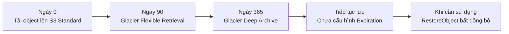
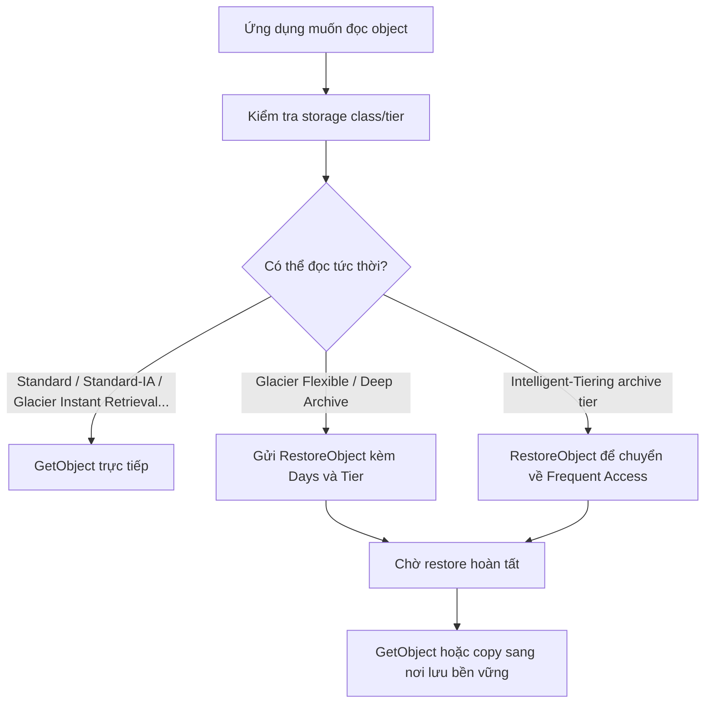
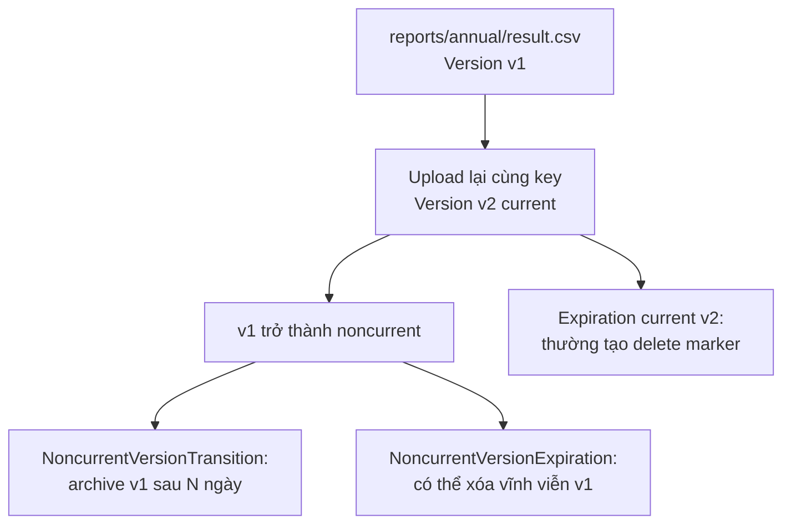
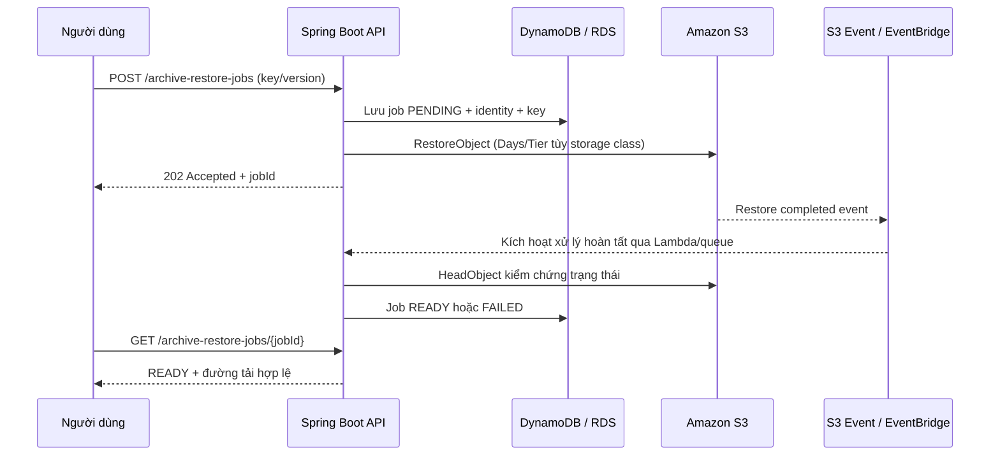
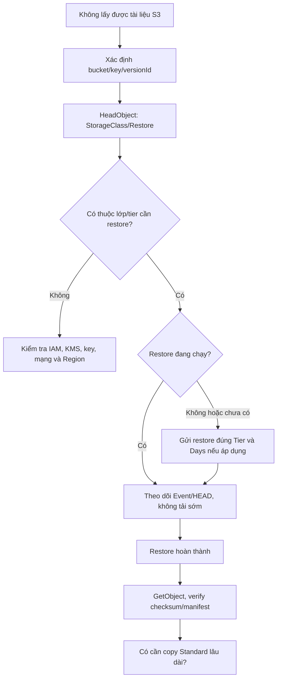

# Lifecycle rule và phục hồi dữ liệu lưu trữ dài hạn

> **Học phần:** CLOUD_PROVIDERS_AWS  
> **Chương:** Lưu trữ đối tượng S3  
> **Mục tiêu:** Thiết kế vòng đời dữ liệu trên Amazon S3, chuyển đối tượng sang lớp lưu trữ phù hợp, khôi phục dữ liệu đã lưu trữ lâu năm và kiểm soát chi phí, bảo mật cùng khả năng phục hồi ứng dụng.

## 1. Bài toán: lưu dữ liệu lâu, ít đọc nhưng vẫn khôi phục được

Một hệ thống quản lý khóa học Java/Spring Boot lưu bài nộp, báo cáo học tập và bản xuất dữ liệu trong **Amazon S3**. Các tệp được truy cập nhiều trong tháng đầu, thỉnh thoảng được đọc sau một học kỳ và có thể cần giữ vài năm cho mục đích đối soát. Giữ mọi object mãi ở **S3 Standard** có thể không tối ưu chi phí. Nhưng chuyển toàn bộ sang lớp archive mà không có quy trình khôi phục có thể khiến ứng dụng thất bại khi người dùng yêu cầu tải báo cáo cũ.

**S3 Lifecycle** cho phép tự động quản lý object theo tuổi, key prefix, tags và kích thước. **S3 restore** là thao tác khác: đưa dữ liệu ở các lớp/tầng archive không thể đọc tức thời vào trạng thái có thể đọc trở lại.

Cần tách ba quyết định:

1. **Khi nào và dữ liệu nào được chuyển lớp lưu trữ?** → Thiết kế Lifecycle rules và lưu ý giới hạn từng storage class.
2. **Khi nào dữ liệu bị xóa?** → Quy định thời gian lưu giữ, Versioning, Object Lock và phê duyệt yêu cầu xóa.
3. **Khi cần dữ liệu đã archive, làm sao phục hồi và báo cho ứng dụng biết?** → Restore request, kiểm tra trạng thái, lấy dữ liệu và kiểm chứng.

Trong học phần AWS, kiến thức này gắn trực tiếp với việc triển khai ứng dụng trong VPC/EC2/Lambda, dùng IAM để kiểm soát quyền gọi S3 API, giám sát bằng CloudWatch và EventBridge, bảo vệ dữ liệu và tối ưu chi phí trong kiến trúc nhiều Region/AZ.

### Kết quả học tập

Sau bài học, người học có thể:

- Giải thích các thành phần của một **S3 Lifecycle configuration** và điểm khác nhau giữa `Transition`, `Expiration`, `NoncurrentVersionTransition` và `NoncurrentVersionExpiration`.
- Lựa chọn storage class cho dữ liệu **truy cập ngay**, **không thường xuyên** và **lưu trữ dài hạn**.
- Tạo Lifecycle rule cho một prefix, tránh áp nhầm cho cả bucket.
- Dự đoán tác động của **giới hạn kích thước 128 KiB**, thời gian lưu tối thiểu và phí request/restore.
- Phục hồi object thuộc **S3 Glacier Flexible Retrieval** hoặc **S3 Glacier Deep Archive** và biết khi nào không cần restore.
- Phân biệt restore **bản sao tạm thời** với tạo **bản sao Standard vĩnh viễn**.
- Thiết kế quy trình bất đồng bộ cho ứng dụng Java/Spring Boot, có theo dõi trạng thái và xử lý lỗi.
- Không nhầm Lifecycle với backup, chống xóa nhầm hoặc giải pháp phục hồi sau thảm họa.

## 2. S3 Lifecycle quản lý những gì?

S3 Lifecycle là cấu hình đặt trên **bucket**. Một bucket có thể chứa nhiều **rules**; mỗi rule gồm:

| Thành phần | Vai trò | Ví dụ |
|---|---|---|
| `ID` | Tên định danh của rule. | `archive-annual-reports` |
| `Status` | Bật hoặc tắt rule. | `Enabled` hoặc `Disabled` |
| `Filter` | Chọn object theo prefix, tag và/hoặc kích thước. | Chỉ áp dụng key bắt đầu bằng `reports/annual/` |
| `Transitions` | Chuyển **current object version** sang storage class khác theo tuổi object. | Sau 90 ngày → `GLACIER` |
| `Expiration` | Cho current version hết hạn theo ngày/tuổi object. | Sau 2.555 ngày, nếu chính sách cho phép |
| `NoncurrentVersionTransitions` | Chuyển các version đã trở thành noncurrent. | Sau 90 ngày kể từ khi thành noncurrent |
| `NoncurrentVersionExpiration` | Xóa vĩnh viễn noncurrent versions khi thỏa điều kiện. | Sau thời gian giữ đã phê duyệt |
| `AbortIncompleteMultipartUpload` | Dọn multipart uploads bị bỏ dở. | Hủy các upload chưa hoàn tất sau 7 ngày |

Trong AWS Console, một số thao tác có thể được diễn đạt dưới tên **Move current versions**, **Move noncurrent versions**, **Expire current versions**, **Permanently delete noncurrent versions** hoặc **Delete incomplete multipart uploads**.

**Quan trọng:** S3 Lifecycle chủ yếu dựa vào **tuổi object/version, prefix, tags và kích thước**, không tự quyết định storage class tối ưu theo số lần tải về thực tế. Nếu cần dịch chuyển lớp theo mẫu truy cập tự động, hãy đánh giá **S3 Intelligent-Tiering**; nếu dùng Lifecycle để đưa object vào Intelligent-Tiering, có các quy tắc tính phí và điều kiện riêng.

### 2.1. Prefix trong S3 là chuỗi ký tự của object key

Giả sử bucket `course-archive-demo-123456789012` chứa:

```text
reports/annual/2025/result.csv
reports/annual/2026/result.csv
reports/monthly/2026-10.csv
uploads/student-01/submission.zip
logs/app/2026-11-20.log
```

Bộ lọc prefix `reports/annual/` khớp **hai object đầu tiên**. Nó không hiểu "thư mục" theo filesystem Linux; dấu `/` chỉ là một phần của key.

**Bẫy:** Prefix `reports/` áp dụng cả `reports/annual/` và `reports/monthly/`. Tạo rule cho cả bucket khi chỉ muốn archive báo cáo năm có thể làm ứng dụng mất khả năng đọc ngay những báo cáo còn đang sử dụng.

### 2.2. Lifecycle không tức thời

Object đạt ngưỡng ngày chỉ trở thành **đủ điều kiện** để transition hoặc expire. S3 xử lý các hành động Lifecycle **bất đồng bộ** nên thời điểm thay đổi thực tế có thể muộn hơn mốc ngày. Thông thường cách tính phí thay đổi từ thời điểm object đủ điều kiện, với một số ngoại lệ như transition sang S3 Intelligent-Tiering.

Vì vậy, đừng xây một ứng dụng kỳ vọng "đúng 00:00:00 object chắc chắn chuyển lớp/xóa xong". Nếu phải hoàn tất xóa trước hạn bắt buộc, cần quy trình kiểm chứng kết quả riêng.

## 3. Các lớp lưu trữ liên quan đến archive

Đặt tên storage class chính xác rất quan trọng, vì **không phải tên nào có chữ Glacier cũng cần restore**.

| Storage class / tier | Cách truy cập | Thời gian giữ tối thiểu để tránh phí lưu giữ phần còn lại | Tình huống |
|---|---|---|---|
| **S3 Standard** | Đọc trực tiếp, độ trễ thấp | Không có mức tối thiểu tương tự lớp archive | Dữ liệu truy cập thường xuyên |
| **S3 Standard-IA** | Đọc trực tiếp, có phí truy xuất | **30 ngày** | Dữ liệu ít đọc nhưng cần ngay |
| **S3 One Zone-IA** | Đọc trực tiếp, lưu ở một AZ | **30 ngày** | Dữ liệu tái tạo được, có thể chấp nhận rủi ro AZ |
| **S3 Glacier Instant Retrieval** | **Đọc trực tiếp**, không cần RestoreObject | **90 ngày** | Lưu lâu, ít đọc nhưng cần độ trễ mili-giây |
| **S3 Glacier Flexible Retrieval** | **Phải restore bất đồng bộ** | **90 ngày** | Archive ít truy xuất, có thể đợi phút/giờ |
| **S3 Glacier Deep Archive** | **Phải restore bất đồng bộ** | **180 ngày** | Lưu cực lâu, có thể đợi nhiều giờ hoặc hơn |
| **S3 Intelligent-Tiering Archive Access tier** | Phải initiate restore để trở lại Frequent Access tier | Tùy cơ chế Intelligent-Tiering | Truy cập hiếm, quy trình tự phân tầng |
| **S3 Intelligent-Tiering Deep Archive Access tier** | Phải initiate restore để trở lại Frequent Access tier | Tùy cơ chế Intelligent-Tiering | Truy cập rất hiếm, chấp nhận phục hồi chậm |

Các khoảng **30/90/180 ngày** trong bảng là **thời gian lưu trữ tối thiểu liên quan đến tính phí**, không phải cam kết AWS sẽ xóa object sau đúng chừng đó ngày. Bạn có thể giữ lâu hơn và đặt Lifecycle theo nhu cầu.

**Phân biệt:**

- `GLACIER_IR` là **S3 Glacier Instant Retrieval**: truy cập bằng `GetObject` bình thường, không dùng bước restore.
- `GLACIER` là **S3 Glacier Flexible Retrieval**: phải gọi `RestoreObject` trước khi `GetObject`.
- `DEEP_ARCHIVE` là **S3 Glacier Deep Archive**: phải gọi `RestoreObject`; thời gian khôi phục thường lâu hơn Flexible Retrieval.
- Với **Intelligent-Tiering**, archive là **tier bên trong storage class INTELLIGENT_TIERING**, cách restore khác Glacier Flexible/Deep.

### 3.1. "Durability" và "availability ngay lập tức" không giống nhau

Một object trong Deep Archive vẫn được S3 thiết kế để lưu trữ bền vững, nhưng bạn **không thể tải về ngay theo cách đọc S3 Standard**. Durability nói đến độ bền của dữ liệu, còn thời gian retrieval nói đến độ trễ khi cần truy cập.

Nếu ứng dụng có yêu cầu **RTO 10 phút**, không thể mặc định chọn Deep Archive rồi yêu cầu người dùng tải kết quả tức thời. Cần thiết kế tầng cache/bản sao Standard, chọn Instant Retrieval hoặc thay đổi yêu cầu khôi phục.

### 3.2. Bảng lựa chọn theo nhu cầu nghiệp vụ

| Yêu cầu | Ứng viên phù hợp | Tại sao |
|---|---|---|
| Người dùng tải bài giảng bất cứ lúc nào | S3 Standard hoặc Intelligent-Tiering phù hợp | Truy cập ngay |
| Báo cáo hiếm khi đọc nhưng yêu cầu trả trong vài giây | S3 Glacier Instant Retrieval | Không cần chờ job restore |
| Dữ liệu đối soát có thể chờ vài giờ | S3 Glacier Flexible Retrieval | Archive theo yêu cầu |
| Hồ sơ lưu nhiều năm, truy xuất rất hiếm, chờ hàng giờ đến hai ngày được | S3 Glacier Deep Archive | Ưu tiên chi phí lưu trữ hơn tốc độ lấy dữ liệu |
| Dữ liệu truy cập khó dự báo | S3 Intelligent-Tiering (đánh giá các tier archive tùy chọn) | Tự động điều chỉnh theo mẫu truy cập |
| Dữ liệu cần giữ theo quy định, chống xóa trước hạn | Versioning + Object Lock + quy trình lưu trữ phù hợp | Lifecycle một mình không chống xóa sai |

## 4. Thiết kế timeline cho báo cáo dài hạn

Giả sử yêu cầu nghiệp vụ:

- Trong **90 ngày đầu**, báo cáo năm ở S3 Standard để truy cập thường xuyên.
- Từ **ngày thứ 90** sau khi tạo object, chuyển sang **S3 Glacier Flexible Retrieval**.
- Từ **ngày thứ 365** sau khi tạo object, chuyển sang **S3 Glacier Deep Archive**.
- **Chưa tự xóa** dữ liệu vì chưa có chính sách retention được phê duyệt.



**Các mốc ngày của Transition tính từ ngày tạo object/current version**. Trong ví dụ, "365 ngày sang Deep Archive" **không có nghĩa đợi thêm 365 ngày sau bước Flexible**. Từ ngày 90 đến ngày 365 là 275 ngày, đủ dài so với khoảng tính phí tối thiểu 90 ngày của Glacier Flexible Retrieval.

Đây là **mô hình giả định** để luyện tập, không phải chu kỳ phù hợp cho tất cả doanh nghiệp. Một tổ chức có thể muốn lưu 3 năm, 7 năm hoặc vô thời hạn; phải lấy yêu cầu pháp lý và sản phẩm làm đầu vào trước khi cấu hình Expiration.

### 4.1. Hình dung chi phí và hành vi theo từng giai đoạn

| Thời điểm | Storage class dự kiến | Ứng dụng có thể `GetObject` ngay không? | Nếu cần dùng |
|---|---|---|---|
| Ngày 20 | Standard | Có | Đọc trực tiếp |
| Ngày 150 | Glacier Flexible Retrieval | Không | Restore, chờ hoàn thành, rồi đọc |
| Ngày 400 | Glacier Deep Archive | Không | Restore Standard/Bulk, chờ lâu hơn |
| Sau khi restore Flexible/Deep | **Storage class gốc vẫn là archive** | Có **trong thời gian bản sao tạm còn hiệu lực** | Tải/copy ra class Standard nếu cần giữ lâu |

## 5. Thiết lập Lifecycle rule qua AWS Console

Ví dụ thao tác trong một **general purpose S3 bucket** do bạn sở hữu. Tên menu có thể khác nhẹ theo phiên bản Console.

1. Mở [Amazon S3 Console](https://console.aws.amazon.com/s3/), chọn đúng AWS account và bucket.
2. Vào **General purpose buckets → chọn bucket → Management**.
3. Trong phần **Lifecycle rules**, chọn **Create lifecycle rule**.
4. Đặt rule name, ví dụ `archive-annual-reports`.
5. Ở phạm vi áp dụng, chọn **Limit the scope of this rule using one or more filters**.
6. Điền prefix `reports/annual/`, kiểm tra không chọn toàn bucket.
7. Chọn hành động **Move current versions of objects between storage classes**.
8. Cấu hình **S3 Glacier Flexible Retrieval** sau **90 ngày** kể từ khi tạo; cấu hình tiếp **S3 Glacier Deep Archive** sau **365 ngày**.
9. Không bật **Expire current versions**, **Permanently delete noncurrent versions** nếu chưa có yêu cầu lưu giữ/xóa đã được xác nhận.
10. Xem các cảnh báo về chi phí storage class, object size và minimum duration; kiểm tra lại vùng áp dụng.
11. Tạo rule, mở lại chi tiết để xác nhận đúng filter, trạng thái **Enabled**, ngày chuyển lớp và các hành động.
12. Theo dõi object mẫu qua S3 Console, S3 Inventory hoặc HEAD API trong các ngày phù hợp; việc chuyển lớp không hoàn tất ngay lập tức.

**Điểm cần chú ý:** Nếu bật Versioning, transition của current version khác với transition của **noncurrent versions**. Không chọn nhầm hành động đối với versions cũ mà ứng dụng còn cần khôi phục.

### 5.1. Vì sao nên bắt đầu bằng prefix hẹp?

Giả sử trong cùng bucket có `uploads/`, `reports/annual/` và `reports/realtime/`. Nếu áp rule cho cả bucket, báo cáo thời gian thực và tệp người dùng đang dùng có thể bị đưa vào lớp phải restore. Thiết kế prefix hoặc tag ngay từ đầu giúp tránh ảnh hưởng ngoài phạm vi.

Nên thử trước trên **bucket sandbox** hoặc bộ object riêng theo prefix, không dùng chính sách mới áp lên Production nếu chưa đánh giá toàn bộ object hiện hữu. Lifecycle rule mới cũng có thể xử lý **object cũ đã đủ điều kiện**.

## 6. Cấu hình Lifecycle bằng AWS CLI và JSON

Giả sử người vận hành có quyền quản lý Lifecycle của bucket, lệnh CLI có thể giúp triển khai lặp lại và kiểm tra cấu hình bằng Infrastructure as Code.

### 6.1. JSON mẫu: archive báo cáo năm, không tự xóa

Tạo file `lifecycle.json` ở **môi trường thao tác AWS CLI của bạn** với nội dung:

```json
{
  "Rules": [
    {
      "ID": "archive-annual-reports",
      "Status": "Enabled",
      "Filter": {
        "Prefix": "reports/annual/"
      },
      "Transitions": [
        {
          "Days": 90,
          "StorageClass": "GLACIER"
        },
        {
          "Days": 365,
          "StorageClass": "DEEP_ARCHIVE"
        }
      ]
    }
  ]
}
```

Trong API/CLI:

- `GLACIER` = **S3 Glacier Flexible Retrieval**.
- `DEEP_ARCHIVE` = **S3 Glacier Deep Archive**.
- `Days` là tuổi object kể từ khi tạo, không đếm lại kể từ chuyển lớp trước đó.
- Cấu hình trên **không chứa Expiration**, nên không chủ động xóa vì tuổi.
- Bucket hiện có các rules khác sẽ cần được giữ trong bản cấu hình tổng, nếu không sẽ bị thay thế.

**Cảnh báo quan trọng:** API `PutBucketLifecycleConfiguration` **thay toàn bộ Lifecycle configuration của bucket**, không chỉ thêm một rule mới vào danh sách. Trước khi ghi, phải lấy cấu hình hiện tại và **hợp nhất** các rules muốn giữ. Đừng chạy nguyên mẫu một-rule này lên bucket đã có các chính sách khác.

### 6.2. Đọc cấu hình hiện tại trước khi sửa

```bash
# Thao tác chỉ đọc: xem Lifecycle hiện hành.
aws s3api get-bucket-lifecycle-configuration \
  --bucket course-archive-demo-123456789012 \
  --region ap-southeast-1
```

Nếu bucket chưa có Lifecycle configuration, API có thể trả `NoSuchLifecycleConfiguration`; đây không có nghĩa bucket không tồn tại. Nếu đã có rules, sao lưu cấu hình theo quy trình tổ chức và bổ sung rule mới vào danh sách thay vì ghi đè.

### 6.3. Ghi cấu hình sau khi kiểm tra

```bash
# Chỉ thực hiện với bucket sandbox hoặc khi thay đổi đã được kiểm tra.
aws s3api put-bucket-lifecycle-configuration \
  --bucket course-archive-demo-123456789012 \
  --lifecycle-configuration file://lifecycle.json \
  --region ap-southeast-1
```

Đọc lại:

```bash
aws s3api get-bucket-lifecycle-configuration \
  --bucket course-archive-demo-123456789012 \
  --region ap-southeast-1
```

Lệnh quản lý Lifecycle cần quyền như `s3:PutLifecycleConfiguration` trên bucket. Tùy hành động đọc, cần quyền `s3:GetLifecycleConfiguration`. Các policy tổ chức và bucket policy có thể bổ sung điều kiện.

### 6.4. Không dùng lệnh API để mô phỏng "chuyển ngay" mọi object

Sau khi lưu rule, S3 thực thi Lifecycle theo cơ chế nền. Đừng mong rằng ngay sau lệnh `put-bucket-lifecycle-configuration`, object cũ lập tức có `StorageClass=DEEP_ARCHIVE`. Để kiểm tra, dùng object đã đủ tuổi và theo dõi trạng thái, hoặc đọc cấu hình để xác minh định nghĩa rule.

Nếu cần di chuyển **ngay một object cụ thể**, cần chọn thao tác sao chép/di chuyển storage class phù hợp; đây không phải hành vi của lệnh quản lý Lifecycle.

## 7. Những ràng buộc làm thay đổi kết quả và chi phí

### 7.1. Mặc định object dưới 128 KiB không được transition

Với cấu hình Lifecycle mới hoặc được chỉnh sửa theo hành vi mặc định hiện hành, S3 **không transition object nhỏ hơn 128 KiB** sang bất kỳ storage class nào theo rule nếu không có điều chỉnh phù hợp. Đây là thay đổi mặc định được AWS cập nhật từ **tháng 9/2024**.

Ví dụ:

| Object | Kích thước | Rule 90 ngày sang Glacier Flexible | Dự kiến theo mặc định hiện hành |
|---|---:|---|---|
| `annual-report.csv` | 12 MiB | Hợp lệ nếu các điều kiện khác đúng | Có thể transition khi đủ điều kiện |
| `summary.json` | 50 KiB | Bị ngưỡng mặc định cản | Không transition |
| `invoice.pdf` | 256 KiB | Hợp lệ nếu các điều kiện khác đúng | Có thể transition khi đủ điều kiện |

**128 KiB = 131.072 byte**. Nếu có yêu cầu đặc biệt, có thể cấu hình bộ lọc theo kích thước `ObjectSizeGreaterThan`/`ObjectSizeLessThan` hoặc tùy chọn API được AWS hỗ trợ để thay hành vi mặc định. Nhưng việc transition hàng triệu object cực nhỏ thường không kinh tế vì **mỗi object có phí transition/request và metadata overhead**.

Cấu hình Lifecycle được tạo **trước tháng 9/2024** có thể vẫn giữ hành vi cũ cho object nhỏ cho đến khi cấu hình được sửa. Vì vậy, kiểm tra bucket thực tế thay vì coi mọi bucket lịch sử giống nhau.

### 7.2. Thời gian lưu tối thiểu không phải hạn tự xóa

Một số lớp có mức lưu giữ tối thiểu để tính phí:

| Storage class | Mức tối thiểu liên quan phí |
|---|---:|
| Standard-IA / One Zone-IA | 30 ngày |
| Glacier Instant Retrieval | 90 ngày |
| Glacier Flexible Retrieval | 90 ngày |
| Glacier Deep Archive | 180 ngày |

Nếu xóa/chuyển object quá sớm, **có thể vẫn chịu phí tương đương phần thời gian tối thiểu còn lại**. Cấu hình các bước Transition liên tiếp cũng phải tuân thủ những điều kiện được AWS hỗ trợ; không thiết kế "ngày 4 vào Instant Retrieval, ngày 20 vào Deep Archive" như một lộ trình hoàn toàn miễn phí.

### 7.3. Object nhỏ và phí metadata

Với Glacier Flexible Retrieval/Deep Archive, AWS có **metadata overhead khoảng 40 KiB cho mỗi object** được archive, với cách tính phí ở các lớp liên quan. Ngoài ra còn có phí request chuyển lớp và phí retrieval khi đọc lại.

Ví dụ minh họa:

```text
100.000 object, mỗi object 20 KiB
Dung lượng payload    = 100.000 × 20 KiB ≈ 1,91 GiB
Metadata overhead     = 100.000 × 40 KiB ≈ 3,81 GiB
```

Đây là ví dụ về **kích thước dữ liệu**, không phải hóa đơn thực tế. Nếu cố chuyển các object này bằng cấu hình cho phép object nhỏ, phí metadata và transition có thể vượt phần tiết kiệm. Trước khi quyết định, hãy cân nhắc **gộp dữ liệu nhỏ thành archive lớn** theo cách cho phép truy xuất/khôi phục an toàn.

### 7.4. Tránh các Lifecycle rules chồng chéo

Một object có thể khớp nhiều rule. Nếu hai rule xung đột, AWS có quy tắc ưu tiên hành động; ví dụ **xóa vĩnh viễn có thể được ưu tiên hơn transition** khi cùng đủ điều kiện.

Không dựa vào thứ tự hiển thị rules để đoán kết quả. Thiết kế filters rõ ràng, xem xét toàn bucket, lưu chính sách thành mã cấu hình được review, và ưu tiên test ở sandbox.

### 7.5. Dữ liệu đang replication hoặc bị Object Lock

Với S3 Replication, các version có replication status `PENDING` hoặc `FAILED` có thể không đủ điều kiện transition như kỳ vọng. S3 Object Lock có thể bảo vệ các version đã khóa khỏi việc bị xóa vĩnh viễn, nhưng Lifecycle vẫn có thể transition các object trong điều kiện cho phép.

Vì vậy, nếu thấy rule "không chạy", phải kiểm tra **storage class, object size, replication status, versioning và retention**, không chỉ đếm số ngày.

## 8. Khi nào phải phục hồi dữ liệu?

**Restore** có nghĩa cụ thể với các storage class/tier không hỗ trợ truy cập tức thời. Đối với object đã chuyển vào **Glacier Flexible Retrieval** hoặc **Deep Archive**, lệnh `GetObject` sẽ không trả ngay nội dung nếu object chưa được restore.



**Không nhầm tên gọi:**

- **Glacier Instant Retrieval** không cần bước restore bất đồng bộ.
- **Glacier Flexible Retrieval/Deep Archive** cần restore để có **bản sao truy cập tạm**.
- **Intelligent-Tiering Archive Access/Deep Archive Access** cần restore để **đưa object về Frequent Access tier**, không phải tạo bản sao tạm với hạn `Days` giống Glacier Flexible/Deep.

### 8.1. Restore không đổi storage class gốc của Glacier Flexible/Deep

Sau khi restore thành công từ Glacier Flexible hoặc Deep Archive:

1. Bản **archive gốc** vẫn ở storage class ban đầu.
2. S3 cho phép đọc một **bản sao tạm thời** trong thời hạn chỉ định.
3. Khi hết hạn, bản sao truy cập tạm biến mất; nếu cần đọc tiếp, có thể phải restore lại.
4. Nếu muốn **giữ lâu dài ở S3 Standard**, cần **copy** object đã restore sang object/key khác với storage class phù hợp.

Đừng nói "restore là chuyển hẳn object trở lại Standard". Đây là một trong những hiểu lầm phổ biến nhất khi vận hành archive.

### 8.2. Tốc độ phục hồi: Expedited, Standard, Bulk

| Nguồn archive | Expedited | Standard | Bulk |
|---|---|---|---|
| Glacier Flexible Retrieval | Thường 1–5 phút cho object nhỏ theo điều kiện AWS | Thường 3–5 giờ | Thường 5–12 giờ |
| Glacier Deep Archive | **Không hỗ trợ** | Thường khoảng 12 giờ | Thường có thể tới 48 giờ |
| Intelligent-Tiering Archive Access | Có tùy chọn Expedited theo điều kiện | Thường 3–5 giờ | Thường 5–12 giờ |
| Intelligent-Tiering Deep Archive Access | **Không hỗ trợ** | Thường khoảng 12 giờ | Thường có thể tới 48 giờ |

Đây là **thời gian điển hình theo tài liệu AWS**, không phải SLA bảo đảm. Truy xuất lượng dữ liệu rất lớn, hàng triệu object hoặc vượt quota có thể lâu hơn. Expedited có chi phí cao hơn và có thể cần **provisioned capacity** để bảo đảm năng lực khôi phục trong các trường hợp được hỗ trợ.

**Chọn theo RTO:** Sự cố kinh doanh cần dữ liệu trong vài phút không nên phụ thuộc Deep Archive. Nếu có thể chờ một hoặc hai ngày để lấy hàng triệu object, Bulk có thể phù hợp về chi phí.

## 9. Thực hành restore bằng AWS Console

Giả sử một báo cáo mẫu đã được transition đến S3 Glacier Flexible Retrieval tại key:

```text
s3://course-archive-demo-123456789012/reports/annual/2025/result.csv
```

Các bước:

1. Mở **S3 Console → General purpose buckets → chọn bucket → Objects**.
2. Tìm đúng key và kiểm tra **Storage class** cùng **Version ID** nếu bucket bật Versioning.
3. Chọn object, mở **Actions → Initiate restore**.
4. Với Glacier Flexible/Deep, nhập **Number of days that the restored copy is available**, ví dụ **7 ngày**.
5. Chọn **Retrieval tier** (Standard/Bulk; Expedited chỉ ở lớp/tier được hỗ trợ) phù hợp RTO và ngân sách.
6. Xác nhận restore request, sau đó kiểm tra trạng thái của object; **không tải về ngay khi job còn đang chạy**.
7. Khi trạng thái hoàn thành, tải xuống hoặc copy tới một key mới nếu cần dùng lâu dài.
8. Kiểm tra nội dung, checksum/manifest và quyền trước khi báo người dùng rằng dữ liệu đã sẵn sàng.

Nếu object nằm trong **Intelligent-Tiering Archive Access hoặc Deep Archive Access tier**, Console có quy trình tương tự nhưng không cần nhập số ngày giữ bản sao tạm như Flexible/Deep, vì object được khôi phục về **Frequent Access tier**.

**Không cần tạo object archive có phí chỉ để kiểm tra giao diện.** Bạn có thể thực hành đọc metadata trên sandbox sẵn có, viết kế hoạch restore và thực thi khi đã có object archive hợp lệ.

## 10. Thực hành restore bằng AWS CLI

AWS CLI phù hợp để tự động hóa việc yêu cầu và kiểm tra restore. Những lệnh sau là ví dụ cho **Glacier Flexible Retrieval hoặc Glacier Deep Archive**; đối với Intelligent-Tiering archive tier, cú pháp request khác vì **không dùng `Days`**.

### 10.1. Đọc metadata trước khi restore

```bash
aws sts get-caller-identity

aws s3api head-object \
  --bucket course-archive-demo-123456789012 \
  --key reports/annual/2025/result.csv \
  --region ap-southeast-1 \
  --query '{StorageClass:StorageClass,Restore:Restore,VersionId:VersionId,Size:ContentLength}'
```

Kết quả có thể chứa `StorageClass: "GLACIER"` hoặc `"DEEP_ARCHIVE"`. Giá trị `Restore` có thể chưa xuất hiện nếu chưa có yêu cầu phục hồi. Quyền `HeadObject` được đánh giá liên quan tới `s3:GetObject` và những chính sách khác.

### 10.2. Tạo Restore request, không in credentials

Tạo file `restore-request.json`:

```json
{
  "Days": 7,
  "GlacierJobParameters": {
    "Tier": "Standard"
  }
}
```

Gửi yêu cầu:

```bash
aws s3api restore-object \
  --bucket course-archive-demo-123456789012 \
  --key reports/annual/2025/result.csv \
  --restore-request file://restore-request.json \
  --region ap-southeast-1
```

Lệnh không trả về nội dung object. API nhận yêu cầu thành công **chưa có nghĩa object đã đọc được**. Một restore đang tiến hành có thể trả lỗi như `RestoreAlreadyInProgress` nếu gửi lặp; hãy kiểm tra trạng thái thay vì gọi liên tục.

**Cấu hình khác:** Muốn Bulk, đổi `"Tier": "Bulk"`. Với Glacier Flexible Retrieval có thể có Expedited, nhưng Deep Archive không hỗ trợ Expedited.

### 10.3. Kiểm tra tiến độ bằng HEAD

```bash
aws s3api head-object \
  --bucket course-archive-demo-123456789012 \
  --key reports/annual/2025/result.csv \
  --region ap-southeast-1 \
  --query '{Restore:Restore,StorageClass:StorageClass,VersionId:VersionId}'
```

Ví dụ nội dung trường `Restore`:

```text
ongoing-request="true"
```

Nghĩa là S3 đang phục hồi. Khi xong, giá trị có dạng:

```text
ongoing-request="false", expiry-date="Wed, 25 Nov 2026 00:00:00 GMT"
```

Chuỗi ngày trên là **ví dụ giả lập**, không phải thời điểm AWS cam kết. Trường `expiry-date` cho biết hạn bản sao truy cập tạm của Glacier Flexible/Deep. AWS tính ngày hết hạn theo thời điểm hoàn tất restore và quy tắc làm tròn đến 00:00 UTC.

Nên triển khai **S3 Event Notifications** cho sự kiện restore hoàn tất nếu ứng dụng cần tự động chạy tiếp; không dùng vòng lặp liên tục gọi HEAD mỗi giây.

### 10.4. Tải object sau khi khôi phục hoàn tất

```bash
aws s3api get-object \
  --bucket course-archive-demo-123456789012 \
  --key reports/annual/2025/result.csv \
  --region ap-southeast-1 \
  ./result-restored.csv
```

Lệnh tải xuống vào máy chạy CLI; kiểm tra đường dẫn cục bộ và không lưu tài liệu nhạy cảm vào thư mục công khai. Nếu object đã hết hạn bản sao tạm, cần gửi restore request mới.

### 10.5. Giữ một bản sao ở lớp Standard

Nếu cần object có thể đọc lâu dài mà không đợi restore lần tiếp theo, sau khi bản sao tạm sẵn sàng có thể **copy sang một key mới** với storage class Standard.

Ví dụ cho object **không lớn hơn 5 GiB** và đã được restore:

```bash
aws s3api copy-object \
  --bucket course-archive-demo-123456789012 \
  --copy-source course-archive-demo-123456789012/reports/annual/2025/result.csv \
  --key recovered/2025/result.csv \
  --storage-class STANDARD \
  --region ap-southeast-1
```

Đích `recovered/` nằm **ngoài prefix `reports/annual/`** chịu rule archive của bài lab, tránh bản Standard mới lại tự bị chuyển lớp theo cùng rule sau một thời gian.

Đối với object **lớn hơn giới hạn một lần CopyObject (5 GiB)**, cần quy trình multipart copy hoặc công cụ quản lý multipart phù hợp. Khi cần duy trì metadata/tags, SSE-KMS encryption, ACL và quyền truy cập, hãy kiểm tra chi tiết các tham số sao chép; ví dụ ở trên chỉ tập trung vào storage class và key.

**Sao chép tạo object khác và có phí lưu trữ riêng.** Hãy xác minh nội dung/công bố kết quả rồi mới dọn dẹp các bản sao không còn cần thiết.

## 11. Trường hợp đặc biệt: Intelligent-Tiering Archive Access

Một object trong **S3 Intelligent-Tiering** có thể chuyển giữa các access tiers theo cơ chế tự động của storage class. Nếu bật các tầng archive tùy chọn, object không được đọc ngay khi ở **Archive Access** hoặc **Deep Archive Access**.

Khi gọi restore từ hai tier này:

- Không dùng `Days` để giữ bản sao tạm.
- Khi hoàn tất, object **chuyển về Frequent Access tier** của cùng storage class Intelligent-Tiering.
- Không có một bản sao tạm hết hạn theo số ngày như Glacier Flexible/Deep.
- Trạng thái truy cập sau đó tiếp tục được hệ thống Intelligent-Tiering quản lý.

Vì `head-object` cho object Intelligent-Tiering thường vẫn phản ánh **storage class là INTELLIGENT_TIERING**, chỉ xem storage class có thể **không đủ** để biết tier truy cập hiện tại. Cần xem thêm các trường trạng thái/tier được AWS công bố, công cụ S3 Inventory hoặc các metric/quan sát phù hợp.

**Bảng ghi nhớ:**

| Nội dung | Glacier Flexible/Deep | Intelligent-Tiering archive tier |
|---|---|---|
| Có cần Initiate restore không? | Có | Có |
| Sau restore object ở đâu? | Bản archive gốc + **bản sao truy cập tạm** | Chuyển về **Frequent Access tier** |
| Có nhập `Days` không? | Có | **Không** |
| Khi hết hạn `Days` | Bản sao tạm mất, archive vẫn còn | Không áp dụng theo cách này |
| Muốn bản Standard vĩnh viễn | Copy sang object Standard mới | Có thể chọn sao chép nếu mục tiêu là storage class khác |

Không dùng chung một JSON restore có `Days` cho cả hai cơ chế.

## 12. Versioning: current version, noncurrent version và delete marker

Khi bật **S3 Versioning**, mỗi lần upload object cùng key có thể tạo một version mới. Version cũ trở thành **noncurrent version**.



Điểm khác nhau:

| Action | Bucket chưa bật Versioning | Bucket đã bật Versioning |
|---|---|---|
| `Transition` | Chuyển object hiện hành | Chuyển current version |
| `Expiration` | Xóa object không thể khôi phục từ bucket nếu không có backup | Thường thêm **delete marker**; version cũ vẫn tồn tại dưới dạng noncurrent |
| `NoncurrentVersionTransition` | Không áp dụng | Chuyển version cũ sau khi đủ điều kiện |
| `NoncurrentVersionExpiration` | Không áp dụng | **Xóa vĩnh viễn** noncurrent version khi đủ điều kiện |

**Không coi "có Versioning" là bảo đảm không bao giờ mất dữ liệu**. `NoncurrentVersionExpiration` có thể xóa vĩnh viễn version cũ; quyền quản trị hoặc cấu hình sai cũng có thể tác động đến dữ liệu. Cần xác định lịch retention rõ ràng.

### 12.1. Ví dụ quản lý version cũ

Giả sử yêu cầu:

- Current version luôn là báo cáo mới nhất, áp policy archive phù hợp.
- Noncurrent versions được giữ tối thiểu 180 ngày kể từ khi bị thay thế.
- Chưa cho phép xóa noncurrent versions vì phải rà soát yêu cầu compliance.

Có thể thiết kế riêng `NoncurrentVersionTransition` và **chưa thêm** `NoncurrentVersionExpiration`. Nếu sau này quy định xóa được phê duyệt, hãy thiết lập thời điểm xóa cho version cũ, kiểm tra chi phí lưu giữ tối thiểu và kiểm chứng trên dữ liệu thử.

Với noncurrent version, mốc `NoncurrentDays` được tính **kể từ khi version trở thành noncurrent**, không phải tuổi object kể từ lần upload đầu. Tùy cấu hình, có thể đặt thêm số **newer noncurrent versions** cần giữ; phải hiểu đồng thời cả hai điều kiện trước khi bật tự xóa.

### 12.2. Restore đúng version ID

Khi key có nhiều versions, bạn có thể cần restore một **version cụ thể**. Nếu bỏ qua `--version-id`, API mặc định thao tác trên **current version**. Với một object đã bị che bởi delete marker, chỉ gọi theo key có thể trả lỗi/đối tượng không thấy.

Quy trình an toàn:

1. Liệt kê các versions có quyền được cấp, xác định version lưu trữ đúng thời điểm.
2. Kiểm tra `StorageClass` và trạng thái restore của **version được chọn**.
3. Gửi yêu cầu restore có `--version-id` nếu cần.
4. Khi hoàn tất, tải object có cùng `version-id` và so checksum/manifest trước khi sử dụng.

Ví dụ chỉ đọc:

```bash
aws s3api list-object-versions \
  --bucket course-archive-demo-123456789012 \
  --prefix reports/annual/2025/result.csv \
  --region ap-southeast-1
```

Không dùng `--version-id` giả lập trong một yêu cầu restore trên dữ liệu thật. Hãy lấy ID chính xác từ API/Console.

## 13. Object Lock, retention và yêu cầu bảo vệ dữ liệu

**S3 Object Lock** giúp đặt retention hoặc legal hold cho **object versions** khi Versioning được bật. Tính năng hữu ích cho yêu cầu WORM (*write once, read many*) và ngăn xóa vĩnh viễn trước hạn theo cơ chế đã thiết lập.

| Khái niệm | Mục đích | Liên hệ với Lifecycle |
|---|---|---|
| Versioning | Lưu nhiều phiên bản của cùng object key | Cho phép phục hồi một số version cũ nếu chưa bị xóa |
| Lifecycle Expiration | Quản lý xóa theo tuổi | Có thể tạo delete marker trong versioned bucket |
| NoncurrentVersionExpiration | Xóa version cũ | Có thể xóa vĩnh viễn, trừ version được bảo vệ bởi Lock/hold phù hợp |
| Object Lock retention | Chống xóa version trước hạn | Lifecycle không được xóa vĩnh viễn version còn khóa |
| Legal hold | Giữ version đến khi được gỡ bởi người có quyền | Có thể ngăn việc xóa vĩnh viễn độc lập với hạn retention |
| S3 Replication/Backup | Lưu bản sao theo thiết kế khôi phục | Bổ sung cho Versioning và Lifecycle; không tự thay thế yêu cầu retention |

**Lưu ý:** Object Lock không cấm tạo **delete marker** hoặc thêm version mới vào key. Một object có thể trông như đã bị xóa với người đọc thông thường nhưng version được khóa vẫn tồn tại và có thể phục hồi theo quyền được cấp.

**Không thiết lập Expiration bừa bãi** cho dữ liệu tài chính, y tế, kiểm toán hoặc hợp đồng khi chưa biết yêu cầu lưu giữ và xử lý xóa. Lifecycle là tự động hóa có thể dẫn tới xóa vĩnh viễn, nên cần review và kiểm tra tác động trước khi kích hoạt.

## 14. Tích hợp restore vào ứng dụng Java/Spring Boot

Một endpoint HTTP như `GET /reports/2025/download` **không nên tự gọi restore rồi giữ request mở hàng giờ**. Restore là quy trình bất đồng bộ; nếu cần, ứng dụng nên trả trạng thái job và báo khi dữ liệu sẵn sàng.

### 14.1. Thiết kế luồng nghiệp vụ



Sơ đồ mô tả một kiến trúc có **event consumer**; EventBridge/S3 notifications không tự gọi vào REST API của ứng dụng nếu chưa cấu hình đích/consumer phù hợp. Có thể dùng S3 Event Notifications → SQS/Lambda và cập nhật DB. Nếu thiếu event, một cơ chế reconciliation/poll giãn cách vẫn cần có để tránh job kẹt mãi.

### 14.2. Trạng thái job nên lưu

| Trạng thái | Ý nghĩa | Xử lý |
|---|---|---|
| `REQUESTED` | Người dùng yêu cầu một version/key hợp lệ | Kiểm tra quyền, quota, RTO và ước tính phí |
| `RESTORING` | AWS đã nhận restore request | Không cho phép tải trước khi hoàn thành |
| `READY` | HEAD xác nhận object có thể đọc | Cấp link tải có thời hạn theo quyền |
| `EXPIRED` | Bản sao truy cập tạm đã hết hạn | Cho phép yêu cầu restore mới |
| `FAILED` | Request lỗi, policy cấm hoặc job không thể hoàn tất | Ghi nguyên nhân có thể hỗ trợ, retry có kiểm soát |

Gắn `jobId` với **bucket/key/versionId/customerId** rõ ràng để tránh trả nhầm dữ liệu giữa người dùng hoặc tenant. Không nhận bucket/key tùy ý từ client rồi đọc bằng một role có quyền rộng.

### 14.3. AWS SDK for Java 2.x: tạo restore request

Ví dụ tập trung vào **Glacier Flexible Retrieval hoặc Deep Archive**, sử dụng credentials mặc định của workload (IAM role trên EC2, execution role trên Lambda, hoặc task role trên ECS). Không nhúng access key vào mã:

```java
import software.amazon.awssdk.regions.Region;
import software.amazon.awssdk.services.s3.S3Client;
import software.amazon.awssdk.services.s3.model.GlacierJobParameters;
import software.amazon.awssdk.services.s3.model.RestoreObjectRequest;
import software.amazon.awssdk.services.s3.model.RestoreRequest;
import software.amazon.awssdk.services.s3.model.Tier;

public final class ArchiveRestoreExample {
    public static void main(String[] args) {
        String bucket = "course-archive-demo-123456789012";
        String key = "reports/annual/2025/result.csv";

        try (S3Client s3 = S3Client.builder()
                .region(Region.AP_SOUTHEAST_1)
                .build()) {

            RestoreRequest restore = RestoreRequest.builder()
                .days(7)
                .glacierJobParameters(
                    GlacierJobParameters.builder()
                        .tier(Tier.STANDARD)
                        .build())
                .build();

            s3.restoreObject(
                RestoreObjectRequest.builder()
                    .bucket(bucket)
                    .key(key)
                    .restoreRequest(restore)
                    .build());

            // Gửi yêu cầu thành công chưa có nghĩa object sẵn sàng.
            System.out.println("Restore request accepted; check asynchronously");
        }
    }
}
```

Đoạn mã dùng **AWS SDK for Java 2.x**, cần dependency `software.amazon.awssdk:s3` và Region thực của bucket. Khi dùng trong Spring Boot, nên quản lý `S3Client` bằng dependency injection, cấu hình timeout/retry, lưu trạng thái job và triển khai xác thực người dùng/tenant.

**Không dùng mã trên nguyên dạng cho Intelligent-Tiering archive tier:** cơ chế đó không chấp nhận `Days`. Xây dựng request riêng theo class/tier và AWS API hiện hành.

### 14.4. Kiểm tra status bằng SDK

Mẫu đọc metadata sau khi đã gửi restore:

```java
import software.amazon.awssdk.services.s3.model.HeadObjectResponse;

// s3 là S3Client đã cấu hình, bucket/key lấy từ job hợp lệ.
HeadObjectResponse metadata = s3.headObject(request -> request
    .bucket(bucket)
    .key(key));

String restoreHeader = metadata.restore();
System.out.println("Storage class: " + metadata.storageClass());
System.out.println("Restore status: " + restoreHeader);
```

Đoạn code là **mảnh minh họa** để đặt vào dịch vụ có `s3`, `bucket`, `key` đã khai báo. Nếu cần kiểm tra phiên bản cụ thể, phải truyền `versionId` tương ứng vào `HeadObjectRequest`. Sau khi HEAD xác nhận `ongoing-request="false"`, vẫn cần thử quyền `GetObject` và kiểm tra lỗi thời hạn bản sao/điều kiện truy cập.

### 14.5. Cấp đường tải cho người dùng

Khi dữ liệu đã sẵn sàng, có thể tạo **presigned URL** ngắn hạn bằng S3 Presigner trên server, gắn với đúng object và quyền. Đặt TTL phù hợp, kiểm tra authorization của người dùng trước khi phát URL; không biến bucket archive thành public chỉ để hỗ trợ tải.

Nếu người dùng thường xuyên cần cùng dữ liệu cũ, hãy cân nhắc **copy có chủ đích sang lớp Standard** hoặc thiết kế cache có TTL, thay vì phát nhiều restore requests không kiểm soát.

## 15. IAM, mạng và mã hóa khi restore

### 15.1. Quyền tối thiểu

Một vai trò vận hành có thể cần:

| Tác vụ | Quyền IAM thường gặp | Phạm vi |
|---|---|---|
| Xem Lifecycle rule | `s3:GetLifecycleConfiguration` | Bucket ARN |
| Đổi Lifecycle rule | `s3:PutLifecycleConfiguration` | Bucket ARN |
| Tìm object | `s3:ListBucket` | Bucket ARN, có thể giới hạn prefix |
| Đọc metadata/tải object | `s3:GetObject` | Object ARN/prefix |
| Gửi restore request | `s3:RestoreObject` | Object ARN/prefix |
| Copy sang key mới | `s3:GetObject` nguồn, `s3:PutObject` đích | Phạm vi object nguồn/đích |
| Xử lý version | `s3:GetObjectVersion`, `s3:ListBucketVersions`, quyền restore phù hợp | Theo version và phạm vi |

Ví dụ identity-based policy **chỉ cho phép xem và khôi phục** object trong `reports/annual/` (chưa có quyền xóa/đổi Lifecycle):

```json
{
  "Version": "2012-10-17",
  "Statement": [
    {
      "Sid": "ListReportKeys",
      "Effect": "Allow",
      "Action": "s3:ListBucket",
      "Resource": "arn:aws:s3:::course-archive-demo-123456789012",
      "Condition": {
        "StringLike": {
          "s3:prefix": "reports/annual/*"
        }
      }
    },
    {
      "Sid": "ReadAndRestoreReportObjects",
      "Effect": "Allow",
      "Action": [
        "s3:GetObject",
        "s3:RestoreObject"
      ],
      "Resource": "arn:aws:s3:::course-archive-demo-123456789012/reports/annual/*"
    }
  ]
}
```

Policy ví dụ cấp quyền đối với **current versions** trong cùng account khi không có deny khác. Nếu cần xử lý version cụ thể, KMS, quyền copy, Object Lock hoặc cross-account, phải thiết kế bổ sung theo tài nguyên, account và hoạt động thực tế.

### 15.2. Quyền mã hóa và KMS

Nếu object dùng **SSE-KMS**, tác vụ đọc/copy cần các quyền KMS tương ứng (ví dụ `kms:Decrypt`) và key policy phải cho phép principal có liên quan. Khi copy object sang key/bucket mới với SSE-KMS, có thể cần quyền mã hóa ở đích như `kms:GenerateDataKey`, tùy cấu hình.

Một lỗi `AccessDenied` sau khi restore hoàn thành có thể đến từ bucket policy, KMS key policy, VPC endpoint policy, SCP hoặc điều kiện quyền khác. **Không sửa bằng cách cấp `s3:*` và `kms:*` trên mọi tài nguyên**.

### 15.3. Mạng VPC/Region

Ứng dụng chạy trên EC2/ECS/Lambda trong **private subnet** phải có đường mạng hợp lệ đến S3: có thể dùng **S3 gateway VPC endpoint** theo thiết kế được hỗ trợ hoặc đường NAT/endpoint khác phù hợp. IAM permission đúng **không tự tạo route**.

S3 bucket gắn với một Region; dùng đúng Region khi tạo client và request. Truy cập khác Region, NAT, data transfer hoặc truy xuất hàng loạt có thể ảnh hưởng chi phí và hiệu năng.

## 16. Theo dõi, kiểm toán và xử lý sự cố

### 16.1. Quan sát trạng thái và kết quả Lifecycle

Một số công cụ hữu ích:

- **S3 Console và `head-object`**: kiểm tra storage class, restore status và metadata của object cụ thể.
- **S3 Inventory**: danh mục object/versions, storage class và các field được cấu hình; phù hợp kiểm toán theo lô.
- **S3 Storage Lens**: chỉ số tổng quan sử dụng/lưu trữ, phân tích xu hướng.
- **S3 Storage Class Analysis**: hỗ trợ hiểu kiểu truy cập đối với dữ liệu phù hợp.
- **CloudTrail**: audit thay đổi Lifecycle (management events); các thao tác đối với object cần cấu hình **S3 data events** nếu muốn ghi nhận chi tiết.
- **S3 Event Notifications / EventBridge**: theo dõi các sự kiện hỗ trợ như restore completed để nối tiếp job.
- **Cost Explorer / Cost and Usage Report**: đánh giá phí storage, transition, request và retrieval.

Không dựa duy nhất vào một email thông báo để coi mọi object đã được transition/restore hoặc delete đúng. Đối với yêu cầu kiểm toán, cần đối chiếu **metadata và bộ object thực tế**.

### 16.2. Bảng lỗi thường gặp

| Hiện tượng | Khả năng | Bước kiểm tra |
|---|---|---|
| Lifecycle rule đã Enabled nhưng object vẫn Standard | Object chưa đủ tuổi, nhỏ hơn 128 KiB theo mặc định, filter sai, job async chưa xong. | Kiểm tra ngày tạo, key, tags/size, replication status và rule. |
| Object báo `InvalidObjectState` khi `GetObject` | Flexible/Deep chưa được restore hoặc bản sao tạm đã hết hạn. | Kiểm tra storage class/restore status, initiate restore rồi đợi hoàn tất. |
| `RestoreAlreadyInProgress` | Restore cùng object đang chạy. | Theo dõi HEAD/event thay vì gửi request mới liên tục. |
| Restore lâu hơn dự tính | Bulk, Deep Archive, dataset rất lớn hoặc giới hạn thông lượng/quota. | Kiểm tra tier, lượng object, API status và thiết kế RTO. |
| HEAD trả `ongoing-request="false"` nhưng tải thất bại | IAM/KMS/endpoint policy, sai version ID, bản sao hết hạn hoặc object bị xóa. | Xem mã lỗi cụ thể và kiểm tra metadata/permissions. |
| S3 object đã restore nhưng lại không đọc được sau vài ngày | Bản sao tạm hết hạn. | Restore lại hoặc copy sang Standard theo nhu cầu. |
| Noncurrent versions vẫn tốn phí | Expiration cho current không xóa hết versions cũ. | Kiểm tra Lifecycle cho noncurrent, retention/Object Lock và Versioning. |
| Object bị đánh dấu xóa nhưng version còn tồn tại | Bucket bật Versioning, Lifecycle tạo delete marker. | Dùng `list-object-versions` và xác định version cần phục hồi. |
| Lifecycle xóa object sớm ngoài dự kiến | Filter hoặc Expiration rule sai/chồng chéo. | Kiểm tra toàn cấu hình và backup/versions có thể khôi phục. |
| Phí tăng dù đã archive | Transition requests, 40-KiB overhead, minimum duration, restore/retrieval/copy. | Dùng Cost Explorer/CUR và thống kê kích thước/số lượng object. |

### 16.3. Quy trình debug rõ ràng



Lưu lại **request ID**, storage class, version ID và mã lỗi khi điều tra, nhưng không ghi access key, secret hoặc nội dung tài liệu nhạy cảm lên ticket/log.

## 17. Chi phí: đừng chỉ nhìn giá GB-tháng

Bài toán archive cần tính ít nhất:

| Nhóm phí | Ví dụ tình huống |
|---|---|
| Lưu trữ GB-tháng theo class | Standard, Glacier Flexible, Deep Archive |
| Phí transition theo request | Mỗi object được Lifecycle chuyển lớp có thể sinh phí |
| Metadata overhead archive | Số lượng object rất lớn, mỗi object rất nhỏ |
| Minimum storage duration | Xóa/chuyển quá sớm có thể còn phí thời gian tối thiểu |
| Restore request và data retrieval | Chọn Standard/Bulk/Expedited khác nhau |
| Bản sao tạm sau restore | Glacier Flexible/Deep có phí bản sao phục hồi trong thời gian giữ |
| Copy sang Standard và object mới | Phát sinh thêm dung lượng/lệnh API |
| S3 Inventory, Athena, CloudWatch, KMS | Phí quan sát, truy vấn và bảo mật |
| Data transfer / NAT / network | Phí tùy luồng dữ liệu và kiến trúc mạng |

### 17.1. Ví dụ so sánh hai chính sách

Giả sử bucket lưu **20.000 báo cáo mới mỗi tháng**, kích thước trung bình **5 MiB**, giữ 3 năm. Đây là **giả định học tập**, không có mức giá USD cụ thể:

```text
Dung lượng phát sinh / tháng = 20.000 × 5 MiB
                            = 100.000 MiB ≈ 97,7 GiB

Sau 36 tháng, nếu không xóa và bỏ qua metadata:
Số object ≈ 720.000
Dung lượng payload ≈ 3.516 GiB
```

Phương án A: **mọi object ở S3 Standard** trong 36 tháng.  
Phương án B: **90 ngày Standard → Flexible → 365 ngày Deep Archive**, sau đó tiếp tục giữ.

Để so sánh, cần tính **số ngày mỗi lô dữ liệu ở từng class**, phí request transition của **720.000 object**, metadata overhead, tỷ lệ restore, số ngày bản sao tạm và giá theo Region. Nếu mỗi năm gần như không ai tải lại, phương án B có thể tiết kiệm lưu trữ. Nếu người dùng liên tục cần hàng chục nghìn báo cáo cũ ngay, chi phí retrieval và độ trễ có thể làm phương án B không phù hợp.

**Không có một công thức đơn giản chỉ dựa vào giá GB-tháng**. Hãy tính tổng chi phí vòng đời theo **phân bố tuổi, số object, kích thước, tần suất đọc, RTO và chính sách giữ dữ liệu**.

### 17.2. Kế hoạch tối ưu

1. Phân loại đối tượng theo nhu cầu truy cập và thời gian giữ.
2. Tránh chuyển object cực nhỏ trừ khi tính toán cho thấy có lợi.
3. Kiểm tra số lượng object và overhead, không chỉ tổng GiB.
4. Chọn Bulk khi chấp nhận được thời gian khôi phục.
5. Giữ bản copy Standard trong thời gian ngắn đúng nhu cầu, tránh để nhiều bản sao vô thời hạn.
6. Bảo đảm Expiration chỉ chạy khi **được phép xóa**, không sử dụng như giải pháp xử lý dữ liệu nhạy cảm thiếu kiểm soát.
7. Dùng AWS Budgets/Cost Explorer để phát hiện chi phí bất thường sau khi triển khai rule.

## 18. Bài thực hành tổng hợp: dữ liệu học tập lưu 5 năm

**Tình huống:** Một nền tảng học trực tuyến triển khai trên AWS lưu báo cáo chứng chỉ và kết quả học tập trong `s3://course-archive-demo-123456789012/reports/annual/`. Báo cáo thường được tải trong 3 tháng đầu, ít khi đọc trong năm thứ nhất và có yêu cầu lưu **5 năm**. Người dùng phải có khả năng yêu cầu phục hồi, được thông báo khi sẵn sàng. Không được xóa dữ liệu trước thời hạn pháp lý đã xác nhận.

**Nhiệm vụ:**

1. Thiết kế một timeline lưu trữ từ **Standard → Glacier Flexible → Deep Archive**. Giải thích vì sao chọn mốc 90 và 365 ngày hoặc đề xuất mốc khác.
2. Viết **Lifecycle JSON** chỉ áp dụng prefix `reports/annual/`. Chưa bật `Expiration` cho đến khi quy định retention và Versioning được kiểm tra.
3. Giải thích ảnh hưởng của thay đổi mặc định **128 KiB** nếu nhiều báo cáo chỉ dài 30 KiB.
4. Lập bảng dự đoán class và khả năng đọc ngay ở **ngày 20, ngày 150, ngày 400**.
5. Thực hiện trong sandbox việc đọc Lifecycle bằng CLI và kiểm tra một object bằng `head-object`. Nếu chưa có archive object, mô tả restore trên giấy.
6. Viết **RestoreObject request** cho một object ở Glacier Flexible với `Days=7`, `Tier=Standard`; chỉ ra cách biết job hoàn thành.
7. Mô tả vì sao object vẫn ở `GLACIER` sau restore và cách copy sang `recovered/` để giữ lâu dài ở Standard.
8. So sánh với **Glacier Instant Retrieval** và **Intelligent-Tiering Archive Access**.
9. Thiết kế API Spring Boot nhận yêu cầu, trả `202 Accepted`, lưu job trạng thái và nhận tín hiệu restore completed qua một consumer.
10. Giải thích điều gì xảy ra nếu một Lifecycle rule `Expiration` chạy khi bucket có Versioning, và `NoncurrentVersionExpiration` có thể gây mất dữ liệu thế nào.
11. Đề xuất IAM quyền tối thiểu, bảo vệ KMS, Object Lock và việc kiểm toán restore cho yêu cầu bảo mật.
12. Liệt kê các cấu phần phí và cách tính tổng chi phí 5 năm.

### Tiêu chí đánh giá

Bài làm đạt khi:

- Không nhầm `GLACIER_IR` với `GLACIER`/`DEEP_ARCHIVE`.
- Biết rằng restore Glacier Flexible/Deep tạo **bản sao truy cập tạm**, còn Intelligent-Tiering archive quay về Frequent Access.
- Không nhầm mốc `Days` của Lifecycle với thời gian tính từ transition trước.
- Xem xét tối thiểu **Versioning, Object Lock, phí chuyển lớp, giới hạn 128 KiB và minimum duration**.
- Có luồng chờ bất đồng bộ, kiểm tra hoàn tất, IAM least privilege và biện pháp bảo vệ dữ liệu khi xóa.

### Câu hỏi tự kiểm tra

**1. Chuyển một object vào Glacier Instant Retrieval có cần RestoreObject để tải không?**  
Không. Storage class này hỗ trợ đọc trực tiếp.

**2. Restore Deep Archive xong thì storage class tự thành Standard?**  
Không. Archive gốc vẫn là Deep Archive, còn bản sao truy cập tạm tồn tại trong số ngày được chỉ định.

**3. Với Lifecycle rule ở ngày 90 vào Flexible và ngày 365 vào Deep, đối tượng nằm ở Flexible bao nhiêu ngày trước khi đủ điều kiện chuyển tiếp?**  
Khoảng **275 ngày**, vì các mốc tính theo tuổi object.

**4. Nếu bật Versioning, Expiration current version luôn xóa vĩnh viễn mọi version?**  
Không. Thông thường S3 thêm delete marker; noncurrent versions cần chính sách riêng.

**5. Thay đổi Lifecycle config có thể ảnh hưởng các object tạo từ trước?**  
Có. Những object đã đủ điều kiện có thể được xử lý sau khi rule được bật.

**6. Restore từ Intelligent-Tiering Archive Access có dùng `Days=7` giống Glacier Flexible không?**  
Không. Restore đưa object về Frequent Access tier; request không dùng `Days`.

**7. Vì sao backup và Lifecycle không phải cùng chức năng?**  
Lifecycle quản lý tuổi/lớp/xóa object; backup cần cơ chế phục hồi bản dữ liệu đúng khi mất, bị sửa hoặc xóa nhầm.

**8. Nếu ứng dụng cần báo cáo cũ ngay trong 2 giây, có nên chỉ lưu tại Deep Archive?**  
Không, trừ khi đã có một bản sao/cache truy cập ngay hoặc yêu cầu RTO được thay đổi.

**9. Cần kiểm tra những gì khi restore hoàn thành nhưng vẫn `AccessDenied`?**  
IAM, bucket policy, version ID, Object Lock/retention nếu liên quan, KMS key policy, VPC endpoint policy, SCP và các điều kiện quyền khác.

**10. Một triệu object rất nhỏ có chắc tiết kiệm khi chuyển Glacier không?**  
Không. Phí transition, metadata overhead và giới hạn mặc định 128 KiB có thể làm tổng chi phí tăng.

## 19. Tổng kết và tài liệu tham khảo AWS

**S3 Lifecycle** giúp tự động quản lý dữ liệu theo tuổi và phạm vi, còn **restore archive** là quy trình riêng để đưa object ở các storage class/tier không truy cập tức thời về trạng thái có thể đọc. Người thiết kế cần chọn storage class theo **mẫu truy cập và RTO**, viết filters đúng phạm vi, đánh giá phí transition/retention, phân biệt **restore tạm** với **copy lâu dài** và không đặt rule xóa khi chưa xác minh Versioning, Object Lock cùng thời hạn lưu giữ.

Tài liệu AWS chính thức để đối chiếu:

- [Amazon S3 — Managing the lifecycle of objects](https://docs.aws.amazon.com/AmazonS3/latest/userguide/object-lifecycle-mgmt.html)
- [Amazon S3 — Lifecycle configuration elements](https://docs.aws.amazon.com/AmazonS3/latest/userguide/intro-lifecycle-rules.html)
- [Amazon S3 — Examples of Lifecycle configurations](https://docs.aws.amazon.com/AmazonS3/latest/userguide/lifecycle-configuration-examples.html)
- [Amazon S3 — Transitioning objects using Lifecycle](https://docs.aws.amazon.com/AmazonS3/latest/userguide/lifecycle-transition-general-considerations.html)
- [Amazon S3 — Configuring Lifecycle rules](https://docs.aws.amazon.com/AmazonS3/latest/userguide/how-to-set-lifecycle-configuration-intro.html)
- [Amazon S3 — Troubleshooting Lifecycle](https://docs.aws.amazon.com/AmazonS3/latest/userguide/troubleshoot-lifecycle.html)
- [Amazon S3 — Storage classes](https://docs.aws.amazon.com/AmazonS3/latest/userguide/storage-class-intro.html)
- [Amazon S3 — Working with archived objects](https://docs.aws.amazon.com/AmazonS3/latest/userguide/archived-objects.html)
- [Amazon S3 — Restoring an archived object](https://docs.aws.amazon.com/AmazonS3/latest/userguide/restoring-objects.html)
- [Amazon S3 — Archive retrieval options](https://docs.aws.amazon.com/AmazonS3/latest/userguide/restoring-objects-retrieval-options.html)
- [Amazon S3 — RestoreObject API](https://docs.aws.amazon.com/AmazonS3/latest/API/API_RestoreObject.html)
- [Amazon S3 — Versioning and Lifecycle actions](https://docs.aws.amazon.com/AmazonS3/latest/userguide/lifecycle-expire-general-considerations.html)
- [Amazon S3 — Object Lock](https://docs.aws.amazon.com/AmazonS3/latest/userguide/object-lock.html)
- [Amazon S3 — Object notification events](https://docs.aws.amazon.com/AmazonS3/latest/userguide/EventNotifications.html)
- [AWS SDK for Java 2.x — Amazon S3 examples](https://docs.aws.amazon.com/sdk-for-java/latest/developer-guide/java_s3_code_examples.html)

> **Lưu ý triển khai:** Tên bucket, key, account ID, Region, mốc thời gian, kích thước và request trong bài là ví dụ. Kiểm tra tính năng, phí và yêu cầu lưu giữ hiện hành trong tài khoản AWS trước khi áp dụng. Việc đặt `Expiration` hoặc `NoncurrentVersionExpiration` trên dữ liệu thật có thể gây mất dữ liệu vĩnh viễn và cần quy trình kiểm soát thay đổi.
