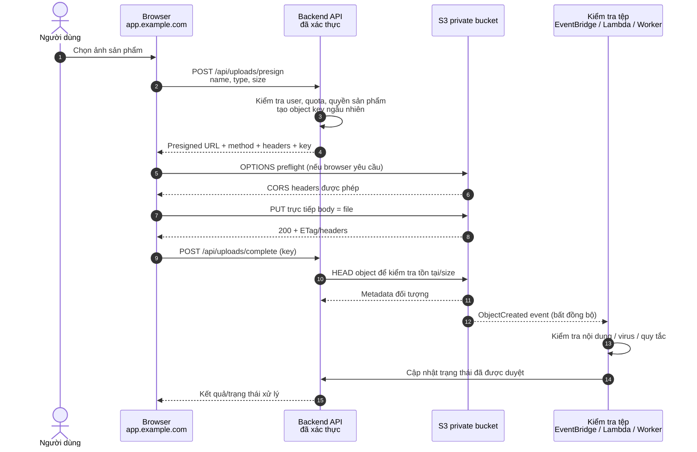
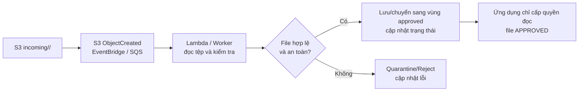
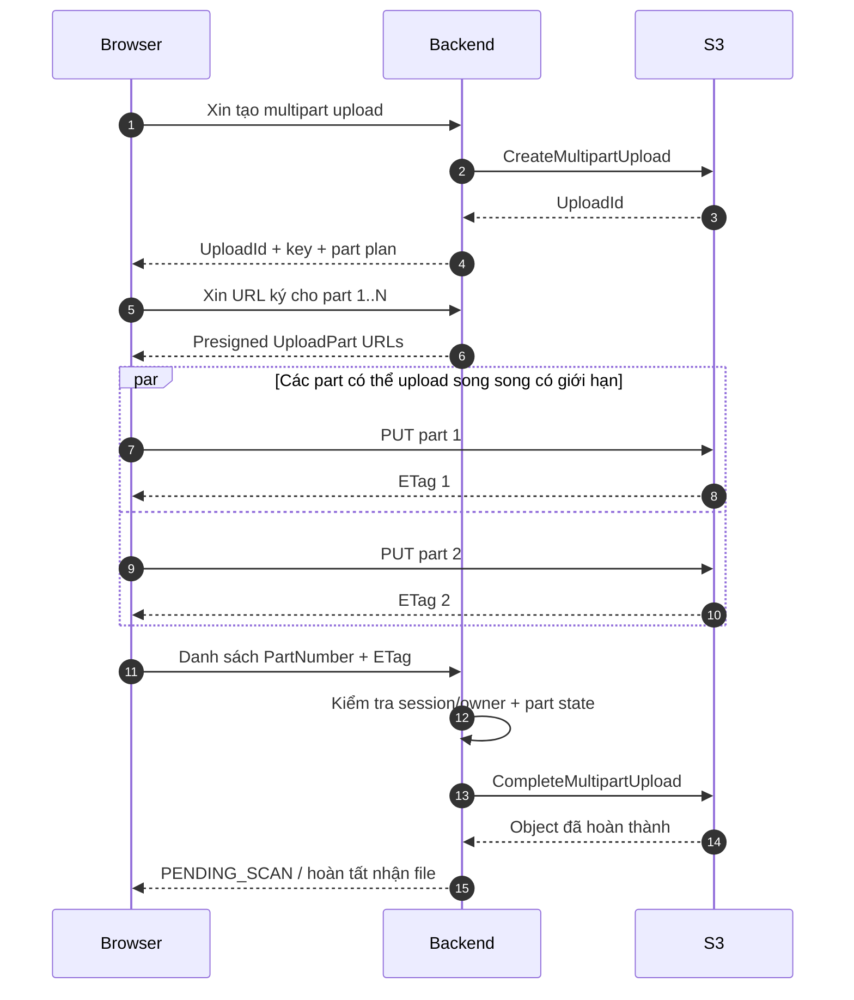
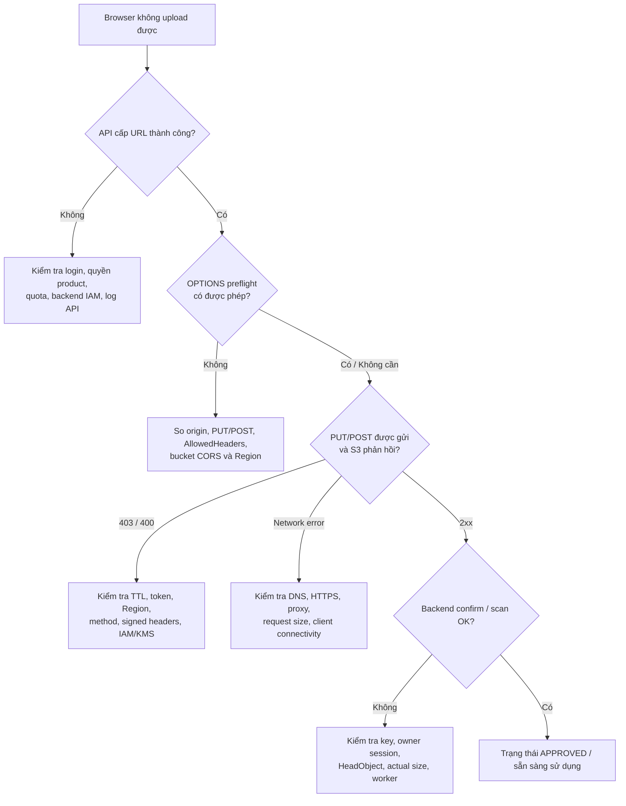

# Presigned URL, CORS và tải tệp từ trình duyệt với Amazon S3

Ứng dụng web thường cho phép người dùng tải ảnh đại diện, hóa đơn PDF, tài liệu hoặc tệp đính kèm. Nếu mọi byte của tệp đều đi qua backend, máy chủ ứng dụng phải xử lý thêm băng thông, bộ nhớ và kết nối dài. Với **Amazon Simple Storage Service (Amazon S3)**, backend có thể cấp một **presigned URL** có hiệu lực ngắn để trình duyệt tải tệp trực tiếp lên S3 mà **không cần đưa AWS access key vào mã frontend**.

Tuy nhiên, một presigned URL hoạt động ở tầng **xác thực yêu cầu đến S3**, còn trình duyệt áp dụng **Cross-Origin Resource Sharing (CORS)** ở tầng bảo mật web. Cấu hình đúng một thành phần chưa đủ: URL có thể hợp lệ nhưng trình duyệt chặn response vì CORS; hoặc CORS cho phép origin nhưng S3 vẫn trả `403 AccessDenied` vì quyền IAM không phù hợp.

Bài thuộc chương **Lưu trữ đối tượng S3** của module **CLOUD_PROVIDERS_AWS**. Trong hệ sinh thái AWS có Region/AZ, IAM, VPC, compute, storage, database, tích hợp và serverless, nội dung này rèn khả năng thiết kế một luồng upload/download **an toàn, có thể kiểm thử, giám sát, phục hồi và kiểm soát chi phí**. Trọng tâm là **Presigned URL, CORS và tải tệp từ trình duyệt**; ví dụ sử dụng AWS SDK for JavaScript v3, một backend Node.js và frontend chạy trong trình duyệt.

## 1. Bài toán và kết quả cần đạt

Giả sử website bán hàng tại `https://app.example.com` cho phép nhân viên đăng ảnh sản phẩm. Ảnh cần được lưu vào S3 bucket riêng tư trong Region `ap-southeast-1`. Backend ứng dụng chạy trên ECS/EC2/Lambda hoặc hạ tầng tương đương.

Yêu cầu:

1. Người dùng phải đăng nhập và được phân quyền upload ảnh cho đúng cửa hàng/sản phẩm.
2. Không đặt AWS access key, secret key hoặc session credentials trong trình duyệt.
3. File đi trực tiếp từ browser đến S3; backend chỉ xử lý metadata và cấp quyền.
4. Chỉ chấp nhận loại tệp, dung lượng và số lượt tải lên theo chính sách.
5. Bucket không công khai; đối tượng mới phải được kiểm tra trước khi sử dụng.
6. Hệ thống phát hiện lỗi, kiểm soát chi phí, lưu được bằng chứng sự kiện và có kế hoạch xử lý upload dở dang.

Sau bài học, bạn sẽ phân biệt được **presigned GET, presigned PUT, presigned POST**, giải thích CORS preflight, tạo policy CORS, triển khai upload, kiểm soát rủi ro và chẩn đoán các lỗi `403`, `SignatureDoesNotMatch`, `ExpiredToken` và lỗi CORS.

## 2. Kiến trúc upload trực tiếp lên S3



Sơ đồ thể hiện trình tự logic; thông báo upload hoàn tất và sự kiện xử lý nền **không mặc nhiên đến theo đúng thứ tự**. Hệ thống nên lưu trạng thái trong database hoặc nơi quản lý tin cậy, hỗ trợ retry và xử lý event lặp lại.

| Thành phần | Trách nhiệm | Không nên làm |
|---|---|---|
| **Browser** | Chọn file, gọi API cấp URL, PUT/POST file lên S3, hiển thị tiến độ | Nhúng IAM credentials hoặc tự quyết định quyền truy cập bucket |
| **Backend** | Xác thực user, kiểm tra quyền, tạo key/URL, theo dõi phiên upload | Tin tuyệt đối MIME type, tên file hoặc user ID do browser gửi |
| **IAM role cấp chữ ký** | Cho phép thao tác S3 giới hạn với đúng bucket/prefix | Dùng AdministratorAccess hoặc phát URL quá lâu |
| **S3 bucket** | Lưu object, đối chiếu chữ ký/quyền và phản hồi CORS | Cho phép public PUT/GET để “dễ upload” |
| **Worker kiểm tra tệp** | Đọc object mới, xác minh nội dung, quét mã độc nếu cần, chuyển/đánh dấu an toàn | Cấp quyền hiển thị ngay mọi object chưa kiểm tra |
| **Database nghiệp vụ** | Lưu owner, key, trạng thái và thông tin file | Lưu presigned URL dài hạn làm định danh file |

**Nguyên tắc:** trình duyệt upload trực tiếp nhưng **quyền cấp upload vẫn nằm ở backend**. URL đã ký là một dạng **bearer capability**: ai có URL còn hiệu lực có thể thực hiện hành động được ký, trong giới hạn những policy hiện hành áp dụng.

## 3. Presigned URL là gì?

**Presigned URL** là một URL chứa các tham số chữ ký AWS Signature Version 4 (SigV4), cho phép bên không có AWS credentials tự gửi một request được ủy quyền trước đến S3. Quyền được kiểm tra theo **danh tính đã ký URL**, request/action, đối tượng và các lớp policy liên quan.

Một URL điển hình có dạng:

```text
https://shop-uploads-example.s3.ap-southeast-1.amazonaws.com/incoming/...
  ?X-Amz-Algorithm=AWS4-HMAC-SHA256
  &X-Amz-Credential=...
  &X-Amz-Date=...
  &X-Amz-Expires=300
  &X-Amz-SignedHeaders=...
  &X-Amz-Signature=...
```

Đây chỉ là cấu trúc minh họa, **không phải URL sử dụng được**. Không gửi URL thật lên issue tracker, analytics, chat công khai hoặc log truy cập không được bảo vệ, vì chuỗi query chứa khả năng truy cập tạm thời.

### 3.1. Ba hình thức quan trọng

| Hình thức | Cách dùng | Đặc điểm |
|---|---|---|
| **Presigned GET URL** | Browser tải object riêng tư hoặc trình duyệt hiển thị ảnh | Cho phép đọc object cụ thể trong thời hạn ký; không cấp quyền list bucket |
| **Presigned PUT URL** | Browser PUT trực tiếp một file vào object key được ký | Đơn giản với `fetch`; method, key và những header được ký phải khớp |
| **Presigned POST** | Browser gửi `multipart/form-data` đến S3 kèm form fields và policy có chữ ký | Hỗ trợ điều kiện policy như `content-length-range`, key và Content-Type phù hợp |

**Presigned POST không phải một PUT URL dùng method POST.** POST dựa trên một **policy document** và nhiều trường form được ký; browser phải gửi chính xác các field đó.

### 3.2. Presigned URL cấp được quyền gì?

Presigned PUT cho key `incoming/shop/uuid.png` **không tự** cho phép:

- Liệt kê tất cả object trong bucket.
- Tải object khác hoặc sửa bucket policy.
- Tạo bất kỳ key nào ngoài key gắn với URL.
- Xóa object hoặc gọi những API không có trong yêu cầu đã ký.

Ngược lại, URL PUT hợp lệ **có thể bị tái sử dụng cho cùng key cho tới khi hết hiệu lực** nếu không có biện pháp bổ sung. Khi PUT lên key đã tồn tại, object hiện hành có thể bị thay thế; nếu S3 Versioning được bật, các phiên bản trước vẫn được giữ theo quy tắc của S3. Vì vậy phải dùng **key ngẫu nhiên không thể dự đoán** và thiết kế trạng thái upload/điều kiện ghi phù hợp.

### 3.3. Hiệu lực của URL và temporary credentials

Với presigned URL sử dụng SigV4 thông thường, thời hạn tối đa khi sử dụng credentials IAM dài hạn có thể tới **7 ngày** tùy cách tạo; trong ứng dụng upload, nên dùng **vài phút**. Nếu URL được ký bằng temporary credentials từ IAM role/STS, URL **không thể sử dụng sau khi session credentials hết hiệu lực**, ngay cả khi tham số `X-Amz-Expires` vẫn còn thời gian.

Ví dụ:

| Cấu hình | Thời gian dự kiến |
|---|---|
| URL ký với `expiresIn=300`, credential còn hiệu lực 1 giờ | URL thường dùng được tối đa khoảng 5 phút |
| URL ký với `expiresIn=3600`, credential hết hạn sau 10 phút | URL hết tác dụng khi credential hết hạn, có thể chỉ 10 phút |
| Cùng URL bị lộ trong lúc còn hiệu lực | Bên có URL có thể thực hiện request tương ứng | Không coi URL như bí mật dài hạn |

Ngoài hạn URL, policy còn có thể đặt giới hạn với condition key như `s3:signatureAge` trong ngữ cảnh hỗ trợ. Việc “thu hồi riêng từng URL” không có một thao tác phổ quát đơn giản; cần cân nhắc tuổi chữ ký, thay đổi quyền, credential, điều kiện ghi hoặc trạng thái đối tượng theo kiến trúc.

### 3.4. Vấn đề HTTPS, Region và endpoint

Sử dụng **HTTPS** khi gửi URL và file. S3 bucket có một Region cụ thể; URL phải được ký nhất quán với Region và endpoint mà client gọi. Lỗi Region hoặc redirect khiến method/host đổi có thể phá chữ ký hoặc gây lỗi CORS.

**Không đưa URL của S3 static website endpoint vào quy trình presigned PUT.** Website hosting và S3 API endpoint có mục đích khác nhau. Frontend thường dùng domain riêng qua CloudFront; thao tác PUT nên đi tới endpoint S3 API được ký đúng Region.

## 4. CORS là gì và vì sao upload có thể lỗi dù chữ ký đúng?

**Origin** gồm **scheme + host + port**. Ví dụ:

```text
https://app.example.com            # Origin A
https://admin.example.com          # Origin B (host khác)
http://app.example.com             # Origin C (scheme khác)
https://app.example.com:8443       # Origin D (port khác)
```

Khi JavaScript trên `https://app.example.com` gửi `fetch` đến `https://shop-uploads-example.s3.ap-southeast-1.amazonaws.com`, hai origin khác nhau. Trình duyệt áp dụng **Same-Origin Policy** và cơ chế **CORS** để quyết định JavaScript có được đọc response cross-origin và gửi một số loại request hay không.

**CORS không phải IAM và cũng không phải cơ chế bảo vệ bucket khỏi mọi client.** Một script dùng cURL/SDK có thể gọi S3 mà không bị trình duyệt thực thi CORS. S3 vẫn đánh giá chữ ký, IAM, bucket policy, KMS và những giới hạn tương ứng.

### 4.1. Preflight request (OPTIONS)

Khi browser thực hiện request cross-origin không thuộc nhóm “simple request”, chẳng hạn PUT với `Content-Type: image/png`, browser thường gửi **OPTIONS preflight** trước:

```http
OPTIONS /incoming/shop/file.png HTTP/1.1
Host: shop-uploads-example.s3.ap-southeast-1.amazonaws.com
Origin: https://app.example.com
Access-Control-Request-Method: PUT
Access-Control-Request-Headers: content-type
```

S3 phản hồi các header CORS tương ứng nếu bucket có rule khớp origin, method và request headers:

```http
HTTP/1.1 200 OK
Access-Control-Allow-Origin: https://app.example.com
Access-Control-Allow-Methods: PUT, GET, HEAD
Access-Control-Allow-Headers: content-type
Access-Control-Max-Age: 300
```

Response trên là **minh họa**; danh sách/thứ tự header và HTTP status thực tế tùy S3/browser. Khi preflight không đạt, browser có thể **không gửi PUT**. Nếu PUT đã gửi nhưng response thiếu header CORS hợp lệ, S3 có thể vẫn lưu object trong khi JavaScript báo lỗi do không được đọc response. Vì vậy cần kiểm tra cả **Network tab** lẫn trạng thái object thực tế trước khi retry để tránh tải trùng.

### 4.2. CORS rule không dùng AllowedMethods=OPTIONS

Trong cấu hình CORS của S3, bạn liệt kê các **actual HTTP methods** được phép như `GET`, `PUT`, `POST`, `DELETE`, `HEAD`. Browser tự gửi OPTIONS preflight và S3 tự đánh giá dựa trên `Access-Control-Request-Method`. **Không thêm `OPTIONS` vào `AllowedMethods`** chỉ vì thấy preflight trong DevTools.

### 4.3. Các thuộc tính cấu hình CORS

| Thuộc tính | Ý nghĩa | Lưu ý |
|---|---|---|
| `AllowedOrigins` | Danh sách origin được phép | Ghi chính xác protocol/hostname/port; không thêm dấu `/` cuối |
| `AllowedMethods` | HTTP methods được browser phép thực hiện | PUT cho presigned PUT, POST cho presigned POST |
| `AllowedHeaders` | Request header names có thể xuất hiện trong preflight | Bao gồm những header được client gửi, như `content-type`, `x-amz-checksum-sha256` nếu sử dụng |
| `ExposeHeaders` | Response headers JavaScript được đọc ngoài các header được CORS safelist | `ETag`, `x-amz-version-id` nếu ứng dụng cần |
| `MaxAgeSeconds` | Thời gian browser có thể cache kết quả preflight | Giảm OPTIONS lặp lại; browser vẫn có giới hạn riêng |

**Phân biệt request và response headers:** `AllowedHeaders` nói về header **client gửi lên**; `ExposeHeaders` nói về header **S3 trả về** mà JavaScript cần đọc. Thêm `ETag` vào AllowedHeaders không giúp JS đọc được `ETag`.

## 5. Thiết lập S3 bucket an toàn trước khi ký URL

Một kiến trúc upload sản phẩm có thể dùng bucket `shop-uploads-example` với các prefix:

```text
shop-uploads-example/
  incoming/<owner-scope>/<upload-uuid>.png
  approved/<product-id>/<asset-id>.png
  rejected/<upload-uuid>/
```

Tên bucket, key và mã định danh chỉ là ví dụ. Trong hệ thống có dữ liệu nhạy cảm, có thể tách **incoming/quarantine** và **approved** thành **hai bucket** với key policy, role và quyền đọc riêng để tránh đọc nhầm file chưa kiểm tra.

### 5.1. Baseline cấu hình

1. **S3 Block Public Access** được bật theo chính sách tổ chức, đặc biệt ở bucket nhận upload người dùng.
2. **S3 Object Ownership = Bucket owner enforced** khi phù hợp; ACL bị vô hiệu hóa và quyền quản trị dựa trên IAM/bucket policy. Tránh gửi `x-amz-acl: public-read` trong request.
3. **Default bucket encryption** được cấu hình; S3 mã hóa object mới mặc định bằng SSE-S3, có thể dùng SSE-KMS nếu yêu cầu quản lý KMS key riêng.
4. **Versioning** cân nhắc theo yêu cầu phục hồi/tái sử dụng key; cần dự trù storage cho các version.
5. **Lifecycle rules** xử lý object chưa hoàn thành, object bị từ chối và **incomplete multipart uploads** nếu có multipart.
6. **Bucket policy/IAM role** giới hạn ai được PutObject/GetObject/DeleteObject; cân nhắc yêu cầu TLS (`aws:SecureTransport`) và các điều kiện phù hợp.
7. **CloudTrail S3 data events**, S3 access logging hoặc quan sát khác được cấu hình theo nhu cầu kiểm toán và ngân sách.

Đối với SSE-KMS, role ký URL/đọc file và các dịch vụ xử lý phía sau có thể cần quyền KMS liên quan theo loại API, cộng với key policy phù hợp. Thiếu quyền KMS có thể dẫn tới AccessDenied ngay cả khi quyền S3 nhìn có vẻ đủ.

### 5.2. Quyền IAM tối thiểu của backend ký PUT

Một role dành riêng cho bước **phát presigned PUT** có thể bắt đầu bằng policy:

```json
{
  "Version": "2012-10-17",
  "Statement": [
    {
      "Sid": "SignUploadsOnlyIntoIncoming",
      "Effect": "Allow",
      "Action": "s3:PutObject",
      "Resource": "arn:aws:s3:::shop-uploads-example/incoming/*"
    }
  ]
}
```

Đây là **identity policy mẫu**, không phải bucket policy. Nếu hệ thống cần đọc metadata sau upload (HEAD) hoặc chuyển object đã được duyệt, nên có **role thực thi khác** với quyền `s3:GetObject`/`s3:CopyObject` tương ứng. Việc cấp quyền `s3:PutObject` để ký URL không cần kèm `s3:ListBucket` cho frontend.

Nếu application role ký URL còn có các quyền S3 khác, quyền thực tế của URL vẫn dựa trên request cụ thể được ký. Tuy nhiên, áp dụng **least privilege** cho presigner làm giảm phạm vi tác động nếu backend bị chiếm quyền.

### 5.3. Thiết kế object key an toàn

Backend nên tự sinh key:

```text
incoming/8c97f1.../7ef5fb30-...-4b23.png
```

Không lấy trực tiếp `../../admin/config`, `users/other-user/file.jpg` hoặc toàn bộ tên file do client cung cấp làm key. S3 key không hoạt động giống đường dẫn filesystem truyền thống, nhưng nhiều hệ thống về sau tải file về đĩa hoặc xử lý prefix như thư mục; tên không được kiểm soát có thể gây nhầm quyền hoặc lỗi downstream.

**Thực hành an toàn:** xác định tenant/owner từ session tin cậy, sử dụng prefix thuộc scope đã cấp, sinh UUID cho tên object, chọn extension theo danh sách loại tệp được cho phép và lưu tên gốc vào database để hiển thị nếu cần.

## 6. Backend tạo presigned PUT URL bằng AWS SDK for JavaScript v3

Giả sử backend Node.js sử dụng IAM role của ECS task, EC2 instance profile hoặc Lambda execution role để lấy temporary credentials tự động. Với môi trường phát triển local, có thể dùng AWS CLI profile/SSO đã được cấp quyền thay cho việc nhúng credentials trong code.

Cài thư viện:

```bash
npm install @aws-sdk/client-s3 @aws-sdk/s3-request-presigner
```

Ví dụ một hàm **issueUpload** chạy ở backend. Tham số `authenticatedUserId` **phải lấy từ session/token đã được backend xác minh**, không lấy từ request body do browser tự khai:

```javascript
import { createHash, randomUUID } from "node:crypto";
import { S3Client, PutObjectCommand } from "@aws-sdk/client-s3";
import { getSignedUrl } from "@aws-sdk/s3-request-presigner";

const bucket = process.env.UPLOAD_BUCKET;
const s3 = new S3Client({
  region: process.env.AWS_REGION ?? "ap-southeast-1",
});

const EXTENSION_BY_MIME = {
  "image/png": "png",
  "image/jpeg": "jpg",
  "application/pdf": "pdf",
};
const MAX_FILE_BYTES = 10 * 1024 * 1024; // 10 MiB

export async function issueUpload({
  authenticatedUserId,
  contentType,
  sizeBytes,
}) {
  if (!bucket) throw new Error("UPLOAD_BUCKET is not configured");
  if (typeof authenticatedUserId !== "string" || !authenticatedUserId) {
    throw new Error("Authenticated user is required");
  }

  const extension = EXTENSION_BY_MIME[contentType];
  if (!extension) throw new Error("Unsupported file type");
  if (
    !Number.isSafeInteger(sizeBytes) ||
    sizeBytes <= 0 ||
    sizeBytes > MAX_FILE_BYTES
  ) {
    throw new Error("File size is invalid or exceeds limit");
  }

  // Không để lộ user ID thật trong đường dẫn object.
  const ownerScope = createHash("sha256")
    .update(authenticatedUserId)
    .digest("hex");
  const key = `incoming/${ownerScope}/${randomUUID()}.${extension}`;

  const command = new PutObjectCommand({
    Bucket: bucket,
    Key: key,
    ContentType: contentType,
  });

  const uploadUrl = await getSignedUrl(s3, command, {
    expiresIn: 300,
    signableHeaders: new Set(["content-type"]),
  });

  return {
    uploadUrl,
    key,
    method: "PUT",
    headers: { "Content-Type": contentType },
    expiresInSeconds: 300,
  };
}
```

**Luồng tích hợp API:** endpoint `POST /api/uploads/presign` sử dụng middleware xác thực hiện có; middleware xác định user, tenant và quyền upload lên sản phẩm tương ứng, kiểm tra rate limit/quota, gọi `issueUpload` và trả kết quả JSON. Nên tạo một bản ghi upload với trạng thái `PENDING` gắn với user/product/key ngay khi phát URL. Code trên chỉ trình bày phần **ký URL**, chưa phải toàn bộ hệ thống quản lý upload.

Đặc điểm bảo mật của ví dụ:

- Key do backend sinh với UUID; user không được chọn tùy ý key.
- IAM role chỉ có quyền PUT vào `incoming/*`.
- Thời hạn URL 5 phút; không trả AWS credentials cho browser.
- Header `Content-Type` được đưa vào yêu cầu và được yêu cầu ký bằng `signableHeaders`. Browser phải gửi đúng giá trị header đã cấp; thay header có thể dẫn tới `SignatureDoesNotMatch`.
- Mức 10 MiB ở đây mới là **kiểm tra metadata client khai trước khi ký**. **Presigned PUT không tự bảo đảm file thật không vượt giới hạn này**; hệ thống phải kiểm tra kích thước thực sau upload hoặc chuyển sang presigned POST có size condition nếu cần ràng buộc ngay ở S3.
- MIME do client khai chỉ là **gợi ý**, chưa chứng minh nội dung là ảnh hoặc PDF an toàn.

Nếu cần điều kiện tải lên chặt hơn như checksum, SSE-KMS headers, object tags hoặc không ghi đè, phải quyết định và ký đúng những header/condition được S3 hỗ trợ. Browser cần gửi đúng yêu cầu đã ký; không thêm các header `x-amz-*` tùy ý sau khi nhận URL.

### 6.1. API không được tin user ID hoặc product ID trong payload

Request minh họa:

```json
{
  "productId": "PRD-1005",
  "fileName": "camera.jpg",
  "contentType": "image/jpeg",
  "sizeBytes": 2176000
}
```

Backend phải kiểm tra:

1. Session hiện tại là ai, đã đăng nhập và được phép sửa `PRD-1005` hay chưa?
2. Tài khoản/cửa hàng có quota và quyền tải lên loại file đó không?
3. User đang có quá nhiều upload chưa hoàn tất hay không?
4. Content type/size/tên gốc có hợp lệ về mặt **cú pháp**; không tin đó là sự thật về file bytes.
5. Key tạo ra thuộc đúng scope được quyền, không bị client thay bằng key của người khác.

Không trả signed URL cho một request chỉ vì `productId` có trong database; phải kiểm tra quan hệ giữa user, tenant, product và thao tác upload.

## 7. Frontend upload bằng Fetch API

Frontend nhận file từ `<input type="file">` hoặc drag-and-drop, rồi gọi backend cấp URL. Ví dụ JavaScript:

```javascript
export async function uploadProductFile(file, productId) {
  if (!file) throw new Error("Please choose a file");

  // API của ứng dụng; dùng phiên xác thực hiện có.
  const presignResponse = await fetch("/api/uploads/presign", {
    method: "POST",
    credentials: "include",
    headers: { "Content-Type": "application/json" },
    body: JSON.stringify({
      productId,
      fileName: file.name,
      contentType: file.type,
      sizeBytes: file.size,
    }),
  });
  if (!presignResponse.ok) {
    throw new Error(`Unable to request upload URL (${presignResponse.status})`);
  }

  const grant = await presignResponse.json();

  // Request đến S3: không gửi cookie của ứng dụng.
  // Dùng đúng method và headers do backend trả về.
  const uploadResponse = await fetch(grant.uploadUrl, {
    method: grant.method, // "PUT"
    headers: grant.headers,
    body: file,
    credentials: "omit",
  });
  if (!uploadResponse.ok) {
    throw new Error(`S3 upload failed (${uploadResponse.status})`);
  }

  // Chỉ báo "đã gửi xong", chưa phải "file đã được kiểm tra an toàn".
  const completeResponse = await fetch("/api/uploads/complete", {
    method: "POST",
    credentials: "include",
    headers: { "Content-Type": "application/json" },
    body: JSON.stringify({ key: grant.key, productId }),
  });
  if (!completeResponse.ok) {
    throw new Error("Upload stored, but confirmation failed");
  }

  return completeResponse.json();
}
```

**Quan trọng về lỗi và retry:**

- Nếu URL hết hạn trước khi bắt đầu/hoàn tất request, browser phải xin URL mới hoặc thực hiện quy trình retry được backend cho phép.
- Nếu PUT thành công nhưng request confirm thất bại, không nên tạo một object key mới ngay mà không kiểm tra phiên upload cũ. Backend có thể kiểm tra bằng `HeadObject`, đối chiếu owner và xử lý idempotent.
- Nếu browser bị lỗi CORS ở response của PUT, **không thể suy ra chắc chắn object chưa được lưu**. Kiểm tra kết quả ở backend/S3 trước khi upload trùng.
- `fetch` không cung cấp tiến độ **upload bytes** theo cách phổ quát như `XMLHttpRequest.upload.onprogress`. Nếu giao diện cần progress bar cho tệp lớn, có thể dùng XHR hoặc cơ chế multipart upload với tiến độ từng part.

### 7.1. Ví dụ input HTML tối thiểu

```html
<input id="productFile" type="file" accept="image/png,image/jpeg,application/pdf" />
<button id="uploadButton" type="button">Tải lên</button>
<p id="uploadStatus" role="status"></p>
```

`accept` chỉ hỗ trợ người dùng chọn file; không phải một kiểm soát bảo mật. Kẻ tấn công có thể gửi HTTP request trực tiếp hoặc đổi phần mở rộng/MIME. Backend và worker phải kiểm tra nội dung thực tế.

### 7.2. CORS của backend và CORS của S3 là hai nơi khác nhau

Nếu frontend `https://app.example.com` và backend `https://api.example.com` là hai origin, backend cũng phải trả CORS headers phù hợp cho các request `/api/uploads/*`. Cấu hình CORS của **S3 bucket không thể sửa lỗi CORS của backend API**.

Trong ví dụ code ở trên, `/api/uploads/*` là đường dẫn cùng origin với frontend để đơn giản hóa. Khi dùng cookie session có `credentials:"include"`, backend phải bảo vệ CSRF và cấu hình cookie/SameSite/CORS phù hợp. Khi gọi S3 qua URL đã ký, không cần gửi cookie ứng dụng nên dùng `credentials:"omit"`.

## 8. Cấu hình CORS cho S3 bucket

Trong Amazon S3 Console: **Buckets → chọn bucket → Permissions → Cross-origin resource sharing (CORS)**. Dán cấu hình JSON minh họa:

```json
[
  {
    "AllowedHeaders": [
      "Content-Type",
      "x-amz-checksum-sha256",
      "x-amz-meta-*"
    ],
    "AllowedMethods": [
      "PUT",
      "POST",
      "GET",
      "HEAD"
    ],
    "AllowedOrigins": [
      "https://app.example.com",
      "https://staging.example.com"
    ],
    "ExposeHeaders": [
      "ETag",
      "x-amz-version-id"
    ],
    "MaxAgeSeconds": 300
  }
]
```

Phần `PUT` dùng cho presigned PUT; `POST` dùng khi sử dụng presigned POST; `GET/HEAD` cho các tương tác đọc nếu cần. Đừng mở những method mà ứng dụng không sử dụng. Rule có thể tách theo origin và method để dễ kiểm soát.

**Không dùng `AllowedOrigins: ["*"]` theo mặc định cho ứng dụng riêng tư.** Wildcard làm mọi origin có thể gửi CORS request theo rule, dù chữ ký/IAM vẫn là lớp kiểm soát truy cập thực sự. Với các luồng có cookie/credentials ở tầng browser, wildcard cũng không tương thích với cơ chế cho phép đọc response có credentials theo tiêu chuẩn CORS. S3 direct upload thường không dùng cookie của ứng dụng.

### 8.1. Cấu hình CORS bằng AWS CLI

S3 API `put-bucket-cors` nhận tài liệu có lớp ngoài `CORSRules`, khác JSON array trần mà S3 Console thường dùng:

```json
{
  "CORSRules": [
    {
      "AllowedOrigins": ["https://app.example.com"],
      "AllowedMethods": ["PUT", "GET", "HEAD"],
      "AllowedHeaders": ["Content-Type", "x-amz-checksum-sha256"],
      "ExposeHeaders": ["ETag"],
      "MaxAgeSeconds": 300
    }
  ]
}
```

Giả sử lưu JSON vừa nêu thành `cors-config.json` trong môi trường triển khai của bạn, lệnh:

```bash
aws s3api put-bucket-cors \
  --bucket shop-uploads-example \
  --cors-configuration file://cors-config.json

aws s3api get-bucket-cors \
  --bucket shop-uploads-example
```

Đây là minh họa cho workflow deploy; bài viết không tạo file phụ. Người thực hành có thể đưa CORS policy vào CloudFormation/CDK/Terraform để review và triển khai nhất quán.

### 8.2. Kiểm tra preflight với cURL

Giả sử bucket và Region đã được cấu hình đúng:

```bash
curl -i -X OPTIONS \
  "https://shop-uploads-example.s3.ap-southeast-1.amazonaws.com/incoming/example.png" \
  -H "Origin: https://app.example.com" \
  -H "Access-Control-Request-Method: PUT" \
  -H "Access-Control-Request-Headers: content-type"
```

Kiểm tra `Access-Control-Allow-Origin`, `Access-Control-Allow-Methods`, `Access-Control-Allow-Headers`. Nếu origin sai `http`/`https`, tên miền hoặc port, rule sẽ không khớp.

**cURL không thực thi CORS như browser.** Một request bằng cURL có thể thành công khi browser thất bại; dùng cURL để quan sát response headers, sau đó kiểm tra thực tế bằng DevTools của browser.

### 8.3. CORS không cấp quyền công khai

Một bucket có CORS `AllowedOrigins: ["https://app.example.com"]` vẫn có thể **private hoàn toàn** với Block Public Access và IAM/bucket policy. Nếu request không có chữ ký hợp lệ hoặc vượt quyền, S3 trả AccessDenied. Ngược lại, bucket cấu hình public không tự trở nên private khi đặt AllowedOrigins hẹp.

CORS là chính sách **trình duyệt đọc/gửi response cross-origin**, còn IAM/bucket policy/authorization quyết định **ai được thao tác với object**.

## 9. Header đã ký, nội dung file và toàn vẹn dữ liệu

Một presigned PUT URL gắn với **method, host, path/query và những header được ký**. Trong URL có tham số `X-Amz-SignedHeaders` cho biết tập header tham gia chữ ký. Không thể sửa key/Region hoặc thay đổi header đã ký rồi mong URL vẫn hoạt động.

### 9.1. Content-Type phải nhất quán

Nếu backend đã ký `Content-Type: image/jpeg`, browser phải gửi **đúng giá trị đó**:

```javascript
const response = await fetch(uploadUrl, {
  method: "PUT",
  headers: { "Content-Type": "image/jpeg" },
  body: jpegFile,
  credentials: "omit",
});
```

Nếu browser gửi `image/png` hoặc thêm một số header cần được ký nhưng chưa khớp, request có thể trả `SignatureDoesNotMatch`. **Tuy nhiên, Content-Type khớp chữ ký vẫn không chứng minh bytes bên trong là ảnh JPEG.** Kẻ gửi có thể tạo file chứa nội dung khác và khai cùng MIME type.

Không tự đặt header `Content-Length` trong JavaScript browser: đây là header do user agent quản lý, và phần lớn browser không cho script trực tiếp chỉnh sửa. Muốn cưỡng chế kích thước upload ở S3 với chính sách biểu mẫu, xem **presigned POST** trong phần tiếp theo.

### 9.2. Dùng checksum khi cần bảo toàn dữ liệu

Một số luồng yêu cầu xác minh tệp không bị thay đổi trong truyền tải. S3 hỗ trợ các checksum request phù hợp như **SHA-256**, trong đó:

1. Client tính checksum của **bytes file**.
2. Backend hoặc client đưa checksum vào cơ chế ký/header theo API và SDK hỗ trợ.
3. S3 xác minh checksum khi nhận object.
4. Backend có thể lưu checksum mong đợi để so sánh với metadata/kết quả xử lý downstream.

Với header `x-amz-checksum-sha256`, giá trị checksum SHA-256 được biểu diễn **Base64 của digest**, không phải chuỗi hex. Khi có checksum header, phải thêm header tương ứng vào CORS AllowedHeaders, và nếu đưa header vào chữ ký thì browser phải gửi chính xác. Trong ứng dụng tệp lớn, chọn cơ chế checksum theo hướng dẫn SDK/S3 để không phải nạp toàn bộ file vào RAM.

**Đừng dùng ETag như một bằng chứng MD5 toàn năng.** ETag của S3 có thể khác MD5 của object, đặc biệt khi dùng multipart upload hoặc một số phương thức mã hóa/tạo object. Nếu yêu cầu kiểm tra toàn vẹn, chọn checksum rõ ràng.

### 9.3. Presigned PUT không tự tạo một “quyền một lần”

URL có thể được gửi lại trong cửa sổ còn hiệu lực. Nếu cần hạn chế overwrite, có thể nghiên cứu các **conditional requests** được S3 hỗ trợ (ví dụ điều kiện `If-None-Match: *` trong trường hợp thích hợp), nhưng phải ký/gửi đúng header, kiểm tra tính tương thích với API và xử lý các mã lỗi tiền điều kiện. Tự tạo UUID chỉ giảm va chạm; nó không tự biến URL thành single-use token.

Mô hình đáng tin cậy hơn cho nhiều ứng dụng là:

- Backend tạo **upload session** có ID và trạng thái riêng.
- S3 object key gắn với phiên này, có TTL, kiểm soát quota.
- Khi upload hoàn tất, backend kiểm tra object và chuyển trạng thái.
- Chỉ object đã qua kiểm tra mới được gắn vào bản ghi nghiệp vụ.
- Các object bị bỏ dở/quá hạn được dọn bằng workflow/lifecycle riêng.

## 10. Presigned POST: giới hạn điều kiện upload trong policy

Presigned POST thường là lựa chọn khi browser gửi file qua **HTML form** và cần S3 kiểm tra điều kiện upload, chẳng hạn **khoảng kích thước request**, tiền tố key, Content-Type và các metadata được khai báo. Backend nhận một URL đích cùng **form fields** có chữ ký.

### 10.1. So sánh PUT và POST

| Tiêu chí | Presigned PUT | Presigned POST |
|---|---|---|
| Request từ browser | `PUT` với body là bytes của file | `POST multipart/form-data` với fields và file |
| Dễ dùng với `fetch` | Rất đơn giản | Cần tạo `FormData` đúng thứ tự |
| Ràng buộc kích thước ngay tại S3 | Không có POST policy `content-length-range`; phải thiết kế giải pháp khác | Có thể dùng điều kiện `content-length-range` trong POST policy |
| Content-Type | Header request, ký nếu cần | Form field/policy condition được kiểm soát |
| CORS method | `PUT` | `POST` |
| Response | Thường HTTP 200 khi PutObject thành công | Thường HTTP 204 hoặc theo cấu hình POST response |
| Multipart Upload API cho file rất lớn | Cần workflow multipart riêng | POST form không thay cho Multipart Upload API |

### 10.2. Tạo presigned POST từ backend

Cài bổ sung:

```bash
npm install @aws-sdk/s3-presigned-post
```

Ví dụ tiếp tục sử dụng `s3`, `bucket` và object `key` do backend sinh và đã kiểm tra owner/loại tệp trong phần 6:

```javascript
import { createPresignedPost } from "@aws-sdk/s3-presigned-post";

const maxBodyBytes = 10 * 1024 * 1024 + 64 * 1024;
// 64 KiB dự phòng cho multipart/form-data overhead; file thực
// vẫn phải được backend/worker kiểm tra sau upload.

const { url, fields } = await createPresignedPost(s3, {
  Bucket: bucket,
  Key: key,
  Expires: 300,
  Fields: {
    "Content-Type": contentType,
  },
  Conditions: [
    ["content-length-range", 1, maxBodyBytes],
    ["eq", "$Content-Type", contentType],
  ],
});

// Trả { url, fields, key } cho browser sau khi user được cấp quyền.
```

`content-length-range` áp dụng cho **HTTP POST request body**, có overhead từ các multipart fields, nên giới hạn này cần được thiết kế cùng quy tắc **kích thước file thực**. Trong ví dụ, frontend kiểm tra file tối đa 10 MiB, POST policy giới hạn cả request và backend xác minh `ContentLength` sau upload; không được coi 64 KiB dự phòng là quyền hợp lệ để tải file vượt giới hạn nghiệp vụ.

Các điều kiện như `["eq", "$Content-Type", contentType]` ràng buộc form field Content-Type; nó **không kiểm tra magic bytes/nội dung file**. Backend vẫn cần xác thực MIME thực tế, đặc biệt với ảnh, PDF hoặc tệp chạy được.

### 10.3. Browser gửi presigned POST bằng FormData

```javascript
async function uploadWithPresignedPost(file, grant) {
  const form = new FormData();
  for (const [name, value] of Object.entries(grant.fields)) {
    form.append(name, value);
  }
  // File phải được thêm cuối cùng để S3 xử lý form đúng cách.
  form.append("file", file);

  const response = await fetch(grant.url, {
    method: "POST",
    body: form,
    credentials: "omit",
  });
  if (!response.ok) {
    throw new Error(`Presigned POST failed (${response.status})`);
  }
  return { key: grant.key, status: response.status };
}
```

**Không đặt thủ công header `Content-Type: multipart/form-data`** ở đoạn code trên. Browser phải tự gắn `boundary` chính xác vào Content-Type; việc ghi đè header có thể làm multipart body không khớp và S3 từ chối.

### 10.4. POST policy thực hiện kiểm soát gì?

| Điều kiện | Kiểm soát | Lưu ý |
|---|---|---|
| `content-length-range` | Khoảng kích thước request được chấp nhận | Có overhead của multipart body |
| `eq $Content-Type` | Giá trị trường Content-Type | Không xác minh bytes tệp |
| `starts-with $key` | Tiền tố key được phép nếu thiết kế dùng prefix linh hoạt | Nên ưu tiên key cụ thể do backend sinh khi có thể |
| `eq $key` / Key cố định | Vị trí object cụ thể được phép | Không cho client tự ghi đè key tùy ý |
| `x-amz-meta-*` và fields phù hợp | Metadata được gửi cùng object | Metadata do client cung cấp vẫn không đáng tin cậy |

**Lưu ý IAM:** presigned POST vẫn được thực thi theo principal có quyền đối với S3 object cần tạo; policy POST không thay thế IAM/bucket policy. Các constraints bảo vệ dữ liệu là **lớp bổ sung**.

## 11. Quy trình xác nhận, kiểm tra file và phát hành object

Browser nhận HTTP 200 từ PUT hoặc HTTP thành công từ POST chỉ có nghĩa **S3 đã chấp nhận request**. Một file có thể mang MIME khai sai, mã độc, payload polyglot, nội dung không phù hợp hoặc không thuộc chủ sở hữu hợp lệ.

### 11.1. Tách trạng thái nghiệp vụ

| Trạng thái | Ý nghĩa | Người dùng được làm gì? |
|---|---|---|
| `PENDING` | Backend đã cấp URL, chưa xác minh có object | Thấy tiến độ, retry/hủy theo quy tắc |
| `UPLOADED` | Object tồn tại, metadata cơ bản khớp phiên upload | Chờ kiểm tra; chưa được chia sẻ công khai |
| `SCANNING` | Worker xử lý/quét nội dung | Thấy trạng thái xử lý |
| `APPROVED` | Nội dung đã qua tiêu chí kiểm tra và liên kết nghiệp vụ | Có thể sử dụng theo quyền và chính sách |
| `REJECTED` | File lỗi/không đúng loại/không an toàn | Thông báo lỗi phù hợp, dọn/cách ly object |
| `EXPIRED` | Phiên upload quá hạn, không hoàn thành | Có thể yêu cầu phiên mới nếu được phép |

Nên lưu object key, user/tenant, resource owner, expected type/size, thời gian cấp, thời gian hoàn tất và trạng thái vào database. **Không lưu presigned URL làm khóa chính**, vì chữ ký hết hạn và cùng object có thể có nhiều URL được tạo ở thời điểm khác nhau.

### 11.2. Backend xác nhận object bằng HEAD

Backend nhận `key` từ browser nhưng **phải đối chiếu key với upload session thuộc user đã xác thực**; không được HEAD tùy ý key do người dùng chọn để dò bucket.

Ví dụ đoạn kiểm tra cơ bản:

```javascript
import { HeadObjectCommand } from "@aws-sdk/client-s3";

async function verifyUploadedObject({
  key,
  expectedMaxBytes,
  expectedContentType,
}) {
  const result = await s3.send(new HeadObjectCommand({
    Bucket: bucket,
    Key: key,
  }));

  if (
    !Number.isSafeInteger(result.ContentLength) ||
    result.ContentLength <= 0 ||
    result.ContentLength > expectedMaxBytes
  ) {
    throw new Error("Unexpected object size");
  }
  if (result.ContentType !== expectedContentType) {
    throw new Error("Unexpected declared content type");
  }
  return {
    key,
    actualSize: result.ContentLength,
    etag: result.ETag,
  };
}
```

Hàm trên chỉ kiểm tra **metadata S3**, không đọc magic bytes và không quét mã độc. Backend phải dùng quyền `s3:GetObject` phù hợp cho HeadObject; KMS permissions có thể cần thêm trong một số luồng/tuỳ chọn API. Nếu quyền ListBucket không có, lỗi của HEAD cho key không tồn tại có thể trả `403` thay vì `404`; không suy luận mọi 403 là object tồn tại.

Các bước bổ sung:

1. Chỉ chấp nhận confirm với upload session của đúng user và key đã cấp.
2. Kiểm tra object tồn tại, size, checksum/metadata cần thiết; xử lý retry/idempotency.
3. Chạy kiểm tra file thực tế (magic bytes, decode ảnh, PDF parser, scan malware theo mức độ nhạy cảm).
4. Chỉ chuyển object sang bucket/prefix phục vụ đọc sau khi đã được duyệt.
5. Cập nhật database bằng thao tác có kiểm soát; giữ audit log và lifecycle cleanup cho object bị từ chối.

### 11.3. ObjectCreated event và xử lý bất đồng bộ

Amazon S3 có thể phát **object creation notifications** qua S3 Event Notifications tới SQS/SNS/Lambda hoặc qua EventBridge theo cấu hình. Một worker có thể:



S3 event notifications là **bất đồng bộ và có thể được giao lặp lại hoặc không theo thứ tự mong đợi**. Worker phải idempotent, có retry/DLQ theo kiến trúc phù hợp, và tránh tự tạo vòng lặp khi ghi object mới vào vị trí cũng kích hoạt cùng event.

Để chống race khi URL PUT còn hiệu lực và có thể bị dùng lại, worker nên biết **version ID, ETag/checksum, thời điểm và trạng thái upload** tương ứng. Không duyệt “bất kỳ bytes nào đang nằm dưới key” mà bỏ qua khả năng key được ghi lại sau khi kiểm tra. Với yêu cầu nhạy cảm, dùng versioning/immutable promotion và quyền riêng cho prefix đã duyệt.

### 11.4. Phục vụ file đã được duyệt

Sau khi object ở trạng thái `APPROVED`, backend có thể phát **presigned GET URL** ngắn hạn cho user được phép đọc:

```javascript
import { GetObjectCommand } from "@aws-sdk/client-s3";
import { getSignedUrl } from "@aws-sdk/s3-request-presigner";

async function createDownloadUrl(approvedKey) {
  return getSignedUrl(
    s3,
    new GetObjectCommand({
      Bucket: bucket,
      Key: approvedKey,
    }),
    { expiresIn: 60 }
  );
}
```

**Trước khi gọi hàm:** backend phải kiểm tra người yêu cầu có quyền đọc object, key thuộc trạng thái APPROVED, và IAM role có `s3:GetObject`. Không dùng cùng một presigner role chỉ có `s3:PutObject` của phần trước để ký GET nếu chưa cấp quyền cần thiết.

Với nhiều file/download hoặc ứng dụng phân phối qua CDN, đánh giá **Amazon CloudFront** với S3 origin riêng tư (OAC), signed URLs/cookies của CloudFront khi cần kiểm soát truy cập. S3 presigned URL thường phù hợp các thao tác trực tiếp và thời gian ngắn, còn CloudFront có lợi khi cần cache, tối ưu độ trễ và kiểm soát phân phối.

## 12. Multipart upload cho file lớn và kết nối không ổn định

Với file lớn, một PUT đơn có thể tốn thời gian và phải gửi lại toàn bộ khi lỗi giữa chừng. **S3 Multipart Upload API** cho phép chia object thành các **part**, upload từng part rồi yêu cầu S3 ghép các part thành object cuối cùng.



Các bước:

1. **Backend** tạo một multipart upload đã kiểm tra quyền cho đúng bucket/key, lưu `UploadId` và owner.
2. Backend cấp **presigned UploadPart URLs** theo `UploadId` và `PartNumber` cụ thể.
3. Browser chia file thành các part với kích thước hợp lệ theo yêu cầu S3, thực hiện upload có giới hạn song song và lưu `ETag` của mỗi part.
4. Browser gửi danh sách `PartNumber`, `ETag` và trạng thái upload tới backend; backend xác minh upload session và gọi `CompleteMultipartUpload`.
5. Nếu lỗi lâu ngày hoặc người dùng hủy, backend gọi `AbortMultipartUpload` theo quyền; thiết lập S3 lifecycle để tự dọn **incomplete multipart uploads** bị bỏ quên.

**Một số giới hạn quan trọng:** các part không phải part cuối có kích thước tối thiểu theo quy định S3 (thông thường ít nhất 5 MiB); số part tối đa và các giới hạn object phải tra tài liệu S3 hiện hành khi thiết kế. Không chia file thành quá nhiều part quá nhỏ. Cần lưu `UploadId` an toàn, vì upload không hoàn tất vẫn có thể làm phát sinh phí lưu part.

### 12.1. CORS cho multipart

Browser cần gửi **PUT** cho các part và đọc **ETag** trong response. Bucket CORS phải có:

- `AllowedMethods` gồm `PUT`.
- `AllowedOrigins` chứa origin frontend đúng.
- `AllowedHeaders` bao gồm các request headers thực tế được ký/gửi.
- `ExposeHeaders` bao gồm `ETag` để JavaScript đọc được.

Nếu thiếu `ExposeHeaders: ["ETag"]`, part có thể upload thành công nhưng browser không đọc được ETag cần để hoàn tất multipart. Đừng lầm lỗi này với việc S3 từ chối upload.

### 12.2. Ai được Complete hoặc Abort?

Nên để **backend đáng tin cậy** quyết định completion/abort sau khi xác thực upload session và giới hạn part size/total bytes. Người dùng không nên tự hoàn tất upload cho key của tenant khác chỉ vì họ biết UploadId. Quyền IAM của backend phải tương ứng với những API S3 mà nó thực sự gọi; không dùng policy PutObject đơn giản để mặc định suy ra đủ quyền với mọi thao tác multipart, nhất là Abort/ListParts hoặc SSE-KMS.

### 12.3. Chống retry gây lỗi

Các part có thể retry khi mạng ngắt; cần xác định semantics khi cùng `PartNumber` được tải lại. Hoàn tất chỉ khi part list nhất quán. Nếu browser ngắt kết nối giữa việc S3 hoàn tất object và API xác nhận response, backend phải tra trạng thái **idempotently** thay vì tạo object trùng hoặc xóa sai upload.

## 13. Mối đe dọa bảo mật và các lớp phòng vệ

| Rủi ro | Ví dụ | Biện pháp |
|---|---|---|
| **Lộ URL đã ký** | URL bị copy vào log client, analytics hoặc kênh hỗ trợ | TTL ngắn, bảo vệ log, không coi URL là public link vĩnh viễn |
| **Cấp URL không kiểm tra quyền** | User A xin key liên quan sản phẩm của user B | Backend xác thực owner/tenant/product trước khi ký |
| **Key có thể đoán hoặc ghi đè** | Client tự đặt `products/admin/logo.png` | Server sinh UUID và prefix theo scope, kiểm soát overwrite/version |
| **Upload file vượt giới hạn** | Client khai 1 MiB nhưng gửi nhiều GiB | Presigned POST policy hoặc kiểm tra object thực + quota + dọn file |
| **Sai MIME/nội dung độc hại** | File mang `image/png` nhưng chứa script/malware | Kiểm tra magic bytes/parser, scan và quarantine trước khi sử dụng |
| **Tái sử dụng URL** | Một URL PUT được gửi nhiều lần trước khi hết hạn | Session state, điều kiện ghi phù hợp, key ngẫu nhiên, ngăn dùng file chưa approved |
| **Public bucket** | Ai cũng đọc được `incoming` | Block Public Access, IAM/bucket policy và phân tầng quyền đọc |
| **XSS/CSRF ở app** | Kẻ xấu dùng session hợp lệ xin nhiều URL | Bảo vệ frontend, CSRF khi dùng cookie, rate limit và audit |
| **Chi phí bị khai thác** | Bot liên tục xin URL và gửi rất nhiều bytes | Quota theo user, số phiên đồng thời, hạn thời gian, cảnh báo phí |
| **KMS permission sai** | Role có PutObject nhưng bị KMS deny | Kiểm tra KMS key policy/IAM và flow mã hóa thực tế |
| **Download object chưa duyệt** | Ảnh chứa payload được hiển thị ngay sau PUT | Chỉ cấp GET cho object approved, tách quarantine và vùng phục vụ |
| **CORS origin quá rộng** | JS từ origin không chủ đích có thể dùng URL bị lộ | Chỉ định origin chính xác, bảo vệ URL ở tầng authorization |

### 13.1. Bucket policy và điều kiện truy cập

Trong bucket policy có thể áp dụng các guardrails hợp lý, chẳng hạn yêu cầu TLS:

```json
{
  "Version": "2012-10-17",
  "Statement": [
    {
      "Sid": "DenyRequestsWithoutTLS",
      "Effect": "Deny",
      "Principal": "*",
      "Action": "s3:*",
      "Resource": [
        "arn:aws:s3:::shop-uploads-example",
        "arn:aws:s3:::shop-uploads-example/*"
      ],
      "Condition": {
        "Bool": {
          "aws:SecureTransport": "false"
        }
      }
    }
  ]
}
```

Đây là một **statement minh họa**, không phải bucket policy hoàn chỉnh. Khi dùng AWS services để ghi log, event hoặc replicate, cần thử toàn bộ policy với service principals và các điều kiện context liên quan để không chặn luồng hợp lệ. Trong các triển khai có yêu cầu ràng buộc tuổi chữ ký, `s3:signatureAge` có thể là một phần của guardrail; cấu hình phải phù hợp các loại SigV4 request thực tế.

**Không coi CORS là chống giả mạo hoặc chống upload độc hại.** CORS chỉ được browser thực thi; người có URL ký hợp lệ có thể dùng cURL hoặc SDK ngoài browser. Mọi kiểm soát quan trọng phải có ở backend, IAM/bucket policy và bước xác minh object.

### 13.2. Rủi ro tải tệp và hiển thị tệp

Một tệp có tên `invoice.pdf` có thể chứa nội dung khác; một ảnh có thể tận dụng lỗi trong bộ giải mã. Khi ứng dụng hiển thị file người dùng:

- Chỉ phục vụ file đã được duyệt, trên domain/bucket/CDN phù hợp, kiểm soát Content-Type/Content-Disposition.
- Không nhúng tùy ý HTML/SVG do người dùng tải lên như nội dung tin cậy của chính ứng dụng.
- Áp dụng CSP và cơ chế cô lập origin cho tệp người dùng khi phù hợp.
- Không dùng tên gốc làm đường dẫn trên máy chủ; encode/normalize khi cần hiển thị.
- Đặt retention/cleanup và quyền đọc theo chính sách dữ liệu của doanh nghiệp.

### 13.3. Truy cập qua VPC Endpoint và Internet

Presigned URL **không tự động biến đường truyền browser → S3 thành lưu lượng chỉ đi trong VPC**. Một browser ở Internet thường truy cập public HTTPS endpoint của S3, nhưng vẫn được bảo vệ bằng TLS và chữ ký. Nếu workload trong VPC gọi S3, có thể cân nhắc S3 **gateway endpoint** hoặc **interface endpoint** theo nhu cầu mạng/Region/đường truy cập được hỗ trợ.

Nếu bucket policy buộc mọi request phải đi qua một VPC endpoint cụ thể (chẳng hạn điều kiện `aws:SourceVpce`), **browser ở Internet có thể bị từ chối**, ngay cả khi presigned URL hợp lệ. Cần chọn topology thực tế trước khi áp guardrail này, hoặc thiết kế upload qua backend/private network thay thế nếu chính sách bắt buộc.

## 14. Theo dõi trạng thái, chi phí và khả năng phục hồi

### 14.1. Tạo quan sát theo từng bước upload

| Bước | Dữ liệu nên ghi | Không nên ghi |
|---|---|---|
| Cấp URL | Upload session ID, owner, bucket/key, TTL, loại/size dự kiến, kết quả authorization | Toàn bộ presigned URL, secret, credentials |
| Browser PUT/POST | Thời gian, HTTP status, request ID nếu có, số byte dự kiến | Query signature trong client analytics |
| Backend confirm | Object key, size thật, checksum/ETag để chẩn đoán, trạng thái phiên | Secret hoặc nội dung file không cần thiết |
| Worker scan | File version/checksum, thời điểm, kết quả/quy tắc và lỗi xử lý | Dữ liệu nhạy cảm trong log |
| Publish/download | Owner/tenant, approval state, quyền đọc, request ID | URL tải xuống đã ký trong log công khai |

S3 **CloudTrail management events** không mặc nhiên bao phủ từng thao tác object như `PutObject/GetObject`. Nếu cần audit object-level API, cân nhắc bật **S3 data events** có chọn lọc (có chi phí), hoặc dùng S3 server access logs/cơ chế quan sát tương ứng. Log ứng dụng phải phân biệt sự kiện “URL đã được cấp” với sự kiện “S3 đã lưu object”.

### 14.2. Tính chi phí

Presigned URL là **cơ chế ký request**, không có một loại storage miễn phí riêng. Các khoản phát sinh có thể gồm:

- **S3 request charges**: PUT, GET, POST, LIST và các API khác theo bảng giá.
- **Storage**: object, phiên bản cũ, object chưa được duyệt/quarantine, các part multipart chưa complete.
- **Data transfer**: tải file từ browser lên S3 và tải file ra Internet/CloudFront theo bảng giá từng chiều và Region.
- **KMS requests** nếu dùng SSE-KMS, tùy lượng thao tác và API.
- **Lambda/SQS/EventBridge/Step Functions** cho scan và xử lý hậu upload.
- **CloudTrail data events, log, CloudWatch metrics** theo phạm vi giám sát được bật.

Ví dụ ứng dụng tạo nhiều presigned URL nhưng ít người thực sự upload: việc **tạo chữ ký ở backend** không tự động lưu object và tính tiền storage cho object đó. Nhưng nếu dùng multipart và không abort các upload dang dở, các part có thể tiếp tục phát sinh phí lưu trữ cho đến khi được dọn.

### 14.3. Các chỉ số và cảnh báo phù hợp

- Tỷ lệ xin URL bị từ chối (401/403/429) và tỷ lệ upload thành công.
- Tỷ lệ xác nhận hoàn tất so với URL được cấp; số phiên `PENDING` quá hạn.
- P95 thời gian upload theo nhóm kích thước, tần suất retry, lỗi CORS và lỗi S3.
- Object đang chờ scan quá lâu, scan worker timeout và DLQ backlog.
- Tổng dung lượng `incoming`/`quarantine`/`approved`, số incomplete multipart uploads.
- Bất thường về số PUT/GET, data transfer hoặc KMS requests.

Để kiểm tra SLA, cần đo ở **lớp browser/backend** lẫn lớp S3/worker. S3 có thể phản hồi nhanh nhưng quy trình kiểm tra ảnh mất nhiều phút; trải nghiệm người dùng phụ thuộc cả hai.

### 14.4. Khôi phục và sự cố Region

S3 cung cấp độ bền lưu trữ cao theo thiết kế dịch vụ, nhưng **không thay thế quản lý xóa nhầm, ghi đè, tài khoản bị xâm nhập hoặc phục hồi nghiệp vụ**. Cân nhắc:

- S3 Versioning/Object Lock theo yêu cầu lưu giữ và chống xóa/sửa nhầm.
- Lifecycle policy để dọn object tạm mà không xóa nhầm bản đã approved.
- Backup/copy/replication sang Region/account khác khi mục tiêu DR yêu cầu, kiểm thử khôi phục và quyền KMS.
- Cấu trúc record DB và metadata cho phép nối lại object sau khi restore.
- Runbook tạm dừng cấp URL khi bucket/Region/quota gặp sự cố, thông báo rõ trạng thái cho user.

Một presigned URL ký cho endpoint Region cụ thể **không tự chuyển sang Region khác** khi Region đó bị lỗi; hệ thống cấp URL phải điều phối đường upload dự phòng theo kiến trúc đã thiết kế.

## 15. Chẩn đoán lỗi upload theo từng tầng

Khi browser báo `TypeError: Failed to fetch` hoặc `403 Forbidden`, đừng đổi ngay bucket thành public. Cần tách các bước **xin URL**, **OPTIONS preflight**, **PUT/POST**, **S3 signature/authorization**, **xác nhận backend** và **kiểm tra file nền**.



### 15.1. Bảng lỗi thường gặp

| Triệu chứng | Nguyên nhân có khả năng | Cách xác minh |
|---|---|---|
| API `/presign` trả 401 | Chưa đăng nhập, session hết hạn | Kiểm tra API auth middleware, cookie/token, CSRF |
| API `/presign` trả 403 | Người dùng không có quyền upload cho product/tenant | Kiểm tra authorization server-side |
| API `/presign` trả 500 | Backend không lấy được AWS credentials, cấu hình SDK/Region sai hoặc lỗi ứng dụng | Xem API logs, credential provider chain và lỗi SDK |
| Browser báo CORS preflight failed | Origin/method/header không khớp S3 CORS | Network tab: OPTIONS, Origin, Access-Control-Request-* |
| Browser báo CORS nhưng cURL PUT được | cURL không chịu Same-Origin Policy | Xem header CORS trên OPTIONS và response PUT thực tế |
| S3 trả `SignatureDoesNotMatch` | Header đã ký bị đổi, URL bị chỉnh sửa, method sai, host/Region khác | So `X-Amz-SignedHeaders`, `Content-Type`, URL nguyên bản và region |
| S3 trả `Request has expired` | Hết hiệu lực chữ ký | Kiểm tra thời hạn cấp và thời điểm gửi request |
| S3 trả `ExpiredToken` | Temporary credentials của role ký đã hết hạn | Kiểm tra vòng đời session cấp URL, tạo URL mới |
| S3 trả `AccessDenied` | IAM/bucket policy/SCP/KMS/condition không cho phép | Đối chiếu presigner principal, key, action, policies và KMS |
| S3 trả lỗi Region/redirect | URL ký sai Region/endpoint hoặc client follow redirect làm sai chữ ký | Ký đúng Region của bucket và endpoint regional |
| PUT thành công nhưng không thấy ETag trong JS | ETag chưa được ExposeHeaders hoặc browser chặn đọc response | Kiểm tra S3 CORS ExposeHeaders và DevTools |
| Presigned POST thất bại `Policy Condition failed` | Fields thiếu/sai, giới hạn content-length, Content-Type không khớp | So POST fields, Conditions và body thực tế |
| Presigned POST có lỗi multipart | Client tự đặt Content-Type, thiếu boundary, file không ở cuối form | Dùng FormData, thêm fields trước, file cuối, không đặt header multipart |
| Backend `HeadObject` trả 403/404 | Key sai/chưa tồn tại, role thiếu GetObject hoặc policy chặn | Kiểm tra key/session, bucket, permissions và request |
| UI báo “upload xong” nhưng file không hiển thị | Worker chưa APPROVED, object bị reject, record DB sai | Kiểm tra trạng thái PENDING/SCANNING/APPROVED và worker logs |
| File lớn thất bại giữa chừng | Timeout, kết nối không ổn định, quota hoặc giới hạn upload | Dùng multipart, retry part có kiểm soát, kiểm tra limit |

### 15.2. Quy trình debug trong Browser DevTools

1. Mở **Network** và lọc theo tên API hoặc S3 host.
2. Xem request đến `/api/uploads/presign`: status 2xx chưa, JSON có method/URL/headers đúng không?
3. Xem request **OPTIONS** (nếu có): Origin, `Access-Control-Request-Method` và `Access-Control-Request-Headers`.
4. Xem response của OPTIONS: `Access-Control-Allow-Origin` phải khớp origin, method/header được cho phép.
5. Xem request PUT/POST: đúng HTTP method, Host, URL, Content-Type và form fields.
6. Xem HTTP response/error XML của S3 khi có thể; giữ request ID để đối chiếu vận hành.
7. Nếu 2xx, kiểm tra backend confirm và pipeline xử lý object; không suy luận approved từ mỗi lần PUT thành công.

**Không chia sẻ bản chụp đầy đủ presigned URL** khi đưa lỗi lên diễn đàn/hỗ trợ. Có thể thay giá trị query signature, credential và key nhạy cảm bằng placeholder; cung cấp thông tin không nhạy cảm như mã lỗi, Region, loại method và header names.

### 15.3. Vì sao cùng URL dùng cURL được nhưng browser không?

Giả sử cURL PUT thành công nhưng browser hiển thị lỗi CORS. Có thể:

- CORS rule chưa cho phép origin chính xác của website.
- Browser gửi preflight cho `PUT` hoặc header `content-type` nhưng CORS thiếu AllowedMethods/AllowedHeaders.
- Browser bị CSP/network policy hoặc extension can thiệp.
- Response S3 không có `Access-Control-Allow-Origin` phù hợp vì request không mang Origin hoặc origin không khớp.
- Browser cố gửi credentials/cookie hoặc tự thêm headers không được cho phép.

Ngược lại, nếu cURL cũng trả 403, hãy ưu tiên kiểm tra **Signature/IAM/KMS/expiration** thay vì chỉ sửa CORS.

### 15.4. Lỗi chẩn đoán sai rất phổ biến

| Kết luận vội vàng | Vì sao sai | Đường kiểm tra đúng |
|---|---|---|
| “CORS đã allow thì ai cũng PUT được” | CORS không cấp IAM permission | Kiểm tra chữ ký, role, bucket policy |
| “Có HTTP 200 nghĩa là ảnh an toàn” | S3 chỉ lưu bytes, không quét nội dung | Worker scan + trạng thái approved |
| “Đổi bucket sang public là hết lỗi” | Mở quyền truy cập không cần thiết, gây rủi ro dữ liệu | Điều tra Origin/header/URL/policy cụ thể |
| “Presigned URL là một lần sử dụng” | Có thể tái sử dụng khi còn hiệu lực | Unique key, session state, overwrite protection |
| “Content-Type là bằng chứng định dạng file” | MIME do client khai có thể giả | Magic bytes, decode/scan file |
| “ETag luôn là MD5” | Không đúng với nhiều loại upload/mã hóa | Dùng checksum rõ ràng |
| “Upload tới S3 qua URL ký là kết nối riêng trong VPC” | Browser Internet thường gọi HTTPS S3 public endpoint | Thiết kế đường mạng theo nguồn client |

## 16. Thiết kế mẫu: tải ảnh sản phẩm cho cửa hàng trực tuyến

Giả sử một doanh nghiệp có:

- **Frontend:** `https://merchant.example.com`, cho nhân viên tải ảnh JPEG/PNG.
- **Backend:** API chạy trên ECS Fargate trong account ứng dụng, xác thực qua OIDC, quản lý sản phẩm trong RDS.
- **S3:** bucket `merchant-assets-incoming` chỉ để nhận file, bucket `merchant-assets-approved` để phát nội dung đã duyệt.
- **Kiểm tra:** S3 ObjectCreated → EventBridge/SQS → Lambda/worker scan/resize ảnh.
- **Phân phối:** CloudFront + OAC truy cập bucket approved, kiểm soát URL tải/xem theo yêu cầu sản phẩm.
- **Giám sát:** CloudWatch và CloudTrail data events nếu cần audit object-level, AWS Budgets.

### 16.1. Thiết kế quyền truy cập

| Principal | Quyền cần có | Phạm vi |
|---|---|---|
| Nhân viên cửa hàng | API nghiệp vụ cho phép upload vào sản phẩm mình quản lý | Không có S3 access key |
| Role backend presigner | `s3:PutObject` | `incoming/*` của bucket nhận file |
| Role backend verifier | `s3:GetObject` / `HeadObject` qua quyền GetObject | Chỉ object gắn với upload session đã ghi |
| Role scan worker | GetObject incoming, PutObject approved, cập nhật trạng thái DB/queue | Chỉ prefix/bucket cần thiết, có KMS nếu dùng |
| Role/CDN đọc nội dung | GetObject approved theo bucket policy OAC và policy ứng dụng | Không đọc incoming/quarantine |
| Admin bảo mật | Quyền audit và ứng cứu theo quy trình | Không dùng chung role ứng dụng |

**Account boundary và môi trường:** dev/staging/prod nên có bucket, IAM role và dữ liệu tách biệt. Không để frontend dev xin URL ghi vào production, kể cả khi cùng AWS Organizations. CORS của bucket production chỉ chứa những frontend origins được phê duyệt.

### 16.2. Luồng xử lý nghiệp vụ

1. Nhân viên chọn ảnh và sản phẩm `PRD-1005`.
2. Backend xác thực, kiểm tra nhân viên thuộc merchant được phép sửa sản phẩm.
3. Backend từ chối nếu file khai báo vượt 10 MiB hoặc không thuộc JPEG/PNG; áp dụng quota theo merchant.
4. Backend tạo upload session và URL PUT TTL 5 phút cho key ngẫu nhiên trong bucket incoming.
5. Browser thực hiện PUT trực tiếp lên S3 qua HTTPS; CORS cấu hình đúng origin và header.
6. Backend nhận confirm; kiểm tra key, size, type khai báo và liên kết upload session.
7. Worker đọc bytes file, xác minh định dạng, kiểm tra nội dung, resize và ghi ảnh đã duyệt vào bucket approved.
8. Backend cập nhật record ảnh của sản phẩm sang APPROVED. Frontend hiển thị ảnh qua đường phân phối đã được phép.
9. Lifecycle dọn object incoming quá hạn; retry/scan lỗi có DLQ và alert.

### 16.3. Cơ chế hạn chế tác động

| Tình huống | Phản ứng của hệ thống |
|---|---|
| User mất quyền sửa sản phẩm ngay sau khi nhận URL | Backend ngăn confirm/publish; URL cũ có thể còn khả năng PUT trong TTL, nên TTL ngắn và kiểm soát session |
| Người dùng tải file độc hại | Object nằm ở incoming/quarantine; worker reject, approved bucket không bị ảnh hưởng |
| Browser ngắt mạng giữa PUT | UI hỗ trợ retry theo thời hạn hoặc cấp phiên mới; backend có trạng thái để đối chiếu |
| Worker lỗi tạm thời | SQS retry/DLQ, object vẫn ở vùng chưa công bố, alert xử lý |
| File vượt giới hạn thật dù metadata khai nhỏ | Backend/worker kiểm tra ContentLength, reject và dọn object, kiểm soát phí |
| URL đã ký bị lộ | Kẻ có URL có thể thử PUT tới key trong thời hạn; không có quyền đọc bucket hoặc publish nếu pipeline đúng |
| Object được ghi lại sau khi scan | Kiểm tra version/checksum và chỉ công bố version đã được duyệt hoặc copy sang key mới |

## 17. Bài tập thực hành

### Bài tập A — Phân biệt lỗi CORS và IAM

Một developer chạy:

```text
Frontend Origin: https://app.example.com
S3 CORS AllowedOrigins: ["https://admin.example.com"]
Presigned PUT expiresIn: 300
IAM presigner role: s3:PutObject vào đúng key
```

**Câu hỏi:** browser có upload thành công không? cURL có thể PUT được không?

**Hướng giải:** Browser `https://app.example.com` không khớp AllowedOrigins, nên preflight có thể bị chặn; tùy loại request, JavaScript có thể không được đọc response. cURL không thực thi CORS, nên vẫn có thể PUT nếu chữ ký, method, headers và IAM/bucket policy hợp lệ. Cách sửa là bổ sung/đổi origin chính xác trong CORS, không mở public access.

### Bài tập B — Tìm rủi ro trong thiết kế

Backend tạo presigned URL theo payload:

```json
{
  "userId": "customer-007",
  "key": "products/featured/banner.png",
  "contentType": "image/png",
  "expiresInSeconds": 604800
}
```

API không kiểm tra đăng nhập và sử dụng IAM role có quyền ghi mọi object. Hãy tìm ít nhất năm vấn đề.

**Đáp án gợi ý:**

1. `userId` do client tự khai; thiếu xác thực và authorization.
2. `key` do client tự chọn, có thể ghi đè asset của người khác.
3. IAM role cấp chữ ký quá rộng; nên giới hạn bucket/prefix.
4. TTL một tuần không phù hợp upload thông thường; URL bị lộ có cửa sổ sử dụng dài.
5. Chưa kiểm soát dung lượng thật, loại tệp, quota và scan.
6. Chưa có upload session/approved state; object có thể được sử dụng trước khi kiểm tra.
7. Chưa xem xét CORS, TLS, key rotation và giám sát chi phí.

### Bài tập C — Viết CORS đúng cho PUT ảnh

Ứng dụng chỉ cho phép frontend `https://shop.example.com` tải ảnh bằng presigned PUT, gửi hai header:

```text
Content-Type: image/jpeg
x-amz-checksum-sha256: <base64-digest>
```

Frontend cần đọc `ETag`.

**Yêu cầu:** viết S3 CORS JSON tối thiểu và giải thích từng trường.

Một đáp án:

```json
[
  {
    "AllowedOrigins": ["https://shop.example.com"],
    "AllowedMethods": ["PUT"],
    "AllowedHeaders": [
      "Content-Type",
      "x-amz-checksum-sha256"
    ],
    "ExposeHeaders": ["ETag"],
    "MaxAgeSeconds": 300
  }
]
```

**Giải thích:** phương thức được cho phép là PUT, headers của request nằm trong AllowedHeaders, ETag của response nằm trong ExposeHeaders. Không thêm OPTIONS vào AllowedMethods. Việc S3 cho phép CORS vẫn yêu cầu presigned URL/IAM hợp lệ.

### Bài tập D — Chọn PUT hay POST

Một hệ thống có ba loại upload:

1. Ảnh đại diện dưới 2 MiB, giao diện đơn giản, kiểm tra kích thước tại backend sau upload.
2. File PDF dưới 10 MiB, muốn S3 áp điều kiện kích thước trực tiếp trong request.
3. Video vài GiB, mạng di động không ổn định, cần retry theo part.

**Đề xuất:**

| Bài toán | Cơ chế phù hợp | Lý do |
|---|---|---|
| Ảnh nhỏ | Presigned PUT | Một request đơn giản, backend scan/verify sau upload |
| PDF có size policy ở S3 | Presigned POST | Điều kiện POST `content-length-range` |
| Video lớn | Multipart Upload + presigned UploadPart URLs | Chia part, retry, upload song song, complete/abort |

Tất cả vẫn cần xác thực người yêu cầu, key an toàn, CORS đúng, kiểm tra file thật và kiểm soát chi phí.

### Bài tập E — Xử lý lỗi CORS “giả”

Browser ghi “CORS error” sau khi gửi PUT. Người vận hành nhìn thấy object mới xuất hiện trong S3.

**Câu hỏi:** điều gì có thể đã xảy ra và nên sửa như thế nào?

**Hướng giải:** Request PUT có thể đã được S3 xử lý, nhưng response thiếu header CORS phù hợp nên JavaScript không được đọc kết quả. Kiểm tra Network tab, CORS rule và response headers; đối chiếu upload session bằng HEAD và xử lý idempotent. Không nên tải lại file ngay theo key mới khi chưa xác minh lần đầu.

## 18. Checklist triển khai production

### Danh tính và quyền

- [ ] Backend xác thực user và kiểm tra quyền theo product/tenant trước khi cấp URL.
- [ ] IAM role dùng temporary credentials, có scope `s3:PutObject` tối thiểu.
- [ ] Key do backend sinh, ngẫu nhiên và chỉ thuộc prefix của upload session được phép.
- [ ] Bucket bật Block Public Access; ACL/object ownership được cấu hình đúng.
- [ ] Không đưa AWS credentials/presigned URL vào log công khai hoặc analytics.
- [ ] TTL URL ngắn; xử lý trường hợp STS credentials hết hạn sớm.
- [ ] Chỉ object APPROVED được cấp quyền đọc cho đúng người dùng.

### Browser và CORS

- [ ] CORS AllowedOrigins đúng scheme/host/port của frontend được hỗ trợ.
- [ ] AllowedMethods khớp PUT hoặc POST; không thêm OPTIONS vào rule.
- [ ] AllowedHeaders bao gồm header browser thực sự gửi và những header đã ký.
- [ ] ExposeHeaders bao gồm ETag/x-amz-version-id nếu JavaScript phải đọc.
- [ ] Browser dùng đúng method, URL, Content-Type và fields do backend trả về.
- [ ] Không gửi cookies của ứng dụng tới S3; không tắt TLS verification.
- [ ] Đã kiểm tra cả browser DevTools và cURL khi debug.

### File, metadata và hậu xử lý

- [ ] Có giới hạn MIME/size/quota và kiểm tra actual object bytes sau upload.
- [ ] File chưa kiểm tra nằm ở incoming/quarantine, không được public.
- [ ] Có kiểm tra magic bytes/parser và scan theo rủi ro của loại file.
- [ ] Backend confirm có đối chiếu owner/session/key và hoạt động idempotent.
- [ ] Worker xử lý event lặp lại, event đến trễ và retry/DLQ.
- [ ] Có phương án chống ghi đè sau scan: version/checksum/promotion riêng.
- [ ] Multipart upload có Complete/Abort và lifecycle dọn part bỏ dở.

### Vận hành

- [ ] Có CloudWatch/app logs, metrics, audit S3 data events khi cần.
- [ ] Có cảnh báo số upload lỗi, pending lâu, scan backlog và chi phí tăng.
- [ ] Có lifecycle dọn object tạm, quy trình giữ/xóa theo yêu cầu dữ liệu.
- [ ] KMS và encryption được thử ở cả upload, read, worker và khôi phục.
- [ ] Đã kiểm tra Region, bucket policy, VPC endpoint policy nếu có và đường mạng thực tế.
- [ ] Dev/staging/prod dùng account/bucket/role/dữ liệu tách theo yêu cầu.
- [ ] Có test lỗi URL hết hạn, sai Content-Type, CORS sai origin, 403 IAM, upload trùng, file độc hại và kết nối chập chờn.

## 19. Ghi nhớ trọng tâm

**Presigned URL** là cách backend cấp quyền ngắn hạn cho một thao tác S3 cụ thể; **CORS** là cách browser kiểm tra quyền truy cập cross-origin; **IAM/bucket policy/KMS** là các lớp bảo vệ tài nguyên. Ba cơ chế có mục tiêu khác nhau và cần được cấu hình đồng bộ.

```text
Người dùng được xác thực
    -> Backend kiểm tra quyền, quota, tạo object key
    -> Backend ký URL PUT hoặc POST policy ngắn hạn
    -> Browser tải bytes trực tiếp lên S3 qua HTTPS + CORS
    -> Backend xác nhận object, owner, size
    -> Worker kiểm tra nội dung / quét mã độc
    -> Chỉ object APPROVED mới được dùng hoặc download
```

Quy tắc chọn:

- **PUT** cho upload đơn giản, cần kiểm tra actual size và nội dung sau upload.
- **POST** nếu cần các điều kiện biểu mẫu, nhất là khoảng kích thước request.
- **Multipart Upload** cho tệp lớn và khả năng retry.
- **Presigned GET/CloudFront signed URL** cho download riêng tư sau khi đã kiểm tra quyền và trạng thái file.

Trong module **CLOUD_PROVIDERS_AWS**, kỹ năng thiết kế upload này kết nối trực tiếp S3 với IAM, Region, VPC, backend trên EC2/ECS/Lambda, xử lý sự kiện qua SQS/EventBridge, quan sát CloudWatch, kiểm soát chi phí và chiến lược phục hồi. Một luồng upload tốt vừa giảm tải backend vừa bảo vệ dữ liệu và giữ được quyền kiểm soát nghiệp vụ.

### Tài liệu AWS tham khảo

- [Amazon S3 — Sharing objects with presigned URLs](https://docs.aws.amazon.com/AmazonS3/latest/userguide/ShareObjectPreSignedURL.html)
- [Amazon S3 — Uploading objects with presigned URLs](https://docs.aws.amazon.com/AmazonS3/latest/userguide/PresignedUrlUploadObject.html)
- [Amazon S3 — Browser-based uploads using HTTP POST](https://docs.aws.amazon.com/AmazonS3/latest/API/sigv4-UsingHTTPPOST.html)
- [Amazon S3 — HTML forms and POST policies](https://docs.aws.amazon.com/AmazonS3/latest/API/sigv4-HTTPPOSTConstructPolicy.html)
- [Amazon S3 — Configuring cross-origin resource sharing (CORS)](https://docs.aws.amazon.com/AmazonS3/latest/userguide/cors.html)
- [Amazon S3 — CORS configuration elements](https://docs.aws.amazon.com/AmazonS3/latest/userguide/ManageCorsUsing.html)
- [Amazon S3 — Uploading and copying objects using multipart upload](https://docs.aws.amazon.com/AmazonS3/latest/userguide/mpuoverview.html)
- [Amazon S3 — Checking object integrity](https://docs.aws.amazon.com/AmazonS3/latest/userguide/checking-object-integrity.html)
- [Amazon S3 — Event notifications](https://docs.aws.amazon.com/AmazonS3/latest/userguide/EventNotifications.html)
- [Amazon S3 — Blocking public access](https://docs.aws.amazon.com/AmazonS3/latest/userguide/access-control-block-public-access.html)
- [Amazon S3 — Object Ownership and ACLs](https://docs.aws.amazon.com/AmazonS3/latest/userguide/about-object-ownership.html)
- [Amazon S3 — Limiting presigned URL capabilities](https://docs.aws.amazon.com/AmazonS3/latest/userguide/using-presigned-url.html)
- [AWS SDK for JavaScript v3 — S3 request presigner examples](https://docs.aws.amazon.com/sdk-for-javascript/v3/developer-guide/javascript_s3_code_examples.html)
- [Amazon CloudFront — Restrict access to S3 origins with OAC](https://docs.aws.amazon.com/AmazonCloudFront/latest/DeveloperGuide/private-content-restricting-access-to-s3.html)
