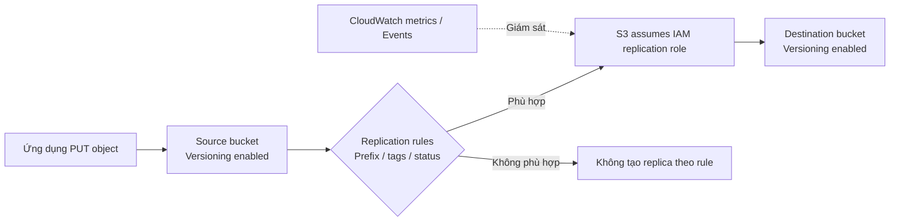
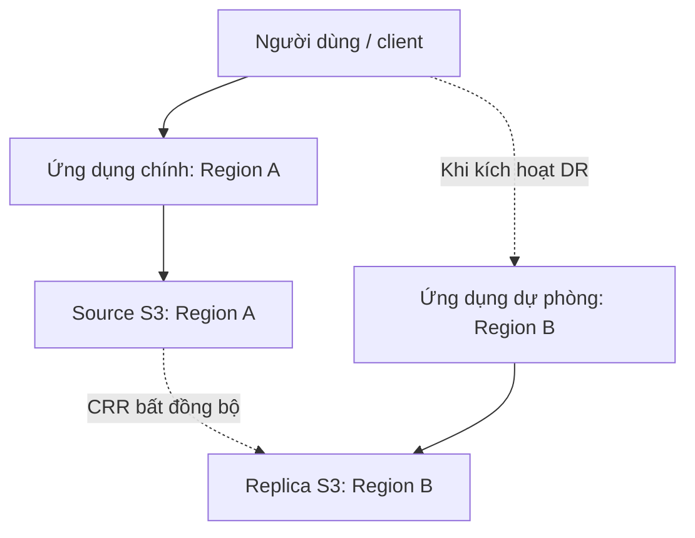

# Replication cùng Region và khác Region

## 1. Bối cảnh và mục tiêu học tập

Một doanh nghiệp lưu ảnh sản phẩm, hóa đơn và file kết quả xử lý trong **Amazon S3**. Nhóm phát triển làm việc ở nhiều tài khoản AWS, bộ phận kiểm toán muốn giữ thêm một bản dữ liệu do tài khoản bảo mật quản lý, còn nhóm vận hành cần có phương án tiếp tục đọc dữ liệu nếu Region chính gặp sự cố. Sao chép thủ công bằng script định kỳ dễ bỏ sót phiên bản mới, khó theo dõi lỗi và không đáp ứng tốt khi số lượng object tăng lớn.

**Amazon S3 Replication** giải quyết nhu cầu sao chép object theo quy tắc từ một **source bucket** tới một hay nhiều **destination bucket**. Hai hình thức phổ biến là **Same-Region Replication (SRR)** giữa các bucket cùng Region và **Cross-Region Replication (CRR)** giữa các bucket khác Region. Ngoài sao chép liên tục đối với những object mới hoặc được ghi phiên bản mới, AWS cung cấp **S3 Batch Replication** để xử lý các object hiện có hoặc đã sao chép lỗi.

Bài thuộc chương **Lưu trữ đối tượng S3** trong lộ trình **CLOUD_PROVIDERS_AWS**. Thiết kế replication phải kết hợp hiểu biết về Region/AZ, IAM, VPC, compute/serverless, mã hóa dữ liệu, giám sát, phục hồi và kiểm soát chi phí. Có bản sao ở bucket khác là một thành phần của chiến lược dữ liệu, nhưng ứng dụng vẫn cần đường truy cập, quyền, kiểm thử failover và kế hoạch khôi phục phù hợp.

Sau bài học, bạn có thể:

- Phân biệt SRR, CRR, live replication, Batch Replication và S3 Replication Time Control (S3 RTC).
- Xác định các điều kiện tiên quyết: **versioning**, IAM role, bucket policy, rule filter, encryption và quyền KMS.
- Cấu hình, đọc và kiểm tra một replication rule bằng AWS CLI/JSON.
- Giải thích phạm vi sao chép của object version, delete marker, metadata, Object Lock và những trường hợp không tự sao chép.
- Thiết kế sao chép xuyên tài khoản/Region phục vụ phân tách trách nhiệm, khả năng khôi phục và yêu cầu lưu trữ dữ liệu.
- Giám sát replication lag, xử lý `PENDING`/`FAILED`, đánh giá chi phí và kiểm thử phương án chuyển vùng.

## 2. Cách S3 Replication hoạt động

Một replication configuration được đặt trên **source bucket**. Trong cấu hình, mỗi rule nêu **object nào phù hợp**, **destination bucket nào nhận**, **IAM role nào S3 được assume**, có bật sao chép delete marker hay không và các tùy chọn khác. Khi một object đủ điều kiện được ghi vào source, S3 tổ chức quá trình sao chép sang destination theo cơ chế **bất đồng bộ**.



**Replication là bất đồng bộ:** việc ghi object thành công vào source bucket **không đồng nghĩa** replica đã có ngay ở destination. Ứng dụng cần phân biệt trạng thái object chính và trạng thái sao chép. Không dùng replication như cơ chế xác nhận đồng bộ cho hai Region trước khi trả kết quả một giao dịch nghiệp vụ.

### 2.1. Những thành phần cấu hình chính

| Thành phần | Ý nghĩa | Ví dụ |
| --- | --- | --- |
| Source bucket | Nơi ứng dụng ghi dữ liệu gốc và chứa replication configuration | `demo-orders-source-unique` |
| Destination bucket | Nơi tiếp nhận replica, cùng Region hoặc Region khác | `demo-orders-dr-unique` |
| Versioning | Giữ nhiều phiên bản object, **bắt buộc bật ở cả hai bucket** | `Enabled` |
| IAM replication role | Cho phép dịch vụ S3 đọc phiên bản source và ghi replica vào destination | `S3ReplicationRole` |
| Rule filter | Chọn object theo key prefix, tags hoặc tổ hợp được hỗ trợ | `orders/` |
| Replication status | Theo dõi trạng thái của từng phiên bản object | `PENDING`, `COMPLETED`, `FAILED`, `REPLICA` |
| S3 RTC | Tùy chọn có SLA về thời gian replication và metrics tương ứng | Mục tiêu 15 phút theo điều kiện dịch vụ |

Những ví dụ về tên bucket, ARN, account ID và các dải thời gian trong bài chỉ phục vụ học tập. Bucket S3 dùng **tên duy nhất toàn cục** trong phạm vi áp dụng của dịch vụ; cần thay bằng tên thật, kiểm tra account và Region trước khi chạy lệnh ghi cấu hình.

### 2.2. SRR và CRR khác nhau ở đâu?

| Tiêu chí | Same-Region Replication (SRR) | Cross-Region Replication (CRR) |
| --- | --- | --- |
| Vị trí | Source và destination **cùng AWS Region** | Source và destination **khác AWS Region** |
| Mục tiêu thường gặp | Phân tách dữ liệu giữa bucket/account, tập trung log, giảm quyền sửa bản sao | Hỗ trợ dự phòng Region, phân phối dữ liệu gần người dùng ở vùng khác, yêu cầu lưu nhiều Region |
| Tài khoản sở hữu | Có thể cùng hoặc khác AWS account | Có thể cùng hoặc khác AWS account |
| Khả năng tránh sự cố toàn Region | Hai bucket vẫn chịu rủi ro chung của Region | Có bản sao ở Region khác khi sao chép đã hoàn tất |
| Chi phí truyền liên Region | Không có hạng mục truyền **chéo Region** chỉ vì SRR | Cần tính phí truyền dữ liệu liên Region cho replication theo bảng giá |
| Yêu cầu chung | Versioning, role, policy, cấu hình rule và giám sát | Giống SRR, thêm kiểm tra chính sách Region, KMS và chi phí liên Region |

Đặt hai bucket trong cùng Region nhưng khác **account** có thể giúp phân tách trách nhiệm quản trị và hạn chế ảnh hưởng của việc lộ quyền ở account ứng dụng. Tuy nhiên, bản sao SRR vẫn có thể bị ảnh hưởng nếu cả Region ngừng hoạt động. Nếu mục tiêu là phục hồi sau sự cố cấp Region, phải đánh giá CRR, mức độ chậm sao chép và cơ chế chuyển ứng dụng sang Region đích.

## 3. Live Replication, Batch Replication và S3 RTC

### 3.1. Live Replication

**Live replication** sử dụng SRR hoặc CRR để sao chép tự động những object mới/phiên bản mới được ghi **sau khi replication rule bắt đầu áp dụng**. Ví dụ, rule được bật lúc 10:00, object `orders/2026/001.json` được tải lên lúc 10:05 và thỏa filter thì S3 sẽ xử lý sao chép object đó.

**Không có cơ chế tự backfill toàn bộ dữ liệu cũ chỉ nhờ bật rule.** Object đã tồn tại trước khi tạo rule không được sao chép hồi tố theo live replication. Nếu muốn sao chép chúng, phải sử dụng S3 Batch Replication hoặc quy trình dữ liệu phù hợp.

Sau khi đã cấu hình, S3 có thể sao chép các phiên bản object phát sinh từ thao tác ghi/cập nhật mới theo điều kiện rule; điều đó không có nghĩa mọi thay đổi cấu hình bucket hoặc mọi hành động trên bản sao đều tự lan truyền. Cần đọc kỹ các trường hợp được và không được replicate ở phần sau.

### 3.2. S3 Batch Replication

**S3 Batch Replication** là sao chép theo **job chủ động** thông qua S3 Batch Operations. Nó phù hợp khi:

- Bucket đã có hàng triệu object **trước ngày bật** SRR/CRR.
- Một số object có trạng thái `FAILED` sau sự cố quyền IAM/KMS.
- Đội vận hành thêm destination mới và cần nhân bản dữ liệu đã từng được sao chép đi nơi khác.
- Cần sao chép có chọn lọc các phiên bản/object theo manifest và điều kiện của Batch Replication.

Ví dụ nguồn có 3 TiB ảnh từ năm trước và sẽ tiếp tục nhận ảnh mới. Cấu hình CRR để **ảnh mới** được sao chép tự động; tạo thêm một **Batch Replication job** cho **ảnh cũ**. Hai luồng phải được theo dõi riêng: live replication và batch job có chỉ số tiến độ, quyền IAM và chi phí tương ứng.

Không nhầm S3 Batch Replication với lệnh `aws s3 sync`: `sync` là công cụ đồng bộ file/object do người dùng chạy, còn Batch Replication là dịch vụ S3 xử lý job sao chép theo mô hình replication và khả năng hỗ trợ của S3.

### 3.3. S3 Replication Time Control (S3 RTC)

**S3 RTC** là tùy chọn giúp có thời gian sao chép dự đoán được hơn và cung cấp SLA tương ứng. AWS nêu mục tiêu/SLA sao chép **99,99% object mới trong 15 phút** theo các điều kiện của dịch vụ. Tùy chọn này có thể được cấu hình với SRR hoặc CRR phù hợp.

Điều quan trọng: **15 phút không phải bảo đảm mọi object đều đã có replica đúng phút thứ 15**. Hệ thống cần xử lý trường hợp trễ/không thành công, quan sát metrics/events và cân nhắc RPO dựa trên tình huống thực tế. **Delete marker replication không thuộc SLA 15 phút của S3 RTC**.

| Nhu cầu | Phương án |
| --- | --- |
| Nhân bản object mới ở hai bucket cùng Region | SRR live replication |
| Có bản sao của object mới ở Region khác | CRR live replication |
| Cần SLA về độ trễ replication và giám sát chặt | SRR/CRR kết hợp S3 RTC khi hỗ trợ |
| Phải sao chép dữ liệu có trước rule hoặc retry object FAILED | S3 Batch Replication |

## 4. Điều kiện tiên quyết trước khi bật replication

### 4.1. Versioning ở cả source và destination

**S3 Versioning phải được bật (`Enabled`) ở cả hai bucket** dùng cho S3 replication. Tính năng này cho phép S3 nhận diện và sao chép các **phiên bản object**. Nếu versioning ở một bên bị tạm dừng hoặc cấu hình thay đổi không phù hợp, replication có thể không hoạt động như mong muốn.

Ví dụ, source bucket ở Singapore (`ap-southeast-1`) và destination ở Sydney (`ap-southeast-2`):

```bash
# Bật versioning cho bucket nguồn, tại Region của nguồn
aws s3api put-bucket-versioning \
  --bucket demo-orders-source-unique \
  --versioning-configuration Status=Enabled \
  --region ap-southeast-1

# Bật versioning cho bucket đích, tại Region của đích
aws s3api put-bucket-versioning \
  --bucket demo-orders-dr-unique \
  --versioning-configuration Status=Enabled \
  --region ap-southeast-2

# Kiểm tra thực tế ở cả hai nơi
aws s3api get-bucket-versioning \
  --bucket demo-orders-source-unique --region ap-southeast-1
aws s3api get-bucket-versioning \
  --bucket demo-orders-dr-unique --region ap-southeast-2
```

Đây là lệnh thay đổi cấu hình thật nếu thực thi. Trước khi chạy, phải tạo bucket, xác nhận owner, AWS CLI profile, phân quyền IAM/SCP và Region, đồng thời thay các tên bucket minh họa. Khi mới bật Versioning, cần kiểm tra việc thay đổi đã có hiệu lực trước khi thử sao chép.

**Versioning không phải backup độc lập:** dù nó giữ nhiều phiên bản, user có quyền xóa phiên bản vĩnh viễn vẫn có thể xóa dữ liệu nếu không có các giới hạn khác. Bản sao ở account khác, Object Lock, backup và quy trình khôi phục là những thành phần bổ sung cần đánh giá.

### 4.2. IAM role do S3 assume

S3 phải được cho phép **đọc object versions** tại source, **ghi replica** tại destination và **đọc replication configuration**. Một **IAM role** được gắn vào cấu hình replication; dịch vụ S3 sẽ assume role này. Trust policy thông thường:

```json
{
  "Version": "2012-10-17",
  "Statement": [
    {
      "Effect": "Allow",
      "Principal": { "Service": "s3.amazonaws.com" },
      "Action": "sts:AssumeRole"
    }
  ]
}
```

Ví dụ permissions policy cho mô hình source/destination cùng account và **object mã hóa SSE-S3**, chỉ dành cho key `orders/`:

```json
{
  "Version": "2012-10-17",
  "Statement": [
    {
      "Sid": "ReadSourceBucketReplicationSettings",
      "Effect": "Allow",
      "Action": ["s3:GetReplicationConfiguration", "s3:ListBucket"],
      "Resource": "arn:aws:s3:::demo-orders-source-unique"
    },
    {
      "Sid": "ReadSourceObjectVersions",
      "Effect": "Allow",
      "Action": [
        "s3:GetObjectVersionForReplication",
        "s3:GetObjectVersionAcl",
        "s3:GetObjectVersionTagging"
      ],
      "Resource": "arn:aws:s3:::demo-orders-source-unique/orders/*"
    },
    {
      "Sid": "WriteReplicas",
      "Effect": "Allow",
      "Action": [
        "s3:ReplicateObject",
        "s3:ReplicateDelete",
        "s3:ReplicateTags"
      ],
      "Resource": "arn:aws:s3:::demo-orders-dr-unique/orders/*"
    }
  ]
}
```

Đây là **ví dụ tối thiểu cho kịch bản đã giả định**, không bao gồm những điều kiện nâng cao như SSE-KMS/DSSE-KMS, Object Lock, thay đổi ownership, sao chép tới nhiều destination hoặc quy tắc `Deny` cụ thể. Cần cấp bổ sung quyền theo chức năng thực sự sử dụng và nguyên tắc **least privilege**. Role trust không tự cấp quyền S3; permissions policy không tự làm role được phép assume.

### 4.3. Bucket policy và giới hạn tổ chức

Trong mô hình **cùng account**, role phù hợp và quyền S3 có thể đủ nếu không có policy từ chối bổ sung. Trong mô hình **cross-account**, destination bucket owner cần cấu hình **bucket policy** cho phép replication role ở account source ghi các bản sao; đồng thời kiểm tra Object Ownership, encryption/KMS key policies, SCP và những `Deny` khác ở cả hai account.

Ví dụ destination account có bucket `company-audit-replica` dùng để giữ log độc lập. Nó chỉ nên cấp đúng `s3:ReplicateObject`/quyền liên quan cho role của source, còn quyền xóa phiên bản hoặc sửa retention thuộc nhóm bảo mật đích. Không cấp `s3:*` hoặc bật truy cập public để “sửa nhanh” lỗi replication.

**S3 Object Ownership – Bucket owner enforced** là lựa chọn thường nên đánh giá để account sở hữu bucket đích quản lý replica rõ ràng, với ACL bị vô hiệu hóa theo chế độ này. Nếu dùng chế độ sở hữu khác, có thể cần cơ chế **Access Control Translation** và quyền `s3:ObjectOwnerOverrideToBucketOwner` theo mô hình đã chọn.

## 5. Cấu hình rule SRR/CRR bằng JSON và AWS CLI

### 5.1. Ví dụ sao chép prefix `orders/` sang Region khác

Giả sử cùng account có hai bucket đã tạo:

- Source: `demo-orders-source-unique`, Region `ap-southeast-1`.
- Destination: `demo-orders-dr-unique`, Region `ap-southeast-2`.
- Hai bucket đã bật versioning; replication role ARN có thật, chính sách đầy đủ và chính sách bucket không chặn.

Lưu cấu hình bên dưới thành file **`replication-rule.json`**:

```json
{
  "Role": "arn:aws:iam::111122223333:role/S3ReplicationRole",
  "Rules": [
    {
      "ID": "replicate-orders-to-dr",
      "Priority": 10,
      "Status": "Enabled",
      "Filter": { "Prefix": "orders/" },
      "DeleteMarkerReplication": { "Status": "Disabled" },
      "Destination": {
        "Bucket": "arn:aws:s3:::demo-orders-dr-unique",
        "StorageClass": "STANDARD"
      }
    }
  ]
}
```

Trong cấu hình:

- `Role` là ARN **IAM role S3 được assume**; thay account ID và role thật.
- `Rules` chứa một hoặc nhiều rule; `Priority` giúp xác định ưu tiên khi nhiều rule có cùng khả năng match tới một destination.
- `Filter.Prefix = "orders/"` giới hạn object key bắt đầu bằng `orders/`, không phải mọi object của bucket.
- `DeleteMarkerReplication = Disabled` giữ cơ chế **không tự sao chép dấu xóa** trong rule ví dụ; quyết định này có tác động tới cách vận hành DR.
- `Destination.StorageClass` quy định storage class của replica theo lựa chọn được hỗ trợ; không có nghĩa file nguồn sẽ chuyển class.

Tạo rule trên source bucket:

```bash
aws s3api put-bucket-replication \
  --bucket demo-orders-source-unique \
  --replication-configuration file://replication-rule.json \
  --region ap-southeast-1

# Đọc lại cấu hình đã lưu
aws s3api get-bucket-replication \
  --bucket demo-orders-source-unique \
  --region ap-southeast-1
```

**Lưu ý về phạm vi câu lệnh:** `put-bucket-replication` cập nhật replication configuration của source bucket. Nếu đã có các rule khác, phải kết hợp chúng trong cấu hình cuối cùng; **không ghi một rule mới rồi vô tình thay mất các rule đang chạy**. Kiểm tra trước với `get-bucket-replication`, lưu lại cấu hình cũ và có phương án khôi phục khi thay đổi.

Đây là **CRR** vì bucket ở hai Region khác nhau. Nếu destination bucket cùng Region với source, vẫn dùng cơ chế replication configuration tương tự nhưng là **SRR**. Thay Region của destination đòi hỏi có bucket và IAM/KMS/bucket policy phù hợp ở Region đó; không thể thay region của một bucket đã tạo bằng sửa một trường JSON.

### 5.2. Thử nghiệm với một object mới

Sau khi cấu hình đã có hiệu lực, upload một object mới đúng prefix:

```bash
# File orders-test.json là dữ liệu mẫu trên máy người vận hành
aws s3api put-object \
  --bucket demo-orders-source-unique \
  --key orders/orders-test.json \
  --body orders-test.json \
  --region ap-southeast-1

# Xem trạng thái replication tại source
aws s3api head-object \
  --bucket demo-orders-source-unique \
  --key orders/orders-test.json \
  --query '[VersionId,ReplicationStatus,ServerSideEncryption]' \
  --region ap-southeast-1

# Xem replica tại destination sau khi việc sao chép hoàn tất
aws s3api head-object \
  --bucket demo-orders-dr-unique \
  --key orders/orders-test.json \
  --query '[VersionId,ReplicationStatus,ServerSideEncryption]' \
  --region ap-southeast-2
```

Các lệnh cần file mẫu có thật và quyền thích hợp. Không chạy trên dữ liệu production trước khi thử với key kiểm thử đã được phê duyệt. Lúc vừa upload, `head-object` phía destination có thể trả về lỗi **chưa tìm thấy object** vì replication chưa hoàn tất. Nếu dùng nhiều phiên bản cùng một key, hãy kiểm tra theo **VersionId** tương ứng để tránh nhầm replica với phiên bản ghi khác.

### 5.3. Lọc bằng tag và nhiều rule

Ngoài prefix, S3 replication rule có thể lọc theo object tags hoặc kết hợp các điều kiện theo cú pháp được hỗ trợ. Ví dụ doanh nghiệp chỉ muốn sao chép object thuộc `Classification=Confidential` vào account audit. Tuy nhiên, tag-based rule cần có tag đúng thời điểm object được ghi để match; đừng mặc định rằng gắn tag sau đó sẽ sao chép hồi tố mọi object cũ.

Một hệ thống có thể có nhiều rule để gửi `orders/` tới bucket DR và `audit/` tới bucket bảo mật, hoặc tới **nhiều destination**. Phải tránh chồng lấn điều kiện vô ý, kiểm tra rule priority, quyền role ở từng destination và chi phí nhân đôi dữ liệu. **Delete marker replication không được hỗ trợ cho rule dùng tag filter**, nên không thể đơn giản bật nó trong mọi trường hợp.

## 6. Phiên bản, xóa object và giới hạn sao chép

S3 Replication làm việc trên dữ liệu object và những thuộc tính/metadata mà dịch vụ hỗ trợ. Nhưng cần phân biệt **ghi phiên bản mới**, **đặt dấu xóa**, **xóa vĩnh viễn một version** và **thay đổi cấu hình bucket**.

### 6.1. Versioning giúp hiểu thao tác PUT và DELETE

Giả sử nguồn `orders/001.json` có hai phiên bản:

```text
Source bucket
  orders/001.json
    v1: nội dung cũ
    v2: nội dung mới       <-- phiên bản hiện tại

Destination bucket
  orders/001.json
    replica của v1
    replica của v2        <-- sau khi replication hoàn tất
```

Khi PUT object mới cùng key trên bucket đã bật versioning, S3 tạo **version mới**. Nếu phiên bản đó được rule áp dụng, S3 sao chép nó bất đồng bộ. Destination giữ replica theo cơ chế versioning của bucket đích; không nên dùng `LastModified` hay version ID độc lập giữa hai bucket để suy luận tính tương đương mà bỏ qua replication status và nội dung.

### 6.2. Delete marker replication

Với bucket đã bật versioning, lệnh DELETE **không truyền `versionId`** thường tạo **delete marker**, khiến object có vẻ bị xóa khỏi kết quả GET thông thường nhưng các phiên bản trước vẫn còn cho đến khi bị xóa theo cơ chế tương ứng.

- Khi **DeleteMarkerReplication = Disabled** (như cấu hình ví dụ), dấu xóa tại source không tự được chép theo rule đó. Bản sao đích có thể vẫn truy cập được — hữu ích để giảm rủi ro xóa nhầm lan ra bản sao.
- Khi **Enabled** cho rule hỗ trợ, dấu xóa do thao tác tương ứng tại source có thể được sao chép, làm object bị ẩn khỏi thao tác GET thông thường ở đích. Điều này giúp hai phía đồng nhất về hành vi xóa logic nhưng tăng rủi ro lan truyền xóa nhầm.
- **Xóa vĩnh viễn một object version cụ thể bằng `versionId` không được replication tự sao chép như thao tác xóa đồng bộ.**
- Dấu xóa do **S3 Lifecycle expiration** tạo ra không được sao chép theo delete marker replication; loại rule dùng tag filter không hỗ trợ tính năng này.

Replication vì vậy **không phải đồng bộ xóa hai chiều**. Quyết định bật hay tắt delete marker replication cần được thống nhất giữa ứng dụng, quản trị lưu trữ và đội chịu trách nhiệm DR.

### 6.3. Các đối tượng/thay đổi cần xử lý riêng

| Tình huống | Hành vi/giới hạn quan trọng |
| --- | --- |
| Object tồn tại trước khi bật rule | Live replication không tự sao chép; dùng Batch Replication |
| Object là **replica** do rule khác tạo | Không tự được sao chép tiếp qua chuỗi live replication theo mặc định; có thể cần Batch Replication |
| Rule đổi destination | Object đã replicate trước đó không tự sao chép lại sang destination mới; dùng Batch cho dữ liệu cũ |
| Bucket policy, IAM policy, lifecycle rule, CORS, event notifications | Là **cấu hình bucket/account**, không được đồng bộ như nội dung object bởi S3 Replication |
| Object có **SSE-KMS/DSSE-KMS** | Cần bật replication cho đối tượng KMS và cấp quyền/chìa khóa đích phù hợp |
| Object có **Object Lock** | Destination cũng phải hỗ trợ và bật Object Lock; replication role cần quyền metadata retention/legal hold bổ sung |
| Metadata, tags, ACL/ownership | Có cơ chế sao chép được hỗ trợ và tùy chọn riêng; không coi mọi sửa đổi metadata trên replica đều tự đồng bộ về nguồn |

Với kiến trúc **hai chiều**, mỗi bucket có thể có replication rule riêng, nhưng **không vì thế mà mọi bản sao và thao tác sửa/xóa đều lan qua lại**. AWS có những tính năng như **replica modification sync** cho phạm vi thay đổi metadata được hỗ trợ. Cần đọc tài liệu, kiểm thử xung đột và thiết kế nơi ghi chính (*single writer*) hoặc quy tắc giải quyết xung đột trước khi cho hai Region cùng ghi cùng một tập key.

## 7. Mã hóa SSE-S3, SSE-KMS và DSSE-KMS khi sao chép

### 7.1. SSE-S3 và các trường hợp thông thường

Với object dùng **SSE-S3**, S3 có thể sao chép khi cấu hình versioning, IAM và replication rule đúng. Encryption trên object replica tuân theo quy tắc S3 replication; nếu source dùng SSE-S3 thì replica thường vẫn dùng cùng loại mã hóa. Không nên suy rằng việc đặt default encryption khác ở destination sẽ tự chuyển tất cả replica sang loại mã hóa mình muốn.

### 7.2. SSE-KMS/DSSE-KMS cần bật tường minh

Mặc định, S3 **không tự replication object mã hóa SSE-KMS/DSSE-KMS** chỉ vì có một rule thường. Cần **opt in** trong rule, chọn khóa KMS phù hợp tại destination và cấp quyền cho replication role.

Các phần JSON thêm vào rule CRR khi dùng **SSE-KMS** theo mô hình khóa KMS cụ thể:

```json
{
  "SourceSelectionCriteria": {
    "SseKmsEncryptedObjects": { "Status": "Enabled" }
  },
  "Destination": {
    "Bucket": "arn:aws:s3:::demo-orders-dr-unique",
    "EncryptionConfiguration": {
      "ReplicaKmsKeyID": "arn:aws:kms:ap-southeast-2:111122223333:key/00000000-0000-0000-0000-000000000000"
    }
  }
}
```

Đây là **trích đoạn các trường cần thêm vào một replication rule**, không phải một cấu hình `put-bucket-replication` hoàn chỉnh. Trường `SourceSelectionCriteria` và `Destination` phải được đặt ở cấp rule tương ứng, cùng `Role`, `Filter`, `Status`, `Priority` và những trường cần thiết khác. ARN khóa chỉ là placeholder.

Replication role và key policy cần cho phép các thao tác tương ứng, điển hình:

- **`kms:Decrypt`** đối với KMS key mã hóa object nguồn.
- **`kms:Encrypt`** đối với KMS key mã hóa replica ở Region đích; có tình huống cần `kms:GenerateDataKey` theo cách mã hóa và cấu hình bucket.
- Quyền đọc phiên bản object (`s3:GetObjectVersionForReplication`) và ghi replica (`s3:ReplicateObject`), cùng các quyền bổ sung cho tags/ACL/Object Lock khi dùng.
- Với **cross-account**, destination KMS key policy phải cho phép role từ source account sử dụng khóa theo đúng phạm vi; AWS managed KMS keys không dùng để cấp quyền cross-account như customer managed keys.

**KMS keys được quản lý theo Region và quyền riêng.** Khi replication giữa Singapore và Sydney, không được dùng một ARN KMS key đơn Region của Singapore như khóa mã hóa ở Sydney. AWS có hỗ trợ **KMS multi-Region keys** và cơ chế dùng khóa liên quan tại Region đích trong những cấu hình phù hợp, nhưng vẫn phải triển khai khóa, policy và điều kiện replication theo hướng dẫn chính thức.

Một lỗi dễ bỏ qua: API cấu hình replication có thể báo thành công **dù ARN KMS key đích sai hoặc key không hợp lệ**, sau đó replication thực tế mới thất bại. Vì vậy phải thử upload object SSE-KMS thật, kiểm tra `ReplicationStatus` và log/metrics, không kết luận hệ thống đúng chỉ từ phản hồi cấu hình.

## 8. Cross-account replication và quyền sở hữu bản sao

### 8.1. Vì sao nên tách account đích?

Ví dụ account `workload-production` chứa source bucket và role ứng dụng. Nếu một IAM principal trong account này bị lộ và có quyền rộng, nó có thể sửa/xóa dữ liệu nguồn. Replicate sang bucket ở account `security-backup` do nhóm khác quản lý giúp giảm khả năng cùng một tập quyền ảnh hưởng trực tiếp cả hai bản.

```text
AWS Organizations
├── Workloads OU
│    └── Account 111122223333
│         └── Source S3 bucket (application writes)
└── Security OU
     └── Account 444455556666
          └── Destination S3 bucket (restricted delete access)

          Source replication role ---> Destination bucket policy
```

Tách account chỉ mang lại lợi ích nếu **quyền xóa, quyền KMS, quyền thay policy, quyền AWS Organizations/IAM và quyền quản trị root** thật sự được phân tách. Nếu cùng một role toàn quyền điều khiển cả hai account, lợi ích an toàn sẽ suy giảm.

### 8.2. Các bước phân quyền xuyên tài khoản

1. Tài khoản destination tạo bucket, bật versioning, cấu hình Block Public Access và encryption/Object Ownership phù hợp.
2. Tài khoản source tạo replication role có **trust vào `s3.amazonaws.com`** và permissions policy chỉ cho đọc source, ghi đúng prefix destination.
3. Destination bucket policy cho phép **replication role ARN** thực hiện những hành động cần thiết với các object đích; không mở quyền cho toàn bộ principal trong account nguồn một cách không cần thiết.
4. Nếu dùng SSE-KMS, cấu hình **customer managed KMS key** và key policy/role policy cho phép các thao tác cần thiết giữa hai account.
5. Source tạo replication rule trỏ đến destination. Kiểm thử ghi object mới, tags, encryption, các trạng thái replication, việc đọc replica bởi owner destination và việc nguồn có hoặc không có quyền xóa đích.

Ví dụ cấu trúc **bucket policy tại destination** trong mô hình minh họa, cần điều chỉnh theo yêu cầu thực tế:

```json
{
  "Version": "2012-10-17",
  "Statement": [
    {
      "Sid": "AllowOnlySourceReplicationRole",
      "Effect": "Allow",
      "Principal": {
        "AWS": "arn:aws:iam::111122223333:role/S3ReplicationRole"
      },
      "Action": [
        "s3:ReplicateObject",
        "s3:ReplicateDelete",
        "s3:ReplicateTags"
      ],
      "Resource": "arn:aws:s3:::demo-orders-dr-unique/orders/*"
    }
  ]
}
```

S3 bucket policy không thay thế các quyền mà role phải có tại account nguồn, cũng không thay thế KMS key policy trong trường hợp object được mã hóa KMS. Nếu destination bucket bật **Bucket owner enforced**, kiểm tra quyền sở hữu object replica và quyền vận hành ở destination theo cơ chế Object Ownership hiện hành.

## 9. Replication phục vụ DR: hiểu đúng RPO và RTO

Một bản sao CRR ở Region khác giúp ứng dụng có **dữ liệu đã được replicate** khi Region nguồn xảy ra sự cố. Nhưng replication không tự thay đổi DNS/API endpoint, không triển khai ứng dụng ở Region đích và không đảm bảo những object đang `PENDING` đã được sao chép trước khi sự cố xảy ra.

| Thuật ngữ | Ý nghĩa với S3 CRR |
| --- | --- |
| **RPO (Recovery Point Objective)** | Mức mất dữ liệu tối đa doanh nghiệp chấp nhận; cần xét replication lag, object còn PENDING/FAILED |
| **RTO (Recovery Time Objective)** | Thời gian hệ thống cần để tiếp tục phục vụ từ Region/bucket dự phòng; cần ứng dụng, quyền truy cập, mạng, DNS và dữ liệu |
| **S3 RTC** | Cung cấp SLA thời gian replication trong phạm vi hỗ trợ; không tự đáp ứng mọi RPO/RTO của ứng dụng |
| **Versioning/Object Lock/backup** | Các cơ chế tăng khả năng chống xóa nhầm/thay đổi không mong muốn, tùy thiết kế và quyền |

### 9.1. Kịch bản Region chính không phục vụ được ứng dụng



Để thực sự failover, đội vận hành cần:

1. Triển khai hoặc có khả năng triển khai **compute/serverless, IAM role, KMS, VPC/network và những dịch vụ phụ thuộc** ở Region đích.
2. Xác định cách ứng dụng trỏ từ source bucket sang destination bucket: thông qua cấu hình, DNS, cơ chế routing phù hợp hoặc **S3 Multi-Region Access Points** khi kiến trúc hỗ trợ và đã cấu hình.
3. Xác nhận phiên bản/dữ liệu đã replicate, xác định những object còn thiếu và phương án bù dữ liệu sau khi sự cố kết thúc.
4. Quyết định **single writer** trong quá trình failover và failback. Nếu ghi mới ở Region B, phải lên kế hoạch sao chép dữ liệu phát sinh đó về Region A; CRR một chiều A → B không tự đảm nhận chiều ngược lại.
5. Kiểm thử chuyển vùng và chuyển lại: quyền đọc/ghi bucket, KMS, policy, thay đổi endpoint, tính toàn vẹn dữ liệu và thời gian phục hồi.

**Multi-Region Access Points không tự tạo bản sao dữ liệu.** Nếu dùng để định tuyến yêu cầu đến nhiều Region, bạn vẫn cần cấu hình replication, quyền, kiểm thử behavior và chiến lược ghi dữ liệu phù hợp.

### 9.2. Replication không thay thế backup và phòng xóa nhầm

Một ứng dụng bị lỗi có thể ghi sai phiên bản object mới, và replication có thể nhân bản **dữ liệu sai** đó. Nếu chính sách đồng bộ dấu xóa được bật, việc xóa logic ở nguồn cũng có thể lan tới đích. Vì vậy, nên kết hợp **Versioning**, chính sách giữ dữ liệu, **S3 Object Lock** ở trường hợp có yêu cầu WORM, quyền account đích độc lập và backup/khôi phục được kiểm thử.

Một chiến lược dữ liệu tốt phải trả lời: **ai được xóa version vĩnh viễn, dữ liệu cần giữ bao lâu, làm thế nào lấy lại version trước và lấy lại từ account dự phòng trong bao lâu?** Chỉ nhìn thấy object xuất hiện ở bucket đích chưa đủ để kết luận đạt yêu cầu kiểm toán hoặc khả năng phục hồi.

## 10. Giám sát replication và trạng thái object

### 10.1. Trạng thái `ReplicationStatus`

Khi kiểm tra object phù hợp với rule, `HeadObject`/`GetObject` có thể trả về header `x-amz-replication-status`. AWS CLI thường thể hiện trường tương ứng là `ReplicationStatus`.

| Trạng thái | Xuất hiện ở đâu? | Ý nghĩa | Việc cần làm |
| --- | --- | --- | --- |
| `PENDING` | Source | Đối tượng đủ điều kiện, đang chờ/được xử lý replication | Theo dõi lag và metrics; kiểm tra thời gian chờ |
| `COMPLETED` | Source | Replication đã hoàn tất tới các destination áp dụng | Có thể kiểm tra bản sao theo key/version khi cần |
| `FAILED` | Source | Replication đã thất bại | Xem role, bucket/KMS policy và event; dùng Batch Replication để xử lý đối tượng lỗi |
| `REPLICA` | Destination | Object là replica do S3 tạo | Kiểm tra quyền sở hữu, encryption và khả năng truy cập |

**Không phải object nào cũng có `ReplicationStatus`.** Object không khớp rule hoặc tồn tại từ trước có thể không có trạng thái replication theo cùng cách. Khi source có **nhiều destination**, `COMPLETED` chỉ xuất hiện khi yêu cầu replication đã thành công ở tất cả destination liên quan; một destination lỗi có thể khiến status tổng thể `FAILED`.

Ví dụ truy vấn trạng thái tại source:

```bash
aws s3api head-object \
  --bucket demo-orders-source-unique \
  --key orders/orders-test.json \
  --query '{VersionId:VersionId,ReplicationStatus:ReplicationStatus,Encryption:ServerSideEncryption}' \
  --region ap-southeast-1
```

### 10.2. CloudWatch metrics và event notifications

AWS cung cấp **S3 Replication metrics** khi bật cho rule, và tự bật metrics tương ứng khi dùng S3 RTC. Các chỉ số quan trọng:

| Metric | Câu hỏi cần trả lời |
| --- | --- |
| **Bytes Pending Replication** | Còn bao nhiêu byte dữ liệu đang chờ sao chép? |
| **Operations Pending Replication** | Có bao nhiêu thao tác/object đang chờ? |
| **Replication Latency** | Bản sao đang chậm hơn nguồn tối đa bao nhiêu thời gian theo phạm vi metric? |
| **Operations Failed Replication** | Những thao tác nào không sao chép thành công theo số liệu tổng hợp? |

Metrics replication có thể được tính phí như **CloudWatch custom metrics**. Ngoài đó, **S3 Event Notifications** hỗ trợ các sự kiện như `s3:Replication:OperationFailedReplication`, `OperationMissedThreshold` và `OperationReplicatedAfterThreshold` theo phạm vi hỗ trợ. Có thể chuyển thông báo đến SQS/SNS/Lambda để cảnh báo hoặc tạo quy trình điều tra.

Một dashboard vận hành nên có số object/byte đang chờ, số lỗi, độ trễ, tình trạng role/KMS, chi phí tăng thêm và trạng thái DR thực tế. Khi có S3 RTC, đặt cảnh báo theo yêu cầu SLO/RPO và đối chiếu với SLA dịch vụ; không chỉ theo dõi số lượng request ghi vào source.

### 10.3. Cách xử lý khi gặp `FAILED`

1. Xác nhận object thực sự **khớp rule** và được ghi sau khi bật rule; kiểm tra prefix, tags, Rule `Status`, `Priority` và versioning của cả hai bucket.
2. Kiểm tra IAM replication role: trust `s3.amazonaws.com`, quyền `GetReplicationConfiguration`, `GetObjectVersionForReplication`, `ReplicateObject` và quyền phù hợp cho tags/delete markers.
3. Kiểm tra **destination bucket policy** và **SCP**/explicit deny; nhất là với cross-account.
4. Nếu dùng SSE-KMS/DSSE-KMS, xem `SourceSelectionCriteria`, destination key ARN đúng Region, KMS key policy và quyền Encrypt/Decrypt/GenerateDataKey khi cần.
5. Nếu có Object Lock, kiểm tra cấu hình ở destination và quyền đọc retention/legal hold.
6. Xem metrics và failure events; sau khi khắc phục quyền/cấu hình, dùng **S3 Batch Replication** để xử lý những object có trạng thái `FAILED`, hoặc ghi lại object mới theo quy trình cho phép.

**`PENDING` lâu không nhất thiết giống `FAILED`:** khi dịch vụ đích/Region tạm thời không sẵn sàng, S3 có thể giữ trạng thái PENDING và tiếp tục khi điều kiện phục hồi. Nhưng nếu object đã `FAILED`, chỉ sửa policy rồi chờ vô hạn thường không phải quy trình khắc phục đầy đủ.

## 11. Chi phí, lifecycle và tuân thủ dữ liệu

### 11.1. Những khoản phí dễ bỏ sót

S3 Replication tạo **bản sao dữ liệu**, kéo theo các chi phí ngoài lưu trữ nguồn:

| Nhóm chi phí | Vì sao phát sinh? |
| --- | --- |
| Storage ở destination | Replica chiếm dung lượng, phiên bản cũ có thể tiếp tục tồn tại |
| Replication requests | S3 thực hiện những thao tác ghi sao chép theo quy tắc tính phí |
| Inter-Region data transfer | CRR truyền dữ liệu qua Region khác, theo bảng giá hiện hành |
| S3 RTC | Tính phí bổ sung cho điều khiển thời gian replication khi bật |
| KMS | Mã hóa/giải mã hoặc tạo data key trong các cấu hình SSE-KMS/DSSE-KMS |
| Batch Replication | Batch Operations/manifest, object processing và yêu cầu sao chép dữ liệu cũ |
| Monitoring | S3 Replication metrics, CloudWatch và thông báo/đích xử lý sự kiện |
| Storage class access/lifecycle | Phí truy cập hoặc chuyển lớp lưu trữ khi dùng class giá thấp và lifecycle |

Ví dụ: 1 TiB source được replicate sang Region khác, sau đó tạo phiên bản mới của nhiều object mỗi ngày. Tổng storage có thể lớn hơn 2 TiB nếu giữ version history ở cả hai bucket, chưa kể request và truyền dữ liệu. **Versioning + replication + không có lifecycle** dễ khiến dữ liệu cũ tích tụ nhiều tháng.

### 11.2. Lifecycle ở source và destination là độc lập

Replication rules và **S3 Lifecycle rules** phục vụ mục tiêu khác nhau. Replication sao chép object; Lifecycle chuyển storage class hoặc xóa/đánh dấu hết hạn theo policy của **bucket tương ứng**. Cấu hình Lifecycle của source **không tự sao chép** sang destination.

Khi áp dụng Lifecycle:

- Xem liệu source/destination có chính sách retention, transition class và expiration **khác nhau** hay không.
- Không xóa source object theo lịch quá sớm khi replication chưa hoàn tất. S3 có cơ chế trì hoãn lifecycle transition/expiration cho object còn trạng thái `PENDING` hoặc `FAILED` theo quy định dịch vụ.
- Tính phí lưu tối thiểu và truy cập cho những storage class như S3 Standard-IA, Glacier Flexible Retrieval hoặc Deep Archive theo điều kiện của chúng.
- Xác nhận replica thực sự có thể phục vụ ứng dụng DR với class đã chọn; đặt ngay bản sao vào lớp archive phục hồi chậm có thể không phù hợp RTO yêu cầu.

**Khả năng lưu trữ rẻ và khả năng phục hồi nhanh có thể xung đột.** Một bucket DR cần phục vụ đọc trong vài phút thường nên được định giá khác với bucket giữ dữ liệu kiểm toán hiếm khi truy cập.

### 11.3. Data residency và compliance

CRR sao chép **dữ liệu ra khỏi Region nguồn**. Nếu dữ liệu chứa thông tin cá nhân hoặc có ràng buộc nơi lưu trữ, cần phê duyệt Region đích, account đích, khóa KMS, chính sách retention và người được quyền truy cập. Việc dùng đường truyền mã hóa và AWS Region khác **không tự bảo đảm** tuân thủ mọi quy định về vị trí hoặc chuyển giao dữ liệu.

SRR có thể phù hợp khi yêu cầu giữ dữ liệu trong một Region nhưng cần phân tách account/đơn vị sở hữu. Tuy vậy, nếu chính sách quy định phải chống được sự cố toàn Region, SRR đơn lẻ không đáp ứng mục tiêu đó.

## 12. Thiết kế và kiểm thử: công ty xử lý hóa đơn

Một doanh nghiệp có API xuất hóa đơn chạy tại Singapore (`ap-southeast-1`). Các hóa đơn mới được ghi dưới prefix `invoices/`, phải có bản sao do account bảo mật quản lý, và cần hỗ trợ phục hồi ở Sydney (`ap-southeast-2`). Dữ liệu mã hóa bằng SSE-KMS; những hóa đơn phát hành sai phải được giữ lại theo quy định thay vì xóa không kiểm soát.

**Thiết kế mẫu:**

1. **Nguồn:** bucket tại `ap-southeast-1`, bật Versioning, mã hóa SSE-KMS, hạn chế ghi/xóa theo IAM và bucket policy; ứng dụng dùng role quyền tối thiểu.
2. **Đích:** bucket tại `ap-southeast-2` trong account bảo mật, bật Versioning và Block Public Access, chuẩn hóa Bucket owner enforced; chọn KMS customer managed key tại Region đích.
3. **Replication:** tạo CRR rule lọc prefix `invoices/`, dùng replication role cụ thể và `SourceSelectionCriteria.SseKmsEncryptedObjects=Enabled`; cấp quyền source/destination/KMS đúng phạm vi.
4. **Xóa và lưu giữ:** xem xét tắt delete marker replication, bật Object Lock/retention khi yêu cầu pháp lý và năng lực dịch vụ hỗ trợ; thử hành vi khi user xóa logic tại nguồn.
5. **Dữ liệu cũ:** nếu đã có hóa đơn trước ngày bật rule, chạy Batch Replication với manifest/phạm vi được duyệt.
6. **Theo dõi:** bật replication metrics, cân nhắc S3 RTC nếu RPO cần SLA thời gian; cảnh báo `FAILED`, backlog/latency và kiểm tra ngẫu nhiên replica có thể đọc/giải mã được.
7. **Failover:** chuẩn bị API/compute, IAM/KMS và cấu hình bucket của Region đích; quy định cơ chế chuyển truy cập, quyền ghi và failback.
8. **Kiểm thử:** upload hóa đơn mới, sửa phiên bản mới, tạo dấu xóa theo kịch bản, cố tình thử role thiếu quyền trong môi trường thử nghiệm, đọc bản sao từ account đích và đo thời gian replication.

**Bảng kiểm chứng kỳ vọng:**

| Bài thử | Kết quả cần quan sát |
| --- | --- |
| PUT `invoices/demo.json` sau khi bật CRR | Source có version mới; replica xuất hiện bất đồng bộ ở bucket đích |
| PUT `temp/debug.txt` ngoài prefix | Không sao chép theo rule `invoices/` |
| PUT object SSE-KMS | Đích có replica có thể giải mã bằng quyền KMS hợp lệ; không bị FAILED vì key policy |
| DELETE object không chỉ version ID, delete marker replication Disabled | Nguồn có delete marker; replica vẫn có phiên bản có thể truy cập theo quyền ở đích |
| Object cũ trước khi bật CRR | Chỉ được sao chép qua Batch Replication/quy trình bù dữ liệu |
| Mất quyền ghi destination trong thử nghiệm | Nhận cảnh báo/trạng thái lỗi thích hợp và có quy trình xử lý Batch khi khôi phục |
| Chuyển API sang Region đích | Đọc được những object đã sao chép; ghi mới/failback cần kế hoạch riêng |

## 13. Các nhầm lẫn thường gặp

| Nhận định sai | Cách hiểu đúng |
| --- | --- |
| “Bật CRR thì toàn bộ object cũ lập tức xuất hiện ở đích.” | Live replication chỉ xử lý object đủ điều kiện được ghi sau khi cấu hình; dùng Batch Replication cho dữ liệu tồn tại trước đó. |
| “Replication nghĩa là hai bucket luôn có cùng dữ liệu ngay tại mọi thời điểm.” | Replication bất đồng bộ, có độ trễ và trạng thái PENDING/FAILED. |
| “SRR cũng bảo vệ ứng dụng khỏi sự cố toàn Region.” | SRR vẫn nằm trong cùng Region; CRR mới đặt bản sao ở Region khác. |
| “Có quyền `s3:PutObject` là S3 có thể replicate bằng role đó.” | Replication cần trust và các quyền chuyên biệt `s3:GetObjectVersionForReplication`, `s3:ReplicateObject` cùng quyền liên quan. |
| “Object SSE-KMS tự replicate với rule mặc định.” | Cần opt in và quyền KMS/khóa destination đúng Region. |
| “DELETE source luôn xóa vĩnh viễn replica.” | Delete marker replication tùy cấu hình; xóa version cụ thể không tự nhân bản như đồng bộ xóa. |
| “S3 RTC bảo đảm tất cả object hoàn tất đúng 15 phút.” | Có SLA theo tỷ lệ/phạm vi quy định; vẫn cần quan sát và kế hoạch xử lý trễ hoặc lỗi. |
| “CRR tự chuyển ứng dụng sang Region dự phòng.” | Cần tự thiết kế compute, endpoint, quyền, DNS/routing, DR runbook và failback. |
| “Replication thay được backup và Object Lock.” | Object sai, xóa logic hoặc thay đổi dữ liệu có thể tiếp tục lan truyền; cần backup, retention, quyền độc lập. |

## 14. Câu hỏi tự kiểm tra

**Câu 1.** Tại sao một bucket chứa hàng triệu object vẫn không có replica cho dữ liệu cũ sau khi vừa tạo CRR rule?

**Gợi ý:** Live replication không tự xử lý object tồn tại trước rule. Phải chạy S3 Batch Replication cho tập dữ liệu đó.

**Câu 2.** Hai bucket cùng Region nhưng khác AWS account là SRR hay CRR? Kiến trúc này bảo vệ khỏi rủi ro nào và không bảo vệ khỏi rủi ro nào?

**Gợi ý:** Là SRR. Nó có thể phân tách quyền quản trị theo account nhưng không tạo bản sao ở Region khác để chống sự cố cấp Region.

**Câu 3.** Một object SSE-KMS có `ReplicationStatus=FAILED` dù rule được tạo thành công. Cần kiểm tra những gì?

**Gợi ý:** `SourceSelectionCriteria`, ARN KMS key đích đúng Region, quyền `kms:Decrypt`/`kms:Encrypt` (và quyền phát sinh theo cấu hình), KMS key policy, replication role và bucket policy.

**Câu 4.** Khi `DeleteMarkerReplication=Disabled`, thao tác DELETE không có `versionId` ở source làm gì tới replica?

**Gợi ý:** Source có delete marker, destination không tự nhận delete marker theo rule đó; phiên bản đích có thể vẫn truy cập được. Kiểm tra quy tắc Lifecycle và quyền thật của destination.

**Câu 5.** S3 RTC có làm RTO của ứng dụng bằng 15 phút không?

**Gợi ý:** Không. RTC liên quan thời gian replication theo SLA của dịch vụ. RTO còn phụ thuộc ứng dụng Region đích, IAM/KMS, endpoint, database và thao tác failover.

**Câu 6.** Nếu đã có hai chiều CRR A→B và B→A, mọi thay đổi replica và xóa version có đồng bộ hai chiều như database đa chủ không?

**Gợi ý:** Không. Replicas không tự sao chép tiếp theo cách đó; delete version và metadata có các điều kiện riêng. Cần thiết kế writer chính, cơ chế đồng bộ được hỗ trợ và kiểm thử xung đột.

## 15. Ghi nhớ

**SRR** sao chép object giữa hai bucket trong **cùng Region**; **CRR** sao chép giữa **hai Region**. Cả hai dùng replication rules trên source, yêu cầu **Versioning ở hai bucket**, **IAM replication role** và quyền phù hợp. **Live replication** giải quyết dữ liệu mới, **Batch Replication** xử lý object cũ/FAILED, còn **S3 RTC** cung cấp SLA về độ trễ sao chép cho phạm vi dịch vụ hỗ trợ.

Thiết kế production phải quan tâm **SSE-KMS và key policies, cross-account ownership, delete markers, Object Lock, replication metrics, latency, lifecycle và chi phí**. Muốn dùng replica cho DR, cần kiểm thử cả việc truy cập dữ liệu lẫn khả năng chạy ứng dụng ở Region đích. Quy tắc nền tảng là: **replication tốt + phân quyền độc lập + khả năng quan sát + kịch bản khôi phục đã được kiểm chứng**.

### Tài liệu AWS tham khảo

- [Amazon S3 — Replicating objects within and across Regions](https://docs.aws.amazon.com/AmazonS3/latest/userguide/replication.html)
- [Setting up live replication](https://docs.aws.amazon.com/AmazonS3/latest/userguide/replication-how-setup.html)
- [Requirements and considerations for replication](https://docs.aws.amazon.com/AmazonS3/latest/userguide/replication-requirements.html)
- [Replication configuration elements](https://docs.aws.amazon.com/AmazonS3/latest/userguide/replication-add-config.html)
- [Setting up permissions for live replication](https://docs.aws.amazon.com/AmazonS3/latest/userguide/setting-repl-config-perm-overview.html)
- [Replicating encrypted objects](https://docs.aws.amazon.com/AmazonS3/latest/userguide/replication-config-for-kms-objects.html)
- [Replicating delete markers between buckets](https://docs.aws.amazon.com/AmazonS3/latest/userguide/delete-marker-replication.html)
- [What does S3 replicate?](https://docs.aws.amazon.com/AmazonS3/latest/userguide/replication-what-is-isnot-replicated.html)
- [Replicating existing objects with Batch Replication](https://docs.aws.amazon.com/AmazonS3/latest/userguide/s3-batch-replication-batch.html)
- [S3 Replication Time Control](https://docs.aws.amazon.com/AmazonS3/latest/userguide/replication-time-control.html)
- [Getting replication status information](https://docs.aws.amazon.com/AmazonS3/latest/userguide/replication-status.html)
- [Using S3 Replication metrics](https://docs.aws.amazon.com/AmazonS3/latest/userguide/repl-metrics.html)
- [Troubleshooting S3 replication](https://docs.aws.amazon.com/AmazonS3/latest/userguide/replication-troubleshoot.html)
- [Amazon S3 pricing](https://aws.amazon.com/s3/pricing/)
