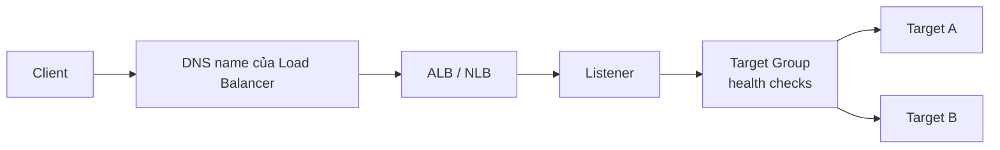
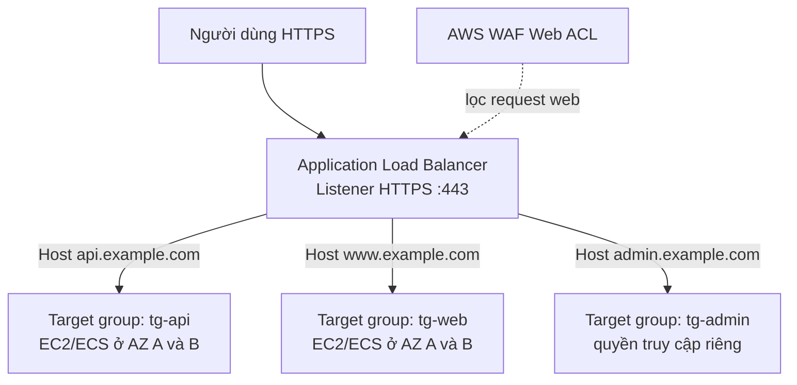
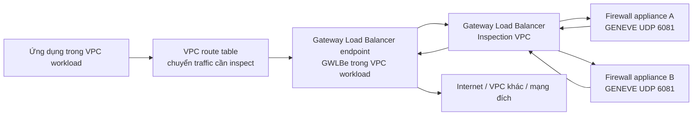
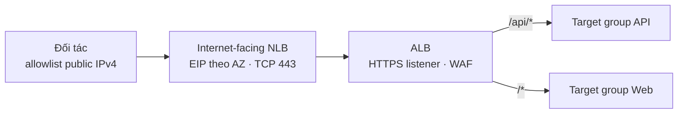
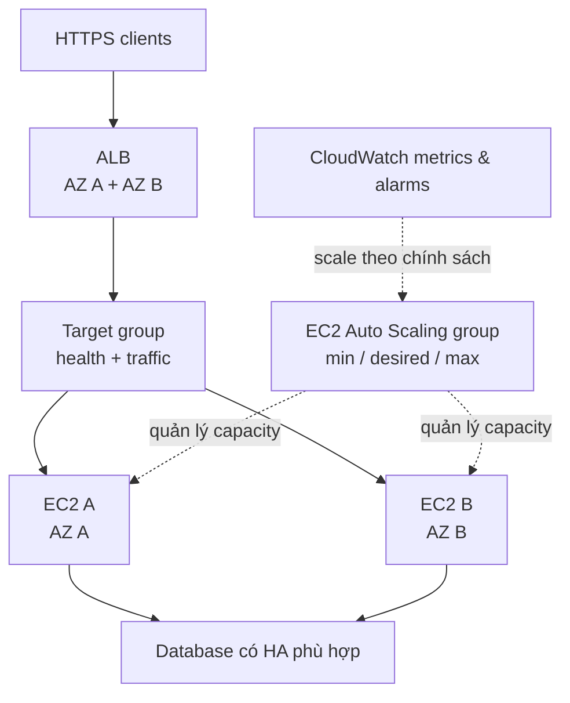

# Lựa chọn Application, Network và Gateway Load Balancer trên AWS

> **Chương:** Cân bằng tải và mở rộng  
> **Module:** CLOUD_PROVIDERS_AWS  
> **Trọng tâm:** chọn đúng loại Elastic Load Balancing dựa trên giao thức, cách định tuyến, yêu cầu địa chỉ IP, bảo mật, khả năng chịu lỗi và chi phí; kết hợp với EC2 Auto Scaling, container, IAM, VPC và giám sát.

## 1. Vì sao không có một loại Load Balancer phù hợp cho mọi ứng dụng?

Giả sử một doanh nghiệp triển khai ba hệ thống trên AWS Region Singapore:

1. **Website và REST API** có nhiều dịch vụ: `shop.example.com/api/*` phải tới API, `shop.example.com/images/*` đến máy phục vụ ảnh; cần HTTPS, AWS WAF, health check và mở rộng EC2 khi tăng người dùng.
2. **Dịch vụ TCP/UDP** cho đối tác yêu cầu **public IPv4 tĩnh** để cấu hình allowlist; có nhiều kết nối dài, không muốn proxy sửa nội dung HTTP.
3. **Hệ thống kiểm tra lưu lượng** ở mạng trung tâm: cần ép traffic giữa Internet, VPC ứng dụng và các mạng nội bộ đi qua một cụm firewall/IDS/IPS ảo trước khi đến đích.

Ba bài toán cần khả năng khác nhau của **Elastic Load Balancing (ELB)**:

- **Application Load Balancer (ALB):** cân bằng tải ở **tầng 7** cho HTTP/HTTPS, hiểu nội dung request và có quy tắc định tuyến theo host/path/header/query.
- **Network Load Balancer (NLB):** cân bằng tải ở **tầng 4** cho các luồng kết nối; hỗ trợ nhiều giao thức truyền tải, địa chỉ IP tĩnh theo AZ và thông lượng lớn.
- **Gateway Load Balancer (GWLB):** xử lý lưu lượng IP ở **tầng 3**, đưa packet đến các **virtual network appliances** qua GENEVE để kiểm tra, lọc hoặc xử lý theo chính sách.

Mục tiêu của bài không chỉ là nhớ “ALB tầng 7, NLB tầng 4, GWLB tầng 3”, mà còn biết **tại sao** một kiến trúc thành công hoặc thất bại khi chọn sai loại.

### 1.1. Điều gì xảy ra khi chưa cân bằng tải?

Một EC2 duy nhất có thể bị quá tải, hỏng instance hoặc AZ, phải bảo trì và phải làm thủ công khi tăng công suất. Một load balancer tạo ra điểm vào thống nhất, kiểm tra tình trạng các target và điều phối lưu lượng đến những target phù hợp.

Tuy nhiên, **load balancer không tự nhân bản dữ liệu, tăng số EC2 hoặc khắc phục lỗi ứng dụng**. Cần kết hợp **Auto Scaling group (ASG), health check, các AZ khác nhau, hệ thống dữ liệu có dự phòng và cách triển khai an toàn**.

## 2. So sánh nhanh ALB, NLB và GWLB

| Tiêu chí | **Application Load Balancer** | **Network Load Balancer** | **Gateway Load Balancer** |
|---|---|---|---|
| Tầng OSI chính | **L7 – Application** | **L4 – Transport** | **L3 – Network** |
| Dữ liệu xử lý | Request HTTP/HTTPS, đường dẫn, hostname, header... | Flow TCP, TLS, UDP, TCP_UDP, QUIC/TCP_QUIC theo hỗ trợ hiện hành | Packet IP được encapsulate bằng GENEVE |
| Listener chính | **HTTP, HTTPS** | **TCP, TLS, UDP, TCP_UDP, QUIC, TCP_QUIC** | **GENEVE/6081** để chuyển packet đến appliance |
| Định tuyến | Host/path/header/query/method/source IP, weighted target groups | Flow và port/protocol; có rule chọn target group theo địa chỉ IP nguồn **IPv4/IPv6** ở cấu hình dual-stack được hỗ trợ | Dẫn traffic từ route qua appliance; không route theo HTTP path |
| Target group | **instance, ip, lambda** | **instance, ip, alb** | **instance, ip** là appliance hỗ trợ GENEVE |
| IP public ổn định | ALB dùng DNS, địa chỉ node có thể thay đổi | Có thể cấp **Elastic IP theo AZ** cho internet-facing NLB | Không phải giải pháp cấp public IP trực tiếp cho ứng dụng web |
| Chấm dứt TLS | HTTPS listener | TLS listener; TCP 443 có thể truyền TLS nguyên vẹn | Không tự TLS-offload của ứng dụng |
| Bảo mật điển hình | AWS WAF, HTTPS, OIDC/Cognito authentication, SG | TLS, SG nếu cấu hình, giữ client IP theo target/attributes, Shield | Third-party firewall, IDS/IPS, policy enforcement qua appliance |
| Trường hợp tốt nhất | Web app, HTTP APIs, gRPC, WebSocket, microservices | TCP/UDP/QUIC, IP tĩnh, kết nối dài, truyền tải hiệu năng cao | Kiểm tra lưu lượng tập trung và trong suốt qua appliances |

**Lưu ý phiên bản:** theo tài liệu Network Load Balancer cập nhật đến **2026**, listener NLB có thêm **QUIC/TCP_QUIC** và hỗ trợ **listener rules** trong cấu hình **dual-stack** cho lựa chọn target group theo địa chỉ IPv4/IPv6. Vì vậy cách học cũ nói NLB “chỉ TCP/UDP/TLS” hoặc “không bao giờ có listener rules” không còn bao quát đầy đủ. Các NLB rules hiện tại **không tương đương** quy tắc L7 host/path/query của ALB.

## 3. Thành phần chung: Load Balancer, Listener, Rule, Target Group và Target

Trước khi chọn loại, hãy hiểu các thành phần:

| Thành phần | Câu hỏi cần trả lời | Ví dụ |
|---|---|---|
| **Load balancer** | Traffic đi vào qua endpoint nào? | `shop-alb-123.ap-southeast-1.elb.amazonaws.com` |
| **Scheme** | Điểm vào public hay private? | `internet-facing` hoặc `internal` đối với ALB/NLB |
| **Listener** | Chấp nhận traffic theo giao thức và port nào? | ALB: HTTPS 443; NLB: TCP 443 |
| **Listener rule/action** | Sau khi nhận traffic, xử lý và chuyển đi đâu? | ALB: `/api/*` → `tg-api` |
| **Target group** | Những backend nào có thể nhận traffic, kiểm tra sức khỏe ra sao? | `tg-api` chứa EC2/ECS tasks |
| **Target** | Đích xử lý thực tế là gì? | EC2 ID, private IP, Lambda hoặc appliance |
| **Health check** | Đích có đủ khỏe để phục vụ không? | HTTP `/health/ready`, TCP connect |
| **Load balancer node/AZ** | Dịch vụ nhận/điều phối traffic ở các AZ như thế nào? | Node tại các subnet đã bật của AZ A/B |

### 3.1. Luồng cân bằng tải ở mức khái niệm



Với **GWLB**, đường đi khác: VPC route table đưa packet đến **Gateway Load Balancer endpoint (GWLBe)**, qua endpoint service tới GWLB rồi đến appliance xử lý packet. GWLB không hoạt động giống một HTTP/HTTPS reverse proxy có host/path rules.

### 3.2. Health check không phải kiểm thử toàn bộ nghiệp vụ

Một EC2 trả `200 OK` tại `/health` có thể vẫn mất kết nối database; một TCP port còn mở có thể tiếp tục chấp nhận kết nối nhưng không xử lý request đúng. Nên thiết kế:

- **Liveness:** quá trình có còn chạy không?
- **Readiness:** target có đủ điều kiện nhận traffic mới không, bao gồm phụ thuộc cần thiết?
- **Độ trễ và lỗi thực tế:** theo dõi ở tầng ứng dụng ngoài health check.

ALB, NLB và GWLB đều có health check theo cơ chế riêng. Khi tất cả target bị unhealthy, một số cơ chế ELB có thể **fail open**, tức vẫn đưa traffic tới các target chưa khỏe theo điều kiện dịch vụ. Vì vậy không được khẳng định “health check bảo đảm không bao giờ gửi đến target lỗi”.

## 4. Application Load Balancer: khi cần hiểu HTTP request

### 4.1. Những yêu cầu ALB giải quyết tốt

**ALB** là lựa chọn mặc định đáng xem xét cho web app và API **HTTP/HTTPS** cần:

- **Host-based routing:** `api.example.com` và `admin.example.com` chuyển đến hai target group.
- **Path-based routing:** `/api/*`, `/images/*`, `/checkout/*` đến các backend khác nhau.
- **Rule theo header/query/method/source IP** khi chức năng hỗ trợ.
- **HTTP → HTTPS redirect**, fixed response, forward tới một hoặc nhiều target groups với trọng số.
- HTTPS termination bằng certificate, policies cho TLS, và có thể kết nối HTTPS đến target.
- **AWS WAF** để lọc web request và chặn mẫu tấn công phổ biến theo rule được cấu hình.
- **Authenticate** trước khi chuyển request bằng tính năng tích hợp Amazon Cognito hoặc OIDC.
- WebSocket, HTTP/2 frontend, HTTP/2/gRPC đến target khi target group được cấu hình đúng.
- Target loại **Lambda** cho trường hợp ALB gọi function trực tiếp.

### 4.2. Sơ đồ host/path routing



Ví dụ listener HTTPS 443:

| Ưu tiên | Điều kiện | Action |
|---|---|---|
| 10 | Host = `api.example.com`, path = `/v1/*` | Forward đến `tg-api-v1` |
| 20 | Host = `www.example.com` | Forward đến `tg-web` |
| 30 | Host = `admin.example.com` | Authenticate OIDC rồi forward `tg-admin` |
| Default | Không khớp rule nào | Fixed response 404, hoặc route mặc định phù hợp |

**Thứ tự ưu tiên có ý nghĩa.** Listener rules được đánh giá theo priority; quy tắc cụ thể phải được đặt đúng thứ tự để tránh bị rule rộng bắt trước.

### 4.3. Target groups và health checks của ALB

ALB target groups thường có các loại:

- `instance`: đăng ký EC2 bằng instance ID.
- `ip`: đăng ký địa chỉ IP được AWS hỗ trợ, thuận tiện cho container/task hoặc backend có IP riêng.
- `lambda`: gọi AWS Lambda function, theo giới hạn tích hợp của target type này.

Backend có thể dùng HTTP/HTTPS. Khi cần gửi **HTTP/2 hoặc gRPC**, phải đặt **target group protocol version** tương ứng; listener HTTPS và client/backend protocol hỗ trợ cũng phải phù hợp.

Với một API chạy port 8080, health check thường dùng path **`/health/ready`** và matcher HTTP code phù hợp. Chỉ trả 200 khi ứng dụng đã load cấu hình, có đủ phụ thuộc thiết yếu để tiếp nhận request.

Nếu target unhealthy, cần đối chiếu:

1. Port listener và port trong target group.
2. SG của ALB và backend: backend phải cho phép lưu lượng **từ SG của ALB** trên port backend, bao gồm health checks.
3. Route table, NACL, subnet/AZ.
4. Health check path, protocol, matcher, timeout, startup time của app.
5. Đăng ký target có đúng instance/IP và AZ đang bật không.

### 4.4. HTTPS, client IP và authentication

Với HTTPS listener, ALB có thể giải mã TLS rồi forward HTTP hoặc HTTPS đến backend. Cần đặt **ACM certificate**, security policy/ciphers và quy trình gia hạn certificate phù hợp.

ALB cung cấp các thông tin proxy trong header như **`X-Forwarded-For`, `X-Forwarded-Proto`, `X-Forwarded-Port`**. Backend cần cấu hình trust đối với header từ proxy đã được kiểm soát; không tin tuyệt đối một header `X-Forwarded-For` do client tùy ý gửi qua các đường truy cập khác.

**ALB authentication** (OIDC/Cognito) là lớp xác thực trước backend, nhưng **không tự thực hiện toàn bộ phân quyền nghiệp vụ** (ví dụ ai được sửa đơn hàng nào). Ứng dụng vẫn cần authorization, quản lý phiên và bảo vệ dữ liệu riêng.

### 4.5. WebSocket, gRPC và session

- **WebSocket:** ALB hỗ trợ HTTP Upgrade thành WebSocket; sau khi nâng cấp, luồng duy trì kết nối tới target. Nếu target bị thay thế, kết nối có thể đứt và client cần reconnect.
- **gRPC:** ALB hỗ trợ gRPC với cấu hình target group/protocol version phù hợp, bao gồm health check và metrics thích hợp.
- **Session stickiness:** có thể cấu hình stickiness tại target group, nhưng nếu mục tiêu là scale ngang và failover, nên đưa session state sang kho dùng chung khi có thể.
- **Connection draining:** dùng `deregistration_delay` và quy trình graceful shutdown để giảm request bị ngắt khi deploy hoặc scale-in.

### 4.6. Những giới hạn của ALB

- ALB chỉ có listener **HTTP/HTTPS**, không làm UDP/TCP generic load balancer.
- IP của ALB nodes có thể thay đổi theo thời gian. **Dùng DNS name của ALB**, không hard-code các IP hiện tại như địa chỉ tĩnh.
- Không trực tiếp cung cấp EIP riêng theo AZ như internet-facing NLB.
- ALB không phải firewall mạng ở lớp 3; WAF chỉ kiểm soát lưu lượng ứng dụng web được hỗ trợ.
- ALB không tự scale số EC2: **Auto Scaling group/ECS Service Auto Scaling** chịu trách nhiệm tăng giảm backend.

## 5. Network Load Balancer: khi yêu cầu nằm ở kết nối truyền tải và IP

### 5.1. Những nhu cầu NLB giải quyết tốt

**NLB** xử lý flow ở tầng truyền tải, phù hợp khi cần:

- Cân bằng tải **TCP, UDP** và các biến thể listener hỗ trợ.
- **Public IPv4 tĩnh theo AZ** với Elastic IP dành cho internet-facing NLB khi cấu hình thích hợp.
- Một số ứng dụng có kết nối dài, throughput lớn hoặc yêu cầu latency truyền tải thấp.
- **TLS termination** ở NLB hoặc **TLS pass-through** tới backend bằng TCP listener.
- Bảo toàn client IP theo target type/protocol và thiết lập `preserve_client_ip.enabled` phù hợp.
- Đưa lưu lượng tới target là **EC2, private IP hoặc một ALB** theo điều kiện hỗ trợ.
- Kết nối qua **AWS PrivateLink** (NLB thường là điểm cung cấp endpoint service) cho dịch vụ private giữa các VPC/tài khoản theo mô hình được hỗ trợ.

**NLB không đọc HTTP path, Host hay query để tự quyết định backend theo logic L7.** Nếu ứng dụng cần điều đó, chọn ALB hoặc ghép NLB với ALB.

### 5.2. Các giao thức được hỗ trợ

Theo AWS NLB listener documentation được cập nhật năm 2026:

| Listener | Vai trò |
|---|---|
| **TCP** | Chuyển TCP flow, có thể đi qua TLS tới backend nguyên vẹn |
| **TLS** | Terminate TLS tại NLB, cần certificate và TLS security policy |
| **UDP** | Cân bằng UDP flow |
| **TCP_UDP** | Nhận cả TCP và UDP trên cùng port theo cấu hình tương ứng |
| **QUIC** | Chuyển lưu lượng QUIC tới backend hỗ trợ |
| **TCP_QUIC** | Kết hợp TCP và QUIC trên cùng port theo cấu hình hỗ trợ |

**Điều kiện QUIC:** tài liệu hiện hành có các giới hạn về listener, dual-stack và security groups; ví dụ các cấu hình QUIC/TCP_QUIC không thể dùng cùng một số tổ hợp dual-stack/SG và không thể ghép tùy tiện với UDP/TCP_UDP. Trước khi chọn QUIC cho production, kiểm tra **Region, listener compatibility, TLS/QUIC support của backend và giới hạn AWS mới nhất**.

**NLB listener rules:** kể từ 2026, NLB có rule trong những cấu hình **dual-stack** để route lưu lượng IPv4 và IPv6 tới các target groups thích hợp; vẫn không phải path-based/host-based HTTP routing của ALB.

### 5.3. Flow routing và client IP

Với TCP, NLB chọn target theo thuật toán dựa trên thông tin của connection/flow. Các packet của cùng một connection thường tiếp tục tới target đã chọn trong vòng đời kết nối; các connection khác có thể được phân phối tới những target khác nhau.

Vì vậy:

- Nếu client giữ một TCP connection trong nhiều giờ, bổ sung EC2 mới **không tự chuyển** connection đó sang instance mới.
- Khi target bị thay hoặc không khỏe, connection hiện tại có thể đứt; ứng dụng/client cần retry, reconnect và xử lý idempotency.
- Muốn backend nhìn thấy IP thật của client cần kiểm tra **target type, protocol, client IP preservation**; không giả định mọi kết nối qua NLB tự bảo toàn source IP ở mọi mô hình.
- Trong những trường hợp không giữ source IP trực tiếp, có thể dùng **Proxy Protocol v2** nếu NLB/target group hỗ trợ và backend hiểu protocol. Không bật tùy tiện vì ứng dụng không hiểu header Proxy Protocol có thể đọc sai payload.

### 5.4. Elastic IP và địa chỉ ổn định

Một internet-facing NLB có thể gắn **Elastic IP** cho từng enabled AZ khi tạo/cấu hình phù hợp. Ví dụ:

```text
NLB tại Region ap-southeast-1
├── AZ A: EIP A → node NLB A
└── AZ B: EIP B → node NLB B
```

Đối tác có thể allowlist các EIP này. Tuy nhiên:

- NLB vẫn có **DNS name** để phân giải và theo dõi trạng thái AZ.
- Nếu bỏ một AZ hoặc xử lý thay đổi zone/target, thiết kế DNS, EIP và failover phải được rà soát.
- Địa chỉ EIP **không chạy giữa các Region**. Yêu cầu IP toàn cầu/cross-Region cần xem **AWS Global Accelerator** hoặc phương án DNS/đa Region phù hợp.
- Public IPv4, EIP và lưu lượng có thể phát sinh phí theo chính sách hiện hành.

Nếu yêu cầu nghiệp vụ là “truy cập web theo đường dẫn và đối tác chỉ chấp nhận IP tĩnh”, có thể dùng **NLB → ALB** theo mô hình kết hợp (xem `7.1`).

### 5.5. TLS termination và mTLS

**TLS listener** cho phép NLB giải mã kết nối HTTPS/TLS từ client. Nếu muốn backend xử lý TLS end-to-end hoặc **mutual TLS (mTLS)** tại ứng dụng, dùng **TCP listener** để chuyển nguyên bản traffic mã hóa cho backend, rồi cấu hình certificate/client certificate ở backend.

AWS NLB **TLS listener không hỗ trợ trực tiếp mTLS authentication** theo tài liệu dịch vụ; đặt TLS listener rồi mong nó kiểm chứng client certificate là sai kiến trúc.

### 5.6. NLB target groups và health checks

Target types:

- `instance` — EC2 instance IDs.
- `ip` — IP addresses được hỗ trợ.
- `alb` — một **Application Load Balancer** làm target, với điều kiện protocol/port/cấu hình theo tài liệu.

Health check cho NLB thường là **TCP, HTTP hoặc HTTPS** tùy target group/protocol; không phải mọi target group UDP/QUIC có “UDP ping” hay “QUIC health check” theo kiểu tương ứng listener. Nên chọn health check có thể xác định backend thực sự phục vụ đúng.

Nếu NLB trả lỗi hoặc connection reset:

1. Kiểm tra NLB listener có đúng protocol/port không.
2. Kiểm tra target group protocol/port/target type.
3. Kiểm tra target healthy, SG/NACL, routing và health check port.
4. Kiểm tra client IP preservation hoặc Proxy Protocol v2 có tương thích backend.
5. Xem CloudWatch metrics về flows, resets và target health.
6. Xem người dùng có giữ stale DNS/IP khi một zone bị rút khỏi DNS không.

**Security group:** NLB có thể được tạo với SG; một số hành vi/quyền bổ sung phụ thuộc SG có được khai báo **lúc tạo NLB** hay không. Không giả định có thể gắn SG bất cứ lúc nào cho một NLB vốn tạo không có SG.

## 6. Gateway Load Balancer: cân bằng traffic đến firewall/IPS

### 6.1. GWLB làm gì?

**GWLB** là dịch vụ điều phối packet ở tầng 3 qua các appliance mạng hỗ trợ **GENEVE**. Các appliance có thể là:

- Firewall ảo do tổ chức hoặc nhà cung cấp phần mềm triển khai.
- Intrusion Detection/Prevention System (IDS/IPS).
- Công cụ lọc luồng, kiểm tra gói, phân tích bảo mật.
- Một số network functions khác tương thích yêu cầu của GWLB.

GWLB không thay thế ALB khi ứng dụng cần route `/api/*` đến backend web, và không tự trở thành firewall. **Quy tắc cho phép/từ chối được triển khai trên appliance**; GWLB chủ yếu đưa packet đến đúng appliance và quản lý phân phối luồng/health.

### 6.2. Luồng GWLB với Gateway Load Balancer endpoint

Một mô hình phổ biến dùng **inspection VPC** chứa GWLB và các appliance, **application VPC** tiêu thụ dịch vụ qua **Gateway Load Balancer endpoint (GWLBe)**.



Sơ đồ mô tả hướng xử lý khái niệm; traffic trả lời cần được định tuyến theo kiến trúc **symmetric routing** phù hợp để stateful firewall nhìn thấy cả hai chiều flow.

Các thành phần thực tế:

1. **Service provider VPC:** GWLB, target groups, appliances.
2. **GWLB endpoint service:** công bố khả năng truy cập GWLB qua cơ chế AWS PrivateLink.
3. **Service consumer/workload VPC:** các subnet có GWLBe.
4. **VPC route tables:** chọn traffic đi vào/ra qua GWLBe.
5. **Appliance security groups/routes:** cho phép GENEVE UDP 6081 và health checks theo thiết kế, trả packet lại GWLB.
6. **Flow affinity / target health:** bảo đảm traffic liên quan được điều phối nhất quán trong giới hạn dịch vụ.

### 6.3. GENEVE và kiểm tra bảo mật

GWLB lắng nghe packet IP và **encapsulate** packet gốc bằng **GENEVE** để chuyển tới appliance trên **UDP port 6081**. Appliance phải hỗ trợ giải đóng gói/xử lý và gửi trả theo yêu cầu dịch vụ.

**GENEVE không đồng nghĩa dữ liệu ứng dụng được giải mã TLS.** Nếu packet gốc là HTTPS mã hóa, một firewall chỉ nhìn header/network metadata trừ khi được phép và cấu hình cơ chế TLS inspection/decryption phù hợp.

**Không mở port 6081 công khai tùy tiện.** Appliance thường chạy trong subnet private của inspection VPC; security group/NACL phải cho phép traffic đúng nguồn và health check.

### 6.4. Routing đúng và xử lý traffic hai chiều

Điểm thường khó nhất khi triển khai GWLB là **định tuyến**:

- Phải có route đưa traffic cần kiểm tra từ application subnet hoặc ingress/egress vào **GWLBe**.
- Traffic sau appliance inspection phải tiếp tục đến đích thật, không lặp route vô hạn về endpoint.
- **Return path** cần đi qua luồng kiểm tra phù hợp khi appliance là stateful.
- Trong mô hình ingress inspection, route table gắn với Internet Gateway có thể đưa traffic đến GWLBe trước khi đến subnet ứng dụng; egress route ngược từ subnet ứng dụng cũng phải được thiết kế.
- Với nhiều AZ, bố trí endpoint/appliance/route theo AZ và kiểm tra cân bằng giữa tính sẵn sàng với phí truyền dữ liệu chéo AZ.
- Khi đi qua Transit Gateway hoặc nhiều VPC, xem xét route propagation, symmetry/affinity và quan sát flow.

**Một GWLBe không cấp quyền truy cập mạng tự động.** VPC routing và security groups vẫn quyết định đường đi.

### 6.5. Flow stickiness và failover

Appliance stateful như firewall cần duy trì trạng thái kết nối. GWLB có cơ chế chọn target/flow stickiness để đưa các packet của flow liên quan đến appliance được chọn, nhưng:

- Nếu appliance lỗi, các **flow đang hoạt động có thể bị gián đoạn**; appliance thay thế không mặc nhiên có connection state của appliance cũ.
- Health check giúp phát hiện target; **không bảo đảm giữ session sau failover**.
- Khi toàn bộ appliance unhealthy, dịch vụ có cơ chế fail-open/forward tới target không khỏe theo trường hợp được AWS mô tả; cần xem cấu hình và chính sách xử lý lỗi để không tạo giả định bảo mật sai.
- **Không mặc định “GWLB bảo đảm chặn hết traffic khi firewall chết”**. Đòi hỏi test fail-open/fail-closed ở mức kiến trúc và vendor appliance.

### 6.6. GWLB khác AWS WAF và Network Firewall

| Công cụ | Vai trò |
|---|---|
| **AWS WAF** | Kiểm tra HTTP(S) request ở lớp ứng dụng cho resource hỗ trợ như ALB; thường dùng cho web exploits, bot/rate rules |
| **Gateway Load Balancer + appliance** | Đưa IP traffic qua firewall/IDS/IPS ảo do tổ chức/vendor quản lý |
| **AWS Network Firewall** | Dịch vụ firewall mạng được AWS quản lý, có mô hình endpoint/routing riêng, không cần tự quản một đội EC2 appliance theo cách GWLB |
| **Security Group/NACL** | Bộ lọc kết nối ở ENI/subnet, không thay thế kiểm tra chuyên sâu nội dung ứng dụng |

Nếu chỉ cần chặn mẫu HTTP attack vào website, ALB + WAF có thể đủ. Nếu cần dịch vụ firewall của vendor có tính năng kiểm tra traffic nhiều giao thức giữa các VPC, GWLB là ứng viên.

## 7. Kết hợp nhiều loại Load Balancer

### 7.1. NLB → ALB: IP tĩnh + HTTP routing/WAF

Một đối tác chỉ cho phép IP tĩnh cho traffic inbound, nhưng ứng dụng web cần **host/path routing**, **WAF** và listener rules.



Điểm kỹ thuật:

- NLB dùng **target type `alb`** và target group **TCP** theo yêu cầu của AWS.
- NLB có thể nhận lưu lượng ở một port TCP, chuyển tới **listener của ALB** trên port tương ứng theo cấu hình hợp lệ.
- ALB tiếp tục xử lý HTTP(S), listener rules, authentication/WAF (nếu có).
- Cần health checks phù hợp ở cả hai tầng; listener/target group NLB phải liên kết đúng ALB.
- Bố trí subnets/AZ và security groups nhất quán; cân nhắc chi phí của **cả NLB lẫn ALB**, data transfer và public IPv4.
- NLB không tự bổ sung path routing. **ALB** vẫn làm nhiệm vụ L7; nếu không có nhu cầu IP tĩnh/PrivateLink thì kiến trúc này có thể phức tạp không cần thiết.

### 7.2. ALB trước EC2 Auto Scaling



Trong cấu trúc này:

- **ALB:** nhận HTTPS, kiểm tra health, phân phối request.
- **Target group:** tập backend nhận lưu lượng.
- **ASG:** launch/terminate EC2 theo desired capacity và scaling policies.
- **CloudWatch:** giám sát `RequestCountPerTarget`, CPU, latency, lỗi... để hỗ trợ scale policy.
- **Database/state:** cần chịu tải và có khả năng phục hồi riêng.

**Auto Scaling không phải tính năng của riêng ALB.** Có thể kết hợp NLB với target group và Auto Scaling phù hợp. Với ECS/EKS/Lambda, cơ chế scale backend tương ứng khác nhau.

### 7.3. GWLB trong kiến trúc có ALB/NLB

Một kiến trúc nhiều tầng có thể dùng:

- GWLB để đưa traffic từ mạng ứng dụng qua các firewall appliances theo VPC route.
- ALB để thực hiện HTTPS termination, HTTP routing và WAF cho web service.
- NLB ở các điểm cần truyền tải/TCP/UDP hoặc IP ổn định.

Không đồng nghĩa cứ thêm ba loại sẽ tự tăng bảo mật. Mỗi tầng thêm **chi phí, route, security rules, health check, điểm vận hành và khả năng lỗi cấu hình**. Chỉ kết hợp khi yêu cầu chứng minh được lợi ích.

## 8. Availability Zone, cross-zone load balancing và khả năng phục hồi

### 8.1. Enable nhiều AZ có ý nghĩa gì?

ALB và NLB hoạt động trong Region và có load balancer nodes tại các AZ được bật. Khi triển khai ứng dụng có yêu cầu chịu lỗi AZ:

1. Dùng các subnet ở **ít nhất hai AZ** theo điều kiện của loại load balancer.
2. Đăng ký target khỏe ở nhiều AZ, không để mọi backend ở AZ A.
3. Thiết kế hệ thống dữ liệu/dịch vụ phụ thuộc không chỉ có một điểm lỗi.
4. Kiểm tra security group, route, NACL và health checks trên từng AZ.
5. Diễn tập lỗi target, AZ và kiểm tra thời gian chuyển đổi thực tế.

**Nhiều AZ của load balancer không có nghĩa backend tự có HA.** Nếu database chỉ có một instance tại AZ lỗi, người dùng có thể vẫn không hoàn tất giao dịch dù ALB còn hoạt động.

### 8.2. Cross-zone load balancing

**Cross-zone** xác định node load balancer ở một AZ có thể phân phối lưu lượng đến target ở AZ khác hay chỉ target cùng AZ.

| Loại | Mặc định và khả năng chỉnh |
|---|---|
| **ALB** | Cross-zone **bật tại load balancer level** và không tắt ở level này. **Target group** có thể override để tắt cross-zone với giới hạn tính năng liên quan |
| **NLB** | Cross-zone mặc định **tắt tại load balancer level**; có thể bật, và target group có thể override |
| **GWLB** | Cross-zone mặc định **tắt**; có cấu hình bật theo cơ chế hỗ trợ |

**Hệ quả cần cân nhắc:** Cross-zone có thể cải thiện phân phối tải khi số target giữa AZ không đều, nhưng cũng có thể tạo traffic qua AZ, chi phí và phụ thuộc bổ sung. Quyết định nên dựa trên **năng lực từng AZ, isolation goals, service behavior và bảng giá hiện hành**, không chỉ bật tất cả.

### 8.3. Health-based DNS và failover

Một số kiểu load balancer có thể rút IP của node/AZ khỏi DNS khi không còn target đủ khỏe theo ngưỡng và điều kiện dịch vụ. Nhưng:

- Client có thể cache DNS lâu hơn TTL hoặc tiếp tục dùng địa chỉ cũ.
- Existing TCP connection không nhất thiết được chuyển target mà không gián đoạn.
- ALB/NLB có những quy tắc **unhealthy-state routing/fail-open** riêng khi thiếu healthy targets.
- Muốn phục hồi mất **cả Region**, cần hệ thống ở Region khác và cơ chế định tuyến multi-Region (Route 53, Global Accelerator, CloudFront/origin failover tùy kiến trúc), cùng replication dữ liệu.
- RTO/RPO phải được đo qua diễn tập chứ không suy từ câu “load balancer có nhiều AZ”.

## 9. Security, TLS và kiểm soát truy cập

### 9.1. Lựa chọn lớp bảo mật tương ứng

| Yêu cầu | Dịch vụ/phương án phù hợp |
|---|---|
| TLS certificate cho web HTTPS | **ALB HTTPS listener** với ACM |
| HTTPS request filtering, rate rules, SQLi/XSS rule sets | **ALB + AWS WAF** |
| Xác thực người dùng ở edge trước web backend | **ALB + Cognito/OIDC authentication** |
| TCP/TLS service với IP tĩnh | **NLB**, chọn TLS listener hoặc TCP pass-through |
| Backend tự xác thực mTLS | **NLB TCP pass-through** tới backend có mTLS |
| Kiểm tra packet/IP traffic nhiều giao thức | **GWLB + firewall/IDS/IPS appliance** |
| Segment network cơ bản | **Security Group, NACL, VPC routing** |
| Private service giữa các VPC/tài khoản | **NLB + interface endpoint service** theo cơ chế PrivateLink |

### 9.2. Internet-facing và internal load balancers

- **Internet-facing ALB/NLB** có endpoint nhận traffic từ Internet khi subnet/route/SG cho phép. Backend vẫn có thể ở private subnet.
- **Internal ALB/NLB** có endpoint private trong VPC; truy cập từ mạng kết nối hợp lệ như VPN, Direct Connect, peering, Transit Gateway hoặc PrivateLink theo cách hỗ trợ.
- **GWLB** thường được triển khai trong inspection VPC và truy cập qua GWLBe/endpoint service; không được chọn như “một web load balancer public”.

Gắn thuộc tính `internal` **không tự cấp route hay IAM authentication**. Phải thiết kế quyền ứng dụng, bảo mật mạng, DNS và đường đi.

### 9.3. IAM với load balancing

**IAM** kiểm soát **ai được tạo/sửa/xóa** load balancer, listeners, target groups, target registrations và attributes. Ví dụ API:

- `elasticloadbalancing:DescribeLoadBalancers`, `DescribeListeners`, `DescribeRules`.
- `elasticloadbalancing:CreateLoadBalancer`, `ModifyListener`, `RegisterTargets`, `ModifyTargetGroupAttributes`.
- `ec2:DescribeVpcs`, `DescribeSubnets`, `DescribeSecurityGroups` cho việc quan sát mạng.
- `acm:DescribeCertificate` và quyền chứng chỉ cần thiết khi cấu hình HTTPS.
- Quyền AWS WAF/CloudWatch/IAM liên quan khi triển khai tích hợp.

Quyền IAM quản trị ELB **không có nghĩa** end user tự được truy cập API/backend. Authentication/authorization ứng dụng, WAF, SG và database policies là các tầng khác.

### 9.4. Ghi log và bảo vệ dữ liệu

- **ALB access logs** giúp ghi thông tin về requests, status, thời gian xử lý và target; cấu hình lưu vào S3 theo tài liệu.
- **NLB access logs** có phạm vi hỗ trợ gắn với TLS listener và thiết lập phù hợp; không mặc định mọi TCP/UDP flow xuất hiện như HTTP access log.
- **GWLB metrics, VPC Flow Logs và appliance logs** hữu ích để theo dõi traffic inspection.
- **CloudTrail** ghi các API quản trị ELB; không thay thế access logs của request người dùng.

Log có thể chứa IP, đường dẫn hoặc thông tin nhạy cảm; cấu hình retention, mã hóa, quyền truy cập và chi phí lưu trữ đúng chính sách.

## 10. Giám sát và xử lý sự cố

### 10.1. CloudWatch metrics cần biết

| Loại | Ví dụ metric cần theo dõi | Cách diễn giải |
|---|---|---|
| **ALB** | `RequestCount`, `TargetResponseTime`, `HTTPCode_ELB_5XX_Count`, `HTTPCode_Target_5XX_Count`, `HealthyHostCount` | Request tăng, backend chậm, lỗi từ ALB hay từ target |
| **NLB** | `ActiveFlowCount`, `NewFlowCount`, `TCP_ELB_Reset_Count`, `TCP_Target_Reset_Count`, `HealthyHostCount` | Connection tăng, TCP resets, tình trạng backend |
| **GWLB** | `ActiveFlowCount`, `NewFlowCount`, `ProcessedBytes`, `HealthyHostCount` (theo metric được hỗ trợ) | Lưu lượng IP và tình trạng appliances |
| **ASG/backend** | CPU/memory (khi có agent), custom latency, scaling activities | Dịch vụ có đủ capacity hay không |

Tên metric/dimensions có thể khác theo loại ELB và hỗ trợ hiện hành. Luôn kiểm tra namespace CloudWatch của tài nguyên thực tế trước khi cấu hình alarm.

### 10.2. ALB trả 502, 503 hoặc 504

Các mã này có thể đến từ nhiều nguồn. Gợi ý hướng điều tra:

- **502 Bad Gateway:** target reset/trả dữ liệu HTTP không hợp lệ, vấn đề TLS/backend, target đóng kết nối không đúng lúc.
- **503 Service Unavailable:** thiếu target có thể phục vụ hoặc routing/target group không có target phù hợp theo điều kiện.
- **504 Gateway Timeout:** target phản hồi quá chậm, network timeout, application lock hoặc dependency chậm.

Cần phân biệt `HTTPCode_ELB_5XX_Count` (lỗi do load balancer trả) và `HTTPCode_Target_5XX_Count` (target trả lỗi). Xem access logs, target health, request duration, thời điểm deploy/scaling và app logs. Không tự sửa bằng cách tăng timeout mà bỏ qua backend quá tải.

### 10.3. NLB kết nối được nhưng app vẫn lỗi

Đi theo tuyến:

1. Listener protocol/port phù hợp với client?
2. NLB đang đưa flow tới target nào? Target healthy?
3. Backend có đúng TCP/UDP/QUIC service, có listen port đó và SG/NACL cho phép?
4. TLS terminate tại NLB hay pass-through đến backend? Certificate/SNI/ALPN có đúng?
5. Proxy Protocol v2 hoặc client IP preservation có gây sai giao thức ứng dụng?
6. Connection timeout hoặc deregistration có ngắt luồng dài?
7. Có đủ capacity/conntrack/port allocation ở backend không?

**NLB health check TCP thành công không bảo đảm HTTP application logic đúng.** Nếu cần có thể dùng HTTP/HTTPS health check tại một port ứng dụng hỗ trợ.

### 10.4. GWLB: traffic không đến hoặc không đi qua firewall

Điều tra lần lượt:

1. **GWLBe** có tồn tại, AVAILABLE và kết nối đúng endpoint service không?
2. **Route table** của source/destination subnet, Internet Gateway/TGW (nếu có) đã đưa traffic cần kiểm tra qua GWLBe chưa?
3. **GWLB target group** có appliances healthy? Health check port hợp lệ?
4. Appliance có xử lý **GENEVE UDP 6081**, MTU và encapsulation theo yêu cầu?
5. SG/NACL/firewall nội bộ appliance có cho phép GENEVE, health check và traffic sau decapsulation?
6. Forward và return path có **symmetric** để stateful appliance xử lý đúng flow?
7. Có loop route hoặc appliance gửi ra nhầm ENI/route không?
8. Nếu target lỗi, policy failover và stateful session được xử lý ra sao?

Ở GWLB, chỉ kiểm tra HTTP status của ứng dụng **không đủ** để chứng minh appliance đã kiểm tra traffic. Cần đối chiếu flow logs, appliance logs và policy decisions.

## 11. Lựa chọn theo các tình huống kinh doanh

### 11.1. Website bán hàng nhiều microservices

**Yêu cầu:** HTTPS, nhiều domain/path, phát hành canary, AWS WAF, backend scale qua AZ.

**Chọn:** **ALB** với listener HTTPS 443, target groups cho `web`, `orders`, `payment`; rule theo hostname/path; ECS Service Auto Scaling hoặc EC2 ASG; CloudWatch và WAF. Có thể dùng weighted target groups khi cập nhật phiên bản.

**Lý do:** đây là bài toán cần hiểu HTTP request, không phải chỉ chuyển TCP packet.

### 11.2. Ứng dụng game/thiết bị IoT dùng UDP

**Yêu cầu:** UDP nhiều kết nối, latency mạng thấp, không có HTTP path routing.

**Chọn:** **NLB** với listener UDP/TCP_UDP phù hợp, backend hỗ trợ giao thức và health check TCP/HTTP/HTTPS được thiết kế. Dùng EIP khi cần IP tĩnh.

**Lý do:** ALB không có UDP listener; GWLB dành cho network appliances thay vì trực tiếp scale game servers.

### 11.3. Backend yêu cầu QUIC

**Yêu cầu:** client kết nối qua QUIC và backend hỗ trợ QUIC; cần cân bằng tải mà giữ đặc tính giao thức.

**Chọn:** xem xét **NLB QUIC hoặc TCP_QUIC** theo Region, listener/target compatibility và các giới hạn cập nhật.

**Lý do:** NLB hiện hỗ trợ các giao thức này ở cấu hình nhất định. Phải kiểm tra cụ thể QUIC v1, TLS của backend và các giới hạn dual-stack/SG; không dùng cấu hình TCP listener cũ rồi mặc định nó xử lý QUIC/UDP đúng.

### 11.4. Doanh nghiệp chỉ allowlist hai IPv4 public

**Yêu cầu:** traffic HTTPS từ đối tác đến backend cần IP tĩnh theo AZ.

**Chọn:** **NLB internet-facing với EIP từng AZ**. Nếu ứng dụng cần HTTP path/WAF, **NLB → ALB**.

**Lý do:** ALB dùng DNS và IP nodes có thể thay đổi; NLB hỗ trợ mô hình static EIP. Cần tính chi phí cả hai tầng nếu kết hợp.

### 11.5. Firewall tập trung cho nhiều VPC

**Yêu cầu:** traffic giữa application VPC và Internet/on-prem phải qua firewall ảo của nhà cung cấp.

**Chọn:** **GWLB + GWLBe + appliances** triển khai trong inspection VPC, kiểm tra route tại mỗi workload VPC và các AZ.

**Lý do:** cần inspection IP packets, flow affinity và khả năng tự scale mạng appliances. ALB/WAF không cung cấp mô hình inspect arbitrary L3 traffic tương đương.

### 11.6. Webhook chỉ gửi request tới Lambda

**Yêu cầu:** HTTP endpoint đơn giản cần listener HTTP/HTTPS và Lambda xử lý.

**Có thể chọn:** **ALB với target group loại Lambda** nếu cần ALB routing/integration; cũng đánh giá API Gateway hoặc Lambda Function URLs theo tính năng, authentication và chi phí.

**Lý do:** NLB không trực tiếp dùng Lambda target; GWLB không dùng để gọi Lambda như application backend.

## 12. Chi phí: đánh giá toàn hệ thống

ELB thường tính phí theo **thời gian load balancer hoạt động** và mức sử dụng đo bằng các đơn vị công suất tương ứng:

| Loại | Nhóm chi phí |
|---|---|
| **ALB** | Load balancer-hours + **LCU-hours** dựa trên thành phần sử dụng như connections, bytes và rule evaluations; phụ phí tính năng/traffic tùy cấu hình |
| **NLB** | Load balancer-hours + **NLCU-hours** dựa trên flows/bytes và các thành phần được AWS quy định |
| **GWLB** | Gateway Load Balancer-hours + **GLCU-hours**, cùng chi phí **Gateway Load Balancer endpoints** và lưu lượng xử lý |
| **Bổ sung** | Public IPv4/EIP, data transfer cross-AZ/cross-Region, WAF, CloudWatch/S3 logs, appliance EC2/licenses, Route 53, Shield/Global Accelerator nếu dùng |

Không hard-code đơn giá USD/giờ trong bài học vì giá thay đổi theo Region, thời điểm và cấu hình.

### 12.1. Ví dụ tư duy dự toán

Nếu một môi trường có:

- **1 ALB** chạy toàn bộ 30 ngày.
- **1 NLB** chạy toàn bộ 30 ngày.
- **2 EIP** gắn vào hai AZ của NLB.
- **2 AZ** chứa các nhóm EC2 có thể tự scale.

Thì riêng thời gian nền của mỗi load balancer tương đương **720 LB-hours** (30 × 24). Để ra tổng tiền còn cần số LCUs/NLCUs, giờ public IPv4, transfer, target EC2, logs và WAF nếu có. Không thể tính chi phí chỉ từ số lượng ALB/NLB.

**GWLB** còn cần phí appliances/licenses, số GWLBe, traffic processing và tác động cross-zone. Khi mô hình firewall tập trung có nhiều VPC/tài khoản, đây có thể là phần chi phí quan trọng.

### 12.2. Cách tối ưu

- Dùng ALB khi thật sự cần L7, tránh tách nhiều ALB nếu một ALB có thể an toàn phục vụ nhiều backend qua listener rules.
- Dùng NLB khi có yêu cầu L4/IP tĩnh; không thêm một NLB trước ALB chỉ để “tăng hiệu năng” nếu không có đo đạc.
- Với GWLB, tối ưu số appliances theo capacity thực, AZ, traffic, endpoint placement và chính sách security.
- Xem xét **cross-zone**, data transfer, số public IPv4 và logs retention.
- Kết hợp **Auto Scaling** với health checks/metrics thực; cần đủ headroom cho lỗi AZ và đợt traffic đột biến.
- Dùng **Cost Explorer, Budgets** và metrics theo load balancer/target groups thay vì chỉ ước lượng từ số EC2.

## 13. Quan sát cấu hình bằng AWS CLI (chỉ đọc)

Các lệnh sau không tạo/sửa tài nguyên. Cần AWS CLI v2, profile có quyền `elasticloadbalancing:Describe*`, `ec2:Describe*` và Region đúng. ARN/ID mẫu cần thay bằng tài nguyên thật.

### 13.1. Liệt kê mọi loại Load Balancer trong Region

```bash
aws elbv2 describe-load-balancers \
  --region ap-southeast-1 \
  --query "LoadBalancers[].[LoadBalancerName,Type,Scheme,VpcId,DNSName,State.Code]" \
  --output table
```

Đọc trường `Type` để phân biệt `application`, `network` và `gateway`. `Scheme`, `DNSName` và `AvailabilityZones` giúp hiểu cách triển khai. Nếu muốn xem cả Classic Load Balancer cũ, dùng API `aws elb describe-load-balancers` riêng.

### 13.2. Xem listener của ALB/NLB/GWLB

```bash
aws elbv2 describe-listeners \
  --region ap-southeast-1 \
  --load-balancer-arn arn:aws:elasticloadbalancing:ap-southeast-1:111122223333:loadbalancer/app/demo-alb/0123456789abcdef \
  --query "Listeners[].[ListenerArn,Protocol,Port]" \
  --output table
```

Ví dụ ARN trên là minh họa. Với NLB, listener có thể là TCP, TLS, UDP, TCP_UDP, QUIC hoặc TCP_QUIC; với GWLB, listener chuyển GENEVE 6081.

### 13.3. Xem listener rules

```bash
aws elbv2 describe-rules \
  --region ap-southeast-1 \
  --listener-arn arn:aws:elasticloadbalancing:ap-southeast-1:111122223333:listener/app/demo-alb/0123456789abcdef/abcdef0123456789 \
  --output json
```

Đối với ALB, đọc `Priority`, `Conditions`, `Actions` để xác nhận host/path routing. Với NLB có listener rules, kiểm tra tính tương thích dual-stack và giới hạn điều kiện IP family; không giả định NLB có bộ điều kiện L7 như ALB.

### 13.4. Xem target groups và health

```bash
aws elbv2 describe-target-groups \
  --region ap-southeast-1 \
  --query "TargetGroups[].[TargetGroupName,Protocol,Port,TargetType,HealthCheckProtocol]" \
  --output table
```

```bash
aws elbv2 describe-target-health \
  --region ap-southeast-1 \
  --target-group-arn arn:aws:elasticloadbalancing:ap-southeast-1:111122223333:targetgroup/demo-tg/0123456789abcdef \
  --query "TargetHealthDescriptions[].[Target.Id,Target.Port,TargetHealth.State,TargetHealth.Reason]" \
  --output table
```

Giải thích các trạng thái thông dụng: `healthy`, `unhealthy`, `initial`, `unused`, `draining`. Nếu `unhealthy`, xem `TargetHealth.Reason` và `Description` từ JSON đầy đủ; cần đối chiếu backend logs.

### 13.5. Xem cross-zone và attributes

```bash
aws elbv2 describe-load-balancer-attributes \
  --region ap-southeast-1 \
  --load-balancer-arn arn:aws:elasticloadbalancing:ap-southeast-1:111122223333:loadbalancer/net/demo-nlb/0123456789abcdef \
  --query "Attributes[].[Key,Value]" \
  --output table
```

Tìm `load_balancing.cross_zone.enabled` và các thuộc tính liên quan. Có thể cần kiểm tra **target group attributes** vì target group có thể override chính sách của load balancer:

```bash
aws elbv2 describe-target-group-attributes \
  --region ap-southeast-1 \
  --target-group-arn arn:aws:elasticloadbalancing:ap-southeast-1:111122223333:targetgroup/demo-tg/0123456789abcdef \
  --output json
```

### 13.6. Xem Gateway Load Balancer endpoints

```bash
aws ec2 describe-vpc-endpoints \
  --region ap-southeast-1 \
  --filters Name=vpc-endpoint-type,Values=GatewayLoadBalancer \
  --query "VpcEndpoints[].[VpcEndpointId,VpcId,ServiceName,State]" \
  --output table
```

Từ endpoint ID/subnet và VPC route tables, xác minh traffic đã đi qua GWLBe đúng thiết kế chưa. Đọc endpoint service và appliances theo tài khoản có quyền tương ứng; consumer VPC không mặc nhiên có quyền xem cấu hình của provider VPC.

## 14. Những nhầm lẫn phổ biến

| Nhận định | Đánh giá |
|---|---|
| “ALB dùng IP tĩnh để đối tác whitelist.” | **Sai theo cách dùng thông thường:** ALB được truy cập qua DNS; nếu cần IP tĩnh, xem NLB/Global Accelerator theo thiết kế. |
| “NLB tự đọc URL path và chuyển `/api` về backend A.” | **Sai:** chọn ALB cho HTTP content-based routing; NLB IP family rules mới không thay thế L7 routing. |
| “GWLB là giải pháp cân bằng REST API thay ALB.” | **Sai:** GWLB dẫn IP packets qua appliances GENEVE, không làm HTTP proxy theo host/path. |
| “ALB chỉ chuyển HTTP/1.1, không hỗ trợ gRPC.” | **Sai:** có HTTP/2/gRPC theo cấu hình listener/target protocol phù hợp. |
| “NLB chỉ hỗ trợ TCP và UDP.” | **Không còn đầy đủ:** hiện hỗ trợ TLS, TCP_UDP và một số trường hợp QUIC/TCP_QUIC. |
| “TLS listener NLB hỗ trợ mTLS client authentication.” | **Sai:** dùng TCP pass-through và triển khai mTLS tại target khi cần. |
| “Cứ bật ALB là EC2 tự nhân đôi khi traffic tăng.” | **Sai:** cần ASG/ECS Service Auto Scaling hoặc cơ chế scale tương ứng. |
| “ALB có health check thì backend nào lỗi cũng không nhận traffic.” | **Không bảo đảm tuyệt đối:** health check là chỉ báo; có các tình huống fail-open/timeout và lỗi nghiệp vụ ngoài health check. |
| “NLB cross-zone mặc định luôn bật.” | **Sai:** NLB mặc định tắt tại load balancer level, có thể bật/override. |
| “ALB cross-zone không thể thay đổi ở bất kỳ cấp nào.” | **Chưa đầy đủ:** luôn bật tại LB level nhưng có thể tắt tại target group theo điều kiện hỗ trợ. |
| “GWLB tự áp firewall policy và giữ mọi session khi appliance failover.” | **Sai:** policy và connection state thuộc appliance và thiết kế; failover có thể làm gián đoạn flow. |
| “Load balancer đa AZ đồng nghĩa database đã chịu lỗi AZ.” | **Sai:** backend, dữ liệu và dependency vẫn cần thiết kế phục hồi. |

## 15. Tình huống tự luyện có đáp án

### Bài 1 — Website có ba microservices

Một website có `/auth/*`, `/orders/*`, `/images/*` và yêu cầu WAF.

**Đáp án:** Chọn **ALB** HTTPS 443, listener rules theo path, target groups độc lập và WAF. Cân nhắc API Gateway hoặc CloudFront khi yêu cầu thay đổi.

### Bài 2 — UDP và IP cố định

Đối tác gửi telemetry qua UDP, yêu cầu public IPv4 allowlist.

**Đáp án:** **NLB** UDP/TCP_UDP phù hợp, EIP theo AZ cho internet-facing NLB, health checks tương thích backend. ALB không có UDP listener.

### Bài 3 — Chặn mọi traffic TCP qua IDS

Công ty cần mạng ứng dụng đi qua đội IDS/IPS ảo trước khi ra ngoài.

**Đáp án:** **GWLB + GWLBe + appliances hỗ trợ GENEVE**, route đúng hai chiều và quy trình kiểm chứng inspection. ALB + WAF không thay thế kiểm tra mọi TCP/UDP packet.

### Bài 4 — IP tĩnh nhưng vẫn có host routing

Người dùng truy cập web từ đối tác chỉ allowlist hai IP, website cần host-based routing, OIDC và WAF.

**Đáp án:** **NLB → ALB** khi điều kiện triển khai cho phép: NLB dùng EIP/TCP target type `alb`; ALB thực hiện HTTPS/OIDC/WAF/routing. Tính phí hai tầng.

### Bài 5 — NLB target healthy nhưng HTTP request lỗi

NLB dùng TCP health check port 8080, app trả 500 do database lỗi.

**Đáp án:** TCP health check chỉ thấy port mở. Cần HTTP/HTTPS health endpoint thể hiện readiness nếu cấu hình được, kết hợp logs/metrics ứng dụng.

### Bài 6 — Autoscaling không tăng instance

ALB có 1 EC2, lưu lượng tăng gấp 5, ALB vẫn phục vụ 502/504. Người quản trị nói “ELB sẽ tăng máy”.

**Đáp án:** Không. Cần **ASG** hoặc cơ chế scale backend, đặt scaling policy dựa trên metric thích hợp, kiểm tra dependency và headroom.

### Bài 7 — Hỏng một AZ

ALB đã bật AZ A/B nhưng toàn bộ EC2 app và RDS chỉ chạy tại AZ A.

**Đáp án:** Load balancer có đa AZ nhưng ứng dụng không có HA. Cần EC2 app và database có phương án dự phòng tại AZ B, health checks và failover.

### Bài 8 — NLB TLS và mTLS

Backend xác thực client certificate, nhưng NLB terminate TLS trước backend nên backend không thấy TLS handshake gốc.

**Đáp án:** Dùng **TCP listener** chuyển TLS nguyên vẹn đến backend để thực hiện mTLS tại backend, nếu phù hợp kiến trúc. NLB TLS listener không tự làm mTLS client validation.

### Bài 9 — GWLB làm đứt session khi firewall thay

GWLB chuyển flow sang appliance khỏe khác sau lỗi, nhưng TCP connection đang dùng bị reset.

**Đáp án:** Đây là rủi ro có thể xảy ra vì **stateful firewall** mới không có connection state cũ. Cần cơ chế quản lý session/state và thiết kế retry; health check không bảo đảm session continuity.

### Bài 10 — Cross-zone và chi phí

NLB đặt hai AZ; AZ A có 1 target, AZ B có 9 target; nhiều request tới node AZ A khiến target A quá tải.

**Đáp án:** Đánh giá bật cross-zone NLB hoặc cân bằng lại capacity giữa AZ, đồng thời xét traffic/cost cross-AZ và khả năng chịu lỗi. Không chỉ tăng `healthy` threshold.

### Bài 11 — Giao thức QUIC

Ứng dụng mới dùng QUIC, nhóm kỹ thuật dự định dùng ALB HTTPS listener như với gRPC.

**Đáp án:** **gRPC qua HTTP/2 trên ALB** là vấn đề khác **QUIC**. Đánh giá **NLB QUIC/TCP_QUIC** theo hỗ trợ và giới hạn hiện hành; không suy từ gRPC sang QUIC.

### Bài 12 — Tách WAF với firewall mạng

Một công ty đã có GWLB kiểm tra traffic, muốn chống SQL injection cho ứng dụng web.

**Đáp án:** Vẫn nên đánh giá **AWS WAF** tích hợp ALB/CloudFront hoặc cơ chế kiểm tra L7 thích hợp. GWLB chủ yếu dẫn packet qua appliance; chỉ khi appliance có chức năng và cấu hình inspection HTTP/TLS phù hợp mới thực hiện được kiểm tra nội dung đó.

## 16. Checklist lựa chọn cho một dự án mới

1. **Xác định protocol thật:** HTTP/HTTPS/gRPC/WebSocket, TCP, UDP, QUIC hay IP traffic cần inspection?
2. **Xác định routing logic:** cần path/host/header/query hay chỉ phân phối flow/port; có traffic network appliances?
3. **Địa chỉ IP:** có yêu cầu EIP tĩnh, DNS, IP toàn cầu hoặc allowlist của bên thứ ba?
4. **Bảo mật:** TLS termination/pass-through, mTLS, WAF, OIDC, SG, firewall/IDS/IPS và IAM quản trị.
5. **Backend:** EC2 instance, ECS/EKS task IP, Lambda, ALB target hay appliances GENEVE?
6. **Khả năng sẵn sàng:** nhiều AZ, target health, cross-zone, capacity dự phòng, backend/database HA.
7. **Auto Scaling:** hệ nào tăng giảm target và khi nào? Có graceful deregistration và đủ capacity không?
8. **Đường đi:** internet-facing/internal, VPC routes, PrivateLink/GWLBe, đối xứng traffic và DNS.
9. **Giám sát:** CloudWatch metrics, access logs, CloudTrail, VPC Flow Logs, application/appliance logs.
10. **Hiệu năng:** connection duration, request rates, throughput, latency, peak flows và behavior khi lỗi.
11. **Chi phí:** LB-hours, LCU/NLCU/GLCU, public IPv4, endpoints, cross-AZ transfer, WAF/appliances.
12. **Kiểm thử:** health/failover, scale-out/scale-in, certificate renewals, rollback và phục hồi mất AZ/Region.

**Nguyên tắc lựa chọn:** **ALB** khi cần hiểu và điều hướng HTTP; **NLB** khi ưu tiên giao thức tầng truyền tải, địa chỉ IP ổn định hoặc throughput/connection; **GWLB** khi cần đưa packet qua các network appliances. Chọn theo **yêu cầu của lưu lượng và ứng dụng**, rồi kết hợp Region/AZ, IAM, VPC, EC2 Auto Scaling, lưu trữ, cơ sở dữ liệu, giám sát và chi phí để tạo hệ thống vận hành được trong thực tế.

## Tài liệu AWS tham khảo

- [What is an Application Load Balancer? — AWS Elastic Load Balancing](https://docs.aws.amazon.com/elasticloadbalancing/latest/application/introduction.html)
- [Listeners for Application Load Balancers](https://docs.aws.amazon.com/elasticloadbalancing/latest/application/load-balancer-listeners.html)
- [Target groups for Application Load Balancers](https://docs.aws.amazon.com/elasticloadbalancing/latest/application/load-balancer-target-groups.html)
- [Listener rules for Application Load Balancers](https://docs.aws.amazon.com/elasticloadbalancing/latest/application/listener-rules.html)
- [What is a Network Load Balancer?](https://docs.aws.amazon.com/elasticloadbalancing/latest/network/introduction.html)
- [Network Load Balancer listeners: TCP/TLS/UDP/QUIC](https://docs.aws.amazon.com/elasticloadbalancing/latest/network/load-balancer-listeners.html)
- [Target groups for Network Load Balancers](https://docs.aws.amazon.com/elasticloadbalancing/latest/network/load-balancer-target-groups.html)
- [Network Load Balancer document history](https://docs.aws.amazon.com/elasticloadbalancing/latest/network/doc-history.html)
- [What is a Gateway Load Balancer?](https://docs.aws.amazon.com/elasticloadbalancing/latest/gateway/gateway-load-balancers.html)
- [Gateway Load Balancer target groups: GENEVE](https://docs.aws.amazon.com/elasticloadbalancing/latest/gateway/target-groups.html)
- [Getting started with Gateway Load Balancers](https://docs.aws.amazon.com/elasticloadbalancing/latest/gateway/getting-started.html)
- [Cross-zone load balancing for ALB target groups](https://docs.aws.amazon.com/elasticloadbalancing/latest/application/edit-target-group-attributes.html)
- [Cross-zone load balancing for NLB target groups](https://docs.aws.amazon.com/elasticloadbalancing/latest/network/edit-target-group-attributes.html)
- [AWS Elastic Load Balancing pricing](https://aws.amazon.com/elasticloadbalancing/pricing/)
- [EC2 Auto Scaling target tracking scaling policies](https://docs.aws.amazon.com/autoscaling/ec2/userguide/as-scaling-target-tracking.html)
