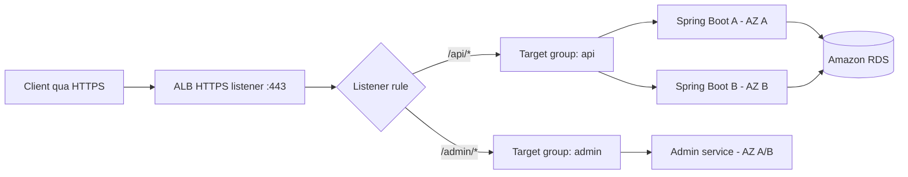
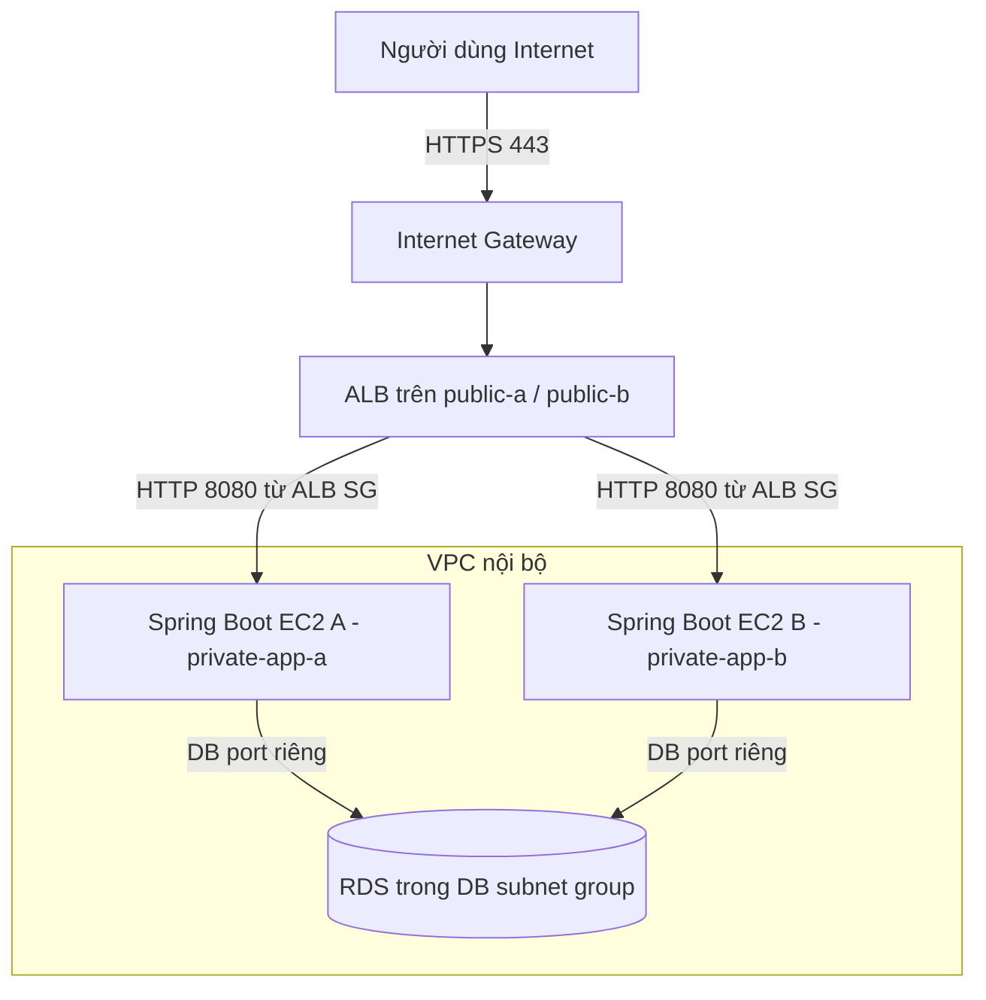
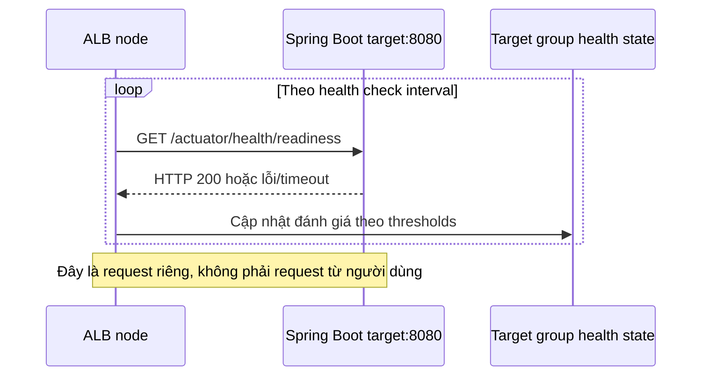
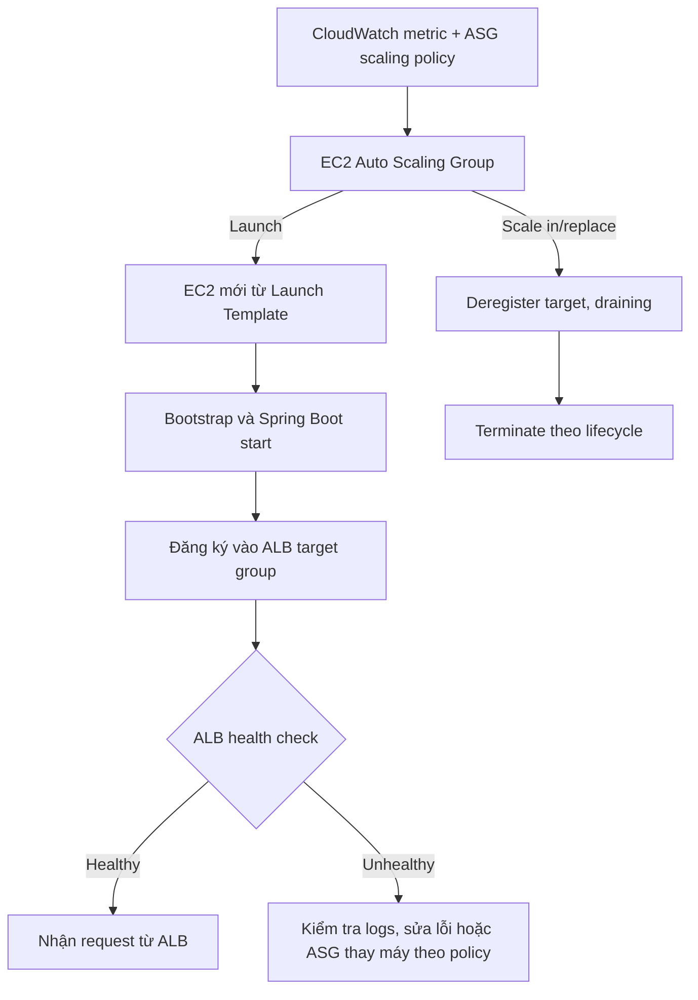
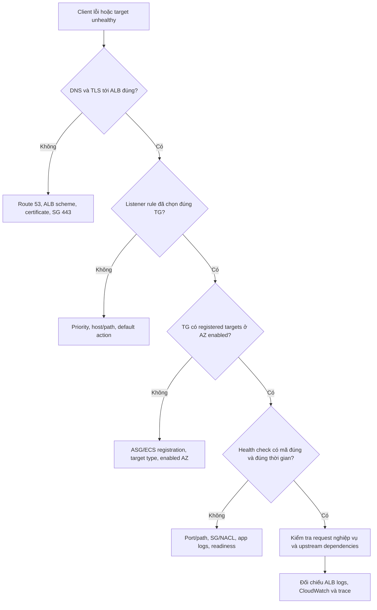

# ALB listener, target group và health check

> **Chương:** Cân bằng tải và mở rộng · **Mô-đun:** `CLOUD_PROVIDERS_AWS`

## 1. Bài toán: nhiều backend, một điểm vào ổn định

Một ứng dụng Java Spring Boot có thể chạy trên nhiều EC2 instances hoặc ECS tasks thuộc các Availability Zone (AZ) khác nhau. Nếu client kết nối trực tiếp tới IP của từng instance, việc mở rộng số máy, cập nhật phiên bản hoặc thay instance lỗi sẽ buộc client biết nhiều địa chỉ và tự xử lý tình trạng sẵn sàng của từng máy.

**Application Load Balancer (ALB)** là bộ cân bằng tải **Layer 7 (HTTP/HTTPS)** của AWS Elastic Load Balancing. ALB cung cấp tên DNS làm điểm vào ổn định, nhận kết nối từ client, đánh giá **listener và listener rules**, chuyển request tới **target group**, sau đó chọn target có đủ điều kiện phục vụ. **Health check** của target group cho biết backend có đáp ứng kiểm tra được cấu hình hay không, giúp ALB hạn chế gửi request đến những target không khỏe.

Ví dụ ba tầng:



ALB giúp giải quyết **phân phối lưu lượng và kiểm tra sức khỏe target**; nó không tự tạo EC2, không tự sửa code lỗi, không tự triển khai Multi-AZ database và không thay thế cơ chế xác thực hay phân quyền của ứng dụng.

Trong mô-đun `CLOUD_PROVIDERS_AWS`, thiết kế ALB liên quan trực tiếp tới **Region/AZ, VPC subnet và security group, IAM, EC2/ECS/EKS/Lambda, database, CloudWatch, Auto Scaling, khả năng phục hồi và kiểm soát chi phí**. Một ALB cấu hình đúng cần trả lời: request đến qua cổng nào, rule nào xử lý, target nào được chọn, tiêu chí nào xác định target healthy, các lớp mạng/bảo mật ra sao và điều gì xảy ra khi không còn target khỏe.

**Kết quả học tập:** Sau bài học, người học có thể:

1. Phân biệt ALB với NLB và nhận diện listener, listener rule, target group, target và health check.
2. Thiết kế ingress HTTPS ở public subnets, backend ở private subnets trên nhiều AZ.
3. Cấu hình rule dựa trên host/path, forward, redirect và fixed response; hiểu thứ tự priority.
4. Chọn target type và cài health check path, port, matcher, interval, timeout, threshold.
5. Chẩn đoán target `initial`, `unhealthy`, `unused`, `draining`; phân biệt kiểm tra hạ tầng và readiness ứng dụng.
6. Tích hợp ALB với Auto Scaling, triển khai rolling/blue-green, CloudWatch và Access Logs.
7. Đánh giá rủi ro bảo mật, lưu lượng liên AZ, tình trạng fail-open, chi phí ALB/LCU và phương án phục hồi.

## 2. Các thành phần tạo nên đường đi request

### 2.1. ALB nằm ở Layer 7

ALB hiểu request HTTP/HTTPS: hostname, path, HTTP method, header, query string và một số đặc điểm HTTP khác. Nhờ đó, ALB có thể đưa `/api/*` tới nhóm backend API và `/images/*` tới nhóm khác mà client chỉ truy cập một DNS name.

| Thành phần | Trách nhiệm | Ví dụ |
| --- | --- | --- |
| **Load balancer** | Tên DNS, scheme, subnets/AZ, node mạng, security groups và attributes. | `app-prod-alb`, internet-facing, hai AZ. |
| **Listener** | Nhận kết nối trên một protocol/port; có default action. | `HTTPS:443` dùng certificate trong ACM. |
| **Listener rule** | Kiểm tra điều kiện và thực hiện action theo priority. | `Host=api.example.com` và `Path=/v1/*`. |
| **Target group** | Nhóm đích, protocol/port, target type, health check và attributes. | `orders-tg`, HTTP:8080. |
| **Target** | Địa chỉ đích thực sự nhận request. | EC2 instance ID, private IP của ECS task hoặc Lambda function. |
| **Health check** | Probe độc lập vào target để đánh giá khả năng nhận traffic. | `GET /actuator/health/readiness` trả HTTP 200. |

Một target group có thể được tham chiếu bởi listener action. Target group **không đồng nghĩa một Auto Scaling Group**: ASG quản lý số lượng/vòng đời EC2; target group quản lý đích định tuyến và trạng thái sức khỏe. ASG có thể tự đăng ký và hủy đăng ký EC2 với target group khi scale in/out nếu được tích hợp đúng.

### 2.2. Chọn ALB hay loại cân bằng tải khác?

| Nhu cầu | ALB | Network Load Balancer (NLB) | Gateway Load Balancer (GWLB) |
| --- | --- | --- | --- |
| Định tuyến theo HTTP host/path/header | **Có**, Layer 7. | Không xử lý HTTP routing theo host/path. | Không dành cho HTTP application routing. |
| TCP/UDP, static IP use case và kết nối transport | Hướng tới HTTP/HTTPS (và HTTP/2, gRPC theo điều kiện). | Phù hợp với TCP/UDP/TLS/transport traffic. | Phù hợp mô hình chuỗi appliance bảo mật/kiểm tra traffic. |
| TLS termination và certificate | Có HTTPS listener và TLS policy. | Có TLS listener cho các use case phù hợp. | Khác mục tiêu. |
| Health check và target groups | Có, phù hợp ứng dụng HTTP. | Có, ở tầng kết nối/protocol theo cấu hình. | Theo use case appliance. |

**Không chọn ALB** cho một giao thức TCP tự thiết kế không chạy qua HTTP chỉ vì cần cân bằng tải; khi đó cân nhắc NLB. Với ứng dụng Java REST, web frontend, microservices HTTP hoặc gRPC, ALB thường là lựa chọn tự nhiên.

### 2.3. Một ALB có thể phục vụ nhiều ứng dụng

Nếu dùng nhiều hostname, ví dụ `api.example.com`, `admin.example.com` và `shop.example.com`, một HTTPS listener có thể nhận tất cả chúng với certificate/SNI phù hợp rồi phân phối bằng host-header rules. Điều này giảm số ALB riêng cần vận hành, nhưng cần cân nhắc ranh giới bảo mật, quota rules, tải tổng hợp, blast radius và chi phí. Đừng gộp mọi ứng dụng vào một ALB nếu các nhóm yêu cầu policy, isolation hoặc lịch phát hành độc lập rõ rệt.

## 3. Chọn internet-facing/internal ALB và mô hình VPC

ALB có hai scheme thường dùng:

- **Internet-facing:** cung cấp điểm vào công khai qua DNS; thông thường đặt ở **public subnets** có đường tới Internet Gateway (IGW). Chỉ mở inbound HTTP/HTTPS cần thiết.
- **Internal:** chỉ có điểm vào private theo mạng được định tuyến; dùng cho API nội bộ, service-to-service traffic hoặc ứng dụng từ hệ thống kết nối riêng (VPN, Direct Connect, VPC peering/Transit Gateway theo thiết kế).

Khi tạo ALB thông thường, AWS yêu cầu chọn **ít nhất hai subnet thuộc hai AZ khác nhau** để duy trì nút cân bằng tải; mỗi subnet nên đáp ứng yêu cầu số địa chỉ IP trống để ALB mở rộng. Hướng dẫn AWS cho ALB khuyến nghị **CIDR subnet tối thiểu /27 và ít nhất tám IP khả dụng trong mỗi subnet**. Với Local Zone/Outposts và một số kiểu triển khai đặc biệt, điều kiện có thể khác; cần kiểm tra tài liệu AWS cho cấu hình cụ thể.

Ví dụ VPC `10.20.0.0/16`:

| Tài nguyên | AZ A | AZ B | Vai trò |
| --- | --- | --- | --- |
| **Public subnet** | `10.20.0.0/24` | `10.20.1.0/24` | Đặt node của internet-facing ALB, route `0.0.0.0/0 → IGW`. |
| **Private app subnet** | `10.20.10.0/24` | `10.20.11.0/24` | EC2/ECS tasks là targets, không cần public IPv4. |
| **Isolated DB subnet** | `10.20.20.0/24` | `10.20.21.0/24` | RDS nhận kết nối từ backend. |



**Lưu ý:** Lưu lượng **ALB → target** giữa các subnet trong cùng VPC dùng định tuyến nội bộ (`local`), không đi Internet Gateway hoặc NAT gateway. Backend có thể cần NAT/VPC endpoint cho **outbound riêng** như tải artifact hay gọi AWS API; điều đó độc lập với đường inbound nhận từ ALB.

### 3.1. Security group cho hai chiều

| Gắn SG vào | Inbound cần mở | Outbound nên giới hạn theo nhu cầu |
| --- | --- | --- |
| **`sg-alb`** | TCP 443 từ client mong muốn (ví dụ `0.0.0.0/0` nếu website công khai). TCP 80 nếu listener chỉ dùng redirect HTTP → HTTPS. | TCP 8080 tới target app/`sg-app` và cổng health check nếu khác. |
| **`sg-app`** | TCP 8080 **chỉ từ `sg-alb`**. Nếu health check port khác, mở cả port đó từ `sg-alb`. | Cổng DB tới `sg-db`, HTTPS tới các dịch vụ cần thiết. |
| **`sg-db`** | Cổng database chỉ từ `sg-app` (ví dụ TCP 5432 của PostgreSQL). | Theo yêu cầu DB. |

Security groups là **stateful**: response của kết nối hợp lệ được cho phép theo trạng thái. **Network ACL là stateless**, vì vậy nếu NACL được siết chặt cần cho phép cả request và return traffic cùng các ephemeral ports tương ứng. Mọi target nên hạn chế nguồn inbound tới SG ALB thay vì mở app port cho mọi IP Internet.

### 3.2. Vùng sẵn sàng và khả năng phân phối

ALB có các node phục vụ AZ đã bật. ALB hỗ trợ cross-zone load balancing; ở mức load balancer, đặc tính này được bật cho ALB, còn target group có tùy chọn kiểm soát cross-zone trong một số trường hợp. Khi thiết kế, hãy kiểm tra **AZ đã enable, target có registered trong AZ, target health** và cấu hình target group. Một ALB ở hai AZ không tạo high availability nếu **tất cả ứng dụng chỉ chạy ở một AZ**.

ALB DNS có thể thay đổi IP theo thời gian khi AWS mở rộng và phục hồi. Client nên dùng **DNS name của ALB hoặc Route 53 alias/CNAME phù hợp**, không hard-code IP node ALB vào ứng dụng. Đối với internal ALB, private DNS và tuyến từ nguồn nội bộ phải được cấu hình chính xác.

## 4. Listener: giao thức, cổng và quy tắc định tuyến

**Listener** là bộ phận chờ kết nối client trên **protocol + port**. Ví dụ listener HTTPS:443 nhận kết nối TLS, lựa chọn certificate thích hợp, xử lý HTTP request rồi áp listener rules. Listener HTTP:80 thường được tạo để **redirect sang HTTPS**.

### 4.1. HTTPS listener và chứng chỉ

Trên HTTPS listener, ALB kết thúc TLS từ client (**TLS termination**); sử dụng certificate từ **AWS Certificate Manager (ACM)** hoặc cơ chế certificate tương thích. Có thể dùng **Server Name Indication (SNI)** cho nhiều hostnames/certificates trên cùng listener. Chọn TLS security policy phù hợp yêu cầu bảo mật và các client được hỗ trợ; quản lý rotation và expiration chứng chỉ.

Đường **ALB → backend** có thể dùng HTTP hoặc HTTPS tùy target group. Nếu chọn HTTPS target group, ALB tạo kết nối TLS riêng tới target; đây **không phải cùng phiên TLS** với client. Muốn mã hóa cả bên trong VPC, cần chọn HTTPS target group và quản lý certificate/backend tương ứng. Theo tài liệu AWS hiện hành, khi ALB kết nối tới HTTPS targets, ALB **không xác thực certificate của target theo cách trình duyệt xác thực public CA**; cần đánh giá rủi ro và áp dụng các kiểm soát mạng/danh tính phù hợp, không suy ra mTLS end-to-end chỉ từ tên protocol HTTPS.

### 4.2. Listener rule hoạt động theo thứ tự nào?

Mỗi listener có:

- **Default rule** không có priority số và được đánh giá **cuối cùng**.
- **Nondefault rules** có priority số; **số nhỏ hơn được đánh giá trước**.
- Mỗi rule kết hợp **conditions** và **actions**; rule đầu tiên khớp quyết định hướng xử lý request.

Các conditions thông dụng:

| Condition | Ví dụ | Mục đích |
| --- | --- | --- |
| **Host header** | `api.example.com` | Route nhiều domain tới nhiều ứng dụng. |
| **Path pattern** | `/orders/*` | Route theo đường dẫn API. |
| **HTTP method** | `POST` | Xử lý riêng một nhóm method khi hợp lý. |
| **HTTP header** | `X-Environment: canary` | Điều hướng request có header phù hợp (phải xét bảo mật nguồn header). |
| **Query string** | `version=v2` | Route theo tham số request được lựa chọn. |
| **Source IP** | Một CIDR được phép. | Định tuyến theo IP client khi dùng đúng kiểu địa chỉ/kiến trúc. |

Đây là ví dụ thiết kế rule cho listener `HTTPS:443`:

| Priority | Điều kiện | Action |
| --- | --- | --- |
| 10 | `host=api.example.com`, `path=/v2/*` | Forward tới `api-v2-tg`. |
| 20 | `host=api.example.com` | Forward tới `api-v1-tg`. |
| 30 | `host=admin.example.com` | Forward tới `admin-tg` (kèm bảo vệ xác thực/WAF thích hợp). |
| Default | Mọi request còn lại | Fixed response HTTP 404 hoặc forward tới trang mặc định theo thiết kế. |

Nếu đặt rule tổng quát `host=api.example.com` ở priority 5, nó sẽ khớp trước `/v2/*` và khiến rule v2 **không bao giờ được dùng**. Hãy dành priority nhỏ hơn cho điều kiện cụ thể hơn; kiểm thử cả path có/không khớp và các trường hợp URL bị mã hóa.

### 4.3. Listener actions

| Action | Kết quả | Ví dụ sử dụng |
| --- | --- | --- |
| **Forward** | Gửi request tới một hoặc nhiều target groups, có thể gắn trọng số. | `/api/*` → `api-tg`. |
| **Redirect** | Trả HTTP redirect để client gọi URL khác. | HTTP:80 → HTTPS:443 với HTTP 301 (hoặc 302 theo nhu cầu). |
| **Fixed response** | Trả response HTTP cấu hình sẵn mà không tới target. | Trả 404/403 cho request không được route, trang thông báo tạm thời phù hợp. |
| **Authenticate (OIDC/Cognito)** | Có thể thực hiện bước xác thực trên HTTPS listener trước action kết thúc. | Bảo vệ ứng dụng web tương thích OIDC/Cognito. |

Không cấu hình redirect từ HTTPS về chính HTTPS:443 cùng host/path mà không thay đổi gì, vì có thể tạo **vòng lặp redirect**. Một listener action chỉ forward/redirect/fixed-response theo ràng buộc của AWS; nếu có bước authentication thì phải kết hợp đúng thứ tự với hành động cuối. Với phiên bản ALB hỗ trợ transforms/khả năng sửa header/URL nâng cao, kiểm tra giới hạn và rule semantics chính thức trước khi dùng.

### 4.4. Ví dụ HTTP → HTTPS

Với listener HTTP:80, chỉ định default action:

```text
Action: Redirect
Protocol: HTTPS
Port: 443
Host: #{host}
Path: /#{path}
Query: #{query}
Status code: HTTP_301
```

Đây là biểu diễn cấu hình theo khái niệm, không phải lệnh AWS CLI. HTTPS listener:443 cần certificate hợp lệ, security group mở port 443 và target group sẵn sàng. Chuyển hướng HTTP lên HTTPS không tự khắc phục chứng chỉ sai hoặc ứng dụng thiết lập secure cookies không đúng.

## 5. Target group: nhóm backend nhận lưu lượng

**Target group** có những thuộc tính quan trọng:

1. **Target type**: `instance`, `ip` hoặc `lambda` đối với ALB.
2. **Protocol/port**: ví dụ HTTP:8080 hoặc HTTPS:8443 cho instance/IP targets. ALB còn hỗ trợ protocol version HTTP/1.1, HTTP/2 hoặc gRPC cho những use case tương thích.
3. **VPC**: bắt buộc với instance/IP target group; xác định phạm vi mạng mà ALB có thể kết nối tới target.
4. **Health check**: protocol, port, path, thành công HTTP/gRPC, timeout, interval và ngưỡng healthy/unhealthy.
5. **Attributes**: deregistration delay, stickiness, load balancing algorithm, slow start và cross-zone ở phạm vi được hỗ trợ.
6. **Registered targets**: danh sách đích và port cụ thể; đăng ký vào target group không tự chứng minh target khỏe.

### 5.1. Ba loại target type cho ALB

| Target type | Đăng ký bằng gì? | Trường hợp phù hợp | Điểm cần chú ý |
| --- | --- | --- | --- |
| **Instance** | EC2 **instance ID**, cùng port backend tương ứng. | ASG chạy EC2, ứng dụng Spring Boot trên instance. | Mạng, AZ và SG của EC2 phải cho phép ALB truy cập; registration thường được ASG điều phối. |
| **IP** | **Private IP address** và port theo các dải/cấu hình được ALB hỗ trợ. | ECS tasks chạy `awsvpc`, EKS pod/IP target, workload dùng IP riêng. | IP thay đổi khi task/pod thay; controller/orchestrator nên tự quản lý register/deregister. |
| **Lambda** | AWS Lambda function ARN, với permission invocation thích hợp. | API/event HTTP có xử lý Lambda theo payload ALB. | Cơ chế request/response, limits, health checks và timeout khác instance/IP; **không có NFS/port 8080**. |

Không chọn `instance` target type cho một ECS Fargate task có ENI riêng chỉ vì task chạy trên AWS: trường hợp này thường cần `ip` target type. Với Amazon EKS, AWS Load Balancer Controller có thể quản lý target registration theo target type `instance` hoặc `ip` tùy cấu hình ingress/service; cần kiểm tra từng deployment.

**Lưu ý:** Loại `alb` là một target type dùng trong mô hình **Network Load Balancer trỏ tới ALB**, không phải một target type thông thường để ALB forward sang ALB khác.

### 5.2. Target group không phải một instance

Giả sử `orders-tg` đăng ký:

| Target | Port | AZ | Health state |
| --- | --- | --- | --- |
| EC2 A | 8080 | AZ A | `healthy` |
| EC2 B | 8080 | AZ B | `healthy` |
| EC2 C | 8080 | AZ B | `unhealthy` |

ALB thường chọn giữa các targets đủ điều kiện phục vụ; C cần được điều tra và không nên tiếp nhận request mới trong trạng thái unhealthy nếu vẫn còn targets healthy, trừ những điều kiện đặc biệt của cơ chế routing/fail-open. Khi ASG thay thế C, target cũ được deregister, target mới được register, rồi health checks đánh giá trước khi cho nhận traffic.

Tách hai vòng đời:

- **Auto Scaling Group**: quyết định cần bao nhiêu EC2 và khi nào tạo/thay.
- **Target group**: giữ danh sách targets, trạng thái sức khỏe và cách phân phối request từ ALB.

Như vậy, việc đặt ASG desired capacity bằng 3 không đảm bảo luôn có 3 backend **healthy**. Hãy giám sát `HealthyHostCount`, `UnHealthyHostCount` và tình trạng ứng dụng, không chỉ số EC2 `running`.

### 5.3. Một target group được tham chiếu từ nhiều rule

Có thể có listener rule `/orders/*` forward tới `orders-tg`, và một listener khác cũng sử dụng nhóm đó. Target group dùng chung làm giảm số cấu hình, nhưng có thể tăng phạm vi tác động nếu đổi health check, attributes hoặc thành viên target. Khi nhiều ứng dụng cần chính sách và lịch rollout khác nhau, tạo target groups riêng thường rõ ràng hơn.

### 5.4. Thay đổi backend không yêu cầu client đổi địa chỉ

ALB expose DNS name và listener port; client không biết instance ID bên trong. Khi ASG scale out từ hai lên bốn EC2, mới có thể cần thay đổi target registration và health state, còn URL công khai giữ nguyên. Với DNS, có thể dùng Route 53 alias cho hostname doanh nghiệp trỏ tới ALB.

## 6. Health check: kiểm tra khả năng phục vụ của target

**Health check** của ALB là request lặp lại từ ALB tới target theo cài đặt của **target group**, độc lập với request người dùng. Với backend HTTP/1.1, ALB thường gửi HTTP request tới `path` và `port` của target; kết quả được đánh giá theo mã phản hồi và thời gian.

Một cấu hình minh họa dành cho Spring Boot:

| Thuộc tính | Giá trị mẫu | Ý nghĩa |
| --- | --- | --- |
| Protocol | `HTTP` | Gửi health check tới target qua HTTP trong VPC. |
| Health check port | `traffic-port` | Dùng port target đã đăng ký, ví dụ 8080. |
| Health check path | `/actuator/health/readiness` | Endpoint chỉ báo ứng dụng sẵn sàng nhận request. |
| Success codes (matcher) | `200` | Chỉ coi HTTP 200 là thành công. |
| Interval | `15 seconds` | Khoảng thời gian giữa các health check. |
| Timeout | `5 seconds` | Quá thời gian này coi một probe không thành công. |
| Healthy threshold | `3` | Số probe thành công liên tiếp để chuyển trạng thái healthy trong trường hợp tương ứng. |
| Unhealthy threshold | `2` | Số probe thất bại liên tiếp để kết luận unhealthy. |

Đây là **giá trị ví dụ**, không phải mọi giá trị mặc định của mọi target type. Giới hạn hợp lệ, default và cách tính thời gian khác nhau theo ALB protocol/target type; xem tài liệu Target group health checks khi cấu hình. Đừng hạ interval/timeout thật thấp nếu ứng dụng có network latency hoặc đang chịu tải vì có thể gây flapping (healthy ↔ unhealthy liên tục).

### 6.1. Readiness khác liveness

Trong một ứng dụng Spring Boot, nên phân biệt:

- **Liveness:** tiến trình còn sống và không ở trạng thái không thể phục hồi?
- **Readiness:** ứng dụng **hiện có sẵn sàng nhận traffic** theo tiêu chí phù hợp?

ALB cần kiểm tra **readiness**. Endpoint `/actuator/health/readiness` có thể hữu ích với Spring Boot Actuator được cấu hình bật các probe và HTTP exposure. Nó **không luôn tồn tại mặc định** trong mọi phiên bản/cấu hình Spring Boot; cần cấu hình và thử gọi thực tế. Một endpoint chỉ trả `200 OK` tĩnh dù app chưa hoàn tất khởi tạo sẽ báo healthy giả.

Ngược lại, nếu endpoint kiểm tra quá nhiều dependency không thiết yếu (chẳng hạn một dịch vụ analytics phụ), nó có thể khiến tất cả backend bị loại khỏi nhận traffic dù API chính còn phục vụ được. Thiết kế readiness theo **những phụ thuộc bắt buộc để thực hiện request**, có timeout phù hợp; không cần trả trạng thái chi tiết chứa thông tin nhạy cảm.

Ví dụ response HTTP đơn giản:

```http
HTTP/1.1 200 OK
Content-Type: application/json

{"status":"UP"}
```

Nếu ứng dụng chưa sẵn sàng, trả mã **không thuộc matcher**, thường HTTP 503:

```http
HTTP/1.1 503 Service Unavailable
Content-Type: application/json

{"status":"DOWN"}
```

Nếu endpoint yêu cầu đăng nhập và trả HTTP `401`, hoặc chuyển hướng sang login và trả `302`, một matcher chỉ chấp nhận `200` sẽ đánh dấu target unhealthy. Hãy cung cấp health endpoint có **quyền truy cập mạng giới hạn từ ALB**, không cần login người dùng nhưng không tiết lộ secrets. Không nên sửa matcher để chấp nhận mọi 3xx/4xx chỉ để health check “xanh”.

### 6.2. Health check đi qua đường nào?



Health check có **Host header** và các header từ ALB, có thể khác hostname public của ứng dụng. Nếu web server/virtual host chỉ cho phép `api.example.com` và trả 404 với Host là IP/port health check, target sẽ unhealthy dù browser truy cập được endpoint khác. Ứng dụng hoặc reverse proxy cần xử lý health route đúng với cách ALB gửi probe.

Kết quả healthy dựa trên probe **từ node ALB tới target**, không chứng minh người dùng cuối đã đi qua DNS, TLS, WAF và listener rules thành công. Đồng thời, health check passing không có nghĩa database và mọi luồng nghiệp vụ luôn khỏe.

### 6.3. Các trạng thái target health

| State | Ý nghĩa | Hướng hành động |
| --- | --- | --- |
| `initial` | Mới register hoặc đang ở giai đoạn bắt đầu health checks. | Chờ probe đầu và kiểm tra bootstrap, listener/port. |
| `healthy` | Đạt tiêu chí health check. | Có thể nhận traffic theo rule/thuật toán áp dụng. |
| `unhealthy` | Không đạt health checks theo ngưỡng. | Xem reason code, app logs, security group và health endpoint. |
| `unused` | Target chưa được ALB dùng theo cấu hình hiện tại, AZ không enabled hoặc target group không được tham chiếu phù hợp. | Kiểm tra listener rule, AZ, registration và target group. |
| `draining` | Đang deregister, chờ kết thúc/thoát các kết nối theo cấu hình. | Theo dõi deregistration delay và rollout. |
| `unavailable` | Không có thông tin health theo kiểu kiểm tra/tính năng tương ứng. | Xem target type, tình trạng kiểm tra và cấu hình. |

Trạng thái và reason codes trả về từ `describe-target-health` giúp tìm nguyên nhân cụ thể: ví dụ `Target.Timeout`, `Target.ResponseCodeMismatch`, `Target.FailedHealthChecks`, `Target.NotRegistered` hoặc thông báo về việc AZ bị tắt. Không suy ra lý do chỉ từ màu đỏ trong Console.

### 6.4. Health check với gRPC và Lambda targets

- Với **HTTP/2/gRPC target groups**, ALB có cấu hình protocol version và health checks tương ứng, có thể đánh giá theo **gRPC status codes** thay vì HTTP status đơn giản. Không áp dụng nguyên mẫu HTTP `/actuator/health/readiness` cho một gRPC-only service nếu chưa triển khai endpoint phù hợp.
- Với **Lambda target group**, health check có thể **bị tắt theo mặc định**; Lambda không có port NFS/TCP 8080 hay trạng thái systemd như EC2. Cấu hình invocation permission, response payload và kiểm thử theo hướng dẫn Lambda as target.

### 6.5. Cơ chế fail-open khi mọi target đều unhealthy

Đây là điểm vận hành dễ bỏ sót: **nếu target group chỉ còn các target unhealthy trên những AZ đang enabled, ALB có thể “fail open”, tiếp tục chuyển request tới tất cả các target đó bất kể trạng thái unhealthy**. Mục tiêu là thử duy trì phục vụ trong tình huống không còn đích healthy, nhưng hành vi này đồng nghĩa **health check không phải một firewall/kill switch đảm bảo traffic dừng tuyệt đối**.

Nếu **không có target nào được đăng ký/khả dụng cho rule**, ALB có thể trả HTTP `503 Service Unavailable`. Cần phân biệt `0 healthy + vẫn có unhealthy registered` với `không còn target nào`. Khi thấy hàng loạt 5xx, kiểm tra cả target registration, lý do unhealthy, ALB metrics, target logs và trạng thái môi trường.

Không xây cơ chế bảo vệ dữ liệu phụ thuộc duy nhất vào việc gắn health state `unhealthy`. Muốn cách ly một backend có sự cố bảo mật hoặc rủi ro gây hại, cần thay đổi routing/registration, quyền truy cập hoặc chặn mạng bằng quy trình phản ứng có kiểm soát.

### 6.6. Thời gian phát hiện và độ trễ khôi phục

Với interval 15 giây và unhealthy threshold 2, sau một thất bại đơn lẻ chưa đủ để kết luận unhealthy; cần **hai probe thất bại liên tiếp**, phụ thuộc thời điểm lỗi và các timeout. Không lấy đơn giản `15 × 2 = 30 giây` làm SLA chính xác, vì thời điểm lỗi, thứ tự probe, timeout và từng node có thể thay đổi.

Khi service phục hồi, target phải đạt số lần healthy check thành công theo cấu hình trước khi được dùng lại trong những tình huống áp dụng. Nếu set interval quá dài, failover/khôi phục chậm; nếu quá ngắn, áp lực probe và flapping tăng. Hãy đo độ trễ khởi động Java, GC pauses, timeout backend và error budget của ứng dụng để lựa chọn.

## 7. Bài thực hành tổng hợp: Spring Boot qua HTTPS ALB

Giả sử cần triển khai dịch vụ `orders`, chạy trên **hai EC2 Amazon Linux 2023**, mỗi AZ một instance. App lắng nghe HTTP:8080 và có health endpoint trả HTTP 200 khi sẵn sàng. Người dùng truy cập `https://api.example.com/orders`; ALB nhận HTTPS:443, terminate TLS và gửi HTTP:8080 đến EC2 qua private VPC.

### 7.1. Kiến trúc và các giả định

| Cấu phần | Cấu hình minh họa | Điều kiện |
| --- | --- | --- |
| Region | `ap-southeast-1` | Các ID/ARN phải thuộc Region và tài khoản thật. |
| VPC | `10.20.0.0/16` | Hai public subnets và hai private app subnets. |
| ALB | `orders-prod-alb`, internet-facing, IPv4, hai AZ | Public subnets có route IGW; SG inbound 443. |
| Listener 80 | Redirect HTTP → HTTPS | Tùy chính sách, có thể không mở port 80. |
| Listener 443 | TLS certificate từ ACM | Certificate cover `api.example.com`. |
| Target group | `orders-tg`, target type `instance`, HTTP:8080 | EC2 instances chạy app trên port 8080. |
| Health check | `GET /actuator/health/readiness`, matcher 200 | Endpoint hoạt động không cần user login từ ALB. |
| Backend | EC2 A và B không có public IPv4 | SG chỉ nhận TCP 8080 từ SG ALB. |
| Database | RDS private/isolated (nếu ứng dụng cần) | SG DB chỉ nhận từ SG app; secrets tách khỏi user data. |

Các tên, account IDs, domains và ARNs trong ví dụ **không tồn tại sẵn**, chỉ minh họa. Nếu triển khai lab thật, thay bằng tài nguyên của bạn và dọn những phần có phí sau khi hoàn thành.

### 7.2. Spring Boot readiness

Với Spring Boot phiên bản có hỗ trợ Actuator readiness probes, cấu hình ví dụ:

```yaml
# application.yml - chỉ là phần liên quan health endpoint
server:
  port: 8080

management:
  endpoint:
    health:
      probes:
        enabled: true
  endpoints:
    web:
      exposure:
        include: health,info
```

Sau khi app khởi động, kiểm tra ngay trên EC2:

```bash
curl --fail --silent --show-error --max-time 5 \
  http://127.0.0.1:8080/actuator/health/readiness
```

**Chú ý:** Tên property, vị trí management port và endpoint có thể khác theo phiên bản/configuration Spring Boot. Nếu cấu hình `management.server.port` tách cổng health check, cần mở cổng đó từ ALB và đặt `Health check port` tương ứng. Nếu filter bảo mật chặn `/actuator/health/readiness`, phải tạo allow rule giới hạn và kiểm thử; không nên bật tất cả Actuator endpoints trên Internet.

Trong một số kiến trúc, readiness chỉ xác nhận server đang chấp nhận request; kiểm tra trạng thái DB phức tạp, migration hay third-party dependencies cần thiết kế riêng. Đừng đưa endpoint nặng vào probe mỗi vài giây vì health check có thể tự gây tải cho ứng dụng.

### 7.3. Các bước cấu hình qua AWS Console

1. **Chuẩn bị VPC**: hai public subnets cho ALB, hai private subnets cho EC2, route tables, IAM instance profile, các EC2 đã chạy ứng dụng ở port 8080.
2. **Tạo security groups**: `sg-alb` inbound TCP 443 từ client dự kiến, outbound TCP 8080 tới `sg-app`; `sg-app` inbound 8080 từ `sg-alb`.
3. Vào **EC2 → Target Groups → Create target group**, chọn target type `Instances`, protocol `HTTP`, port `8080` và VPC thích hợp.
4. Chọn health check protocol `HTTP`, path `/actuator/health/readiness`, success matcher `200`, interval/timeout/threshold phù hợp; đăng ký EC2 A/B nếu chưa để ASG quản lý.
5. Vào **EC2 → Load Balancers → Create → Application Load Balancer**, chọn **Internet-facing**, hai subnet thuộc hai AZ và `sg-alb`.
6. Thêm **HTTPS:443 listener** với ACM certificate và default action forward tới `orders-tg`; nếu cần, thêm HTTP:80 listener redirect tới HTTPS.
7. Tạo listener rules theo hostname/path khi có nhiều dịch vụ; kiểm tra thứ tự priority. Nếu chỉ có một ứng dụng, default forward thường đã đủ.
8. Chờ target group báo `healthy`, xem `describe-target-health` nếu không đạt. Sau đó thêm Route 53 alias record cho hostname và kiểm tra HTTPS bằng client thật.
9. Xác minh một **route không hợp lệ** nhận 404/fixed response như thiết kế, không bị chuyển tới backend ngoài dự kiến. Nếu là public application, kiểm tra WAF/rate controls, logs và cảnh báo.
10. Ghi lại resources/ARNs, owner, policy, health check, dashboard, chi phí dự kiến và quy trình rollback.

### 7.4. Hai cách kiểm chứng khác nhau

**Trên EC2**, thử đường nội bộ tới ứng dụng:

```bash
curl -i --max-time 5 http://127.0.0.1:8080/actuator/health/readiness
```

**Từ client bên ngoài** (khi hostname/HTTPS public đã sẵn sàng):

```bash
curl --fail --show-error --verbose https://api.example.com/orders
```

Lệnh đầu xác nhận ứng dụng local; lệnh sau xác nhận DNS, TLS certificate, listener, rule, target group, security group, request routing và ứng dụng. Đừng kết luận ALB lỗi chỉ vì ứng dụng local đang chạy, hoặc kết luận ứng dụng khỏe chỉ vì TLS handshake của ALB thành công.

### 7.5. Khi backend chưa có application

Nếu tạo ALB trước khi EC2 chạy ứng dụng, target có thể ở `initial` hoặc `unhealthy`. Bạn có thể thiết lập hạ tầng trước nhưng **chưa chuyển traffic khách hàng** cho tới khi:

- Build/release artifact được xác nhận đúng phiên bản.
- EC2 service khởi động bằng systemd; không phụ thuộc terminal SSH.
- Health endpoint trả đúng mã và dưới timeout.
- ALB target group xác nhận đủ số target healthy ở các AZ dự kiến.
- Dashboard, logs và rollback path sẵn sàng.

## 8. Kiểm tra bằng AWS CLI (read-only)

Lệnh AWS CLI giúp kiểm tra trạng thái thực tế, đặc biệt khi console chỉ hiển thị `Unhealthy`. Những ví dụ sau giả định AWS CLI v2 đã cấu hình credentials bằng IAM Identity Center/role và có quyền `elasticloadbalancing:Describe*` tương ứng.

### 8.1. Liệt kê ALB và lấy ARN

```bash
aws sts get-caller-identity

aws elbv2 describe-load-balancers \
  --region ap-southeast-1 \
  --names orders-prod-alb \
  --query "LoadBalancers[].{Arn:LoadBalancerArn,Name:LoadBalancerName,DNS:DNSName,Scheme:Scheme,State:State.Code,Type:Type}" \
  --output table
```

Ghi nhận giá trị `LoadBalancerArn` và DNS name. Đừng nhầm ARN của **load balancer** với ARN của **listener** hoặc **target group**.

### 8.2. Xem listeners và rules

```bash
# Thay chuỗi ARN dưới đây bằng ARN thực tế.
aws elbv2 describe-listeners \
  --region ap-southeast-1 \
  --load-balancer-arn 'arn:aws:elasticloadbalancing:ap-southeast-1:111122223333:loadbalancer/app/orders-prod-alb/example' \
  --output json

# Thay bằng ListenerArn lấy từ describe-listeners.
aws elbv2 describe-rules \
  --region ap-southeast-1 \
  --listener-arn 'arn:aws:elasticloadbalancing:ap-southeast-1:111122223333:listener/app/orders-prod-alb/example/example-listener' \
  --output json
```

Trong kết quả:

- `Listeners[].Port`/`Protocol`: cổng và giao thức phía client.
- `Listeners[].DefaultActions`: action mặc định.
- `Rules[].Priority`: thứ tự rule; default rule có `default`.
- `Rules[].Conditions`: host/path/header/query/method/source-IP conditions.
- `Rules[].Actions`: forward tới target group nào, redirect hay fixed response.

### 8.3. Xem target groups và trạng thái targets

```bash
# Có thể lấy TargetGroupArn theo tên.
aws elbv2 describe-target-groups \
  --region ap-southeast-1 \
  --names orders-tg \
  --output json

# Thay ARN bằng TargetGroupArn thật lấy ở trên.
aws elbv2 describe-target-health \
  --region ap-southeast-1 \
  --target-group-arn 'arn:aws:elasticloadbalancing:ap-southeast-1:111122223333:targetgroup/orders-tg/example' \
  --query "TargetHealthDescriptions[].{Id:Target.Id,Port:Target.Port,State:TargetHealth.State,Reason:TargetHealth.Reason,Description:TargetHealth.Description}" \
  --output table
```

Nếu status `unhealthy` cùng reason `Target.ResponseCodeMismatch`, kiểm tra matcher và HTTP status thực tế. Nếu `Target.Timeout`, xem ứng dụng có lắng nghe port, route/SG/NACL, timeout và host resource. Nếu `unused`, đối chiếu listener rule, enabled AZ và target registration trước khi tăng số máy.

### 8.4. Xem target group attributes

```bash
aws elbv2 describe-target-group-attributes \
  --region ap-southeast-1 \
  --target-group-arn 'arn:aws:elasticloadbalancing:ap-southeast-1:111122223333:targetgroup/orders-tg/example' \
  --output table
```

Các key quan trọng có thể gồm `deregistration_delay.timeout_seconds`, `stickiness.enabled`, `slow_start.duration_seconds` và `load_balancing.algorithm.type`. Giới hạn, sự tương thích và giá trị mặc định phụ thuộc target group type và cấu hình; không sửa attribute nào trước khi hiểu tác động của nó.

## 9. AWS CLI: ví dụ tạo target group và listener có kiểm soát

Các lệnh phần này **có thể tạo tài nguyên tính phí hoặc thay đổi đường traffic nếu chạy trong AWS account thật**. Chúng chỉ nhằm giải thích quy trình; chưa được thực thi. Thay toàn bộ ID/ARN ví dụ và sử dụng môi trường lab được cấp quyền trước khi chạy.

### 9.1. Tạo target group HTTP:8080 với health check

```bash
aws elbv2 create-target-group \
  --region ap-southeast-1 \
  --name orders-tg \
  --protocol HTTP \
  --port 8080 \
  --vpc-id vpc-0123456789abcdef0 \
  --target-type instance \
  --health-check-protocol HTTP \
  --health-check-port traffic-port \
  --health-check-path /actuator/health/readiness \
  --health-check-interval-seconds 15 \
  --health-check-timeout-seconds 5 \
  --healthy-threshold-count 3 \
  --unhealthy-threshold-count 2 \
  --matcher HttpCode=200
```

Trả về `TargetGroupArn`. Nếu có ASG, nên cấu hình ASG dùng target group để tự quản lý targets; đối với EC2 rời, có thể `register-targets` theo ID khi thực sự được phép và cần thiết:

```bash
aws elbv2 register-targets \
  --region ap-southeast-1 \
  --target-group-arn 'arn:aws:elasticloadbalancing:ap-southeast-1:111122223333:targetgroup/orders-tg/example' \
  --targets Id=i-0123456789abcdef0,Port=8080
```

Đăng ký **không đảm bảo healthy**; target còn phải có network path, listener phù hợp và ứng dụng trả đúng health response.

### 9.2. Tạo ALB và HTTPS listener

Ví dụ tạo ALB ở hai public subnets, có `sg-alb`:

```bash
aws elbv2 create-load-balancer \
  --region ap-southeast-1 \
  --name orders-prod-alb \
  --type application \
  --scheme internet-facing \
  --ip-address-type ipv4 \
  --subnets subnet-aaaaaaaaaaaaaaaaa subnet-bbbbbbbbbbbbbbbbb \
  --security-groups sg-0123456789abcdef0
```

Sau khi ALB active và đã có `LoadBalancerArn`, tạo HTTPS listener:

```bash
aws elbv2 create-listener \
  --region ap-southeast-1 \
  --load-balancer-arn 'arn:aws:elasticloadbalancing:ap-southeast-1:111122223333:loadbalancer/app/orders-prod-alb/example' \
  --protocol HTTPS \
  --port 443 \
  --certificates CertificateArn=arn:aws:acm:ap-southeast-1:111122223333:certificate/example \
  --default-actions Type=forward,TargetGroupArn=arn:aws:elasticloadbalancing:ap-southeast-1:111122223333:targetgroup/orders-tg/example
```

ARN `example` ở đây không hợp lệ để chạy thật. Chọn TLS security policy đáp ứng chuẩn tổ chức khi tạo listener; công cụ có thể dùng default policy nếu không chỉ rõ. Thực hiện điều chỉnh security policy/certificate bằng cấu hình được review và kiểm tra sau khi triển khai.

### 9.3. Rule theo đường dẫn

Với một target group khác đã tồn tại, có thể tạo rule ưu tiên `10`:

```bash
aws elbv2 create-rule \
  --region ap-southeast-1 \
  --listener-arn 'arn:aws:elasticloadbalancing:ap-southeast-1:111122223333:listener/app/orders-prod-alb/example/example-listener' \
  --priority 10 \
  --conditions Field=path-pattern,Values='/orders/*' \
  --actions Type=forward,TargetGroupArn=arn:aws:elasticloadbalancing:ap-southeast-1:111122223333:targetgroup/orders-tg/example
```

Với HTTPS listener, điều kiện host/path chỉ khớp theo semantics của ALB; ALB **không tự loại bỏ tiền tố `/orders`** trước khi gửi tới ứng dụng trong cấu hình forward thông thường. Nếu backend chỉ xử lý `/api/orders` hoặc `/`, cần thay context path của ứng dụng hoặc cấu hình rewrite/transform được hỗ trợ và kiểm thử kỹ. Sau thay đổi, dùng `describe-rules` và thử request từ client để xác minh.

## 10. Listener routing nâng cao: trọng số, stickiness và thay đổi phiên bản

### 10.1. Forward có trọng số

Một listener action có thể forward tới **nhiều target groups với weights khác nhau**. Ví dụ:

```text
Listener HTTPS:443
  Rule host=api.example.com
    Forward:
      orders-v1-tg  weight=90
      orders-v2-tg  weight=10
```

Đây là cấu hình khái niệm cho **canary rollout**: khoảng 10% request mới có thể được chọn sang v2 theo quy tắc trọng số, nhưng tỷ lệ quan sát thực tế phụ thuộc lưu lượng, stickiness, các target group và những giới hạn phân phối. Không đồng nhất weight=10 với “chính xác 10% người dùng” hay “10% kết nối trong mọi phút”.

**Quan trọng:** ALB **không tự động chuyển toàn bộ lưu lượng từ một target group unhealthy sang target group khác** chỉ vì rule weighted forward chứa cả hai. Phải có automation/runbook thay trọng số hoặc thay rule khi v2 lỗi. Weighted forwarding là công cụ chuyển dịch traffic, không tự tạo cơ chế failover giữa target groups.

### 10.2. Stickiness và session state

**Stickiness** có thể giúp một client tiếp tục gửi request tới cùng target/target group trong khoảng thời gian cấu hình bằng cookie. Nó hữu ích cho một số ứng dụng legacy giữ session trong memory, nhưng có các rủi ro:

- Load không phân bố đều nếu một số clients tạo rất nhiều request.
- Khi target lỗi hoặc scale in, client vẫn phải được chuyển sang target khác; state trong memory có thể mất.
- Cookie có thời hạn và policy; cần quan tâm HTTPS, SameSite, secure cookies, CORS và quyền riêng tư.
- Khi weighted forward giữa nhiều target groups, **target group stickiness** và **target stickiness** là những thiết lập có phạm vi khác nhau.

Với ứng dụng Java hiện đại, ưu tiên **stateless services**, lưu session cần thiết trong một store phù hợp (ví dụ Amazon ElastiCache/Redis được vận hành đúng), hoặc token được xác thực an toàn; chỉ bật stickiness khi có yêu cầu đã được kiểm chứng.

### 10.3. Deregistration delay và graceful shutdown

Khi ASG scale in hoặc thay EC2, target thường chuyển sang `draining` khi deregister. **Deregistration delay** cho phép các request/kết nối đang xử lý có thời gian hoàn tất theo cấu hình. Nếu delay quá ngắn, request dài có thể bị cắt; nếu quá dài, rollout và scale-in kéo dài.

Ứng dụng Spring Boot nên:

1. Bắt đầu **không nhận request mới** khi shutdown theo cách tương thích cơ chế load balancer/orchestrator.
2. Cho phép request đang xử lý hoàn tất trong timeout hợp lý.
3. Đóng database connections, file handles và thông điệp đang xử lý an toàn.
4. Đảm bảo ASG instance lifecycle và deregistration delay có đủ thời gian nhưng không chờ vô hạn.

Với Spring Boot, có thể cấu hình graceful shutdown theo phiên bản hỗ trợ và đo thời gian kết thúc thật; không mặc định mọi process Java xử lý SIGTERM đúng. Đặt stop timeout, ALB deregistration delay và các job nền theo một kế hoạch nhất quán.

### 10.4. Slow start và thuật toán cân bằng tải

Một target vừa healthy có thể chưa đủ cache, JIT warmup hoặc connection pool. **Slow start** (khi target group/algorithm tương thích) tăng lưu lượng cho target mới dần dần trong một khoảng thời gian cấu hình, giúp tránh dồn tải đột ngột.

ALB có các thuật toán load balancing cho target groups theo loại và tính năng hỗ trợ, gồm **round robin**, **least outstanding requests** và **weighted random**. Chọn theo phân phối latency, khả năng xử lý bất đồng đều giữa targets và yêu cầu hệ thống; một thuật toán không giải quyết được truy vấn database chậm hay thread pool cạn. Có sự kết hợp thuộc tính không tương thích (ví dụ một số trường hợp slow start/stickiness với algorithm cụ thể), vì vậy cần kiểm tra tài liệu trước khi bật cùng lúc.

## 11. Bảo mật khi đưa ALB vào production

ALB ở trước ứng dụng có thể làm giảm bề mặt tiếp xúc trực tiếp của EC2, nhưng nó không tự loại bỏ các nguy cơ ứng dụng HTTP. Cần kết hợp **TLS, listener rules, IAM, VPC security groups, AWS WAF, ứng dụng và cơ chế bảo vệ dữ liệu**.

### 11.1. Chọn nơi kết thúc TLS

| Lớp | Thiết kế phổ biến | Điều kiện kiểm soát |
| --- | --- | --- |
| **Client → ALB** | HTTPS:443, ACM certificate, TLS security policy phù hợp. | Certificate hợp lệ cho hostname, tự gia hạn/giám sát, redirect HTTP nếu mở port 80. |
| **ALB → backend** | HTTP trong VPC hoặc HTTPS tới target tùy yêu cầu. | Security group chỉ cho traffic từ ALB; dùng HTTPS nếu yêu cầu encryption in transit cả đoạn này. |
| **Backend → RDS/đích khác** | TLS/mã hóa riêng nếu dịch vụ hỗ trợ và chính sách yêu cầu. | Không mặc định việc client dùng HTTPS bảo vệ mọi lưu lượng phía sau. |

Phải bảo vệ **server certificate phía client** và chọn TLS security policy theo chuẩn tổ chức; bật HTTPS không có nghĩa đã xử lý mọi rủi ro OWASP, credential theft hay application authorization. Nếu cần xác thực client bằng chứng chỉ/mTLS ở ALB, kiểm tra khả năng **mutual TLS** và giới hạn/trust store/certificate revocation theo tài liệu AWS hiện hành trước khi chọn kiến trúc.

### 11.2. Chuyển thông tin client vào backend bằng headers

Khi ALB terminate TLS và tạo kết nối mới tới backend, backend có thể nhìn thấy địa chỉ kết nối là **ALB node**, không phải IP gốc của người dùng. ALB dùng các header như:

- `X-Forwarded-For`: chuỗi địa chỉ IP liên quan tới client/proxies theo cấu hình forwarding.
- `X-Forwarded-Proto`: giao thức ban đầu từ client tới ALB (ví dụ `https`).
- `X-Forwarded-Port`: cổng client dùng khi kết nối tới ALB.

Đây là dữ liệu quan trọng để tạo URL redirect đúng HTTPS, áp chính sách cookie và logging. Tuy nhiên, một client hoặc proxy phía trước có thể gửi sẵn header tương tự; **đừng tin phần tử bất kỳ của `X-Forwarded-For` để cấp quyền, chặn truy cập hoặc xác định danh tính** mà không có cơ chế xác định proxy tin cậy. Thiết kế trust chain, WAF, route và log phù hợp. Backend chỉ nên nhận lưu lượng từ ALB/trusted network nếu sử dụng các forwarded headers làm dữ liệu tin cậy.

Trong Spring Boot, có thể cần cấu hình hỗ trợ forwarded headers theo web stack/proxy thực tế. Kiểm tra kỹ để tránh redirect HTTP↔HTTPS vô hạn, sai absolute URL hoặc lộ host header injection.

### 11.3. AWS WAF, authentication và least privilege

- **AWS WAF** có thể được gắn với ALB để lọc HTTP requests theo rule, managed rules, IP/rate conditions. WAF hỗ trợ một lớp bảo vệ bổ sung, không thay thế kiểm tra input, phân quyền API và secure coding.
- **Listener authentication** có thể tích hợp Amazon Cognito hoặc OIDC trên HTTPS listener cho use case web phù hợp; phân quyền nghiệp vụ chi tiết vẫn thuộc ứng dụng.
- **IAM** giới hạn ai được sửa ALB, listener, target group, certificates, WAF hoặc CloudWatch log configuration. Một người có quyền `ModifyListener` hoặc `ModifyRule` có thể chuyển traffic đến backend khác, nên thay đổi cần review và CloudTrail monitoring.
- **Security groups** bảo vệ target; **NACL/route** và VPC endpoints tạo thêm điều kiện mạng. Đừng gán public IPv4 cho backend chỉ để ALB health check được.
- **Logging** phải xử lý dữ liệu cá nhân/URLs/query strings cẩn trọng; không đưa tokens vào URL hoặc log secrets.

### 11.4. Bảo vệ quản trị và tránh public endpoints ngoài ý muốn

Một API nội bộ dùng internal ALB chỉ nên được truy cập qua VPC, kết nối riêng hoặc gateway theo chính sách. Nếu vô tình chọn scheme `internet-facing`, DNS/IP của ALB có thể công khai ngay cả khi SG đang hạn chế. Hãy kiểm tra:

1. ALB scheme thật và subnet mapping.
2. Inbound/outbound SG theo nhóm clients được phép.
3. Listener default rule: không forward những host/path lạ tới admin API.
4. TLS certificates và domain ownership; chính sách HSTS khi phù hợp và đã kiểm thử.
5. WAF/authentication cho endpoint có độ nhạy cao.
6. Sự thay đổi route/SG/rules được giám sát và có quy trình rollback.

## 12. Auto Scaling, khả năng sẵn sàng và chiến lược triển khai

ALB thường được sử dụng cùng **EC2 Auto Scaling Group**, Amazon ECS service hoặc bộ điều phối EKS để tự động đăng ký/hủy đăng ký targets khi workload thay đổi. Nhưng **ALB không quyết định capacity của compute**: phải cấu hình dịch vụ tính toán có thể scale để đáp ứng traffic.

### 12.1. ALB + EC2 Auto Scaling Group



Thứ tự đăng ký target, chạy app, health check và quyết định terminate trên thực tế phụ thuộc ASG và lifecycle hooks. Sơ đồ mô tả **quan hệ logic**, không khẳng định ASG luôn đợi bootstrap xong mới đăng ký target. Cần cấu hình **health check type ELB** khi muốn ASG tính đến tình trạng ALB target, thay vì chỉ kiểm tra EC2; đặt **health check grace period**, warmup và thời gian bootstrap hợp lý.

Ví dụ một EC2 bắt đầu `running` sau một phút nhưng user data cần ba phút để tải JAR và khởi động JVM. Nếu grace period quá ngắn và sử dụng ELB health checks, ASG có thể thay máy đang khởi tạo khiến hệ thống lặp vòng launch → unhealthy → terminate. Sửa bài toán bằng bootstrap ổn định, readiness đúng và grace period phù hợp; không giải quyết bằng cách cho phép mọi status code là healthy.

### 12.2. ECS và EKS

- **Amazon ECS**: service có thể đăng ký tasks vào ALB target group; với Fargate/`awsvpc`, thường chọn `ip` target type. Kết hợp ECS deployment health checks, grace period và ALB health check.
- **Amazon EKS**: AWS Load Balancer Controller tạo/quản lý ALB/target groups từ Kubernetes Ingress/Service theo annotations và configuration. Đồng bộ readiness probes của pod, target registration, pod termination/draining và routing.
- **Lambda**: ALB forward tới Lambda target group theo payload/response integration; xử lý scale, IAM invocation permission và health check khác EC2/ECS. Nếu API cần đầy đủ các đặc tính API management, cân nhắc so sánh thêm Amazon API Gateway.

Không tạo target group `instance` với port cố định chỉ theo thói quen khi workload là task/pod có IP/port riêng. Target type và quyền đăng ký phải khớp với platform điều phối.

### 12.3. Blue-green và canary deployment

Với hai target groups:

```text
api-v1-tg: 3 targets healthy (đang phục vụ)
api-v2-tg: 3 targets healthy (phiên bản mới)

Canary  ->  v1 weight=95, v2 weight=5
Expand  ->  v1 weight=50, v2 weight=50
Cutover ->  v1 weight=0,  v2 weight=100
```

Ở mỗi bước, đo `HTTPCode_Target_5XX_Count`, response time, business metrics, error logs và target health **theo version**. Nếu v2 không đáp ứng SLO, chuyển rule trọng số về v1 theo runbook. Không chuyển 100% traffic chỉ vì v2 trả health 200; cần xác minh các luồng nghiệp vụ đại diện và tương thích database schema.

**Canary không tự giải quyết database schema migration.** Với hệ thống Spring Boot có cả v1/v2 chạy đồng thời, thay đổi schema nên theo hướng backward/forward compatible (expand-and-contract) khi phù hợp và có rollback dữ liệu an toàn.

### 12.4. Multi-AZ thực sự

Muốn chịu lỗi một AZ, phải có **đủ healthy targets tại AZ khác**, không chỉ có hai subnets của ALB. Cần kiểm tra:

- ALB subnets và enabled AZs đúng.
- ASG/ECS tasks phân bố qua AZ và đủ capacity tối thiểu.
- Targets ở từng AZ được đăng ký, network path/SG/NACL cho phép health checks.
- Database, cache, DNS và dependent services không tạo điểm lỗi duy nhất.
- Health check timeout và app retry hợp lý khi một AZ hỏng.
- Cơ chế scale/recover có thể tạo máy mới ở AZ còn hoạt động; AMI, user data, IAM và artifact source đều truy cập được.

Để kiểm thử khả năng phục hồi, cần làm bài tập chaos/failover trong môi trường được phép với mục tiêu RTO/RPO rõ ràng. **Một ALB đa AZ không thay thế Multi-AZ của RDS hoặc kế hoạch sao lưu dữ liệu.**

## 13. Giám sát ALB và target groups

### 13.1. Các CloudWatch metrics cần biết

AWS phát metrics ALB trong namespace **`AWS/ApplicationELB`**. Tùy metric, có thể lọc theo load balancer, target group và Availability Zone:

| Metric | Ý nghĩa | Dùng để phát hiện |
| --- | --- | --- |
| `RequestCount` | Số request được xử lý trong khoảng đo theo quy tắc metric. | Thay đổi traffic, tải theo giờ, spike. |
| `TargetResponseTime` | Thời gian phản hồi từ target theo định nghĩa ALB. | Backend chậm, DB/repository latency, GC pauses. |
| `HTTPCode_ELB_5XX_Count` | HTTP 5xx do chính ALB tạo. | Lỗi ở đường tới target/ALB hoặc cấu hình. |
| `HTTPCode_Target_5XX_Count` | HTTP 5xx do target trả. | Lỗi application hoặc backend dependencies. |
| `HealthyHostCount` | Số targets healthy trong target group. | Mất redundancy, target bị loại. |
| `UnHealthyHostCount` | Số targets unhealthy. | Bootstrap lỗi, network, timeout, ứng dụng lỗi. |
| `TargetConnectionErrorCount` | Lỗi kết nối từ load balancer đến target. | SG/route/port, server từ chối kết nối. |
| `RejectedConnectionCount` | Kết nối bị từ chối theo giới hạn và điều kiện metric. | Tải bất thường hoặc tài nguyên/giới hạn kết nối. |
| `ConsumedLCUs` | ALB Load Balancer Capacity Units đã tiêu thụ theo định nghĩa dịch vụ. | Xu hướng chi phí và lưu lượng/connection/rule complexity. |

**Không đọc một metric đơn lẻ rồi kết luận nguyên nhân.** Ví dụ target group có `HealthyHostCount=0` có thể do ứng dụng `/health` bị khóa `401`, SG thiếu rule, EC2 không khởi động, hoặc các targets đều trả 500. Kết hợp reason codes từ `describe-target-health`, application logs, health endpoint và access logs.

### 13.2. Access logs, connection logs và VPC Flow Logs

- **ALB access logs** có thể được ghi tới Amazon S3 khi bật; giúp quan sát request path, status do ALB/target, thời gian xử lý và các trường định tuyến. Cần kiểm soát thông tin nhạy cảm và retention.
- **ALB connection logs** (khi cấu hình và được hỗ trợ) cung cấp thông tin về kết nối TLS/client ở phạm vi riêng; kiểm tra loại log, định dạng và cấu hình dịch vụ hiện hành.
- **VPC Flow Logs** ghi metadata network như source/destination/ports/ACCEPT/REJECT, hữu ích khi nghi NG/NACL/route; chúng không lưu HTTP body.
- **CloudWatch Logs và application logs** cung cấp stack trace, request IDs và tình trạng database/third-party API.

Tạo correlation ID giữa ALB/access log và ứng dụng theo cách kiểm soát spoofing; không ghi authorization header, token hoặc dữ liệu khách hàng vào log công khai.

### 13.3. Dashboard và cảnh báo gợi ý

| Tín hiệu | Kiểu cảnh báo | Chủ sở hữu xử lý |
| --- | --- | --- |
| `HealthyHostCount` thấp hơn số backend cần thiết lâu hơn khoảng chờ hợp lý. | Suy giảm redundancy. | Platform/On-call. |
| `HTTPCode_Target_5XX_Count / RequestCount` tăng bền vững. | Ứng dụng lỗi. | Application owner. |
| `HTTPCode_ELB_5XX_Count` hoặc `TargetConnectionErrorCount` tăng. | Lỗi listener/backend connection. | Platform + application. |
| `TargetResponseTime` p95/p99 tăng theo SLO. | Performance degradation. | Application + DB + platform. |
| `ConsumedLCUs` tăng cùng lưu lượng bất thường. | Điều tra chi phí/capacity. | Platform + FinOps/Security. |

Khi thiết lập alarm, kiểm tra **statistic, period, missing data handling và dimension**. Không tính tỷ lệ 5xx bằng cách chia cho zero request trong interval trống. Với nhiều target groups, đặt cảnh báo theo dịch vụ cụ thể để tránh một nhóm healthy che mất một nhóm đã lỗi.

### 13.4. Health checks không phải uptime monitoring hoàn chỉnh

Một endpoint phía backend có thể khỏe nhưng:

- DNS công khai của người dùng sai.
- Certificate hết hạn hoặc không khớp hostname.
- Rule priority chuyển nhầm traffic.
- WAF block request hợp lệ.
- User authentication hoặc payment API lỗi.
- Backend không xử lý đúng một endpoint nghiệp vụ khác.

Vì vậy, bên cạnh ALB health checks cần có **synthetic monitoring từ ngoài**, kiểm tra TLS/HTTP, số liệu SLO ứng dụng và cảnh báo nghiệp vụ. Đây là cách tránh “dashboard xanh” trong khi khách hàng vẫn không sử dụng được dịch vụ.

## 14. Troubleshooting: ALB báo lỗi hoặc target unhealthy

### 14.1. Phân biệt các lỗi HTTP phổ biến

| Dấu hiệu | Khả năng cần điều tra | Bước đầu kiểm tra |
| --- | --- | --- |
| **HTTP 400** | Request/headers không hợp lệ, vượt giới hạn hoặc target từ chối. | Phân biệt status do ALB hay target trả qua access logs và metric. |
| **HTTP 401/403** | WAF/authentication, listener auth, hoặc ứng dụng từ chối. | Kiểm tra WAF logs, auth action, app security và policy. |
| **HTTP 404** | Listener default fixed response hoặc backend không có route. | Kiểm tra listener rules priority, target group và app context path. |
| **HTTP 502 Bad Gateway** | ALB không nhận response hợp lệ từ target, reset/đóng kết nối, lỗi protocol hoặc vấn đề backend. | Xem ALB access logs, `HTTPCode_ELB_5XX_Count`, backend logs, TCP/HTTP/TLS. |
| **HTTP 503 Service Unavailable** | Chẳng hạn không có target đủ điều kiện đăng ký/route hoặc ALB không thể phục vụ do cấu hình/capacity. | Kiểm tra target registrations, enabled AZ, target health, listener rules và ALB metrics. |
| **HTTP 504 Gateway Timeout** | Backend phản hồi quá chậm, kết nối không hoàn tất theo thời gian timeout hoặc network path gặp sự cố. | Kiểm tra ALB idle timeout, backend latency, SG/NACL, ứng dụng/RDS và trace. |
| **Target unhealthy + `ResponseCodeMismatch`** | Health endpoint trả `301`, `302`, `401`, `403`, `404`, `500` thay vì matcher. | `curl` health endpoint như ALB gọi; xem path/Host/header/health config. |
| **Target unhealthy + `Timeout`** | Service không listen, port sai, SG/NACL chặn, request treo hoặc app quá tải. | Kiểm tra listener port của app, routes, SG và kernel/application logs. |

**Đừng đồng nhất HTTP 502/503/504 với cùng một lỗi.** Một 503 do backend trả sẽ tăng target 5xx metric; một 503 do ALB phát ra có nguyên nhân khác và thường phản ánh ELB 5xx metric. Các thông số và lý do chi tiết cần đọc trong AWS ELB troubleshooting và access logs.

### 14.2. Quy trình khoanh vùng từ ngoài vào trong



**Bước 1 — Xác định phạm vi:** Một endpoint lỗi hay toàn domain? Một AZ hay cả hai? Tất cả users hay một nhóm? Chỉ HTTP/2/gRPC hay mọi HTTP requests? Ghi thời điểm xảy ra và thay đổi gần nhất (deployment, rule, policy, SG, certificate, DNS).

**Bước 2 — Kiểm tra listener:** `describe-listeners`/`describe-rules` có đúng protocol, port, certificate, priority, conditions và default action không? Một rule cụ thể bị rule tổng quát chặn phía trước là lỗi routing logic, không phải lỗi server.

**Bước 3 — Kiểm tra target registration:** `describe-target-health` hiển thị targets nào, states và reason codes? ASG có thực sự attach target group? Target group target type/port/VPC có đúng với EC2/ECS?

**Bước 4 — Kiểm tra network:** SG ALB outbound tới target, SG target inbound **từ SG ALB**, NACL stateless, listener của ứng dụng và route private IP. VPC Flow Logs có dấu hiệu REJECT hay không?

**Bước 5 — Kiểm tra health endpoint:** Từ instance hoặc một nguồn được phép trên mạng, thử `GET /actuator/health/readiness` trên đúng port và với Host header tương ứng. Đối chiếu mã HTTP, thời gian, lỗi TLS, dependencies và các authentication redirects.

**Bước 6 — Kiểm tra ứng dụng:** `systemctl`/container logs, Java heap/GC/thread pool, DB connections, service discovery, secrets, upstream latency và lỗi của request nghiệp vụ. ALB health 200 không loại trừ các lỗi này.

**Bước 7 — Khôi phục có kiểm soát:** Nếu deployment mới gây lỗi, rollback version hoặc rule/weight về target group ổn định; nếu network rule sai, sửa thay đổi nhỏ và kiểm chứng; nếu thiếu capacity, scale có điều kiện. Sau xử lý, xác minh metrics, client request và alert đã hồi phục.

### 14.3. Case 1: health check trả 302 thay vì 200

Spring Security chuyển hướng request `GET /actuator/health/readiness` sang `/login`, trả 302. Health matcher chỉ chấp nhận 200 nên ALB đánh dấu target unhealthy.

**Cách xử lý:** Trong application security config, cho phép **chính health endpoint** được truy cập không yêu cầu đăng nhập, nhưng vẫn hạn chế inbound bằng security group chỉ từ ALB. Bảo đảm endpoint không tiết lộ chi tiết nhạy cảm. Kiểm tra lại HTTP status 200 khi ready, 503 khi not-ready. Không đổi matcher thành `200-499` vì như vậy 401/403/404 có thể bị coi là healthy.

### 14.4. Case 2: local curl thành công nhưng ALB báo timeout

App trả 200 khi gọi `127.0.0.1:8080` ngay trên EC2, nhưng ALB health checks timeout. Các khả năng:

1. App chỉ bind `127.0.0.1` thay vì ENI/private IP hoặc `0.0.0.0` theo thiết kế.
2. SG EC2 không cho **sg-alb → TCP 8080**.
3. Health check port được cấu hình 9090, còn app chỉ listen 8080.
4. NACL chặn response port; route/target IP sai.
5. App đáp ứng local nhanh nhưng kẹt khi request mang header hoặc đường dẫn khác.

Hãy xác minh bằng lệnh phù hợp trên EC2 và **không mở inbound app port cho toàn Internet**:

```bash
# Xem process nào lắng nghe TCP:8080.
sudo ss -ltnp | grep ':8080'

# Kiểm tra endpoint nội bộ.
curl --fail --silent --show-error --max-time 5 \
  http://127.0.0.1:8080/actuator/health/readiness
```

Nếu cần thử qua private IP, lấy địa chỉ từ EC2 Console hoặc API có quyền, thử từ một client được phép trong VPC và đối chiếu SG/NACL. Không dùng kiểm thử từ Internet trực tiếp tới EC2 private làm tiêu chí cho ALB routing.

### 14.5. Case 3: scale in gây lỗi 502 cho request dài

Một job tạo báo cáo mất 40 giây, nhưng target deregistration/termination diễn ra quá sớm; request bị cắt giữa chừng. Để điều tra, kiểm tra trạng thái `draining`, deregistration delay, application graceful shutdown và ASG lifecycle. Có thể cần thiết kế long-running task thành **job bất đồng bộ qua SQS/worker** thay vì giữ HTTP request lâu. Tăng timeout vô hạn trên ALB không phải giải pháp bền vững.

### 14.6. Case 4: cả hai AZ đều unhealthy nhưng vẫn có request vào app

Một dependency bị lỗi khiến readiness trả 503 trên mọi target, nhưng log ứng dụng vẫn ghi nhận requests từ ALB. Đây có thể là **fail-open** khi target group không còn healthy target nào. Xác minh target health, request logs, ALB routing và trạng thái dependency. Không cố dùng readiness 503 như cơ chế chặn tuyệt đối; khi cần cách ly, áp rule khác hoặc tạm ngừng route theo quy trình được phê duyệt.

## 15. Chi phí, capacity và giới hạn cần tính trước

ALB là tài nguyên **có phí ngay khi tồn tại** theo mô hình tính phí AWS, ngay cả khi không có nhiều request. Chi phí thông thường gồm **giờ ALB** và **Load Balancer Capacity Units (LCU) hoặc cơ chế tính phí được hỗ trợ ở Region/tính năng tương ứng**. Các chiều LCU đáng quan tâm:

- **New connections**: số kết nối mới.
- **Active connections**: số kết nối đang hoạt động.
- **Processed bytes**: lượng dữ liệu ALB xử lý, chịu ảnh hưởng cấu hình/tính năng.
- **Rule evaluations**: số rule được đánh giá theo quy tắc tính phí.

LCU thường phản ánh **chiều có mức tiêu thụ tương đối cao nhất** trong khoảng tính phí, theo đơn vị/giá trị do AWS quy định. Không tính đơn giản bằng cách cộng bốn chiều như bốn tài nguyên độc lập. AWS có thể cung cấp tùy chọn **LCU reservation/capacity** theo điều kiện, nên phải kiểm tra khả dụng và giá hiện tại.

| Hạng mục | Có thể tăng chi phí khi | Biện pháp |
| --- | --- | --- |
| **ALB hours** | Tạo nhiều ALBs hoặc để ALB lab chạy liên tục. | Gộp ứng dụng cùng ranh giới quản trị khi phù hợp; dọn lab. |
| **LCU/processed bytes** | Lưu lượng lớn, nhiều kết nối hoạt động và response body lớn. | Cache/CDN cho static content; đo p95/p99 và volume. |
| **Listener rules** | Nhiều rules phức tạp được đánh giá trên request. | Viết rule cụ thể ở priority phù hợp; đo tác động thực tế. |
| **Public IPv4 và data transfer** | Internet-facing ALB/traffic qua mạng có tính phí theo dịch vụ và Region. | Kiểm tra bảng giá public IPv4, cross-zone và data transfer. |
| **AWS WAF / logs** | Bật WAF, managed rules, ghi S3/access logs hoặc truy vấn CloudWatch. | Chọn retention và scope có chủ đích. |
| **Compute targets** | ASG scale out thêm EC2, ECS tasks, EBS hoặc database tăng tải. | Tối ưu autoscaling theo SLO và budget, dùng cooldown/warmup phù hợp. |
| **TLS/requests và backend** | Backend CPU tăng do mã hóa hoặc tính toán. | Benchmark TLS termination và app throughput trước khi nâng máy. |

**Bài học về traffic:** ALB cân bằng lưu lượng, nhưng **không làm giảm tổng số byte ứng dụng tạo ra**. Ví dụ dùng ALB để tải video hoặc file tĩnh hàng GB có thể làm tăng processed bytes và compute traffic; kiến trúc dùng S3 + CloudFront thường thích hợp hơn cho phân phối tệp công khai. Với API Java, đo request count, response time, backend concurrency và chi phí tổng thay vì chỉ tối ưu phí ALB.

### 15.1. Quota và giới hạn

Trước khi gom nhiều ứng dụng vào một ALB, kiểm tra Service Quotas cho:

- Số load balancers, listeners và rules được phép.
- Số target groups, targets và quy tắc theo ALB.
- Giới hạn host/path/header conditions, certificates/SNI.
- Timeout, kích thước HTTP header/body và protocol restrictions theo tính năng.
- Đặc tính gRPC/HTTP2, Lambda targets, WAF và authentication.

Các quota có thể thay đổi theo account, Region hoặc loại tài nguyên; không thiết kế hệ thống chỉ từ các giá trị ghi trong bài học tĩnh. Dùng **AWS Service Quotas** và tài liệu giới hạn hiện hành để dự báo tăng trưởng.

### 15.2. Mối liên hệ ALB và hiệu quả ứng dụng

Giả sử mỗi Spring Boot instance xử lý ổn định 100 request/giây trong bài benchmark của chính hệ thống, và lưu lượng dự kiến đạt 250 request/giây. Không nên đơn giản suy ra “ba EC2 luôn đủ”. Cần chừa headroom khi một AZ lỗi, p95/p99 latency, burst, connection pool, DB load, request không đồng đều và lúc rolling deploy. Chỉ số capacity nên dựa trên **benchmark có profile traffic thật và failure scenario**, rồi cấu hình ASG minimum/desired/maximum, CloudWatch alarms và target tracking policy tương ứng.

## 16. Bài tập thực hành và tình huống thiết kế

### Bài tập 1 — Thiết kế ALB đa AZ cho ứng dụng Java

Một công ty triển khai `shop-api` gồm ba EC2 Spring Boot trên hai AZ trong VPC `10.20.0.0/16`. Hãy:

1. Chia tối thiểu hai public subnets cho internet-facing ALB và hai private subnets cho EC2, không chồng CIDR.
2. Vẽ request path từ Internet → HTTPS listener 443 → target group HTTP:8080 → Java app → RDS.
3. Viết bảng security group inbound/outbound, giải thích tại sao EC2 không cần public IP và route tới IGW để nhận traffic từ ALB.
4. Chọn readiness endpoint và các thông số health check phù hợp; xác định giá trị mã HTTP khi app ready/not-ready.
5. Nêu ít nhất ba điều kiện phải kiểm tra nếu target không được đánh dấu healthy sau khi EC2 đã `running`.

**Tiêu chí đạt:** Có đủ hai AZ, listener HTTPS được bảo vệ, target group đúng port/type, backend chỉ nhận từ ALB, health check có nghĩa đối với nghiệp vụ và đủ chỉ số theo dõi.

### Bài tập 2 — Thứ tự listener rules

Listener HTTPS:443 có ba yêu cầu:

- `api.example.com/v1/orders` → `orders-v1-tg`.
- `api.example.com/v2/orders` → `orders-v2-tg`.
- `admin.example.com/*` → `admin-tg` với authentication phù hợp.

Hãy tạo bảng priority/conditions/actions, chọn default response cho host/path khác và kiểm tra:

1. Điều gì xảy ra nếu rule tổng quát `Host=api.example.com` có priority nhỏ hơn rule `Path=/v2/*`?
2. Vì sao redirect `HTTP:80 → HTTPS:443` nên có listener riêng?
3. Backend có nhất thiết nhận đường dẫn đã xóa tiền tố `/v2` không?
4. Khi nào cần tách ALB cho admin workload dù có thể dùng listener rule chung?

### Bài tập 3 — Health check unhealthy

`describe-target-health` cho kết quả:

```text
Target A: healthy, Port=8080
Target B: unhealthy, Reason=Target.ResponseCodeMismatch
Target C: unhealthy, Reason=Target.Timeout
```

Hãy lập kế hoạch chẩn đoán độc lập cho B và C, không giả định cả hai cùng lỗi:

- Với B, kiểm tra HTTP matcher, `/actuator/health/readiness`, authentication redirect và mã HTTP nhận được.
- Với C, kiểm tra EC2 private IP, target port, process listening, SG target/ALB, NACL và thời gian khởi tạo.
- Chỉ ra khác nhau giữa **local curl thành công** và **ALB health check thành công**.
- Giải thích khả năng điều gì xảy ra nếu A cũng unhealthy và tất cả targets vẫn registered.

### Bài tập 4 — Canary rollout an toàn

Đội ứng dụng phát hành `orders-v2` lên một target group mới, muốn cho 5% request đi v2:

1. Thiết kế weighted forward giữa v1/v2; nêu giới hạn của việc hiểu weight thành phần trăm tuyệt đối.
2. Định nghĩa tiêu chí trước khi bắt đầu: ít nhất hai v2 targets healthy, smoke tests, dashboard và rollback action.
3. Chọn các metrics để quyết định nâng 5% → 25% → 50% → 100%; nêu ngưỡng do tổ chức tự quyết định, **không bịa số SLA từ AWS**.
4. Giải thích vì sao ALB không tự chuyển toàn bộ traffic sang v1 nếu v2 target group không còn target healthy.
5. Phân tích ảnh hưởng của sticky sessions và thay đổi schema database khi hai versions chạy song song.

### Bài tập 5 — Auto Scaling trong sự cố AZ

Một ALB đã bật hai AZ nhưng ASG chỉ có targets ở AZ A. Khi AZ A ngừng hoạt động, client nhận lỗi. Hãy giải thích:

- Tại sao “ALB có hai AZ” chưa tạo đủ khả năng phục hồi.
- Cấu hình ASG/placement nào cần thay đổi để AZ B có backend healthy.
- Readiness, grace period và Launch Template/user data phải được thiết kế như thế nào.
- Cách kết hợp ALB `HealthyHostCount`, app error rate và RDS failover để xác nhận recovery.
- Những chi phí phát sinh khi tăng minimum capacity để giữ headroom.

### Bài tập 6 — Tránh mở rộng quyền khi sửa lỗi

ALB health check tới EC2 private bị timeout. Một thành viên đề xuất mở TCP 8080 từ `0.0.0.0/0` trên SG EC2 “cho chắc”. Hãy phản biện bằng sơ đồ nguồn → đích thật của health check, đề xuất rule chỉ từ `sg-alb` và liệt kê các bước kiểm tra định tuyến, NACL, application listener, target group port. Kết quả mong muốn là khôi phục traffic **với thay đổi nhỏ nhất**, giữ lại bằng chứng CloudTrail và giám sát sau triển khai.

### Câu hỏi tự kiểm tra

1. ALB hoạt động tại Layer nào và điều gì khiến nó phù hợp với REST API?
2. Listener, listener rule, target group và target khác nhau ra sao?
3. Default listener rule được đánh giá trước hay sau rules có priority số?
4. Một rule tổng quát có priority quá cao (số quá nhỏ) gây lỗi gì?
5. Target type nào thường phù hợp với ECS Fargate tasks dùng network mode `awsvpc`?
6. Vì sao `EC2 running` không đồng nghĩa target `healthy`?
7. Matcher health check `200` sẽ đánh giá response `302`/`401` thế nào?
8. Readiness khác liveness như thế nào khi chọn health endpoint?
9. Tại sao health endpoint trả HTTP 200 chưa chứng minh client HTTPS đã dùng được ứng dụng?
10. Điều gì có thể xảy ra nếu tất cả targets trong target group đều `unhealthy`?
11. `draining` và deregistration delay có vai trò gì trong rolling deployment?
12. Weighted forwarding có tự chuyển traffic khỏi target group unhealthy không?
13. Sticky sessions có thể ảnh hưởng thế nào tới scale-in và cân bằng lưu lượng?
14. Vì sao backend EC2 ở private subnet vẫn nhận được traffic từ internet-facing ALB?
15. Phân biệt `HTTPCode_ELB_5XX_Count` với `HTTPCode_Target_5XX_Count`.
16. Vì sao chọn ALB đa AZ chưa đủ để bảo đảm ứng dụng đa AZ hoạt động?
17. Những chiều nào ảnh hưởng tới LCU và chi phí ALB?
18. Khi nào nên dùng NLB thay cho ALB?

## 17. Tài liệu AWS chính thức để tra cứu

Các liên kết dưới đây là nguồn chính thức để kiểm tra tính năng, giới hạn, thông số mặc định và giá **theo thời điểm và Region triển khai thực tế**:

- [Elastic Load Balancing — Application Load Balancers](https://docs.aws.amazon.com/elasticloadbalancing/latest/application/introduction.html)
- [Application Load Balancers — Create an Application Load Balancer](https://docs.aws.amazon.com/elasticloadbalancing/latest/application/create-application-load-balancer.html)
- [ALB — Listeners](https://docs.aws.amazon.com/elasticloadbalancing/latest/application/load-balancer-listeners.html)
- [ALB — Listener rules](https://docs.aws.amazon.com/elasticloadbalancing/latest/application/listener-update-rules.html)
- [ALB — Forward/redirect/fixed-response actions](https://docs.aws.amazon.com/elasticloadbalancing/latest/application/rule-action-types.html)
- [ALB — Target groups](https://docs.aws.amazon.com/elasticloadbalancing/latest/application/load-balancer-target-groups.html)
- [ALB — Register targets](https://docs.aws.amazon.com/elasticloadbalancing/latest/application/target-group-register-targets.html)
- [ALB — Target group health checks](https://docs.aws.amazon.com/elasticloadbalancing/latest/application/target-group-health-checks.html)
- [ALB — Target group attributes](https://docs.aws.amazon.com/elasticloadbalancing/latest/application/target-group-attributes.html)
- [ALB — Cross-zone load balancing](https://docs.aws.amazon.com/elasticloadbalancing/latest/application/disable-cross-zone.html)
- [ALB — Security groups](https://docs.aws.amazon.com/elasticloadbalancing/latest/application/load-balancer-security-groups.html)
- [ALB — TLS policies and HTTPS listeners](https://docs.aws.amazon.com/elasticloadbalancing/latest/application/create-https-listener.html)
- [ALB — Authenticate users](https://docs.aws.amazon.com/elasticloadbalancing/latest/application/listener-authenticate-users.html)
- [ALB — CloudWatch metrics](https://docs.aws.amazon.com/elasticloadbalancing/latest/application/load-balancer-cloudwatch-metrics.html)
- [ALB — Access logs](https://docs.aws.amazon.com/elasticloadbalancing/latest/application/load-balancer-access-logs.html)
- [ALB — Troubleshooting](https://docs.aws.amazon.com/elasticloadbalancing/latest/application/load-balancer-troubleshooting.html)
- [EC2 Auto Scaling — Attach a load balancer to an Auto Scaling group](https://docs.aws.amazon.com/autoscaling/ec2/userguide/attach-load-balancer-asg.html)
- [Elastic Load Balancing — Pricing](https://aws.amazon.com/elasticloadbalancing/pricing/)

**Ghi nhớ:** **Listener** quyết định ALB nhận request ở đâu và áp rule nào; **target group** quyết định nhóm backend và cách quản lý targets; **health check** đánh giá readiness theo protocol/port/path/matcher đã cấu hình. Một hệ thống có độ tin cậy cao cần kết hợp đúng **TLS, VPC/SG, nhiều AZ, Auto Scaling, metric/log, kế hoạch rollback và ngân sách**, vì ALB chỉ là một mắt xích trong chuỗi phục vụ ứng dụng.
