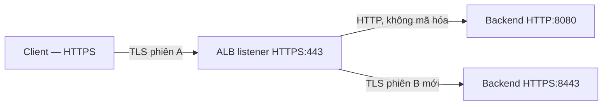
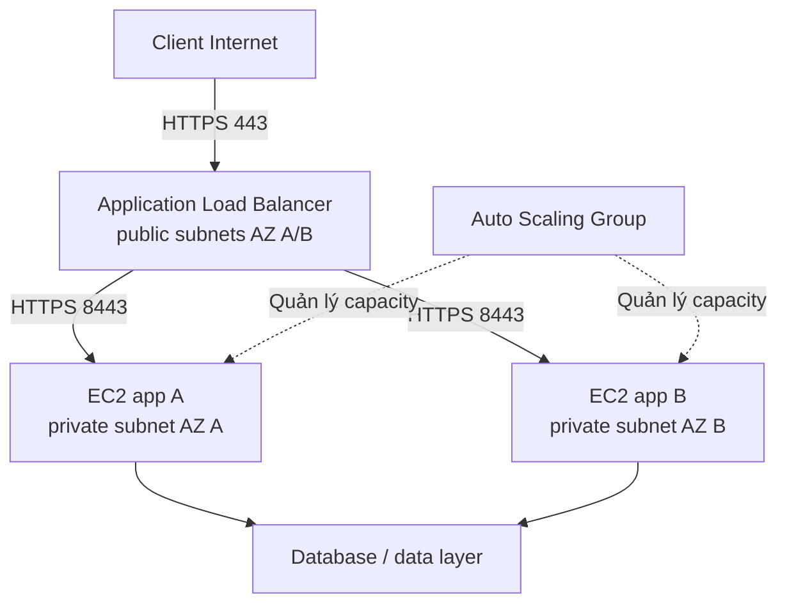

# TLS termination và kết nối HTTPS đến backend

Khi người dùng truy cập `https://api.example.com`, ứng dụng có thể được triển khai trên nhiều EC2 instances ở các Availability Zone khác nhau. Một **Application Load Balancer (ALB)** nhận kết nối HTTPS, chọn target còn khỏe và chuyển yêu cầu đến ứng dụng. Nhưng có hai câu hỏi độc lập: **TLS kết thúc ở đâu?** Và **đường từ load balancer tới backend có được mã hóa không?**

Nếu ALB có listener `HTTPS:443` nhưng target group dùng `HTTP:8080`, đoạn **client → ALB** được mã hóa, còn đoạn **ALB → backend** là HTTP. Nếu target group dùng `HTTPS:8443`, ALB **giải mã rồi thiết lập một kết nối TLS mới** tới backend. Hai kết nối TLS có khóa, chứng chỉ, cấu hình giao thức và vòng đời riêng; đây thường được gọi là **TLS termination + re-encryption**.

Bài học thuộc chương **Cân bằng tải và mở rộng** của module **CLOUD_PROVIDERS_AWS**, kết nối AWS Region/AZ, IAM, VPC, EC2, Auto Scaling, container, lưu trữ/cơ sở dữ liệu và serverless. Người học sẽ biết chọn kiến trúc TLS phù hợp, bảo vệ đường truyền, xử lý lỗi và xây dựng dịch vụ có giám sát, khả năng phục hồi và kiểm soát chi phí.

## 1. Mục tiêu học tập

Sau bài học, bạn có thể:

1. Giải thích **TLS handshake**, chứng chỉ, **TLS termination**, **TLS re-encryption**, **TLS passthrough** và sự khác biệt giữa các mô hình.
2. Cấu hình về mặt kiến trúc **ALB HTTPS listener**, chứng chỉ trong **AWS Certificate Manager (ACM)**, **security policy** và target group `HTTPS`.
3. Phân biệt khả năng của **ALB** và **Network Load Balancer (NLB)** khi sử dụng TLS, HTTP routing và các chế độ mutual TLS.
4. Thiết kế **security group, subnet, certificate rotation, health checks, HTTP→HTTPS redirect** và các header chuyển tiếp an toàn.
5. Vận hành một ứng dụng Java/Spring Boot sau ALB với sơ đồ hai AZ, Auto Scaling, logging và theo dõi lỗi TLS.
6. Kiểm tra cấu hình bằng `curl`, `openssl` và AWS CLI chỉ đọc, đồng thời chẩn đoán `502`, `503`, `504`, lỗi chứng chỉ và target unhealthy.
7. Đánh giá **trade-off** về chi phí, hiệu năng, khả năng kiểm toán và yêu cầu tuân thủ.

## 2. TLS hoạt động ở những lớp nào?

**TLS (Transport Layer Security)** bảo vệ dữ liệu đang truyền bằng cơ chế thỏa thuận khóa, mã hóa và kiểm tra tính toàn vẹn. HTTPS là **HTTP chạy trên TLS**.

Đối với kết nối `https://api.example.com`, client thường:

1. Tra DNS để lấy địa chỉ đích.
2. Kết nối đến load balancer theo giao thức truyền tải phù hợp.
3. Thực hiện **TLS handshake**, trong đó client và server thống nhất phiên bản TLS/cipher phù hợp; server trình chứng chỉ X.509.
4. Client **kiểm tra chứng chỉ** dựa trên hostname, chuỗi tin cậy/CA, thời hạn và chính sách của client.
5. Sau khi bắt tay thành công, HTTP request/response được bảo vệ trong phiên TLS.

TLS giúp bảo vệ kết nối nhưng **không tự chứng minh** người dùng có quyền gọi API. Xác thực người dùng (OAuth/OIDC, session, API token, mTLS client certificate…) và phân quyền nghiệp vụ vẫn là trách nhiệm khác.

### 2.1. Những thuật ngữ cần phân biệt

| Thuật ngữ | Ý nghĩa | Ví dụ trong AWS |
|---|---|---|
| **TLS termination** | Endpoint nhận kết nối TLS, hoàn tất handshake và giải mã dữ liệu | ALB listener `HTTPS:443` hoặc NLB listener `TLS:443` |
| **TLS offloading** | Chuyển phần xử lý TLS từ backend lên load balancer | Java service nhận HTTP sau ALB |
| **TLS re-encryption** | Thiết lập TLS thứ hai từ load balancer đến backend | ALB `HTTPS:443 → target HTTPS:8443` |
| **TLS passthrough** | Load balancer chuyển tiếp byte TLS mà không giải mã payload ứng dụng | NLB listener `TCP:443 → TCP target` |
| **Certificate** | Thông tin định danh khóa công khai được CA hoặc chủ hệ thống ký | Chứng chỉ ACM cho `api.example.com` |
| **SNI** | TLS extension giúp client chỉ hostname mong muốn để phía nhận chọn chứng chỉ | Nhiều hostname dùng một ALB HTTPS listener |
| **Security policy** | Bộ phiên bản TLS/cipher được load balancer cho phép | `ELBSecurityPolicy-TLS13-1-2-2021-06` |
| **mTLS** | Hai phía xác thực chứng chỉ trong handshake TLS theo mô hình hỗ trợ | ALB mTLS verify với trust store cho client |

### 2.2. TLS được duy trì ở đâu?



Trong cả hai hướng, **ALB đã giải mã request của client** để áp dụng route theo hostname/path, redirect, điều kiện listener và các khả năng HTTP khác. Ở hướng HTTPS tới backend, dữ liệu được **mã hóa lại** trên một phiên TLS mới; **không phải phiên TLS đầu tiên được chuyển nguyên vẹn** đến backend.

## 3. Ba kiến trúc truyền lưu lượng phổ biến

| Kiến trúc | Listener | Target group | TLS kết thúc ở đâu? | Khi nên chọn |
|---|---|---|---|---|
| **A. TLS termination tại ALB** | ALB `HTTPS:443` | `HTTP:8080` | ALB | Backend nội bộ được phép dùng HTTP theo yêu cầu bảo mật/tuân thủ |
| **B. Termination + re-encryption** | ALB `HTTPS:443` | `HTTPS:8443` | Tại ALB và một lần nữa ở backend | Muốn mã hóa cả đoạn ALB → ứng dụng, theo ranh giới tin cậy đã được đánh giá |
| **C. TLS passthrough** | NLB `TCP:443` | `TCP:443` | Chỉ backend | Ứng dụng phải trực tiếp kiểm soát phiên TLS client, ví dụ giao thức/identity ở tầng TLS |

### 3.1. Kiến trúc A: chỉ mã hóa client → ALB

```text
Client                         ALB                        EC2
  └──────── HTTPS/TLS ────────► [443] ───── HTTP ────────► [8080]
             mã hóa            giải mã           không mã hóa
```

Ưu điểm: backend ít phải quản lý chứng chỉ, TLS handshake và sự cố CA; dễ triển khai/scale Java service. Đánh đổi: lưu lượng nội bộ ALB → backend **không được mã hóa ở lớp TLS**, phải được chấp nhận bởi threat model và yêu cầu tuân thủ. VPC, security group và mạng AWS tạo ra ranh giới bảo vệ, nhưng **không nên gọi đường HTTP nội bộ là “mã hóa end-to-end”**.

### 3.2. Kiến trúc B: re-encrypt đến backend

```text
Client                      ALB                          EC2
  └──── TLS phiên 1 ────────► [443] ──── TLS phiên 2 ────► [8443]
       certificate public    decrypt   certificate backend   decrypt
```

Ưu điểm: payload được mã hóa khi truyền trên **cả hai chặng**; có thể đáp ứng các quy định yêu cầu mã hóa in transit trong mạng nội bộ.

Đánh đổi: cần quản lý TLS/cert trên backend, kiểm tra cipher/protocol tương thích, theo dõi health check và tối ưu chi phí CPU. **ALB không xác thực danh tính chứng chỉ của target** như trình duyệt làm với website công cộng. Vì vậy, mô hình này cung cấp **mã hóa ALB → target** nhưng không tự bảo đảm **xác thực bằng CA/hostname ở chặng backend**. Nếu chính sách yêu cầu xác thực hai chiều chặt chẽ giữa các service, cần thêm giải pháp mTLS/service-to-service identity phù hợp.

### 3.3. Kiến trúc C: TLS passthrough

```text
Client                      NLB TCP                        Backend
  └──────── TLS bytes ─────► [443] ─────────────────────► [443]
                            không giải mã              TLS termination
```

NLB `TCP` chuyển lưu lượng kết nối mà không nhìn thấy HTTP request đã giải mã. Backend trực tiếp sở hữu server certificate và có thể thực thi một số cơ chế TLS client authentication của mình. Đổi lại, **NLB TCP passthrough không cung cấp ALB-style path/host-based HTTP routing** từ payload được mã hóa.

**Lưu ý phân biệt:** NLB `TLS listener` **có terminate TLS**. NLB `TLS listener → TLS target group` là hai phiên TLS; `TCP listener → TCP target` mới là ví dụ TLS passthrough.

Nguồn: [ALB listeners](https://docs.aws.amazon.com/elasticloadbalancing/latest/application/load-balancer-listeners.html), [NLB listeners](https://docs.aws.amazon.com/elasticloadbalancing/latest/network/load-balancer-listeners.html).

## 4. Application Load Balancer HTTPS listener

**Listener** là cấu hình nhận kết nối với **protocol/port** và áp dụng các **actions/rules**. Đối với ALB, listener hỗ trợ HTTP và HTTPS.

Để nhận HTTPS công cộng ở cổng 443, thường cần:

- Một **ALB internet-facing** nếu client truy cập Internet; hoặc **internal ALB** nếu chỉ nhận lưu lượng private.
- Subnets ở **ít nhất hai Availability Zone** theo kiến trúc triển khai ALB và yêu cầu availability.
- Security group cho phép **TCP 443** từ nguồn client hợp lệ.
- **Chứng chỉ server** hợp lệ cho hostname dịch vụ, thường quản lý bằng **AWS Certificate Manager (ACM)**.
- Một **TLS security policy** phù hợp với phiên bản TLS/cipher của client.
- **Default action** hoặc listener rules chuyển yêu cầu tới target group/redirect/fixed response hay chức năng hỗ trợ tương ứng.
- DNS record, ví dụ Route 53 Alias tới DNS name của ALB.

### 4.1. Chứng chỉ ACM và tên miền

Giả sử DNS `api.example.com` trỏ tới ALB:

1. Tạo hoặc import chứng chỉ cho `api.example.com` (hoặc SAN/wildcard phù hợp) trong **cùng Region với ALB**.
2. Nếu cấp chứng chỉ public qua ACM, xác minh quyền sở hữu domain bằng phương thức được hỗ trợ, thường là DNS validation.
3. Gắn certificate ARN vào HTTPS listener `443`.
4. Tạo DNS record tới ALB.
5. Kiểm tra client thấy chứng chỉ khớp hostname, còn hạn và được tin cậy.

**Không dùng DNS mặc định dạng `*.elb.amazonaws.com` làm tên kiểm thử chứng chỉ public của domain riêng**: certificate `api.example.com` không khớp hostname DNS mặc định của load balancer. Dùng `curl --resolve` hoặc `--connect-to` để kiểm tra đúng **SNI/Host** mà vẫn kết nối ALB mong muốn.

ACM có thể hỗ trợ gia hạn tự động đối với **chứng chỉ do ACM cấp và đáp ứng điều kiện quản lý/gia hạn**. **Chứng chỉ import** cần được chủ sở hữu gia hạn/cập nhật theo quy trình. Chứng chỉ cài trực tiếp trên backend thường có cơ chế vận hành riêng; không suy ra ACM tự cài hoặc gia hạn nó.

### 4.2. SNI và nhiều certificate

Nếu ALB phục vụ `api.example.com` và `admin.example.com` trên cùng listener `443`, có thể gắn default certificate và các chứng chỉ bổ sung vào **certificate list**. Client hiện đại gửi hostname qua **SNI**, ALB chọn chứng chỉ phù hợp theo cấu hình và thuật toán hỗ trợ.

Tình huống dễ gây nhầm:

- DNS record đúng ALB nhưng certificate không chứa hostname → lỗi xác thực tên.
- Client quá cũ không hỗ trợ SNI → có thể nhận default certificate.
- Certificate đã hết hạn hoặc chưa hoàn tất ACM validation → TLS không đạt yêu cầu.
- Certificate cho frontend **không đồng nghĩa** certificate tự động được cài trên EC2 backend.

### 4.3. TLS security policy là quyết định bảo mật

Security policy quy định các phiên bản TLS/cipher có thể thỏa thuận. Các lựa chọn phổ biến có TLS 1.2/1.3; danh sách còn có FIPS, Post-Quantum TLS và các bộ chính sách phục vụ yêu cầu chuẩn cụ thể. **Không chọn security policy chỉ theo chữ “latest”**, mà cân đối khả năng tương thích client, yêu cầu tuân thủ và mức bảo vệ.

Ví dụ một tên policy công khai:

```text
ELBSecurityPolicy-TLS13-1-2-2021-06
```

Đây là **ví dụ**, không phải khẳng định là mặc định trong mọi cách tạo listener. Theo tài liệu AWS hiện hành, default policy **có thể khác nhau giữa Console và CLI/CloudFormation/CDK**; do đó ở production phải **chọn rõ policy** trong IaC và đọc lại listener sau khi triển khai.

Đặc biệt, **TLS policy của kết nối ALB → backend không được chọn độc lập giống frontend policy**. AWS tự chọn backend policy dựa trên nhóm policy đang được dùng bởi các HTTPS listeners: các nhóm TLS 1.3, FIPS, Post-Quantum và RFC 9151 có lựa chọn khác nhau. Nếu backend không hỗ trợ cipher/protocol phù hợp, bắt tay TLS với target có thể thất bại.

Nguồn: [Security policies for ALB](https://docs.aws.amazon.com/elasticloadbalancing/latest/application/describe-ssl-policies.html).

## 5. Tạo HTTPS target group cho backend

**Target group** chỉ định protocol, port, target type, health check và các tham số routing khác. ALB hỗ trợ **HTTP hoặc HTTPS target group**.

### 5.1. Ví dụ cấu hình

| Thuộc tính | Giá trị minh họa | Ý nghĩa |
|---|---|---|
| ALB listener | `HTTPS:443` | Nhận traffic TLS từ người dùng |
| Listener certificate | ACM cert cho `api.example.com` | Trình certificate cho client |
| Security policy | TLS 1.2/1.3 phù hợp | Thương lượng TLS client ↔ ALB |
| Target group | Protocol `HTTPS` | Dùng TLS trên chặng ALB → target |
| Target port | `8443` | Java app/reverse proxy lắng nghe TLS |
| Target type | `instance` hoặc `ip` | EC2 instance hoặc IP tương ứng |
| Health check | `HTTPS:8443 /actuator/health/readiness` | Kiểm tra endpoint backend có phục vụ được |
| Matcher | `200` | Mã HTTP thành công kỳ vọng, tùy app |
| Target SG | Chỉ cho `TCP 8443` từ ALB SG | Giới hạn nguồn đến backend |

**Tên/đường dẫn readiness chỉ là ví dụ:** ứng dụng Spring Boot cần Actuator và cấu hình endpoint tương ứng. Nếu ứng dụng cung cấp `/healthz`, dùng đường dẫn thật.

### 5.2. Backend phải có TLS server certificate

Target `HTTPS:8443` phải thực sự lắng nghe TLS: có chứng chỉ server, private key, phiên bản TLS/cipher tương thích. Nếu Java app chỉ mở HTTP `8080` mà target group gửi HTTPS `8443`, handshake không thể thành công.

Chứng chỉ trên backend có thể được cấp bởi CA nội bộ, tự ký hoặc theo hệ thống PKI của tổ chức. **Theo tài liệu ALB, load balancer không xác thực chứng chỉ target**, nên AWS chấp nhận cả chứng chỉ tự ký hoặc đã hết hạn ở chặng này. Tuy nhiên:

- Không xem đó là xác thực server bằng CA/hostname.
- Vẫn nên **quản lý ngày hết hạn, thay khóa và quyền truy cập private key** theo chính sách riêng; một số thành phần khác có thể cần validate certificate.
- Hạn chế chặng backend trong VPC, route, security group và tài khoản được kiểm soát.
- Nếu backend ở mạng không nằm trong cùng phạm vi bảo vệ của AWS VPC, đánh giá yêu cầu xác thực và bảo vệ bổ sung.
- Kiểm tra hiệu lực TLS thực tế bằng thử kết nối và log, không suy ra từ tên target group.

Nguồn: [Target groups for ALB](https://docs.aws.amazon.com/elasticloadbalancing/latest/application/load-balancer-target-groups.html).

### 5.3. Nâng từ HTTP target sang HTTPS target

Giả sử hệ thống đang là:

```text
ALB HTTPS:443 → TG HTTP:8080 → Spring Boot
```

Kế hoạch chuyển thành:

```text
ALB HTTPS:443 → TG HTTPS:8443 → Spring Boot
```

Không chỉ sửa trường protocol trên target group. Thông thường bạn cần:

1. Chuẩn bị backend TLS listener tại `8443`, certificate/key và cấu hình Java/reverse proxy.
2. Cho phép ALB SG tới target SG `8443`; kiểm tra NACL/route.
3. Tạo **target group HTTPS mới** hoặc thay cấu hình qua cơ chế triển khai được AWS hỗ trợ; một số thuộc tính protocol của target group không thể đổi trực tiếp.
4. Đăng ký targets, cấu hình HTTPS health check, chờ targets thành **healthy**.
5. Cập nhật ALB listener rule trỏ sang TG mới, dùng rollout từng bước nếu có nhiều nhóm targets.
6. Theo dõi 5xx, latency, TLS handshake, health check và khả năng rollback.
7. Gỡ target group/port cũ sau khi vượt qua cửa sổ quan sát và hoàn tất chuyển đổi.

## 6. Health checks và vì sao target HTTPS có thể unhealthy

Health check **khác với request thực tế**. ALB định kỳ gửi kiểm tra tới target theo protocol/port/path/matcher được cấu hình. Target chỉ được nhận lưu lượng theo cơ chế health check khi hệ thống đánh giá đủ điều kiện, ngoại trừ hành vi **fail-open** trong những tình huống nhất định khi toàn bộ target đều unhealthy.

### 6.1. Một health check HTTPS cần gì?

Ví dụ:

```text
Protocol: HTTPS
Port: traffic-port (8443)
Path: /actuator/health/readiness
Matcher: 200
Interval: theo chính sách
Timeout: theo latency thực tế
Healthy/unhealthy thresholds: theo yêu cầu vận hành
```

Backend phải trả đúng status trong thời hạn cho phép. Phản hồi `301`/`302` có thể làm health check **không khớp matcher `200`** dù ứng dụng phục vụ nội dung bình thường.

### 6.2. Header Host của health check

Một lỗi phổ biến là backend chỉ chấp nhận hostname `api.example.com`. Theo hướng dẫn ALB, với target `10.0.12.34` và health check port `8443`, health check có thể mang:

```text
Host: 10.0.12.34:8443
User-Agent: ELB-HealthChecker/2.0
```

Nếu reverse proxy/Java app yêu cầu `Host: api.example.com` cho mọi request, health check có thể bị từ chối. Hãy cấu hình **default virtual host** hoặc endpoint health check nhận request đúng hình thức AWS gửi tới. Không giải quyết bằng cách tắt mọi kiểm tra HTTP Host trên toàn ứng dụng khi không cần.

Với HTTPS health check, ALB thiết lập TLS tới target theo bộ giao thức được hỗ trợ. Cần xác minh backend có ciphers/protocol tương thích và cấu hình TLS không buộc đặc tính mà ALB không cung cấp trên chặng này.

Nguồn: [ALB target health checks](https://docs.aws.amazon.com/elasticloadbalancing/latest/application/target-group-health-checks.html), [ALB troubleshooting](https://docs.aws.amazon.com/elasticloadbalancing/latest/application/load-balancer-troubleshooting.html).

### 6.3. Checklist khi `unhealthy`

| Triệu chứng | Nguyên nhân có thể | Hướng xác minh |
|---|---|---|
| `Target.Timeout` | SG/NACL/route chặn, app không phản hồi, TLS timeout | Thử TCP/TLS giữa host trong VPC và target, kiểm tra flow logs |
| `Target.FailedHealthChecks` | Handshake lỗi, kết nối đóng sớm, backend không phục vụ | Xem app/proxy logs, TLS versions/ciphers, certificate/key |
| `Target.ResponseCodeMismatch` | Trả `302`, `401`, `403` hoặc `404` khác matcher | Kiểm tra health path, Host header, authentication/redirect |
| `Target.NotInUse` | Target group không được listener dùng hoặc AZ chưa được bật | Kiểm tra listener rule và enabled AZ |
| `Target.InvalidState` | EC2 đã stop/terminate hoặc trạng thái không hợp lệ | Xem lifecycle ASG/EC2 |
| `Target.DeregistrationInProgress` | Target đang drain connection | Kiểm tra deploy, deregistration delay |

## 7. Chuyển HTTP thành HTTPS cho người dùng

Cách thường dùng:

- **Listener HTTP:80**: chỉ **redirect** sang `HTTPS:443`, giữ hostname/path/query theo cấu hình phù hợp.
- **Listener HTTPS:443**: kiểm tra certificate và forward tới target group.
- Chính sách bảo mật tại biên và ứng dụng quyết định **HSTS**, cookies và các redirect nội bộ.

### 7.1. Redirect tại ALB, tránh vòng lặp

Ví dụ client truy cập:

```text
http://api.example.com/orders?id=123
```

ALB trả redirect sang:

```text
https://api.example.com/orders?id=123
```

Chọn mã chuyển hướng phù hợp ngữ nghĩa ứng dụng; ví dụ **HTTP_301** thường dùng cho URL canonical cố định, **HTTP_302** tạm thời. Với POST/PUT, phải chú ý method/body khi client xử lý 301/302; không mặc định mọi client giữ nguyên HTTP method.

**Nguyên nhân redirect loop hay gặp:**

1. Client truy cập HTTPS vào ALB.
2. ALB giải mã rồi forward qua HTTP backend.
3. Backend chỉ nhìn thấy kết nối nội bộ HTTP, nghĩ client chưa dùng HTTPS.
4. Backend redirect sang HTTPS.
5. Client yêu cầu lại HTTPS; vòng lặp tiếp diễn.

**Cách xử lý:** backend nhận biết **giao thức phía client** qua header có nguồn tin cậy (ví dụ `X-Forwarded-Proto` do ALB đặt), hoặc để ALB đảm nhiệm redirect phía public và cấu hình reverse proxy awareness đúng cách.

### 7.2. Các header chuyển tiếp quan trọng

| Header | Mục đích | Điểm phải kiểm tra |
|---|---|---|
| `X-Forwarded-Proto` | Giao thức client → ALB, ví dụ `https` | Chỉ tin header từ ingress proxy đã xác thực/được kiểm soát |
| `X-Forwarded-Port` | Port mà client kết nối tới ALB | Dùng khi xây dựng redirect/canonical URL |
| `X-Forwarded-For` | Chuỗi thông tin IP client/proxy | Đừng lấy tùy tiện phần tử đầu nếu client có thể gửi header giả |
| `Host` | Tên host HTTP do client yêu cầu | Routing, virtual host, CORS và canonical URL |
| `X-Amzn-Trace-Id` | Hỗ trợ theo dõi request trong môi trường AWS | Không thay distributed tracing đầy đủ |

AWS ALB có khả năng xử lý/điều chỉnh `X-Forwarded-For` theo chế độ cấu hình. Một số header có thể đã tồn tại trong request từ client; ứng dụng nên **chỉ chấp nhận proxy headers khi request đến từ load balancer/trusted proxy**, cấu hình lớp mạng để người ngoài không thể truy cập thẳng backend và giả mạo thông tin này.

### 7.3. HTTPS ở phía client không đồng nghĩa ứng dụng biết HTTPS

Nếu backend Java chạy HTTP, cần cấu hình nhận forwarded headers đúng, tránh:

- API sinh `Location: http://...` thay vì `https://...`.
- Session cookie thiếu `Secure` trên bối cảnh HTTPS.
- Callback OAuth/OIDC sai scheme hoặc redirect URI.
- CORS/origin kiểm tra sai host hoặc protocol.
- Nhiều redirect `http ↔ https`.

Nguồn: [X-Forwarded headers and ALB](https://docs.aws.amazon.com/elasticloadbalancing/latest/application/x-forwarded-headers.html).

## 8. Spring Boot Java ở phía backend

Spring Boot có thể chạy sau ALB theo hai mô hình chính:

- **Mô hình HTTP nội bộ**: ALB terminate HTTPS; Spring Boot mở `8080`, đọc `X-Forwarded-Proto` theo chính sách trusted proxy.
- **Mô hình HTTPS nội bộ**: ALB terminate HTTPS rồi re-encrypt tới `8443`; Spring Boot (hoặc Envoy/Nginx sidecar) quản lý TLS certificate/key ở backend.

### 8.1. Mẫu HTTPS backend với Spring Boot

Ví dụ ứng dụng dùng Spring Boot phiên bản hỗ trợ cấu hình SSL qua các thuộc tính thích hợp:

```yaml
server:
  port: 8443
  ssl:
    enabled: true
    key-store: file:/etc/app/tls/keystore.p12
    key-store-type: PKCS12
    key-store-password: "${APP_KEYSTORE_PASSWORD}"
    key-alias: app-backend

management:
  endpoint:
    health:
      probes:
        enabled: true
  endpoints:
    web:
      exposure:
        include: health,info
```

**Ý nghĩa:** ứng dụng mở HTTPS `8443` và dùng certificate/private key được đóng gói trong PKCS#12 keystore. `APP_KEYSTORE_PASSWORD` phải đến từ cơ chế quản lý bí mật, không commit giá trị thật vào repository. Cú pháp placeholder phụ thuộc cách Spring nạp cấu hình; khi áp dụng thật cần kiểm tra việc đọc biến môi trường của phiên bản Spring Boot đang dùng.

Đoạn cấu hình **chưa tự tạo certificate/keystore**. Bạn cần cấp certificate phù hợp, đặt file an toàn, phân quyền đọc private key, có cơ chế rotation và kiểm tra restart không làm mất kết nối quá lâu.

**Lưu ý:** Spring Boot thường có các endpoint health theo `/actuator/health` hoặc `/actuator/health/readiness` nếu probes được bật; endpoint thực tế còn phụ thuộc dependency Actuator và cấu hình exposure/path. Kiểm tra HTTP status trả về đúng matcher của target group.

### 8.2. Nếu backend là HTTP nhưng bên ngoài HTTPS

Ví dụ cấu hình tham khảo:

```yaml
server:
  port: 8080
  forward-headers-strategy: native
```

Cấu hình này giúp Spring Boot sử dụng thông tin forwarded headers qua hạ tầng servlet/container theo khả năng hỗ trợ. Ở từng phiên bản/framework, `framework` có thể phù hợp hơn; phải test redirect, HTTPS awareness và client IP thực tế.

**Giới hạn tin cậy:** chỉ bật xử lý forwarded headers ở ingress có kiểm soát, cho phép SG app nhận traffic từ ALB, tránh lộ `8080` ra Internet. Không coi việc đọc `X-Forwarded-Proto` do request bất kỳ gửi vào là bằng chứng TLS đã được bảo vệ.

### 8.3. Lựa chọn proxy TLS riêng trong instance/container

Nếu app không nên quản lý keystore, có thể dùng **Nginx/Envoy** ở phía backend để kết thúc TLS `8443` rồi chuyển HTTP vào Java process loopback/sidecar. Cách này tách PKI khỏi ứng dụng nhưng bổ sung quy trình vận hành reverse proxy, cấu hình headers, health checks và chứng chỉ.

Dù chọn Spring TLS trực tiếp hay proxy, hãy giám sát:

- TLS handshake và lỗi certificate/private key.
- CPU và latency khi bật TLS.
- Tỷ lệ kết nối/pool, keep-alive và draining.
- Readiness check trong lúc rollout/restart.
- Chế độ mất key/certificate sau deploy/scale-out.

## 9. Security group, subnet và nguyên tắc least privilege

Ví dụ kiến trúc **ALB internet-facing + EC2 private subnet**, nhiều AZ:



### 9.1. Quy tắc mạng tham khảo

| Thành phần | Inbound | Outbound | Lưu ý |
|---|---|---|---|
| **ALB SG** | TCP 443 từ IP hợp lệ; TCP 80 nếu dùng redirect | TCP 8443 đến target SG (hoặc 8080 nếu HTTP target) | Hạn chế nguồn truy cập theo nhu cầu; SG là stateful |
| **EC2 app SG** | TCP 8443 **chỉ từ ALB SG** | DB/endpoint/service cần thiết | Không mở 8443 cho `0.0.0.0/0` |
| **DB SG** | Port DB từ app SG | Theo yêu cầu kết nối | TLS tới DB là quyết định độc lập |
| **Network ACL** | Rule cho chiều vào/ra và ephemeral ports khi dùng custom ACL | Rule phản hồi phù hợp | NACL stateless, nên khác SG |
| **Route tables** | Theo subnet/VPC | Theo data path | ALB tới EC2 trong VPC thường không cần NAT |

**Quan trọng:** không bắt buộc EC2 backend có public IP. Internet-facing ALB có thể nhận kết nối công cộng trong public subnets, còn backend ở private subnets. NAT gateway hoặc VPC endpoint có thể phục vụ **egress cho EC2**, chứ không phải điều kiện để ALB forward tới backend private cùng VPC.

### 9.2. Chặng TLS vẫn cần kiểm soát nguồn và đích

Kết nối có TLS nhưng security group mở quá rộng vẫn tạo bề mặt tấn công. Ngược lại, SG chặn cổng `8443` làm target unhealthy dù certificate hoàn toàn hợp lệ. Thiết kế cần đồng thời đúng về **mạng, danh tính, mã hóa và quyền**.

Nếu ALB đặt trong VPC trung tâm, backend ở VPC khác qua peering/Transit Gateway hoặc target IP hỗ trợ, cần xét **routing liên VPC, target type, network policy, CIDR và bảo vệ lưu lượng qua ranh giới khác nhau**. Không ngoại suy cam kết bảo vệ của kết nối trong cùng VPC cho đường đi ra ngoài AWS.

## 10. Khi nào dùng Network Load Balancer?

ALB chuyên xử lý HTTP/HTTPS ở tầng ứng dụng; NLB chuyên phân phối lưu lượng ở tầng kết nối/truyền tải. Tùy tính năng và phiên bản AWS, NLB hỗ trợ nhiều protocol/target type.

### 10.1. Các tổ hợp TLS thường gặp của NLB

| Listener NLB | Target group | Dữ liệu tới target | Trường hợp |
|---|---|---|---|
| **TLS:443** | **TCP:8080/443** | NLB giải mã TLS, gửi TCP payload đã giải mã | TLS offload cho TCP service |
| **TLS:443** | **TLS:8443** | NLB giải mã frontend và lập TLS session mới đến target | TLS termination + re-encryption |
| **TCP:443** | **TCP:443** | Chuyển tiếp byte TLS đã mã hóa tới target | TLS passthrough, backend giữ quyền điều khiển handshake |

NLB TLS target group sử dụng certificate trên target nhưng, theo tài liệu AWS, **NLB không xác thực certificate của target**. TLS kết nối NLB → backend có security policy do AWS chọn dựa trên listener, giống nguyên tắc không cấu hình độc lập mọi tham số backend như trên ALB.

**Không dùng NLB chỉ vì cần HTTPS backend.** Nếu workload cần host/path-based routing, HTTP redirect và nhiều HTTP-oriented features, **ALB HTTPS target group** thường là lựa chọn phù hợp hơn.

### 10.2. mTLS và nhầm lẫn về chữ “passthrough”

**mTLS ở phía client** là việc client cũng trình certificate và phía server xác minh nó:

- **ALB mTLS verify**: ALB xác thực chứng chỉ client dựa trên trust store được cấu hình.
- **ALB mTLS passthrough mode**: ALB **vẫn terminate TLS frontend**, chỉ **chuyển chuỗi chứng chỉ client tới backend qua HTTP headers**; backend chịu trách nhiệm xác minh. Đây **không phải TLS byte passthrough**.
- **NLB TLS listener mTLS verify**: theo tài liệu NLB hiện hành, NLB hỗ trợ **xác thực chứng chỉ client ở verify mode** tại listener. Không suy ra có mTLS passthrough mode giống ALB.
- **NLB TCP passthrough**: backend trực tiếp nhận TLS handshake từ client; nếu backend yêu cầu và xác minh client certificate thì đó là mTLS do **backend thực hiện**.

**mTLS client → load balancer không có nghĩa tự động có mTLS ALB/NLB → backend.** Phía backend là một chặng kết nối riêng với cơ chế chứng thực khác; ALB/NLB TLS target group không đảm nhiệm certificate validation của target như client PKI nghiêm ngặt.

Nguồn: [ALB mutual TLS](https://docs.aws.amazon.com/elasticloadbalancing/latest/application/mutual-authentication.html), [NLB mutual TLS](https://docs.aws.amazon.com/elasticloadbalancing/latest/network/mutual-authentication.html), [NLB target groups](https://docs.aws.amazon.com/elasticloadbalancing/latest/network/load-balancer-target-groups.html).

## 11. Thiết kế chứng chỉ và quản lý vòng đời

Một hệ thống an toàn không dừng ở việc “đã có ổ khóa trên trình duyệt”. Cần có **hai chiến lược certificate** nếu mã hóa tới backend.

### 11.1. Chứng chỉ frontend

- Phát hành hoặc import vào ACM trong Region của ALB/NLB.
- Chọn DNS/SAN phù hợp tên client truy cập.
- Gắn certificate vào listener HTTPS/TLS.
- Theo dõi trạng thái gia hạn/expiration, domain validation và thay đổi certificate list.
- Kiểm tra tất cả client quan trọng hỗ trợ policy/cipher đã chọn.
- Quản lý quyền IAM sửa listener/certificate theo least privilege.

### 11.2. Chứng chỉ backend

- Cấp bởi PKI nội bộ hoặc cơ chế quản lý secret/certificate phù hợp.
- Cài an toàn trên EC2/container, hạn chế quyền đọc private key.
- Có thời hạn, định kỳ thay/rotate trước ngày hết hạn.
- Tự động hóa cập nhật đồng loạt cho fleet/ASG, rollback khi cấu hình không hợp lệ.
- Ghi nhận fingerprint/serial, loại khóa, algorithm, nơi certificate được dùng.
- Nếu có consumer khác **thực sự validate CA/hostname**, certificate phải đáp ứng yêu cầu của consumer đó.

Để xác thực danh tính target bằng cryptographic trust (mTLS/backend PKI verification) trong yêu cầu tuân thủ nghiêm ngặt, cần thêm các thành phần/trạm kiểm soát hỗ trợ xác minh target, ví dụ service mesh/sidecar proxy với trusted CA, thiết kế mạng và application-level identity. **Không dựa vào việc ALB HTTPS target group chấp nhận self-signed cert để khẳng định đã đáp ứng mTLS end-to-end.**

### 11.3. Đừng nhầm chứng chỉ với khóa mã hóa dữ liệu lưu trữ

TLS certificate phục vụ **mã hóa trong quá trình truyền**. EBS/S3/RDS encryption, AWS KMS và cơ chế backup liên quan tới **mã hóa khi lưu trữ**. Dù backend được gọi bằng HTTPS, dữ liệu vẫn cần cơ chế bảo vệ at-rest, quyền IAM/KMS và chính sách lưu trữ theo dữ liệu nghiệp vụ.

## 12. Kiểm tra HTTPS từ phía client

Dùng các lệnh sau với **domain/tài khoản kiểm thử thuộc quyền quản lý**. Chúng chỉ tạo HTTP/TLS requests, không thay đổi tài nguyên AWS.

### 12.1. Kiểm tra certificate và TLS

```bash
# Xem redirect HTTP sang HTTPS
curl -I http://api.example.com/health

# Kiểm tra chi tiết handshake và response của endpoint HTTPS
curl -v https://api.example.com/health

# Kiểm tra thương lượng TLS 1.2 nếu endpoint cho phép
openssl s_client -connect api.example.com:443 \
  -servername api.example.com -tls1_2 </dev/null

# Kiểm tra thương lượng TLS 1.3 nếu endpoint cho phép
openssl s_client -connect api.example.com:443 \
  -servername api.example.com -tls1_3 </dev/null
```

`openssl s_client` có thể trình certificate chain và thông tin thương lượng. Muốn **xác minh** certificate theo hostname/CA, phải dùng tùy chọn kiểm tra phù hợp của phiên bản OpenSSL hoặc dùng `curl` với kiểm tra certificate mặc định. Không xem “CONNECTED” là bằng chứng chứng chỉ hợp lệ.

### 12.2. Test khi cần giữ nguyên SNI/Host

Khi đang chuyển DNS, có thể kiểm tra ALB qua một IP **được biết trước từ DNS của ALB** và hostname cần dùng:

```bash
# Dùng IP ví dụ (thay bằng IP của ALB ở thời điểm test)
curl --resolve api.example.com:443:203.0.113.10 \
  https://api.example.com/health
```

`203.0.113.10` là địa chỉ tài liệu minh họa, không phải IP AWS thật. Với ALB, IP node có thể thay đổi và nhiều AZ có nhiều địa chỉ; **không hardcode IP ALB** vào cấu hình production.

### 12.3. Phân biệt lỗi frontend và backend

- **TLS handshake bị từ chối trước khi có HTTP response**: ưu tiên kiểm tra domain/SNI, frontend certificate, TLS policy, client và network.
- **HTTPS frontend thành công nhưng nhận HTTP 502**: kiểm tra ALB → backend, TLS handshake với target, target đóng kết nối hoặc response HTTP không hợp lệ.
- **HTTPS frontend thành công nhưng nhận HTTP 503**: kiểm tra target group có targets được đăng ký/healthy và listener routing.
- **HTTPS frontend thành công nhưng 504**: kiểm tra timeout của kết nối/response và độ chậm backend.
- **Redirect vòng lặp**: kiểm tra HTTP listener, backend `X-Forwarded-Proto` và cấu hình Spring/reverse proxy.

## 13. AWS CLI kiểm tra cấu hình (chỉ đọc)

Các lệnh dưới đây cần một AWS CLI profile có quyền đọc `elasticloadbalancing:Describe*` và các quyền liên quan. Thay Region/ARN/ID theo môi trường thật.

```bash
# Kiểm tra ALB được tạo và scheme của nó
aws elbv2 describe-load-balancers \
  --region ap-southeast-1 \
  --profile learning \
  --query "LoadBalancers[].{Name:LoadBalancerName,Type:Type,Scheme:Scheme,DNS:DNSName}"

# Xem listener, protocol, port và security policy
aws elbv2 describe-listeners \
  --load-balancer-arn arn:aws:elasticloadbalancing:ap-southeast-1:111111111111:loadbalancer/app/example/abcdef0123456789 \
  --region ap-southeast-1 \
  --profile learning

# Kiểm tra target groups và traffic port
aws elbv2 describe-target-groups \
  --region ap-southeast-1 \
  --profile learning \
  --query "TargetGroups[].{Name:TargetGroupName,Protocol:Protocol,Port:Port,Health:HealthCheckProtocol}"

# Kiểm tra health state và reason code
aws elbv2 describe-target-health \
  --target-group-arn arn:aws:elasticloadbalancing:ap-southeast-1:111111111111:targetgroup/example/0123456789abcdef \
  --region ap-southeast-1 \
  --profile learning

# Liệt kê tên security policies có sẵn
aws elbv2 describe-ssl-policies \
  --region ap-southeast-1 \
  --profile learning \
  --query "SslPolicies[].Name"
```

Các ARN `111111111111` trong ví dụ không đại diện tài khoản thật. Tài nguyên ALB/target group nằm trong Region; ARN phải dùng đúng Region. Không tạo hoặc sửa listener/certificate bằng những lệnh đọc này.

Để kiểm tra một certificate frontend do ACM quản lý:

```bash
aws acm describe-certificate \
  --certificate-arn arn:aws:acm:ap-southeast-1:111111111111:certificate/00000000-0000-4000-8000-000000000000 \
  --region ap-southeast-1 \
  --profile learning \
  --query "Certificate.{Domain:DomainName,Status:Status,NotAfter:NotAfter,InUseBy:InUseBy}"
```

Kiểm tra `NotAfter` giúp theo dõi certificate frontend, nhưng **không thay** giám sát rotation backend certificate tự quản.

## 14. Logging và metric giám sát TLS

### 14.1. ALB access logs, connection logs và CloudWatch

| Tín hiệu | Giúp trả lời | Lưu ý |
|---|---|---|
| **ALB access logs** | Request, target, response codes, processing time, một số thông tin TLS của client | Bật và cấu hình đích S3/retention/quyền tương ứng |
| **ALB connection logs** | Phiên TLS phía client đã thương lượng protocol/cipher/key exchange ra sao | Hữu ích khi thay security policy hoặc client TLS |
| **CloudWatch `HTTPCode_ELB_5XX_Count`** | ALB tự phát sinh bao nhiêu 5xx | Phân biệt với lỗi do backend trả |
| **`HTTPCode_Target_5XX_Count`** | Backend trả bao nhiêu 5xx | Lỗi ứng dụng/DB có thể làm tăng |
| **`TargetConnectionErrorCount`** | Có lỗi khi load balancer kết nối targets không | Xem network/port/TLS/app lifecycle |
| **`HealthyHostCount / UnHealthyHostCount`** | Số targets khỏe/bệnh theo TG/AZ | Quan trọng khi canary hoặc thay cert backend |
| **`TargetResponseTime`** | Thời gian đáp ứng phía target theo metric | Phân tích hiệu năng, không dùng thay p95/p99 end-user |
| **VPC Flow Logs** | Có flows giữa ALB/target bị từ chối theo mạng không | Không ghi plaintext HTTP/TLS payload |
| **CloudTrail** | Ai thay đổi listener/cert/TG/security policy | Management-plane audit, không phải traffic logs |

Metric tên và dimension có thể khác giữa ALB/NLB; hãy kiểm tra namespace và tài liệu CloudWatch trước khi viết alarm. Cân nhắc privacy, lưu trữ log, quyền truy cập và chi phí trên S3/CloudWatch.

### 14.2. Những cảnh báo hữu ích

- `HealthyHostCount` về 0 ở một hoặc nhiều AZ.
- `HTTPCode_ELB_5XX_Count` tăng sau deploy/restart TLS backend.
- `TargetConnectionErrorCount` tăng khi rotate chứng chỉ hoặc đổi security policy.
- `TargetResponseTime` p95 vượt ngưỡng nghiệp vụ.
- Certificate frontend sắp hết hạn hoặc mất khả năng tự gia hạn.
- Backend logs báo TLS handshake errors hoặc key/certificate load failures.
- Lưu lượng/LCU ALB tăng bất thường, ảnh hưởng ngân sách.

**Không dựa vào một health check xanh để khẳng định cả chuỗi ứng dụng an toàn**: health endpoint có thể trả 200 trong khi database, external dependencies hay certificate rotation chưa được kiểm tra.

## 15. Hiệu năng và chi phí của TLS termination

### 15.1. Những chi phí cần cân nhắc

- **ALB/NLB**: phí theo giờ hoạt động và đơn vị năng lực sử dụng tương ứng (LCU/NLCU theo bảng giá/dòng sản phẩm).
- **EC2/ECS/EKS**: CPU và RAM xử lý handshake/mã hóa backend nếu re-encrypt.
- **Network/data transfer**: dữ liệu giữa AZ/Region hoặc qua NAT/Internet theo topology.
- **Certificates/PKI**: ACM public/private, CA nội bộ, secret/rotation và hoạt động quản trị theo mô hình dùng.
- **Observability**: S3/CloudWatch log storage, metrics và truy vấn log.
- **Availability**: capacity giữ dự phòng ở nhiều AZ, thời gian fleet x86/ARM hoặc HTTP/HTTPS chạy song song khi đổi kiến trúc.

### 15.2. Không suy ra “HTTPS tới backend luôn đắt hơn rất nhiều”

Chi phí TLS phụ thuộc vào phiên TLS mới, keep-alive, connection reuse, CPU type, traffic và thuật toán mã hóa. Với workload có IO/DB bottleneck, chi phí crypto có thể nhỏ so với thành phần khác; với số lượng short-lived connections rất lớn, handshake/CPU có thể trở thành yếu tố đáng kể.

Cách kiểm chứng:

1. Ghi baseline **frontend HTTPS → backend HTTP** trong điều kiện tải thật.
2. Dựng thử **frontend HTTPS → backend HTTPS** với cùng app, network và instance.
3. Đo request/s, p95/p99, CPU, memory, target errors, handshake failures, connection reuse và chi phí.
4. Đo trong các tình huống peak traffic, rolling deploy và lỗi một AZ.
5. Đánh giá thêm yêu cầu bảo mật/tuân thủ; không chọn HTTP chỉ vì phép đo chi phí thấp hơn khi chính sách yêu cầu encryption in transit.

### 15.3. Mã hóa và khả năng mở rộng là các mục tiêu liên kết

Khi ASG thêm EC2 target mới, hệ thống phải đồng thời:

- Đảm bảo **certificate/backend TLS** tồn tại và hợp lệ về cấu hình trên instance.
- Đảm bảo SG cho phép ALB kết nối `8443`.
- Hoàn thành startup, readiness health check trước khi nhận traffic.
- Quản lý connection draining/deregistration delay khi scale-in.
- Giữ tối thiểu healthy capacity theo AZ và ngân sách yêu cầu.

Một Launch Template quên cài keystore có thể làm **mọi target mới unhealthy**, khiến autoscaling không cải thiện được sẵn sàng.

## 16. Kiến trúc ví dụ: Java API phục vụ nhiều AZ

**Bài toán:** một doanh nghiệp vận hành Java REST API trên EC2 Auto Scaling trong hai AZ. Người dùng Internet phải dùng HTTPS. Chính sách nội bộ yêu cầu mã hóa cả ALB → EC2. Database được truy cập từ private subnet và có kế hoạch backup riêng.

### 16.1. Sơ đồ thiết kế

```text
Route 53 record api.example.com
        │
        ▼
ALB internet-facing — public subnets, AZ A/B
  Listener HTTP:80  → redirect HTTPS:443
  Listener HTTPS:443
    - ACM certificate api.example.com
    - TLS security policy được chọn rõ
    - Rule forward tới TG java-api-https
        │
        ├── TLS phiên B → EC2 private AZ A, HTTPS:8443
        │                  Spring Boot + keystore
        │                  readiness endpoint
        └── TLS phiên B → EC2 private AZ B, HTTPS:8443
                           Spring Boot + keystore
                           readiness endpoint

EC2 IAM role → S3 / Secrets Manager / CloudWatch (theo quyền)
EC2 SG      → Database SG trên port nghiệp vụ phù hợp
ASG         → scale-out/in và duy trì healthy capacity
```

### 16.2. Ma trận lựa chọn

| Yêu cầu | Lựa chọn thiết kế | Cần xác minh |
|---|---|---|
| Client HTTPS | ALB HTTPS `443` + ACM | SNI/hostname, certificate, policy |
| Ngăn HTTP công khai | ALB HTTP `80` redirect `443` | Không redirect loop; method semantics |
| TLS đến backend | Target group `HTTPS:8443` | Cài cert, protocol/cipher, SG |
| HA | ALB và ASG nhiều AZ | Healthy targets mỗi AZ, capacity và health checks |
| IAM | EC2 instance profile least privilege | Secrets/cert và quyền CloudWatch |
| Quan sát | Access/connection logs, CloudWatch alarms | Lỗi ALB vs target, chi phí log |
| Database | Private network, auth và TLS DB theo policy | Không suy ra ALB TLS tự bảo vệ chặng DB |
| DR | Sao lưu database, thử restore, RTO/RPO | Không nhầm multi-AZ với backup |

### 16.3. Quy trình rollout

1. Đảm bảo backend nhận HTTPS `8443` và test bằng `curl/openssl` trong môi trường nội bộ.
2. Tạo **TG HTTPS mới**, đăng ký targets từ ASG hoặc phương án phù hợp, kiểm tra `HealthyHostCount`.
3. Cập nhật listener rule sang TG mới bằng cơ chế thay đổi đã được phê duyệt; có thể triển khai canary khi cần.
4. Quan sát response 5xx, TLS errors, p95/p99, CPU và health ở hai AZ.
5. Thử scale-out: instance mới có chứng chỉ/secret/cấu hình và trở thành healthy.
6. Kiểm tra rollback route/TG cũ, rồi chuyển lưu lượng đầy đủ sau khi đạt SLO.
7. Loại bỏ target group/cấu hình cũ theo quy trình; cập nhật IaC và tài liệu vận hành.

## 17. Chẩn đoán các lỗi thường gặp

### 17.1. Trình duyệt báo certificate không hợp lệ

**Dấu hiệu:** `NET::ERR_CERT_COMMON_NAME_INVALID`, `CERT_DATE_INVALID` hoặc `curl: (60) SSL certificate problem`.

**Thử từng lớp:**

- Kiểm tra DNS hostname client thực sự truy cập.
- Dùng `openssl s_client -servername api.example.com` để xem certificate.
- Xác minh ACM certificate bao gồm SAN/hostname, đã issued và gắn listener.
- Kiểm tra khách hàng có đang gọi DNS mặc định của ALB thay hostname custom không.
- Xem TLS security policy, client TLS support và thời gian hệ thống.

Nếu lỗi xảy ra **trước HTTP**, thường chưa cần debug backend target group.

### 17.2. `502 Bad Gateway` sau khi đổi target group sang HTTPS

**Giả thuyết:**

- Backend `8443` chưa mở hoặc đang phục vụ HTTP thay vì TLS.
- Backend certificate/private key sai định dạng hoặc service startup không thành công.
- Backend chỉ hỗ trợ protocol/cipher không tương thích với backend TLS policy của ALB.
- SG/NACL/route chặn ALB → backend.
- Backend đóng kết nối bất thường, trả response không hợp lệ.

**Cách kiểm tra:** xác nhận `TargetConnectionErrorCount`, target health reason, Java/proxy logs, TLS handshake trên instance và backend SSL policy. Đừng lập tức thay frontend cert: **client → ALB đã bắt tay thành công** nếu ALB trả HTTP 502.

### 17.3. `503 Service Unavailable`

Ưu tiên xem target group có targets đăng ký/available hay không, health check và listener rule forward đúng TG chưa. Xác minh AZ được bật và instance/ASG thực tế đang chạy. Cần phân biệt ALB-generated 503 với response 503 do backend tạo.

### 17.4. `504 Gateway Timeout`

Có thể do kết nối/response của target không hoàn tất trong thời gian yêu cầu. Xem SG/NACL/route, ứng dụng/DB queries, keep-alive, request timeout và logs theo trace ID. Việc tăng timeout có thể che đi bottleneck, không phải lúc nào cũng là biện pháp đúng.

### 17.5. TLS backend hoạt động nhưng health check thất bại

Phổ biến nhất:

- Health path yêu cầu authentication.
- Backend trả `302` sang trang đăng nhập hoặc HTTPS redirect sai cổng.
- Virtual host chỉ chấp nhận `api.example.com`, trong khi health check dùng Host là IP target.
- Matcher chỉ `200` nhưng endpoint trả `204` hoặc giá trị khác.
- Cổng health check khác traffic port hoặc backend chỉ hỗ trợ TLS configuration khác.
- Backend chậm trong lúc JVM warm-up, migration database hoặc ứng dụng đang shutting down.

Chọn health check **đủ phản ánh readiness nhưng không tạo phụ thuộc dễ làm toàn fleet unhealthy**. Nếu cần liveness và readiness, tách chức năng theo app/framework.

### 17.6. Mã hóa đúng nhưng header/client IP bị giả mạo

Vấn đề có thể nằm ở khả năng bypass ALB và gửi request trực tiếp đến app, hoặc app dùng `X-Forwarded-For` không có kiểm soát. Khóa backend SG để chỉ nhận từ ALB/nguồn tin cậy, dùng công cụ proxy-header parsing chuẩn của framework và xác định chuỗi trust proxies rõ ràng.

## 18. Bài thực hành

### Bài A — Phân tích ba đường truyền

Cho các cấu hình:

| Phương án | Listener | Target group | TLS ở chặng nào? |
|---|---|---|---|
| 1 | ALB HTTPS:443 | HTTP:8080 | Client → ALB |
| 2 | ALB HTTPS:443 | HTTPS:8443 | Client → ALB và ALB → target, hai phiên riêng |
| 3 | NLB TCP:443 | TCP:443 | Client → backend qua NLB passthrough |

**Câu hỏi:** phương án nào cho phép ALB route theo HTTP path mà vẫn mã hóa chặng ALB → target?

**Đáp án:** **Phương án 2**. Backend `8443` cần TLS server certificate và cấu hình tương thích. ALB có thể đọc HTTP request sau termination, áp dụng route và mã hóa lại.

### Bài B — Phân biệt mã hóa và xác thực backend

Một nhóm dùng ALB `HTTPS:443 → target HTTPS:8443`; target sử dụng self-signed certificate và ALB forward request thành công.

**Câu hỏi:** có thể khẳng định “ALB đã xác thực CA và hostname của EC2” không?

**Đáp án:** **Không.** Theo tài liệu AWS, ALB **không validate certificate của target**. Chặng backend có TLS encryption; nếu cần cryptographic target identity verification theo CA/hostname/mTLS, phải bổ sung giải pháp tương ứng và chứng minh đáp ứng chính sách.

### Bài C — Chẩn đoán redirect loop Spring Boot

Sau khi chuyển vào ALB, client vào `https://api.example.com` luôn nhận 301 về chính URL đó.

**Gợi ý giải thích:** ALB terminate HTTPS và forward HTTP, backend nghĩ request không bảo mật rồi tự redirect. Kiểm tra redirect listener, `X-Forwarded-Proto`, cấu hình trusted proxy headers của Spring Boot và quyền truy cập trực tiếp backend.

### Bài D — Giải thích unhealthy target

Backend EC2 trả `200` khi gọi `https://10.0.12.34:8443/actuator/health/readiness` từ một host nội bộ với Host tùy chỉnh; nhưng ALB báo `Target.ResponseCodeMismatch`.

**Yêu cầu:** nêu hai nguyên nhân có thể.

**Gợi ý:** (1) request health check từ ALB dùng **Host: 10.0.12.34:8443** và bị virtual host chặn/redirect; (2) health check path/port hoặc matcher khác lệnh test. Kiểm tra status code thật trong backend logs và target health details.

### Bài E — Sự cố trong đợt Auto Scaling

Fleet có hai EC2 old healthy. ASG scale từ hai lên sáu instances, nhưng bốn máy mới unhealthy.

**Gợi ý điều tra:** kiểm tra AMI/launch template đã cài đúng JDK, certificate/keystore, secret IAM, SG `8443`, Java readiness và health check thresholds chưa. Tránh tăng min size liên tục khi mọi instance mới đều thiếu cấu hình backend TLS.

### Bài F — Chọn giải pháp cho yêu cầu chứng chỉ client

Doanh nghiệp yêu cầu client dùng certificate do CA nội bộ cấp, và backend Java phải xử lý path routing.

- **ALB mTLS verify:** ALB kiểm tra client certificate, rồi route HTTP theo path; backend có thể dùng các header được AWS cung cấp theo cấu hình và logic nghiệp vụ.
- **ALB mTLS passthrough mode:** ALB terminate TLS, chuyển certificate chain đến backend bằng headers để backend tự xác minh.
- **NLB TCP passthrough:** backend trực tiếp kiểm tra TLS/mTLS, nhưng NLB không route theo HTTP path.
- **NLB TLS mTLS verify:** khả năng mTLS tại NLB cho traffic phù hợp, nhưng không có HTTP path rules như ALB.

**Yêu cầu:** chọn phương án theo nơi cần kiểm tra certificate, nhu cầu HTTP routing và yêu cầu ai phải nắm trực tiếp TLS session. Nêu ranh giới tin cậy của headers/PKI.

## 19. Câu hỏi ôn tập

1. TLS termination là gì?
2. `HTTPS listener → HTTP target` có phải HTTPS end-to-end không?
3. `HTTPS listener → HTTPS target` sử dụng một hay hai TLS sessions?
4. Khi dùng ALB HTTPS target group, ALB có validate certificate hostname/CA của target không?
5. Certificate ACM cho frontend tự động được cài lên EC2 backend không?
6. Tại sao security policy frontend có thể ảnh hưởng khả năng bắt tay TLS ở backend?
7. Nếu NLB TCP listener `443` chuyển byte TLS tới target, TLS được giải mã ở đâu?
8. Khác biệt giữa ALB mTLS passthrough và NLB TCP TLS passthrough?
9. Vì sao backend HTTP sau ALB đôi khi sinh redirect loop?
10. ALB health check thường dùng Host header thế nào?
11. Vì sao target healthy không có nghĩa hệ thống đạt SLO?
12. Security group có cần thiết khi backend có HTTPS không?
13. Dùng một AZ cho toàn bộ backend có rủi ro gì?
14. `TargetConnectionErrorCount` tăng sau deploy certificate có thể báo điều gì?
15. Làm sao chứng minh chi phí re-encryption hợp lý trong sản xuất?

**Đáp án ngắn:** (1) hoàn tất TLS tại thành phần nhận và giải mã; (2) không; (3) hai TLS sessions riêng; (4) không; (5) không; (6) AWS chọn backend policy theo policy frontend; (7) backend; (8) ALB vẫn giải mã TLS và chuyển thông tin certificate bằng header, NLB TCP không giải mã; (9) app thấy HTTP nội bộ; (10) thường là IP target và port health check khi không phải cổng mặc định; (11) thiếu số đo latency/errors và dependency; (12) có, TLS không thay least privilege; (13) điểm lỗi AZ; (14) sai protocol/cipher/key/port hoặc network; (15) benchmark tải thật theo SLO + TCO.

## 20. Checklist triển khai production

- [ ] Có sơ đồ rõ **client TLS**, **backend TLS** và vùng tin cậy tại ALB/NLB.
- [ ] Chọn ALB/NLB và chế độ termination/re-encryption/passthrough theo yêu cầu.
- [ ] DNS record và frontend certificate khớp hostname; certificate được giám sát/gia hạn.
- [ ] HTTPS listener `443` có security policy được chọn rõ trong IaC.
- [ ] HTTP listener `80` redirect sang HTTPS nếu phù hợp.
- [ ] Backend HTTPS `8443` có keystore/key, protocol/cipher và rotation được kiểm chứng.
- [ ] Không tuyên bố ALB/NLB tự validate certificate backend khi tài liệu nói không.
- [ ] Target group HTTPS và health check trỏ đúng port/path/matcher.
- [ ] Backend health check xử lý đúng Host header của ALB và không bị auth/redirect.
- [ ] ALB SG chỉ mở cổng cần thiết; target SG chỉ nhận từ ALB/nguồn tin cậy.
- [ ] X-Forwarded headers được xử lý trong trusted proxy boundary; tránh redirect loop/IP spoofing.
- [ ] Mô hình nhiều AZ, ASG capacity và connection draining được kiểm tra.
- [ ] Canary/rollback có tiêu chí dừng bằng 5xx, TLS errors, p95/p99 và healthy targets.
- [ ] Logging/metrics/alarms cho frontend TLS, target connections và application SLO hoạt động.
- [ ] IAM, KMS, DB TLS và encryption at rest được đánh giá độc lập.
- [ ] Certificate rotation và scale-out đã được thử trên instance mới.
- [ ] Chi phí ALB/NLB, compute, log, CA/PKI và dữ liệu truyền đã được tính.
- [ ] Có chủ sở hữu, runbook sự cố và quy trình review policy/certificates định kỳ.

## 21. Tổng kết

**TLS termination** tại ALB cho phép load balancer giải mã HTTPS và áp dụng HTTP routing trước khi forward. Nếu target group dùng **HTTP**, chặng backend không có TLS. Nếu target group dùng **HTTPS**, ALB tạo **phiên TLS thứ hai** để re-encrypt dữ liệu; việc này bảo vệ tính bí mật/toàn vẹn trên chặng truyền nhưng **không đồng nghĩa ALB xác thực CA/hostname của target**.

**NLB TCP passthrough** phù hợp khi backend phải trực tiếp sở hữu handshake TLS; **NLB TLS listener** lại terminate TLS và có thể re-encrypt tới TLS target group. Client mTLS, identity của backend và mã hóa mỗi chặng là những yêu cầu cần mô tả riêng.

Thiết kế production cần kết hợp **ACM, security policy, listener/target group, health checks, VPC/security groups, forwarding headers, Auto Scaling, logging và quản lý chi phí**. Với Java workload, đừng quên đồng bộ chứng chỉ/keystore và readiness của mọi instance mới để kiến trúc HTTPS vẫn sẵn sàng khi tăng tải hoặc mất một AZ.

### Tài liệu AWS và Spring chính thức

1. [Application Load Balancer listeners](https://docs.aws.amazon.com/elasticloadbalancing/latest/application/load-balancer-listeners.html)
2. [Create an HTTPS listener for your ALB](https://docs.aws.amazon.com/elasticloadbalancing/latest/application/create-https-listener.html)
3. [ALB TLS security policies](https://docs.aws.amazon.com/elasticloadbalancing/latest/application/describe-ssl-policies.html)
4. [Target groups for ALB](https://docs.aws.amazon.com/elasticloadbalancing/latest/application/load-balancer-target-groups.html)
5. [Health checks for ALB target groups](https://docs.aws.amazon.com/elasticloadbalancing/latest/application/target-group-health-checks.html)
6. [Troubleshoot your Application Load Balancer](https://docs.aws.amazon.com/elasticloadbalancing/latest/application/load-balancer-troubleshooting.html)
7. [X-Forwarded headers and ALB](https://docs.aws.amazon.com/elasticloadbalancing/latest/application/x-forwarded-headers.html)
8. [Mutual authentication with TLS in ALB](https://docs.aws.amazon.com/elasticloadbalancing/latest/application/mutual-authentication.html)
9. [NLB listeners and TLS passthrough](https://docs.aws.amazon.com/elasticloadbalancing/latest/network/load-balancer-listeners.html)
10. [NLB TLS target groups](https://docs.aws.amazon.com/elasticloadbalancing/latest/network/load-balancer-target-groups.html)
11. [NLB mutual authentication](https://docs.aws.amazon.com/elasticloadbalancing/latest/network/mutual-authentication.html)
12. [AWS Certificate Manager](https://docs.aws.amazon.com/acm/latest/userguide/acm-overview.html)
13. [ELB pricing](https://aws.amazon.com/elasticloadbalancing/pricing/)
14. [Spring Boot SSL documentation](https://docs.spring.io/spring-boot/reference/features/ssl.html)
