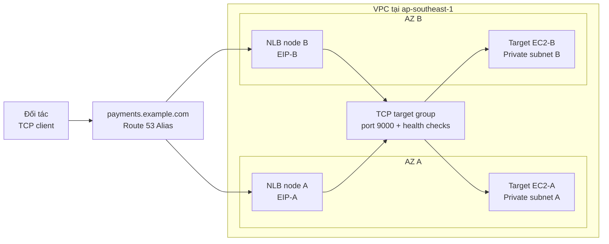
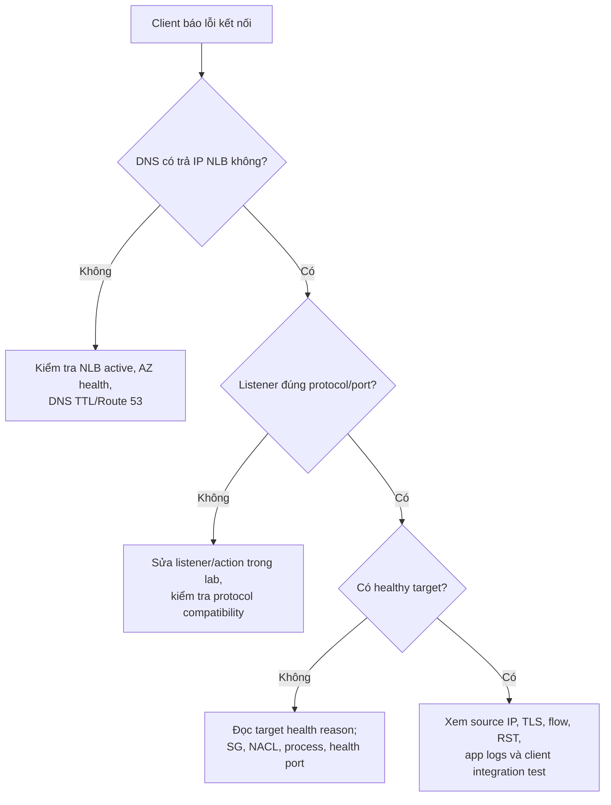

# NLB, địa chỉ IP cố định và lưu lượng tầng giao vận

## Mục tiêu học tập

Sau bài học, người học có thể:

1. Giải thích **Network Load Balancer (NLB)** thuộc Amazon Elastic Load Balancing, hoạt động chủ yếu ở **tầng 4 (transport)** và khác Application Load Balancer (ALB) thế nào.
2. Phân biệt **internet-facing** và **internal NLB**, hiểu cơ chế **địa chỉ IPv4 cố định theo Availability Zone (AZ)** qua Elastic IP (EIP) hoặc private IPv4.
3. Cấu hình và giải thích vai trò **listener**, **target group**, **target**, **health check**, **VPC subnet**, **Security Group (SG)** và **Network ACL (NACL)**.
4. Lựa chọn giao thức **TCP, TLS, UDP, TCP_UDP, QUIC, TCP_QUIC**, hiểu sự khác nhau giữa **TLS termination** và **TLS passthrough**.
5. Hiểu **client source IP preservation**, **Proxy Protocol v2**, phân phối kết nối, **cross-zone load balancing** và ảnh hưởng tới khả dụng đa AZ.
6. Dùng AWS CLI tạo một NLB TCP có hai địa chỉ EIP, đăng ký EC2, kiểm tra health, theo dõi CloudWatch và chẩn đoán các lỗi phổ biến.
7. Biết khi nào nên dùng NLB, ALB, AWS Global Accelerator hoặc **AWS PrivateLink**, đồng thời cân nhắc bảo mật, phục hồi và chi phí.

## 1. Vấn đề kiến trúc: dịch vụ cần địa chỉ ổn định và chịu tải lớn

Giả sử một hệ thống thanh toán nhận kết nối TCP từ đối tác qua cổng `9000`. Phía đối tác chỉ cho phép truy cập từ **một danh sách IP cố định**, không muốn cập nhật IP mỗi khi nhóm của bạn thay EC2 hoặc scale-out. Ứng dụng cần chạy trên ít nhất hai AZ để một lỗi host không làm toàn bộ dịch vụ ngừng hoạt động.

Nếu đối tác kết nối thẳng vào một EC2:

- IP/instance có thể thay đổi khi thay thế máy hoặc Auto Scaling tạo máy mới.
- Lỗi một instance có thể làm mất toàn bộ kết nối.
- Việc thêm máy mới đòi hỏi thay cấu hình hoặc xây dựng cơ chế điều phối kết nối riêng.

**Network Load Balancer (NLB)** cung cấp một đầu vào ở tầng giao vận để phân phối luồng tới nhiều target. Với **internet-facing NLB**, ta có thể chỉ định **một Elastic IP cho mỗi AZ được bật**. Đối tác đưa các IP này vào allowlist, trong khi phía sau NLB có thể thay EC2, container hay địa chỉ target mà không cần thay đổi EIP của những AZ vẫn được giữ.

NLB không tự quản lý ứng dụng, database, TLS certificate của mọi target hoặc bản phát hành. Nó là một phần của kiến trúc có VPC, EC2/containers, IAM, giám sát, backup, Auto Scaling và quy trình phục hồi.

> **Ý chính:** NLB duy trì đầu vào mạng ổn định cho các **luồng TCP/UDP/TLS/QUIC** và chọn target khỏe mạnh. Nó không giải quyết thay cho ứng dụng những vấn đề như xác thực người dùng, lưu session vào database hoặc phục hồi dữ liệu.

## 2. NLB là gì? Vì sao nói hoạt động ở tầng 4?

Trong mô hình OSI, **tầng 4** liên quan đến vận chuyển dữ liệu giữa các endpoint, ví dụ cổng TCP/UDP. NLB được thiết kế để xử lý các **kết nối và luồng dữ liệu (flows)** thay vì chủ yếu phân tích request HTTP theo đường dẫn, header hay cookie.

| Nhu cầu | NLB | ALB |
| --- | --- | --- |
| Định tuyến TCP/UDP ở tầng giao vận | **Phù hợp** | Không dùng cho UDP/tùy ý giao thức TCP. |
| TLS ở phía client | Listener `TLS` có thể terminate; `TCP` hỗ trợ passthrough. | Listener HTTPS có TLS termination và logic HTTP. |
| Cần static public IPv4 cụ thể tại các AZ | **EIP per enabled AZ** trên internet-facing NLB. | ALB không hỗ trợ gắn EIP trực tiếp. |
| Phân luồng theo `/api/orders`, hostname, HTTP header | Không phải tính năng routing ứng dụng cốt lõi của NLB. | **Phù hợp** với listener rules của ALB. |
| Theo dõi source IP ở backend | Có tùy target type/protocol; có Proxy Protocol v2. | Dùng header HTTP như `X-Forwarded-For` theo cơ chế ALB. |
| Tích hợp endpoint service của AWS PrivateLink | **Hỗ trợ** với NLB và cấu hình endpoint service phù hợp. | Có thể đặt ALB làm target **sau NLB** trong trường hợp cần cả hai. |
| Web/API cần WAF và routing HTTP chuyên sâu | Cân nhắc kết hợp NLB → ALB nếu cần IP cố định. | Thường là lựa chọn trực tiếp tốt hơn. |

NLB hiện hỗ trợ các giao thức listener **TCP, TLS, UDP, TCP_UDP, QUIC, TCP_QUIC**. Đây là phạm vi AWS đã mở rộng so với tài liệu cũ chỉ nêu TCP/UDP/TLS. Một số tính năng mới (QUIC, luật phân luồng IPv4/IPv6, weighted target groups) có điều kiện hỗ trợ riêng; xem tài liệu hiện hành trước khi triển khai.

### Đơn vị phân phối là luồng, không phải từng HTTP request

Với TCP, NLB chọn target theo hàm băm dựa trên các thuộc tính luồng như protocol, IP nguồn/đích, port nguồn/đích và TCP sequence number. **Một TCP connection** sẽ đi tới **một target** trong suốt vòng đời của kết nối đó; các connection mới từ cùng client có thể đến target khác.

Với UDP, NLB dùng thông tin 5-tuple của flow để phân phối nhất quán trong vòng đời flow. UDP không thiết lập kết nối bằng handshake như TCP; trạng thái flow và idle timeout vẫn quan trọng.

Hệ quả:

- Nếu một client mở một connection TCP kéo dài nhiều giờ, NLB **không chia từng gói của connection đó** sang các EC2 khác để “cân đều CPU”.
- Nếu ứng dụng có nhiều connection ngắn, NLB có nhiều cơ hội phân phối tải tới các target hơn.
- Khi một target lỗi, các kết nối đang đi qua nó **có thể bị reset/gián đoạn**; client nên có retry/reconnect và ứng dụng cần xử lý idempotency khi cần.

## 3. Những thành phần của Network Load Balancer

| Thành phần | Vai trò | Ví dụ |
| --- | --- | --- |
| **Load balancer** | Đầu mối nhận traffic, có DNS name và các node theo AZ. | `payments-tcp-nlb`. |
| **Scheme** | Xác định có nhận lưu lượng Internet hay chỉ trong mạng riêng. | `internet-facing` hoặc `internal`. |
| **IP address type** | Loại địa chỉ đầu vào. | `ipv4` hoặc `dualstack`. |
| **Enabled AZ/subnet** | Nơi đặt node NLB; một subnet trên mỗi AZ được chọn. | Public subnet ở AZ A và AZ B. |
| **Listener** | Chấp nhận giao thức/cổng từ client và chuyển theo action/rule. | `TCP:9000` → target group. |
| **Target group** | Tập hợp các target và chính sách health/routing. | `tcp-orders-tg`, TCP cổng `9000`. |
| **Target** | Endpoint thực sự xử lý lưu lượng. | EC2 instance ID, private IP hoặc một ALB theo tính năng hỗ trợ. |
| **Health check** | Đánh giá target có được xem là sẵn sàng nhận lưu lượng. | TCP:9000 hoặc HTTP:/ready trên cổng riêng. |
| **Security Group/NACL** | Kiểm soát đường đi được phép tới NLB/target. | Cho đối tác gửi TCP:9000; cho NLB tới EC2. |

### Luồng mạng minh họa



Sơ đồ biểu diễn ý tưởng chung. Khi **cross-zone load balancing tắt** (mặc định), node AZ A thường gửi traffic đến target khỏe mạnh ở AZ A, và node AZ B gửi tới target ở AZ B. Khi bật cross-zone, mỗi node có thể gửi tới target ở các AZ đã bật theo cấu hình.

## 4. Địa chỉ IP cố định: điểm khác biệt quan trọng

### 4.1. Internet-facing NLB: public IPv4/EIP theo AZ

Với internet-facing NLB, mỗi enabled AZ có một node và địa chỉ public IPv4 để client kết nối. Khi tạo NLB, bạn có thể:

1. Dùng AWS tự cấp một public IPv4/EIP cho từng AZ; hoặc
2. Chỉ định **Elastic IP Allocation ID** của mình cho từng AZ bằng **subnet mapping**.

Nếu đối tác bắt buộc **allowlist IP cố định do bạn quản lý**, nên chuẩn bị và gán EIP rõ ràng ngay lúc tạo. Ví dụ hai AZ có:

| AZ | Subnet dùng đặt NLB | Public EIP minh họa | Ý nghĩa |
| --- | --- | --- | --- |
| `ap-southeast-1a` | `subnet-public-a` | `203.0.113.10` | EIP A cho NLB node A. |
| `ap-southeast-1b` | `subnet-public-b` | `198.51.100.20` | EIP B cho NLB node B. |

Các IP trên thuộc dải **dành cho tài liệu**, không phải EIP thực của AWS. Mỗi enabled AZ cần **một EIP riêng**, không thể dùng một EIP làm đồng thời địa chỉ của hai node NLB trong hai AZ.

**Tính cố định có phạm vi:** EIP gắn với node/AZ tương ứng còn hiệu lực khi giữ cấu hình mapping; nhưng nếu bạn xóa NLB, bỏ AZ, đổi subnet mapping hoặc quản lý EIP sai, không có cam kết mọi client connection sẽ tiếp tục đến cùng endpoint. Không nên suy ra rằng danh sách IP là một điểm vào **duy nhất luôn khỏe** trong mọi sự cố.

### 4.2. Internal NLB: private IPv4 ổn định theo subnet

Internal NLB có IP riêng trong các subnet đã chọn. Khi tạo, bạn có thể để AWS chọn hoặc chỉ định **private IPv4 address** từ CIDR subnet cho từng AZ.

Ví dụ:

```text
VPC 10.40.0.0/16
AZ A: internal NLB node 10.40.1.10
AZ B: internal NLB node 10.40.2.10
Client: ứng dụng trong VPC, peered VPC, TGW, VPN hoặc Direct Connect
```

Internal NLB không tự trở thành public vì bạn biết private IP. Nó dùng đường mạng riêng được thiết kế; phải có route, DNS và chính sách bảo mật phù hợp từ client đến NLB.

### 4.3. IPv6 và dualstack

NLB hỗ trợ `ipv4` hoặc `dualstack`, tùy yêu cầu mạng, subnet và listener. Với **dualstack**, NLB có DNS record `A` cho IPv4 và `AAAA` cho IPv6. Có thể chỉ định địa chỉ IPv6 khi tạo theo subnet mapping trong trường hợp được hỗ trợ.

Đừng suy ra **EIP IPv4 là địa chỉ IPv6**: EIP là public IPv4, còn đường IPv6 cần VPC/subnet IPv6, routes, Security Group/NACL và cấu hình listener/target thích hợp. Một số tổ hợp UDP IPv6, QUIC, target group loại IPv4/IPv6 có hạn chế riêng.

### 4.4. Vẫn nên công bố DNS, dù có IP cố định

AWS cấp DNS name cho NLB, ví dụ:

```text
payments-tcp-nlb-0123456789abcdef.elb.ap-southeast-1.amazonaws.com
```

Bạn có thể tạo **Route 53 alias** như `payments.example.com` trỏ đến NLB. NLB DNS có thể trả các địa chỉ của những AZ đang phục vụ và **loại IP của AZ khỏi câu trả lời DNS** nếu AZ không còn target khỏe. TTL DNS thông thường của NLB là khoảng **60 giây**.

Vì vậy:

- Với hệ thống có thể dùng hostname, nên **kết nối bằng DNS name** và tôn trọng TTL, retry/reconnect.
- Với đối tác phải allowlist, cung cấp **toàn bộ EIP của các enabled AZ**, nhưng vẫn đề nghị client kết nối qua hostname.
- **Ghim duy nhất một EIP** tại client có thể khiến client tiếp tục truy cập AZ lỗi trong khi DNS NLB đã chuyển traffic khỏi AZ đó.

**EIP tĩnh giúp allowlist và tích hợp, không thay thế chiến lược HA/DNS failover.**

## 5. NLB chọn target như thế nào?

NLB xác định target group từ listener action/rules, sau đó phân phối các flow tới target **được đăng ký và khỏe mạnh** theo trạng thái và cấu hình AZ.

### Target types

| Target type | Cách đăng ký | Dùng khi |
| --- | --- | --- |
| `instance` | EC2 **Instance ID**. | Dịch vụ chạy trực tiếp trên EC2, thường tích hợp Auto Scaling. |
| `ip` | Địa chỉ IP và port phù hợp. | ECS task trong awsvpc, thiết bị/app có IP trong các mạng được hỗ trợ. |
| `alb` | Đăng ký một **Application Load Balancer** làm target, với hạn chế listener/port tương ứng. | Cần NLB cung cấp địa chỉ cố định/PrivateLink, còn ALB định tuyến HTTP/HTTPS ở tầng 7. |

Không phải mọi IP public tùy ý trên Internet đều có thể được đăng ký làm `ip` target. Cần tuân thủ phạm vi địa chỉ và đường kết nối được Elastic Load Balancing hỗ trợ. Khi tạo target group, **target type và IP address type không đổi được**; muốn đổi thường tạo target group mới và chuyển listener.

### Giao thức và port của listener/target group

| Listener | Target group được hỗ trợ (khái quát) | Cách dùng |
| --- | --- | --- |
| `TCP` | `TCP`, `TCP_UDP`, `TCP_QUIC`; với ALB target phải là `TCP`. | TCP application hoặc passthrough TLS/HTTPS như byte stream. |
| `TLS` | `TCP` hoặc `TLS`. | Terminate TLS tại NLB; backend dùng TCP hoặc tái mã hóa TLS. |
| `UDP` | `UDP` hoặc `TCP_UDP`. | DNS/game/telemetry dùng UDP. |
| `TCP_UDP` | `TCP_UDP`. | Cùng cổng cần cả TCP và UDP. |
| `QUIC` | `QUIC` hoặc `TCP_QUIC`. | QUIC pass-through cho backend hỗ trợ. |
| `TCP_QUIC` | `TCP_QUIC`. | Cùng cổng hỗ trợ TCP và QUIC khi điều kiện dịch vụ cho phép. |

NLB hỗ trợ **port 1–65535**. Một listener có thể có default action và các tính năng listener rules theo loại protocol/NLB, nhưng NLB **không kiểm tra HTTP path/host như ALB**. Các listener rules mới có thể phân luồng theo **phiên bản IP nguồn IPv4/IPv6** trên dualstack NLB, không phải bằng mọi điều kiện HTTP hoặc CIDR như ALB.

## 6. Health checks: target có thực sự phục vụ được không?

Target group của NLB dùng các health check hoạt động chủ động để xác định target có đủ điều kiện nhận traffic. Các giao thức health check chính là **TCP**, **HTTP**, **HTTPS**; health check không sử dụng UDP để kiểm tra trực tiếp UDP service.

Ví dụ cho một TCP server ở cổng `9000`:

| Check | Cách đánh giá | Rủi ro đánh giá sai |
| --- | --- | --- |
| **TCP:9000** | Thiết lập kết nối TCP tới port. | Port mở nhưng tiến trình có thể không xử lý message hợp lệ. |
| **HTTP:8080/ready** | Gọi endpoint HTTP phục vụ health. | Phải có HTTP health endpoint bên cạnh dịch vụ TCP/UDP. |
| **HTTPS:8443/ready** | HTTP qua TLS tới endpoint health. | Endpoint chỉ hỗ trợ TLS 1.3 có thể không tương thích với HTTPS health check của NLB. |

Đối với **UDP/QUIC backend**, có thể đặt một TCP/HTTP/HTTPS endpoint sức khỏe trên target để báo liệu dịch vụ UDP/QUIC có sẵn sàng hay không. TCP port sống không chứng minh UDP message xử lý thành công; ứng dụng nên tự cập nhật health endpoint theo trạng thái thực.

### Các trạng thái cần đọc

| Trạng thái | Ý nghĩa |
| --- | --- |
| `initial` | Target mới đăng ký, đang chờ kiểm tra ban đầu. |
| `healthy` | Các health checks đạt theo quy tắc. |
| `unhealthy` | Check thất bại hoặc target không khả dụng. |
| `draining` | Target đang được deregister và xử lý những connection còn lại. |
| `unused` | Target group chưa dùng bởi listener, target không thuộc AZ đang bật hoặc điều kiện khác chưa hợp lệ. |
| `unavailable` | Không thể xác định health do vấn đề bên phía load balancer. |

Mỗi target group có ngưỡng **healthy/unhealthy**, khoảng kiểm tra và timeout. Quá trình đánh giá được phân tán; số health requests thực tế một target nhận có thể **nhiều hơn** số dự đoán từ interval.

### DNS failover và fail-open

NLB thường đưa **IP của AZ không có đủ healthy targets** ra khỏi DNS để tránh traffic mới tới vùng đó. Đây là lý do DNS quan trọng ngay cả khi NLB có EIP tĩnh.

Nếu **tất cả targets đều unhealthy** trong tất cả AZ đang bật, NLB có thể **fail open** và tiếp tục chuyển traffic tới các targets dù check báo lỗi. Tương tự một target group rỗng có cơ chế fail-open. Vì vậy:

- Không dùng “còn DNS A record” làm bằng chứng mọi target đều khỏe.
- Không trông cậy NLB tự từ chối toàn bộ request để bảo vệ dữ liệu khi mọi backend lỗi.
- Theo dõi `HealthyHostCount`, `UnHealthyHostCount` và health reason codes; thiết kế ứng dụng chịu được lỗi/retry phù hợp.

## 7. Client IP preservation và Proxy Protocol v2

Đối tác có thể muốn server ghi log IP gốc của client hoặc giới hạn quyền truy cập theo địa chỉ. NLB có cơ chế **preserve client IP** tùy giao thức và target type.

| Tổ hợp target group | Mặc định preservation | Ghi chú |
| --- | --- | --- |
| `instance` target, TCP/TLS | **Bật**. | Server thường thấy IP nguồn client theo cơ chế hỗ trợ. |
| `ip` target, TCP/TLS | **Tắt**. | Server thường thấy private IP của node NLB, trừ khi bật thuộc tính và đáp ứng điều kiện. |
| `instance/ip` với UDP, TCP_UDP, QUIC, TCP_QUIC | **Bật và không tắt được** theo cơ chế tương ứng. | Đảm bảo Security Group/NACL và ứng dụng xử lý đúng nguồn. |

Bạn có thể cấu hình `preserve_client_ip.enabled` cho các TCP/TLS target group được hỗ trợ; có những giới hạn về vị trí IP target và mạng, đặc biệt target ở ngoài VPC/các mạng được hỗ trợ. Với dualstack, khi client và target **khác họ IP** (IPv4 ↔ IPv6), không thể hiểu là source IP luôn được giữ nguyên.

### Proxy Protocol v2

Khi backend cần biết IP/port client mà không thể nhận trực tiếp qua source IP, NLB hỗ trợ **Proxy Protocol v2** trong những trường hợp thích hợp. NLB chèn **header nhị phân** trước payload để backend có thể đọc thông tin nguồn/đích và metadata liên quan.

**Không tự bật `proxy_protocol_v2.enabled=true` nếu server không hiểu header này.** Một ứng dụng TCP mong đợi byte đầu tiên là message nghiệp vụ có thể đọc nhầm header và coi request bị lỗi.

Ví dụ target group attribute:

```bash
aws elbv2 modify-target-group-attributes \
  --target-group-arn "arn:aws:elasticloadbalancing:ap-southeast-1:111122223333:targetgroup/tcp-orders-tg/aaaaaaaaaaaaaaaa" \
  --attributes Key=proxy_protocol_v2.enabled,Value=true \
  --region ap-southeast-1
```

Lệnh thay đổi cấu hình thật, chỉ dùng khi backend đã hỗ trợ Proxy Protocol v2 và nhóm vận hành đã kiểm thử. Header cũng có thể xuất hiện ở các health-check connections, cần lưu ý khi xây dựng health endpoint.

### Vấn đề hairpinning

Nếu một instance vừa là **client của NLB** vừa được đăng ký làm **target của NLB**, và bật client IP preservation, việc NLB chọn quay về chính instance đó có thể tạo **NAT loopback/hairpin** không được hỗ trợ, dẫn tới timeout. Các lựa chọn khắc phục có điều kiện gồm thay topology hoặc tắt client IP preservation khi được phép rồi dùng Proxy Protocol v2.

## 8. TLS termination, passthrough và giao thức UDP/QUIC

### 8.1. TLS termination tại NLB

Tạo listener `TLS:443` và gắn certificate phù hợp từ **AWS Certificate Manager (ACM)** hoặc nguồn được hỗ trợ. NLB giải mã kết nối client tại listener, sau đó kết nối từ NLB đến target group có protocol:

- `TCP`: lưu lượng đoạn NLB → target ở dạng mà ứng dụng nhận theo TCP, không tự mã hóa lại.
- `TLS`: NLB thiết lập phiên TLS **mới** đến target, cần certificate trên target; hành vi xác minh certificate phía target theo quy định dịch vụ, không tương đương mTLS end-to-end do ứng dụng tự kiểm soát.

TLS termination giảm một số trách nhiệm certificate/handshake ở backend và có thể đáp ứng chính sách mã hóa frontend, nhưng cần đánh giá riêng yêu cầu mã hóa đoạn NLB → target, authentication và chuẩn bảo mật nội bộ.

### 8.2. TLS passthrough

Nếu backend phải tự xử lý TLS (ví dụ mTLS ở application hoặc cần đọc thông tin certificate trực tiếp), dùng **TCP listener cổng 443** tới **TCP target group cổng 443**. NLB chuyển tiếp luồng byte đã mã hóa, không đóng vai trò terminate TLS tại listener.

```text
Client -- TLS handshake / encrypted TCP --> NLB TCP:443 --> Backend TCP:443
                     NLB không giải mã TLS của ứng dụng
```

NLB không thể áp quy tắc HTTP host/path khi đang passthrough lưu lượng mã hóa. Nếu cần kiểm soát L7, cân nhắc ALB hoặc proxy chuyên biệt theo thiết kế.

### 8.3. UDP, TCP_UDP và QUIC

- `UDP` dùng cho ứng dụng cần datagram; thiết kế client retry, flow timeout và các đặc điểm mất gói tương ứng.
- `TCP_UDP` dùng khi cần cả TCP và UDP trên cùng port, chẳng hạn một dịch vụ kết hợp.
- `QUIC` và `TCP_QUIC` là các lựa chọn NLB mới, có **giới hạn kết hợp**: theo tài liệu hiện hành, QUIC/TCP_QUIC không dùng với **dualstack NLB hoặc NLB có Security Group gắn vào**, và có giới hạn số lượng listener/phối hợp UDP. Kiểm tra điều kiện mới nhất và target compatibility khi dùng.
- Listener QUIC hoạt động như **pass-through cho QUIC v1** và các backend phải hỗ trợ QUIC tương ứng; nó không biến dịch vụ TCP cũ thành QUIC.

Trong bài thực hành sau, ta chọn **TCP** để tập trung vào NLB IP cố định và flow ở tầng giao vận; QUIC là phương án cần thiết kế, thử tải và kiểm tra bảo mật riêng.

## 9. Sẵn sàng cao và cross-zone load balancing

Mỗi NLB bật ít nhất một AZ; production thường nên dùng **hai hoặc nhiều AZ** tương thích với workload. Với các target khỏe ở mỗi AZ, NLB có thể định tuyến phục vụ dù một node, một EC2 hoặc một AZ suy giảm.

### Cross-zone mặc định tắt

| Cấu hình | Node NLB AZ A chuyển traffic đến | Ưu điểm | Điểm cần chú ý |
| --- | --- | --- | --- |
| **Cross-zone OFF** (mặc định) | Healthy targets ở **AZ A**. | Dễ khoanh vùng, traffic nội AZ khi có target. | Phải có target khỏe trong **mỗi AZ đang phục vụ** để không rút IP khỏi DNS. |
| **Cross-zone ON** | Healthy targets ở **mọi AZ được bật**. | Chia sẻ năng lực, một AZ có thể phục vụ qua targets AZ khác. | Có thể tạo traffic liên AZ và phụ thuộc liên vùng; đánh giá giá dịch vụ/transfer và giới hạn target group. |

Cross-zone có thể được cấu hình trên NLB hoặc thuộc tính target group theo phạm vi hỗ trợ. Đừng nhầm **load balancer nhiều AZ** với **Auto Scaling group nhiều AZ**: NLB chỉ phân phối traffic, còn số lượng instance thay thế và lịch triển khai được quản lý bởi ASG hoặc công cụ khác.

### Không giả định mọi connection sống sót qua lỗi AZ

Một connection TCP gắn với target có thể gián đoạn khi target chết hoặc node/AZ bị loại khỏi DNS. DNS failover chủ yếu ảnh hưởng **kết nối mới**; connection đang hoạt động, ứng dụng không retry hoặc client cache IP quá lâu vẫn có thể lỗi.

AWS có hỗ trợ **zonal shift** với điều kiện và giới hạn tương ứng để chuyển traffic khỏi một AZ; đây là công cụ vận hành cần kiểm thử, không phải nút bấm bảo đảm khôi phục mọi connection.

### Deregistration delay và connection draining

Khi thay bản phát hành hoặc scale-in, nên cho NLB/target group **deregister target có kiểm soát**, xử lý connection còn lại trong thời gian `deregistration_delay.timeout_seconds` phù hợp. Với ứng dụng giữ kết nối lâu, cần cơ chế báo client reconnect hoặc chuyển session ở mức ứng dụng.

## 10. Bảo mật: NLB có Security Group, nhưng không phải WAF

Tài liệu cũ thường nói NLB không hỗ trợ SG. **Hiện tại NLB hỗ trợ Security Group**, với điều kiện quan trọng:

> **Nếu tạo NLB mà không gắn bất kỳ Security Group nào, bạn không thể gắn SG cho NLB đó về sau.** Nên chỉ định SG ngay lúc tạo nếu dự kiến cần kiểm soát bằng SG; sau đó có thể thay các SG đã gắn theo quy trình.

Thiết kế một cặp SG:

| Nơi gắn | Inbound | Outbound |
| --- | --- | --- |
| `sg-nlb` gắn với NLB | Cho phép TCP:9000 **từ IP/CIDR đối tác**. | Cho phép đi tới target:9000 và health-check port theo nhu cầu. |
| `sg-app` gắn với EC2 target | Cho phép TCP:9000 và health-check port **từ SG NLB**. | Chỉ mở theo nhu cầu của ứng dụng. |

Reference **SG NLB** trong inbound SG target là cách giúp target chỉ nhận traffic qua NLB, kể cả khi NLB preserve client IP (với kiểu cấu hình phù hợp).

Phân biệt:

- **Security Group** là stateful; đặt rule inbound/outbound theo lớp mạng và cổng.
- **Network ACL** là stateless ở subnet; phải cho phép cả gói đi và gói trả lời, gồm ephemeral ports thích hợp.
- **NLB là transport load balancer**; không cung cấp luật WAF/HTTP chuyên sâu như kiến trúc ALB + AWS WAF.
- **TLS/mTLS, IAM và xác thực nghiệp vụ** cần thiết kế riêng, phù hợp điểm terminate TLS.
- **Public IP allowlist** hạn chế nguồn kết nối ở tầng mạng nhưng không thay thế xác thực client, chống lạm dụng và audit.

### PrivateLink

Với dịch vụ SaaS/B2B cần cho account/VPC khác tiêu thụ dịch vụ qua mạng riêng, có thể tạo **VPC endpoint service** dựa trên NLB. Khách hàng tạo **interface endpoint** qua AWS PrivateLink, không cần công khai endpoint ứng dụng trên Internet theo mô hình này.

Ở đây **NLB backend vẫn cần có target khỏe**, endpoint policy/allowed principals, kết nối VPC/subnet và SG được cấu hình. PrivateLink không tự động trao quyền ứng dụng cho client; vẫn phải xác thực/ủy quyền nghiệp vụ.

## 11. Thực hành AWS CLI: NLB TCP với hai Elastic IP

Phần này là **bản thiết kế lệnh để thực hành trên môi trường riêng**. Các ID, ARN, EIP và CIDR đều **giả định**; chỉ chạy khi đã thay bằng giá trị thật thuộc account của bạn. Tạo NLB, cấp EIP và lưu lượng thực tế có thể phát sinh chi phí.

### 11.1. Kiến trúc lab

```text
AWS Region: ap-southeast-1
VPC: vpc-0123456789abcdef0
AZ A: subnet-01111111111111111 (public)
AZ B: subnet-02222222222222222 (public)
NLB security group: sg-03333333333333333
Target security group: sg-04444444444444444
EC2 target A: i-05555555555555555 (private AZ A)
EC2 target B: i-06666666666666666 (private AZ B)
Service: TCP 9000; health check: TCP 9000
```

**Giả định:** public subnets có đường tới Internet Gateway cho internet-facing NLB; EC2 nằm trong cùng VPC, các target có ứng dụng đang lắng nghe `0.0.0.0:9000` hoặc địa chỉ private tương ứng; SG/NACL cho phép kết nối và health. AWS CLI profile có IAM permissions ELBv2/EC2 cần thiết.

**Không cần gán public IPv4 cho EC2 targets** chỉ vì NLB là internet-facing. NLB nhận yêu cầu ở frontend, rồi chuyển qua đường riêng tới backend.

### 11.2. Kiểm tra tài khoản, VPC và subnets

```bash
aws sts get-caller-identity

aws ec2 describe-subnets \
  --subnet-ids subnet-01111111111111111 subnet-02222222222222222 \
  --query 'Subnets[].{Id:SubnetId,Vpc:VpcId,Az:AvailabilityZone,Cidr:CidrBlock}' \
  --region ap-southeast-1
```

Xác nhận mỗi subnet thuộc **AZ khác nhau** và cùng VPC với các targets. Kiểm tra route tables, SG và trạng thái EC2 trước khi tạo NLB.

### 11.3. Cấp hai Elastic IP

```bash
# Chạy lần 1, ghi lại AllocationId cho AZ A
aws ec2 allocate-address --domain vpc --region ap-southeast-1

# Chạy lần 2, ghi lại AllocationId khác cho AZ B
aws ec2 allocate-address --domain vpc --region ap-southeast-1
```

Ví dụ nhận `eipalloc-0a000000000000001` và `eipalloc-0b000000000000002`. Không dùng cùng AllocationId cho cả hai subnet. Hai EIP này cần thuộc account/Region phù hợp.

### 11.4. Tạo internet-facing NLB với subnet mappings và SG

```bash
aws elbv2 create-load-balancer \
  --name payments-tcp-nlb \
  --type network \
  --scheme internet-facing \
  --ip-address-type ipv4 \
  --subnet-mappings \
    SubnetId=subnet-01111111111111111,AllocationId=eipalloc-0a000000000000001 \
    SubnetId=subnet-02222222222222222,AllocationId=eipalloc-0b000000000000002 \
  --security-groups sg-03333333333333333 \
  --region ap-southeast-1
```

Ghi lại `LoadBalancerArn` và `DNSName`. Ví dụ ARN có dạng:

```text
arn:aws:elasticloadbalancing:ap-southeast-1:111122223333:loadbalancer/net/payments-tcp-nlb/aaaaaaaaaaaaaaaa
```

Kiểm tra:

```bash
aws elbv2 describe-load-balancers \
  --names payments-tcp-nlb \
  --query 'LoadBalancers[].{Arn:LoadBalancerArn,State:State.Code,DNS:DNSName,Zones:AvailabilityZones}' \
  --region ap-southeast-1
```

Đợi NLB đạt trạng thái `active`. Nếu đã gán EIP từ đầu, AWS phản ánh các địa chỉ tương ứng trong thông tin subnet mappings của NLB.

### 11.5. Tạo target group TCP

```bash
aws elbv2 create-target-group \
  --name payments-tcp-tg \
  --protocol TCP \
  --port 9000 \
  --vpc-id vpc-0123456789abcdef0 \
  --target-type instance \
  --health-check-protocol TCP \
  --health-check-port traffic-port \
  --region ap-southeast-1
```

Lấy `TargetGroupArn` được trả về, ví dụ:

```text
arn:aws:elasticloadbalancing:ap-southeast-1:111122223333:targetgroup/payments-tcp-tg/bbbbbbbbbbbbbbbb
```

TCP health check chỉ cần port mở. Nếu ứng dụng có endpoint HTTP health riêng, có thể chọn `--health-check-protocol HTTP`, `--health-check-port 8080` và `--health-check-path /ready` sau khi thiết kế endpoint phù hợp.

### 11.6. Đăng ký EC2 targets

```bash
aws elbv2 register-targets \
  --target-group-arn "arn:aws:elasticloadbalancing:ap-southeast-1:111122223333:targetgroup/payments-tcp-tg/bbbbbbbbbbbbbbbb" \
  --targets Id=i-05555555555555555 Id=i-06666666666666666 \
  --region ap-southeast-1
```

Các target cần ở trong những AZ mà NLB đã bật, ứng dụng phải lắng nghe port được khai báo và SG/NACL phải cho phép traffic cùng health checks.

### 11.7. Tạo listener

```bash
aws elbv2 create-listener \
  --load-balancer-arn "arn:aws:elasticloadbalancing:ap-southeast-1:111122223333:loadbalancer/net/payments-tcp-nlb/aaaaaaaaaaaaaaaa" \
  --protocol TCP \
  --port 9000 \
  --default-actions \
    Type=forward,TargetGroupArn=arn:aws:elasticloadbalancing:ap-southeast-1:111122223333:targetgroup/payments-tcp-tg/bbbbbbbbbbbbbbbb \
  --region ap-southeast-1
```

NLB cần có listener thì mới tiếp nhận traffic client trên cổng này. Target group được gắn với listener, sau đó health check xác nhận target sẵn sàng.

### 11.8. Xác minh target health

```bash
aws elbv2 describe-target-health \
  --target-group-arn "arn:aws:elasticloadbalancing:ap-southeast-1:111122223333:targetgroup/payments-tcp-tg/bbbbbbbbbbbbbbbb" \
  --region ap-southeast-1
```

Kết quả mong muốn: cả target `i-055...` và `i-066...` có `State=healthy`. Nếu `unhealthy`, đọc `Reason` và `Description` thay vì lập tức mở inbound `0.0.0.0/0` hoặc tắt SG.

### 11.9. Thử kết nối từ client được phép

Tại một client mà `sg-nlb` cho phép TCP:9000 và có đường mạng đến NLB:

```bash
# Chỉ kiểm tra kết nối TCP; lệnh không xác minh nội dung ứng dụng
nc -vz payments-tcp-nlb-0123456789abcdef.elb.ap-southeast-1.amazonaws.com 9000
```

`nc` có sẵn tùy hệ điều hành; Windows PowerShell có thể dùng:

```powershell
Test-NetConnection -ComputerName payments.example.com -Port 9000
```

Lệnh kiểm tra TCP success chỉ cho biết đã kết nối được tới port; một giao thức thanh toán hoặc TCP binary protocol còn cần **integration test** để xác minh request/response và tính toàn vẹn dữ liệu.

### 11.10. Quan sát trạng thái và dọn lab

Trong thời gian test, theo dõi target health và các CloudWatch metrics mục 12. Khi kết thúc lab, thứ tự dọn dẹp thông thường là: **xóa listener → xóa NLB → hủy đăng ký/xóa target group khi không còn dùng → giải phóng EIP** sau khi xác minh không gắn với tài nguyên khác. NLB/EIP có thể phát sinh phí dù chưa có traffic; không xóa EIP dùng chung của hệ thống thật.

## 12. Giám sát NLB bằng CloudWatch

Các metric NLB nằm trong namespace `AWS/NetworkELB`. Một số metric chỉ có dữ liệu khi traffic hoặc điều kiện tương ứng tồn tại, nên không tự coi “không có datapoint” là “zero error”.

| Metric | Ý nghĩa | Cách dùng |
| --- | --- | --- |
| `HealthyHostCount` / `UnHealthyHostCount` | Số target khỏe/không khỏe theo dimension. | Cảnh báo thiếu target, suy giảm một AZ. |
| `ActiveFlowCount` | Số flow/connection đang hoạt động. | Quan sát lưu lượng connection dài. |
| `NewFlowCount` | Lượng flow mới trong khoảng đo. | Phát hiện spike, xu hướng autoscaling. |
| `ProcessedBytes` | Lượng bytes được NLB xử lý. | Theo dõi tải dữ liệu và chi phí. |
| `TCP_ELB_Reset_Count` | TCP RST do NLB tạo. | Phát hiện kết nối hết idle timeout hoặc target lỗi. |
| `TCP_Target_Reset_Count` | TCP RST do target tạo. | Phân tích vấn đề ứng dụng hoặc OS backend. |
| `PortAllocationErrorCount` | Lỗi cấp port khi NLB phải dịch địa chỉ client. | Xem mức kết nối tới cùng target, thêm target khi cần. |
| `ClientTLSNegotiationErrorCount` | Lỗi bắt tay TLS từ client đến TLS listener. | Kiểm tra certificate/security policy/client compatibility. |
| `SecurityGroupBlockedFlowCount_*` | Flow bị chặn bởi SG của NLB. | Đối chiếu điều kiện SG/NLB, lưu ý metric theo chiều/protocol. |
| `ConsumedLCUs` | LCU đã dùng của NLB. | Theo dõi năng lực tính phí theo giờ. |

Ví dụ liệt kê metrics:

```bash
aws cloudwatch list-metrics \
  --namespace AWS/NetworkELB \
  --region ap-southeast-1
```

Để truy vấn chính xác theo NLB, dùng **LoadBalancer dimension** từ phần cuối ARN, ví dụ `net/payments-tcp-nlb/aaaaaaaaaaaaaaaa`. Với health metrics cần thêm **TargetGroup dimension** `targetgroup/payments-tcp-tg/bbbbbbbbbbbbbbbb` theo tài liệu metric.

Không chỉ giám sát NLB:

- **VPC Flow Logs** giúp phân tích IP/port, ACCEPT/REJECT và đường mạng.
- **EC2/Auto Scaling metrics** cho biết CPU, RAM/disk (khi có agent), tình trạng instance và sức chứa.
- **Application logs / business metrics** cho biết transaction có thực sự thành công.
- **CloudWatch alarms + EventBridge/SNS** giúp thông báo giảm healthy targets hoặc lỗi kết nối.
- Với dịch vụ quan trọng, nên có kiểm thử từ phía client/đối tác để đo thời gian kết nối và thời gian xử lý request thực tế.

## 13. Chi phí và tối ưu kiến trúc

NLB thông thường tính phí theo **giờ NLB hoạt động** và **Load Balancer Capacity Units (LCUs)** dựa trên các chiều sử dụng như kết nối/flow và dữ liệu, theo bảng giá hiện hành. Có thể phát sinh thêm các khoản:

- **Public IPv4/EIP** được gắn theo AZ, kể cả khi lưu lượng thấp, tùy giá hiện hành.
- **Data transfer** giữa Region/AZ hoặc ra Internet theo đường thực tế.
- **EC2/ECS/EKS targets** và hạ tầng dữ liệu phía sau.
- **CloudWatch alarms, logs, PrivateLink endpoints** nếu sử dụng.
- **Route 53, AWS Global Accelerator** hoặc dịch vụ bổ sung nếu thiết kế yêu cầu.

Không tính “hai EIP = hai NLB”: một NLB nhiều AZ có thể sử dụng nhiều node/EIP, nhưng vẫn là **một load balancer** ở cấp quản lý. Để ước lượng chi phí:

```text
Ước lượng ≈ phí NLB-hours
         + phí LCU-hours (dựa trên tải thực tế hoặc reserved LCUs)
         + phí public IPv4, data transfer, compute, observability khác
```

Không dùng đơn giá cố định cho mọi Region trong bài vì biểu giá AWS có thể thay đổi. Dùng **AWS Pricing Calculator**, Cost Explorer và CloudWatch `ConsumedLCUs` cho tải thực tế.

### Tối ưu nhưng không đánh đổi quá nhiều khả dụng

1. Chọn NLB khi thực sự cần **transport protocols**, static endpoint hoặc PrivateLink; web/API HTTP thuần có thể phù hợp ALB hơn.
2. Tận dụng multi-AZ và healthy targets ở từng AZ khi cross-zone mặc định tắt; đừng giảm về một AZ chỉ để tiết kiệm chút chi phí nếu SLO yêu cầu HA.
3. Theo dõi số connection dài và LCU; tối ưu reconnect/idle timeout của ứng dụng, tránh giữ connection rỗng vô thời hạn.
4. Nếu cần source IP, chọn đúng target type/attribute; khi tắt preservation, theo dõi `PortAllocationErrorCount` và scale số target.
5. Đánh giá chi phí cross-AZ path và việc bật cross-zone theo traffic/khả năng phục hồi cụ thể.
6. Cân nhắc NLB → ALB khi cần **cả static IP và chức năng routing HTTP tầng 7**, nhưng kiến trúc hai lớp có thêm chi phí/vận hành.

## 14. Chẩn đoán lỗi NLB theo triệu chứng

| Triệu chứng | Nguyên nhân thường gặp | Hướng kiểm tra |
| --- | --- | --- |
| DNS name không trả IP mong đợi | Sai account/Region, AZ bị loại khỏi DNS vì health, client cache DNS. | `describe-load-balancers`, trạng thái AZ, target health, TTL. |
| Client không kết nối được TCP:9000 | Listener thiếu/sai port, SG NLB hoặc NACL chặn, route/IGW sai. | Listener, EIP/subnet mappings, VPC routes và SG/NACL. |
| Target `initial` kéo dài | Health check chưa thông, target chưa sẵn sàng. | Port process, target SG, health protocol, timer. |
| Target `unhealthy` | Health endpoint sai, app down, SG/NACL chặn hoặc check không tương thích. | `describe-target-health` Reason/Description; log ứng dụng. |
| Target `unused` | Target không ở enabled AZ hoặc target group chưa gắn listener. | Enabled AZs, target group, listener actions. |
| Client thấy source IP là NLB node | IP-type TCP/TLS target group mặc định tắt source IP preservation. | `preserve_client_ip.enabled`, Proxy Protocol v2, mạng hỗ trợ. |
| Bật Proxy Protocol v2 làm app lỗi | Backend không parse header nhị phân. | Tắt trên lab hoặc triển khai parser/proxy tương thích. |
| `TCP_ELB_Reset_Count` tăng | Idle timeout hoặc target lỗi, connection đang hoạt động bị reset. | So thời điểm RST với `UnHealthyHostCount`, log, flow duration. |
| `PortAllocationErrorCount` tăng | NLB dịch client IP và vượt giới hạn port tới target đích. | Thêm targets, phân bổ connection, cấu hình preservation phù hợp. |
| HTTPS/TLS lỗi nhưng TCP port mở | Listener TLS sai certificate/security policy, backend TLS hoặc client cipher không tương thích. | TLS negotiation metrics, ACM/cert, backend log. |
| UDP backend không thật sự khỏe nhưng check xanh | TCP health port mở dù dịch vụ UDP đang lỗi. | Thiết kế endpoint health bám trạng thái UDP. |
| Một AZ mất target, đối tác vẫn gọi IP AZ đó | Client ghim EIP, bỏ qua DNS failover. | Chuyển sang hostname và refresh DNS; allowlist cả EIP. |
| Backend không thấy kết nối được load balance | Một TCP connection dài chỉ gắn với một target. | Tăng số connection song song hoặc phân phối ở tầng ứng dụng. |

### Trình tự xử lý nhanh



Mọi thay đổi cấu hình thực tế cần theo quy trình vận hành. Không chữa lỗi bằng cách mở mọi inbound vào EC2 hoặc tắt toàn bộ Health Check.

## 15. Bài tập tình huống thiết kế

**Bối cảnh:** Công ty cung cấp dịch vụ nhận dữ liệu tài chính qua TCP:9000. Ba đối tác dùng firewall allowlist IP; một số giữ kết nối TCP trong nhiều phút. Hệ thống chạy hai AZ ở Singapore, mỗi AZ có hai EC2 trong private subnet. Yêu cầu:

- Tên dịch vụ: `feed.company.example`.
- Đối tác chỉ cho phép các public IPv4 đã khai báo trước.
- Khi một EC2 lỗi, kết nối mới đến các EC2 còn khỏe.
- Khi một AZ lỗi, client có thể kết nối tới AZ còn lại.
- Backend cần log IP nguồn của đối tác.
- Không mở kết nối trực tiếp từ Internet vào EC2.
- Có giám sát kết nối, lỗi TLS/protocol và chi phí.

### Một phương án khả thi

1. Tạo **internet-facing NLB** tại hai public subnets thuộc hai AZ, gán **EIP-A và EIP-B** ngay lúc tạo.
2. Tạo `TCP:9000` listener và `instance` target group TCP:9000; đăng ký các EC2 qua Auto Scaling group hoặc quy trình deployment phù hợp.
3. Với **instance-type TCP target group**, client IP preservation mặc định bật; kiểm tra tính tương thích với topology và SG. Gắn `sg-nlb` lúc tạo; inbound chỉ cho các CIDR đối tác, `sg-app` ở EC2 chỉ chấp nhận từ SG NLB.
4. Tạo Route 53 alias `feed.company.example` → NLB. Yêu cầu đối tác **allowlist cả EIP-A/EIP-B** và kết nối bằng DNS name có retry theo TTL. Nếu một AZ bị loại khỏi DNS, client cần cập nhật kết quả DNS để đi AZ còn khỏe.
5. Thiết kế health endpoint thực sự kiểm tra khả năng xử lý message. Nếu protocol TCP riêng không có HTTP, có thể dùng TCP check ban đầu, rồi bổ sung HTTP health server nhỏ trên port riêng phản ánh trạng thái app.
6. Dùng CloudWatch `HealthyHostCount`, `ActiveFlowCount`, `TCP_ELB_Reset_Count`, `PortAllocationErrorCount`, kết hợp logs và integration tests từ client.
7. Áp cơ chế retry với idempotency key/application sequence number để giảm rủi ro xử lý trùng khi connection bị reset và client gửi lại message.
8. Thử kế hoạch giảm tải/loại một target, thử AZ failure trên môi trường cô lập, xác minh DNS failover và hành vi reconnect.
9. Định kỳ xem phí NLB, LCUs, public IPv4, data transfer và EC2. Nếu bài toán mở rộng sang nhiều Region và yêu cầu global anycast IP, đánh giá thêm **AWS Global Accelerator**.

### So sánh nhanh ba hướng thiết kế

| Giải pháp | Khi phù hợp nhất | Điểm đánh đổi |
| --- | --- | --- |
| **NLB + EIP theo AZ** | TCP/UDP transport, IP allowlist theo Region, đa AZ. | Nhiều EIP theo AZ; DNS failover/flow recovery cần được tôn trọng. |
| **ALB** | Web/API cần host/path/header routing, WAF. | Không gắn trực tiếp EIP; không hỗ trợ UDP transport. |
| **Global Accelerator trước endpoint phù hợp** | Cần IP anycast cố định toàn cầu và định tuyến tối ưu/multi-Region. | Thêm một lớp dịch vụ, điều kiện hỗ trợ và chi phí riêng. |

## 16. Những sai lầm phổ biến

**Sai lầm 1: “NLB có đúng một public IP cho cả Region.”**  
Không đúng theo mô hình nhiều AZ thông thường: có **một IP node theo AZ**; nếu cần IP do mình sở hữu, gán EIP cho mỗi AZ.

**Sai lầm 2: “Có EIP thì không cần DNS.”**  
Không đúng. DNS NLB hỗ trợ điều hướng khỏi AZ không còn healthy targets; client ghim IP cố định có thể bỏ qua khả năng này.

**Sai lầm 3: “NLB cân bằng từng HTTP request độc lập.”**  
Không đúng. TCP được chọn target theo **connection/flow**, một connection kéo dài thường nằm trên một target.

**Sai lầm 4: “NLB chỉ hỗ trợ TCP.”**  
Không đúng. NLB còn hỗ trợ TLS, UDP, TCP_UDP và các listener QUIC/TCP_QUIC mới, với giới hạn riêng.

**Sai lầm 5: “Tất cả target group đều giữ IP client mặc định.”**  
Không đúng. Instance TCP/TLS thường bật, trong khi IP-type TCP/TLS mặc định **tắt** source IP preservation.

**Sai lầm 6: “NLB không có Security Group.”**  
Không đúng với NLB hiện hành. Nhưng nếu tạo NLB **không gắn SG**, không thể thêm SG sau này theo quy định dịch vụ.

**Sai lầm 7: “UDP health check dùng gói UDP thực.”**  
Không đúng. NLB dùng **TCP/HTTP/HTTPS** health checks; cần endpoint phản ánh sức khỏe dịch vụ UDP.

**Sai lầm 8: “TCP health check thành công là giao dịch nghiệp vụ thành công.”**  
Không đúng. Cổng mở chỉ cho thấy kết nối cơ bản; cần application/integration tests.

**Sai lầm 9: “NLB TLS:443 đồng nghĩa TLS passthrough.”**  
Không đúng. Listener `TLS` terminate TLS tại NLB. Nếu muốn backend terminate TLS của client, dùng `TCP` listener và target tương ứng.

**Sai lầm 10: “Cross-zone luôn bật trên NLB.”**  
Không đúng. Mặc định NLB phân phối trong cùng AZ; có thể cấu hình cross-zone theo nhu cầu.

**Sai lầm 11: “Khi mọi target unhealthy, NLB luôn chặn hết traffic.”**  
Không đúng. NLB có **fail-open** behavior trong các tình huống quy định; cần cảnh báo và logic xử lý lỗi ở ứng dụng.

## 17. Câu hỏi tự kiểm tra

**Câu 1.** Đối tác cần allowlist IP cố định cho TCP:9000 tại hai AZ. Chọn gì?  
**Đáp án:** Internet-facing NLB, gán **một EIP cho mỗi enabled AZ**, tạo TCP listener và target group. Công bố cả IP và DNS name.

**Câu 2.** Vì sao client nên dùng DNS ngay cả khi đã allowlist EIP của NLB?  
**Đáp án:** NLB có thể loại IP AZ không còn target khỏe khỏi DNS; client dùng DNS và retry có thể chuyển sang AZ khác.

**Câu 3.** Một TCP client giữ đúng một connection rất lâu, NLB có tự chia message sang mọi target không?  
**Đáp án:** Không. Connection được gắn với target đã chọn trong vòng đời flow.

**Câu 4.** Target group `ip`/TCP mặc định bảo toàn IP client chứ?  
**Đáp án:** Không. Mặc định tắt; cần bật thuộc tính khi được hỗ trợ hoặc dùng Proxy Protocol v2 và backend đọc được header.

**Câu 5.** NLB nhận TLS trên port 443 nhưng backend phải thực hiện mTLS trực tiếp. Chọn listener gì?  
**Đáp án:** Thường dùng `TCP:443` passthrough, để TLS handshake/certificate do backend xử lý; phải thiết kế backend và SG phù hợp.

**Câu 6.** Target UDP cần health check bằng giao thức nào?  
**Đáp án:** TCP, HTTP hoặc HTTPS; không dùng UDP health check trực tiếp của NLB.

**Câu 7.** NLB vừa được tạo không có SG. Có thể gắn SG về sau không?  
**Đáp án:** Không theo quy định NLB hiện hành; phải cân nhắc gắn SG ngay khi tạo.

**Câu 8.** NLB bật cross-zone hay tắt mặc định?  
**Đáp án:** Mặc định tắt; node gửi tới healthy targets cùng AZ. Có thể cấu hình bật khi cần chia sẻ tải giữa AZ.

**Câu 9.** NLB health check báo unhealthy ở tất cả targets. Có chắc NLB ngừng chuyển traffic không?  
**Đáp án:** Không. NLB có cơ chế **fail open** trong trường hợp tất cả targets unhealthy.

**Câu 10.** Ứng dụng cần định tuyến theo `Host: api.example.com` và `/v1/orders`. Nên dùng riêng NLB không?  
**Đáp án:** Nên dùng **ALB** cho điều kiện HTTP tầng 7. Khi đồng thời cần static IP/PrivateLink, cân nhắc mô hình **NLB → ALB** với giới hạn và chi phí tương ứng.

## Tài liệu AWS chính thức

- [Network Load Balancer — Khái niệm và cơ chế hoạt động](https://docs.aws.amazon.com/elasticloadbalancing/latest/network/introduction.html)
- [Network Load Balancers — IP address types và cross-zone](https://docs.aws.amazon.com/elasticloadbalancing/latest/network/network-load-balancers.html)
- [Availability Zones và địa chỉ IP tĩnh cho NLB](https://docs.aws.amazon.com/elasticloadbalancing/latest/network/availability-zones.html)
- [Listeners for Network Load Balancers](https://docs.aws.amazon.com/elasticloadbalancing/latest/network/load-balancer-listeners.html)
- [Create a listener — hỗ trợ protocol và điều kiện](https://docs.aws.amazon.com/elasticloadbalancing/latest/network/create-listener.html)
- [Target groups for Network Load Balancers](https://docs.aws.amazon.com/elasticloadbalancing/latest/network/load-balancer-target-groups.html)
- [NLB target-group attributes và client IP preservation](https://docs.aws.amazon.com/elasticloadbalancing/latest/network/edit-target-group-attributes.html)
- [Health checks for Network Load Balancers](https://docs.aws.amazon.com/elasticloadbalancing/latest/network/target-group-health-checks.html)
- [Security groups for Network Load Balancers](https://docs.aws.amazon.com/elasticloadbalancing/latest/network/load-balancer-security-groups.html)
- [NLB CloudWatch metrics](https://docs.aws.amazon.com/elasticloadbalancing/latest/network/load-balancer-cloudwatch-metrics.html)
- [NLB troubleshooting](https://docs.aws.amazon.com/elasticloadbalancing/latest/network/load-balancer-troubleshooting.html)
- [AWS CLI — create-load-balancer](https://docs.aws.amazon.com/cli/latest/reference/elbv2/create-load-balancer.html)
- [AWS CLI — create-target-group](https://docs.aws.amazon.com/cli/latest/reference/elbv2/create-target-group.html)
- [AWS PrivateLink endpoint services](https://docs.aws.amazon.com/vpc/latest/privatelink/privatelink-share-your-services.html)
- [Elastic Load Balancing pricing](https://aws.amazon.com/elasticloadbalancing/pricing/)

**Ghi nhớ:** NLB cung cấp đầu vào ở **tầng giao vận** cho các kết nối/flows, có thể dùng **Elastic IP cố định theo AZ** với internet-facing NLB hoặc **private IPv4 theo subnet** với internal NLB. Để dịch vụ ổn định, phải phối hợp DNS và AZ failover, health checks, target groups, SG/NACL, client IP behavior, TLS và retry của ứng dụng. NLB giải quyết **phân phối kết nối**; tính toàn vẹn giao dịch, dữ liệu bền vững và trải nghiệm người dùng còn cần thiết kế ở các lớp khác.
