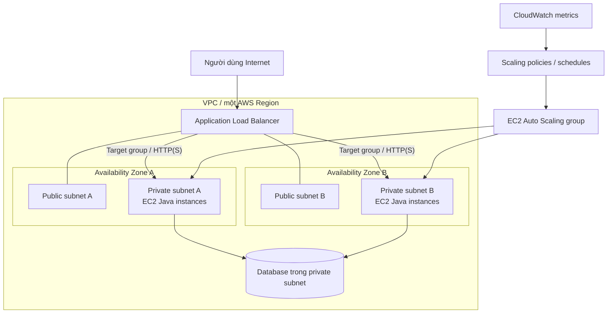
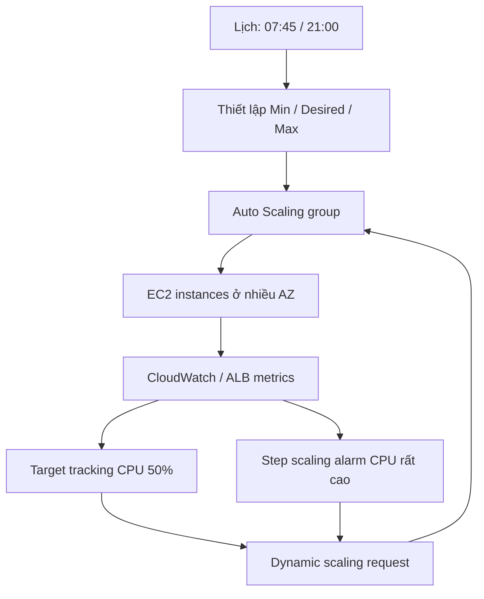

# Target tracking, step scaling và scheduled scaling

Một ứng dụng web có thể phục vụ tốt lúc 2 giờ sáng nhưng quá tải vào giờ cao điểm. Nếu duy trì quá nhiều EC2 cả ngày, chi phí tăng; nếu duy trì quá ít, người dùng gặp độ trễ hoặc lỗi. **Amazon EC2 Auto Scaling** điều chỉnh số lượng máy EC2 theo nhu cầu và giới hạn người quản trị đặt ra. Ba cơ chế thường được dùng là **target tracking**, **step scaling** và **scheduled scaling**.

Bài học thuộc chương **Cân bằng tải và mở rộng** của module **CLOUD_PROVIDERS_AWS**. Nội dung nối tiếp kiến thức Region/AZ, IAM, VPC, EC2, Application Load Balancer (ALB), CloudWatch, lưu trữ/cơ sở dữ liệu và thiết kế serverless. Người học rèn cách chọn chính sách mở rộng phù hợp, triển khai ứng dụng Java an toàn trên nhiều Availability Zone, giám sát khả năng phục hồi và kiểm soát chi phí.

> **Phạm vi:** Các ví dụ tập trung vào **Amazon EC2 Auto Scaling group (ASG)**. Dịch vụ **Application Auto Scaling** cũng có những kiểu chính sách tương tự cho một số tài nguyên khác (ECS, DynamoDB...), nhưng CLI, giới hạn và metric có thể khác; không áp dụng nguyên mẫu lệnh EC2 ASG cho mọi dịch vụ.

## 1. Mục tiêu học tập

Sau bài học, bạn có thể:

1. Phân biệt **Auto Scaling group**, **launch template**, **desired capacity**, **min size**, **max size**, **target group** và **instance warmup**.
2. Giải thích target tracking duy trì một metric gần **target value**, chọn metric phù hợp và hiểu cách CloudWatch alarm được AWS quản lý.
3. Thiết kế step scaling theo **CloudWatch alarm**, ngưỡng và mức vượt ngưỡng (*breach size*), có quy tắc scale-out/scale-in riêng.
4. Tạo scheduled action một lần hoặc lặp theo **cron + time zone** để đón trước tải dự báo được.
5. Biết ba cơ chế tương tác thế nào với min/max/desired và tránh chính sách xung đột.
6. Cấu hình trên Console/CLI, kiểm tra hoạt động scaling và giải thích vì sao ASG chưa thêm hoặc bớt instance.
7. Thiết kế bài toán web Java sau ALB theo nhiều AZ, có health check, warmup, giám sát và bảo mật.
8. Ước lượng tác động hiệu năng, tính sẵn sàng và chi phí trước khi điều chỉnh chính sách.

## 2. Nền tảng: Auto Scaling group và cân bằng tải

### 2.1. Các thành phần chính

| Thành phần | Chức năng | Ví dụ |
| --- | --- | --- |
| **Launch template** | Mẫu cấu hình EC2 mới: AMI, instance type, IAM instance profile, security group, user data... | `lt-web-java` |
| **Auto Scaling group** | Duy trì và điều chỉnh số lượng/capacity của EC2 | `web-java-asg` |
| **Desired capacity** | Mức capacity ASG cố gắng duy trì | 4 instance |
| **Min size / Max size** | Sàn và trần capacity ASG được phép vận hành | Min 2, Max 10 |
| **Target group** | Danh sách target được ALB kiểm tra và chuyển request tới | `tg-web-java` |
| **CloudWatch metric** | Dữ liệu đo tải/hoạt động hệ thống | CPUUtilization, request count per target |
| **Scaling policy** | Quy tắc quyết định thay đổi desired capacity | CPU target 50% |
| **Scheduled action** | Yêu cầu cập nhật capacity tại thời điểm xác định | 07:45 mở rộng lên 4 |
| **Instance warmup** | Thời gian cần để instance mới khởi tạo, ổn định và đóng góp đủ năng lực xử lý | 180 giây, giá trị minh họa |

**Capacity** thường tương ứng số instance khi nhóm dùng các instance có trọng số bằng nhau. Nếu ASG sử dụng **instance weights** trong mixed instances policy, capacity có thể được đo bằng **capacity units**; khi đó `DesiredCapacity=4` không nhất thiết có nghĩa là đúng bốn máy.

Ví dụ:

```text
ASG web-java-asg
  MinSize       = 2
  DesiredCapacity = 4
  MaxSize       = 10
```

Khi chính sách yêu cầu tăng capacity từ 4 lên 6, ASG sẽ cố khởi chạy thêm tài nguyên phù hợp launch template và điều kiện hệ thống. Khi giảm từ 6 xuống 4, ASG lựa chọn các instance để kết thúc theo termination policy/quy tắc bảo vệ đã cấu hình.

**Desired capacity là mục tiêu, không phải số máy đang sẵn sàng tại mọi thời điểm.** Có thể có instance đang `Pending`, `Warming`, `InService`, `Terminating` hoặc đang bị thay thế do health check. Instance bị lỗi cũng có thể được ASG thay thế **không cần** một dynamic scaling policy.

### 2.2. Kiến trúc minh họa cho ứng dụng web



Ở kiến trúc này, ALB phân phối request tới các **healthy targets**; ASG quản lý số lượng instance ứng dụng. Hai cơ chế phối hợp nhưng **khác nhau về nhiệm vụ**: ALB không tự tạo EC2 mới, và ASG không thay ALB thực hiện cân bằng HTTP.

Ứng dụng Java nên được thiết kế tương đối **stateless**: lưu session cần chia sẻ vào nơi thích hợp và lưu tệp bền vững ở S3/EFS hoặc dịch vụ được thiết kế cho dữ liệu. Nếu phiên người dùng chỉ tồn tại trong RAM của một EC2, việc ASG scale-in có thể làm mất phiên.

## 3. Ba chiến lược scaling: bảng so sánh

| Tiêu chí | **Target tracking** | **Step scaling** | **Scheduled scaling** |
| --- | --- | --- | --- |
| Tín hiệu quyết định | Metric cần giữ gần target | CloudWatch alarm vượt ngưỡng với các mức điều chỉnh | Thời gian hoặc lịch lặp |
| Cách cấu hình | Chọn metric + target value | Tạo alarm và step adjustments | Tạo scheduled action |
| Ví dụ | CPU trung bình mục tiêu 50% | CPU 70–80% thêm 1; từ 80% thêm 2 | 07:45 ngày thường tăng mức nền |
| Phản ứng với tải bất ngờ | Có, theo dữ liệu metric | Có, theo alarm | Không tự phát hiện spike ngoài lịch |
| CloudWatch alarm | AWS tạo và quản lý | Người quản trị tạo/gắn | Không cần alarm để chạy lịch |
| Điều chỉnh scale-in | Tự động và thường thận trọng; có thể disable | Thiết kế policy/alarm riêng | Hạ desired/min/max theo lịch |
| Phù hợp | Tải thay đổi liên tục, metric tỷ lệ với năng lực xử lý | Cần phản ứng theo mức vượt ngưỡng cụ thể | Tải có quy luật theo giờ/ngày |
| Rủi ro thiết kế | Chọn metric không tỷ lệ capacity; warmup sai | Ngưỡng/step gây dao động; alarm nhiễu | Lịch sai múi giờ, capacity bị tăng/giảm sai lúc |

Không có chính sách nào tự giải quyết mọi bài toán. Với hệ thống web thông thường, **target tracking** thường là điểm bắt đầu dễ kiểm soát. **Scheduled scaling** có thể giúp khởi động máy trước giờ cao điểm; **step scaling** hữu ích khi đội vận hành cần phản ứng riêng với một ngưỡng bất thường.

## 4. Target tracking scaling

### 4.1. Nguyên lý hoạt động

Với **target tracking**, bạn chọn một metric biểu diễn mức sử dụng của nhóm và **target value** mong muốn. AWS điều chỉnh capacity để metric tiến gần mức mục tiêu, giống bộ điều nhiệt trong phòng.

Ví dụ:

- ASG có 4 EC2.
- Metric chọn `ASGAverageCPUUtilization`.
- Target value = **50%**.
- Tải tăng làm CPU trung bình vượt mục tiêu; chính sách tìm cách scale-out.
- Tải giảm làm CPU thấp hơn mục tiêu trong thời gian đủ dài; chính sách có thể scale-in.

Để trực giác hóa nhu cầu capacity, nếu hệ thống có **4 instance** đang xử lý tải ổn định ở **80% CPU**, muốn về quanh **50%** thì ước lượng tuyến tính đơn giản là:

\[
N_{\text{ước lượng}} = \left\lceil\frac{4 \times 80}{50}\right\rceil = 7
\]

Đây **không phải thuật toán chính xác của AWS**. Scaling thực tế còn phụ thuộc lượng tải mỗi instance, điều kiện min/max, warmup, dữ liệu metric, độ trễ khởi động và cơ chế tránh dao động. Con số chỉ giúp hiểu vì sao tăng từ 4 lên 5 instance đôi khi chưa đủ đưa CPU về mục tiêu.

### 4.2. Chọn metric phù hợp

Một metric tốt cho target tracking cần phản ánh **mức sử dụng trên mỗi đơn vị capacity**: khi tăng số instance trong khi tổng tải tương đối ổn định, metric trung bình nên **giảm**.

| Metric | Khi nào nên dùng | Lưu ý |
| --- | --- | --- |
| `ASGAverageCPUUtilization` | Ứng dụng bị giới hạn bởi CPU, phân phối tải tương đối đều | CPU thấp chưa chắc ứng dụng không nghẽn I/O hoặc database |
| `ALBRequestCountPerTarget` | Web/API đi qua **Application Load Balancer** | Metric bình quân request/target; cần target group phù hợp |
| `ASGAverageNetworkIn` / `ASGAverageNetworkOut` | Workload bị chi phối bởi lưu lượng mạng | Đơn vị là byte; cần kiểm chứng quan hệ với năng lực xử lý |
| Custom metric có tính tỷ lệ | Worker xử lý job, throughput mỗi instance, backlog **mỗi instance** | Cần xuất metric đúng namespace/dimensions và giám sát chất lượng dữ liệu |

**Không phù hợp làm target tracking trực tiếp** nếu không chuẩn hóa:

- Tổng số request đến ALB (`RequestCount`): tăng số EC2 không làm tổng số request vào ALB tự giảm.
- Tổng số message đang chờ trong SQS: tăng instance có thể làm backlog giảm, nhưng không tỷ lệ đơn giản với năng lực trong từng chu kỳ; bài toán SQS thường cần metric **backlog per instance**.
- Response latency: có thể liên quan số máy nhưng không phải lúc nào cũng thay đổi tỷ lệ nghịch với capacity.

Đối với `ALBRequestCountPerTarget`, phải xác định **resource label** của ALB và target group được gắn với ASG. Target value thể hiện **số request trung bình trên mỗi target trong khoảng một phút**. Ví dụ 600 request/target/phút là **mục tiêu minh họa**, cần đo tải thật để chọn.

### 4.3. Scale-out và scale-in được AWS quản lý

Khi tạo target tracking policy, **EC2 Auto Scaling tự tạo và quản lý các CloudWatch alarm cần thiết**. Không tự ý sửa/xóa những alarm này; thay đổi metric hoặc mục tiêu bằng **scaling policy**.

Đặc điểm:

1. Scale-out có thể xảy ra khi metric cao hơn mức mục tiêu.
2. Scale-in thường thận trọng hơn để giảm khả năng bật/tắt liên tục.
3. Có tùy chọn **Disable scale in** nếu muốn policy này chỉ phụ trách mở rộng và một cơ chế khác xử lý giảm capacity.
4. Cần cấu hình **default instance warmup** hoặc warmup của chính sách đủ với thời gian khởi động và ổn định ứng dụng.
5. Mọi yêu cầu capacity vẫn bị giới hạn bởi **MinSize/MaxSize** và các điều kiện vận hành khác.

**Khi có nhiều target tracking policies** trên cùng ASG, nên dùng các metric khác nhau. EC2 Auto Scaling **scale out nếu bất kỳ policy nào yêu cầu scale out**; hệ thống chỉ **scale in khi tất cả target tracking policies có phần scale-in được bật đều sẵn sàng scale-in**. Quy tắc này ưu tiên khả năng phục vụ tải.

### 4.4. Ví dụ CPU và request count

Giả sử:

- CPU policy: target = **50%**.
- ALB policy: target = **600 request/target/phút**.
- Khi khung giờ cao điểm, CPU = **40%**, request/target = **850**.

Trong ví dụ này, policy request có thể đòi **scale out** dù CPU còn dưới 50%. Hệ thống không nên scale in chỉ vì CPU thấp, khi metric request vẫn cho thấy thiếu capacity.

**Chỉ chọn nhiều policy khi các metric có ý nghĩa riêng.** Càng nhiều policy không đồng nghĩa hệ thống càng tốt; các mục tiêu xung đột có thể giữ quá nhiều instance và làm tăng chi phí.

## 5. Instance warmup, health check và khả năng phản ứng

Một EC2 đã chạy ở trạng thái EC2 `running` chưa chắc Java application đã nhận request được. Quá trình có thể gồm tải AMI, chạy user data, tải secrets, khởi động JVM, kết nối database, warming cache và vượt qua ALB health check.

Ba thiết lập khác nhau:

| Thiết lập | Phạm vi | Ý nghĩa |
| --- | --- | --- |
| **Instance warmup** | Dynamic scaling/ASG | Giúp chính sách tính capacity phù hợp khi instance mới chưa ổn định |
| **Health check grace period** | ASG health checking | Cho instance mới thời gian ban đầu trước khi ASG xử lý một số kết quả health check không đạt |
| **ALB health check** | Target group | Quyết định instance có đủ điều kiện nhận request từ load balancer |

Ví dụ app Java cần khoảng **180 giây** từ lúc EC2 khởi động tới khi sẵn sàng. Nếu đặt warmup quá ngắn, chính sách có thể đánh giá sai năng lực thật, liên tục tạo thêm máy. Nếu warmup quá dài, phản ứng với thay đổi tải có thể chậm.

**Khuyến nghị:** đo thời gian startup thực tế (P50/P95 hoặc phân phối tương đương), chọn warmup dựa trên dữ liệu, rồi đo lại trong thử nghiệm tải. Mục tiêu là chính sách không đánh giá nhầm các instance đang khởi động thành capacity đã sẵn sàng.

Health check endpoint như `/actuator/health/readiness` cần phản ánh khả năng nhận traffic thực tế và không yêu cầu đăng nhập ngoài ý muốn. Đối với Spring Boot, chỉ bật/thiết kế health probe theo cấu hình bảo mật của ứng dụng; không tiết lộ secrets hoặc thông tin nội bộ tại endpoint công khai.

### 5.1. Vì sao workload vẫn quá tải sau scale-out?

- EC2 quota hoặc loại instance không còn khả dụng ở AZ dự kiến.
- ASG đã chạm `MaxSize`.
- Launch template/AMI hoặc user data lỗi, máy không vào `InService`.
- SG/route/DNS khiến máy không tải dependency hoặc không đăng ký ALB.
- ALB health check liên tục thất bại.
- Database hoặc API downstream là nút thắt; tăng EC2 không giải quyết được.
- Metric cập nhật chậm, thiếu dữ liệu hoặc không phản ánh tải của ứng dụng.
- Warmup dài, mất nhiều thời gian trước khi số máy mới xử lý đủ request.

Do vậy, scaling policy phải đi cùng **observability**, health check và kiểm thử chịu tải.

## 6. Step scaling: mở rộng theo mức vượt ngưỡng

### 6.1. Cách hoạt động

**Step scaling** sử dụng một hoặc nhiều **CloudWatch alarms** do người quản trị tạo. Khi metric vượt ngưỡng alarm, ASG áp dụng **step adjustment** tương ứng với **mức chênh lệch so với ngưỡng**.

Ví dụ một ASG có min 2, desired 4, max 10. Chọn alarm scale-out nếu CPU trung bình **≥ 70%** trong **2 kỳ liên tiếp**, mỗi kỳ một phút.

| CPU được policy đánh giá | Mức vượt ngưỡng 70% | Hành động minh họa |
| --- | --- | --- |
| `< 70%` | Chưa vượt ngưỡng | Không kích hoạt policy scale-out này |
| `70% đến dưới 80%` | `0 đến dưới 10` điểm phần trăm | **+1 instance** |
| `80% trở lên` | `10` điểm phần trăm trở lên | **+2 instance** |

AWS CLI/SDK biểu diễn **MetricIntervalLowerBound/UpperBound tương đối so với alarm threshold**, ví dụ:

```text
Alarm threshold = 70%

Step 1: lower=0,  upper=10  => 70% <= metric < 80% : +1
Step 2: lower=10, upper=null => metric >= 80%      : +2
```

**Giới hạn ở biên:** với alarm “trên ngưỡng cao”, lower bound của step là **bao gồm**, upper bound là **không bao gồm**. Ở ngưỡng scale-in thấp hơn, cách xử lý biên khác theo chiều alarm; đọc tài liệu AWS thay vì tự áp quy tắc giống hệt.

Giá trị metric được chọn từ những điểm CloudWatch theo **metric aggregation type** của policy và thuộc tính alarm, không nhất thiết là một điểm CPU mới nhất. Các bước có thể tiếp tục được áp dụng khi alarm vẫn vi phạm và điều kiện warmup/capacity cho phép.

### 6.2. Loại điều chỉnh capacity

| Adjustment type | Ý nghĩa | Ví dụ khi current capacity là 8 |
| --- | --- | --- |
| `ChangeInCapacity` | Cộng/trừ số lượng hoặc capacity units | `+2` đưa mục tiêu lên khoảng 10 |
| `PercentChangeInCapacity` | Cộng/trừ theo tỷ lệ hiện có | `+25%` tương đương khoảng 2 |
| `ExactCapacity` | Đặt desired capacity ở giá trị cụ thể | `6` yêu cầu mục tiêu là 6 |

Với phần trăm, AWS áp dụng quy tắc làm tròn và có thể có tham số **MinAdjustmentMagnitude**. Với **instance weights**, các con số là capacity units, không luôn là số máy thực tế. Ví dụ ở bảng là minh họa cho nhóm có instance tương đương.

### 6.3. Cần scale-in policy riêng

Scale-out cao CPU chưa tự xác định bao giờ giảm máy. Một cấu hình đầy đủ có thể dùng:

- **Alarm cao:** CPU ≥ 70% trong 2 kỳ, step +1/+2.
- **Alarm thấp:** CPU ≤ 30% trong 5 kỳ, step -1, kết hợp warmup/termination phù hợp.

Khoảng cách giữa 30% và 70% là **hysteresis** để giảm trạng thái *flapping*: vừa thêm máy xong lại xóa, rồi lại thêm.

Thực tế, scale-in cần thêm các ràng buộc:

- Duy trì **MinSize** và capacity an toàn.
- Cho ALB **deregistration delay** phù hợp để request đang xử lý có cơ hội hoàn thành.
- Dùng **scale-in protection** khi có instance đang xử lý công việc không thể ngắt; lưu ý chế độ này có thể cản việc giảm capacity.
- Nếu hệ thống có job dài, cân nhắc lifecycle hooks và cơ chế draining/giao việc thay vì terminate đột ngột.

### 6.4. Step scaling khác simple scaling

**Simple scaling** cũng dựa trên alarm nhưng chỉ có một mức điều chỉnh và cách xử lý cooldown đơn giản hơn. **Step scaling** chọn nhiều mức dựa trên breach size và phối hợp instance warmup.

Với metric có quan hệ tỷ lệ tốt với capacity như CPU/request-per-target, AWS thường khuyến nghị **target tracking trước**. Step scaling phù hợp khi cần phản ứng đột biến theo ngưỡng riêng, chẳng hạn tăng mạnh capacity khi CPU vượt 85%.

## 7. Scheduled scaling: thay đổi capacity theo thời gian

### 7.1. Khi nào nên dùng?

Một số tải **dự đoán được**:

- Trang đặt lịch có lượt truy cập cao từ 08:00–17:00 các ngày làm việc.
- Job batch chạy vào 23:00.
- Hệ thống báo cáo tăng nhu cầu ngay trước ngày chốt tháng.
- Sự kiện doanh nghiệp có giờ khai mạc và kết thúc đã biết.

**Scheduled scaling** cho phép tạo **scheduled action** đặt **desired**, và tùy chọn **min/max capacity** tại một thời điểm tương lai. Lịch có thể chạy **một lần** hoặc **lặp lại**.

Nếu tăng desired từ 2 lên 4 lúc 08:00, EC2 mới **không nhất thiết sẵn sàng đúng 08:00**, vì cần boot, warmup và health check. Vì vậy nên **lên lịch sớm hơn giờ tăng traffic** theo thời gian startup đo được.

### 7.2. Lịch lặp, cron và múi giờ

Trong AWS CLI, recurring schedule dùng biểu thức cron **năm trường**:

```text
minute hour day-of-month month day-of-week

Ví dụ:
45 7 * * 1-5  -> 07:45, thứ Hai đến thứ Sáu
0 21 * * 1-5  -> 21:00, thứ Hai đến thứ Sáu
```

Ví dụ thiết lập `--time-zone Asia/Ho_Chi_Minh` để lịch trên diễn giải theo giờ Việt Nam. AWS hỗ trợ các tên **IANA time zone**; mặc định lịch dùng **UTC**. Với những múi giờ có Daylight Saving Time (DST), lịch diễn giải theo time zone được chọn và có thể tự điều chỉnh DST.

**Phân biệt:** `--start-time` và `--end-time` qua CLI/SDK được khai báo ở **UTC**, còn `--recurrence` có thể dùng `--time-zone`. Không sao chép giá trị giờ Việt Nam vào UTC ISO mà quên quy đổi.

### 7.3. Cấu hình giờ hành chính minh họa

ASG dùng cấu hình giờ thường:

```text
Ban đêm:
  MinSize=2, DesiredCapacity=2, MaxSize=6

Ngày làm việc, từ 07:45:
  MinSize=4, DesiredCapacity=4, MaxSize=10

Sau 21:00:
  MinSize=2, DesiredCapacity=2, MaxSize=6
```

Khi đến giờ sáng, scheduled action tăng **mức nền tối thiểu** lên 4 để ứng dụng có đủ năng lực trước cao điểm. Trong suốt ngày làm việc, target tracking vẫn có thể tăng desired vượt 4 nếu tải lên, nhưng **không vượt MaxSize 10**.

Khi đến giờ tối, hành động đưa sàn xuống 2 và desired về 2. Nếu tải vẫn cao, dynamic scaling có thể tiếp tục yêu cầu thêm capacity sau hành động lịch. **Scheduled scaling không khóa desired capacity ở một số cố định cho cả khung giờ**.

### 7.4. Những lưu ý về lịch

- Scheduled actions có thể được AWS thực thi trễ một khoảng ngắn so với thời điểm dự kiến, nên không dùng như một cơ chế đáp ứng đúng mili-giây.
- Nếu nhiều actions trong **cùng ASG** trùng thời điểm hoặc cron tương đương, có thể phát sinh lỗi/cách thực thi khó dự đoán; ưu tiên lịch rõ ràng, không chồng lấn.
- Với sự kiện đặc biệt, tạo **một lần** với thời điểm cụ thể và lên kế hoạch trả capacity về mức phù hợp.
- Nếu tạm thời không muốn lịch hoạt động, có thể dùng cơ chế tạm dừng **ScheduledActions** theo quy trình; khi bật lại phải kiểm tra lịch và trạng thái hiện tại.
- Không quên **chi phí ban đêm/cuối tuần** khi để `MinSize` ở mức cao không cần thiết.

## 8. Kết hợp target tracking, step và scheduled scaling

### 8.1. Một kiến trúc chính sách hợp lý

Trong ứng dụng thương mại điện tử:

1. **Scheduled scaling** đặt min/desired nền theo khung giờ có lịch đặt hàng.
2. **Target tracking** duy trì CPU trung bình gần **50%** trong biến động thông thường.
3. **Step scaling (tùy chọn)** dùng alarm **CPU rất cao** hoặc tín hiệu độc lập để tăng nhanh số instance khi có spike mà target tracking chưa đáp ứng đủ.



**Không triển khai đồng thời nhiều chính sách gây xung đột trước khi đo**. Ví dụ target tracking có thể đang muốn giữ CPU 50% trong khi step scale-in tùy tiện muốn giảm 3 instance khi CPU xuống 45%; mô hình này có thể gây dao động lớn. Nếu dùng step policy cho scale-in riêng, đánh giá có nên đặt target tracking **Disable scale in** hoặc điều chỉnh logic tương tác.

### 8.2. Ba tình huống

| Tình huống | Kết quả mong đợi |
| --- | --- |
| 07:45, tải chưa tăng | Scheduled action đưa desired lên mức nền 4; dynamic policy có thể điều chỉnh sau |
| 10:00, CPU tăng lên 78%, ASG dưới MaxSize | Target tracking có thể scale out; step policy riêng có thể phản ứng nếu alarm đủ điều kiện |
| 22:00, lưu lượng thấp | Scheduled action hạ nền, dynamic policy có thể tiếp tục scale in trong giới hạn mới |

**MinSize/MaxSize không phải “khuyến nghị”; chúng là giới hạn của ASG.** Nếu MaxSize = 6 và demand cần 10 instance, scaling policy sẽ không tự vượt trần đã cấu hình. Trái lại, nếu MinSize = 4, target tracking không scale-in xuống 2 dù metric rất thấp.

### 8.3. Cách chọn chiến lược

- Tải thay đổi liên tục, chưa biết giờ: **target tracking** với metric thích hợp.
- Tải có đỉnh rõ theo lịch: **scheduled scaling + target tracking**.
- Yêu cầu phản ứng đặc biệt với đỉnh cao/độ nghiêm trọng: **step scaling** bổ sung và thử nghiệm kiểm soát.
- Workload không tỷ lệ với metric CPU: dùng metric phù hợp hơn (ví dụ request/target hoặc backlog/worker).
- Ứng dụng khởi động rất chậm: cân nhắc **warm pools**, tối ưu startup hoặc scheduled scale-up sớm; kiểm tra chi phí trước khi sử dụng.

## 9. Bài toán thực tế: mở rộng API Java sau ALB

Giả sử nhóm xây dựng API Java có 2 AZ, cơ sở dữ liệu nằm private và ALB phục vụ HTTPS. Nhóm đo được:

- Một instance có thể xử lý khoảng **600 request/phút** tại mục tiêu hiệu năng chấp nhận được.
- Ban đêm tổng tải thường **600 request/phút**.
- Giờ hành chính tổng tải khoảng **2.400 request/phút**.
- Trong sự kiện khuyến mại, tải có thể lên **4.800 request/phút**.

Ước lượng đơn giản nếu phân phối đều:

\[
N_{\text{cần}} \approx \left\lceil\frac{\text{Tổng request/phút}}{600}\right\rceil
\]

| Mức tải | Số instance ước lượng | Ghi chú |
| --- | ---: | --- |
| 600 request/phút | 1 | Nhưng nên duy trì tối thiểu 2 ở hai AZ nếu yêu cầu HA |
| 2.400 request/phút | 4 | Mức nền ban ngày |
| 4.800 request/phút | 8 | Nằm dưới MaxSize = 10 trong ví dụ |

Đây là **mô hình capacity sơ bộ**, chưa bao gồm độ lệch phân phối request, độ dài request, giới hạn database, connection pools, JVM GC, ALB health, failover một AZ và headroom. Muốn production HA, cần thử tải và tính **năng lực còn lại khi một AZ gặp sự cố**, không lấy 8 instance làm mức đủ tuyệt đối chỉ từ phép chia.

Lựa chọn khởi đầu:

- ASG chạy ít nhất **2 instance**, đặt ở các private subnets thuộc hai AZ.
- Target tracking: `ALBRequestCountPerTarget = 600` hoặc CPU 50% tùy thí nghiệm.
- Scheduled action ngày thường đưa **Min/Desired lên 4** trước giờ mở cửa.
- MaxSize 10 là trần giả định; khi thử tải cho thấy chưa đủ, cần đánh giá quota, database và chi phí trước khi điều chỉnh.
- ALB target group health check, deregistration delay; application shutdown có hỗ trợ graceful draining.
- CloudWatch giám sát HTTP 5XX, latency, target health, CPU, memory (nếu thu từ agent) và scaling activities.

## 10. Chuẩn bị trước khi cấu hình EC2 Auto Scaling

Với một AWS account dùng trong học tập, trước khi tạo scaling policy cần có:

1. **Launch template** đúng AMI, instance type, security group và IAM instance role; user data/AMI bảo đảm ứng dụng khởi động được.
2. **Auto Scaling group** đã tồn tại và có dải **Min / Desired / Max** nhất quán; thử health check trước khi scale.
3. Ít nhất **hai Availability Zone** nếu yêu cầu phục hồi khi một AZ lỗi, với subnet/VPC routes đúng.
4. Với kiến trúc web, **ALB + target group** gắn vào ASG; health check endpoint có thể dùng để xác định target healthy.
5. **CloudWatch metrics** sẵn sàng ở đúng account/Region, có độ phân giải phù hợp với phản ứng mong muốn.
6. Danh tính IAM Identity Center/role có quyền xem hoặc quản lý ASG, CloudWatch Alarm và lịch theo nhiệm vụ; không dùng root access key.
7. Có **ngân sách và kế hoạch dọn dẹp**, vì khi scaling policy hoạt động có thể tự khởi chạy EC2, EBS và tạo thêm chi phí.

Với metric CPU của EC2, mặc định nhiều môi trường có chu kỳ **5 phút**; **EC2 detailed monitoring** có thể cung cấp dữ liệu khoảng **1 phút** và có thể phát sinh chi phí. Với metric tùy chỉnh, xác định chu kỳ xuất bản, xử lý giá trị bằng 0 và trạng thái thiếu dữ liệu.

## 11. Cấu hình trên AWS Console

### 11.1. Kiểm tra nhóm trước

1. Mở [Amazon EC2 Console](https://console.aws.amazon.com/ec2/) trong **đúng Region**.
2. Vào **Auto Scaling → Auto Scaling Groups**, chọn `web-java-asg`.
3. Kiểm tra **Launch template**, subnets, Availability Zones, min/desired/max và target group.
4. Mở tab **Instance management** xem instance đã `InService` và `Healthy` chưa.
5. Mở tab **Monitoring**/CloudWatch để xác nhận metric thực sự có dữ liệu.

**Nếu ứng dụng chưa nhận được request hoặc các máy không healthy**, việc thêm scaling policy sẽ khó kiểm tra đúng hành vi. Nên giải quyết cấu hình nền trước.

### 11.2. Tạo target tracking policy

1. Trong ASG, mở **Automatic scaling → Dynamic scaling policies → Create dynamic scaling policy**.
2. Chọn **Target tracking scaling**.
3. Đặt tên như `cpu-target-50`.
4. Chọn metric **Average CPU utilization** và **Target value = 50**.
5. Kiểm tra instance warmup/Default instance warmup.
6. Nếu cần scale-out-only, xem tùy chọn **Disable scale in**; trường hợp thông thường để ASG quản lý cả hai chiều.
7. Tạo policy và kiểm tra các CloudWatch alarms được AWS quản lý.

Nếu chọn **ALB request count per target**, chỉ chọn target group thực sự được gắn với ASG và kiểm tra số request/target phản ánh tải. Không chọn ALB hoàn toàn khác rồi đánh giá scaling của nhóm này.

### 11.3. Tạo step scaling policy và alarm

1. Trong **Automatic scaling → Dynamic scaling policies**, tạo policy **Step scaling**.
2. Chọn **Scale out**, điều chỉnh theo **Change in capacity**.
3. Định nghĩa step cho mức vượt ngưỡng alarm, ví dụ:
   - Từ 70 đến dưới 80% CPU: thêm 1.
   - Từ 80% CPU trở lên: thêm 2.
4. Kiểm tra instance warmup và policy được tạo.
5. Vào **CloudWatch → Alarms → Create alarm** để tạo alarm CPU với dimension **AutoScalingGroupName** của ASG, threshold ≥70%, 2/2 kỳ 60 giây khi metrics phù hợp.
6. Chọn **Auto Scaling action** liên kết tới step scaling policy đã tạo, xác nhận rồi lưu alarm.
7. Nếu cần scale-in, tạo policy và alarm thấp **riêng**, cân nhắc hysteresis.

**Chú ý:** CloudWatch Console và ASG Console đôi khi hiển thị các bước với thứ tự khác. Quy tắc cốt lõi vẫn là **alarm phải kích hoạt đúng step policy** và step bounds phải khớp threshold.

### 11.4. Tạo scheduled actions

1. Trong ASG, mở **Automatic scaling → Scheduled actions → Create scheduled action**.
2. Đặt tên như `weekday-morning`.
3. Chọn **Recurring** hoặc **Once**.
4. Nếu recurring, cấu hình giờ, ngày và **time zone** chính xác.
5. Chọn `Min=4, Desired=4, Max=10` cho buổi sáng.
6. Tạo hành động thứ hai `weekday-evening` để trở lại `Min=2, Desired=2, Max=6`.
7. Kiểm tra không trùng lịch, giờ khởi động phù hợp thời gian warmup và phạm vi tài khoản/Region đúng.

Không cần tạo schedule cho từng giờ một khi target tracking đã đủ xử lý dao động trong ngày.

## 12. AWS CLI: xem trạng thái và đặt chính sách mẫu

Dùng **AWS CLI v2** và profile có quyền phù hợp. Các tên `web-java-asg`, Region `ap-southeast-1` và giá trị capacity là **ví dụ**, phải thay cho môi trường thật.

### 12.1. Kiểm tra trạng thái (read-only)

```bash
# Xem bạn đang ở tài khoản nào.
aws sts get-caller-identity --profile training

# Xem giới hạn và trạng thái ASG.
aws autoscaling describe-auto-scaling-groups \
  --auto-scaling-group-names web-java-asg \
  --query "AutoScalingGroups[].{Name:AutoScalingGroupName,Min:MinSize,Desired:DesiredCapacity,Max:MaxSize,Warmup:DefaultInstanceWarmup}" \
  --region ap-southeast-1 --profile training

# Xem dynamic policies.
aws autoscaling describe-policies \
  --auto-scaling-group-name web-java-asg \
  --region ap-southeast-1 --profile training

# Xem scheduled actions hiện có.
aws autoscaling describe-scheduled-actions \
  --auto-scaling-group-name web-java-asg \
  --region ap-southeast-1 --profile training

# Xem những lần scaling gần đây và lý do.
aws autoscaling describe-scaling-activities \
  --auto-scaling-group-name web-java-asg \
  --max-items 10 \
  --region ap-southeast-1 --profile training
```

Các lệnh trên không tạo hoặc terminate EC2. Nếu kết quả ASG trống, có thể do sai **account**, **Region**, **tên nhóm** hoặc quyền đọc.

### 12.2. Tạo target tracking CPU 50% (có tác động)

```bash
# CHỈ CHẠY TRONG ASG ĐƯỢC ỦY QUYỀN.
aws autoscaling put-scaling-policy \
  --auto-scaling-group-name web-java-asg \
  --policy-name cpu-target-50 \
  --policy-type TargetTrackingScaling \
  --target-tracking-configuration '{
    "PredefinedMetricSpecification": {
      "PredefinedMetricType": "ASGAverageCPUUtilization"
    },
    "TargetValue": 50.0,
    "DisableScaleIn": false
  }' \
  --region ap-southeast-1 --profile training
```

Policy có thể khiến ASG **khởi chạy hoặc kết thúc EC2** dựa trên metric. Cấu hình target tracking cũng khiến AWS quản lý CloudWatch alarms cho policy, vì vậy bạn không tạo alarm CPU riêng để điều khiển policy trên.

Với `ALBRequestCountPerTarget`, cấu hình khác ở `PredefinedMetricSpecification`:

```json
{
  "PredefinedMetricSpecification": {
    "PredefinedMetricType": "ALBRequestCountPerTarget",
    "ResourceLabel": "app/my-alb/ALB_ID/targetgroup/my-target-group/TG_ID"
  },
  "TargetValue": 600.0
}
```

`ResourceLabel` phải dùng **phần định danh ALB và target group thực** do AWS cung cấp; chuỗi trên là placeholder, không phải ARN của target group. Chỉ sử dụng metric này khi ALB/target group và ASG liên kết đúng.

### 12.3. Tạo step scaling policy và CloudWatch alarm (có tác động)

Ví dụ sau dùng **Bash** (Linux/macOS), vì biến `$(...)` và `$POLICY_ARN` có cú pháp khác trên PowerShell. Có thể chạy trên máy Linux đã cấu hình AWS CLI; khi dùng Windows, triển khai tương đương bằng PowerShell và kiểm tra escaping JSON theo shell.

```bash
# Tạo step scaling policy; các interval relative to threshold=70%.
# CHỈ CHẠY trên ASG được phép để thử nghiệm.
POLICY_ARN=$(aws autoscaling put-scaling-policy \
  --auto-scaling-group-name web-java-asg \
  --policy-name cpu-high-step \
  --policy-type StepScaling \
  --adjustment-type ChangeInCapacity \
  --metric-aggregation-type Average \
  --step-adjustments \
    "MetricIntervalLowerBound=0,MetricIntervalUpperBound=10,ScalingAdjustment=1" \
    "MetricIntervalLowerBound=10,ScalingAdjustment=2" \
  --query PolicyARN --output text \
  --region ap-southeast-1 --profile training)

# Alarm kích hoạt policy khi CPU >=70% trong 2/2 kỳ 60s.
aws cloudwatch put-metric-alarm \
  --alarm-name web-java-cpu-high \
  --namespace AWS/EC2 \
  --metric-name CPUUtilization \
  --dimensions Name=AutoScalingGroupName,Value=web-java-asg \
  --statistic Average \
  --period 60 \
  --evaluation-periods 2 \
  --datapoints-to-alarm 2 \
  --threshold 70 \
  --comparison-operator GreaterThanOrEqualToThreshold \
  --alarm-actions "$POLICY_ARN" \
  --region ap-southeast-1 --profile training
```

Lệnh này tạo policy **scale-out** và một alarm. Muốn scale-in, cần một alarm thấp và step adjustments âm phù hợp. Metric chu kỳ 60 giây có ý nghĩa khi hệ thống thực sự **xuất dữ liệu 1 phút**; nếu đang dùng monitoring 5 phút, alarm có thể thiếu dữ liệu. Trước khi dùng production, xác định rõ `TreatMissingData`, warmup, alarm actions và ngưỡng dựa trên đo tải thật.

### 12.4. Tạo scheduled actions theo giờ Việt Nam (có tác động)

```bash
# Ngày làm việc 07:45 theo Asia/Ho_Chi_Minh.
aws autoscaling put-scheduled-update-group-action \
  --auto-scaling-group-name web-java-asg \
  --scheduled-action-name weekday-morning \
  --recurrence "45 7 * * 1-5" \
  --time-zone "Asia/Ho_Chi_Minh" \
  --min-size 4 --desired-capacity 4 --max-size 10 \
  --region ap-southeast-1 --profile training

# Ngày làm việc 21:00: trả mức nền về 2.
aws autoscaling put-scheduled-update-group-action \
  --auto-scaling-group-name web-java-asg \
  --scheduled-action-name weekday-evening \
  --recurrence "0 21 * * 1-5" \
  --time-zone "Asia/Ho_Chi_Minh" \
  --min-size 2 --desired-capacity 2 --max-size 6 \
  --region ap-southeast-1 --profile training
```

Hai scheduled actions cập nhật **cả min/desired/max** để bảo đảm giới hạn nhất quán. Sau khi chạy một action, **dynamic policies vẫn hoạt động** trong giới hạn mới; vì vậy không đảm bảo desired luôn cố định ở 4 vào ban ngày hay 2 vào ban đêm.

**Quan trọng:** tạo scheduled actions không khiến chúng chạy ngay nếu thời điểm lịch chưa tới. Nếu thử nghiệm trong sandbox, dùng mô phỏng/quan sát hoặc khung giờ được phép; không thay giờ lịch của production chỉ để đẩy một lần scale.

### 12.5. Xem CloudWatch alarm và lịch sử

```bash
aws cloudwatch describe-alarms \
  --alarm-names web-java-cpu-high \
  --region ap-southeast-1 --profile training

aws autoscaling describe-scheduled-actions \
  --auto-scaling-group-name web-java-asg \
  --region ap-southeast-1 --profile training

aws autoscaling describe-scaling-activities \
  --auto-scaling-group-name web-java-asg \
  --max-items 20 \
  --region ap-southeast-1 --profile training
```

Lưu ý rằng việc có một alarm `ALARM` không đồng nghĩa một EC2 sẽ xuất hiện ngay. Cần xem lý do trong scaling activities, min/max, quota, warmup, health checks và trạng thái instance.

## 13. Kiểm tra hiệu quả và tránh scale bất thường

### 13.1. Metric cần theo dõi

| Nhóm chỉ số | Ví dụ | Mục đích |
| --- | --- | --- |
| **ASG capacity** | `GroupDesiredCapacity`, `GroupInServiceInstances`, `GroupPendingInstances` | So sánh mục tiêu với số instance sẵn sàng |
| **EC2 workload** | `CPUUtilization`, memory/disk (qua CloudWatch Agent) | Xem nghẽn tài nguyên |
| **ALB targets** | `HealthyHostCount`, `UnHealthyHostCount` | Xác nhận instance mới thực sự nhận request |
| **Ứng dụng** | P95 latency, HTTP 5XX, request rate, queue length | Xác nhận chất lượng dịch vụ cuối cùng |
| **Auto Scaling activities** | Thời điểm, nguyên nhân, tình trạng thành công/thất bại | Truy nguyên vì sao desired thay đổi |
| **Chi phí** | EC2 hours, EBS, ALB, data transfer, metrics | Đánh giá hiệu quả mở rộng |

Các **ASG group metrics** như `GroupDesiredCapacity` cần được bật/thu thập theo cấu hình hỗ trợ; đừng giả định mọi metric đều hiện sẵn. App latency/5XX cần nhìn cùng traffic vì trung bình CPU thấp không đảm bảo trải nghiệm khách hàng tốt.

### 13.2. Kiểm thử tải có phương pháp

1. **Baseline:** ghi lại desired/current, CPU, request count, latency, errors trong trạng thái bình thường.
2. **Scale-out:** tăng tải **có kiểm soát** trên hệ thống sandbox; ghi nhận alarm, scaling activity, thời gian EC2 trở thành healthy.
3. **Stabilize:** đợi warmup/health checks hoàn tất; quan sát CPU hoặc request/target có giảm gần mục tiêu không.
4. **Scale-in:** giảm tải; xác minh request đang xử lý được drain và instance kết thúc không làm mất dữ liệu/phiên.
5. **Schedule:** kiểm tra lịch, time zone và capacity giới hạn sau mỗi scheduled action.
6. **Failure mode:** xác nhận hành vi khi một instance unhealthy, hoặc một AZ không còn capacity; không cố tình gây gián đoạn production.
7. **Costs:** so sánh số instance-hours và dịch vụ đi kèm trước/sau thay đổi.

Không đánh giá chính sách chỉ bằng việc “đã tạo đúng trong Console”. Chính sách đạt mục tiêu khi **độ trễ, lỗi, sự sẵn sàng và chi phí** phù hợp với yêu cầu.

## 14. Troubleshooting: chính sách tồn tại nhưng không scale đúng

| Triệu chứng | Nguyên nhân có thể | Hướng kiểm tra |
| --- | --- | --- |
| CPU 90% nhưng không có instance mới | `MaxSize` đã chạm hoặc quota/instance capacity thiếu | Xem min/max, scaling activities, EC2 quotas/AZ |
| Policy target tracking không phản ứng | Metric thiếu, chọn sai dimension/target group, role/quyền | Xem policy, CloudWatch datapoints, ASG activity |
| Alarm `ALARM` nhưng step policy không chạy | Alarm action chưa gắn đúng policy ARN hoặc bị tắt | Kiểm tra alarm actions, policy state, activity |
| Vừa thêm máy lại giảm ngay | Warmup quá ngắn, policy xung đột hoặc ngưỡng quá gần | Kiểm tra warmup, hysteresis và alarm history |
| EC2 chạy nhưng không nhận traffic ALB | Health check fail, SG/port/subnet sai, app chưa ready | Xem target health, readiness probe và listener |
| CPU vẫn cao sau scale-out | Database, downstream hoặc tải không được phân phối đều | Đo DB/connection pool/latency, request per target |
| Scheduled action không thực thi giờ dự kiến | Cron sai, time zone sai, lịch chưa đến, action hết hạn | Xem next scheduled action, time zone, start/end |
| Scheduled action chạy nhưng target tracking đổi desired tiếp | Dynamic scaling vẫn hoạt động trong min/max mới | Kiểm tra scaling activities và mục đích scheduled action |
| Scale-in không xảy ra dù CPU thấp | `MinSize` cao, warmup, policy khác chưa sẵn sàng, scale-in disabled/protected | Đối chiếu toàn bộ policy, min, warmup, protection |
| Đã giảm tải nhưng instance chưa terminate | Deregistration/draining, instance protection, lifecycle hooks | Xem ASG termination activities và lifecycle |
| Scaling liên tục lên xuống | Dữ liệu metric nhiễu, target value không phù hợp, step thresholds gần nhau | Thử tải, điều chỉnh warmup/ngưỡng và metric |
| Hóa đơn tăng ngoài dự kiến | Lịch tăng MinSize quá cao, MaxSize lớn, ALB/EBS/NAT/monitoring | Xem Cost Explorer, Budgets, instance-hours |

### Quy trình chẩn đoán theo thứ tự

1. **Xác định yêu cầu:** ASG đáng lẽ phải scale in hay scale out? Tín hiệu đến từ policy nào hoặc scheduled action nào?
2. **Kiểm tra capacity:** min/desired/max, hiện tại có bao nhiêu instance `InService`, `Pending`, `Terminating`?
3. **Kiểm tra metric/alarm:** có dữ liệu đúng Region/dimension và ngưỡng không? Alarm được AWS quản lý hay do bạn tạo?
4. **Kiểm tra warmup/health:** máy mới có healthy, đúng version ứng dụng và nhận request không?
5. **Kiểm tra scaling activities:** lý do thành công hoặc thất bại, lịch sử thay đổi desired.
6. **Kiểm tra quota, AZ và launch template:** thiếu năng lực cấp máy mới, AMI không tồn tại, IAM thiếu quyền hay SG sai?
7. **Đối chiếu các policies/schedules cùng lúc:** có MinSize hoặc hành động khác đang giữ capacity không?
8. **Đối chiếu ứng dụng và chi phí:** tăng EC2 có cải thiện độ trễ, tỉ lệ lỗi và throughput không?

**Không chỉnh MaxSize production lên rất cao** chỉ vì một lần scale-out thất bại. Cần xác định giới hạn thực tế, quota EC2 và tác động ngân sách.

## 15. Bảo mật, độ sẵn sàng và chi phí

### 15.1. Bảo mật khi scale-out

Mỗi instance được ASG tạo phải kế thừa cấu hình an toàn từ **launch template**, như:

- IAM instance role dùng **temporary credentials**, chỉ có quyền AWS mà app cần.
- Security Group của app chỉ mở inbound từ ALB hoặc nguồn được phê duyệt, không mở SSH/RDP cho Internet.
- AMI đã được cập nhật, ổ EBS mã hóa và cấu hình secrets qua AWS Systems Manager Parameter Store hoặc Secrets Manager phù hợp.
- Log ứng dụng gửi vào dịch vụ tập trung (ví dụ CloudWatch Logs) để không mất khi instance bị terminate.
- Đường outbound tới dependencies (NAT, VPC endpoints hoặc phương án phù hợp) để máy mới boot và lấy cấu hình thành công.
- User data tránh hard-code mật khẩu và token; tách dữ liệu bền vững khỏi vòng đời của EC2.

Nếu launch template cấu hình sai, **càng scale-out càng tạo thêm nhiều máy lỗi**. Cần quản lý version của launch template, phát hành AMI kiểm chứng và kiểm thử nhóm trước khi đẩy production.

### 15.2. Độ sẵn sàng và phục hồi

- Dùng nhiều AZ, tối thiểu theo mục tiêu chịu lỗi và dung lượng còn lại khi một AZ gián đoạn.
- Health checks chính xác để ASG tự thay instance lỗi.
- Đo thời gian khởi động và thời gian drain, đặc biệt với Java JVM và kết nối database.
- Xác định mức **MinSize** bảo đảm công suất nền hoặc failover khi một AZ lỗi.
- Đặt **MaxSize** có đủ headroom nhưng không vượt quota/giới hạn chi phí đã phê duyệt.
- Xem xét termination policies, capacity rebalancing (nếu dùng Spot) và khởi động tại nhiều subnet/AZ.

### 15.3. Cách tính chi phí

Auto Scaling chính sách **không có nghĩa mọi chi phí khác sẽ tự giảm**. Một cấu trúc ước lượng:

\[
\text{Chi phí tổng} \approx
\text{EC2 instance-hours}
+ \text{EBS}
+ \text{ALB/LCU}
+ \text{truyền dữ liệu}
+ \text{NAT/endpoint}
+ \text{giám sát và log}
\]

Giả sử cùng một loại EC2, nếu duy trì **4 instance cả 24 giờ** thì có **96 instance-hours/ngày**. Nếu lịch hợp lý duy trì **4 instance trong 8 giờ** và **2 instance trong 16 giờ**, phần instance-hours cơ bản là **64/ngày**, tức ít hơn **32 instance-hours** so với giữ 4 máy cả ngày.

Đây là **ví dụ lý thuyết**: trong thực tế target tracking có thể bổ sung máy, scheduled actions có thể bị delay, thời gian boot/terminate có ảnh hưởng, và chi phí ALB, EBS, monitoring không giảm tương ứng. So sánh bằng **Cost Explorer** và [AWS Pricing Calculator](https://calculator.aws/) với giá đúng Region và loại instance.

**Mục tiêu của scaling không chỉ là giảm số EC2**; cần thỏa SLO/SLA, khả năng phục hồi và ngân sách đồng thời.

## 16. Bài thực hành: thiết kế scaling cho ứng dụng Java

**Bối cảnh:** một ASG phục vụ ứng dụng Spring Boot qua ALB, trải trên hai Availability Zone. Không cần tạo hạ tầng thật để giải bài toán này.

### Nhiệm vụ A. Chọn phương án

Hệ thống có:

- Min = 2, Desired = 2, Max = 10.
- Một máy phục vụ khoảng 600 request/phút trong điều kiện thử tải.
- Ban đêm 600 request/phút, ban ngày 2.400 request/phút, spike 4.800 request/phút.
- Máy mới cần 3 phút để sẵn sàng và có health check hợp lệ.

Hãy quyết định:

1. Chọn **target tracking** metric nào phù hợp hơn nếu CPU không phải nút thắt nhưng request rate phản ánh tải?
2. Đặt target value minh họa và giải thích cần đo hệ số an toàn/headroom nào.
3. Có nên lên lịch thêm capacity trước 08:00 không? Đặt lịch lúc mấy giờ nếu máy mất 3 phút khởi động?
4. Max=10 có đủ cho spike theo mô hình sơ bộ? Có đủ để chịu lỗi cả một AZ không?
5. Nếu thêm **step policy** cho spike, chọn ngưỡng/metric thế nào để không xung đột policy chính?

### Nhiệm vụ B. Đọc kết quả của ba chính sách

Giả sử ASG đã cấu hình:

```text
Target tracking:
  CPU target = 50%

Step scale-out:
  CPU >= 70% trong 2 phút
  70 <= CPU < 80 : +1
  CPU >= 80      : +2

Scheduled weekday-morning:
  07:45 -> Min=4, Desired=4, Max=10

Scheduled weekday-evening:
  21:00 -> Min=2, Desired=2, Max=6
```

Cho các thời điểm sau:

| Thời điểm | Tín hiệu | Câu hỏi cần trả lời |
| --- | --- | --- |
| 07:45 | CPU 25%, đang có 2 instance | Vì sao ASG vẫn có thể scale lên 4? |
| 10:00 | CPU 82%, desired 4 | Policy nào có thể kích hoạt? Có bảo đảm ngay lập tức tăng đúng 2 máy không? |
| 11:00 | CPU 35%, desired 8 | Target tracking có chắc giảm xuống 4 ngay không? |
| 21:00 | CPU 20%, desired 6 | Scheduled action có thể thay đổi capacity thế nào, dynamic policy còn hoạt động không? |
| 22:00 | CPU 88%, max đã hạ còn 6 | Vì sao ASG không thể tự tăng lên 8? |

**Đáp án định hướng:** scheduled action tác động theo thời gian, không phụ thuộc CPU; target tracking/step dùng tín hiệu CloudWatch và warmup; max giới hạn scaling; target tracking không cam kết phản ứng tức thì hoặc số lượng instance chính xác theo một công thức đơn giản.

### Nhiệm vụ C. Phân tích sự cố

Một buổi sáng, ASG đã có desired 6 nhưng chỉ **2 healthy targets** trong ALB. CloudWatch báo CPU cao và HTTP 5XX tăng.

Hãy lập checklist ít nhất năm điểm:

- ASG activities và trạng thái 4 instance còn lại.
- Launch template/AMI/user data và IAM instance profile.
- Thời gian JVM start, health check path/port/timeout.
- SG, NACL, route và dependency network.
- Instance warmup/health check grace period.
- ALB target group health và database/downstream.
- EC2 quota, AZ capacity, phiên bản phần mềm.

**Không kết luận “cần thêm MaxSize” trước khi xác định lý do instance không healthy.**

### Nhiệm vụ D. Kiểm tra chỉ đọc nếu có AWS sandbox

Khi được cấp ASG có sẵn, thực hiện các lệnh đọc trong mục 12.1, ghi:

```text
AWS Account / Region: ...
ASG name: ...
Min / Desired / Max: ...
Active policy names and types: ...
Target tracking metric / target value: ...
Step scaling alarm / bounds: ...
Scheduled action name / timezone / recurrence: ...
Default instance warmup: ...
Healthy targets / InService instances: ...
Last 5 scaling activities and causes: ...
Monitoring gaps: ...
Estimated monthly cost and owner: ...
Reviewer / Date: ...
```

**Tiêu chí hoàn thành:** người học thiết kế chính sách phù hợp nhu cầu, đọc được min/desired/max, phân biệt ba cơ chế, hiểu vai trò warmup/health checks và giải thích được nguyên nhân hoặc giới hạn của một lần scaling. Bài tập lý thuyết và đọc-only không cần chạy EC2 hoặc tạo tài nguyên tính phí.

## 17. Câu hỏi tự kiểm tra

1. DesiredCapacity khác GroupInServiceInstances thế nào?
2. Vì sao Auto Scaling group có thể thay máy bị lỗi dù không có target tracking/step scaling policy?
3. Target tracking có phù hợp để giữ **tổng** request count của ALB tại 2.400 request/phút không? Vì sao?
4. Khi có hai target tracking policies, một policy muốn scale in và policy kia muốn scale out, ASG ưu tiên chiều nào?
5. Ai tạo CloudWatch alarm cho target tracking? Bạn có nên sửa alarm đó trực tiếp không?
6. Với step threshold 70 và bounds 0–10, 10–∞, CPU đúng 80% thuộc step nào?
7. Vì sao scale-in cần hysteresis, warmup, draining và termination protection?
8. Lịch `45 7 * * 1-5` với time zone `Asia/Ho_Chi_Minh` có nghĩa gì? Nếu không chỉ định time zone, lịch dùng giờ nào?
9. Scheduled action đặt Desired=4 có khóa ASG ở đúng 4 EC2 tới lịch tiếp theo không?
10. Vì sao nâng MaxSize từ 6 lên 20 có thể không giải quyết lỗi khi mọi EC2 mới đều unhealthy?
11. Chi phí nào vẫn phát sinh khi ASG giảm số EC2 nhưng ALB và data volume/snapshot vẫn tồn tại?
12. Nếu app Java mất 5 phút để sẵn sàng và sự kiện bắt đầu 08:00, cần tính điều gì khi đặt lịch tăng capacity?
13. Có nên dùng target tracking CPU 50% cho ứng dụng nghẽn kết nối database dù CPU luôn thấp không?
14. Với weighted capacity units, Desired=4 có nhất thiết là bốn instance không?

## 18. Tài liệu AWS chính thức

- [Dynamic scaling for Amazon EC2 Auto Scaling](https://docs.aws.amazon.com/autoscaling/ec2/userguide/as-scale-based-on-demand.html).
- [Target tracking scaling policies](https://docs.aws.amazon.com/autoscaling/ec2/userguide/as-scaling-target-tracking.html).
- [Create a target tracking scaling policy](https://docs.aws.amazon.com/autoscaling/ec2/userguide/policy_creating.html).
- [Step and simple scaling policies](https://docs.aws.amazon.com/autoscaling/ec2/userguide/as-scaling-simple-step.html).
- [Scheduled scaling for EC2 Auto Scaling](https://docs.aws.amazon.com/autoscaling/ec2/userguide/ec2-auto-scaling-scheduled-scaling.html).
- [Create a scheduled action](https://docs.aws.amazon.com/autoscaling/ec2/userguide/scheduled-scaling-create-scheduled-action.html).
- [Set scaling limits for an Auto Scaling group](https://docs.aws.amazon.com/autoscaling/ec2/userguide/asg-capacity-limits.html).
- [Set default instance warmup for an ASG](https://docs.aws.amazon.com/autoscaling/ec2/userguide/ec2-auto-scaling-default-instance-warmup.html).
- [Health checks for Auto Scaling instances](https://docs.aws.amazon.com/autoscaling/ec2/userguide/health-checks-overview.html).
- [Attach an Application Load Balancer to an ASG](https://docs.aws.amazon.com/autoscaling/ec2/userguide/attach-load-balancer-asg.html).
- [View Auto Scaling scaling activities](https://docs.aws.amazon.com/autoscaling/ec2/userguide/ec2-auto-scaling-scaling-activities.html).
- [Auto Scaling group metrics](https://docs.aws.amazon.com/autoscaling/ec2/userguide/ec2-auto-scaling-metrics.html).
- [Amazon EC2 Auto Scaling pricing](https://aws.amazon.com/ec2/autoscaling/pricing/).
- [AWS Pricing Calculator](https://calculator.aws/).

> **Ghi nhớ:** **Target tracking** giữ metric gần mục tiêu; **step scaling** thay đổi capacity theo mức vượt ngưỡng alarm; **scheduled scaling** chuẩn bị capacity theo thời gian. Với mọi chính sách, cần xác minh **đúng metric, min/max, warmup, health checks, khả năng chịu lỗi đa AZ và chi phí thực tế**.
