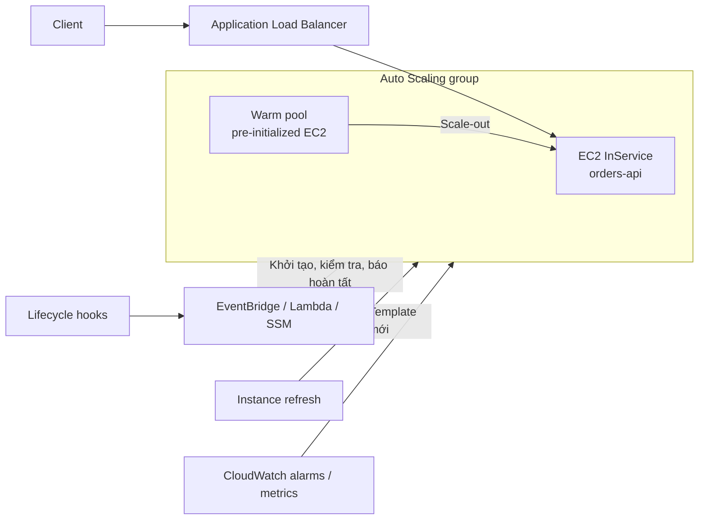
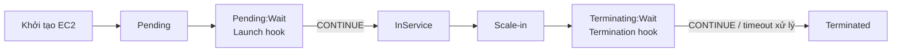
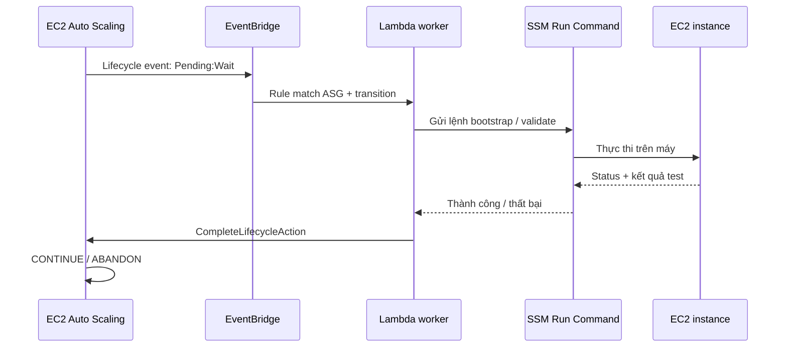
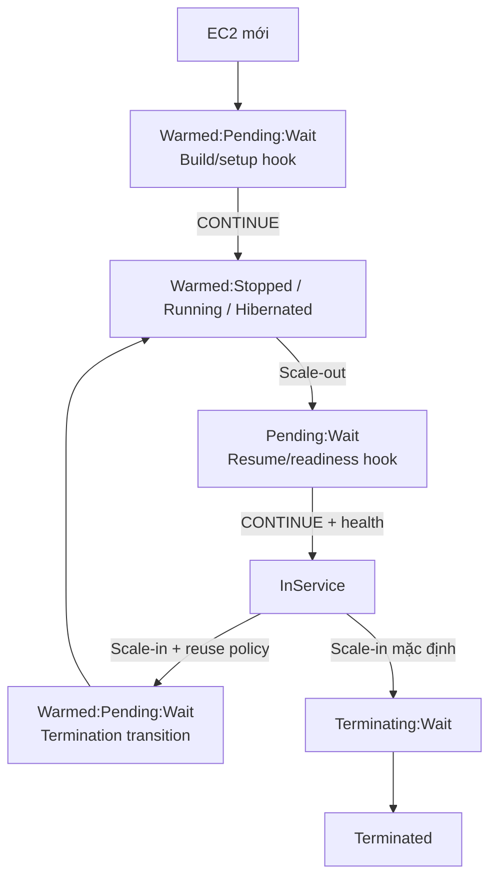
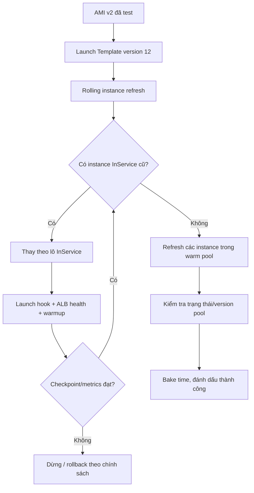

# Warm pool, lifecycle hook và instance refresh trong EC2 Auto Scaling

> **Chương:** Cân bằng tải và mở rộng  
> **Module:** `CLOUD_PROVIDERS_AWS`  
> **Bối cảnh:** Thiết kế một ứng dụng Java chạy trên EC2, đứng sau Application Load Balancer (ALB), sử dụng Auto Scaling group (ASG) để đáp ứng tải, khởi tạo instance an toàn, triển khai bản AMI mới và tối ưu chi phí khi số lượng máy biến động.

## Mục tiêu học tập

Sau bài này, người học có thể:

1. Phân biệt **warm pool**, **lifecycle hook**, **instance warmup**, **health check grace period** và **instance refresh**.
2. Giải thích cách warm pool chuẩn bị trước EC2 và các trạng thái `Stopped`, `Hibernated`, `Running`; xác định lợi ích so với chi phí.
3. Thiết kế lifecycle hook cho quá trình **launch**, **terminate**, vào/ra warm pool; xử lý `Pending:Wait`, `Warmed:Pending:Wait` và kết quả `CONTINUE`/`ABANDON`.
4. Dùng Amazon EventBridge, Lambda hoặc AWS Systems Manager (SSM) để chạy công việc khởi tạo và hoàn tất lifecycle action đúng lúc.
5. Triển khai **instance refresh** theo lô, sử dụng `MinHealthyPercentage`, `MaxHealthyPercentage`, `InstanceWarmup`, checkpoint, bake time, skip matching và rollback.
6. Kết hợp warm pool + lifecycle hook + instance refresh để cập nhật ứng dụng mà vẫn bảo vệ mức phục vụ, khả năng phục hồi và chi phí.
7. Đọc trạng thái và chẩn đoán lỗi qua AWS CLI, Auto Scaling activity history, ELB target health, CloudWatch và CloudTrail.

## 1. Ba cơ chế giải quyết ba vấn đề khác nhau

Một Auto Scaling group có thể tự tạo hoặc chấm dứt instance dựa trên `MinSize`, `MaxSize`, `DesiredCapacity` và scaling policy. Nhưng tự động tăng số lượng máy chưa đủ đảm bảo ứng dụng sẵn sàng phục vụ.

Ví dụ, `orders-api` chạy Spring Boot trên EC2 cần:

- Khoảng vài phút để boot hệ điều hành, tải config, chạy kiểm tra và làm nóng kết nối.
- Chỉ được nhận lưu lượng từ ALB sau khi thực sự sẵn sàng.
- Thay đồng loạt một AMI bị lỗi bảo mật mà vẫn giữ số instance phục vụ cần thiết.
- Không giữ quá nhiều máy chạy không cần thiết chỉ để dự phòng một đợt tải.

Ba tính năng chính giải quyết các vấn đề tương ứng:

| Tính năng | Vấn đề chính | Cách hoạt động | Câu hỏi vận hành |
|---|---|---|---|
| **Warm pool** | Scale-out bị chậm do thời gian khởi tạo EC2/app | Duy trì nhóm instance đã chuẩn bị sẵn bên cạnh ASG | “Có máy sẵn sàng nhanh khi lưu lượng tăng không?” |
| **Lifecycle hook** | Instance vào/ra phục vụ trước khi hoàn thành công việc bắt buộc | Tạm dừng instance ở trạng thái chờ và cho phép xử lý tự động | “Đã cấu hình/kiểm tra/dọn dữ liệu xong trước khi chuyển trạng thái chưa?” |
| **Instance refresh** | Các instance đang chạy giữ cấu hình/AMI cũ | Cập nhật theo lô đến desired configuration, giám sát health và warmup | “Làm sao đưa AMI mới lên toàn ASG có kiểm soát?” |

Các khái niệm liên quan nhưng không hoán đổi cho nhau. Warm pool không tự làm app sẵn sàng; lifecycle hook không tự tạo năng lực dự phòng; instance refresh không tự đảm bảo một bản phát hành có thể phục hồi mà không cần kiểm thử.

### 1.1 Các thành phần cần biết trước

- **Auto Scaling group (ASG):** quản lý nhóm EC2 bằng desired capacity, chính sách scale-out/in, health check và thay thế instance.
- **Launch Template:** mô tả AMI, instance type, IAM instance profile, security group, user data và các tham số khởi chạy. Nên quản lý theo version có thể truy vết.
- **Application Load Balancer (ALB):** phân phối HTTP/HTTPS đến target healthy, hỗ trợ health check và deregistration delay.
- **CloudWatch:** metrics và alarms cho scaling, health, latency, errors, chi phí giám sát.
- **EventBridge:** nhận sự kiện lifecycle/refresh để kích hoạt automation; cần xử lý sự kiện có thể đến lặp hoặc không đúng thứ tự.

Một kiến trúc minh họa:



> Đường mũi tên từ warm pool sang `InService` là chuyển trạng thái instance trong ASG, không phải hoạt động mà ALB trực tiếp quản lý. Instance nằm trong warm pool chưa được coi là target đang phục vụ ứng dụng.

## 2. Warm pool là gì?

**Warm pool** là tập EC2 instance được ASG chuẩn bị trước và duy trì **bên cạnh nhóm đang phục vụ**. Khi cần scale-out, ASG có thể lấy instance sẵn có từ warm pool thay vì phải bắt đầu hoàn toàn từ một EC2 mới.

Lợi ích lớn nhất xuất hiện khi **cold start** tốn nhiều thời gian, chẳng hạn:

- Cài package và Java runtime hoặc tải artifact lớn.
- Download dữ liệu ML/reference, tạo cache lên ổ đĩa.
- Thực hiện kiểm tra cấu hình/tệp hoặc thiết lập agent quản lý.
- Ứng dụng có startup nặng, cần nhiều bước trước khi nhận traffic.

Warm pool không tăng tốc mọi công việc. Nếu mỗi lần instance vào phục vụ vẫn phải tải dữ liệu mới trong nhiều phút, ưu thế có thể bị giảm. Nếu khởi động EC2/app đã rất nhanh, warm pool có thể tạo chi phí không cần thiết.

### 2.1 Đừng nhầm trạng thái EC2 với lifecycle của Auto Scaling

| Đối tượng | Ví dụ trạng thái | Ý nghĩa |
|---|---|---|
| EC2 instance | `running`, `stopped` | Trạng thái compute của máy EC2 |
| ASG instance phục vụ | `Pending`, `Pending:Wait`, `InService`, `Terminating` | Giai đoạn vòng đời do Auto Scaling điều phối |
| Warm pool instance | `Warmed:Pending`, `Warmed:Pending:Wait`, `Warmed:Stopped`, `Warmed:Running`, `Warmed:Hibernated` | Đang chuẩn bị hoặc đang chờ trong warm pool |
| Instance refresh | `Pending`, `InProgress`, `Successful`, `Failed`, `Cancelled`... | Trạng thái **chiến dịch cập nhật**, không phải EC2 state |

Một instance ở `Warmed:Stopped` không tiêu thụ CPU cho ứng dụng, nhưng vẫn là tài nguyên warm pool và có thể bị ASG khởi động lại khi cần mở rộng.

### 2.2 Ba trạng thái warm pool và chi phí

| `PoolState` | Điều xảy ra | Ưu điểm | Chi phí và điều kiện |
|---|---|---|---|
| `Stopped` | EC2 ngừng chạy, EBS vẫn giữ dữ liệu đã chuẩn bị | Tiết kiệm compute khi chờ; tăng tốc so với cài lại từ đầu | Vẫn trả tiền EBS và các tài nguyên tính phí khác; cần EBS-backed root |
| `Hibernated` | Lưu nội dung RAM lên root EBS rồi ngừng chạy | Có thể khôi phục trạng thái bộ nhớ, nhanh với một số workload | Cần hỗ trợ hibernation, đủ EBS, cấu hình phù hợp; trả phí lưu trữ EBS, bao gồm RAM image |
| `Running` | EC2 tiếp tục chạy khi nằm trong warm pool | Gần như không phải khởi động lại máy | Vẫn trả phí EC2 compute; dễ phát sinh chi phí nhàn rỗi |

Với nhiều ứng dụng Java, **`Stopped` là lựa chọn ban đầu hợp lý** nếu phần bootstrap nặng đã ghi kết quả ra ổ đĩa. Hibernation chỉ nên dùng sau khi kiểm tra điều kiện EC2, hệ điều hành, root EBS encryption, RAM và độ ổn định ứng dụng sau resume. `Running` phù hợp khi thật sự cần phản ứng cực nhanh và chấp nhận chi phí compute.

EC2 bị stop hoặc hibernate không nhất thiết miễn phí toàn bộ: EBS volumes, địa chỉ IPv4 công khai/Elastic IP được tính phí theo biểu giá hiện hành, snapshots, logs và tài nguyên phụ trợ vẫn có thể gây chi phí. Warm pool thiếu kiểm soát có thể đội hóa đơn.

### 2.3 Cách tính kích thước warm pool

Giả sử ASG:

```text
MinSize         = 2
DesiredCapacity = 4
MaxSize         = 12
```

Khi không đặt giới hạn warm pool riêng, kích thước ban đầu thường được tính theo:

```text
Warm pool capacity ≈ MaxSize - DesiredCapacity
                   = 12 - 4 = 8
```

Khi số lượng này lớn, hãy cân nhắc đặt `MaxGroupPreparedCapacity` để giới hạn **tổng số instance đang phục vụ + instance được chuẩn bị**.

Ví dụ:

```text
ASG DesiredCapacity       = 4
ASG MaxSize               = 12
MaxGroupPreparedCapacity  = 7

Warm pool mục tiêu ban đầu ≈ 7 - 4 = 3
```

`MinSize` của warm pool quy định mức dự trữ tối thiểu. ASG tự điều chỉnh warm pool theo desired capacity, min size, prepared capacity và các trường hợp khác. Không xem công thức đơn giản trên là đảm bảo pool luôn có đúng N máy ở mọi thời điểm: instance có thể đang pending, chuyển trạng thái, bị thay thế hoặc thiếu capacity tại AZ.

Đặc biệt, `MinSize` của **ASG** khác `MinSize` của **warm pool**. Instance trong warm pool chưa vào `InService` và không được coi là đang phục vụ load balancer.

### 2.4 Điều gì xảy ra khi traffic tăng đột biến?

1. Scaling policy tăng `DesiredCapacity` của ASG.
2. Nếu có instance phù hợp đang chờ trong warm pool, ASG lấy instance ra, khởi động/resume nếu cần.
3. Lifecycle hook được cấu hình có thể giữ instance ở `Pending:Wait` trong lúc kiểm tra lại app.
4. Khi hook hoàn tất và ASG/ALB health check đạt, instance chuyển sang `InService` và phục vụ.
5. Auto Scaling tiếp tục duy trì warm pool theo giới hạn và điều kiện đã cấu hình.

**Nếu pool cạn**, ASG có thể launch instance mới trực tiếp vào nhóm, tạo **cold start**. Vì thế cần định lượng burst capacity, thời gian làm đầy lại pool, quota EC2 và năng lực Region/AZ; warm pool không bảo đảm loại bỏ hoàn toàn thời gian khởi động mới.

### 2.5 Instance reuse khi scale-in

Thông thường, khi giảm tải, ASG **terminate** instance đã phục vụ và có thể tạo instance khác để bù warm pool. Nếu bật:

```text
InstanceReusePolicy.ReuseOnScaleIn = true
```

ASG có thể đưa các instance đang phục vụ trở lại warm pool thay vì terminate. Trước khi reuse cần xử lý các vấn đề:

- Drain connections và hoàn thành request đang xử lý.
- Dọn session, job state, file tạm, log/secret theo policy.
- Thay/cập nhật credential ngắn hạn khi start lại.
- Kiểm tra instance có đang dùng **AMI và ứng dụng version cũ** không.
- Tránh trường hợp dữ liệu runtime hoặc network connection cũ gây lỗi khi resume.

Reuse giúp giảm thời gian/công sức chuẩn bị lại, nhưng tăng trách nhiệm đảm bảo tính sạch và nhất quán của máy.

## 3. Lifecycle hook: giữ instance ở trạng thái chờ

**Lifecycle hook** cho phép ASG tạm dừng một instance tại bước cụ thể của vòng đời để một tác vụ bên ngoài hoàn thành trước khi instance tiếp tục.

Hai lifecycle transition quan trọng:

```text
autoscaling:EC2_INSTANCE_LAUNCHING
autoscaling:EC2_INSTANCE_TERMINATING
```

Ở tình huống thông thường **không có warm pool**:



Tác vụ thường làm tại hook:

| Hook | Tác vụ thường gặp | Kết quả mong đợi |
|---|---|---|
| **Launch** | Cấu hình app, register agent, fetch config, chuẩn bị cache, health smoke test | Không đưa instance vào phục vụ trước khi sẵn sàng |
| **Terminate** | Drain job, ghi checkpoint, flush logs, thông báo hệ thống quản lý | Hoàn tất dọn dẹp trước khi terminate/return-to-pool |
| **Warm pool enter** | Cài package, chép dữ liệu, chạy bootstrap dài | Hoàn tất chuẩn bị trước khi stop/hibernate |
| **Warm pool exit** | Kiểm tra service sau resume, làm nóng cache, xác minh deployment | Sẵn sàng cho InService sau warm start |

### 3.1 Hook chờ bao lâu và ai báo hoàn tất?

Khi hook có hiệu lực, instance vào trạng thái `*:Wait`. AWS phát lifecycle event; automation nhận event và làm việc. Sau đó gọi:

```text
CompleteLifecycleAction(result = CONTINUE | ABANDON)
```

**`CONTINUE`:** cho phép tiếp tục vòng đời, tùy còn hook khác và health checks. **`ABANDON`:** với launch hook, có thể làm ASG terminate và thay instance; với termination hook, chấm dứt ngay và bỏ qua hook khác. Đừng xem `ABANDON` là chức năng tự rollback một đợt phát hành.

Nếu không gọi hoàn tất trước thời hạn, hook dùng **default result** đã cấu hình. Heartbeat timeout mặc định là **3600 giây (1 giờ)**; khi đặt hook, có thể chọn trong phạm vi AWS hỗ trợ. Với tác vụ dài, gọi `RecordLifecycleActionHeartbeat` để gia hạn thời gian chờ từng đợt. Tuy nhiên, tổng thời gian được giữ lại còn chịu **global timeout = nhỏ hơn giữa 48 giờ và 100 lần heartbeat timeout**.

**Thiết kế failure mode rõ ràng:**

- Launch hook bootstrap bắt buộc: thường cân nhắc `ABANDON` để không đưa máy chưa chuẩn bị vào nhóm.
- Termination hook: `CONTINUE` hay `ABANDON` đều dẫn tới terminate, nhưng `ABANDON` có thể bỏ qua các hook khác. Với việc dọn bắt buộc, cần cơ chế đảm bảo bổ sung ngoài hook.
- Sự kiện hoặc tác vụ lỗi: ghi log, gửi cảnh báo và bảo đảm timeout không biến thành “máy chưa sẵn sàng nhưng vẫn hoạt động”.

### 3.2 Lifecycle hook không phải health check

Một hook báo `CONTINUE` chỉ có nghĩa custom action đã được xác nhận hoàn thành theo cơ chế điều phối. Instance vẫn cần:

- EC2 status checks.
- Health check của Auto Scaling (EC2 hoặc ELB tùy cấu hình).
- ALB target group health check (ví dụ `/actuator/health/readiness` của Spring Boot).
- Metrics nghiệp vụ, request latency/error rate, khả năng truy cập database/cache.

Không để một script chỉ kiểm tra tiến trình `java` rồi báo ready nếu ứng dụng chưa hoàn tất migration, kết nối dependency hoặc mở port.

### 3.3 EventBridge, Lambda và Systems Manager

Một workflow phổ biến:



Trong triển khai thực tế, một lệnh SSM có thể mất lâu hơn thời gian chạy tối đa của Lambda. Do đó có thể tách **bắt đầu command** và **xử lý kết quả** qua EventBridge/Step Functions/SQS hoặc worker khác, thay vì để Lambda chờ đồng bộ. Hệ thống nhận event phải xử lý **trùng lặp**, lỗi retry, timeout và lưu correlation bằng lifecycle action token/instance ID, tên ASG và tên hook.

IAM cần quyền tối thiểu cho từng vai trò: role của worker được gọi `autoscaling:CompleteLifecycleAction`, `autoscaling:RecordLifecycleActionHeartbeat` và `ssm:SendCommand` theo tài nguyên phù hợp; EC2 instance profile có quyền SSM và chỉ các dịch vụ ứng dụng cần dùng. Không chứa AWS access key trong user data.

## 4. Lifecycle hook khi có warm pool: điểm dễ sai nhất

Với warm pool, luồng instance có thể đi qua trạng thái **`Warmed:Pending:Wait`** ngoài `Pending:Wait`.

### 4.1 Một launch hook có thể được gọi hai lần

Khi cấu hình `autoscaling:EC2_INSTANCE_LAUNCHING`:

1. **Lần đầu** khi instance mới được tạo để đưa vào warm pool: nó có thể dừng ở `Warmed:Pending:Wait`.
2. Sau khi bootstrap hoàn tất, instance được chuyển về trạng thái pool (`Warmed:Stopped`, `Warmed:Running` hoặc `Warmed:Hibernated`).
3. **Lần sau**, khi scale-out lấy instance từ warm pool vào ASG, hook có thể dừng ở `Pending:Wait`.
4. Hoàn thành bước kiểm tra sau khởi động/resume rồi chuyển `InService`.

Vì vậy handler phải phân biệt sự kiện **đang vào pool** và **đang vào phục vụ** dựa trên lifecycle state/context. Không chạy lại mọi thao tác provisioning tốn thời gian hoặc thao tác không idempotent trong cả hai pha.



Sơ đồ mô tả luồng có hook; khi không có hook, một số trạng thái `:Wait` được bỏ qua.

### 4.2 Vì sao user data thường bị ngắt giữa chừng?

AWS có thể **stop/hibernate instance ngay sau khi khởi tạo vào warm pool**, không đợi toàn bộ user data hoàn tất. Với cloud-init Linux, user data mặc định thường chỉ chạy **lần boot đầu tiên**. Nếu một script tải tệp lớn trong 5 phút nhưng máy bị stop khi mới chạy 2 phút, khi scale-out về sau script có thể không chạy lại.

Hậu quả là instance vào `InService` dù không có đủ artifact/config; ASG có thể coi máy healthy nếu chỉ dựa EC2 health check.

Cách khắc phục:

- Dùng launch lifecycle hook để giữ ở `Warmed:Pending:Wait`, chỉ `CONTINUE` sau khi bootstrap đã kết thúc thực sự.
- “Bake” những phần nặng vào **AMI** bằng EC2 Image Builder để giảm thời gian bootstrap.
- Khi phù hợp, cấu hình user data/cloud-init chạy trên mỗi boot, nhưng phải làm script idempotent, phân biệt lần đầu và lúc resume.
- Tại thời điểm vào phục vụ, kiểm tra **readiness** độc lập, không dựa hoàn toàn vào cờ “đã chạy user data” trong ổ đĩa.

### 4.3 Termination hook và reuse policy

Nếu ASG **không reuse**, termination hook thường dừng instance ở `Terminating:Wait` để drain/flush trước khi terminate. Nếu bật `ReuseOnScaleIn=true`, hook cho transition `autoscaling:EC2_INSTANCE_TERMINATING` có thể chạy ở `Warmed:Pending:Wait` khi instance trở về pool.

Vì thế không viết automation với giả định “gặp termination lifecycle event nghĩa là EC2 chắc chắn bị xóa”. Cần xác định warm pool context, lựa chọn giữ session/cache và bước dọn phù hợp.

### 4.4 Lifecycle hook, default instance warmup, health check grace khác nhau

| Cấu hình | Khi nào tác động? | Mục đích | Có thay được hook không? |
|---|---|---|---|
| **Lifecycle hook heartbeat timeout** | Instance đang chờ `*:Wait` | Thời hạn cho custom action; có heartbeat và complete | Chính nó là cơ chế đồng bộ nghiệp vụ |
| **Health check grace period** | Khi instance mới vào `InService` | Tránh đánh giá instance unhealthy quá sớm khi startup | Không. Không ép bootstrap xong |
| **Default instance warmup** | Sau khi instance vào `InService` | Đợi trước khi tính instance vào aggregated scaling metrics/chu kỳ scaling liên quan | Không. Instance có thể đã nhận traffic |
| **ALB health check** | Target được đăng ký/kiểm tra | Quyết định target đủ điều kiện nhận traffic | Không thay custom hook |
| **Warm pool** | Trước khi instance cần vào `InService` | Giữ máy được chuẩn bị trước | Không bảo đảm app readiness |

Các mốc thời gian có thể chồng lên nhau; đừng cộng chúng thành một “startup timeout” duy nhất.

## 5. Instance refresh: cập nhật có kiểm soát những EC2 đang chạy

Khi sửa Launch Template trỏ đến AMI mới, những EC2 **đã chạy không tự đổi** AMI hoặc OS. **Instance refresh** giúp cập nhật fleet bằng chiến dịch thay thế hoặc bằng chiến lược cập nhật root volume theo trường hợp được hỗ trợ.

Những tình huống phổ biến:

- Cài bản vá hệ điều hành hoặc Java runtime qua golden AMI mới.
- Thay version user data, agent, cấu hình launch hoặc instance type.
- Migrate sang Launch Template mới.
- Làm đồng nhất fleet vốn gồm nhiều version instance.

### 5.1 Rolling instance refresh

Đây là **chiến lược mặc định**. ASG thay instance theo các lô, dựa trên mức healthy capacity được yêu cầu. Đối với ASG đứng sau ALB:

1. Xác định desired configuration (Launch Template version/AMI, loại instance…).
2. Khởi chạy refresh, đặt mức minimum/maximum healthy percentage.
3. ASG lần lượt thay EC2 cũ bằng EC2 mới (hoặc launch-first khi cấu hình cần giữ capacity).
4. Chạy lifecycle hooks, health check, instance warmup.
5. Chỉ tiếp tục lô sau khi đạt các điều kiện liên quan.
6. Khi có warm pool, ASG cập nhật các **`InService` instance trước**, sau đó đến **warm pool instance**.

**Không nên** giả định đổi Launch Template mà không chạy refresh sẽ khiến warm pool tự được thay mới. Máy cũ nằm trong pool vẫn có thể chứa AMI/app version cũ.

### 5.2 Replace root volume: trường hợp đặc biệt

AWS còn hỗ trợ **instance refresh với chiến lược Replace Root Volume** trong những điều kiện nhất định. Thay vì terminate toàn instance, chiến lược này cập nhật **root EBS volume** theo AMI, trong khi giữ các thành phần như ENI, non-root EBS volume và instance identity theo hành vi dịch vụ.

Điều kiện quan trọng gồm ASG dùng **mixed instances policy** phù hợp, overrides có `ImageId`, AMI có một root volume và những ràng buộc khác của AWS. **Không sử dụng Replace Root Volume cho ASG đã có warm pool**: đây là giới hạn của tính năng hiện tại. Trong bài này, kiến trúc warm pool + instance refresh dùng **Rolling**.

Khi chọn root volume replacement, ứng dụng vẫn cần kế hoạch ứng phó với quá trình reboot/health checks và backup trạng thái trên root; không xem đây là chiến lược nâng cấp không có gián đoạn ở tầng ứng dụng.

## 6. Các tùy chọn quan trọng của rolling instance refresh

### 6.1 Minimum và maximum healthy percentage

- **`MinHealthyPercentage`:** phần trăm so với desired capacity cần duy trì ở trạng thái healthy/InService theo tính toán ASG khi thay instance.
- **`MaxHealthyPercentage`:** phần trăm capacity tối đa cho phép trong quá trình refresh; tạo khoảng để **launch-before-terminate** nếu cần.

Ví dụ ASG có `DesiredCapacity=10`:

| Cấu hình minh họa | Ý nghĩa vận hành | Đánh đổi |
|---|---|---|
| `MinHealthyPercentage=90`, `MaxHealthyPercentage=100` | Có thể tạm giảm khoảng 10% healthy capacity khi làm rolling | Ít capacity dự phòng hơn; có nguy cơ tăng độ trễ |
| `MinHealthyPercentage=100`, `MaxHealthyPercentage=110` | Ưu tiên launch instance mới trước khi bỏ instance cũ nếu quota/capacity cho phép | Cần chi phí và quota cho instance bổ sung |
| `MinHealthyPercentage=100`, `MaxHealthyPercentage=100` | Giữ số lượng phục vụ, thay tuần tự theo điều phối | Có thể chậm, phải đợi thêm capacity; bị ảnh hưởng quota |

Các số lượng thực tế chịu **làm tròn và đơn vị capacity** của ASG (nhất là mixed instances/weighted capacities), giới hạn min/max group, health và availability. Phần trăm không phải SLA rằng ứng dụng sẽ không có request lỗi.

Cần kiểm tra **EC2 vCPU quota, instance capacity, subnet IP capacity, target group** và chi phí trước khi yêu cầu ASG nâng capacity tạm thời.

### 6.2 Instance warmup và health check

**`InstanceWarmup`** là khoảng thời gian chờ sau khi instance mới chuyển `InService` và healthy trước khi refresh tiếp tục thay lô sau. Nó khác thời gian dành cho lifecycle hook đang ở `Pending:Wait`.

Chẳng hạn Spring Boot cần 3 phút sau khi có process để đủ cache và connection pool; có thể chọn warmup khoảng 180 giây sau khi đo thực tế. Nhưng nếu readiness endpoint sai và trả 200 trước khi thực sự sẵn sàng, chỉ tăng warmup không chữa được lỗi readiness.

**`HealthCheckGracePeriod`** được đặt trên ASG, không phải một phiên bản khác của `InstanceWarmup`. Nó cho ASG khoảng thời gian trì hoãn đánh giá lỗi health mới sau khi instance vào `InService`; phải phối hợp với ALB health checks và lifecycle hooks.

### 6.3 Skip matching

`SkipMatching=true` giúp bỏ qua instance có cấu hình đã khớp desired configuration theo tiêu chí AWS, giảm thay thế thừa. Tuy nhiên:

- Nó **không thể biết** mọi thay đổi mã nguồn được script user data tải động từ repository.
- Nếu cùng AMI ID/Launch Template version nhưng artifact mới được kéo từ URL cố định, instance có thể bị **skip** dù vẫn chạy code cũ.
- Với một số dạng mixed instances/attribute-based selection, AWS có giới hạn cho `SkipMatching` và `DesiredConfiguration`; kiểm tra tài liệu trước khi sử dụng.

Để phát hành đáng tin cậy, tạo AMI/Launch Template version **bất biến** hoặc quản lý artifact version rõ ràng. Nếu source code thay đổi mà metadata triển khai không đổi, cần dùng cách kiểm tra và chiến lược refresh tương ứng, có thể tắt skip matching.

### 6.4 Checkpoints

`CheckpointPercentages` chia refresh thành giai đoạn để đội vận hành kiểm thử sau từng tỷ lệ thay thế, ví dụ **10% → 50% → 100%**. Sau mỗi checkpoint, có khoảng đợi `CheckpointDelay` hoặc thời gian điều phối theo cấu hình.

Điều nên kiểm tra tại checkpoint:

- ALB 5xx/target 5xx, p95/p99 latency và error rate.
- Tỷ lệ lỗi Java/GC, memory, CPU, thread pool, database connection.
- Hệ thống nghiệp vụ: tạo đơn, xác thực, ghi dữ liệu, event queue.
- So sánh instance mới và cũ về log, metrics, version và traffic.

Checkpoint **không thay thế canary routing** nếu cần so sánh phiên bản theo lưu lượng rất nhỏ hoặc nhóm người dùng cụ thể; nó là điểm dừng của hoạt động thay instance.

### 6.5 Bake time và rollback

**`BakeTime`** là khoảng đợi **cuối chiến dịch refresh**, sau khi những thay thế cần thiết được thực hiện, để tiếp tục kiểm tra health trước khi đánh dấu thành công. Nó khác `InstanceWarmup` cho từng lô.

AWS hỗ trợ **automatic rollback** cho những cấu hình đủ điều kiện khi refresh thất bại hoặc CloudWatch alarms cấu hình cho refresh đi vào `ALARM`. Không mặc định auto rollback bật sẵn. Khi rollback, AWS xử lý thay/khôi phục cấu hình ở mức ASG/instance theo cơ chế dịch vụ; không có nghĩa database schema, giao dịch hoặc dữ liệu ngoài EC2 cũng được rollback.

**Lưu ý về Launch Template version:** để hỗ trợ rollback theo điều kiện dịch vụ, ưu tiên version cụ thể dạng `"12"`; hạn chế dùng `$Latest`/`$Default` trong desired configuration khi yêu cầu rollback tự động và truy vết.

### 6.6 Scale-in protection, standby và những giới hạn

Instance được **protected from scale in**, đang `Standby`, hoặc không healthy có thể cản trở tiến trình refresh; AWS cung cấp lựa chọn xử lý (`Refresh`, `Ignore` hoặc `Wait`, tùy trường) và có timeout khi không thể tiếp tục.

Nếu có hoạt động scale-out trong lúc refresh, các instance mới thường được tạo theo **desired configuration** của refresh, dù việc cập nhật cấu hình ASG chính thức hoàn tất sau khi refresh thành công.

Một refresh có thể kéo dài vì thời gian bootstrap/hook/warmup, số lượng instance, quota hoặc sự cố capacity. Cần có deadline vận hành và cảnh báo thay vì chỉ xem % hoàn thành.

## 7. Warm pool + lifecycle hook + instance refresh phối hợp ra sao?

### 7.1 Trước khi triển khai

ASG `orders-api-asg` đang dùng Launch Template `orders-api-lt:11`, ứng dụng Java v1. `DesiredCapacity=4`, `MaxSize=12`. Warm pool có 3 instance `Warmed:Stopped` đã bootstrap Java.

Khi một đợt tăng tải xảy ra:

1. ASG lấy EC2 từ pool.
2. Launch lifecycle hook thực hiện **readiness sau khi restart**.
3. Khi hoàn tất, ALB health check xác nhận target sẵn sàng.
4. Instance được đưa vào `InService` theo điều phối ASG.
5. Cơ chế scaling bình thường tiếp tục vận hành.

### 7.2 Khi phát hành AMI mới

Đội phát triển xây AMI v2 đã kiểm thử, tạo Launch Template version **12** trỏ AMI mới và chạy **Rolling instance refresh**.



Các điểm mấu chốt:

- Instance `InService` được thay **trước** warm pool.
- Trong lúc refresh, pool có thể chưa đồng nhất AMI version. Không dựa vào số máy trong pool để kết luận bản phát hành hoàn tất.
- Với warm pool, **không chọn Replace Root Volume strategy** vì AWS không hỗ trợ kết hợp này.
- Lifecycle hook có thể giữ các instance mới trong trạng thái chờ để kiểm tra. Nếu nó fail và `ABANDON`, ASG tạo instance thay thế; refresh có thể chậm hoặc thất bại nếu lỗi lặp.
- Chỉ kết thúc khi cả fleet và warm pool (theo phạm vi refresh), health và chỉ số nghiệp vụ đáp ứng tiêu chí.

### 7.3 Khi rollback

Nếu bản v2 gây tăng lỗi nghiệp vụ:

1. Dừng tiếp tục rollout hoặc kích hoạt rollback theo cơ chế/điều kiện hỗ trợ.
2. Xác định cấu hình v1 ổn định (AMI và Launch Template version 11).
3. Đưa ASG trở lại version đã được phê duyệt, thực hiện thay những instance cần thiết.
4. Kiểm tra **warm pool** còn instance v2/v1; yêu cầu đồng bộ theo chiến dịch rollout/rollback.
5. Xác minh app và dữ liệu (DB migrations tương thích ngược, queue, session).
6. Lưu bằng chứng lỗi, cập nhật component/Image Builder pipeline và phát hành bản sửa.

**Chỉ đổi Launch Template version không biến instance đang chạy trở về AMI cũ.** Instance refresh/rollback thay fleet theo chính sách, còn dữ liệu ngoài EC2 phải có kế hoạch phục hồi riêng.

## 8. Tính toán trade-off: giảm thời gian scale-out với warm pool

Giả sử một ứng dụng Java có:

```text
Cold boot EC2 + hệ điều hành      45 giây
Cài agent + tải artifact         90 giây
Khởi tạo Spring Boot             75 giây
Tạo cache ban đầu                30 giây
------------------------------------------
Cold start minh họa             240 giây
```

Nếu AMI đã chứa agent/artifact và warm pool giữ trạng thái `Stopped` sau bootstrap, một lần scale-out từ pool có thể chỉ mất khoảng thời gian khởi động lại, readiness check và ALB registration. **Không có cam kết AWS cho con số cụ thể**: phải đo từ yêu cầu scale-out đến target thật sự healthy và đáp ứng request.

Giả sử hệ thống cần tăng thêm **3 instance trong 2 phút**. Nếu cold start thực tế 4 phút, tăng desired capacity khi CPU đã cao sẽ đến muộn. Có thể:

- Duy trì warm pool tối thiểu 3 instance.
- Dùng target tracking/predictive hoặc scheduled scaling trước các đợt tải có quy luật.
- Tối ưu AMI/User Data để rút ngắn thời gian boot.
- Đo lại `TimeToInService`, thời gian ELB healthy và độ trễ ứng dụng.

### 8.1 Không mặc định warm pool sẽ rẻ hơn

Warm pool trạng thái `Running` vẫn tính phí EC2. Với `Stopped` hoặc `Hibernated`, phí EBS vẫn tăng theo số instance; AMI/snapshot, logs và IPv4 có thể bổ sung chi phí. Một warm pool quá lớn có thể tốn nhiều hơn lợi ích giảm latency.

Trước khi bật, so sánh:

| Lựa chọn | Ưu điểm | Điểm cần đánh đổi |
|---|---|---|
| Không warm pool; scale-out bình thường | Đơn giản, ít tài nguyên nhàn rỗi | Cold start dài khi burst |
| Warm pool `Stopped` | Chuẩn bị trước disk/software với ít phí compute khi chờ | Vẫn cần thời gian boot lại và EBS |
| Warm pool `Hibernated` | Giữ state RAM khi đủ điều kiện | Giới hạn hibernation, EBS RAM image, kiểm tra resume |
| Warm pool `Running` | Sẵn sàng nhanh | Phí compute chạy liên tục |
| Tối ưu AMI + warm pool nhỏ | Giảm bootstrap và giới hạn pool | Cần image pipeline và kiểm thử |
| Scheduled scaling | Chuẩn bị năng lực trước tải dự đoán được | Không phản ứng tốt với tải bất ngờ |

## 9. AWS CLI: quan sát cấu hình hiện tại

Các ví dụ sử dụng AWS CLI v2. Tên tài nguyên `orders-api-asg`, `orders-api-lt` và ID mô phỏng cần thay bằng thông tin thật. Các lệnh trong mục này là **read-only**.

### 9.1 Xác định Account/Region

```bash
aws sts get-caller-identity
aws configure get region
```

Nếu làm việc với nhiều Account/Region, truyền `--profile` và `--region` vào lệnh phù hợp; không suy từ hostname hoặc tên ASG.

### 9.2 Kiểm tra ASG và lifecycle state của instance

```bash
aws autoscaling describe-auto-scaling-groups \
  --auto-scaling-group-names orders-api-asg \
  --region ap-southeast-1 \
  --query 'AutoScalingGroups[].{Name:AutoScalingGroupName,Min:MinSize,Desired:DesiredCapacity,Max:MaxSize,LaunchTemplate:LaunchTemplate,Instances:Instances[].{Id:InstanceId,Lifecycle:LifecycleState,Health:HealthStatus}}' \
  --output json
```

Nhìn vào `DesiredCapacity` và `LifecycleState` để phân biệt instance phục vụ với instance đang chờ vào nhóm. Khi dùng mixed instances policy, cấu hình Launch Template có thể nằm trong cấu trúc khác trường `LaunchTemplate` ở mức ASG.

### 9.3 Kiểm tra warm pool

```bash
aws autoscaling describe-warm-pool \
  --auto-scaling-group-name orders-api-asg \
  --region ap-southeast-1 \
  --output json
```

Các trường cần chú ý: `WarmPoolConfiguration.PoolState`, `MinSize`, `MaxGroupPreparedCapacity`, `InstanceReusePolicy` và `Instances[].LifecycleState`. Nếu group chưa có pool, kiểm tra thông báo lỗi thay vì cho rằng ASG không tồn tại.

### 9.4 Liệt kê lifecycle hooks

```bash
aws autoscaling describe-lifecycle-hooks \
  --auto-scaling-group-name orders-api-asg \
  --region ap-southeast-1 \
  --query 'LifecycleHooks[].{Name:LifecycleHookName,Transition:LifecycleTransition,Timeout:HeartbeatTimeout,Default:DefaultResult}' \
  --output table
```

Đối chiếu hook name, transition, timeout và default result với nhu cầu ứng dụng. Khi hook bị timeout, log/metric phải cho biết có instance nào vào phục vụ khi bootstrap chưa xong hay không.

### 9.5 Xem instance refresh và scaling activities

```bash
aws autoscaling describe-instance-refreshes \
  --auto-scaling-group-name orders-api-asg \
  --region ap-southeast-1 \
  --query 'InstanceRefreshes[].{Id:InstanceRefreshId,Status:Status,Percentage:PercentageComplete,ToUpdate:InstancesToUpdate,Reason:StatusReason}' \
  --output table

aws autoscaling describe-scaling-activities \
  --auto-scaling-group-name orders-api-asg \
  --region ap-southeast-1 \
  --max-items 20 \
  --query 'Activities[].{Time:StartTime,Status:StatusCode,Reason:Description}' \
  --output table
```

Khi quá trình refresh bị đình trệ, đọc `StatusReason` và scaling activities để tìm lỗi capacity, IAM, AMI, lifecycle hook hoặc health check.

## 10. AWS CLI: tạo warm pool và lifecycle hook (ví dụ có thay đổi hạ tầng)

> **Chỉ thực hiện trong tài khoản thử nghiệm hoặc quy trình thay đổi đã được duyệt.** Những lệnh sau làm thay đổi ASG và có thể tạo EC2 instance, EBS volume, chi phí mới. Cần có quyền IAM, launch template hợp lệ, EC2 quota và security group/VPC được cấu hình.

### 10.1 Đặt warm pool `Stopped`

```bash
aws autoscaling put-warm-pool \
  --auto-scaling-group-name orders-api-asg \
  --pool-state Stopped \
  --min-size 2 \
  --max-group-prepared-capacity 8 \
  --instance-reuse-policy ReuseOnScaleIn=true \
  --region ap-southeast-1
```

Trong ví dụ, pool được cấu hình dự trữ **ít nhất 2** instance khi đủ điều kiện, tổng prepared capacity có trần 8, và sử dụng cơ chế trả instance vào pool khi scale-in. Giá trị `8` chỉ hợp lý nếu phù hợp `DesiredCapacity` và nhu cầu ASG thực tế; không được sao chép máy móc.

### 10.2 Tạo launch lifecycle hook

```bash
aws autoscaling put-lifecycle-hook \
  --auto-scaling-group-name orders-api-asg \
  --lifecycle-hook-name bootstrap-readiness \
  --lifecycle-transition autoscaling:EC2_INSTANCE_LAUNCHING \
  --heartbeat-timeout 900 \
  --default-result ABANDON \
  --region ap-southeast-1
```

Hook này giữ instance ở `*:Wait` tối đa 900 giây cho một heartbeat interval; automation phải gọi complete khi xong. Nếu không có callback, `ABANDON` giúp tránh tiếp tục launch một instance chưa được chứng nhận. Khi warm pool hoạt động, launch hook có thể xuất hiện ở **hai thời điểm**: vào pool và ra phục vụ.

Lệnh `put-lifecycle-hook` cấu hình hook; nó **không tạo sẵn** logic Lambda/SSM hay tự kiểm tra ứng dụng. Nếu dùng EventBridge, cần định nghĩa rule và target riêng.

### 10.3 Gửi heartbeat và hoàn tất

Sau khi worker nhận được lifecycle event và biết **instance ID**, tên ASG và tên hook:

```bash
# Trong lúc bootstrap còn thực hiện
aws autoscaling record-lifecycle-action-heartbeat \
  --auto-scaling-group-name orders-api-asg \
  --lifecycle-hook-name bootstrap-readiness \
  --instance-id i-0123456789abcdef0 \
  --region ap-southeast-1

# Khi tất cả điều kiện readiness pass
aws autoscaling complete-lifecycle-action \
  --auto-scaling-group-name orders-api-asg \
  --lifecycle-hook-name bootstrap-readiness \
  --instance-id i-0123456789abcdef0 \
  --lifecycle-action-result CONTINUE \
  --region ap-southeast-1
```

Khi cùng instance/hook có nhiều lifecycle actions theo thời điểm (đặc biệt trong warm pool), dùng **lifecycle action token đúng sự kiện** nếu được cung cấp và phù hợp API, tránh callback nhầm action cũ. Tác vụ bootstrap phải kiểm tra đúng event, không gọi `CONTINUE` chỉ dựa vào việc nhận event.

Nếu xảy ra lỗi không thể phục hồi trong thời hạn hook, automation có thể dùng `ABANDON` cho launch action theo thiết kế. Với terminate action, cần quản lý riêng các hoạt động dọn dẹp không thể đảo ngược.

### 10.4 Xem target health tại ALB

```bash
aws elbv2 describe-target-health \
  --target-group-arn arn:aws:elasticloadbalancing:ap-southeast-1:123456789012:targetgroup/orders-api/0123456789abcdef \
  --region ap-southeast-1 \
  --output json
```

ARN ở trên là ví dụ. Kiểm tra `TargetHealth.State` và `Reason`. Instance mới `InService` trong ASG và target healthy tại ALB có liên hệ, nhưng không nên dùng một field duy nhất để đánh giá toàn bộ tình trạng ứng dụng.

## 11. AWS CLI: triển khai bằng rolling instance refresh

Giả sử Launch Template `orders-api-lt` đã có version `12` với AMI mới đã kiểm thử. Ví dụ dưới đây chọn:

- Healthy capacity tối thiểu 100% của desired capacity.
- Cho phép tăng lên tối đa 110% trong lúc cập nhật.
- Warmup 180 giây.
- Checkpoint ở 10%, 50%, 100%, đợi 600 giây tại checkpoint.
- Skip instances đã khớp version.
- Bật auto rollback, bake time 300 giây.

```bash
aws autoscaling start-instance-refresh \
  --auto-scaling-group-name orders-api-asg \
  --strategy Rolling \
  --desired-configuration '{"LaunchTemplate":{"LaunchTemplateName":"orders-api-lt","Version":"12"}}' \
  --preferences '{"MinHealthyPercentage":100,"MaxHealthyPercentage":110,"InstanceWarmup":180,"CheckpointPercentages":[10,50,100],"CheckpointDelay":600,"SkipMatching":true,"AutoRollback":true,"BakeTime":300}' \
  --region ap-southeast-1
```

Lệnh trả về `InstanceRefreshId`. JSON inline trên minh họa cách dùng với **Bash**; trong **PowerShell/Windows**, escaping/quoting có thể khác. Có thể lưu JSON vào file và truyền `--desired-configuration file://desired-configuration.json`, `--preferences file://refresh-preferences.json` theo CLI để tránh lỗi dấu nháy.

**Không áp dụng nguyên tham số trên mọi ASG:** giá trị có thể không hợp lệ hoặc không được hỗ trợ theo policy, mixed instances, attribute-based instance selection, launch template version/rollback, warm pool và maintenance policy. Đọc cấu hình ASG hiện có, tài liệu AWS và chạy thử tại môi trường staging.

### 11.1 Theo dõi và xử lý tình huống chưa đạt

```bash
aws autoscaling describe-instance-refreshes \
  --auto-scaling-group-name orders-api-asg \
  --instance-refresh-ids 01234567-89ab-cdef-0123-456789abcdef \
  --region ap-southeast-1
```

Thay ID giả định bằng ID nhận từ lần gọi thực tế. Khi có lỗi, trước tiên xác định refresh đang bị chặn ở lifecycle hook, health check, quota/capacity, checkpoint hay desired configuration.

### 11.2 Cancel và rollback không giống nhau

```bash
# Dừng thay thế thêm instance (không đảo ngược những instance đã cập nhật)
aws autoscaling cancel-instance-refresh \
  --auto-scaling-group-name orders-api-asg \
  --region ap-southeast-1

# Khởi động rollback theo khả năng hỗ trợ và trạng thái refresh
aws autoscaling rollback-instance-refresh \
  --auto-scaling-group-name orders-api-asg \
  --region ap-southeast-1
```

**`Cancel`** dừng hoạt động refresh tiếp theo nhưng không tự khôi phục fleet/AMI cũ. **`Rollback`** yêu cầu AWS thực hiện chiến dịch đưa fleet về previous configuration theo điều kiện hỗ trợ, có thể cần thời gian và capacity. Với database migration không tương thích ngược, rollback EC2 **không tự khôi phục schema/data**.

## 12. Thiết kế readiness hook cho ứng dụng Java

Giả sử `orders-api` cung cấp endpoint:

```text
GET /actuator/health/liveness
GET /actuator/health/readiness
```

- **Liveness:** tiến trình còn sống và đủ điều kiện restart nếu gặp lỗi không hồi phục.
- **Readiness:** ứng dụng sẵn sàng nhận request nghiệp vụ: dependencies quan trọng, cấu hình, migration/seed phù hợp, listener, thread pool.
- **ALB target group health check:** nên dùng đường dẫn readiness phù hợp, có điều kiện trả về 200 chính xác và tránh kiểm tra phụ thuộc quá sâu gây cascade failure.

Có thể xây bootstrap controller theo các bước:

```text
onLifecycleEvent(event):
    require event.asg == "orders-api-asg"
    require event.hook == "bootstrap-readiness"
    require event.transition == EC2_INSTANCE_LAUNCHING

    if event.lifecycleState == "Warmed:Pending:Wait":
        ensureBaseDependenciesInstalled()
        verifyArtifactChecksum()
        verifySystemdUnitsPresent()
        complete(event.token, CONTINUE)

    else if event.lifecycleState == "Pending:Wait":
        waitForServiceStarted()
        checkReadinessEndpointLocally()
        verifyExpectedApplicationVersion()
        complete(event.token, CONTINUE)

    else:
        logAndIgnoreUnexpectedState()

onTransientFailure:
    heartbeat(event.token) while within bounded deadline
    retryWithBackoff()

onPermanentFailure:
    complete(event.token, ABANDON)
    alertOperations()
```

Đây là **pseudocode kiến trúc**, chưa phải Lambda có thể triển khai trực tiếp. Cần dùng thông tin event/metadata thực tế theo schema của AWS và có:

- **Idempotency:** EventBridge có thể chuyển lại sự kiện; tác vụ có thể được gọi nhiều lần.
- **Deadline:** Không đợi vô hạn sau khi global timeout hết.
- **Observability:** Ghi correlation ID, hook name, ASG, instance ID, AMI/app version, lifecycle state và kết quả.
- **Access control:** Chỉ worker đúng role được gọi lifecycle APIs; không cấp wildcard permissions không cần thiết.
- **Secret hygiene:** Lấy credential tại runtime qua IAM role/Secrets Manager/SSM Parameter Store, không “bake” secret vào AMI.
- **Fallback:** Nếu automation không hoạt động, default result phải phù hợp rủi ro vận hành.

### 12.1 Tại sao cần hai pha bootstrap?

Pha **warm pool enter** có thể:

- Cài Corretto 21, đặt cấu hình OS, tạo directory.
- Tải artifact đã phê duyệt về EBS và xác minh hash/signature.
- Pre-compute dữ liệu tĩnh hoặc tạo cache trên disk.
- Cài CloudWatch Agent và SSM agent theo AMI baseline.

Pha **warm pool exit** có thể:

- Bật lại systemd service và đợi `readiness=UP`.
- Lấy config/env mới nhất từ nguồn tin cậy.
- Xác minh token/secrets đã được cấp mới hợp lệ.
- Tạo connection pool và cache volatile cần thiết.
- Xác nhận AMI/artifact version đúng desired configuration trước khi vào traffic.

Không nên khởi động toàn bộ workload hoặc tạo session với cơ sở dữ liệu quá lâu trước khi máy được đưa vào phục vụ nếu session sẽ hết hạn khi instance đang `Stopped`.

## 13. Giám sát hiệu quả của warm pool và instance refresh

### 13.1 Các chỉ số quan trọng

| Nhóm | Chỉ số / thông tin | Điều muốn biết |
|---|---|---|
| **Scale-out** | Thời gian từ tăng desired capacity đến ALB target healthy | Warm pool có thực sự giảm latency không? |
| **Warm pool** | Số instance Warmed:Stopped/Running/Hibernated, mức hết pool | Pool có đủ dự trữ và được bổ sung kịp không? |
| **Bootstrap** | Số hook `Pending:Wait`, timeout, CONTINUE/ABANDON, thời gian từng pha | Bước chuẩn bị nào chậm/hỏng? |
| **Fleet consistency** | AMI ID, Launch Template version, app build SHA theo instance | Có máy đang chạy version cũ không? |
| **Refresh** | `PercentageComplete`, `StatusReason`, checkpoint/bake, số instance cần update | Chiến dịch có tiến triển không? |
| **Application** | ALB TargetResponseTime, HTTPCode_Target_5XX_Count, errors, p95/p99 latency | Khách hàng có bị ảnh hưởng không? |
| **Capacity** | EC2 quotas, subnet IP còn lại, target group healthy count | Có đủ tài nguyên thêm máy khi launch-before-terminate? |
| **Cost** | EC2 running/stopped, EBS, IPv4, logs, ALB, NAT Gateway | Pool/refresh có làm vượt ngân sách? |

Kết hợp **CloudWatch alarms**, EventBridge refresh events, Auto Scaling activity logs, EC2 status checks và log ứng dụng. Nếu dùng CloudWatch metrics cho warm pool, kiểm tra và bật tính năng group metrics collection tương ứng; không giả định tất cả metrics tự hiện ngay trên dashboard.

### 13.2 Thử nghiệm trước production

Một bài test có ý nghĩa nên chạy cả:

1. **Cold start baseline:** không warm pool, đo `T_scaleout → T_ALB_healthy`.
2. **Warm start:** cùng AMI/app version, có warm pool `Stopped`, đo lại theo tải mô phỏng.
3. **Pool exhausted:** yêu cầu scale-out lớn hơn số instance trong pool.
4. **Broken bootstrap:** cố tình để readiness fail ở staging, xác minh hook `ABANDON` và alarm.
5. **Instance refresh:** thay AMI v1 → v2, kiểm tra checkpoint và fleet consistency.
6. **Rollback:** gây lỗi giả định có kiểm soát, xác nhận đường quay lại version đã được phê duyệt.
7. **AZ failure/capacity:** đánh giá việc warm pool hoặc EC2 quota thiếu tài nguyên.

Chỉ sử dụng số đo thực nghiệm từ môi trường tương ứng để chọn pool size, timeout và warmup; không dựa vào một giá trị mẫu trong tài liệu.

## 14. Chẩn đoán sự cố thường gặp

| Triệu chứng | Nguyên nhân có thể | Hướng kiểm tra |
|---|---|---|
| Warm pool đã có instance nhưng scale-out vẫn chậm | Sau resume app vẫn phải tải dữ liệu; pool ở `Stopped`; hook kiểm tra kéo dài | Đo từng pha stop/start, bootstrap, Pending:Wait, ALB healthy |
| Instance vào pool nhưng app thiếu package | User data bị stop/hibernate giữa chừng | Dùng launch lifecycle hook, image baking và kiểm tra dấu hiệu bootstrap hoàn tất |
| Một launch hook gọi hai lần | Instance đi **vào** rồi **ra** warm pool | Phân biệt `Warmed:Pending:Wait` và `Pending:Wait`, làm handler idempotent |
| Instance bị terminate liên tục | Launch hook timeout + default ABANDON; app health fail | Kiểm tra EventBridge/SSM/Lambda logs, hook timeout, ALB health |
| ASG có nhiều instance đang `Pending:Wait` | Callback mất, wrong token hoặc tác vụ bootstrap kẹt | Xem lifecycle events, credentials, permissions và deadline |
| Instance quay lại warm pool với state cũ | Bật reuse-on-scale-in nhưng thiếu cleanup | Thiết kế shutdown/drain và reinitialize khi warm pool exit |
| Refresh báo 100% nhưng app lỗi | Health endpoint không phản ánh nghiệp vụ; thiếu bake/checkpoint | Bổ sung smoke/business metrics và CloudWatch alarm |
| Refresh đứng ở 50% | Checkpoint delay, scale-in protected/standby, quota, unhealthy instance | Xem StatusReason, refresh preferences và scaling activities |
| Refresh không thay instance cũ | Skip matching thấy cấu hình “khớp”, code tải động không đổi Launch Template | Pin AMI/artifact version hoặc tắt skip matching theo thiết kế |
| Không thể dùng Replace Root Volume | ASG có warm pool, hoặc điều kiện mixed instances/AMI không phù hợp | Dùng Rolling hoặc điều chỉnh kiến trúc theo giới hạn AWS |
| Chi phí tăng sau khi bật pool | `Running`, pool size lớn, EBS/IPv4 dư thừa | Kiểm tra Cost Explorer, warm pool state/capacity, idle resources |
| ALB target healthy nhưng khách hàng lỗi | Readiness quá đơn giản, session/state/DB incompatible | Kiểm tra nghiệp vụ và tương thích phiên bản/cơ sở dữ liệu |

### 14.1 Quy trình điều tra ngắn

1. Xác định Account, Region, ASG, Launch Template version và AMI thực tế.
2. Xác định vấn đề thuộc **warm pool capacity**, **lifecycle hook wait**, **ALB readiness** hay **instance refresh**.
3. Đọc `describe-warm-pool`, `describe-lifecycle-hooks`, `describe-instance-refreshes` và scaling activity.
4. Xem EventBridge/worker logs để biết callback đã gọi `CONTINUE` hay `ABANDON`; có timeout và retries không?
5. So sánh version/cấu hình của instance `InService` với instance `Warmed:*`.
6. Xem CloudWatch và ALB target health; kiểm tra EC2 quota/IP/AZ availability.
7. Xác nhận lỗi đã được giải quyết bằng một lượt scale-out và một lượt refresh nhỏ tại staging.

## 15. Bảo mật, sẵn sàng và kiểm soát chi phí

### 15.1 Bảo mật khi tự động bootstrap

Lifecycle handler có khả năng khởi động, cấu hình và chuyển trạng thái EC2; IAM cho handler phải được giới hạn chính xác. Đối với bootstrap Java:

- Tải artifact qua S3/private repository với quyền IAM phù hợp.
- Xác minh artifact version và integrity trước `CONTINUE`.
- Dùng SSM Session Manager/Run Command khi phù hợp, tránh mở SSH/22 toàn Internet.
- Không đưa access key, database password, OAuth secret vào user data, AMI hoặc logs.
- Giới hạn role được gọi `CompleteLifecycleAction`, `RecordLifecycleActionHeartbeat` và `SendCommand`; audit qua CloudTrail.
- Ghi nhận sự kiện release và bằng chứng kiểm thử; không tắt health check chỉ để refresh “xanh”.

### 15.2 Khả năng phục hồi khi một AZ bị sự cố

Warm pool không tự biến kiến trúc một AZ thành multi-AZ. ASG cần khai báo subnet tại nhiều AZ, ALB cross-zone theo mô hình phù hợp, dữ liệu dùng chung được tách khỏi EC2 và kế hoạch xử lý instance capacity.

Nếu AZ-A không có khả năng cấp EC2 mới, warm pool ở AZ khác có thể hữu ích nhưng vẫn chịu giới hạn capacity placement và cấu hình ASG. Khi cần sẵn sàng cao, đánh giá workload có thể chạy trong nhiều AZ, session store, database failover, health routing và hạn chế AZ capacity. Warm pool chỉ là một thành phần của bài toán mở rộng.

### 15.3 Ngân sách khi refresh

Khi rolling refresh sử dụng launch-before-terminate, số instance chạy có thể **tạm vượt desired capacity**. Cộng với warm pool `Running` hoặc EBS `Stopped`, chi phí sẽ cao hơn trong thời gian phát hành.

Nên:

1. Ước tính max concurrent running instances trong refresh.
2. Kiểm tra vCPU quota và số IP trong subnet.
3. Sử dụng AWS Budgets/Cost Explorer, tags theo môi trường/ASG và metric capacity.
4. Đặt lifecycle retention hợp lý cho AMI/EBS snapshots và CloudWatch logs.
5. Dọn các bản AMI/instance đã nghỉ nhưng giữ khả năng rollback đúng thời hạn cần thiết.

## 16. Bài tập tự kiểm tra

**Bài 1 — Chọn công cụ.** Ứng dụng Java cần 4 phút khởi động. Lúc tăng tải, người dùng bắt đầu gặp timeout trước khi ASG kịp tạo thêm máy. Tính năng nào giúp chuẩn bị EC2 trước? Bạn có cần lifecycle hook không, và để làm gì?

**Bài 2 — Pool size.** ASG có desired capacity 6, max size 20. Nếu tạo warm pool mà không đặt `MaxGroupPreparedCapacity`, số warm pool instance theo công thức khởi tạo mặc định là bao nhiêu? Nếu đặt `MaxGroupPreparedCapacity=9` thì khoảng bao nhiêu?

**Bài 3 — User data.** EC2 mới vào warm pool với script cài Java 21 cần 3 phút. Sau 30 giây instance bị stop, về sau start lại nhưng không cài xong Java. Giải thích nguyên nhân và ít nhất hai hướng sửa.

**Bài 4 — Hook hai lần.** Một handler nhận sự kiện launch cùng instance ID tại `Warmed:Pending:Wait` và sau đó `Pending:Wait`. Tại sao? Tác vụ nào nên chạy trong mỗi pha?

**Bài 5 — Timeout và failure.** Launch hook có `HeartbeatTimeout=300` và `DefaultResult=ABANDON`. Nếu worker không gọi callback trong 300 giây, điều gì có thể xảy ra? Gửi heartbeat định kỳ có cho phép chờ vô hạn không?

**Bài 6 — Instance refresh.** ASG desired 10, team muốn luôn giữ ít nhất 10 healthy instances khi chuyển AMI v1 → v2. Cặp thông số minimum/maximum healthy percentage nào có thể phù hợp, và chi phí/quota phải lưu ý?

**Bài 7 — Skip matching.** EC2 tải JAR từ `latest.jar` trong user data. Tệp JAR thay đổi nhưng AMI và Launch Template version không đổi. Khi bật `SkipMatching=true`, vì sao refresh có thể bỏ qua máy đang chạy code cũ?

**Bài 8 — Warm pool cùng refresh.** Sau refresh, tất cả `InService` instances đều dùng AMI v2 nhưng còn nhiều instance `Warmed:Stopped` dùng v1. Có thể coi toàn bộ fleet đã đồng bộ chưa? Chiến lược instance refresh nào không dùng được nếu ASG có warm pool?

**Bài 9 — Rollback.** Một release v2 làm tăng lỗi database. Đổi Launch Template về v1 có tự thay các instance đang chạy không? Rollback EC2 có tự undo schema migration không?

<details>
<summary>Gợi ý đáp án</summary>

1. Warm pool giảm cold start bằng máy đã chuẩn bị trước; lifecycle hook giữ instance chờ đến khi bootstrap/readiness thật sự hoàn tất.
2. Công thức ban đầu: 20 − 6 = 14; nếu prepared cap 9, khoảng 9 − 6 = 3, giả sử không có constraint khác.
3. ASG stop trước khi user data hoàn tất; cloud-init thường không chạy lại script lần đầu. Dùng launch lifecycle hook, bake vào AMI, hoặc user data mỗi boot có idempotency.
4. Hook gọi khi instance đi vào pool, rồi lần nữa khi lấy từ pool vào InService. Pha đầu cài đặt nền/kiểm hash; pha sau kiểm readiness sau resume.
5. Sau timeout, ABANDON có thể làm ASG terminate instance chưa hoàn tất. Heartbeat gia hạn từng đợt nhưng vẫn có global timeout nhỏ hơn giữa 48 giờ và 100 lần heartbeat timeout.
6. Ví dụ min 100%, max 110% hoặc mức cao hơn được phép, có capacity/quota phù hợp để launch-before-terminate.
7. Skip matching nhìn cấu hình/Launch Template theo tiêu chí AWS, không biết nội dung file tải động đã thay. Cần version artifact rõ hoặc refresh không skip theo policy.
8. Chưa. Rolling refresh cần xử lý các instance warm pool sau InService; Replace Root Volume không hỗ trợ ASG có warm pool.
9. Không. Cần thay/cập nhật fleet theo refresh/rollback. Database schema và dữ liệu phải có kế hoạch tương thích/khôi phục riêng.

</details>

## 17. Checklist trước khi đưa vào production

- [ ] Đã biết thời gian cold start, warm start và `T_scaleout → T_ALB_healthy` thực tế.
- [ ] Đã xác nhận ASG min/desired/max, subnet nhiều AZ, quota EC2 và capacity.
- [ ] Đã chọn `PoolState` cùng kích thước pool dựa trên nhu cầu tải và chi phí.
- [ ] Đã dùng launch hook nếu bootstrap có thể bị stop/hibernate trước khi hoàn tất.
- [ ] Handler phân biệt `Warmed:Pending:Wait` và `Pending:Wait`, có idempotency và timeout.
- [ ] Đã chọn hợp lý `CONTINUE`/`ABANDON`, heartbeat timeout, global deadline và cơ chế retry.
- [ ] User data, AMI, artifact và secret được quản lý theo version/quyền tối thiểu.
- [ ] ALB readiness/health check, ASG health grace và instance warmup được cấu hình theo chức năng riêng.
- [ ] Instance refresh dùng **version Launch Template cụ thể**, có mức healthy capacity phù hợp.
- [ ] Đã kiểm tra checkpoints, bake time, skip matching và rollback/CloudWatch alarms nếu cần.
- [ ] Khi dùng warm pool, rolling refresh xử lý cả instance `InService` và `Warmed:*`.
- [ ] Đã diễn tập thiếu capacity, hook failure, pool cạn, rollback, AZ failure và việc scale-in reuse.
- [ ] Đã theo dõi lỗi/lifecycle events, App/ALB metrics và chi phí EBS/EC2 khi pool nhàn rỗi.
- [ ] Đã kiểm tra khả năng khôi phục dữ liệu bên ngoài EC2, nhất là database/schema migration.

## Tài liệu chính thức của AWS

- [Amazon EC2 Auto Scaling — Decrease latency using warm pools](https://docs.aws.amazon.com/autoscaling/ec2/userguide/ec2-auto-scaling-warm-pools.html)
- [Amazon EC2 Auto Scaling — Create a warm pool](https://docs.aws.amazon.com/autoscaling/ec2/userguide/creating-warm-pool.html)
- [Amazon EC2 Auto Scaling — Lifecycle hooks](https://docs.aws.amazon.com/autoscaling/ec2/userguide/lifecycle-hooks.html)
- [Amazon EC2 Auto Scaling — Use lifecycle hooks with a warm pool](https://docs.aws.amazon.com/autoscaling/ec2/userguide/warm-pool-instance-lifecycle.html)
- [Amazon EC2 Auto Scaling — Add lifecycle hooks](https://docs.aws.amazon.com/autoscaling/ec2/userguide/adding-lifecycle-hooks.html)
- [Amazon EC2 Auto Scaling — Complete a lifecycle action](https://docs.aws.amazon.com/autoscaling/ec2/userguide/completing-lifecycle-hooks.html)
- [Amazon EC2 Auto Scaling — Instance refresh overview](https://docs.aws.amazon.com/autoscaling/ec2/userguide/instance-refresh-overview.html)
- [Amazon EC2 Auto Scaling — Start an instance refresh](https://docs.aws.amazon.com/autoscaling/ec2/userguide/start-instance-refresh.html)
- [Amazon EC2 Auto Scaling — Replace root volumes during instance refresh](https://docs.aws.amazon.com/autoscaling/ec2/userguide/replace-root-volume.html)
- [Amazon EC2 Auto Scaling — Roll back an instance refresh](https://docs.aws.amazon.com/autoscaling/ec2/userguide/instance-refresh-rollback.html)
- [Amazon EC2 Auto Scaling — Set default instance warmup](https://docs.aws.amazon.com/autoscaling/ec2/userguide/ec2-auto-scaling-default-instance-warmup.html)
- [Amazon EC2 Auto Scaling — AWS CLI commands](https://docs.aws.amazon.com/cli/latest/reference/autoscaling/index.html)

**Điểm cần ghi nhớ:** **Warm pool** giảm thời gian chờ scale-out bằng EC2 đã chuẩn bị; **lifecycle hook** bảo đảm tác vụ khởi tạo hoặc dọn dẹp được xử lý trước khi đổi trạng thái; **instance refresh** đưa AMI/cấu hình mới vào fleet theo từng lô có kiểm soát. Hiệu quả thực sự phụ thuộc readiness, quota, ALB health, IAM, giám sát, rollback và chi phí trong toàn bộ vòng đời.

