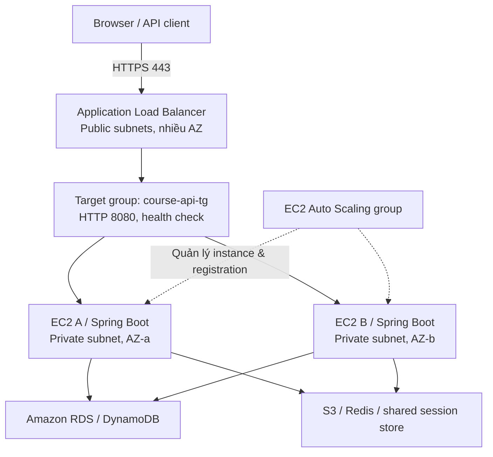
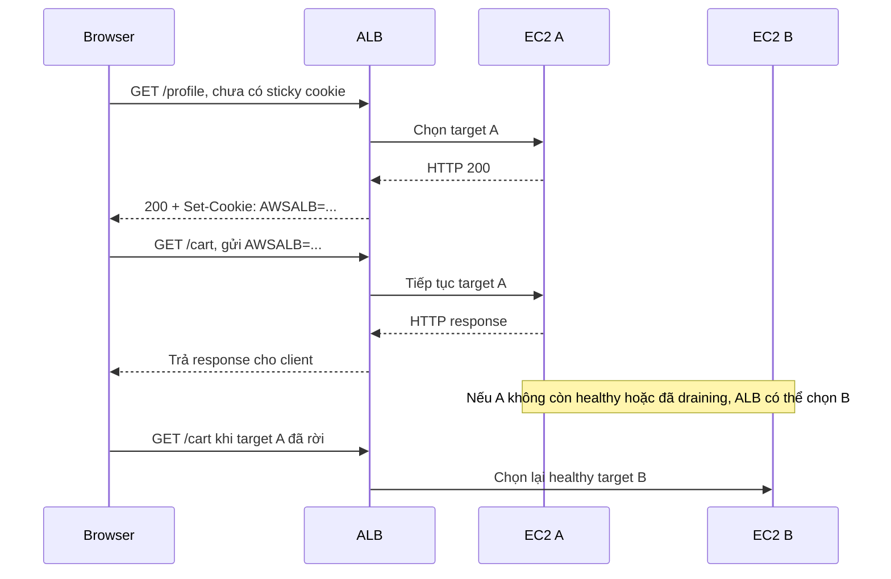
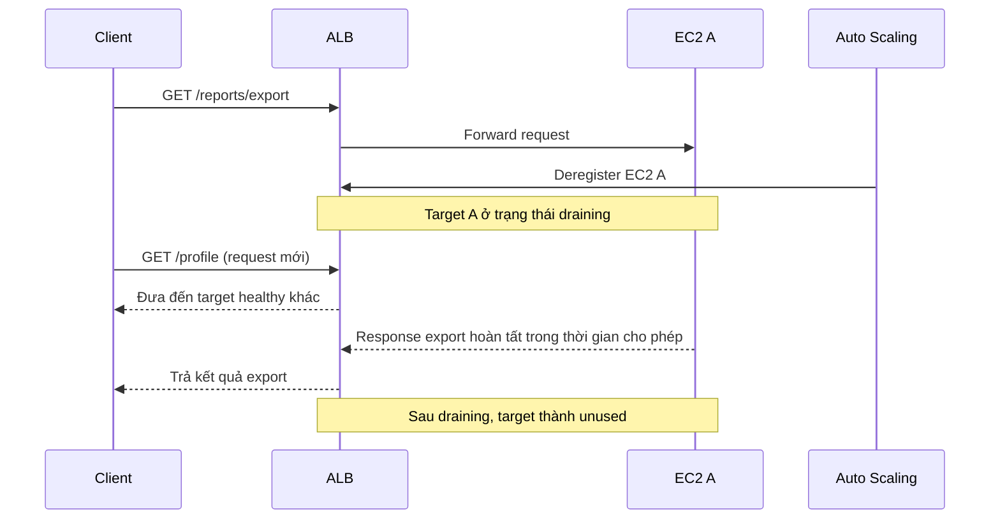
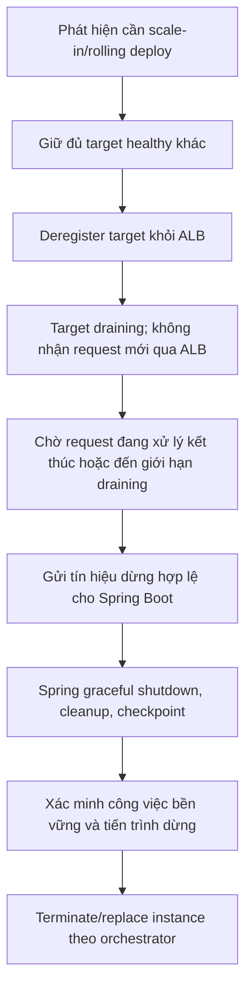
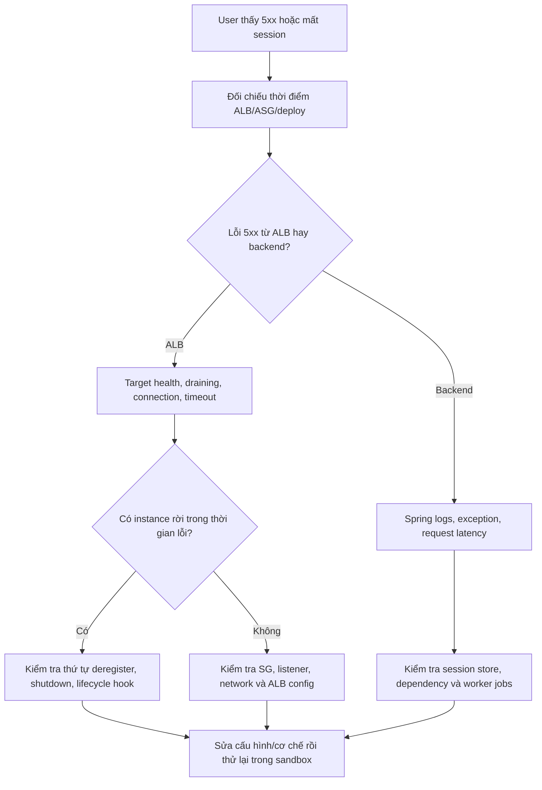

# Sticky session, connection draining và graceful shutdown

> **Học phần:** CLOUD_PROVIDERS_AWS  
> **Chương:** Cân bằng tải và mở rộng  
> **Trọng tâm:** Application Load Balancer (ALB), target group, Amazon EC2 Auto Scaling, session affinity và quy trình ngừng instance/ứng dụng Java Spring Boot một cách có kiểm soát.  
> **Bối cảnh:** Ứng dụng phân tán trên nhiều Availability Zone (AZ), có thể thay instance khi cập nhật phiên bản, scale-in hoặc khắc phục sự cố.

## 1. Vì sao ba khái niệm này phải được học cùng nhau?

Một hệ thống Java/Spring Boot phục vụ người dùng qua **Application Load Balancer** với hai EC2 instances trong các private subnets. Người học đăng nhập, bắt đầu tải báo cáo và gửi một yêu cầu xử lý kéo dài vài chục giây. Ngay lúc đó, **Auto Scaling** quyết định giảm một instance vì tải hệ thống thấp, hoặc nhóm vận hành triển khai phiên bản mới.

Nếu tắt tiến trình hoặc terminate instance ngay lập tức:

- Một HTTP request đang chạy có thể bị ngắt và người dùng nhận lỗi 502/5xx.
- Phiên đăng nhập lưu trong RAM của instance vừa mất có thể không còn khi người dùng được chuyển sang máy khác.
- Một tác vụ nền có thể xử lý được một nửa nhưng chưa ghi kết quả bền vững.
- Người vận hành khó phân biệt lỗi do cân bằng tải, timeout, mất trạng thái phiên hay lỗi ứng dụng.

Ba cơ chế giải quyết ba khía cạnh khác nhau:

| Cơ chế | Câu hỏi nó giải quyết | Thành phần chủ yếu |
|---|---|---|
| **Sticky session / session affinity** | Các yêu cầu liên tiếp của một client có được ưu tiên về cùng backend không? | ALB, cookie của client, target group |
| **Connection draining / deregistration delay** | Khi đưa backend ra khỏi vòng cân bằng tải, các request đang chạy có cơ hội hoàn thành không? | ALB và target group |
| **Graceful shutdown** | Khi tiến trình phải dừng, nó có ngừng nhận việc mới và chờ xử lý việc đang chạy không? | Spring Boot, JVM, OS/systemd, orchestration |

**Điểm quan trọng:** Sticky session không thay thế lưu trạng thái phiên bền vững; draining không tự yêu cầu Spring Boot hoàn thành tác vụ nền; và Spring Boot graceful shutdown không ngăn ALB tiếp tục gửi request mới đến một target vẫn được đăng ký là healthy.

### Kết quả học tập

Sau bài này, người học có thể:

1. Phân biệt **duration-based** và **application-based stickiness** của ALB; nhận diện cookie liên quan.
2. Giải thích giới hạn sticky session trong hệ thống tự động mở rộng và nhiều AZ.
3. Cấu hình và quan sát `deregistration_delay.timeout_seconds` cho ALB target group.
4. Thiết kế trình tự **deregister → drain → shutdown → terminate**, và biết quy trình scale-in của Auto Scaling thực hiện phần nào.
5. Cấu hình Spring Boot graceful shutdown, readiness/health check và timeout của systemd.
6. Triển khai và thử nghiệm có kiểm soát bằng AWS Console/CLI, `curl`, CloudWatch và ALB access logs.
7. Nhận diện các giới hạn với WebSocket, long polling, long-running jobs, và kế hoạch phục hồi dữ liệu.
8. Đánh giá ảnh hưởng tới tính sẵn sàng, bảo mật, kiểm soát chi phí và hoạt động vận hành.

## 2. Kiến trúc cơ sở: ALB, target group và Auto Scaling

Một kiến trúc tham khảo:



- **ALB listener** nhận kết nối HTTP/HTTPS và chọn hành động chuyển tiếp.
- **Target group** chứa các backend được đăng ký theo instance ID hoặc IP và cấu hình health checks, stickiness, deregistration delay.
- **EC2 Auto Scaling group (ASG)** tạo/thay/terminate EC2 theo launch template và scaling policies, có thể tự đăng ký/deregister instances với target group đã gắn.
- **Ứng dụng Spring Boot** phải định nghĩa khi nào thực sự sẵn sàng phục vụ request, xử lý lỗi và dừng tiến trình.
- **Kho dữ liệu chung** như RDS, DynamoDB, S3 hoặc Redis giúp một instance mới tiếp tục công việc sau khi instance cũ rời hệ thống.

Ví dụ các giá trị xuyên suốt bài:

```text
Region:             ap-southeast-1
Account minh họa:   123456789012
VPC:                10.20.0.0/16
ALB:                course-alb
Target group:       course-api-tg
Target port:        8080
Health path:        /actuator/health/readiness
Auto Scaling group: course-api-asg
EC2 instances:      i-0123456789abcdef0, i-0fedcba9876543210
```

Các account ID, tên và ARN trong tài liệu là **giả định để học**, không chỉ định tài nguyên thực tế của người đọc.

### 2.1. Trình tự chọn target thông thường

Khi stickiness tắt, ALB quyết định backend cho mỗi HTTP request theo **thuật toán chọn target** của target group (mặc định thường là `round_robin`; có các tùy chọn khác tùy điều kiện). Khi stickiness được bật, quyết định ban đầu dùng thuật toán đó, còn những request tiếp theo có cookie hợp lệ được ưu tiên về cùng backend.

**Không nhầm:** Một HTTP keep-alive connection, một TCP connection, một HTTP request và một user session là các đối tượng khác nhau. Sticky session liên quan đến **lựa chọn target giữa nhiều request**, không đơn giản đồng nghĩa giữ một TCP socket mở.

## 3. Sticky session là gì và hoạt động thế nào?

**Sticky session** (*session affinity*) cho phép ALB gắn các HTTP requests của một client vào cùng một target trong khoảng thời gian cấu hình. ALB sử dụng **HTTP cookies** để ghi nhận lựa chọn đó.

Ví dụ một người dùng gửi ba requests:



Giá trị cookie ALB là thông tin đã được mã hóa; ứng dụng không cần và không nên cố phân tích nội dung của cookie đó.

### 3.1. Duration-based stickiness: cookie do ALB cấp

Khi sử dụng **load balancer generated cookie**:

- ALB phát cookie `AWSALB` sau khi chọn backend.
- Client cần lưu và gửi lại cookie trong các request tiếp theo để duy trì affinity.
- Thuộc tính target group `stickiness.type=lb_cookie` xác định kiểu này.
- Thuộc tính `stickiness.lb_cookie.duration_seconds` xác định khoảng thời gian duy trì stickiness; AWS cho phép **1–604800 giây (7 ngày)**.
- ALB có cơ chế gia hạn thời hạn stickiness của cookie khi phục vụ request; cần phân biệt thời lượng stickiness được cấu hình với hạn kỹ thuật trên cookie.
- Với trình duyệt/cấu hình CORS phù hợp, ALB còn phát cookie `AWSALBCORS` cùng thông tin chọn target để đáp ứng yêu cầu thuộc tính cookie.

Ví dụ đặt stickiness **5 phút (300 giây)** cho môi trường thử nghiệm:

```text
stickiness.enabled = true
stickiness.type = lb_cookie
stickiness.lb_cookie.duration_seconds = 300
```

Nếu client xóa cookie, cookie hết hiệu lực, đổi trình duyệt hoặc backend cũ không còn healthy, ALB có thể chọn backend khác. Sticky session **không hứa giữ cùng một EC2 bất kể lỗi máy**.

### 3.2. Application-based stickiness: ứng dụng phát cookie

Một lựa chọn khác là **application-based stickiness**:

1. Ứng dụng backend tạo một cookie, ví dụ `COURSE_AFFINITY`.
2. Target group được cấu hình `stickiness.type=app_cookie` và `stickiness.app_cookie.cookie_name=COURSE_AFFINITY`.
3. Khi ALB quan sát cookie ứng dụng hợp lệ theo tên đã cấu hình, ALB tạo thêm các cookie do nó quản lý (chẳng hạn dạng `AWSALBAPP-0`).
4. Client phải gửi lại **cả cookie ứng dụng và cookie ALB liên quan** để duy trì stickiness.
5. Thời lượng có thể cấu hình ở target group bằng `stickiness.app_cookie.duration_seconds`.

**Không dùng** các tên bắt đầu bằng `AWSALB`, `AWSALBAPP` hoặc `AWSALBTG` cho cookie do ứng dụng tự đặt vì đây là các prefix AWS dành riêng.

Application-based stickiness hữu ích khi ứng dụng đã có cookie quản lý vòng đời phiên riêng và muốn ALB gắn affinity theo cookie đó. Nó **không thay thế** phiên đăng nhập hoặc cơ chế xác thực của ứng dụng; ALB chỉ định tuyến request.

### 3.3. Phân biệt các cookie thường gặp

| Cookie | Ai tạo? | Dùng cho |
|---|---|---|
| `AWSALB` | ALB | Duration-based stickiness **đến một target** trong target group. |
| `AWSALBCORS` | ALB | Biến thể hỗ trợ một số tình huống cross-origin. |
| `AWSALBAPP-0` (có thể nhiều shard) | ALB | Application-based stickiness ở target group. |
| `AWSALBTG` / `AWSALBTGCORS` | ALB | Stickiness ở **listener rule có nhiều weighted target groups**, để giữ **target group** được chọn. |
| `JSESSIONID` | Servlet container / framework ứng dụng | Định danh HTTP session của ứng dụng; không tự bảo đảm dữ liệu session có ở backend khác. |
| `COURSE_AFFINITY` | Ứng dụng minh họa | Cookie ứng dụng khi cấu hình `app_cookie`. |

**Hai cấp stickiness khác nhau:** Với listener forward tới nhiều target groups có weight, bạn có thể cần **target group stickiness** ở listener rule (ví dụ `AWSALBTG`), và **target stickiness** bên trong target group (ví dụ `AWSALB`). Chúng không tự thay thế nhau. Application-based stickiness có một số giới hạn khi dùng weighted target groups; phải kiểm tra cấu hình thực tế trước khi kết hợp.

### 3.4. Điều kiện và giới hạn quan trọng

- ALB stickiness cần clients có thể lưu/gửi cookies; một API client bỏ cookie sẽ không giữ affinity qua các request.
- AWS không hỗ trợ target stickiness khi **cross-zone load balancing bị tắt** ở target group; cần kiểm tra trạng thái cross-zone.
- Thuật toán **`weighted_random`** không kết hợp được sticky sessions ở target group.
- ALB không hỗ trợ sticky sessions khi **target optimizer** đang bật.
- Với WebSocket, khi backend chấp nhận HTTP 101 Upgrade, **kết nối WebSocket đã thiết lập vốn gắn với một target**; sau upgrade, cookie stickiness không còn quyết định việc định tuyến từng WebSocket message.
- Khi target bị deregister và chuyển sang `draining`, ALB có thể gửi **request mới của client có cookie cũ** tới target healthy khác.
- Nhiều ALB đặt tầng liên tiếp, CORS và cookie policy có thể phát sinh khác biệt đáng kể; phải thử bằng trình duyệt/client thực tế.

**Lưu ý:** Các chi tiết trên mô tả **Application Load Balancer**. Network Load Balancer (NLB) có mô hình stickiness dựa trên source IP và connection draining ở cấp kết nối khác với ALB; không bê nguyên cookie/HTTP behavior sang NLB.

## 4. Sticky session có phải giải pháp lưu session an toàn không?

**Không.** Stickiness chỉ ưu tiên đường đi HTTP đến backend. Nó không sao chép dữ liệu trong memory từ instance A sang B.

Giả sử ứng dụng Spring Boot dùng HTTP session lưu **in memory**:

```text
User #17 đăng nhập ở EC2 A
Session data (in-memory) chỉ nằm trên A
ALB có cookie -> những request sau thường quay về A
EC2 A bị terminate hoặc unhealthy
ALB chọn EC2 B -> B không có dữ liệu session cũ
User #17 có thể bị mất session hoặc phải đăng nhập lại
```

Nếu muốn nâng tính sẵn sàng, cân nhắc:

| Mô hình session | Ưu điểm | Giới hạn |
|---|---|---|
| **Memory session + sticky session** | Dễ triển khai, ít thành phần. | Mất session nếu target mất; scale-in/redeploy khó bảo đảm liên tục. |
| **Spring Session + Redis/ElastiCache** | Chia sẻ session giữa instances; dễ chuyển request. | Phụ thuộc mạng, Redis, TTL, độ sẵn sàng và chi phí. |
| **Dữ liệu phiên lưu trong database phù hợp** | Bền vững hơn theo thiết kế, có thể đọc từ nhiều node. | I/O, độ trễ, schema và khả năng mở rộng phải được đánh giá. |
| **Stateless auth (token phù hợp) + shared business state** | Giảm yêu cầu affinity, dễ scale horizontally. | Cần bảo mật token, expiry/revocation và giải quyết nghiệp vụ nhiều bước. |

**Khuyến nghị thiết kế:** Đối với API REST thường xuyên scale-out/scale-in, ưu tiên **stateless application** hoặc **shared session store** khi có trạng thái phiên thật sự cần chia sẻ. Chỉ dùng sticky sessions khi workload thực sự có ích từ affinity và đã có kế hoạch chuyển đổi khi target mất.

### 4.1. Sticky session có thể gây lệch tải

Khi tăng số targets từ 2 lên 6, người dùng cũ vẫn có thể tiếp tục gửi request vào hai targets cũ trong thời gian cookie còn hiệu lực. Điều này làm một số instances nhận nhiều request hơn dù ALB có thêm backend mới.

Biện pháp:

1. Đặt thời hạn stickiness đủ ngắn theo nhu cầu nghiệp vụ.
2. Giám sát requests/CPU/latency **theo target** thay vì chỉ tổng của target group.
3. Giảm phụ thuộc vào in-memory session.
4. Cân nhắc chiến lược rebalancing trong khi rollout, nhưng tránh buộc mọi người dùng phải đăng nhập lại ngoài kế hoạch.

**Không dùng "sticky = phân phối đều"** làm giả định khi thiết kế Auto Scaling. Affinity thường làm giảm khả năng cân bằng đều tuyệt đối.

## 5. Connection draining là gì?

**Connection draining** là cơ chế cho phép target đang rời target group **hoàn tất những request còn đang xử lý** trong một thời gian chờ nhất định.

Trong ALB, thời gian này được cấu hình bởi thuộc tính:

```text
deregistration_delay.timeout_seconds
```

- Giá trị mặc định: **300 giây**.
- Phạm vi cho ALB target group: **0–3600 giây**.
- Khi bắt đầu deregistration, trạng thái target thường thành **`draining`**.
- ALB dừng chọn target đang deregister cho các HTTP request mới, trong khi cho phép các request đã chuyển đến target có cơ hội hoàn tất.
- Khi hết quá trình, trạng thái target thành **`unused`**.
- Nếu không còn in-flight requests/active connections, ALB có thể hoàn tất deregistration sớm về mặt xử lý, dù giao diện vẫn hiển thị `draining` cho đến hết thời gian cấu hình.

**Không nên hiểu timeout 300 giây là "ALB luôn giữ target chạy đúng 300 giây".** Đây là giới hạn thời gian cho draining, không phải khoảng delay bắt buộc cho mọi request.

### 5.1. Timeline giả định

Một API xử lý báo cáo khoảng 25 giây. Target group có `deregistration_delay.timeout_seconds=90`:



Nếu request cần hơn 90 giây, **không có bảo đảm** nó vẫn hoàn tất. Nếu tiến trình Java chết hoặc host bị terminate trước khi gửi response, ALB cũng không thể cứu request. Vì vậy draining cần phối hợp với **graceful shutdown và orchestration**.

### 5.2. Những điều draining không bảo đảm

- Không giữ dữ liệu session của backend đã bị xóa.
- Không làm cho một tiến trình đã chết xử lý tiếp request.
- Không tự checkpoint các tác vụ nền hoặc bảo đảm yêu cầu không bị gửi hai lần.
- Không làm đúng mọi WebSocket/gRPC streaming session dài hàng giờ.
- Không tự sửa lỗi nghiệp vụ, deadlock hay HTTP timeout ở client.
- Không bảo đảm "zero downtime" nếu không còn target healthy, deploy thay cùng lúc quá nhiều targets hoặc thay đổi security group sai.

### 5.3. Draining khác health check fail

| Trường hợp | Ý nghĩa |
|---|---|
| Target `healthy` | ALB nhận thấy target có thể phục vụ traffic theo health check. |
| Target `unhealthy` | Health check không đạt; ALB áp quy tắc routing dựa trên health state. |
| Target `draining` | Target **đang được deregister**, xử lý request còn tồn tại theo thời gian chờ. |
| Target `unused` | Không còn được sử dụng cho target group theo trạng thái hiện tại. |

Cố tình làm tất cả các targets trả health check lỗi **không tương đương** một quy trình draining đúng cách. ALB có hành vi **fail-open** trong một số trường hợp khi toàn bộ targets bị unhealthy, có thể tiếp tục route đến chúng; đừng dựa vào "trả 503 health check là chắc chắn không nhận traffic" để dừng hệ thống.

## 6. Graceful shutdown trong Java/Spring Boot

**Graceful shutdown** giúp tiến trình ứng dụng:

1. Ngừng nhận request mới theo cơ chế web server được dùng.
2. Cho request đang chạy cơ hội kết thúc.
3. Đóng resources và các thành phần ứng dụng trong thời gian chờ.
4. Thoát theo tín hiệu dừng bình thường.

Ở Spring Boot hiện hành, graceful shutdown được hỗ trợ cho các embedded web servers phổ biến và **được bật mặc định trong các phiên bản mới**. Với những môi trường cần cấu hình rõ ràng hoặc có các phiên bản cũ, đặt cấu hình tường minh và kiểm tra tài liệu đúng phiên bản Spring Boot.

### 6.1. Cấu hình Spring Boot

Ví dụ `application.yml`:

```yaml
server:
  port: 8080
  shutdown: graceful

spring:
  lifecycle:
    timeout-per-shutdown-phase: 90s

management:
  endpoint:
    health:
      probes:
        enabled: true
```

- `server.shutdown=graceful` bật yêu cầu dừng có kiểm soát.
- `spring.lifecycle.timeout-per-shutdown-phase=90s` đặt thời gian chờ cho từng pha đóng thành phần theo mô hình Spring lifecycle.
- `management.endpoint.health.probes.enabled=true` cho phép dùng health probes của Spring Boot Actuator khi ứng dụng đã có dependency và cấu hình exposure thích hợp.
- `/actuator/health/readiness` có thể phản ánh trạng thái sẵn sàng phục vụ nếu cấu hình và dùng Actuator đúng cách.
- Không tự kết luận mọi request sẽ được chờ **đúng 90 giây**, vì thời gian dừng thực tế còn phụ thuộc web server, signal, process manager, và tài nguyên hệ thống.

**Lưu ý về Spring Boot version:** Hành vi mặc định và tập các web servers hỗ trợ có thể khác giữa các phiên bản. Hãy kiểm tra documentation ứng với version thực được đóng gói thay vì chỉ sao chép cấu hình từ một bài lab.

### 6.2. SIGTERM, SIGKILL và JVM

Trên Linux:

- **SIGTERM** là yêu cầu chấm dứt có thể được ứng dụng/JVM xử lý qua shutdown hooks và lifecycle.
- **SIGKILL** kết thúc tiến trình cưỡng bức; ứng dụng không có cơ hội chạy shutdown logic.
- Lệnh `systemctl stop ...` thường khởi động chu trình dừng dịch vụ do systemd quản lý và sau timeout có thể buộc dừng.
- Khởi chạy Java qua shell wrapper xử lý signal không đúng có thể khiến process Java không nhận được SIGTERM như kỳ vọng.

**Hệ quả:** Việc cấu hình Spring Boot graceful shutdown chỉ phát huy tác dụng nếu môi trường triển khai thực sự gửi signal phù hợp và cho JVM đủ thời gian hoàn thành.

### 6.3. Ví dụ systemd unit cho EC2

Tệp cấu hình minh họa `/etc/systemd/system/course-api.service`:

```ini
[Unit]
Description=Course API Spring Boot application
After=network-online.target
Wants=network-online.target

[Service]
Type=simple
User=course-api
WorkingDirectory=/opt/course-api
ExecStart=/usr/bin/java -jar /opt/course-api/course-api.jar
KillSignal=SIGTERM
TimeoutStopSec=150
Restart=on-failure
Environment=SPRING_PROFILES_ACTIVE=prod

[Install]
WantedBy=multi-user.target
```

Trong ví dụ:

- systemd khởi chạy trực tiếp tiến trình Java để nhận signal.
- `TimeoutStopSec=150` cho hệ điều hành một khoảng chờ trước khi buộc dừng theo cấu hình systemd.
- User `course-api` cần quyền đọc JAR, ghi những thư mục/log cần thiết và phải có role AWS tối thiểu nếu cần gọi AWS API.
- Việc restart hoặc stop service **không tự deregister** target khỏi ALB. Nếu tiến trình được dừng khi ALB vẫn gửi request mới, lỗi vẫn có thể xảy ra.

**Không copy unit vào máy sản xuất rồi restart ngay.** Cần áp dụng qua quy trình triển khai có health checks, target draining và giám sát.

### 6.4. Shutdown hook và tác vụ nền

Spring Boot có cơ chế dừng các `SmartLifecycle` beans; các resources như connection pool, message consumer và thread pool phải được đóng theo trình tự phù hợp.

Các công việc dài:

- Job xử lý nhiều phút/giờ nên lưu **checkpoint** vào S3, DynamoDB, RDS hoặc một nơi bền vững.
- SQS consumer cần ngừng nhận messages mới, xử lý thông điệp đang giữ trong thời hạn visibility phù hợp, sau đó acknowledge/delete message khi thành công.
- Background scheduled tasks cần cơ chế ngăn mở job mới khi shutdown bắt đầu; tránh giả định chỉ cấu hình web server graceful là đủ.
- Ghi dữ liệu/transaction cần idempotency để retry không tạo duplicate side effects.

**Không sử dụng cách đơn giản "thêm Thread.sleep(120000) vào @PreDestroy"** làm chiến lược drain. Cần biết đang có bao nhiêu công việc thực sự, timeout nào đang áp dụng, và cách xác nhận đã an toàn để dừng.

## 7. Phối hợp ba cơ chế thành một quy trình dừng an toàn

Luồng mong muốn khi lấy một EC2 instance ra khỏi dịch vụ:



Sơ đồ thể hiện **chuỗi trách nhiệm về mặt thiết kế**. Trong Auto Scaling hoặc các bộ điều phối khác, thao tác deregistration, lifecycle hook và shutdown có thể được **điều phối/đan xen** theo quy trình riêng của dịch vụ; không giả định đã tự có mọi bước kiểm tra nghiệp vụ trong sơ đồ.

### 7.1. Phân biệt trường hợp dừng

| Tình huống | Ai chủ yếu điều phối? | Cần kiểm tra |
|---|---|---|
| Chủ động bảo trì một EC2 standalone | Người vận hành/automation | Deregister → chờ drain → stop service → kiểm tra → thao tác EC2 |
| Scale-in Auto Scaling group đã gắn target group | Amazon EC2 Auto Scaling + ALB | ASG tự deregister target; thời gian drain và lifecycle hooks cho cleanup bổ sung |
| Instance Refresh / rolling deploy | Auto Scaling hoặc công cụ deployment | Minimum healthy capacity, instance warmup, readiness, drain và thứ tự rollout |
| ECS service dùng ALB | ECS deployment/draining + ALB, container stop timeout | ECS task lifecycle, target group và signal ứng dụng |
| Sự cố host hoặc tiến trình bị kill bất ngờ | Không có thời gian drain đầy đủ | High availability, retry, idempotency và phục hồi dữ liệu |
| Long-running background worker không phục vụ HTTP | Queue/job coordinator | Đừng chỉ dùng ALB draining để xác định công việc đã hoàn tất |

### 7.2. Scale-in: ASG làm gì?

Khi Auto Scaling group được liên kết với Elastic Load Balancing:

1. ASG chọn một instance để giảm capacity theo termination policy.
2. ASG điều phối **deregistration** của instance khỏi load balancer.
3. ALB cho phép **in-flight requests** tiếp tục trong giới hạn deregistration delay.
4. Nếu có **termination lifecycle hook**, ASG có thể giữ instance ở `Terminating:Wait` để ứng dụng/automation thực hiện cleanup bổ sung.
5. Sau khi hoàn tất hook hoặc timeout, ASG tiếp tục vòng đời và instance bị terminate.

Do cơ chế ASG tự quản lý registration/deregistration, **không tự động khuyên thao tác `deregister-targets` thủ công với một target do ASG quản lý** trong môi trường Production. Hãy dùng cơ chế scaling/deployment được hỗ trợ và theo dõi trạng thái của target.

### 7.3. Lifecycle hook cho cleanup có kiểm soát

Lifecycle hook cho phép chạy logic bổ sung khi instance sắp bị terminate, chẳng hạn:

- Ngừng nhận job mới từ SQS hoặc job scheduler.
- Ghi checkpoint/offset vào kho bền vững.
- Xuất log còn trong buffer.
- Chờ task đang chạy hoàn thành trong mức RTO/timeout cho phép.
- Gọi `CompleteLifecycleAction` để ASG tiếp tục terminate.

Ví dụ tạo termination hook cho một ASG đã tồn tại:

```bash
aws autoscaling put-lifecycle-hook \
  --auto-scaling-group-name course-api-asg \
  --lifecycle-hook-name course-api-termination-hook \
  --lifecycle-transition autoscaling:EC2_INSTANCE_TERMINATING \
  --heartbeat-timeout 180 \
  --default-result CONTINUE \
  --region ap-southeast-1
```

Khi ASG tạo lifecycle event, một **EventBridge rule/Lambda/SQS consumer hoặc agent nội bộ** phải nhận sự kiện và thực thi cleanup có xác nhận. **Tạo hook một mình không tự chạy script cleanup.**

Sau khi hoàn tất hoạt động nghiệp vụ, controller có quyền tương ứng có thể gọi:

```bash
aws autoscaling complete-lifecycle-action \
  --auto-scaling-group-name course-api-asg \
  --lifecycle-hook-name course-api-termination-hook \
  --instance-id i-0123456789abcdef0 \
  --lifecycle-action-result CONTINUE \
  --region ap-southeast-1
```

Không tự gọi `CONTINUE` trước khi cleanup thực sự hoàn tất. Khi cần gia hạn thời gian chờ do job dài, controller có thể gửi heartbeat bằng `record-lifecycle-action-heartbeat` nếu quy trình và giới hạn cho phép. Tránh kéo dài vô hạn hoặc bỏ quên hook khiến giảm capacity bị đình trệ.

### 7.4. Scale-in protection và tác vụ kéo dài

Với job kéo dài hàng giờ, một termination hook 180 giây không đủ. Có thể cân nhắc **instance scale-in protection** trong giai đoạn chạy job quan trọng, nhưng vẫn phải:

- Có cơ chế gỡ protection sau khi job hoàn tất.
- Giới hạn số instances cần được bảo vệ để ASG vẫn vận hành/scale-in.
- Có checkpoint và retry khi hạ tầng lỗi, vì protection không loại bỏ rủi ro chết host.
- Đánh giá chi phí do giữ instance sống lâu hơn.

Đối với xử lý batch dài, **SQS + idempotent workers** hoặc nền tảng batch/orchestration phù hợp thường tự nhiên hơn HTTP request nhiều giờ.

## 8. Thiết kế các timeout cho đúng

Không có một giá trị `deregistration_delay.timeout_seconds` tối ưu cho mọi ứng dụng. Cần lấy dữ liệu latency của workload, thời gian xử lý task, giới hạn platform và chiến lược retry.

### 8.1. Ví dụ thời gian minh họa

Giả sử hệ thống có:

- Phần lớn HTTP requests dưới **3 giây**.
- Một số API tạo báo cáo hoàn thành trong khoảng **20–40 giây**.
- Job batch dài đã tách ra khỏi HTTP request.
- Rolling deploy cần giữ đủ hai AZ có backend healthy.

Một phương án **để thử nghiệm**, không phải SLA:

| Thành phần | Giá trị minh họa | Mục đích |
|---|---:|---|
| ALB deregistration delay | 120 giây | Cho request dài có thời gian hoàn tất. |
| Spring Boot graceful shutdown phase timeout | 90 giây | Cho web server và lifecycle beans chờ xử lý. |
| systemd `TimeoutStopSec` | 150 giây | Tránh SIGKILL quá sớm khi ứng dụng đang dừng. |
| ASG termination lifecycle hook timeout | 180 giây | Cho cleanup/checkpoint ngoài phần draining. |
| Client HTTP timeout | Dựa trên SLA API | Không giữ request vô hạn hoặc retry không kiểm soát. |

**Không cộng các con số trong bảng thành một "thời gian bảo đảm"**. Thời điểm AWS deregister, lúc OS gửi signal, các giới hạn của ASG/deployment và quá trình shutdown có thể chồng lấn. Cần đo toàn bộ lifecycle trong môi trường giống Production.

### 8.2. Nếu đặt quá ngắn hoặc quá dài

| Lỗi cấu hình | Hậu quả |
|---|---|
| Draining 0–5 giây với request chạy 30 giây | Có thể ngắt request và tăng 5xx. |
| Draining dài hàng chục phút cho API chỉ vài mili-giây | Triển khai/scale-in có thể bị kéo dài, tiêu tốn capacity không cần thiết. |
| Spring timeout dài nhưng systemd timeout ngắn | JVM có thể bị kill trước khi shutdown xong. |
| Lifecycle hook timeout ngắn hơn cleanup thực tế | ASG tiếp tục terminate khi tác vụ chưa hoàn thành. |
| Client timeout cực ngắn rồi retry ngay | Request cũ có thể vẫn chạy; nếu API không idempotent, có thể tạo duplicate. |
| Health check chưa ổn định khi scale-out | Backend mới bị đánh unhealthy hoặc traffic đến sớm trước warmup. |

**Nguyên tắc:** Đo p95/p99 latency, tối đa thời gian request hợp lệ và thời gian chờ được chấp nhận. Thử nghiệm các trường hợp tail latency, mạng chập chờn và backend bị kill để đánh giá.

## 9. Cấu hình ALB trong AWS Console

Thao tác với một **ALB + target group** hiện có trong sandbox; không cần tái tạo toàn bộ VPC để học các thuộc tính.

### 9.1. Bật sticky session (duration-based)

1. Mở **EC2 Console → Load Balancing → Target Groups**.
2. Chọn target group `course-api-tg`, mở tab **Attributes → Edit**.
3. Tại phần **Target selection configuration/Stickiness**, bật stickiness.
4. Chọn **Load balancer generated cookie**.
5. Đặt **Stickiness duration = 300 giây** cho bài lab.
6. Xác nhận routing algorithm và cross-zone phù hợp; không chọn weighted random nếu muốn sticky.
7. Lưu, mở lại target group để xác nhận các giá trị.
8. Dùng trình duyệt hoặc `curl` có cookie jar để quan sát requests được gắn vào target.

Nếu dùng **application-based cookie**, đổi loại sang Application-based, nhập tên cookie mà ứng dụng thực sự phát và thời lượng. Chỉ bật trong lab khi backend có logic Set-Cookie phù hợp.

### 9.2. Đặt deregistration delay

1. Vẫn ở target group, mở **Attributes → Edit**.
2. Tại phần **Target deregistration management**, tìm **Deregistration delay**.
3. Đặt giá trị thử nghiệm, ví dụ **120 giây**, trong phạm vi AWS cho phép.
4. Lưu và kiểm tra lại thuộc tính đã được cập nhật.
5. Tại tab **Targets**, quan sát target khi thực hiện một quy trình deregistration/scale-in hợp lệ trong sandbox.

**Không thực hiện scale-in khi chỉ còn một target healthy** nếu mục tiêu là kiểm thử không gián đoạn. Cần có target khác sẵn sàng trước khi loại node khỏi hệ thống.

### 9.3. Cấu hình health check

Trong target group:

- Protocol: HTTP (hoặc HTTPS nếu kiến trúc backend có TLS).
- Port: traffic port phù hợp (ví dụ 8080).
- Path: `/actuator/health/readiness` nếu Spring Boot có endpoint này và được phép truy cập nội bộ.
- Success matcher: 200 hoặc dải mã được phê duyệt.
- Interval, timeout, healthy/unhealthy thresholds: chọn theo thời gian startup và mục tiêu phát hiện lỗi.

Ví dụ **giả định**: interval 15 giây, timeout 5 giây, unhealthy threshold 3, healthy threshold 2. Những giá trị này cần điều chỉnh theo điều kiện thực; health check thất bại không tự chứng minh instance đã chết.

Security group của target nên cho phép **ALB security group** truy cập port ứng dụng. Hạn chế mở trực tiếp port quản trị/Actuator cho Internet.

## 10. AWS CLI: xem và thay đổi thuộc tính target group

### 10.1. Xem cấu hình hiện tại

Đầu tiên xác nhận AWS identity và Region, sau đó đọc target group:

```bash
aws sts get-caller-identity

aws elbv2 describe-target-groups \
  --names course-api-tg \
  --region ap-southeast-1

aws elbv2 describe-target-group-attributes \
  --target-group-arn arn:aws:elasticloadbalancing:ap-southeast-1:123456789012:targetgroup/course-api-tg/0123456789abcdef \
  --region ap-southeast-1
```

**Không áp các lệnh ghi** nếu chưa kiểm tra đúng account, Region và ARN của target group.

### 10.2. Bật duration-based stickiness 5 phút

```bash
aws elbv2 modify-target-group-attributes \
  --target-group-arn arn:aws:elasticloadbalancing:ap-southeast-1:123456789012:targetgroup/course-api-tg/0123456789abcdef \
  --attributes \
    Key=stickiness.enabled,Value=true \
    Key=stickiness.type,Value=lb_cookie \
    Key=stickiness.lb_cookie.duration_seconds,Value=300 \
  --region ap-southeast-1
```

Lệnh này là ví dụ đối với **ALB target group**, cần quyền `elasticloadbalancing:ModifyTargetGroupAttributes`. AWS có thể từ chối tổ hợp thuộc tính không tương thích với routing/cross-zone. Không sử dụng các tham số stickiness cookie này cho NLB.

### 10.3. Đặt deregistration delay

```bash
aws elbv2 modify-target-group-attributes \
  --target-group-arn arn:aws:elasticloadbalancing:ap-southeast-1:123456789012:targetgroup/course-api-tg/0123456789abcdef \
  --attributes Key=deregistration_delay.timeout_seconds,Value=120 \
  --region ap-southeast-1
```

Đọc lại thuộc tính để xác nhận. Hành động chỉnh attribute **không tự deregister bất kỳ target nào**.

### 10.4. Kiểm tra trạng thái targets

```bash
aws elbv2 describe-target-health \
  --target-group-arn arn:aws:elasticloadbalancing:ap-southeast-1:123456789012:targetgroup/course-api-tg/0123456789abcdef \
  --region ap-southeast-1
```

Các giá trị thường gặp gồm `healthy`, `unhealthy`, `initial`, `draining` và `unused`. Đối với lỗi, đọc thêm `Reason` và `Description` trong output.

### 10.5. Thử deregister thủ công trên target độc lập trong sandbox

**Chỉ** thực hiện với target test **không do ASG đang chủ động quản lý** hoặc qua một quy trình được kiểm soát:

```bash
aws elbv2 deregister-targets \
  --target-group-arn arn:aws:elasticloadbalancing:ap-southeast-1:123456789012:targetgroup/course-api-tg/0123456789abcdef \
  --targets Id=i-0123456789abcdef0 \
  --region ap-southeast-1
```

Dùng `describe-target-health` để quan sát `draining`, rồi `unused`. Sau khi kiểm chứng, nếu target test vẫn cần phục vụ, đăng ký lại bằng `register-targets` với thông số phù hợp và đợi healthy; không bỏ lại môi trường bị thiếu capacity.

### 10.6. Cấu hình bằng Infrastructure as Code

Ví dụ thuộc tính của **AWS CloudFormation TargetGroup**:

```yaml
Resources:
  CourseApiTargetGroup:
    Type: AWS::ElasticLoadBalancingV2::TargetGroup
    Properties:
      TargetType: instance
      VpcId: vpc-0123456789abcdef0
      Protocol: HTTP
      Port: 8080
      HealthCheckPath: /actuator/health/readiness
      HealthCheckProtocol: HTTP
      TargetGroupAttributes:
        - Key: stickiness.enabled
          Value: "true"
        - Key: stickiness.type
          Value: lb_cookie
        - Key: stickiness.lb_cookie.duration_seconds
          Value: "300"
        - Key: deregistration_delay.timeout_seconds
          Value: "120"
```

Đây là **mảnh tài nguyên minh họa**, chưa phải một template CloudFormation hoàn chỉnh; phải có VPC, listener/ALB, subnet và quyền triển khai đúng. Trong Production, quản lý thay đổi các thuộc tính bằng IaC để tránh cấu hình qua Console rồi bị lần deploy sau ghi đè.

## 11. Lab Spring Boot: quan sát sticky cookie và request dài

Để học trực quan, triển khai một ứng dụng test trên **hai instances khác nhau**. Mỗi instance cần có label riêng, ví dụ biến môi trường `APP_INSTANCE_LABEL=course-api-a` và `APP_INSTANCE_LABEL=course-api-b`.

### 11.1. Endpoint trả về node hiện tại và đếm session cục bộ

Đoạn code dành cho **lab** (Spring Web + Servlet API):

```java
package com.example.courseapi;

import jakarta.servlet.http.HttpSession;
import java.util.Map;
import org.springframework.http.ResponseEntity;
import org.springframework.web.bind.annotation.GetMapping;
import org.springframework.web.bind.annotation.RestController;

@RestController
public class LabController {
    private final String node = System.getenv()
        .getOrDefault("APP_INSTANCE_LABEL", "unknown-node");

    @GetMapping("/lab/node")
    public ResponseEntity<Map<String, String>> node() {
        return ResponseEntity.ok()
            .header("X-Lab-Node", node)
            .body(Map.of("node", node));
    }

    @GetMapping("/lab/session-count")
    public Map<String, Object> sessionCount(HttpSession session) {
        Integer current = (Integer) session.getAttribute("counter");
        int next = (current == null ? 0 : current) + 1;
        session.setAttribute("counter", next);
        return Map.of("node", node, "counter", next);
    }

    @GetMapping("/lab/slow")
    public Map<String, Object> slowRequest() throws InterruptedException {
        Thread.sleep(20_000); // Chỉ minh họa request chậm ở môi trường lab
        return Map.of("node", node, "result", "completed");
    }
}
```

**Giới hạn ví dụ:** `Thread.sleep` giữ một request thread trong 20 giây và không phải cách xử lý tác vụ nặng trong Production. `HttpSession` dùng in-memory session ở ví dụ để minh họa mất state; trong ứng dụng thật nên cân nhắc Spring Session/Redis hoặc thiết kế stateless. Với Spring Boot 2 dùng API Servlet cũ có thể phải thay `jakarta.servlet` bằng `javax.servlet` tương ứng phiên bản.

Đừng mở các endpoint lab này công khai trong Production; label máy và hành vi chậm chỉ phục vụ kiểm chứng. Dùng HTTPS với chứng chỉ hợp lệ ở ALB.

### 11.2. Thử stickiness với cookie jar

Dùng DNS thực của ALB sandbox, thay `course-alb.example.com` bằng hostname được quản trị:

```bash
# Lệnh đầu nhận cookie từ ALB và lưu vào file cookies.txt.
curl -sS -D - -o /dev/null \
  -c cookies.txt \
  https://course-alb.example.com/lab/node

# Các lệnh sau gửi lại cookie đã lưu và cập nhật cookie jar.
curl -sS -D - -o /dev/null \
  -b cookies.txt -c cookies.txt \
  https://course-alb.example.com/lab/node

curl -sS -D - -o /dev/null \
  -b cookies.txt -c cookies.txt \
  https://course-alb.example.com/lab/node
```

Quan sát header `X-Lab-Node` và `Set-Cookie`. Khi stickiness hợp lệ, nhiều request của cùng cookie jar thường trả cùng node. **Không thể dùng kết quả của 2–3 request làm bằng chứng định lượng phân phối tải**. Để so sánh, thử không gửi cookie và gửi từ nhiều clients độc lập.

Thử session counter:

```bash
curl -sS -b cookies.txt -c cookies.txt \
  https://course-alb.example.com/lab/session-count

curl -sS -b cookies.txt -c cookies.txt \
  https://course-alb.example.com/lab/session-count
```

Nếu cùng target và session cookie được giữ, biến đếm tăng. Nếu target mất và backend mới không dùng shared session store, bộ đếm có thể quay về giá trị đầu. Đây là minh họa **session loss**, không phải lỗi xác thực của ALB.

### 11.3. Thử connection draining với request chậm

Chạy thử trên **target test thuộc nhóm có ít nhất một target khác healthy**:

1. Cấu hình ALB deregistration delay = 120 giây.
2. Mở một request đến `/lab/slow`, để nó chạy 20 giây.
3. Trong khi request đang chạy, bắt đầu quy trình deregister target xử lý request đó qua cơ chế được phép.
4. Kiểm tra target chuyển thành `draining`; gửi request mới và quan sát backend khác phục vụ.
5. Xác nhận request ban đầu có hoàn thành trong thời gian cho phép hay không.
6. Sau khi không còn request đang chạy, gửi SIGTERM đến Spring Boot theo quy trình kiểm thử.
7. Kiểm tra log cho thấy shutdown đã được yêu cầu và tiến trình thoát phù hợp.

**Kiểm thử phải điều khiển được node nào đang nhận request**, có thể dùng session cookie/label đã xác nhận. Nếu không chắc request được route tới target nào, kết quả sẽ không đủ chứng minh draining.

### 11.4. Thử graceful shutdown tách biệt

Trên một instance test đã **rời target group** hoặc đang được điều phối an toàn:

```bash
# Xem trạng thái dịch vụ lab.
sudo systemctl status course-api.service

# Stop service bằng systemd; JVM nhận SIGTERM theo unit.
sudo systemctl stop course-api.service

# Xem nhật ký dừng.
sudo journalctl -u course-api.service -n 100 --no-pager
```

Không thử lệnh stop trực tiếp trên target Production đang nhận lưu lượng. Nếu Spring Boot đã bắt đầu graceful shutdown nhưng bên ngoài vẫn forward request mới, cấu hình chỉ dựa vào ứng dụng có thể dẫn đến lỗi; phần ALB drain và orchestration phải đi cùng.

## 12. Readiness, liveness và health checks

**Health check không phải chỉ là "JVM process còn chạy"**. Một ứng dụng có thể trả TCP accept nhưng vẫn đang khởi tạo dữ liệu, chưa kết nối database hoặc không đủ năng lực nhận request.

### 12.1. Phân biệt

| Tín hiệu | Câu hỏi | Gợi ý sử dụng |
|---|---|---|
| **Liveness** | Process có đang bị kẹt hoặc cần restart không? | Tránh phụ thuộc quá nhiều external services để không restart hàng loạt khi dependency tạm lỗi. |
| **Readiness** | Instance đã đủ điều kiện nhận HTTP request mới chưa? | Dùng cho ALB health check khi endpoint/logic phù hợp. |
| **ALB target health** | ALB quan sát target healthy theo protocol/path/threshold không? | Chọn target để route và xác định tình trạng load balancing. |
| **ASG EC2/ELB health** | Instance có cần được thay thế theo chính sách ASG không? | Tác động vòng đời instance và khả năng phục hồi. |

Trong Spring Boot Actuator, nếu đã bật probes và access phù hợp, `/actuator/health/liveness` và `/actuator/health/readiness` biểu diễn hai khía cạnh riêng.

### 12.2. Health check khi scale-out

- Instance mới boot, Java start, nạp cấu hình, kết nối những dependency quan trọng.
- Readiness chưa đạt cho đến khi ứng dụng đủ điều kiện phục vụ.
- ALB health check quan sát target và chỉ route sau khi target được coi là healthy, tùy rule và điều kiện routing.
- Có thể dùng **ASG health check grace period** và **instance warmup/slow start** thích hợp để giảm thay instance sớm hoặc dồn tải quá nhanh.

**Không nhầm:** `health check grace period` của Auto Scaling, `ALB health check interval/threshold` và `target group slow start duration` là các cấu hình **khác nhau**.

### 12.3. Health check khi scale-in

Không nên làm readiness chuyển `REFUSING_TRAFFIC` rồi lập tức kill JVM khi ALB còn đang forward các request. Một quy trình được điều phối tốt sẽ:

1. Đảm bảo các target còn lại healthy.
2. Dừng đưa request mới đến target (qua deregistration/quy trình orchestrator).
3. Chờ in-flight requests và task có thể xử lý hết.
4. Dừng ứng dụng bằng signal tương thích với graceful shutdown.

Nếu hệ thống có thủ tục đánh dấu "draining" bên trong ứng dụng, thủ tục đó phải thống nhất với trạng thái ở ALB và các health checks, tránh để toàn target group đồng loạt không healthy.

## 13. WebSocket, long polling, streaming và xử lý nền

Các request ngắn và các kết nối dài có yêu cầu khác nhau.

### 13.1. WebSocket

Khi client upgrade thành WebSocket, backend được chọn có thể giữ kết nối trong thời gian dài. Cookie sticky sau upgrade không điều phối từng message; connection đang tồn tại gắn với target đã được chọn.

Nếu cần rolling deploy không ngắt các kết nối WebSocket kéo dài hàng giờ, chỉ dựa vào `deregistration_delay.timeout_seconds` mặc định 300 giây thường không đủ. Cần:

- Cơ chế client reconnect có backoff và phục hồi subscription/state.
- Lưu session/subscription cần thiết ở kho chia sẻ hoặc có cách tái dựng.
- Protocol-level close có lý do rõ ràng trước khi backend dừng.
- Thiết kế giới hạn thời gian kết nối, chuyển tải hoặc cơ chế blue/green phù hợp.

### 13.2. Long polling, Server-Sent Events, gRPC streaming

- Kiểm tra timeout **client**, **ALB idle timeout**, application response timeout và thời gian draining.
- Với SSE, cần hỗ trợ reconnect và last event ID nếu nghiệp vụ đòi hỏi.
- Với gRPC streaming, kiểm tra hỗ trợ ALB và timeout phù hợp; không giả định cookie stickiness có hành vi giống HTTP/1.1 browser request.
- Với HTTP request chạy hàng phút, cân nhắc chuyển sang **async job**: trả `202 Accepted` + job ID, xử lý qua queue/worker và cho client poll status.

### 13.3. Tác vụ nền cần checkpoint và idempotency

Trong thực tế, việc hoàn thành **HTTP response** không bảo đảm một job được chạy trong thread nền đã lưu kết quả. Khi terminate:

1. Ngừng nhận job mới.
2. Đợi tasks đang chạy hoặc lưu checkpoint.
3. Chỉ ACK message sau khi kết quả bền vững.
4. Dùng idempotency key để xử lý retry.
5. Đảm bảo node mới đọc lại từ queue/checkpoint được.

Trạng thái xử lý nên nằm trên SQS/DynamoDB/RDS/S3 hoặc hệ thống chuyên dụng, không dựa hoàn toàn vào memory của instance cũ.

## 14. Quan sát và chẩn đoán lỗi 5xx khi scale-in

Để chứng minh cấu hình có ích, cần đo cả phía ALB lẫn ứng dụng.

### 14.1. CloudWatch metrics hữu ích

| Chỉ số / nguồn | Quan sát điều gì |
|---|---|
| `HealthyHostCount` / `UnHealthyHostCount` | Số targets healthy/unhealthy theo target group/AZ. |
| `HTTPCode_ELB_5XX_Count` | Lỗi 5xx do ALB tạo. |
| `HTTPCode_Target_5XX_Count` | Lỗi 5xx do backend trả. |
| `TargetResponseTime` | Độ trễ xử lý request ở targets. |
| `TargetConnectionErrorCount` | Kết nối từ ALB tới target có vấn đề. |
| `RequestCount` | Tổng request quan sát được ở ALB. |
| ASG Activity History / desired capacity | Sự kiện scale-out, scale-in và instance replacement. |
| Spring Boot metrics/logs | Request đang chạy, timeout, shutdown events, active jobs, session. |

Cần chọn **đúng dimensions** trong CloudWatch, đối chiếu thời điểm và timezone; không chỉ so tổng request trước/sau deploy. Nếu có nhiều target groups, phải lọc theo LoadBalancer và TargetGroup phù hợp.

### 14.2. ALB access logs

Khi bật ALB access logging tới S3 với quyền và cấu hình đúng, có thể phân tích:

- Thời điểm request.
- Target IP/port và HTTP status của target.
- ELB status code, target status code.
- Thời gian request/target processing và dấu hiệu timeout.
- User agent, request path nếu quyền truy cập cho phép.
- Tăng 502/503/504 trùng với thay đổi target health hoặc instance termination.

Access logs có thể có **độ trễ, chi phí S3 và dữ liệu nhạy cảm trong URL**. Bảo vệ bucket, đặt retention/lifecycle, và không ghi tokens hoặc secrets vào query string của API.

### 14.3. CloudTrail và deployment timeline

CloudTrail có thể giúp tìm những thao tác quản trị như:

- Thay target group attributes.
- Register/deregister targets bằng API.
- Thay đổi Auto Scaling group hoặc lifecycle hooks.
- Chỉnh security groups, listener hoặc policies.

Kết hợp audit logs với deployment/ASG events để biết **ai thay cấu hình, khi nào và hệ thống đổi trạng thái ra sao**. Không khẳng định mọi sự kiện AWS do control plane tự điều phối luôn hiển thị dưới dạng một API call trực tiếp do con người thực hiện.

### 14.4. Bảng phân tích lỗi

| Hiện tượng | Nguyên nhân có thể | Cách kiểm tra |
|---|---|---|
| Request nhận 502 ngay khi instance dừng | Java bị kill/đóng kết nối trước khi ALB hoàn tất request. | Spring/systemd logs, deregistration state, thời gian shutdown. |
| Request nhận 503 trong deploy | Không có target healthy phù hợp hoặc target group/listener không dùng được. | `describe-target-health`, listener rules, health checks, ASG capacity. |
| Request timeout/504 | Backend xử lý chậm, idle/response timeout hoặc mạng gặp vấn đề. | `TargetResponseTime`, app logs, ALB access logs, network. |
| Session đăng nhập mất khi scale-in | Session chỉ ở memory target cũ. | Có Redis/shared session store không? cookie còn gửi đúng không? |
| Tải lệch mạnh sau scale-out | Cookie sticky giữ clients cũ trên targets ban đầu. | Per-target requests/CPU, stickiness duration, session strategy. |
| Sticky không hoạt động | Client không gửi cookie, cross-zone disabled, routing algorithm không tương thích, cookie app sai tên. | Header Set-Cookie/Cookie, target group attributes, CORS/browser policy. |
| Target lâu chuyển từ draining sang unused | Cấu hình deregistration delay, active requests hoặc trạng thái hiển thị chờ timeout. | Timestamp, target state, active requests, target group attributes. |
| Ứng dụng graceful vẫn mất job nền | Spring web shutdown không tự checkpoint worker/SQS jobs. | Job lifecycle, consumer shutdown, checkpoint và queue retries. |
| Không có request nhưng ALB vẫn coi unhealthy | Health path/port không trả success, SG/NACL/endpoint sai hoặc startup chưa xong. | Local curl health endpoint, target group health reason và SG. |
| Scale-in bị kéo dài không rõ lý do | Termination hook chưa complete hoặc timeout lớn; draining dài. | ASG Activity History, lifecycle events/heartbeats, target state. |

### 14.5. Quy trình xử lý lỗi sau deploy



## 15. Bảo mật, độ sẵn sàng và chi phí

### 15.1. Bảo mật

- Terminate HTTPS tại ALB với chứng chỉ được quản lý phù hợp (ví dụ AWS Certificate Manager) và chính sách TLS thích hợp.
- Chỉ cho phép ALB security group truy cập port backend trên EC2; tránh mở cổng ứng dụng trực tiếp cho Internet nếu không cần.
- Bảo vệ cookie ứng dụng với `Secure`, `HttpOnly` và `SameSite` thích hợp; không coi cookie ALB là session token xác thực.
- Kiểm soát quyền IAM để sửa listener, target group, ASG, security groups và lifecycle hooks.
- Không xuất `JSESSIONID` hoặc thông tin nhạy cảm vào log/monitoring công khai.
- Nếu dùng Redis/shared session store, bảo vệ mạng, auth/encryption, rotation và quyền ứng dụng.
- Phân quyền read access logs/CloudWatch rõ ràng vì dữ liệu có thể chứa thông tin người dùng hoặc đường dẫn nghiệp vụ.

### 15.2. Khả năng phục hồi

- Duy trì **capacity ở nhiều AZ**, có nhiều hơn một target healthy khi rolling deploy.
- Đặt minimum healthy percentage và instance warmup phù hợp với ASG Instance Refresh.
- Dùng readiness phản ánh tình trạng ứng dụng, không biến mọi dependency tạm lỗi thành lệnh restart hàng loạt.
- Thực hiện canary/blue-green khi thay đổi lớn; kiểm tra error rate trước khi tiếp tục rollout.
- Thiết kế client retries và idempotency cho POST/PUT có side effects.
- Đưa session hoặc business state quan trọng ra ngoài bộ nhớ instance.
- Có kế hoạch cho sự cố **không thể drain** như host chết hoặc AZ outage.

### 15.3. Chi phí

Ba cơ chế ảnh hưởng chi phí theo cách khác nhau:

| Thành phần | Chi phí hoặc đánh đổi |
|---|---|
| ALB | Phí ALB và Load Balancer Capacity Units (LCU) theo sử dụng; routing/cookie policy ảnh hưởng profile tải. |
| EC2 / ASG | Giữ instance thêm thời gian để draining/cleanup có thể kéo dài thời gian sử dụng compute và làm scale-in chậm. |
| Redis / ElastiCache hoặc kho phiên | Tăng phí dịch vụ nhưng cải thiện tính sẵn sàng và giúp session không phụ thuộc node. |
| CloudWatch / ALB access logs | Ingestion, storage, request truy vấn và retention tùy dịch vụ/cấu hình. |
| Long-running HTTP jobs | Giữ connections/threads lâu, có thể cần công suất lớn hơn. |
| SQS + async workers | Chi phí queue/worker riêng nhưng tăng khả năng phục hồi, quản lý retry và scale độc lập. |

**Không thể quyết định thời gian draining chỉ để giảm vài phút EC2 bill** mà bỏ qua SLO về lỗi 5xx hoặc công việc nghiệp vụ bị mất. Đồng thời, đặt draining một giờ cho API xử lý vài mili-giây cũng không có cơ sở nếu chưa có tác vụ dài.

## 16. Bài thực hành tổng hợp: scale-in mà người học vẫn tải báo cáo

**Tình huống:** Nền tảng học trực tuyến dùng ALB có target group chứa ba EC2 Spring Boot ở hai Availability Zones. Người dùng truy cập qua HTTPS; một số session ở memory, các API tải báo cáo mất tối đa 35 giây. ASG có chính sách scale-in vào giờ thấp điểm. Nhóm muốn giảm lỗi HTTP 5xx và tránh mất báo cáo đang xử lý.

### 16.1. Yêu cầu

1. Vẽ kiến trúc ALB → target group → ba EC2, có RDS và nơi lưu session chung.
2. Mô tả sự khác nhau giữa **sticky session**, **connection draining** và **graceful shutdown** qua một request bắt đầu trước thời điểm scale-in.
3. Cấu hình duration-based stickiness 300 giây và giải thích vai trò cookie `AWSALB`.
4. Trình bày lý do memory session có thể bị mất khi một instance rời; đề xuất Redis/Spring Session hoặc mô hình stateless.
5. Chọn một giá trị deregistration delay thử nghiệm (ví dụ 120 giây) dựa trên request dài tối đa 35 giây, nêu buffer và các giả định.
6. Viết cấu hình Spring Boot để graceful shutdown với timeout theo pha, và đề xuất systemd timeout phù hợp.
7. Xây dựng **trình tự scale-in** có ASG deregistration và termination lifecycle hook, chỉ ra cleanup nào hook phải thực hiện.
8. Thực hành trong sandbox dùng `describe-target-group-attributes`, `describe-target-health` và cookie jar; không terminate instance đang phục vụ khách hàng thật.
9. Khi một target đang `draining`, dự đoán đường đi của **request mới có cookie sticky cũ**, và số phận **request đã bắt đầu**.
10. Thiết kế thử nghiệm lỗi bất ngờ: kill một target, quan sát health/5xx và giải thích vì sao draining không thể cứu tiến trình đã chết.
11. Chọn ít nhất ba CloudWatch metrics, một nguồn log ALB và một nguồn log ứng dụng để chứng minh hiệu quả.
12. Đề xuất thay đổi giúp xử lý yêu cầu tạo báo cáo dài bằng **SQS job + checkpoint + idempotency** thay vì HTTP request giữ nhiều phút.
13. Đánh giá ảnh hưởng tới chi phí EC2, ALB, kho session và log khi thay thời gian drain/session duration.

### 16.2. Tiêu chí đạt

Bài làm tốt nếu:

- Phân biệt đúng cookie chọn target với dữ liệu session của ứng dụng.
- Không mặc định ALB ngăn mất session khi EC2 bị terminate.
- Giải thích đúng `draining`, `unused`, giới hạn 0–3600 giây và mặc định 300 giây.
- Có phối hợp trình tự ALB → Spring → OS/ASG, không chỉ sửa một timeout.
- Có kế hoạch xử lý in-flight HTTP requests và background jobs riêng biệt.
- Đo được HTTP 5xx/target health/latency trước và sau thay đổi.
- Không tăng quyền IAM hoặc mở security group quá rộng chỉ để debug lỗi.
- Có thiết kế phục hồi khi host chết không kịp drain.

### 16.3. Câu hỏi tự kiểm tra

**1. ALB sticky session có đồng nghĩa lưu HTTP session vào ALB không?**  
Không. ALB chỉ định tuyến requests theo cookie; dữ liệu session vẫn do ứng dụng hoặc session store quản lý.

**2. Cookie nào thường được ALB dùng cho duration-based stickiness đến target?**  
`AWSALB` (có thể thêm `AWSALBCORS` trong các trường hợp liên quan CORS).

**3. Một target group có thể kết hợp sticky session với thuật toán `weighted_random` không?**  
Không. Cấu hình này không được ALB hỗ trợ.

**4. ALB mặc định chờ bao lâu khi deregister target?**  
300 giây; có thể cấu hình trong phạm vi 0–3600 giây với ALB target group thích hợp.

**5. Khi target ở trạng thái `draining`, client có sticky cookie của target cũ sẽ luôn tiếp tục nhận request mới tại target đó?**  
Không. Request mới có thể được route đến target healthy khác khi target cũ đang deregister.

**6. Spring Boot graceful shutdown có thay thế deregistration delay không?**  
Không. Ứng dụng cần được dừng một cách có kiểm soát sau khi đã giảm/loại lưu lượng mới từ load balancer.

**7. Gửi `SIGKILL` có cho JVM xử lý mọi shutdown hook không?**  
Không. SIGKILL không cho tiến trình xử lý shutdown bình thường.

**8. Nếu ASG có termination lifecycle hook, tạo hook có tự chạy script cleanup không?**  
Không. Cần có consumer/automation nhận lifecycle event và gọi hoàn tất khi công việc xong.

**9. Tất cả targets trả health check 503 là cách an toàn để không nhận traffic mới?**  
Không. ALB có thể có hành vi fail-open; cần dùng điều phối đúng và giữ targets healthy.

**10. Tại sao một WebSocket kết nối lâu không thể được bảo vệ hoàn toàn chỉ bằng sticky cookie?**  
Vì kết nối sau upgrade gắn với một target và sẽ mất nếu target chết; client cần reconnect/restore state.

## 17. Tài liệu tham khảo chính thức

Tài liệu AWS và Spring Boot nên đối chiếu với phiên bản, Region và loại load balancer thực tế:

- [Application Load Balancers — Edit target group attributes (stickiness, deregistration delay)](https://docs.aws.amazon.com/elasticloadbalancing/latest/application/edit-target-group-attributes.html)
- [Application Load Balancers — Target groups and attributes](https://docs.aws.amazon.com/elasticloadbalancing/latest/application/load-balancer-target-groups.html)
- [Application Load Balancers — Register and deregister targets](https://docs.aws.amazon.com/elasticloadbalancing/latest/application/target-group-register-targets.html)
- [Application Load Balancers — Listener rule actions and weighted target group stickiness](https://docs.aws.amazon.com/elasticloadbalancing/latest/application/rule-action-types.html)
- [Application Load Balancers — Health checks for targets](https://docs.aws.amazon.com/elasticloadbalancing/latest/application/target-group-health-checks.html)
- [Application Load Balancers — Access logs](https://docs.aws.amazon.com/elasticloadbalancing/latest/application/load-balancer-access-logs.html)
- [Application Load Balancers — CloudWatch metrics](https://docs.aws.amazon.com/elasticloadbalancing/latest/application/load-balancer-cloudwatch-metrics.html)
- [Amazon EC2 Auto Scaling — Instance lifecycle](https://docs.aws.amazon.com/autoscaling/ec2/userguide/ec2-auto-scaling-lifecycle.html)
- [Amazon EC2 Auto Scaling — How lifecycle hooks work](https://docs.aws.amazon.com/autoscaling/ec2/userguide/lifecycle-hooks-overview.html)
- [Amazon EC2 Auto Scaling — Completing lifecycle hooks](https://docs.aws.amazon.com/autoscaling/ec2/userguide/completing-lifecycle-hooks.html)
- [Amazon EC2 Auto Scaling — Graceful instance termination](https://docs.aws.amazon.com/autoscaling/ec2/userguide/gracefully-handle-instance-termination.html)
- [Spring Boot Reference — Graceful shutdown](https://docs.spring.io/spring-boot/reference/web/graceful-shutdown.html)
- [Spring Boot Reference — Kubernetes probes and application availability](https://docs.spring.io/spring-boot/reference/actuator/endpoints.html#actuator.endpoints.kubernetes-probes)
- [Spring Session — Redis-backed HTTP sessions](https://docs.spring.io/spring-session/reference/guides/boot-redis.html)

> **Ghi nhớ:** Sticky session cải thiện affinity nhưng không làm phiên dữ liệu bền vững. ALB draining cho request đang chạy cơ hội hoàn thành khi backend rời target group. Spring Boot graceful shutdown giúp tiến trình dừng đúng cách. Một hệ thống AWS có thể mở rộng an toàn cần **cả điều phối giao thông, trạng thái ứng dụng, khả năng phục hồi sau sự cố và kiểm chứng bằng metrics/logs**, thay vì dựa vào một cookie hoặc một timeout.
