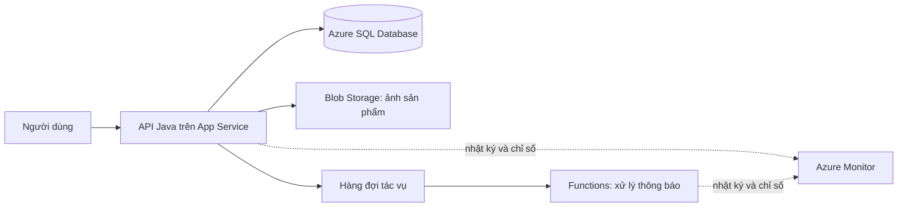

# Azure là gì và các mô hình dịch vụ đám mây

> Chương: Nền tảng Azure

Microsoft Azure là nền tảng điện toán đám mây của Microsoft, cung cấp các tài nguyên và dịch vụ để xây dựng, triển khai, vận hành ứng dụng. Thay vì tự mua và vận hành toàn bộ máy chủ, doanh nghiệp có thể thuê năng lực tính toán, lưu trữ, mạng và dịch vụ dữ liệu, sau đó điều chỉnh theo nhu cầu.

Điều cần hiểu đầu tiên không phải là nhớ tên thật nhiều dịch vụ, mà là xác định **mình cần giải quyết việc gì, muốn kiểm soát đến đâu và sẽ chịu trách nhiệm vận hành phần nào**. Ba mô hình IaaS, PaaS và SaaS giúp trả lời các câu hỏi đó.

## 1. Mục tiêu và tình huống xuyên suốt

Sau bài học, bạn có thể:

- Giải thích Azure cung cấp gì và đám mây khác cách vận hành hạ tầng tại chỗ như thế nào.
- Phân biệt IaaS, PaaS, SaaS dựa trên ranh giới quản lý và trách nhiệm.
- Nhận diện vai trò cơ bản của subscription, resource group và Microsoft Entra ID.
- Phân biệt mô hình dịch vụ với public cloud, private cloud và hybrid cloud.
- Đề xuất mô hình phù hợp cho từng thành phần của một ứng dụng, kèm lý do và phần công việc còn phải làm.

Ví dụ xuyên suốt là một nhóm phát triển hệ thống bán hàng bằng Java. Hệ thống có API xử lý đơn hàng, cơ sở dữ liệu, nơi lưu ảnh sản phẩm và tác vụ gửi thông báo. Lúc đầu lượng truy cập nhỏ; đến đợt khuyến mãi, lưu lượng tăng mạnh. Nhóm cần triển khai nhanh nhưng vẫn phải bảo vệ dữ liệu khách hàng và kiểm soát chi phí.

## 2. Điện toán đám mây giải quyết vấn đề nào?

### 2.1. Từ sở hữu thiết bị sang sử dụng dịch vụ

Khi vận hành hạ tầng tại chỗ, doanh nghiệp thường phải chuẩn bị mặt bằng, nguồn điện, mạng, máy chủ, thiết bị lưu trữ và nhân lực bảo trì. Việc mở rộng có thể cần mua sắm và lắp đặt trước khi ứng dụng sử dụng được tài nguyên.

Với Azure, nhóm có thể yêu cầu tài nguyên qua cổng quản trị, công cụ dòng lệnh, API hoặc mô tả hạ tầng bằng mã. Microsoft vận hành hạ tầng vật lý bên dưới; phần công việc nhóm phải làm phía trên phụ thuộc vào dịch vụ được chọn.

Ví dụ, thuê máy ảo giúp nhóm có máy chạy ứng dụng mà không phải mua máy chủ vật lý. Tuy nhiên, nhóm vẫn cần quản lý hệ điều hành và phần mềm trên máy ảo. Chọn một nền tảng chạy ứng dụng được quản lý có thể giảm thêm phần việc đó.

### 2.2. Những đặc tính cần hiểu

| Đặc tính | Ý nghĩa thực tế | Điều không nên suy ra |
| --- | --- | --- |
| Cấp phát theo nhu cầu | Có thể yêu cầu tài nguyên khi cần qua giao diện hoặc API | Mọi yêu cầu đều thành công ngay; vẫn có hạn mức và giới hạn năng lực |
| Truy cập qua mạng | Dịch vụ được sử dụng qua kết nối mạng và cơ chế xác thực phù hợp | Mọi tài nguyên phải mở công khai ra Internet |
| Tài nguyên được chia sẻ ở tầng hạ tầng | Nhà cung cấp tổ chức hạ tầng để phục vụ nhiều khách hàng với cơ chế cách ly | Khách hàng có quyền truy cập dữ liệu của nhau |
| Co giãn | Có thể tăng hoặc giảm năng lực theo tải nếu dịch vụ và thiết kế hỗ trợ | Ứng dụng nào cũng tự mở rộng mà không cần cấu hình |
| Đo lường mức sử dụng | Mức dùng tài nguyên được ghi nhận để quản lý và tính phí theo cơ chế dịch vụ | Mọi loại phí chỉ phát sinh khi có người gửi yêu cầu |

**Scalability** là khả năng mở rộng năng lực để đáp ứng tải. **Elasticity** nhấn mạnh việc điều chỉnh năng lực lên và xuống theo biến động nhu cầu. Một hệ thống có thể mở rộng thủ công nhưng chưa có cơ chế co giãn tự động.

### 2.3. Lợi ích đi kèm quyết định thiết kế

Đám mây giúp rút ngắn thời gian chuẩn bị hạ tầng và cung cấp nhiều dịch vụ dùng chung. Tuy vậy, độ tin cậy, bảo mật và chi phí vẫn phụ thuộc vào cách chọn và cấu hình dịch vụ.

Đối với hệ thống bán hàng, tạo thêm nhiều bản chạy API chỉ có ích khi bộ cân bằng tải phân phối được yêu cầu, ứng dụng xử lý trạng thái phù hợp và cơ sở dữ liệu chịu được tải tương ứng. Co giãn tầng tính toán không tự giải quyết mọi nút thắt.

## 3. Azure nằm ở đâu trong kiến trúc ứng dụng?

### 3.1. Các nhóm dịch vụ nền tảng

| Nhu cầu | Ví dụ dịch vụ hoặc thành phần Azure | Câu hỏi thiết kế ban đầu |
| --- | --- | --- |
| Chạy ứng dụng | Azure Virtual Machines, Azure App Service, Azure Functions | Cần quản lý máy hay chỉ cần triển khai mã ứng dụng? |
| Kết nối và cách ly mạng | Azure Virtual Network | Thành phần nào cần liên lạc với nhau, qua đường nào? |
| Lưu tệp và đối tượng | Azure Blob Storage | Ai được đọc, ghi ảnh và tài liệu? |
| Lưu dữ liệu quan hệ | Azure SQL Database | Cần mô hình dữ liệu, hiệu năng và khả năng phục hồi ra sao? |
| Quản lý danh tính | Microsoft Entra ID | Ai hoặc ứng dụng nào được xác thực? |
| Quan sát vận hành | Azure Monitor | Theo dõi chỉ số, nhật ký và cảnh báo nào? |
| Theo dõi chi phí | Microsoft Cost Management | Chi phí thuộc môi trường, nhóm và khối lượng công việc nào? |

Danh sách này là bản đồ khái niệm, không phải yêu cầu dùng tất cả dịch vụ. Một ứng dụng nhỏ có thể bắt đầu với ít thành phần, rồi bổ sung theo nhu cầu có thể giải thích được.

### 3.2. Subscription, resource group và resource

Ba khái niệm này giúp bạn biết tài nguyên được tổ chức ở đâu:

- **Subscription** là phạm vi quan trọng để tổ chức sử dụng Azure, quản lý truy cập, chính sách và theo dõi chi phí. Cách xuất hóa đơn còn liên quan đến thỏa thuận và cấu trúc thanh toán của tổ chức.
- **Resource group** là vùng chứa logic để quản lý một tập tài nguyên có liên quan, thường được nhóm theo ứng dụng, môi trường hoặc vòng đời.
- **Resource** là đối tượng được tạo và quản lý, chẳng hạn máy ảo, tài khoản lưu trữ hoặc một ứng dụng trên nền tảng được quản lý.

Ví dụ dưới đây chỉ mô tả tổ chức logic, không phải lệnh triển khai:

```text
Subscription: nhom-ban-hang
├── Resource group: sales-dev
│   ├── Ứng dụng API cho môi trường phát triển
│   ├── Dịch vụ cơ sở dữ liệu phát triển
│   └── Tài nguyên lưu ảnh thử nghiệm
└── Resource group: sales-prod
    ├── Ứng dụng API cho môi trường thật
    ├── Dịch vụ cơ sở dữ liệu thật
    └── Tài nguyên lưu ảnh sản phẩm
```

Resource group không phải một mạng riêng và không thay thế ranh giới bảo vệ dữ liệu. Các tài nguyên trong cùng resource group không tự có quyền truy cập lẫn nhau. Tài nguyên ở các resource group khác nhau vẫn có thể giao tiếp nếu mạng và quyền cho phép.

### 3.3. Microsoft Entra ID và quyền truy cập

Microsoft Entra ID cung cấp chức năng danh tính, giúp xác thực người dùng và ứng dụng. Một tenant là một phạm vi thư mục danh tính của Entra ID; tenant không đồng nghĩa với subscription. Một tenant có thể được liên kết với nhiều subscription.

Cần phân biệt hai câu hỏi:

1. **Xác thực:** danh tính đang truy cập là ai?
2. **Phân quyền:** danh tính đó được làm gì trên tài nguyên nào?

Azure RBAC là cơ chế phân quyền theo vai trò trên các phạm vi tài nguyên Azure. Quyền quản lý tài nguyên và quyền đọc dữ liệu bên trong dịch vụ có thể là các quyền khác nhau. Ví dụ, có quyền xem cấu hình tài khoản lưu trữ không đồng nghĩa đương nhiên có quyền tải mọi đối tượng trong đó.

Ở mức nhập môn, hãy ghi nhớ: **subscription tổ chức phạm vi sử dụng, resource group tổ chức tài nguyên, danh tính và vai trò kiểm soát truy cập**. Ba yếu tố liên quan với nhau nhưng giải quyết các vấn đề khác nhau.

### 3.4. Region và availability zone

**Region** là một khu vực triển khai Azure có hạ tầng trung tâm dữ liệu. Vị trí triển khai ảnh hưởng đến độ trễ, yêu cầu về dữ liệu, dịch vụ có thể sử dụng và chi phí.

**Availability zone** là các nhóm trung tâm dữ liệu được tách biệt trong một region có hỗ trợ, với hạ tầng điện, làm mát và mạng độc lập. Việc sử dụng nhiều zone có thể giúp giảm tác động của sự cố cục bộ, nhưng ứng dụng phải dùng dịch vụ và cấu hình phù hợp.

Region không phải resource group. Vị trí metadata của resource group không bắt buộc mọi tài nguyên trong nhóm phải cùng region. Tạo resource group cũng không tự tạo kiến trúc nhiều zone hoặc nhiều region.

## 4. IaaS: thuê hạ tầng, tự quản phần mềm bên trên

### 4.1. IaaS là gì?

**Infrastructure as a Service — IaaS** cung cấp tài nguyên hạ tầng như máy ảo, lưu trữ và mạng. Nhà cung cấp quản lý cơ sở vật chất, thiết bị vật lý và lớp ảo hóa; khách hàng quản lý hệ điều hành khách, runtime, ứng dụng và dữ liệu theo tài nguyên mình sử dụng.

Ví dụ điển hình trên Azure là **Azure Virtual Machines**. Bạn chọn cấu hình máy, hệ điều hành và thiết lập liên quan, sau đó cài phần mềm để chạy ứng dụng.

### 4.2. Ví dụ với ứng dụng Java

Nhóm bán hàng tạo một máy ảo Linux, cài JDK, đưa ứng dụng Java lên máy và cấu hình tiến trình chạy. Nhóm có quyền tùy chỉnh sâu nhưng phải chịu trách nhiệm cho nhiều việc:

- Cập nhật hệ điều hành khách và JDK, quản lý các gói phần mềm.
- Cấu hình truy cập quản trị và giới hạn kết nối mạng.
- Quản lý cấu hình ứng dụng, bí mật và tài khoản dịch vụ.
- Thu thập log, thiết lập cảnh báo và xử lý khi tiến trình dừng.
- Thiết kế sao lưu, phục hồi, mở rộng và tính sẵn sàng phù hợp.

### 4.3. Khi nào nên cân nhắc?

IaaS phù hợp khi cần quyền kiểm soát hệ điều hành, phụ thuộc phần mềm đặc thù hoặc cần di chuyển một hệ thống cũ mà chưa thể thay đổi kiến trúc nhiều. Nó cũng hữu ích khi yêu cầu vận hành buộc phải cấu hình ở tầng máy.

Đổi lại, quyền kiểm soát cao kéo theo công việc vận hành lớn. Chuyển một máy chủ từ phòng máy lên máy ảo Azure có thể thay đổi nơi đặt hạ tầng, nhưng không tự biến ứng dụng thành hệ thống có khả năng chịu lỗi hoặc co giãn tốt.

## 5. PaaS: triển khai ứng dụng trên nền tảng được quản lý

### 5.1. PaaS là gì?

**Platform as a Service — PaaS** cung cấp nền tảng để triển khai ứng dụng hoặc sử dụng một chức năng như cơ sở dữ liệu. Nhà cung cấp quản lý nhiều thành phần hạ tầng và nền tảng hơn so với IaaS. Khách hàng tập trung vào mã nguồn, dữ liệu, cấu hình, quyền truy cập và yêu cầu vận hành của ứng dụng.

Ví dụ tiêu biểu là **Azure App Service** cho ứng dụng web/API và **Azure SQL Database** cho cơ sở dữ liệu quan hệ được quản lý.

### 5.2. Ví dụ với ứng dụng Java

Thay vì tạo máy ảo rồi cài JDK và cấu hình tiến trình, nhóm chọn một cấu hình App Service phù hợp để triển khai API Java. Nhóm vẫn phải kiểm tra runtime được hỗ trợ và cách đóng gói ứng dụng của mình.

Dữ liệu đơn hàng có thể được đặt trong Azure SQL Database. Microsoft vận hành nền tảng cơ sở dữ liệu được quản lý, trong khi nhóm vẫn chịu trách nhiệm thiết kế bảng, truy vấn, phân quyền dữ liệu và đáp ứng yêu cầu của ứng dụng.

Những phần việc vẫn cần làm gồm:

- Kiểm tra khả năng tương thích của ứng dụng và phiên bản runtime.
- Cấu hình kết nối, danh tính và cách cung cấp bí mật.
- Đặt giới hạn truy cập mạng phù hợp với kiến trúc.
- Chọn năng lực xử lý, cấu hình mở rộng và quan sát tải.
- Thiết lập cảnh báo, kiểm tra khôi phục và quản lý thay đổi ứng dụng.

### 5.3. Lợi ích và giới hạn

PaaS giảm lượng việc quản lý máy và giúp nhóm dành nhiều thời gian cho nghiệp vụ. Đổi lại, ứng dụng phải thích nghi với khả năng và ràng buộc của nền tảng: runtime, mô hình triển khai, cách lưu trạng thái, mạng và cơ chế mở rộng.

Ví dụ, nếu API lưu phiên người dùng hoặc ảnh tải lên chỉ trên ổ đĩa cục bộ của một bản chạy, mở rộng thành nhiều bản chạy có thể tạo hành vi không nhất quán. Nhóm cần chọn nơi lưu trạng thái và tệp phù hợp thay vì mặc định mọi bản chạy dùng chung dữ liệu cục bộ.

**Được quản lý không có nghĩa là đã được cấu hình đúng cho nhu cầu của bạn.** Nền tảng có thể cung cấp sao lưu hoặc tính năng phục hồi, nhưng nhóm vẫn cần hiểu phạm vi bảo vệ, thời gian lưu giữ và cách khôi phục đáp ứng yêu cầu nghiệp vụ.

## 6. SaaS: sử dụng phần mềm hoàn chỉnh

### 6.1. SaaS là gì?

**Software as a Service — SaaS** cung cấp phần mềm hoàn chỉnh cho người dùng. Nhà cung cấp quản lý ứng dụng và các lớp kỹ thuật bên dưới. Khách hàng sử dụng tính năng, cấu hình nghiệp vụ và quản trị dữ liệu, người dùng, quyền truy cập trong phạm vi sản phẩm cho phép.

Microsoft 365 là một ví dụ SaaS quen thuộc trong hệ sinh thái Microsoft. Cần phân biệt: **Microsoft 365 không phải tài nguyên Azure để bạn triển khai mã Java của mình**; đây là ví dụ giúp hiểu mô hình cung cấp phần mềm hoàn chỉnh.

### 6.2. Trách nhiệm của khách hàng trong SaaS

Không quản lý máy chủ không đồng nghĩa hết trách nhiệm. Tổ chức vẫn cần:

- Quản lý người dùng, nhóm và quyền sử dụng chức năng.
- Thiết lập chính sách truy cập và bảo vệ tài khoản.
- Phân loại dữ liệu được đưa vào sản phẩm.
- Cấu hình chia sẻ, lưu giữ, xuất dữ liệu và tích hợp theo nhu cầu.
- Hiểu giới hạn dịch vụ, điều khoản sử dụng và cách xử lý sự cố nghiệp vụ.

### 6.3. Khi nào nên cân nhắc?

SaaS phù hợp khi nhu cầu đã được đáp ứng bằng sản phẩm hoàn chỉnh và tổ chức không cần tự xây dựng toàn bộ phần mềm đó. Với nhóm bán hàng, sử dụng một công cụ cộng tác dạng SaaS có thể hợp lý hơn việc tự viết hệ thống họp trực tuyến và chia sẻ tài liệu.

Ngược lại, nếu nhóm cần xây API đơn hàng riêng, câu hỏi triển khai API thường dẫn đến IaaS, PaaS hoặc một hình thức nền tảng phù hợp khác. Việc một ứng dụng của bạn chạy trên Azure cũng không tự khiến nó trở thành SaaS; SaaS còn nói đến cách bạn cung cấp phần mềm hoàn chỉnh cho khách hàng.

## 7. So sánh mô hình bằng ranh giới trách nhiệm

Bảng dưới là mô hình khái quát để học. Ranh giới chính xác luôn phụ thuộc vào dịch vụ cụ thể và cách bạn triển khai.

| Lớp hoặc công việc | Tại chỗ | IaaS | PaaS | SaaS |
| --- | --- | --- | --- | --- |
| Trung tâm dữ liệu và thiết bị vật lý | Khách hàng | Nhà cung cấp | Nhà cung cấp | Nhà cung cấp |
| Lớp ảo hóa do dịch vụ cung cấp | Khách hàng nếu sử dụng | Nhà cung cấp | Nhà cung cấp | Nhà cung cấp |
| Hệ điều hành phục vụ khối lượng công việc | Khách hàng | Khách hàng quản lý hệ điều hành khách | Nhà cung cấp quản lý nền tảng; khách hàng theo phạm vi triển khai | Nhà cung cấp |
| Runtime và middleware | Khách hàng | Khách hàng | Thường được nền tảng quản lý; khách hàng vẫn có trách nhiệm với thành phần tự đóng gói | Nhà cung cấp |
| Mã và phiên bản ứng dụng | Khách hàng | Khách hàng | Khách hàng | Nhà cung cấp quản lý sản phẩm |
| Dữ liệu và quyền truy cập của tổ chức | Khách hàng | Khách hàng | Khách hàng | Khách hàng vẫn có trách nhiệm trong phạm vi sử dụng |
| Cấu hình phù hợp với nghiệp vụ | Khách hàng | Khách hàng | Khách hàng | Khách hàng trong phạm vi sản phẩm |

### 7.1. Trách nhiệm chia sẻ không phải chia đôi

Mô hình **shared responsibility** xác định nhà cung cấp và khách hàng chịu trách nhiệm ở những lớp khác nhau. Phần việc không nhất thiết được chia đều, và không thể dùng một tỷ lệ chung cho mọi dịch vụ.

Có thể hình dung ranh giới dịch chuyển như sau:

```text
IaaS: bạn quản lý hệ điều hành → runtime → ứng dụng → dữ liệu
PaaS: bạn tập trung ứng dụng → dữ liệu → cấu hình sử dụng nền tảng
SaaS: bạn tập trung dữ liệu → người dùng → cấu hình sử dụng sản phẩm
```

Ở cả ba mô hình, khách hàng vẫn cần kiểm soát dữ liệu và danh tính trong phạm vi trách nhiệm của mình. Nhà cung cấp quản lý hạ tầng không thể thay bạn quyết định nhân viên nào được xem danh sách khách hàng.

### 7.2. Ví dụ về sự cố do hiểu sai ranh giới

Giả sử nhóm dùng dịch vụ lưu trữ được quản lý để chứa hóa đơn. Dịch vụ có cơ chế bảo vệ hạ tầng, nhưng nhóm cấu hình quyền đọc công khai cho dữ liệu cần giữ riêng tư. Vấn đề nằm ở quyết định cấu hình và quyền truy cập của khách hàng.

Tương tự, nền tảng chạy ứng dụng có thể tự duy trì hệ điều hành bên dưới, nhưng một lỗi phân quyền trong API Java vẫn có thể khiến người dùng đọc đơn hàng của người khác. Chọn PaaS không loại bỏ yêu cầu kiểm tra bảo mật ứng dụng.

## 8. Serverless và container nằm ở đâu?

### 8.1. Serverless không phải không có máy chủ

Serverless là cách sử dụng năng lực tính toán với mức trừu tượng cao, trong đó nhà cung cấp quản lý hạ tầng máy chủ và nhiều khía cạnh cấp phát, vận hành. Máy chủ vẫn tồn tại; nhóm phát triển không trực tiếp quản lý chúng như với máy ảo.

**Azure Functions** là một ví dụ thường gặp khi xử lý mã theo sự kiện. Trong hệ thống bán hàng, một tác vụ gửi thông báo hoặc xử lý tệp mới có thể phù hợp với cách tổ chức này.

Cần xem điều kiện thực thi, cách mở rộng và cơ chế tính phí của phương án triển khai cụ thể. Không nên suy ra rằng mọi dịch vụ serverless đều tính phí hoàn toàn theo số yêu cầu, luôn tự giảm về không hoặc không có thời gian khởi động.

Trong bài học này, IaaS, PaaS và SaaS là ba mô hình dịch vụ chính để so sánh trách nhiệm. Serverless mô tả thêm một cách cung cấp và vận hành nền tảng; không cần coi nó là một bậc cố định thay thế ba mô hình đó.

### 8.2. Container là cách đóng gói và chạy ứng dụng

Container đóng gói ứng dụng cùng các phụ thuộc cần thiết. Container không tự quyết định dịch vụ thuộc IaaS, PaaS hay SaaS:

- Chạy container trên máy ảo vẫn để lại nhiều trách nhiệm ở tầng máy cho nhóm.
- Chạy container trên nền tảng được quản lý có thể giảm công việc quản lý hạ tầng.
- Cung cấp một sản phẩm hoàn chỉnh cho người dùng có thể là SaaS dù nội bộ sản phẩm dùng container.

Nếu bạn tự đóng gói runtime hoặc thư viện trong image, bạn cần quản lý lỗ hổng và cập nhật các thành phần đó. Nhà cung cấp quản lý máy chủ không tự sửa mọi phụ thuộc trong image của bạn.

## 9. Public, private và hybrid cloud là trục phân loại khác

IaaS, PaaS và SaaS trả lời câu hỏi **khách hàng nhận dịch vụ ở lớp nào**. Public cloud, private cloud và hybrid cloud mô tả **cách hạ tầng đám mây được triển khai và kết hợp**.

| Mô hình triển khai | Ý nghĩa | Ví dụ khái niệm |
| --- | --- | --- |
| Public cloud | Năng lực đám mây được nhà cung cấp cung cấp cho nhiều khách hàng với cơ chế cách ly | Doanh nghiệp sử dụng dịch vụ Azure trong môi trường đám mây công cộng |
| Private cloud | Hạ tầng đám mây dành riêng cho một tổ chức | Tổ chức vận hành môi trường đám mây riêng có cơ chế tự phục vụ và quản lý tài nguyên |
| Hybrid cloud | Kết hợp môi trường riêng hoặc tại chỗ với public cloud theo một kiến trúc liên kết | API chạy trên Azure kết nối đến hệ thống nội bộ qua kết nối được kiểm soát |
| Multicloud | Sử dụng dịch vụ từ nhiều nhà cung cấp đám mây | Hai khối lượng công việc sử dụng hai nền tảng cloud khác nhau |

Public cloud không đồng nghĩa dữ liệu công khai. Một ứng dụng trên Azure có thể sử dụng mạng riêng và giới hạn truy cập. Private cloud cũng không đồng nghĩa chỉ cần có một máy chủ đặt tại văn phòng; còn cần các đặc tính và cơ chế quản lý của môi trường đám mây.

Hybrid cloud và multicloud không đồng nghĩa. Một doanh nghiệp có thể dùng Azure cùng hệ thống tại chỗ mà không dùng nhà cung cấp public cloud thứ hai. Ngược lại, dùng hai public cloud chưa đủ để mô tả cách chúng tích hợp với nhau.

## 10. Áp dụng cho hệ thống bán hàng Java

### 10.1. Hai phương án cho cùng một nhu cầu

| Thành phần | Phương án thiên về IaaS | Phương án thiên về nền tảng được quản lý |
| --- | --- | --- |
| API Java | Máy ảo do nhóm cài hệ điều hành và runtime ứng dụng | App Service với cách triển khai và runtime phù hợp |
| Dữ liệu đơn hàng | Tự cài và vận hành cơ sở dữ liệu trên máy ảo | Azure SQL Database nếu phù hợp với yêu cầu và khả năng tương thích |
| Ảnh sản phẩm | Nhóm tự quản giải pháp lưu tệp trên hạ tầng thuê | Blob Storage với quyền truy cập được thiết kế rõ |
| Tác vụ nền | Tiến trình do nhóm cài đặt, giám sát và mở rộng | Functions cho những tác vụ phù hợp với mô hình sự kiện |

Đây là các phương án so sánh, không phải bản thiết kế bắt buộc. Một hệ thống thực tế có thể kết hợp máy ảo với cơ sở dữ liệu được quản lý và lưu trữ đối tượng. Mỗi thành phần nên được chọn theo ràng buộc của chính nó.

### 10.2. Kiến trúc minh họa



Sơ đồ chỉ thể hiện vai trò thành phần và luồng logic. Nó chưa mô tả đầy đủ mạng, xác thực, phân quyền, sao lưu hoặc tính sẵn sàng. Một kiến trúc đưa vào sử dụng cần bổ sung những quyết định đó.

Với tác vụ gửi thông báo, hàng đợi có thể tách việc tiếp nhận đơn hàng khỏi tốc độ xử lý thông báo. Nhóm vẫn phải thiết kế cơ chế thử lại và xử lý trùng lặp. Việc chuyển tác vụ sang một hàm không tự bảo đảm mỗi thông báo chỉ được gửi đúng một lần.

### 10.3. Cách ra quyết định theo từng bước

1. **Xác định yêu cầu:** lượng truy cập, độ trễ chấp nhận được, dữ liệu cần bảo vệ và thời gian phục hồi mong muốn.
2. **Liệt kê phụ thuộc:** phiên bản Java, thư viện, cơ sở dữ liệu, thành phần cần quyền hệ điều hành.
3. **Chọn mức kiểm soát:** phần nào thực sự cần quản lý máy, phần nào có thể giao nền tảng quản lý.
4. **Kiểm tra khả năng phù hợp:** runtime, mạng, vùng triển khai, cách mở rộng, tích hợp và giới hạn của dịch vụ.
5. **Ước lượng công sức và chi phí:** bao gồm vận hành, giám sát, sao lưu và xử lý sự cố.
6. **Thử nghiệm có phạm vi:** kiểm tra triển khai, truy cập dữ liệu và hành vi khi tải thay đổi trước khi mở rộng.

Với nhóm nhỏ có một API Java tương thích nền tảng và không cần tùy chỉnh hệ điều hành, PaaS là một phương án đáng đánh giá. Nếu ứng dụng phụ thuộc sâu vào phần mềm đặc thù ở tầng hệ điều hành, IaaS có thể là lựa chọn phù hợp hơn trong giai đoạn đầu.

## 11. Chi phí, an toàn và vận hành ngay từ đầu

### 11.1. Chi phí không chỉ là giá chạy ứng dụng

Có thể dùng công thức tư duy sau để liệt kê thành phần chi phí; đây không phải công thức báo giá của Azure:

```text
Tổng chi phí cần xem xét
  = tính toán + lưu trữ + truyền dữ liệu + dịch vụ đi kèm
  + quan sát và sao lưu + công sức vận hành
```

IaaS có thể khiến nhóm phải dành thêm thời gian vá hệ điều hành và trực vận hành. PaaS có thể giảm phần việc đó nhưng vẫn phát sinh phí theo năng lực và tính năng sử dụng. SaaS có thể tính theo người dùng hoặc cơ chế khác của sản phẩm.

Vì vậy, không có thứ tự giá cố định rằng IaaS luôn rẻ hơn PaaS hoặc serverless luôn rẻ nhất. Cần so sánh cùng yêu cầu và cùng mức sử dụng dự kiến.

Đối với môi trường học tập, nên nhận diện rõ tài nguyên đã tạo, theo dõi mức dùng và thu dọn sau khi xong. Dừng một ứng dụng hoặc máy không bảo đảm mọi tài nguyên liên quan đều ngừng phát sinh phí; ổ đĩa, bản sao lưu hoặc tài nguyên khác có thể vẫn tồn tại.

### 11.2. Bảo mật là một phần của lựa chọn dịch vụ

Dù chọn mô hình nào, hãy xác định dữ liệu nào nhạy cảm, ai được truy cập và cách ứng dụng lấy quyền. Tránh đặt bí mật trong mã nguồn; sử dụng cơ chế danh tính và quản lý bí mật phù hợp với dịch vụ.

Quyền cần được giới hạn theo nhu cầu thực hiện công việc. Một API chỉ cần đọc ảnh sản phẩm không nên nhận quyền quản trị toàn bộ subscription. Ranh giới quyền nhỏ hơn giúp hạn chế tác động khi có lỗi hoặc lộ thông tin xác thực.

### 11.3. Tính sẵn sàng không thay thế sao lưu

**Tính sẵn sàng** giúp dịch vụ tiếp tục phục vụ khi một thành phần gặp sự cố. **Sao lưu và phục hồi** giúp khôi phục dữ liệu hoặc trạng thái khi cần. Hai mục tiêu liên quan nhưng không thay thế nhau.

Ví dụ, có nhiều bản chạy API không khôi phục được dữ liệu đơn hàng bị ứng dụng xóa nhầm. Một dịch vụ cơ sở dữ liệu được quản lý vẫn cần được cấu hình và kiểm tra khả năng phục hồi theo yêu cầu của nhóm.

## 12. Các nhầm lẫn thường gặp

| Nhận định | Cách hiểu đúng |
| --- | --- |
| Azure chỉ là nơi thuê máy ảo | Azure còn cung cấp nền tảng ứng dụng, dữ liệu, danh tính, mạng và nhiều dịch vụ khác |
| Chọn PaaS thì không còn vận hành | Nhóm vẫn vận hành ứng dụng, quản lý dữ liệu, cấu hình, truy cập và theo dõi dịch vụ |
| SaaS là tên gọi cho mọi ứng dụng chạy trên cloud | SaaS là cách cung cấp phần mềm hoàn chỉnh cho người sử dụng |
| IaaS, PaaS, SaaS là ba mức độ chất lượng | Chúng phân chia quyền kiểm soát và trách nhiệm, không xếp hạng tốt xấu |
| Có autoscale thì mọi tầng đều tự mở rộng | Mỗi tầng có khả năng, cấu hình và nút thắt riêng |
| Public cloud nghĩa là mọi dữ liệu công khai | Quyền truy cập phụ thuộc thiết kế danh tính, mạng và cấu hình dữ liệu |
| Resource group là vùng mạng cách ly | Đây là vùng chứa logic để tổ chức và quản lý tài nguyên |
| Dùng cloud thì mặc nhiên rẻ và an toàn | Kết quả phụ thuộc lựa chọn dịch vụ, thiết kế và cách vận hành |

## 13. Bài tập áp dụng và tự kiểm tra

### 13.1. Bài tập phân loại

Với mỗi tình huống, chọn mô hình dịch vụ và nêu ít nhất hai trách nhiệm còn thuộc về khách hàng:

1. Bạn cần chạy một ứng dụng cũ phải cài một thành phần đặc thù vào hệ điều hành.
2. Bạn có API Java tương thích nền tảng và muốn giảm công việc quản lý máy.
3. Doanh nghiệp cần một sản phẩm cộng tác hoàn chỉnh cho nhân viên.

**Gợi ý đáp án:**

1. Cân nhắc IaaS. Khách hàng quản lý hệ điều hành khách, runtime, ứng dụng, dữ liệu và quyền truy cập.
2. Cân nhắc PaaS. Khách hàng quản lý mã ứng dụng, dữ liệu, cấu hình và việc sử dụng quyền truy cập; cần kiểm tra nền tảng đáp ứng các yêu cầu thực tế.
3. Cân nhắc SaaS. Khách hàng quản trị người dùng, chia sẻ dữ liệu và cấu hình sử dụng sản phẩm.

### 13.2. Bài tập thiết kế nhỏ

Hãy mô tả phương án cho hệ thống bán hàng gồm API Java, dữ liệu đơn hàng, ảnh sản phẩm và tác vụ thông báo. Với mỗi thành phần, ghi:

- Nhu cầu chính và điều kiện đặc thù.
- Mô hình hoặc kiểu dịch vụ dự kiến sử dụng.
- Việc nhà cung cấp quản lý và việc nhóm vẫn phải làm.
- Một rủi ro cần kiểm tra trước khi đưa vào sử dụng.

Một đáp án hợp lý có thể kết hợp App Service, Azure SQL Database, Blob Storage và tác vụ theo sự kiện. Chất lượng đáp án nằm ở việc giải thích sự phù hợp, ranh giới trách nhiệm và rủi ro, thay vì chỉ liệt kê tên sản phẩm.

### 13.3. Câu hỏi tự kiểm tra

**Một subscription có phải một tenant không?** Không. Subscription là phạm vi sử dụng và quản lý tài nguyên Azure; tenant là phạm vi thư mục danh tính. Chúng có quan hệ liên kết nhưng không đồng nghĩa.

**Dùng PaaS có thể triển khai mã có lỗi phân quyền không?** Có. Nền tảng quản lý nhiều lớp kỹ thuật, nhưng logic và quyền truy cập bên trong ứng dụng vẫn cần được thiết kế đúng.

**Có nên chọn một mô hình cho toàn bộ hệ thống?** Không bắt buộc. Các thành phần có nhu cầu khác nhau và có thể sử dụng các mô hình phù hợp khác nhau.

**Serverless có nghĩa không cần theo dõi hệ thống không?** Không. Vẫn phải quan sát lỗi, thời gian thực thi, tải, chi phí và tác động đến các dịch vụ phụ thuộc.

**Cần nhớ điều gì khi đánh giá một dịch vụ Azure mới?** Hãy xác định dịch vụ giải quyết nhu cầu nào, cung cấp quyền kiểm soát đến đâu, giao phần việc nào cho nhà cung cấp và để lại trách nhiệm nào cho nhóm.
