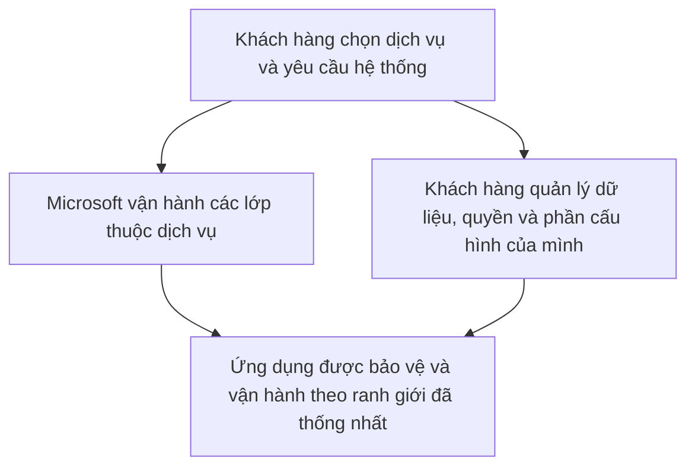
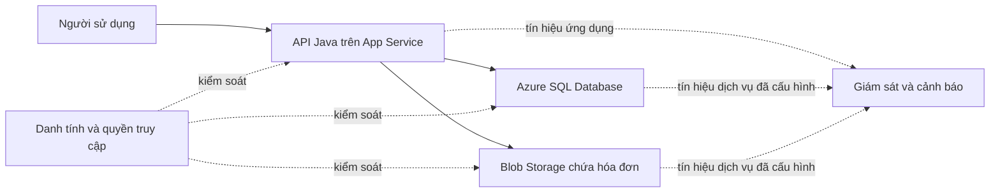

# Mô hình trách nhiệm chia sẻ trên Azure

## 1. Vì sao cần hiểu trách nhiệm trước khi tạo tài nguyên?

Một ứng dụng chạy trên Azure sử dụng nhiều lớp: trung tâm dữ liệu, máy chủ vật lý, mạng, nền tảng tính toán, hệ điều hành, mã ứng dụng, danh tính và dữ liệu. Microsoft và tổ chức sử dụng Azure cùng tham gia bảo vệ, vận hành các lớp đó. **Mô hình trách nhiệm chia sẻ** xác định bên nào quản lý phần nào, thay vì mặc định rằng chuyển ứng dụng lên đám mây đồng nghĩa chuyển toàn bộ trách nhiệm cho nhà cung cấp.

Trong phạm vi hệ sinh thái Azure, sự phân chia này ảnh hưởng trực tiếp đến cách tổ chức subscription, resource group, Microsoft Entra ID, mạng ảo, dịch vụ tính toán, lưu trữ và dữ liệu. Nó cũng quyết định ai phải triển khai thay đổi, nhận cảnh báo, kiểm tra bản sao lưu, xử lý sự cố và kiểm soát chi phí.

Ví dụ, Microsoft có thể bảo vệ phần cứng lưu trữ nhưng không biết một container chứa hóa đơn của doanh nghiệp có được phép công khai hay không. Microsoft có thể vận hành nền tảng cơ sở dữ liệu nhưng không tự xác định tài khoản của ứng dụng cần được đọc những bảng nào. Đó là các quyết định thuộc về chủ sở hữu hệ thống và dữ liệu.

Sau bài học, bạn cần có khả năng:

- Giải thích ranh giới giữa trách nhiệm của Microsoft và trách nhiệm của khách hàng.
- Phân biệt trách nhiệm khi dùng IaaS, PaaS và SaaS.
- Áp dụng mô hình cho Virtual Machines, App Service, Azure SQL Database, Storage và Microsoft Entra ID.
- Phân công người chịu trách nhiệm cho danh tính, cấu hình, dữ liệu, giám sát, khôi phục và chi phí.
- Nhận diện những phần việc còn thiếu khi một nhóm nói rằng hệ thống đã được Azure quản lý.

## 2. Hai phía của mô hình

### 2.1. Microsoft bảo vệ và vận hành hạ tầng cung cấp dịch vụ

Ở mọi mô hình dịch vụ đám mây công cộng, Microsoft chịu trách nhiệm đối với hạ tầng vật lý do Microsoft vận hành để cung cấp dịch vụ. Những công việc này gồm bảo vệ cơ sở trung tâm dữ liệu, vận hành máy chủ vật lý, hạ tầng mạng vật lý và các thành phần nền tảng thuộc phạm vi dịch vụ.

Khi khách hàng chọn dịch vụ được quản lý ở mức cao hơn, Microsoft còn tiếp nhận thêm một số lớp vận hành, chẳng hạn hệ điều hành nền tảng hoặc bộ máy cơ sở dữ liệu. Phạm vi cụ thể phụ thuộc dịch vụ và cách triển khai; không thể suy rộng trách nhiệm của một dịch vụ sang mọi dịch vụ khác trên Azure.

Cụm từ thường dùng là **bảo mật của đám mây**: bảo vệ nền tảng mà Microsoft cung cấp.

### 2.2. Khách hàng bảo vệ những gì mình đưa vào và cấu hình trên Azure

Khách hàng là tổ chức hoặc cá nhân sử dụng Azure. Khách hàng vẫn phải xác định dữ liệu nào được lưu, ai được truy cập, ứng dụng được phép làm gì, cấu hình nào phù hợp và rủi ro nào chấp nhận được.

Những trách nhiệm thường xuyên xuất hiện gồm:

- Phân loại dữ liệu, xác định mục đích sử dụng và yêu cầu lưu giữ.
- Quản lý tài khoản người dùng, danh tính ứng dụng và quyền truy cập.
- Bảo vệ các thiết bị đầu cuối do tổ chức quản lý.
- Chọn cấu hình dịch vụ, kết nối mạng và cách công bố ứng dụng.
- Quản lý mã nguồn, dependency và bí mật trong phần ứng dụng mình kiểm soát.
- Xác định yêu cầu khả dụng, khả năng khôi phục và bằng chứng tuân thủ của hệ thống.

Cụm từ tương ứng là **bảo mật trong đám mây**: bảo vệ tài nguyên, ứng dụng và dữ liệu mà khách hàng triển khai hoặc sử dụng.

Hai cụm từ này giúp ghi nhớ nhưng không thay thế việc đọc phạm vi của từng dịch vụ. Một lớp như mạng hoặc danh tính có thể chứa cả thành phần Microsoft vận hành lẫn cấu hình khách hàng phải chịu trách nhiệm.

### 2.3. Chia sẻ không có nghĩa là cùng làm mọi việc

Một trách nhiệm được chia sẻ thường gồm nhiều phần việc khác nhau, với ranh giới và điểm bàn giao rõ ràng.

Ví dụ đối với danh tính:

- Microsoft vận hành nền tảng Microsoft Entra ID.
- Tổ chức quản lý vòng đời tài khoản, nhóm, quyền truy cập, chính sách đăng nhập và các cấu hình trong tenant thuộc thẩm quyền của mình.
- Người dùng và nhóm quản trị phải thực hiện quy trình bảo vệ tài khoản, xử lý thông tin xác thực bị lộ và thu hồi quyền khi cần.

Nói rằng danh tính là trách nhiệm chia sẻ chưa đủ. Một kế hoạch vận hành phải chỉ ra ai cấu hình, ai phê duyệt, ai giám sát và ai xử lý cảnh báo.



## 3. Trách nhiệm thay đổi theo IaaS, PaaS và SaaS

### 3.1. IaaS: khách hàng quản lý nhiều lớp phần mềm

**Infrastructure as a Service — IaaS** cung cấp tài nguyên hạ tầng như máy ảo, mạng ảo và đĩa. Azure Virtual Machines là ví dụ điển hình.

Microsoft vận hành hạ tầng vật lý và lớp ảo hóa của nền tảng. Khách hàng quản lý hệ điều hành khách trong máy ảo, phần mềm cài bên trong, ứng dụng, tài khoản và cấu hình tài nguyên của mình.

Nếu nhóm tự cài một hệ quản trị cơ sở dữ liệu lên VM, nhóm cũng phải quản lý việc vá lỗi, cấu hình và vận hành phần mềm đó. Việc phần mềm chạy trên Azure không tự biến nó thành dịch vụ cơ sở dữ liệu được quản lý.

IaaS phù hợp khi cần quyền kiểm soát sâu, nhưng quyền kiểm soát đi cùng nghĩa vụ vận hành lớn hơn.

### 3.2. PaaS: Microsoft quản lý thêm nền tảng ứng dụng

**Platform as a Service — PaaS** cung cấp nền tảng để khách hàng triển khai ứng dụng hoặc sử dụng năng lực như cơ sở dữ liệu mà không phải tự vận hành toàn bộ hệ điều hành phía dưới. Azure App Service và Azure SQL Database là những ví dụ thường gặp.

Với một ứng dụng Java chạy trên App Service bằng runtime do nền tảng cung cấp, Microsoft quản lý hạ tầng và các lớp nền tảng thuộc dịch vụ. Nhóm phát triển vẫn quản lý mã Java, dependency đóng gói cùng ứng dụng, thiết lập ứng dụng, quyền truy cập và dữ liệu.

Nếu triển khai bằng custom container, nhóm còn phải quản lý nội dung image của mình, bao gồm các gói và thư viện được đưa vào image. Việc nền tảng chạy container không đồng nghĩa nền tảng tự sửa mọi lỗ hổng bên trong image do khách hàng cung cấp.

PaaS giảm khối lượng công việc hạ tầng nhưng vẫn cần năng lực phát triển an toàn và quản trị cấu hình.

### 3.3. SaaS: nhà cung cấp vận hành ứng dụng hoàn chỉnh

**Software as a Service — SaaS** cung cấp ứng dụng hoàn chỉnh để người dùng sử dụng. Microsoft 365 là ví dụ giúp hình dung mô hình SaaS trong hệ sinh thái Microsoft; nó không phải một máy ảo hay tài nguyên App Service mà khách hàng tự triển khai trong subscription Azure.

Nhà cung cấp quản lý ứng dụng và nền tảng cung cấp ứng dụng đó. Khách hàng vẫn phải quản trị người dùng, dữ liệu mình đưa vào, cách chia sẻ, cấu hình tenant và các thiết bị đầu cuối thuộc tổ chức.

Nếu người dùng chia sẻ một tài liệu nhạy cảm cho sai đối tượng, việc nhà cung cấp vận hành phần mềm không làm mất trách nhiệm quản trị chia sẻ của tổ chức.

### 3.4. Ma trận trách nhiệm ở mức khái quát

Bảng dưới mô tả xu hướng phân chia, không thay thế tài liệu phạm vi của từng dịch vụ.

| Lớp hoặc công việc | IaaS | PaaS | SaaS |
| --- | --- | --- | --- |
| Trung tâm dữ liệu, máy chủ và mạng vật lý | Microsoft | Microsoft | Nhà cung cấp |
| Lớp ảo hóa và nền tảng hạ tầng do nhà cung cấp vận hành | Microsoft | Microsoft | Nhà cung cấp |
| Hệ điều hành khách hoặc hệ điều hành nền tảng | Khách hàng quản lý hệ điều hành trong VM | Microsoft quản lý lớp hệ điều hành của dịch vụ | Nhà cung cấp |
| Runtime, middleware hoặc bộ máy dữ liệu | Khách hàng với phần mềm tự cài | Microsoft với thành phần thuộc nền tảng; khách hàng với thành phần tự đưa vào | Nhà cung cấp với phần ứng dụng cung cấp |
| Mã ứng dụng và dependency do khách hàng triển khai | Khách hàng | Khách hàng | Khách hàng vẫn quản lý mã mở rộng, tích hợp hoặc thành phần tự viết nếu có |
| Dữ liệu, phân loại và quyết định ai được truy cập | Khách hàng | Khách hàng | Khách hàng |
| Danh tính và cấu hình quyền | Microsoft vận hành nền tảng; khách hàng quản trị danh tính và quyền | Microsoft vận hành nền tảng; khách hàng quản trị danh tính và quyền | Nhà cung cấp vận hành nền tảng; khách hàng quản trị trong phạm vi được cung cấp |
| Mạng và đường truy cập dịch vụ | Khách hàng quản lý cấu hình mạng của mình | Chia sẻ tùy dịch vụ và chế độ kết nối | Nhà cung cấp quản lý mạng dịch vụ; khách hàng quản lý các lựa chọn truy cập được cung cấp |
| Thiết bị đầu cuối do khách hàng quản lý | Khách hàng | Khách hàng | Khách hàng |

Điểm cần nhớ: **càng dùng dịch vụ được quản lý, khách hàng càng ít phải vận hành các lớp thấp; trách nhiệm về dữ liệu và quyết định truy cập vẫn còn**.

## 4. Áp dụng vào cấu trúc quản trị Azure

### 4.1. Subscription là phạm vi quản trị cần có chủ sở hữu

Subscription giúp tổ chức tài nguyên và là một phạm vi quan trọng cho việc gán quyền, áp chính sách và theo dõi chi phí. Microsoft vận hành dịch vụ Azure; tổ chức vẫn phải quyết định ai được tạo tài nguyên, ai phê duyệt quyền và ai theo dõi chi phí trong subscription.

Một ứng dụng có thể được bảo vệ tốt ở cấp mã nguồn nhưng vẫn gặp rủi ro nếu quá nhiều người có quyền quản trị rộng ở cấp subscription. Quyền kế thừa xuống các phạm vi thấp hơn cần được tính đến khi đánh giá ai thực sự có thể thay đổi hệ thống.

### 4.2. Resource group tổ chức tài nguyên, không tự cô lập mọi thứ

Resource group là nơi nhóm các tài nguyên liên quan để quản lý vòng đời và áp quyền hoặc chính sách ở một phạm vi chung. Nó không tự tạo ra một mạng riêng, không tự chặn lưu lượng giữa các ứng dụng và không tự bảo đảm rằng chỉ thành viên dự án mới đọc được dữ liệu.

Muốn giới hạn truy cập, nhóm phải thiết kế các cơ chế phù hợp: quyền truy cập, cấu hình mạng, xác thực ứng dụng và quyền trên dữ liệu. Đặt hai ứng dụng vào hai resource group khác nhau chưa đủ để kết luận chúng được cô lập an toàn.

### 4.3. Phân biệt xác thực, phân quyền và phạm vi thao tác

Ba câu hỏi cần tách biệt:

1. **Xác thực:** người dùng hoặc ứng dụng là ai?
2. **Phân quyền:** danh tính đó được thực hiện hành động nào trên đối tượng nào?
3. **Phạm vi:** quyền áp dụng ở tenant, subscription, resource group, tài nguyên hay bên trong dữ liệu ứng dụng?

Azure RBAC được dùng để quản lý quyền đối với tài nguyên Azure và một số quyền dữ liệu theo khả năng của dịch vụ. Vai trò quản trị Microsoft Entra ID phục vụ một phạm vi khác với vai trò Azure RBAC. Không nên coi việc quản trị tenant và quản trị subscription là cùng một loại quyền.

Cũng cần phân biệt **management plane** với **data plane**:

- Management plane: tạo tài nguyên, thay đổi cấu hình, thiết lập kết nối hoặc quản lý thuộc tính dịch vụ.
- Data plane: đọc blob, ghi bản ghi cơ sở dữ liệu hoặc thực hiện thao tác trên dữ liệu dịch vụ.

Một vai trò có thể có quyền quản lý tài nguyên nhưng không trực tiếp cấp quyền đọc dữ liệu. Tuy nhiên, người có quyền quản trị mạnh có thể có khả năng thay đổi quyền hoặc các thiết lập làm ảnh hưởng đến dữ liệu. Vì vậy, đánh giá rủi ro phải xem cả đường cấp quyền trực tiếp và khả năng thay đổi cấu hình.

## 5. Ví dụ theo từng nhóm dịch vụ

### 5.1. Azure Virtual Machines: VM đã chạy chưa có nghĩa là đã được vận hành an toàn

Giả sử một nhóm tạo VM Linux, cài Java và chạy API xử lý đơn hàng.

Microsoft chịu trách nhiệm với phần hạ tầng và lớp ảo hóa thuộc dịch vụ. Nhóm phải quản lý:

- Cập nhật hệ điều hành khách và các gói cài trong VM.
- Phiên bản Java, web server, dependency và mã ứng dụng.
- Tài khoản hệ điều hành, khóa đăng nhập và quyền quản trị.
- Cổng được mở, luật mạng, tường lửa trong máy và kênh quản trị.
- Log, cảnh báo, dung lượng đĩa, bản sao lưu và kế hoạch phục hồi.

Nhóm có thể dùng công cụ Azure để hỗ trợ cập nhật hoặc giám sát. Việc sử dụng công cụ không xóa trách nhiệm xác định phạm vi, cấu hình, kiểm tra kết quả và xử lý lỗi cập nhật.

Nếu một thư viện Java trong ứng dụng có lỗ hổng, nhóm phải cập nhật dependency, kiểm thử rồi triển khai lại. Không thể chờ Microsoft tự sửa mã hoặc gói ứng dụng do nhóm đóng gói.

### 5.2. Azure App Service: giảm vận hành máy chủ, vẫn sở hữu ứng dụng

Khi chuyển API Java sang App Service, nhóm không còn quản lý hệ điều hành máy chủ của nền tảng theo cách quản lý một VM. Tuy vậy, các công việc sau vẫn thuộc phía khách hàng:

- Chọn cấu hình triển khai và runtime phù hợp trong các lựa chọn dịch vụ hỗ trợ.
- Theo dõi tương thích, thay đổi và vòng đời phiên bản cần thiết cho ứng dụng.
- Vá dependency đóng gói trong ứng dụng hoặc image do nhóm xây dựng.
- Xác thực người dùng, kiểm tra quyền trong từng chức năng và kiểm tra đầu vào.
- Quản lý cấu hình, bí mật, danh tính ứng dụng và kết nối đến dịch vụ dữ liệu.
- Thiết kế scale, kiểm tra tải, theo dõi lỗi và khôi phục sau triển khai thất bại.

Lỗi kiểm soát quyền khiến người dùng A đọc được đơn hàng của người dùng B là lỗi logic ứng dụng. Việc App Service quản lý nền tảng không tự sửa lỗi này.

### 5.3. Azure SQL Database: bộ máy dữ liệu được quản lý, nội dung vẫn cần chủ sở hữu

Azure SQL Database quản lý nhiều công việc ở lớp dịch vụ và bộ máy cơ sở dữ liệu. Khách hàng không quản lý hệ điều hành máy chủ như khi tự cài SQL Server lên VM.

Khách hàng vẫn phải:

- Thiết kế schema, truy vấn, chỉ mục và migration của ứng dụng.
- Quản lý người dùng, quyền dữ liệu và phương thức xác thực.
- Kiểm soát đường kết nối đến cơ sở dữ liệu.
- Phân loại dữ liệu, quy định giữ dữ liệu và xử lý dữ liệu nhạy cảm.
- Xác định yêu cầu khôi phục, xem xét cơ chế sao lưu của dịch vụ và cấu hình phần mình được phép kiểm soát.
- Thực hành khôi phục để biết ứng dụng có thể dùng được dữ liệu sau phục hồi hay không.

Nếu ứng dụng ghép chuỗi truy vấn từ dữ liệu đầu vào và tạo ra SQL injection, vấn đề thuộc phần mã và thiết kế truy vấn của khách hàng. Việc Microsoft quản lý bộ máy cơ sở dữ liệu không bảo đảm mọi truy vấn ứng dụng gửi lên đều an toàn.

### 5.4. Azure Storage: độ bền dữ liệu và quyền công khai là hai vấn đề khác nhau

Microsoft vận hành hạ tầng lưu trữ và các cơ chế thuộc dịch vụ. Khách hàng phải quyết định cách dùng Storage cho dữ liệu cụ thể:

- Tệp nào được công khai, tệp nào chỉ được truy cập sau xác thực.
- Danh tính nào được đọc, ghi hoặc xóa dữ liệu.
- Cách hạn chế quyền và thời hạn của cơ chế truy cập được ủy quyền, chẳng hạn SAS khi sử dụng.
- Cấu hình mạng, phương thức xác thực và lựa chọn bảo vệ dữ liệu phù hợp.
- Chính sách lưu giữ, xóa dữ liệu và phương án phục hồi trước thao tác nhầm.

Một đối tượng lưu trữ có thể được lưu bền vững nhưng vẫn bị lộ nếu quyền truy cập quá rộng. Ngược lại, phân quyền đúng không tự giải quyết việc ứng dụng xóa nhầm dữ liệu. Hai loại rủi ro cần những biện pháp khác nhau.

### 5.5. Microsoft Entra ID và managed identity: giảm bí mật, vẫn phải giới hạn quyền

Microsoft Entra ID cung cấp nền tảng danh tính. Tổ chức chịu trách nhiệm quản trị tài khoản, nhóm, quyền và các chính sách thuộc tenant của mình.

Managed identity giúp một số tài nguyên Azure xác thực đến dịch vụ khác mà ứng dụng không phải tự lưu và luân chuyển một mật khẩu hay khóa truy cập theo cách truyền thống. Tuy nhiên, nhóm vẫn phải gán đúng quyền cho danh tính đó và quản lý các tài nguyên có thể sử dụng nó.

Nếu managed identity của API chỉ cần đọc một container lưu ảnh, việc cấp quyền ghi hoặc quyền rộng trên nhiều tài nguyên sẽ làm tăng phạm vi ảnh hưởng khi API bị chiếm quyền điều khiển. Managed identity giải quyết một phần bài toán thông tin xác thực; nó không thay thế nguyên tắc cấp quyền tối thiểu.

### 5.6. Mạng ảo và kết nối riêng: hạ tầng có sẵn, thiết kế vẫn do khách hàng

Microsoft vận hành hạ tầng mạng vật lý. Khách hàng thiết kế mạng logic và các thiết lập kết nối trong phạm vi dịch vụ sử dụng: không gian địa chỉ, subnet, tuyến đường, luật mạng, kết nối giữa các mạng và đường truy cập đến dịch vụ.

Một dịch vụ hỗ trợ private endpoint không có nghĩa tài nguyên đã được cấu hình đúng chỉ vì private endpoint tồn tại. Nhóm còn phải xem xét DNS, đường đi lưu lượng, cách ứng dụng kết nối, quyền truy cập dữ liệu và cấu hình truy cập công khai tương ứng.

Kết nối riêng giúp kiểm soát đường truyền; ứng dụng vẫn cần xác thực và phân quyền khi thao tác với dữ liệu.

## 6. Những trách nhiệm không tự biến mất khi chọn dịch vụ được quản lý

### 6.1. Dữ liệu và khóa mã hóa

Khách hàng phải biết hệ thống đang lưu những dữ liệu nào, ai có quyền đọc và dữ liệu được giữ bao lâu. Các cơ chế mã hóa của nền tảng là một phần bảo vệ dữ liệu, nhưng mã hóa không sửa được việc cấp quyền sai hoặc ứng dụng trả dữ liệu nhạy cảm cho sai người.

Nếu lựa chọn phương án quản lý khóa do khách hàng kiểm soát, nhóm phải quản lý quyền dùng khóa, vòng đời khóa và tác động khi khóa không còn sử dụng được. Đây là trách nhiệm vận hành bổ sung cần cân nhắc theo yêu cầu của hệ thống.

### 6.2. Bản sao lưu, khôi phục và tính sẵn sàng

Cần phân biệt ba khái niệm:

| Khái niệm | Mục tiêu | Ví dụ câu hỏi khách hàng phải trả lời |
| --- | --- | --- |
| Tính sẵn sàng | Duy trì khả năng phục vụ khi có lỗi | Ứng dụng có tiếp tục phục vụ khi một thành phần ngừng hoạt động không? |
| Sao lưu | Có bản dữ liệu để phục hồi theo cơ chế đã chọn | Có bản nào trước thời điểm thao tác xóa nhầm không? |
| Khôi phục sau sự cố | Đưa hệ thống trở lại trạng thái sử dụng được | Ai phục hồi, theo trình tự nào và kiểm tra kết quả ra sao? |

Sao chép dữ liệu để tăng khả năng chịu lỗi không nhất thiết bảo vệ khỏi thao tác xóa nhầm, vì thay đổi sai có thể được sao chép theo. Có bản sao lưu cũng chưa chứng minh ứng dụng phục hồi được trong thời gian doanh nghiệp yêu cầu.

Khách hàng cần đặt mục tiêu cho:

- **RPO — Recovery Point Objective:** mức mất dữ liệu theo thời gian có thể chấp nhận, chẳng hạn có thể chấp nhận mất tối đa 15 phút dữ liệu.
- **RTO — Recovery Time Objective:** thời gian mục tiêu để khôi phục khả năng phục vụ sau sự cố, chẳng hạn phải hoạt động trở lại trong 60 phút.

Các con số trên là yêu cầu giả định của doanh nghiệp, không phải cam kết của dịch vụ Azure. Để đạt chúng, nhóm phải lựa chọn kiến trúc, cấu hình và kiểm tra khôi phục tương ứng.

### 6.3. Giám sát và phản ứng sự cố

Microsoft có trách nhiệm giám sát và xử lý những thành phần nền tảng thuộc phạm vi mình vận hành. Khách hàng vẫn cần quan sát các tín hiệu liên quan đến hệ thống của mình: lỗi ứng dụng, truy cập bất thường, cạn dung lượng, truy vấn chậm hoặc thay đổi quyền quản trị.

Một chuỗi giám sát có ích gồm:

1. Thu thập đúng log và chỉ số.
2. Đặt điều kiện cảnh báo phù hợp với tác động thực tế.
3. Chuyển cảnh báo đến nhóm có khả năng xử lý.
4. Có hướng dẫn chẩn đoán, khôi phục và điều phối khi sự cố vượt phạm vi nhóm.
5. Rút kinh nghiệm và sửa cấu hình, mã hoặc quy trình gây sự cố.

Bật thu thập log nhưng không ai nhận và xử lý cảnh báo vẫn để lại một khoảng trống trách nhiệm. Log cũng có thể chứa dữ liệu nhạy cảm, nên cần kiểm soát quyền đọc và thời gian lưu.

### 6.4. Tuân thủ và quản lý chi phí

Các bằng chứng tuân thủ của nhà cung cấp hỗ trợ đánh giá nền tảng. Khách hàng vẫn phải đánh giá yêu cầu áp dụng cho dữ liệu và quy trình của mình, lựa chọn dịch vụ, cấu hình và thu thập bằng chứng cần thiết. Không thể chỉ dựa vào việc sử dụng Azure để kết luận toàn bộ ứng dụng đáp ứng mọi yêu cầu của tổ chức.

Chi phí là một phần vận hành cần có người phụ trách. Khách hàng chọn dung lượng, cấu hình, thời gian hoạt động, cách scale và thời gian lưu dữ liệu hoặc log. Microsoft cung cấp cơ chế đo lường và tính phí theo dịch vụ; tổ chức phải theo dõi mức dùng và đưa ra quyết định tối ưu.

Cảnh báo ngân sách không nên được coi là cơ chế bảo đảm mọi tài nguyên tự dừng khi chạm ngưỡng. Nếu tổ chức cần phản ứng tự động, phải thiết kế hành động, quyền thực thi và tác động của hành động đó đối với ứng dụng.

## 7. Tình huống xuyên suốt: ứng dụng quản lý đơn hàng

### 7.1. Bối cảnh

Một doanh nghiệp triển khai hệ thống gồm:

- API Java trên Azure App Service.
- Dữ liệu đơn hàng trên Azure SQL Database.
- Tệp hóa đơn trên Azure Blob Storage.
- Microsoft Entra ID phục vụ nhu cầu danh tính phù hợp của hệ thống.
- Managed identity cho các kết nối dịch vụ được hỗ trợ và được cấu hình.
- Azure Monitor cùng dữ liệu quan sát mà nhóm lựa chọn thu thập.

Nhóm hạ tầng quản lý subscription, resource group và cấu hình dùng chung. Nhóm ứng dụng quản lý API. Người phụ trách dữ liệu phê duyệt việc đọc và lưu giữ thông tin đơn hàng.



Sơ đồ mô tả quan hệ chức năng; cấu hình kết nối, DNS và phương thức xác thực thực tế phải được thiết kế riêng cho hệ thống.

### 7.2. Bảng phân công ở phía khách hàng

| Công việc | Nhóm chịu trách nhiệm chính | Dấu hiệu đã thực hiện |
| --- | --- | --- |
| Phê duyệt quyền ở subscription và resource group | Nhóm quản trị nền tảng | Có danh sách quyền, người phê duyệt và lịch rà soát |
| Cấu hình đường truy cập đến SQL và Storage | Nhóm nền tảng phối hợp nhóm ứng dụng | Có kiểm tra kết nối hợp lệ và kiểm tra đường truy cập bị cấm |
| Sửa lỗi API và cập nhật dependency Java | Nhóm ứng dụng | Có bản dựng mới, kiểm thử và kết quả triển khai |
| Xác định ai được xem hóa đơn | Chủ sở hữu dữ liệu phối hợp nhóm ứng dụng | Có quy tắc truy cập và kiểm tra theo vai trò nghiệp vụ |
| Quản trị quyền của managed identity | Nhóm quản trị quyền theo quy trình tổ chức | Có phạm vi quyền phù hợp và bằng chứng kiểm tra |
| Xác định RPO, RTO và thực hành khôi phục | Chủ hệ thống phối hợp nhóm dữ liệu, nền tảng | Có mục tiêu được thống nhất và biên bản khôi phục thử |
| Nhận cảnh báo và xử lý lỗi ứng dụng | Nhóm trực vận hành | Cảnh báo thử đến được người nhận và có quy trình xử lý |
| Theo dõi chi phí tài nguyên | Chủ subscription hoặc người được giao | Có báo cáo mức dùng, ngưỡng cảnh báo và hành động xử lý |

Đây là phân công minh họa. Tên nhóm có thể thay đổi, nhưng mỗi công việc cần có một đầu mối rõ ràng. Bảng chỉ phân công phần khách hàng; các phần nền tảng do Microsoft vận hành vẫn tuân theo phạm vi từng dịch vụ.

### 7.3. Ba sự cố và cách xác định bên xử lý

**Sự cố A: người dùng đọc được hóa đơn của người khác.**

Nhóm kiểm tra quyền tại API, cách tạo đường dẫn tải tệp và quyền trên Storage. Nếu nguyên nhân là API không kiểm tra chủ sở hữu hóa đơn hoặc cấp đường truy cập quá rộng, khách hàng phải sửa logic và cấu hình. Cần đồng thời giới hạn truy cập, xem xét log và xác định dữ liệu đã bị truy cập.

**Sự cố B: lỗi thuộc nền tảng tính toán bên dưới App Service.**

Microsoft xử lý thành phần nền tảng thuộc dịch vụ. Khách hàng vẫn kiểm tra sức khỏe ứng dụng, xác định tác động nghiệp vụ và thực hiện phương án liên tục dịch vụ đã thiết kế. Không nên giả định mọi lỗi HTTP đều do nền tảng; mã ứng dụng, cấu hình và dịch vụ phụ thuộc cũng cần được xem xét.

**Sự cố C: migration của ứng dụng xóa nhầm dữ liệu đơn hàng.**

Nhóm ứng dụng và dữ liệu dừng tác động sai, xác định thời điểm cần phục hồi và sử dụng cơ chế khôi phục phù hợp. Sau phục hồi, nhóm phải kiểm tra tính nhất quán, kết nối của API và các thay đổi nghiệp vụ phát sinh. Việc dịch vụ có cơ chế sao lưu không thay thế quy trình quyết định và xác nhận phục hồi.

Trong cả ba trường hợp, phản ứng hiệu quả bắt đầu bằng việc giới hạn tác động và thu thập bằng chứng. Xác định ranh giới trách nhiệm giúp phân công xử lý, không nên trở thành lý do trì hoãn hành động thuộc quyền kiểm soát của nhóm.

## 8. Cách lập bản đồ trách nhiệm cho một tài nguyên

Có thể dùng quy trình sáu bước sau khi lựa chọn hoặc thay đổi dịch vụ.

### Bước 1: Xác định chính xác dịch vụ và cách triển khai

Ghi rõ ứng dụng chạy trên VM hay App Service, dùng runtime nền tảng hay custom container, cơ sở dữ liệu là Azure SQL Database hay phần mềm tự cài. Chỉ ghi “chạy trên Azure” không đủ để xác định trách nhiệm.

### Bước 2: Liệt kê các lớp và tài sản cần bảo vệ

Liệt kê hệ điều hành, runtime, mã, dependency, danh tính, bí mật, mạng, dữ liệu, log và các kết nối đến dịch vụ khác. Bao gồm cả phần nằm ngoài Azure như thiết bị quản trị và hệ thống CI/CD của tổ chức.

### Bước 3: Tách phần dịch vụ quản lý và phần khách hàng kiểm soát

Với mỗi lớp, xác định ai có thể thay đổi nó và ai thực hiện bảo trì. Những mục có cả hai bên tham gia cần được tách thành các phần việc cụ thể.

Ví dụ, không ghi chung “bảo mật cơ sở dữ liệu: Microsoft”. Hãy tách thành vận hành bộ máy dữ liệu, quản lý người dùng, quyền bảng, cấu hình kết nối, mã truy vấn và khôi phục theo yêu cầu nghiệp vụ.

### Bước 4: Gán người chịu trách nhiệm ở phía tổ chức

Mỗi công việc cần có đầu mối thực hiện, người quyết định khi có thay đổi quan trọng và nơi nhận cảnh báo. Tránh giao một mục cho nhiều nhóm mà không chỉ định nhóm điều phối.

### Bước 5: Xác định cách kiểm tra và bằng chứng

Một cấu hình chỉ có ý nghĩa khi có thể kiểm tra. Ví dụ:

- Danh tính chỉ đọc không thể ghi hoặc xóa dữ liệu.
- Người dùng không thể đọc tài liệu của tài khoản khác qua API.
- Cảnh báo thử được gửi đến đúng người trực.
- Bản phục hồi có thể được ứng dụng đọc và đáp ứng mục tiêu đã thống nhất.

### Bước 6: Rà soát khi kiến trúc thay đổi

Chuyển từ VM sang PaaS, thay đổi kiểu triển khai, bổ sung kết nối riêng hoặc thêm managed identity đều làm thay đổi một phần trách nhiệm. Bản đồ phải được cập nhật cùng kiến trúc, thay vì chỉ lập lúc bắt đầu dự án.

Mẫu ghi nhận ngắn cho một hạng mục:

```text
Tài nguyên: API đơn hàng trên App Service
Hạng mục: dependency Java đóng gói cùng ứng dụng
Phần Microsoft: vận hành nền tảng App Service theo phạm vi dịch vụ
Phần khách hàng: theo dõi, cập nhật, kiểm thử và triển khai dependency
Đầu mối: nhóm ứng dụng
Cách kiểm tra: đối chiếu dependency trong bản dựng đã triển khai
Khi có lỗi: đánh giá tác động, cập nhật và triển khai theo quy trình
```

## 9. Những hiểu lầm thường gặp

| Hiểu lầm | Cách hiểu đúng | Hành động cần có |
| --- | --- | --- |
| Đưa ứng dụng lên Azure là Microsoft chịu toàn bộ bảo mật | Trách nhiệm thay đổi theo lớp dịch vụ | Lập bản đồ trách nhiệm cho kiến trúc thực tế |
| PaaS làm nhóm không còn phải vá gì | Mã, dependency và image tự cung cấp vẫn cần bảo trì | Theo dõi thành phần có trong bản triển khai |
| Tạo resource group riêng là dữ liệu đã được cô lập | Resource group không tự tạo rào chắn mạng hay quyền nghiệp vụ | Cấu hình quyền, kết nối và xác thực phù hợp |
| Có mã hóa là không thể lộ dữ liệu | Danh tính được cấp quyền vẫn có thể đọc dữ liệu theo quyền | Rà soát phân quyền và logic trả dữ liệu |
| Managed identity làm quyền truy cập tự trở nên an toàn | Danh tính vẫn có thể được cấp quyền quá rộng | Cấp quyền tối thiểu và kiểm tra phạm vi |
| Có private endpoint thì mọi truy cập công khai đã bị chặn | Còn phụ thuộc cấu hình truy cập của dịch vụ, DNS và đường kết nối | Kiểm tra toàn bộ đường truy cập thực tế |
| Có sao lưu là chắc chắn khôi phục được theo yêu cầu | Cần quy trình, quyền, cấu hình và kiểm tra phục hồi | Thực hành khôi phục và đo thời gian thực tế |
| Bật giám sát là đã có người xử lý | Thu thập tín hiệu và phản ứng là hai công việc khác nhau | Kiểm tra kênh cảnh báo và đầu mối xử lý |
| Nhà cung cấp có chứng nhận thì ứng dụng tự đáp ứng mọi yêu cầu | Cấu hình và quy trình khách hàng vẫn phải được đánh giá | Thu thập bằng chứng cho hệ thống của tổ chức |

## 10. Bài tập tự thực hành

### Bài tập 1: Phân loại trách nhiệm cho VM

Một nhóm chạy API Java và PostgreSQL trên hai VM. Hãy phân công các công việc: bảo vệ trung tâm dữ liệu, vá Linux, cập nhật thư viện Java, cập nhật PostgreSQL, quản lý khóa đăng nhập, mở cổng kết nối và kiểm tra bản sao lưu.

**Gợi ý đối chiếu:** Microsoft bảo vệ hạ tầng vật lý của dịch vụ. Nhóm khách hàng quản lý hệ điều hành khách, phần mềm tự cài, ứng dụng, thông tin xác thực, cấu hình truy cập và phương án sao lưu trong phạm vi hệ thống của mình. Nếu dùng thêm dịch vụ được quản lý, hãy chỉ rõ dịch vụ đó tiếp nhận phần việc nào.

### Bài tập 2: Chuyển sang PaaS

Giả sử API được chuyển từ VM sang App Service bằng runtime nền tảng, còn cơ sở dữ liệu chuyển sang Azure SQL Database. Hãy chỉ ra những công việc hạ tầng mà nhóm không còn trực tiếp làm và những trách nhiệm vẫn còn.

**Gợi ý đối chiếu:** nhóm không còn tự quản lý hệ điều hành máy chủ của các dịch vụ đó hoặc tự vận hành bộ máy Azure SQL Database theo cách cài trên VM. Nhóm vẫn sở hữu mã Java, dependency ứng dụng, schema, truy vấn, quyền, cấu hình kết nối, dữ liệu và yêu cầu khôi phục.

### Bài tập 3: Tìm khoảng trống trách nhiệm

Một nhóm nói: “Storage đã mã hóa, SQL đã có sao lưu và Azure Monitor đã thu thập log, nên hệ thống đã đủ an toàn.” Hãy nêu ít nhất bốn câu hỏi còn thiếu.

**Gợi ý đối chiếu:** ai đọc được dữ liệu, ai có thể thay đổi quyền, ai nhận cảnh báo, bản phục hồi đã được kiểm tra chưa, API có kiểm tra quyền nghiệp vụ không, và ai quyết định thời gian lưu dữ liệu hoặc log? Các tính năng nền tảng chỉ giải quyết một phần trong chuỗi bảo vệ và vận hành.

### Bài tập 4: Tự lập bản đồ cho một ứng dụng nhỏ

Chọn kiến trúc API trên App Service, dữ liệu trên Azure SQL Database và tệp trên Blob Storage. Lập bảng gồm năm cột: hạng mục, phần Microsoft, phần khách hàng, đầu mối và cách kiểm tra. Điền ít nhất các mục danh tính, mã ứng dụng, kết nối mạng, dữ liệu, khôi phục và cảnh báo.

Kết quả cần chỉ ra được một người hoặc nhóm có thể hành động cho từng phần việc phía khách hàng. Nếu một hàng chỉ ghi “chia sẻ” mà không nói rõ mỗi bên làm gì, hãy tách hàng đó thành các công việc cụ thể hơn.

## 11. Kiến thức cần ghi nhớ

Trên Azure, Microsoft vận hành các lớp nền tảng thuộc phạm vi dịch vụ, còn khách hàng chịu trách nhiệm về dữ liệu, quyết định truy cập và những thành phần mình triển khai hoặc cấu hình. IaaS, PaaS và SaaS dịch chuyển ranh giới vận hành, nhưng không loại bỏ nhu cầu quản trị phía khách hàng.

Cách áp dụng mô hình là đi từ dịch vụ cụ thể đến công việc cụ thể: xác định lớp nào do ai quản lý, chỉ định đầu mối và kiểm tra bằng chứng. Một kiến trúc được vận hành đầy đủ cần kết nối các quyết định về subscription, resource group, danh tính, mạng, tính toán, lưu trữ và dữ liệu với quy trình triển khai, giám sát, bảo vệ, khôi phục và kiểm soát chi phí.
