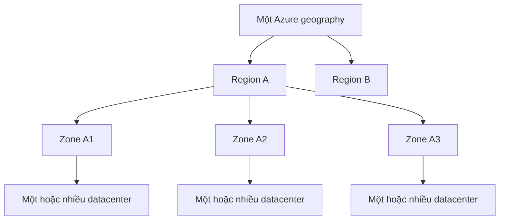
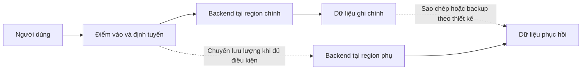

# Region, geography và lựa chọn vị trí triển khai

## Mục tiêu và bối cảnh

Trong chương **Nền tảng Azure** của module **CLOUD_PROVIDERS_AZURE**, lựa chọn vị trí triển khai là quyết định nối hạ tầng với nhu cầu ứng dụng. Một ứng dụng có thể dùng Microsoft Entra ID để xác thực, mạng ảo để kết nối, dịch vụ tính toán để chạy nghiệp vụ và dịch vụ lưu trữ để giữ dữ liệu. Các thành phần đó cần một kế hoạch vị trí thống nhất để đạt yêu cầu về hiệu năng, phục hồi, bảo vệ dữ liệu và chi phí.

Sau bài này, bạn có thể phân biệt geography, region và availability zone; xác định những điều kiện phải kiểm tra trước khi chọn region; và trình bày được lý do lựa chọn region chính cùng phương án phục hồi. Trọng tâm là cách ra quyết định cho một hệ thống cụ thể, thay vì ghi nhớ danh sách địa điểm.

## 1. Geography và region mô tả điều gì?

**Azure geography** là phạm vi địa lý Azure dùng làm ranh giới lưu trú dữ liệu. Một geography có thể chứa một hoặc nhiều region.

**Azure region** là một tập hợp cơ sở hạ tầng vật lý gồm trung tâm dữ liệu và mạng kết nối trong một khu vực. Mỗi region thuộc một geography. Với tài nguyên có phạm vi vùng, lựa chọn region xác định nơi dịch vụ được triển khai. Xem định nghĩa trong [tổng quan Azure regions của Microsoft](https://learn.microsoft.com/en-us/azure/reliability/regions-overview).

Cần phân biệt ba câu hỏi khi thiết kế:

| Câu hỏi | Khái niệm liên quan | Ví dụ cách ghi trong quyết định |
| --- | --- | --- |
| Dữ liệu được phép nằm trong phạm vi địa lý nào? | Geography và cam kết dữ liệu của từng dịch vụ | Chỉ dùng các địa điểm đã được tổ chức phê duyệt |
| Backend và dữ liệu chính sẽ chạy ở đâu? | Region | Chọn một region chính cho luồng giao dịch |
| Các bản chạy được phân tán trong region thế nào? | Availability zone | Phân tán các thành phần cần chịu lỗi zone |

Geography là thuật ngữ của Azure, không nên suy ra phạm vi của nó chỉ từ tên một châu lục hoặc một quốc gia. Hãy tra ánh xạ chính thức.

Ví dụ, danh sách Azure ghi **Southeast Asia** có vị trí tại Singapore, mã `southeastasia` và geography **Asia Pacific**; **East Asia** có vị trí tại Hong Kong, mã `eastasia` và cùng geography đó. Vì vậy, tên region không đồng nghĩa với tên quốc gia. Các ví dụ này lấy từ [danh sách Azure regions](https://learn.microsoft.com/en-us/azure/reliability/regions-list); cần kiểm tra lại danh sách khi lập kế hoạch triển khai.

### Tên hiển thị và mã dùng trong cấu hình

Portal thường hiển thị tên dễ đọc, còn Azure CLI và Infrastructure as Code thường dùng mã region. Trong ví dụ này:

```text
Tên hiển thị: Southeast Asia
Mã region:    southeastasia
```

Khi ghi quyết định kiến trúc, nên lưu cả tên và mã để người đọc đối chiếu được với cấu hình. Không tự chuyển tên thành mã bằng cách bỏ dấu cách vì cách đặt tên cần được xác nhận từ Azure.

## 2. Availability zone nằm bên trong region

**Availability zone** là nhóm gồm một hoặc nhiều trung tâm dữ liệu tách biệt trong một region, với hạ tầng điện, làm mát và mạng độc lập. Không phải mọi region đều hỗ trợ zone.

Một tài nguyên **zonal** gắn với một zone cụ thể. Với **zone-redundant**, dịch vụ phân tán hoặc sao chép thành phần qua nhiều zone; cách bật và phạm vi bảo vệ phụ thuộc dịch vụ. Xem [tổng quan availability zones](https://learn.microsoft.com/en-us/azure/reliability/availability-zones-overview).

Sơ đồ sau minh họa quan hệ khái niệm, không mô tả số zone hay vị trí của region thực tế:



Ví dụ thiết kế: hai bản chạy API đặt ở hai zone nhưng cùng phụ thuộc một thành phần dữ liệu không có phương án chịu lỗi tương ứng thì luồng giao dịch vẫn có thể gián đoạn. Do đó, khi ghi “ứng dụng chịu lỗi một zone”, cần xem toàn bộ đường đi của yêu cầu, từ đầu vào đến dữ liệu và các phụ thuộc.

## 3. Region pair không thay thế thiết kế phục hồi

Một số Azure region được liên kết thành **region pair**, thường trong cùng geography nhưng có ngoại lệ. Nhiều region không có pair. Một số dịch vụ dùng pair cho cơ chế sao chép địa lý; chẳng hạn Azure Storage GRS có thể sao chép sang region được ghép cặp.

Chọn region có pair không tự tạo bản sao ứng dụng, HA hay failover. Kiến trúc nhiều region cũng không nhất thiết bị giới hạn vào pair, nhưng từng tính năng dịch vụ có thể có quy tắc riêng. Xem [Azure region pairs và nonpaired regions](https://learn.microsoft.com/en-us/azure/reliability/regions-paired).

Khi thiết kế region phụ, cần trả lời cụ thể:

- Bản sao dữ liệu hình thành bằng cơ chế nào?
- Có đủ backend, cấu hình mạng, chứng thư và quyền truy cập để chạy ở đó chưa?
- Ai quyết định chuyển lưu lượng, dựa trên tín hiệu nào?
- Sau khi chuyển, hệ thống nào được phép nhận ghi?
- Quy trình đưa lưu lượng về region chính xử lý dữ liệu phát sinh ra sao?

Nếu chưa trả lời được, “có region pair” mới chỉ là một thuộc tính của địa điểm, chưa phải kế hoạch khôi phục ứng dụng.

## 4. Region, resource group và dịch vụ toàn cục

Resource group là đơn vị tổ chức tài nguyên. Trường location của resource group xác định nơi lưu metadata của nhóm; tài nguyên trong nhóm có thể nằm ở các region khác nhau. Vì vậy, location của nhóm không phải một cơ chế buộc mọi tài nguyên bên trong ở cùng nơi. Đây là hành vi được mô tả trong [hướng dẫn quản lý resource groups](https://learn.microsoft.com/en-us/azure/azure-resource-manager/management/manage-resource-groups-portal).

Một sơ đồ triển khai nên ghi vị trí của từng thành phần thay vì chỉ ghi vị trí resource group:

| Thành phần trong thiết kế minh họa | Thông tin cần ghi |
| --- | --- |
| Resource group | Location của metadata và mục đích quản lý |
| Backend API | Region phục vụ chính, cách phân tán bản chạy |
| Dữ liệu giao dịch | Region ghi chính, bản sao, nơi giữ backup |
| Kết nối mạng | Đầu nối, đường đến dữ liệu và hệ thống nội bộ |
| Giám sát | Nơi gửi log, dữ liệu chứa trong log, thời gian giữ |
| Thành phần toàn cục | Phạm vi dịch vụ và quan hệ với backend vùng |

Azure còn có dịch vụ toàn cục, ví dụ Microsoft Entra ID, Azure DNS và Traffic Manager, không yêu cầu chọn region theo cách một VM yêu cầu. Phân loại này được nêu ở [tài liệu regions cho Azure Virtual Machines](https://learn.microsoft.com/en-us/azure/virtual-machines/regions).

“Dịch vụ toàn cục” không phải bằng chứng rằng mọi dữ liệu của ứng dụng có thể được lưu ở bất kỳ đâu. Với một luồng đăng nhập rồi đặt hàng, vẫn cần mô tả riêng dữ liệu danh tính, dữ liệu đơn hàng và log truy cập.

## 5. Tách điều kiện bắt buộc khỏi tiêu chí tối ưu

Lựa chọn region nên diễn ra qua hai bước.

**Bước thứ nhất là lọc tính khả thi.** Loại những ứng viên không đáp ứng điều kiện bắt buộc của workload.

**Bước thứ hai là so sánh các ứng viên còn lại.** Dùng phép đo và dự toán để chọn phương án phù hợp hơn.

Microsoft khuyến nghị kiểm tra lưu trú dữ liệu, độ trễ, danh mục dịch vụ, giá, zone và giới hạn triển khai khi [lựa chọn Azure region](https://learn.microsoft.com/en-us/azure/cloud-adoption-framework/ready/azure-setup-guide/regions).

### Điều kiện bắt buộc

Các điều kiện phải được diễn đạt thành tiêu chí có thể kiểm chứng, ví dụ:

- Dữ liệu đơn hàng và các bản sao chỉ được lưu tại tập địa điểm đã phê duyệt.
- Dịch vụ cơ sở dữ liệu phải có đúng tính năng và cấp dịch vụ cần dùng.
- Kiến trúc phải đáp ứng mục tiêu phục hồi đã thống nhất.
- Subscription có quyền truy cập region và hạn mức phù hợp với kế hoạch.
- Luồng từ backend đến hệ thống nội bộ phải đáp ứng yêu cầu kết nối của dự án.

Một ứng viên không đạt điều kiện bắt buộc không được đưa trở lại chỉ vì giá thấp hoặc gần người dùng.

### Tiêu chí tối ưu

Các tiêu chí này giúp so sánh những phương án đã khả thi:

| Tiêu chí | Bằng chứng nên thu thập |
| --- | --- |
| Trải nghiệm người dùng | Độ trễ p50, p95 và tỷ lệ lỗi từ các nhóm người dùng |
| Tương tác giữa thành phần | Thời gian gọi API, truy vấn dữ liệu, truyền tệp |
| Chi phí | Dự toán theo cùng lưu lượng, cấu hình và thời gian giữ dữ liệu |
| Khả năng vận hành | Thời gian khôi phục đo được, mức độ tự động hóa, năng lực đội |
| Dư địa tăng trưởng | Hạn mức, lựa chọn SKU thay thế và kế hoạch mở rộng |

p50 là mức mà khoảng một nửa phép đo không vượt quá; p95 là mức mà khoảng 95% phép đo không vượt quá. p95 giúp nhìn thấy phần trải nghiệm chậm mà giá trị trung bình có thể che khuất.

## 6. Lập bản đồ dữ liệu trước khi chọn địa điểm

Câu hỏi “database ở đâu?” chưa bao quát toàn bộ dữ liệu của hệ thống. Một dự án nên lập bảng đường đi của dữ liệu để tránh bỏ sót bản sao được tạo bởi vận hành hoặc tích hợp.

Bảng sau là mẫu phân tích cho một ứng dụng đặt hàng, không phải mô tả mặc định của Azure:

| Nhóm dữ liệu | Nơi phát sinh | Bản sao cần kiểm kê | Quyết định cần ghi |
| --- | --- | --- | --- |
| Hồ sơ khách hàng | API đăng ký | Database, cache, bản xuất báo cáo | Địa điểm lưu và quyền truy cập |
| Đơn hàng | API giao dịch | Database, replica, backup | Nơi ghi chính và phương án khôi phục |
| Tệp đính kèm | Người dùng tải lên | Storage, bản sao dự phòng | Region lưu và cơ chế sao chép |
| Log ứng dụng | Backend | Nền tảng giám sát, kho lưu trữ | Có dữ liệu nhạy cảm hay không |
| Dữ liệu phân tích | Pipeline nghiệp vụ | Kho phân tích, môi trường thử | Quy tắc chuyển dữ liệu và ẩn danh |

Trong mẫu này, nếu dự án chọn region chính ở địa điểm được phê duyệt nhưng xuất báo cáo chứa thông tin khách hàng sang nơi chưa được phê duyệt, kế hoạch vị trí vẫn chưa nhất quán.

Cũng cần phân biệt **lưu trú dữ liệu** với **kiểm soát truy cập**. Địa điểm phù hợp không tự thiết lập quyền Microsoft Entra ID, mã hóa, quản lý khóa hoặc phân quyền vận hành. Hồ sơ triển khai cần ghi cả nơi dữ liệu tồn tại và chủ thể được phép sử dụng dữ liệu đó.

Với yêu cầu giới hạn trong một quốc gia, hãy đối chiếu quốc gia của từng địa điểm được chọn; việc hai region có cùng geography chưa đủ để chứng minh chúng cùng nằm trong quốc gia đó.

## 7. Đo độ trễ theo luồng nghiệp vụ

Khoảng cách trên bản đồ là dữ kiện để tạo danh sách ứng viên. Quyết định hiệu năng cần dựa trên phép đo đại diện cho cách người dùng sử dụng ứng dụng.

Một luồng đặt hàng có thể gồm:

```text
Thiết bị người dùng
    -> điểm vào ứng dụng
    -> backend API
    -> truy vấn tồn kho
    -> ghi đơn hàng
    -> gọi dịch vụ thanh toán
    -> phản hồi
```

Để ước lượng sơ bộ phần thời gian mạng của các lần gọi tuần tự, có thể dùng:

```text
Thời gian mạng xấp xỉ = tổng RTT của các lần trao đổi tuần tự
```

RTT là thời gian khứ hồi. Công thức trên là mô hình đơn giản; nó chưa bao gồm thời gian xử lý, chờ hàng đợi, thiết lập kết nối hoặc các nhánh chạy song song.

Ví dụ tự đặt: backend gọi database tuần tự 12 lần. Nếu mỗi lần trao đổi có RTT 25 ms thay vì 2 ms, chênh lệch phần mạng theo mô hình là:

```text
12 × (25 - 2) = 276 ms
```

Đây là phép tính minh họa, không phải số đo mạng Azure. Nó cho thấy vì sao đặt API gần người dùng nhưng để dữ liệu giao dịch ở xa có thể làm thời gian phản hồi xấu đi.

Một kế hoạch đo nên giữ cùng phiên bản ứng dụng, tập dữ liệu và kịch bản tải; lấy mẫu từ nhiều nhà mạng và nhiều thời điểm; rồi so sánh cả p95, lỗi và thời gian của từng chặng. Ghi rõ phép đo là từ người dùng đến ứng dụng hay giữa hai thành phần để tránh so sánh khác phạm vi.

## 8. Kiểm tra dịch vụ, SKU, quota và capacity

Một region xuất hiện trong danh sách địa điểm chưa xác nhận rằng mọi cấu hình cần dùng đều triển khai được tại đó.

Với dự án cụ thể, nên lập bảng điều kiện:

| Thành phần dự kiến | Mức kiểm tra cần đạt |
| --- | --- |
| Máy ảo | Đúng họ VM, kích thước, zone và yêu cầu đĩa |
| Dịch vụ chạy ứng dụng | Đúng runtime, cấp dịch vụ và tính năng mở rộng |
| Cơ sở dữ liệu | Đúng engine, phiên bản, HA và phương án bản sao |
| Lưu trữ | Đúng loại tài khoản, tính năng và cơ chế dự phòng |
| Mạng | Đủ phương án kết nối và địa chỉ cho luồng nghiệp vụ |

**SKU** là biến thể hoặc cấp cấu hình của sản phẩm. Khi kiểm tra, cần ghi đúng SKU thay vì chỉ đánh dấu tên dịch vụ.

Với VM, **quota** là hạn mức của subscription, còn **capacity** là tài nguyên tính toán thực có tại region hoặc zone. Azure kiểm tra hai điều này riêng. Đủ quota vẫn có thể gặp lỗi cấp phát. Quota vCPU còn gồm hạn mức tổng theo region và hạn mức theo họ VM. Xem [tài liệu vCPU quotas](https://learn.microsoft.com/en-us/azure/virtual-machines/quotas).

Ví dụ tính hạn mức tự đặt: dự án cần 6 VM, mỗi VM 4 vCPU. Nhu cầu ban đầu là 24 vCPU. Nếu tổng quota vùng còn 40 vCPU nhưng quota họ VM chỉ còn 16 vCPU thì kế hoạch này chưa khả thi với họ đó. Nếu cả hai hạn mức đều đủ, nhóm triển khai vẫn cần xử lý rủi ro capacity theo cấu hình thực tế.

Đối với region phục hồi, hãy tính quy mô cần nhận tải khi có sự cố. Một phương án chỉ chạy thử một VM nhỏ ở region phụ chưa chứng minh rằng có thể khởi tạo toàn bộ hệ thống trong thời gian mục tiêu.

## 9. Chọn kiến trúc theo phạm vi sự cố

Trong thiết kế phục hồi, cần phân biệt mục tiêu vận hành bình thường với tình huống mất thành phần, mất zone hoặc mất region.

Hai thuật ngữ thường dùng là:

- **RTO — Recovery Time Objective:** mục tiêu thời gian khôi phục dịch vụ sau gián đoạn.
- **RPO — Recovery Point Objective:** mục tiêu mức mất dữ liệu tính theo thời gian có thể chấp nhận khi khôi phục.

Ví dụ mục tiêu do dự án tự đặt: RTO 60 phút và RPO 15 phút. Khi đó, quy trình cần chứng minh khả năng khôi phục trong 60 phút và giới hạn khoảng dữ liệu chưa phục hồi trong mục tiêu 15 phút. Đó là mục tiêu của workload, không phải cam kết tự có khi chọn region.

| Phương án kiến trúc | Điều nhóm thiết kế phải chứng minh |
| --- | --- |
| Một bản chạy ở một region | Chấp nhận được thời gian gián đoạn và có thể dựng lại |
| Phân tán qua nhiều zone | Luồng nghiệp vụ còn hoạt động khi mất một zone |
| Region chính và region phụ dự phòng | Có thể khôi phục dữ liệu, backend và lưu lượng đúng RTO/RPO |
| Nhiều region cùng phục vụ | Có quy tắc định tuyến, ghi dữ liệu và xử lý xung đột phù hợp |

Bảng này là cách phân tích mục tiêu, không khẳng định một dịch vụ cụ thể hỗ trợ mọi phương án.

Trong thiết kế active-passive, chỉ region chính phục vụ tải nghiệp vụ bình thường, còn region phụ sẵn sàng theo mức đã chọn. Trong active-active, nhiều region cùng phục vụ. Active-active đòi hỏi xác định rõ chủ thể được ghi, cách đồng bộ và cách xử lý khi kết nối giữa các region bị gián đoạn.

Replication cũng không thay thế mọi vai trò của backup. Với một thiết kế sao chép thay đổi sang bản phụ, thao tác xóa nhầm có thể được sao chép theo. Kế hoạch khôi phục cần tính cả lỗi dữ liệu và lỗi thao tác, không chỉ mất hạ tầng.

## 10. Tính chi phí của cả phương án

Để so sánh region công bằng, cần giữ cùng cấu hình và giả định tải. Một dự toán chỉ nhìn giá một VM sẽ bỏ qua phần lớn tác động của kiến trúc.

Có thể tổ chức dự toán theo mô hình:

```text
Tổng chi phí dự kiến
  = tính toán
  + lưu trữ và thao tác dữ liệu
  + truyền dữ liệu
  + mạng và định tuyến
  + backup
  + giám sát
  + tài nguyên dự phòng
  + công sức vận hành
```

Các khoản trong biểu thức là nhóm chi phí để kiểm kê, không phải công thức tính hóa đơn Azure. Đơn giá và cách tính cần đối chiếu bảng giá của từng sản phẩm.

Ví dụ tự đặt: một phương án giảm chi phí backend nhờ chọn địa điểm khác nhưng phải truyền thường xuyên tập dữ liệu lớn giữa backend và database. Nhóm dự án cần cộng cả lưu lượng và thời gian xử lý phát sinh trước khi kết luận phương án đó rẻ hơn.

Với region phụ, cần ghi rõ tài nguyên nào luôn chạy, tài nguyên nào chỉ khởi tạo khi phục hồi và thời gian khởi tạo dự kiến. Giảm tài nguyên chờ có thể giảm chi phí duy trì nhưng khiến RTO khó đạt hơn.

## 11. Ví dụ: lựa chọn vị trí cho ứng dụng phục vụ người dùng Việt Nam

Giả sử một đội xây dựng ứng dụng quản lý đơn hàng với các yêu cầu sau:

- Ứng dụng phục vụ chủ yếu người dùng tại Việt Nam.
- Backend giao dịch cần phản hồi p95 dưới 350 ms trong kịch bản tải của dự án.
- Dữ liệu và mọi bản sao chỉ nằm tại các địa điểm được tổ chức phê duyệt.
- Mục tiêu phục hồi khi mất region là RTO 60 phút, RPO 15 phút.
- Nhóm ưu tiên cấu hình đơn giản đủ đáp ứng yêu cầu.

Các yêu cầu, điểm số và số liệu dưới đây đều là **giả định để học cách ra quyết định**; chúng không phải benchmark, báo giá hay xác nhận khả năng triển khai thực tế của Azure.

### 11.1. Lọc trước khi chấm điểm

Nhóm khảo sát Southeast Asia, East Asia và một ứng viên thứ ba. Với bài toán giả định, kết quả xác minh là:

| Điều kiện bắt buộc | Southeast Asia | East Asia | Ứng viên thứ ba |
| --- | --- | --- | --- |
| Địa điểm được tổ chức phê duyệt | Đạt | Đạt | Không đạt |
| Đủ cấu hình dịch vụ bắt buộc | Đạt | Đạt | Chưa kiểm tra |
| Hạn mức theo quy mô dự kiến | Đạt | Đạt | Chưa kiểm tra |
| Có phương án đáp ứng mục tiêu phục hồi | Đạt có điều kiện | Đạt có điều kiện | Chưa kiểm tra |

Ứng viên thứ ba bị loại vì không đạt điều kiện địa điểm. “Đạt có điều kiện” nghĩa là nhóm đã xác định được phương án cần thử nghiệm, chưa chứng minh được RTO/RPO bằng diễn tập.

### 11.2. So sánh các ứng viên khả thi

Nhóm quy đổi kết quả khảo sát thành điểm 1–5, điểm cao hơn là phù hợp hơn. Trọng số được chọn cho bài toán này:

| Tiêu chí | Trọng số | Southeast Asia | East Asia |
| --- | --- | --- | --- |
| Hiệu năng theo phép đo của nhóm | 45% | 5 | 4 |
| Chi phí theo dự toán cùng cấu hình | 30% | 3 | 4 |
| Mức thuận tiện cho vận hành | 25% | 4 | 4 |

Phép tính:

```text
Southeast Asia = 0,45 × 5 + 0,30 × 3 + 0,25 × 4 = 4,15
East Asia      = 0,45 × 4 + 0,30 × 4 + 0,25 × 4 = 4,00
```

Với bộ giả định đó, Southeast Asia là ứng viên chính. Chênh lệch 0,15 điểm khá nhỏ, nên nhóm cần xem kết luận có thay đổi khi điều chỉnh trọng số hoặc khi giá và tải thực tế khác dự tính hay không.

Một bản ghi quyết định phù hợp có thể viết:

> Chọn Southeast Asia làm region chính theo bộ giả định đã khảo sát. Đưa East Asia vào kế hoạch xác minh region phục hồi. Trước khi vận hành, phải hoàn tất kiểm tra cấu hình dịch vụ, quy tắc bản sao dữ liệu, hạn mức phục hồi và diễn tập RTO/RPO. Đánh giá lại khi phân bố người dùng, yêu cầu dữ liệu hoặc dịch vụ bắt buộc thay đổi.

Đây là kết luận từ tình huống giả định, không phải khuyến nghị mặc định cho mọi ứng dụng tại Việt Nam.

### 11.3. Gắn quyết định với đường đi yêu cầu

Sơ đồ dưới đây mô tả ý tưởng kiến trúc cần được kiểm chứng, không khẳng định đã cấu hình một dịch vụ Azure cụ thể:



Điều cần kiểm tra là cả backend và dữ liệu ở region phụ có tạo thành một luồng phục vụ hoàn chỉnh hay không. Chỉ chuyển đường vào trong khi backend phụ thiếu quyền đọc dữ liệu vẫn không khôi phục được nghiệp vụ.

## 12. Minh họa khảo sát bằng Azure CLI

Các lệnh dưới đây dành cho người học tự chạy trong môi trường đã cài Azure CLI, đăng nhập và chọn đúng subscription. Chúng chỉ đọc thông tin; không tạo tài nguyên. Kết quả phụ thuộc subscription và thời điểm truy vấn.

### 12.1. Kiểm tra ngữ cảnh và tên region

```powershell
az account show --query "{subscription:name,id:id,tenant:tenantId}" --output table

az account list-locations --query "[].{code:name,display:displayName}" --output table
```

Đối chiếu mã `southeastasia` và `eastasia` trong kết quả thay vì tự suy từ tên hiển thị. Lệnh `az account list-locations` liệt kê các region được hỗ trợ cho subscription hiện tại; danh sách này không phải ma trận tính năng của từng dịch vụ. Xem [tham chiếu az account](https://learn.microsoft.com/en-us/cli/azure/account?view=azure-cli-latest#az-account-list-locations).

### 12.2. Khảo sát SKU và hạn mức VM

```powershell
az vm list-skus --location southeastasia --resource-type virtualMachines --all --output json

az vm list-usage --location southeastasia --output table
```

Trong kết quả SKU, xem tên SKU, zone liên quan và các mục `restrictions`. Tùy chọn `--all` đưa cả các SKU bị hạn chế vào kết quả để khảo sát; việc một SKU xuất hiện chưa có nghĩa subscription sử dụng được nó.

`az vm list-usage` cho biết mức sử dụng và hạn mức tính toán theo region. Hai lệnh này không xác nhận capacity vật lý theo thời gian thực cho một lần cấp phát tương lai. Tham chiếu cú pháp và ý nghĩa tại [az vm list-skus](https://learn.microsoft.com/en-us/cli/azure/vm?view=azure-cli-latest#az-vm-list-skus) và [az vm list-usage](https://learn.microsoft.com/en-us/cli/azure/vm?view=azure-cli-latest#az-vm-list-usage).

Đối với dịch vụ dữ liệu hoặc nền tảng ứng dụng, cần tiếp tục kiểm tra tài liệu và cấu hình của chính dịch vụ đó. Không dùng kết quả khảo sát VM để kết luận về mọi sản phẩm Azure.

### 12.3. Lưu kết quả thành bằng chứng quyết định

Một ghi chép khảo sát có ích nên có:

- Ngày thực hiện và subscription hoặc môi trường khảo sát.
- Region, SKU và tính năng đang xem xét.
- Hạn mức hiện có cùng quy mô cần dùng khi bình thường và khi phục hồi.
- Điều kiện chưa xác minh, người phụ trách và thời điểm xem lại.
- Kết quả đo ứng dụng và giả định chi phí cùng phiên bản.

Bằng chứng này giúp đội triển khai biết một kết luận còn hiệu lực trong điều kiện nào.

## 13. Đưa lựa chọn vị trí vào cấu hình và vận hành

Sau khi chọn region, hãy thể hiện lựa chọn đó trong tham số triển khai thay vì để mỗi người tự chọn ở Portal. Ví dụ dưới đây chỉ là đối tượng cấu hình minh họa để thảo luận; nó không tạo tài nguyên:

```json
{
  "primaryLocation": "southeastasia",
  "recoveryLocation": "eastasia",
  "workload": "orders",
  "environment": "production"
}
```

Việc khai báo `recoveryLocation` không dựng backend phụ hoặc sao chép dữ liệu. Template và pipeline thực tế cần triển khai những thành phần tương ứng, với cách cấu hình do từng dịch vụ hỗ trợ.

Kế hoạch vận hành nên gắn vị trí với các hoạt động cụ thể:

| Hoạt động | Kết quả cần có |
| --- | --- |
| Triển khai | Tham số location khớp quyết định đã duyệt |
| Quan sát | Có tín hiệu phân biệt lỗi ứng dụng, lỗi phụ thuộc và lỗi phạm vi vùng |
| Sao lưu | Biết bản sao nào có thể dùng để khôi phục và nằm ở đâu |
| Phục hồi | Đo được thời gian hoàn tất và trạng thái dữ liệu sau chuyển |
| Kiểm soát chi phí | Tách được chi phí chính, dự phòng và truyền dữ liệu |
| Thay đổi yêu cầu | Biết khi nào phải xem lại lựa chọn region |

Ví dụ: khi mở rộng sang nhóm người dùng mới, hãy đo lại luồng nghiệp vụ từ nhóm đó. Khi đổi cơ sở dữ liệu, hãy xác minh lại khả năng phục hồi ở region phụ. Một quyết định vị trí cần được xem lại khi các giả định nền thay đổi.

## 14. Những nhầm lẫn cần tránh

| Nhầm lẫn | Cách xử lý trong thiết kế |
| --- | --- |
| Tên region cho biết chính xác quốc gia và phạm vi dữ liệu | Tra vị trí, geography và cam kết của dịch vụ |
| Location của resource group quyết định vị trí mọi tài nguyên | Ghi location của từng tài nguyên và từng bản sao |
| Có zone nghĩa là ứng dụng đã chịu được lỗi zone | Kiểm tra toàn bộ luồng và cấu hình của từng thành phần |
| Có region pair nghĩa là có hệ thống DR hoàn chỉnh | Xác định dữ liệu, backend, định tuyến và quy trình khôi phục |
| Region có dịch vụ nghĩa là có mọi SKU cần dùng | Kiểm tra đúng cấu hình và các hạn chế |
| Đủ quota nghĩa là chắc chắn cấp phát được | Xem riêng rủi ro capacity và phương án thay thế |
| Region gần nhất luôn cho ứng dụng nhanh nhất | Đo luồng nghiệp vụ gồm cả các phụ thuộc |
| Một bản sao dữ liệu tương đương backup cho mọi lỗi | Thiết kế khôi phục cả lỗi hạ tầng lẫn lỗi dữ liệu |
| Điểm tổng cao có thể bù một điều kiện bắt buộc không đạt | Loại ứng viên không khả thi trước khi chấm điểm |

## 15. Hồ sơ tối thiểu của một quyết định region

Một quyết định hoàn chỉnh cần giúp người khác dựng được kế hoạch triển khai và biết giới hạn của kế hoạch. Có thể dùng khung sau:

```text
Workload:
Nhóm người dùng và hệ thống phụ thuộc:
Phạm vi địa điểm được phép:
Region chính, mã region và geography:
Dịch vụ, SKU và tính năng bắt buộc:
Phương án chịu lỗi trong region:
Region hoặc phương án khôi phục:
Cơ chế sao chép, backup và nơi giữ các bản sao:
RTO/RPO mục tiêu và kết quả diễn tập:
Bằng chứng hiệu năng:
Hạn mức và kế hoạch capacity:
Dự toán chi phí cùng giả định tải:
Lý do loại các ứng viên khác:
Điều kiện cần đánh giá lại:
```

Qua khung này, “chọn region” trở thành một quyết định có bằng chứng: vị trí phù hợp với dữ liệu, đường đi yêu cầu đáp ứng trải nghiệm, dịch vụ triển khai được, và đội vận hành có phương án khôi phục cùng ngân sách tương ứng.
