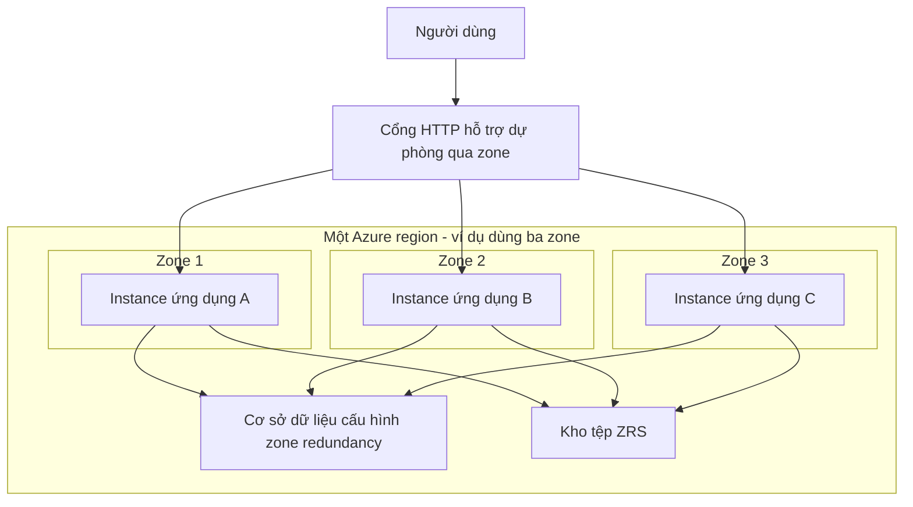

# Availability Zone và thiết kế phân bố tài nguyên

Trong chương **Nền tảng Azure**, Availability Zone giúp trả lời một câu hỏi thiết kế: nếu một khu vực hạ tầng bên trong region ngừng hoạt động, luồng nghiệp vụ quan trọng của ứng dụng còn chạy được không?

Một ứng dụng có nhiều máy ảo vẫn có thể dừng hoàn toàn nếu tất cả cùng nằm trong một zone, cùng phụ thuộc vào một cơ sở dữ liệu đơn lẻ hoặc cùng đi qua một thiết bị mạng duy nhất. Thiết kế phân bố tài nguyên phải xét cả đường đi của yêu cầu, nơi giữ trạng thái, công suất dự phòng và cách chuyển đổi khi có sự cố.

Bài học sử dụng bối cảnh một ứng dụng đặt hàng trên Microsoft Azure. Các quyết định về zone được nối với subscription, resource group, mạng ảo, tính toán, lưu trữ, dữ liệu, bảo mật, giám sát và chi phí để hình thành một kiến trúc có thể vận hành.

## Mục tiêu học tập

Sau bài học, bạn có thể:

- Phân biệt region, Availability Zone, availability set và các kiểu triển khai có hỗ trợ zone.
- Nhận ra tài nguyên nào cần phân bố thủ công, tài nguyên nào có cơ chế dự phòng do Azure quản lý.
- Thiết kế đường đi của một yêu cầu để tránh phụ thuộc duy nhất vào một zone.
- Tính công suất còn lại khi mất một zone và giải thích giới hạn của autoscale.
- Xây dựng phương án kiểm tra, theo dõi và phục hồi phù hợp với mục tiêu nghiệp vụ.

## 1. Availability Zone là gì?

**Availability Zone**, gọi ngắn là **zone**, là một nhóm logic gồm một hoặc nhiều datacenter tách biệt về mặt vật lý trong một Azure region. Các zone có hạ tầng nguồn điện, làm mát và mạng độc lập nhằm hạn chế một sự cố cục bộ ảnh hưởng đồng thời đến mọi bản sao của dịch vụ.

**Region** là phạm vi địa lý chứa các datacenter Azure. Các zone thuộc cùng một region có thể được sử dụng để đặt những bản sao của ứng dụng và dữ liệu vào các miền lỗi khác nhau. Số zone và cách một dịch vụ sử dụng chúng phụ thuộc region và dịch vụ; không nên cố định giả định rằng mọi region luôn có đúng ba zone. Xem [tổng quan Availability Zone của Microsoft](https://learn.microsoft.com/en-us/azure/reliability/availability-zones-overview).

Trong ví dụ của bài, giả sử region được chọn hỗ trợ ba zone mà ứng dụng cần dùng:

```text
Region được chọn
├── Zone 1: các instance ứng dụng và hạ tầng liên quan
├── Zone 2: các instance ứng dụng và hạ tầng liên quan
└── Zone 3: các instance ứng dụng và hạ tầng liên quan
```

Sơ đồ này mô tả ba phạm vi bố trí tài nguyên. Nó không có nghĩa mỗi zone chỉ chứa một datacenter hoặc mọi loại tài nguyên Azure đều có thể đặt vào cả ba zone.

### Zone là miền lỗi

**Miền lỗi** là tập hợp thành phần có thể bị ảnh hưởng cùng lúc bởi một sự cố chung. Nếu hai máy ảo cùng phụ thuộc vào hạ tầng điện của một zone, chúng chưa độc lập trước sự cố của zone đó.

Ví dụ, tăng từ một lên năm instance trong cùng zone giúp xử lý thêm tải và có thể giảm tác động của lỗi một instance. Để chịu được mất zone, cần có tài nguyên và khả năng phục vụ ở zone khác, cùng cơ chế đưa yêu cầu đến đó.

### Số zone là định danh logic trong subscription

Khi cấu hình tài nguyên, bạn thường thấy các giá trị như `1`, `2`, `3`. Đây là các định danh zone logic. Ánh xạ giữa zone logic và zone vật lý có thể khác nhau giữa các subscription. Vì vậy, `zone 1` của subscription A không mặc nhiên trùng vị trí vật lý với `zone 1` của subscription B. Thiết kế cần phối hợp vị trí giữa nhiều subscription phải xác minh ánh xạ được Azure cung cấp. Xem [physical và logical availability zones](https://learn.microsoft.com/en-us/azure/availability-zones/az-overview).

## 2. Phân biệt các phạm vi bảo vệ

| Khái niệm | Vai trò chính | Giới hạn cần hiểu |
| --- | --- | --- |
| Region | Chọn phạm vi địa lý triển khai | Chọn region chưa xác định tài nguyên có dự phòng qua zone hay không |
| Availability Zone | Tách các bản sao theo miền lỗi vật lý trong region | Vẫn có thể chịu tác động của sự cố cấp region hoặc lỗi chung của ứng dụng |
| Availability set | Phân bố các VM theo fault domain và update domain của mô hình này | Không cung cấp cam kết phân bố VM qua nhiều Availability Zone |
| Triển khai nhiều region | Bổ sung phạm vi phục hồi ngoài region chính | Cần xử lý định tuyến, dữ liệu, quyền truy cập và vận hành giữa các region |
| Backup | Giữ điểm phục hồi dữ liệu theo chính sách | Cần thời gian khôi phục; không tự cung cấp năng lực phục vụ trực tiếp |

**Fault domain** nhóm các thành phần có thể chia sẻ hạ tầng lỗi, còn **update domain** liên quan đến nhóm được cập nhật hoặc bảo trì cùng đợt trong availability set. Hai khái niệm này giúp hiểu bảo vệ ở cấp VM nhưng không thay thế việc lựa chọn zone.

Availability Zone chủ yếu hỗ trợ tính sẵn sàng trong region. Một kế hoạch phục hồi thảm họa vẫn phải xét sự cố cả region, sai sót quản trị, hỏng dữ liệu và mất quyền truy cập. Hướng dẫn [sử dụng region và Availability Zone](https://learn.microsoft.com/en-us/azure/well-architected/design-guides/regions-availability-zones) phân biệt các cách triển khai theo phạm vi lỗi này.

## 3. Ba kiểu bố trí tài nguyên cần nhận diện

### 3.1. Zonal: tài nguyên gắn với một zone

Một tài nguyên **zonal** được đặt vào zone cụ thể. Chẳng hạn, một VM gắn với zone 1 chạy trong zone đó. Từng VM riêng lẻ không đồng thời chạy trên nhiều zone.

Bạn có thể tạo nhiều VM zonal ở các zone khác nhau để xây dựng một tầng ứng dụng có dự phòng. Khi đó, trách nhiệm thiết kế vẫn bao gồm phân phối lưu lượng, đồng bộ dữ liệu nếu có, phát hiện lỗi và quản lý vòng đời instance. Xem [khả năng chịu lỗi của Azure Virtual Machines](https://learn.microsoft.com/en-us/azure/reliability/reliability-virtual-machines).

### 3.2. Zone-redundant: dự phòng qua nhiều zone

Với tài nguyên **zone-redundant**, dịch vụ Azure cung cấp cơ chế trải thành phần hoặc bản sao qua nhiều zone. Mức tự động hóa, điều kiện sử dụng và hành vi failover phụ thuộc từng dịch vụ.

Ví dụ, một storage account sử dụng ZRS thể hiện lựa chọn dự phòng dữ liệu qua zone. Với một dịch vụ cơ sở dữ liệu, bạn có thể cần bật tùy chọn zone redundancy trên đúng cấu hình được hỗ trợ. Tên gọi PaaS không đủ để kết luận tài nguyên đã có cấu hình này.

### 3.3. Regional hoặc nonzonal: chưa có cam kết phân bố qua zone

Một tài nguyên có vị trí ở cấp region nhưng không chỉ định zone có thể được gọi là **regional** hoặc **nonzonal** trong tài liệu dịch vụ. Cách gọi này không tự chứng minh rằng tài nguyên chịu được mất zone.

Cần đọc hành vi của đúng loại tài nguyên. Một dịch vụ có thể tự hỗ trợ dự phòng, còn dịch vụ khác yêu cầu bạn cấu hình rõ ràng.

| Kiểu triển khai | Quyết định của người triển khai | Câu hỏi phải trả lời |
| --- | --- | --- |
| Zonal | Chọn zone cho từng tài nguyên | Bản sao phục vụ khi zone này mất nằm ở đâu? |
| Zone-redundant | Chọn cấu hình, tier và số instance phù hợp | Azure tự xử lý phần nào và ứng dụng phải xử lý phần nào? |
| Regional/nonzonal | Chọn region, có thể không có thuộc tính zone | Tài liệu dịch vụ cam kết gì khi một zone gặp sự cố? |

Hai hệ quả thực tế:

- `location` của resource group dùng cho metadata của resource group; nó không tự ép mọi tài nguyên con vào một zone.
- Tag như `zone=1` phục vụ quản lý, không thay thế thuộc tính bố trí tài nguyên của dịch vụ.

## 4. Bắt đầu từ yêu cầu nghiệp vụ và luồng quan trọng

Giả sử ứng dụng đặt hàng cần tiếp tục nhận đơn khi một zone mất. Trước khi chọn VM hoặc storage, hãy xác định:

1. **Luồng quan trọng:** đăng nhập, xem hàng, tạo đơn và ghi nhận kết quả thanh toán.
2. **SLO:** mục tiêu đo lường của ứng dụng, chẳng hạn tỷ lệ yêu cầu tạo đơn thành công trong một khoảng thời gian.
3. **RTO:** thời gian mục tiêu để khôi phục mức dịch vụ cần thiết sau sự cố.
4. **RPO:** khoảng dữ liệu gần nhất mà doanh nghiệp chấp nhận có thể mất khi phục hồi.
5. **Mức suy giảm cho phép:** có được tạm dừng gợi ý sản phẩm hoặc báo cáo để ưu tiên tạo đơn không?

Các mục tiêu phải nêu phạm vi sự cố. RPO cho mất một zone có thể khác RPO cho mất cả region. RTO của cơ sở dữ liệu cũng chưa phải RTO của luồng tạo đơn, vì ứng dụng còn cần kết nối lại, lấy cấu hình và trả lời người dùng.

**SLA** là cam kết dịch vụ theo điều kiện của nhà cung cấp. **SLO** là mục tiêu bạn đặt và đo cho hệ thống. Không suy trực tiếp SLA của một tài nguyên thành độ sẵn sàng của toàn bộ ứng dụng.

Một phát biểu thiết kế hữu ích là:

> Khi mất bất kỳ một trong ba zone đã chọn, hệ thống duy trì luồng tạo đơn ở tải cao điểm đã xác định, trong giới hạn độ trễ và tỷ lệ lỗi đã thống nhất.

Phát biểu này dẫn đến kiểm tra được cả khả năng phân bố, dữ liệu, định tuyến và công suất.

## 5. Kiến trúc minh họa cho ứng dụng đặt hàng

Giả sử region và các cấu hình dịch vụ đều hỗ trợ yêu cầu triển khai. Một phương án gồm:

- Cổng HTTP có cấu hình dự phòng qua zone và health probe phù hợp.
- Ba nhóm instance ứng dụng, mỗi nhóm ở một zone.
- Cơ sở dữ liệu có zone redundancy được bật trên cấu hình hỗ trợ.
- Kho tệp dùng ZRS khi phù hợp với loại dữ liệu và dịch vụ.
- Cơ chế truy cập bí mật, nhận dạng và giám sát được đánh giá trong cùng luồng nghiệp vụ.



Sơ đồ tập trung vào phạm vi lỗi, không thể hiện toàn bộ thiết kế mạng và bảo mật. Các khối cơ sở dữ liệu và lưu trữ biểu diễn endpoint logic của dịch vụ; không có nghĩa người dùng phải tạo ba endpoint riêng.

Khi triển khai, cần chọn đúng dịch vụ cho từng chức năng. Ví dụ, Azure Application Gateway phù hợp với nhu cầu gateway HTTP của kiến trúc này khi dùng cấu hình hỗ trợ zone. Azure Load Balancer cung cấp cân bằng tải ở tầng vận chuyển, không thay thế mọi chức năng định tuyến HTTP. Kiến trúc [VM baseline của Azure](https://learn.microsoft.com/en-us/azure/architecture/virtual-machines/baseline) minh họa cách phối hợp gateway, compute và các phụ thuộc.

### Đọc kiến trúc theo từng tầng

| Tầng | Cách bố trí dự kiến | Rủi ro phải xử lý |
| --- | --- | --- |
| Tiếp nhận lưu lượng | Gateway, frontend và tài nguyên IP có khả năng chịu mất zone theo cấu hình hỗ trợ | Một frontend hoặc thiết bị chuyển tiếp đơn lẻ làm nghẽn toàn bộ đường vào |
| Ứng dụng | Instance ở nhiều zone, cùng có khả năng phục vụ | Trạng thái phiên chỉ nằm trên máy bị lỗi |
| Dữ liệu giao dịch | Cấu hình HA qua zone của dịch vụ được chọn | Kết nối đứt trong failover; ứng dụng gửi lại gây tạo trùng đơn |
| Tệp và đối tượng | Redundancy phù hợp, chẳng hạn ZRS | Quyền truy cập hoặc DNS khiến dữ liệu còn nhưng ứng dụng không đọc được |
| Kết nối ra ngoài | Đường egress và thiết bị mạng được đánh giá theo miền lỗi | Mất kết nối đến đối tác thanh toán dù tầng web còn sống |
| Vận hành | Có telemetry và quyền can thiệp cần thiết | Chỉ biết VM còn chạy mà không biết khách hàng tạo đơn thất bại |

Không thể kết luận toàn kiến trúc chịu mất zone chỉ vì tầng compute đã được trải đều.

## 6. Thiết kế mạng không đồng nghĩa tạo một subnet cho mỗi zone

Azure Virtual Network và subnet trải qua các Availability Zone của region. Bạn có thể đặt VM ở những zone khác nhau trong cùng subnet. Không bắt buộc tạo subnet riêng cho từng zone để đạt phân bố vật lý. Xem [reliability của Azure Virtual Network](https://learn.microsoft.com/en-us/azure/reliability/reliability-virtual-network).

Hãy chia subnet theo chức năng, chính sách bảo mật và yêu cầu của dịch vụ, ví dụ:

```text
VNet của ứng dụng
├── Subnet dành cho gateway
├── Subnet dành cho tầng ứng dụng
└── Subnet dành cho private endpoint khi thiết kế yêu cầu
```

Một subnet chứa ba VM không nói lên ba VM nằm ở ba zone. Thuộc tính zone của từng tài nguyên mới là dữ kiện cần kiểm tra.

Các thành phần đặt trong VNet cũng có hành vi riêng. Ví dụ, đường đi có thể qua network virtual appliance, firewall, gateway hoặc DNS do bạn quản lý. Nếu thành phần bắt buộc đó chỉ hoạt động trong một zone, khả năng chịu lỗi của VNet không giải quyết được điểm phụ thuộc này.

### Health probe phải phản ánh khả năng phục vụ

Một cổng TCP mở chỉ chứng minh có tiến trình nhận kết nối. Một ứng dụng vẫn có thể trả lỗi cho mọi yêu cầu tạo đơn vì không truy cập được dữ liệu.

Thiết kế nên phân biệt:

- **Liveness:** tiến trình còn hoạt động để nền tảng quyết định có cần khởi động lại không.
- **Readiness:** instance có thể tiếp nhận loại yêu cầu mà bộ định tuyến sắp gửi tới không.
- **Kiểm tra nghiệp vụ:** một yêu cầu đại diện có hoàn thành xuyên suốt hệ thống không.

Readiness cần kiểm tra đúng phạm vi và có timeout. Nếu đưa mọi phụ thuộc không thiết yếu vào probe, sự cố một dịch vụ gợi ý sản phẩm có thể làm toàn bộ instance bị loại khỏi tuyến. Ngược lại, probe luôn trả thành công sẽ tiếp tục đưa khách hàng đến instance không phục vụ được.

Loại một backend khỏi phân phối lưu lượng cũng không bảo đảm mọi kết nối đang mở được chuyển tiếp nguyên vẹn. Client và ứng dụng cần xử lý kết nối bị ngắt.

## 7. Thiết kế tầng ứng dụng để bản sao khác tiếp quản được

### Tránh giữ trạng thái quan trọng trên một instance

Các instance nên có thể thay thế cho nhau trong luồng phục vụ. Những dữ liệu như đơn hàng, tiến độ thanh toán và trạng thái nghiệp vụ cần được lưu ở lớp dữ liệu có cơ chế bảo vệ phù hợp.

Ví dụ, nếu giỏ hàng chỉ nằm trong bộ nhớ VM ở zone 1, việc định tuyến sang zone 2 có thể làm người dùng mất giỏ hàng. Sticky session có thể giữ người dùng ở một instance trong điều kiện bình thường, nhưng không tạo bản sao trạng thái cho thời điểm instance mất.

Cache cũng cần được phân loại. Mất cache có thể chấp nhận nếu dữ liệu gốc còn và hệ thống đủ công suất xây dựng lại. Nếu cache giữ dữ liệu duy nhất, nó thực chất là một thành phần lưu trữ quan trọng và cần thiết kế bảo vệ tương ứng.

### Retry có giới hạn và thao tác có tính idempotent

Trong failover, một yêu cầu có thể timeout sau khi thao tác đã được ghi nhận. Gửi lại yêu cầu tạo đơn một cách mù quáng có thể tạo hai đơn.

Một cách xử lý ở mức thiết kế:

```text
Client gửi yêu cầu cùng khóa nghiệp vụ duy nhất
→ Ứng dụng kiểm tra hoặc ghi khóa trong giao dịch phù hợp
→ Nếu khóa đã có kết quả, trả lại kết quả đó
→ Nếu chưa có, xử lý và lưu kết quả một cách nhất quán
```

Cần bảo đảm việc chống trùng xử lý được các yêu cầu đến đồng thời, thay vì chỉ kiểm tra trước rồi ghi sau không có ràng buộc.

Retry nên:

- Chỉ áp dụng cho lỗi tạm thời phù hợp.
- Có số lần, timeout tổng và khoảng chờ tăng dần kèm độ ngẫu nhiên.
- Tôn trọng giới hạn của dịch vụ phụ thuộc.
- Kết hợp idempotency hoặc cơ chế đối soát đối với thao tác có tác dụng phụ.

Các lỗi cấu hình, thiếu quyền hoặc dữ liệu đầu vào sai thường cần được sửa nguyên nhân. Retry liên tục trong các trường hợp này chỉ tăng tải.

### Chọn active-active hoặc active-passive

**Active-active** cho nhiều nhóm instance phục vụ đồng thời. Mất một zone làm giảm công suất, sau đó hệ thống định tuyến đến các nhóm còn lại.

**Active-passive** giữ một nhóm dự phòng để tiếp quản. Cần xác định nhóm dự phòng đang chạy hay phải được cấp phát, dữ liệu có cập nhật kịp không, ai kích hoạt tiếp quản và mất bao lâu.

Với cả hai mô hình, một bản sao tồn tại trên sơ đồ chưa đủ: bản sao phải có phiên bản phần mềm, cấu hình, quyền truy cập và năng lực phục vụ phù hợp.

## 8. Tính công suất khi mất một zone

Phân bố đều tài nguyên chỉ có ý nghĩa nếu phần còn lại chịu được tải cần thiết.

Gọi:

- `P` là tải cao điểm cần phục vụ.
- `C_i` là công suất đã kiểm chứng của nhóm ứng dụng ở zone `i`, trong giới hạn độ trễ và tỷ lệ lỗi cho phép.

Để chịu mất bất kỳ một zone, điều kiện công suất cần xét là:

```text
Tổng công suất của các zone - công suất của zone lớn nhất >= P
```

Đây là điều kiện lập kế hoạch, chưa chứng minh hệ thống đáp ứng SLO. Cơ sở dữ liệu, gateway, pool kết nối và dịch vụ ngoài cũng phải chịu được phân bố tải mới.

### Ví dụ ba zone

Giả sử tải cao điểm là `900 request/giây`. Mỗi zone có nhóm ứng dụng chịu được `600 request/giây` trong điều kiện kiểm thử phù hợp.

| Tình huống | Công suất còn lại | Tải cần phục vụ | Mức sử dụng theo mô hình |
| --- | --- | --- | --- |
| Cả ba zone hoạt động | 1.800 request/giây | 900 request/giây | 50% |
| Mất một zone | 1.200 request/giây | 900 request/giây | 75% |
| Mất hai zone | 600 request/giây | 900 request/giây | Không đủ công suất |

Các con số là ví dụ tính toán, không phải thông số của một SKU Azure. Công suất thực tế phải được đo với kiểu yêu cầu, kích thước dữ liệu và các giới hạn của ứng dụng.

Nếu chỉ có `450 request/giây` mỗi zone, mất một zone để lại đúng `900 request/giây`. Mô hình không còn dư địa cho tăng tải, lệch phân phối hoặc thời gian khởi động kết nối.

Phân bố lệch cũng tạo rủi ro. Ba nhóm có công suất lần lượt `900, 300, 300` có tổng là `1.500`; nhưng mất nhóm lớn nhất chỉ còn `600`, không đáp ứng tải `900`.

### Autoscale không phải công suất tức thời

Tăng instance có thể cần phát hiện chỉ số vượt ngưỡng, cấp phát, khởi động ứng dụng và làm nóng cache. Trong sự cố diện rộng, yêu cầu cấp phát còn có thể thất bại do thiếu capacity phù hợp.

**Quota** là giới hạn được phép dùng, còn **capacity** là tài nguyên nền tảng thực sự có thể cấp phát ở thời điểm đó. Có quota chưa bảo đảm cấp phát thành công. Với tải quan trọng, hãy cân nhắc công suất chạy sẵn, SKU thay thế hoặc Capacity Reservations đủ điều kiện được chuẩn bị trước. Xem [hướng dẫn capacity resilience](https://learn.microsoft.com/en-us/azure/well-architected/design-guides/capacity-resilience).

## 9. Phân bố dữ liệu và hiểu đúng failover

### 9.1. Lưu trữ đối tượng với ZRS

Với cấu hình ZRS hiện hành trên loại storage account phù hợp, Azure Storage sao chép đồng bộ dữ liệu qua ba hoặc nhiều Availability Zone trong region chính. LRS sao chép dữ liệu tại một vị trí datacenter và không cung cấp cùng phạm vi bảo vệ qua zone. GZRS kết hợp ZRS ở region chính với sao chép bất đồng bộ sang region phụ. Xem [các lựa chọn redundancy của Azure Storage](https://learn.microsoft.com/en-us/azure/storage/common/storage-redundancy).

Cần phân biệt ba câu hỏi:

1. Dữ liệu được sao chép đến đâu?
2. Khi có sự cố, endpoint nào còn đọc hoặc ghi được và trong điều kiện nào?
3. Nếu dữ liệu bị xóa hoặc sửa sai, có thể phục hồi phiên bản trước không?

Redundancy phục vụ khả năng chịu lỗi hạ tầng. Nó không tự tạo lịch sử phục hồi cho mọi loại thao tác sai. Các cơ chế backup, versioning hoặc soft delete phải được chọn theo dịch vụ và nhu cầu dữ liệu.

### 9.2. Cơ sở dữ liệu được quản lý

Với Azure SQL Database, zone redundancy cần đúng service tier, region và cấu hình hỗ trợ. Dịch vụ quản lý việc chuyển đổi ở tầng cơ sở dữ liệu, nhưng ứng dụng vẫn phải xử lý lỗi kết nối tạm thời và những yêu cầu đang thực hiện bị ngắt. Xem [reliability của Azure SQL Database](https://learn.microsoft.com/en-us/azure/reliability/reliability-sql-database).

Không nên tạo ba database độc lập ở ba zone rồi mặc nhiên coi chúng là một cụm dữ liệu nhất quán. Mô hình sao chép, quyền ghi, phát hiện lỗi và chọn primary phải do cơ chế HA của sản phẩm hoặc thiết kế cụm đảm nhiệm.

Ngay cả khi cơ chế dữ liệu bảo vệ được giao dịch đã commit trong kịch bản mất zone, ứng dụng có thể chưa nhận được phản hồi xác nhận. Vì vậy, logic chống trùng và đối soát vẫn cần thiết.

### 9.3. Managed disk và VM là hai phạm vi khác nhau

Managed disk dùng ZRS bảo vệ bản sao dữ liệu qua zone theo khả năng được dịch vụ hỗ trợ. Nó không khiến một VM duy nhất tiếp tục chạy đồng thời ở zone khác. Thiết kế phục hồi còn phải xét compute, cách gắn disk, mạng và trình tự khởi động ứng dụng. Xem [reliability của Azure Disk Storage](https://learn.microsoft.com/en-us/azure/reliability/reliability-storage-disk).

Nếu tự vận hành cơ sở dữ liệu trên VM, bạn cần thiết kế replication, failover, quorum và fencing phù hợp với sản phẩm. Fencing ngăn node không còn quyền lãnh đạo tiếp tục ghi, tránh hai primary ghi độc lập.

Ví dụ lý thuyết: một cụm đồng thuận dùng đa số với ba voter, mỗi zone một voter, còn hai phiếu khi mất một zone. Đây là minh họa về quorum, không phải cấu hình áp dụng mặc định cho mọi database. Cụm thực tế có thể có witness, replica không bỏ phiếu và quy tắc khác.

## 10. Kiểm tra khả năng hỗ trợ trước khi triển khai

Sự hỗ trợ phải được kiểm tra theo tổ hợp:

```text
Subscription + Region + Loại dịch vụ + SKU/Tier + Tính năng + Zone
```

Một region hỗ trợ Availability Zone không có nghĩa tất cả SKU đều sẵn sàng trong mọi zone. Một dịch vụ hỗ trợ zone redundancy cũng có thể yêu cầu cấu hình hoặc mức tài nguyên cụ thể.

Trước khi chốt thiết kế, cần có câu trả lời cho các điểm sau:

- Subscription có quyền và quota để tạo đủ tài nguyên không?
- Dịch vụ và SKU có hỗ trợ mô hình zone mong muốn tại region đó không?
- Có đủ capacity cho triển khai ban đầu, thay thế instance và mở rộng khi cần không?
- Cấu hình hiện hữu có thể thay đổi tại chỗ hay cần tạo mới và di chuyển?
- Có ràng buộc về disk, IP, private endpoint hoặc network appliance không?
- Backup và khôi phục có phù hợp với vị trí dữ liệu được phép lưu không?

Nên lưu các quyết định này trong cấu hình triển khai và tài liệu vận hành của dự án ứng dụng, để người vận hành hiểu vì sao chọn từng phương án.

### Ví dụ kiểm tra bằng Azure CLI

Các lệnh sau chỉ là ví dụ đọc thông tin để người học áp dụng trong môi trường đã đăng nhập đúng subscription. Chúng không triển khai hoặc thay đổi tài nguyên.

```powershell
# Kiểm tra subscription đang được chọn.
az account show --query "{Subscription:name,Id:id,Tenant:tenantId}" --output json

# Liệt kê vị trí và zone được khai báo của VM trong resource group.
az vm list --resource-group "<resource-group>" --query "[].{Name:name,Region:location,Zones:zones}" --output json

# Kiểm tra SKU redundancy của một storage account.
az storage account show --resource-group "<resource-group>" --name "<storage-account>" --query "{Name:name,Region:location,Redundancy:sku.name}" --output json
```

Kết quả `zones` rỗng trên một VM không chứng minh VM được trải qua mọi zone. Với tài nguyên do dịch vụ quản lý, cần kiểm tra thêm thuộc tính và tài liệu của đúng dịch vụ. Kết quả kiểm tra cấu hình cũng cần được đối chiếu với khả năng phục vụ đo được.

## 11. Thể hiện quyết định trong Infrastructure as Code

Infrastructure as Code giúp việc bố trí tài nguyên có thể được xem xét và tái tạo. Quyết định về zone nên nằm trong tham số hoặc thuộc tính triển khai phù hợp, thay vì chỉ xuất hiện trong tên tài nguyên.

Ví dụ Bicep sau khai báo một storage account GPv2 dùng ZRS:

```bicep
param location string
param storageAccountName string

resource orderFiles 'Microsoft.Storage/storageAccounts@2023-05-01' = {
  name: storageAccountName
  location: location
  kind: 'StorageV2'
  sku: {
    name: 'Standard_ZRS'
  }
  properties: {
    minimumTlsVersion: 'TLS1_2'
    supportsHttpsTrafficOnly: true
    allowBlobPublicAccess: false
    allowSharedKeyAccess: false
    publicNetworkAccess: 'Disabled'
  }
}
```

Tên storage account phải thỏa quy tắc đặt tên và tính duy nhất của dịch vụ. Region phải hỗ trợ cấu hình này. Đoạn mã chỉ thể hiện phần lựa chọn storage và một số chính sách truy cập; để ứng dụng sử dụng được còn cần private connectivity, DNS và quyền dữ liệu phù hợp. Các tùy chọn bảo mật không tự cấp quyền cho ứng dụng.

Điểm cần quan sát là `Standard_ZRS` thể hiện cơ chế dự phòng của dịch vụ; đoạn mã không tạo thủ công ba storage account độc lập.

Đối với tầng VM, kế hoạch triển khai có thể biểu diễn như sau:

| Nhóm instance | Zone khai báo | Vai trò | Công suất dự kiến |
| --- | --- | --- | --- |
| app-a | 1 | Nhận lưu lượng bình thường | Được đo trong kiểm thử tải |
| app-b | 2 | Nhận lưu lượng bình thường | Được đo trong kiểm thử tải |
| app-c | 3 | Nhận lưu lượng bình thường | Được đo trong kiểm thử tải |

Virtual Machine Scale Sets có thể hỗ trợ quản lý tập instance; cấu hình zone và cách phân bố cần được chọn theo mô hình sử dụng. Dù dùng VM riêng hay scale set, bước nghiệm thu phải kiểm tra vị trí thực tế của instance và hành vi khi thiếu một nhóm.

## 12. Điều gì xảy ra khi một zone gặp sự cố?

Xét zone 1 bị mất trong kiến trúc minh họa:

1. Một phần request đang xử lý trên instance A có thể thất bại hoặc timeout.
2. Health probe phát hiện A không sẵn sàng; tầng định tuyến điều chỉnh backend đủ điều kiện nhận lưu lượng.
3. Instance B và C nhận phần tải còn lại. Các kết nối đã đứt cần được client hoặc ứng dụng xử lý.
4. Cơ sở dữ liệu và lưu trữ thực hiện cơ chế chịu lỗi tương ứng với cấu hình đã chọn.
5. Ứng dụng kết nối lại, xử lý retry có giới hạn và chống tạo trùng đơn.
6. Người vận hành theo dõi luồng tạo đơn, công suất còn lại, độ trễ và lỗi phụ thuộc.

Đây là trình tự lý giải các trách nhiệm, không phải cam kết rằng mọi dịch vụ hoàn thành các bước cùng thứ tự hoặc trong một khoảng thời gian cố định.

Một hệ thống có thể gặp ba loại suy giảm khác nhau:

| Biểu hiện | Giả thuyết cần kiểm tra | Hướng xử lý thiết kế |
| --- | --- | --- |
| Request vẫn đi vào instance lỗi | Probe hoặc định tuyến chưa phản ánh tình trạng phục vụ | Kiểm tra ngưỡng probe, endpoint và hành vi kết nối |
| Instance còn lại quá tải | Thiếu công suất sau mất zone hoặc retry tăng đột biến | Bổ sung headroom, giới hạn retry, ưu tiên luồng quan trọng |
| Instance khỏe nhưng không tạo đơn được | Phụ thuộc dữ liệu, DNS, bí mật hoặc đối tác gặp vấn đề | Kiểm tra toàn luồng và khả năng chịu lỗi của phụ thuộc |

Sau khi zone hồi phục, không nên đưa ngay toàn bộ tải trở lại. Cần bảo đảm instance đã đúng phiên bản, hoàn thành đồng bộ cần thiết, qua readiness và đủ công suất. Với cụm dữ liệu tự quản lý, phải tránh để node mang dữ liệu cũ quay lại làm primary trái quy tắc.

## 13. Giám sát và vận hành theo phạm vi lỗi

Giám sát nên kết hợp góc nhìn hạ tầng với kết quả nghiệp vụ:

- Tỷ lệ tạo đơn thành công và độ trễ p95/p99 của luồng quan trọng.
- Số instance sẵn sàng, trạng thái backend và phân bố theo zone khi thông tin này có sẵn.
- CPU, bộ nhớ, hàng đợi, số kết nối và công suất còn lại của nhóm còn hoạt động.
- Lỗi kết nối cơ sở dữ liệu, thời gian truy cập storage và số lần retry.
- Dấu hiệu xử lý trùng, trạng thái thanh toán chưa đối soát và lượng công việc tồn đọng.
- Thông báo liên quan từ Azure Service Health và Resource Health khi phù hợp.

Đưa định danh instance, nhóm triển khai và zone vào telemetry của ứng dụng khi có cách thu thập đáng tin cậy. Không gắn zone bằng suy đoán từ tên máy. Cũng không nên giả định mọi metric của dịch vụ Azure đều có sẵn dimension zone.

Một runbook ngắn cần chỉ rõ:

1. Cách nhận diện phạm vi ảnh hưởng bằng nhiều tín hiệu.
2. Người có quyền thực hiện từng hành động phục hồi.
3. Điều kiện tạm ngừng triển khai hoặc tắt chức năng ít quan trọng.
4. Cách xác minh luồng nghiệp vụ sau chuyển đổi.
5. Điều kiện đưa tài nguyên hồi phục trở lại phục vụ.

### Bảo mật là phụ thuộc của khả năng phục hồi

Instance ở zone dự phòng vẫn cần nhận dạng và quyền hợp lệ. Có thể dùng managed identity và Azure RBAC để quản lý truy cập tài nguyên, đồng thời kiểm tra các quyền dữ liệu cụ thể mà ứng dụng cần.

Nếu quy trình tiếp quản buộc người vận hành tìm một mật khẩu chỉ lưu trên máy đã mất, thiết kế phục hồi không hoàn chỉnh. Tương tự, cơ chế lấy secret, làm mới token, phân giải DNS và truy cập dịch vụ danh tính phải được xem xét theo hành vi ứng dụng, thay vì coi zone tự giải quyết mọi phụ thuộc bảo mật.

### Triển khai phần mềm cũng có thể gây lỗi đồng thời

Một bản phát hành lỗi được đưa đến tất cả zone có thể làm toàn bộ ứng dụng mất khả năng phục vụ. Nên triển khai theo đợt, xác minh chỉ số trước khi mở rộng và duy trì khả năng rollback tương thích với schema dữ liệu.

Phân bố vật lý làm giảm lỗi chung từ hạ tầng; kỷ luật triển khai giúp giảm lỗi chung từ phần mềm và cấu hình.

## 14. Kiểm tra thiết kế bằng diễn tập có kiểm soát

Mục tiêu diễn tập là chứng minh hành vi của ứng dụng trong phạm vi đã chọn. Trong môi trường thử nghiệm phù hợp, có thể mô phỏng việc toàn bộ instance ứng dụng của một zone không phục vụ và quan sát hệ thống còn lại.

Dừng một tiến trình hoặc loại một nhóm backend không tương đương sự cố zone thật. Thử nghiệm đó kiểm tra một phần cơ chế định tuyến và công suất. Mất zone còn có thể tác động đến dữ liệu, mạng và nhiều dịch vụ đồng thời, vì vậy cần ghi rõ phần nào được thử, phần nào chưa có bằng chứng.

### Kế hoạch diễn tập minh họa

| Hạng mục | Nội dung cần xác định |
| --- | --- |
| Giả thuyết | Mất nhóm ứng dụng tại bất kỳ một zone vẫn duy trì luồng tạo đơn trong giới hạn mục tiêu |
| Tải | Đại diện cho tải cao điểm và tỷ lệ loại request thực tế |
| Phạm vi | Một môi trường thử nghiệm, một nhóm instance đã xác định |
| Quan sát | Tỷ lệ lỗi, độ trễ, phân phối tải, retry, trạng thái dữ liệu và đơn trùng |
| Điều kiện dừng | Vượt ngưỡng lỗi hoặc ảnh hưởng ngoài phạm vi cho phép |
| Phục hồi | Khôi phục nhóm instance, kiểm tra readiness rồi tăng tải trở lại |
| Bằng chứng | Mốc thời gian, biểu đồ, log và những giới hạn của thử nghiệm |

Không chỉ thử zone có ít instance nhất. Cần kiểm tra lần lượt các trường hợp có thể làm mất nhiều công suất hoặc phụ thuộc nhất.

Đối với dịch vụ dữ liệu được quản lý, sử dụng cách kiểm tra failover và khả năng chịu lỗi mà dịch vụ hỗ trợ. Không suy đoán hành vi nền tảng từ một phép thử không tác động đến thành phần đó.

Kết quả nên trả lời được:

- Hệ thống mất bao lâu để phát hiện và ổn định?
- Có đáp ứng SLO dưới tải sau khi mất một zone không?
- Có request đã thành công về dữ liệu nhưng client nhận lỗi không?
- Có đơn trùng, sai lệch trạng thái hoặc yêu cầu cần đối soát không?
- Phương án phục hồi có cần thao tác chưa được tự động hóa hoặc chưa có quyền không?

## 15. Cân bằng độ tin cậy, hiệu năng và chi phí

Dự phòng qua zone có thể cần thêm instance, service tier phù hợp, dung lượng lưu trữ và năng lực mạng. Không có một tỷ lệ tăng chi phí chung áp dụng cho toàn bộ dịch vụ.

Khi ước tính, hãy xét:

- Chi phí tài nguyên đang chạy để duy trì công suất sau mất zone.
- Chi phí của cấu hình HA, storage và các thành phần mạng.
- Giá áp dụng cho truyền dữ liệu theo dịch vụ và tuyến đang dùng.
- Tác động của độ trễ, đặc biệt với ghi đồng bộ hoặc giao tiếp nhiều lượt.
- Công sức giám sát, diễn tập và vận hành phương án phục hồi.

Không mặc định mọi truyền dữ liệu giữa zone đều có cùng cách tính phí. Giá và điều kiện áp dụng cần được kiểm tra ở thời điểm triển khai.

Về hiệu năng, nên đo cả trạng thái bình thường và trạng thái mất zone. Ví dụ, việc mất cache có thể làm tải database tăng mạnh dù request/giây từ người dùng không đổi.

Về tối ưu chi phí, có thể ưu tiên dự phòng cho luồng quan trọng, giảm chức năng phụ khi sự cố và lựa chọn dịch vụ quản lý phù hợp. Quyết định tiết kiệm phải nêu rõ hệ quả đối với RTO, RPO và công suất phục vụ.

## 16. Những lỗi thiết kế thường gặp

| Nhận định hoặc cách làm | Vấn đề | Cách sửa hướng suy nghĩ |
| --- | --- | --- |
| Tạo nhiều VM nhưng không chọn zone | Chưa bảo đảm phân bố qua miền lỗi mong muốn | Khai báo và kiểm tra bố trí theo zone |
| Gắn tag zone cho tài nguyên | Tag không điều khiển vị trí triển khai | Dùng thuộc tính hoặc tùy chọn được dịch vụ hỗ trợ |
| Tạo subnet riêng rồi cho rằng đã tách zone | Subnet Azure có phạm vi qua zone | Kiểm tra tài nguyên bên trong subnet |
| Trải compute nhưng giữ dữ liệu ở một điểm lỗi | Đường xử lý vẫn có phụ thuộc duy nhất | Đánh giá dữ liệu và mọi phụ thuộc bắt buộc |
| Dùng disk ZRS rồi cho rằng VM tự có HA | Compute và dữ liệu có cơ chế khác nhau | Thiết kế cả năng lực tiếp quản ứng dụng |
| Chỉ dựa vào autoscale khi sự cố | Cấp phát và khởi động cần thời gian, có thể thiếu capacity | Chuẩn bị công suất và phương án thay thế |
| Sao chép dữ liệu rồi bỏ backup | Thao tác sai có thể lan sang các bản sao | Bổ sung chính sách phục hồi dữ liệu |
| Dùng cùng số zone giữa hai subscription mà không kiểm tra | Zone logic có thể ánh xạ khác nhau | Xác minh vị trí khi kiến trúc cần phối hợp vật lý |
| Chỉ đo CPU và số VM | Hạ tầng sống chưa chứng minh nghiệp vụ thành công | Theo dõi và thử nghiệm luồng xuyên suốt |
| Coi nhiều zone là kế hoạch cho mất cả region | Phạm vi bảo vệ chưa bao phủ sự cố lớn hơn | Xây dựng phương án DR theo mục tiêu riêng |

## 17. Tự kiểm tra mức hiểu

Hãy dùng kiến trúc ứng dụng đặt hàng để giải thích các tình huống sau:

1. Ba VM cùng zone với load balancer có chịu được mất zone đó không? Thành phần nào cần thay đổi?
2. Ba nhóm ứng dụng ở ba zone cùng dùng một database không có bảo vệ qua zone. Điều gì xảy ra khi zone chứa database mất?
3. Tổng công suất là 1.500 request/giây, chia thành 900, 300 và 300. Vì sao chưa đáp ứng yêu cầu phục vụ 900 request/giây khi mất bất kỳ một zone?
4. Client timeout sau khi gửi yêu cầu thanh toán. Vì sao failover thành công vẫn chưa loại bỏ nguy cơ thanh toán trùng?
5. Một bài diễn tập chỉ dừng instance ứng dụng đã chứng minh được những gì và chưa chứng minh được những gì?

Một phương án phân bố tài nguyên thuyết phục phải liên kết được **miền lỗi, đường đi yêu cầu, trạng thái dữ liệu, công suất còn lại và bằng chứng vận hành**. Khi các phần đó nhất quán, Availability Zone trở thành một thành phần của thiết kế chịu lỗi có thể kiểm chứng.
