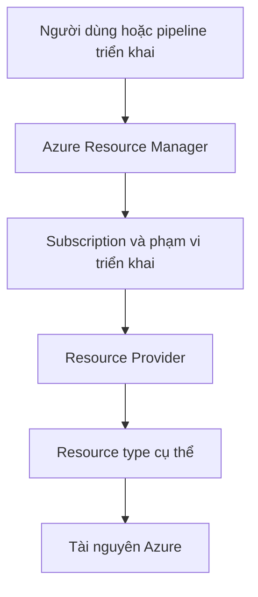

# Resource Provider, loại tài nguyên và Resource ID

Khi triển khai một ứng dụng trên Microsoft Azure, ta thường tạo nhiều tài nguyên như máy ảo, mạng ảo, tài khoản lưu trữ, cơ sở dữ liệu và dịch vụ web. Azure Resource Manager (ARM) cần biết mỗi tài nguyên thuộc dịch vụ nào, có cấu trúc ra sao và nằm ở phạm vi quản lý nào. Ba khái niệm **Resource Provider**, **resource type** và **Resource ID** trả lời những câu hỏi đó.

Bài học này nằm trong chương **Nền tảng Azure** của module `CLOUD_PROVIDERS_AZURE`. Module giới thiệu hệ sinh thái Azure từ subscription, resource group và Microsoft Entra ID đến mạng, tính toán, lưu trữ và dữ liệu; đồng thời hướng dẫn triển khai, giám sát, bảo vệ và kiểm soát chi phí cho kiến trúc ứng dụng. Nắm vững cách Azure định danh và quản lý tài nguyên sẽ giúp ta đọc cấu hình, phân quyền, tự động hóa triển khai và xử lý lỗi chính xác hơn.

## Mục tiêu học tập

Sau bài học, bạn có thể:

- Giải thích vai trò của Resource Provider và provider namespace trong Azure Resource Manager.
- Phân biệt provider namespace, resource type, tên tài nguyên, `kind`, `sku` và API version.
- Mô tả cách đăng ký Resource Provider ở cấp subscription và kiểm tra trạng thái đăng ký.
- Đọc cấu trúc Resource ID của tài nguyên cấp resource group, subscription, tài nguyên con và extension resource.
- Tra cứu Resource ID bằng Azure CLI và sử dụng ID trong Bicep hoặc thao tác quản trị.

## 1. Resource Provider nằm ở đâu trong mô hình Azure?

Azure Resource Manager là lớp quản lý thống nhất (control plane) tiếp nhận yêu cầu tạo, đọc, cập nhật hoặc xóa tài nguyên. Khi bạn triển khai một virtual machine, ARM định tuyến yêu cầu đến Resource Provider phụ trách loại tài nguyên đó. Provider thực hiện các thao tác quản lý, kiểm tra cấu hình và phối hợp với hạ tầng Azure để cung cấp tài nguyên.

Có thể hình dung luồng quản lý như sau:



Ví dụ, khi tạo máy ảo, ARM chuyển yêu cầu đến provider `Microsoft.Compute`, sau đó provider xử lý resource type `virtualMachines`. Khi tạo virtual network, yêu cầu đi đến `Microsoft.Network` và resource type `virtualNetworks`.

Resource Provider cung cấp các thao tác quản lý cho một nhóm dịch vụ. Provider thường công bố metadata về resource type, API version, khu vực hỗ trợ và các thao tác quản trị. Tên định danh của provider được gọi là **provider namespace**.

| Provider namespace | Ví dụ resource type | Tài nguyên thường gặp |
|---|---|---|
| `Microsoft.Compute` | `virtualMachines` | Máy ảo, bộ mở rộng máy ảo |
| `Microsoft.Network` | `virtualNetworks` | Mạng ảo, subnet, network interface, public IP |
| `Microsoft.Storage` | `storageAccounts` | Tài khoản lưu trữ, blob service, container |
| `Microsoft.Web` | `sites` | App Service và ứng dụng web |
| `Microsoft.KeyVault` | `vaults` | Key Vault |
| `Microsoft.Sql` | `servers`, `databases` | SQL server logic và cơ sở dữ liệu Azure SQL |
| `Microsoft.Insights` | `components`, `diagnosticSettings` | Application Insights và cấu hình giám sát |

Tên namespace thường có dạng `Microsoft.<TênDịchVụ>`. Đây là tên định danh trong Azure Resource Manager, không nhất thiết trùng với tên hiển thị trên Azure Portal.

## 2. Đăng ký Resource Provider

Một subscription cần đăng ký provider namespace trước khi sử dụng các resource type do provider đó quản lý. Việc đăng ký cho Azure biết subscription có ý định sử dụng namespace tương ứng và cho phép các thao tác quản lý thuộc namespace đó được thực hiện trong subscription.

Một số điểm cần nhớ:

- Đăng ký được thực hiện ở **cấp subscription**, không phải riêng từng resource group.
- Một provider namespace có thể cung cấp nhiều resource type. Ví dụ `Microsoft.Network` quản lý nhiều loại tài nguyên mạng.
- Azure có thể tự động đăng ký một số provider trong một số quy trình triển khai. Tuy nhiên, khi gặp lỗi đăng ký, hãy kiểm tra trạng thái thực tế thay vì giả định provider đã sẵn sàng.
- Đăng ký provider không tự tạo tài nguyên, không cấp quyền truy cập dữ liệu và không thay thế việc cấu hình RBAC.
- Người thực hiện cần quyền đăng ký provider (`Microsoft.Resources/subscriptions/providers/register/action`). Các vai trò như Owner và Contributor thường bao gồm quyền này; trong môi trường doanh nghiệp, quyền thực tế còn phụ thuộc role assignment và policy của tổ chức.

### Kiểm tra subscription đang sử dụng

Trước khi đăng ký, xác nhận Azure CLI đang trỏ đến đúng subscription:

```bash
az account show --output table
```

Nếu cần chuyển subscription, dùng ID hoặc tên subscription đã được cấp:

```bash
az account set --subscription "<subscription-id-or-name>"
```

Kiểm tra trạng thái của một provider:

```bash
az provider show \
  --namespace Microsoft.Storage \
  --query registrationState \
  --output tsv
```

Các trạng thái thường gặp gồm `NotRegistered`, `Registering`, `Registered` và `Unregistering`. Nếu trạng thái là `NotRegistered`, có thể yêu cầu đăng ký:

```bash
az provider register --namespace Microsoft.Storage
```

Lệnh đăng ký có thể trả về trước khi quá trình hoàn tất. Kiểm tra lại trạng thái cho đến khi provider ở trạng thái `Registered`:

```bash
az provider show \
  --namespace Microsoft.Storage \
  --query registrationState \
  --output tsv
```

Để xem các namespace chưa đăng ký trong subscription:

```bash
az provider list \
  --query "[?registrationState=='NotRegistered'].namespace" \
  --output table
```

Không cần đăng ký hàng loạt mọi provider. Chỉ đăng ký namespace cần cho workload, theo quy trình và quyền hạn của tổ chức.

### Xem resource type mà provider hỗ trợ

Provider metadata giúp xác nhận namespace có những resource type nào và các API version hoặc khu vực mà từng type hỗ trợ. Ví dụ:

```bash
az provider show \
  --namespace Microsoft.Network \
  --query "resourceTypes[].{type:resourceType,locations:locations,apiVersions:apiVersions}" \
  --output table
```

Thông tin này hữu ích khi chọn API version hoặc điều tra lỗi triển khai. Provider đã đăng ký không có nghĩa mọi resource type, SKU hoặc tính năng đều khả dụng ở mọi khu vực. Hạn ngạch subscription, chính sách Azure Policy và giới hạn riêng của dịch vụ vẫn có thể ảnh hưởng đến triển khai.

## 3. Phân biệt provider namespace và resource type

Một resource type thường được viết theo dạng:

```text
<provider-namespace>/<resource-type>
```

Ví dụ:

```text
Microsoft.Compute/virtualMachines
Microsoft.Network/virtualNetworks
Microsoft.Storage/storageAccounts
Microsoft.Web/sites
```

Trong `Microsoft.Storage/storageAccounts`, `Microsoft.Storage` là provider namespace còn `storageAccounts` là resource type. Một **resource** cụ thể là một instance của type đó, chẳng hạn tài khoản lưu trữ `stappdata01` trong resource group `rg-app-prod`.

| Thành phần | Ý nghĩa | Ví dụ |
|---|---|---|
| Provider namespace | Nhóm dịch vụ quản lý tài nguyên | `Microsoft.Storage` |
| Resource type | Loại tài nguyên do provider cung cấp | `storageAccounts` |
| Resource name | Tên của một instance trong phạm vi áp dụng | `stappdata01` |
| `kind` | Phân loại hoặc biến thể của một số loại tài nguyên | `StorageV2` |
| `sku` | Cấp dịch vụ, hiệu năng hoặc mô hình dự phòng | `Standard_GRS` |
| API version | Phiên bản hợp đồng quản lý dùng cho request hoặc template | `2023-05-01` |

Các giá trị trên có quan hệ với nhau nhưng không thể thay thế cho nhau. Ví dụ, `Microsoft.Storage/storageAccounts` xác định loại tài nguyên; `StorageV2` mô tả loại tài khoản lưu trữ; `Standard_GRS` chọn SKU; còn API version xác định schema và hành vi của API quản lý tại thời điểm gọi.

API version **không phải** một phần của Resource ID. Khi gọi ARM REST API, Resource ID xác định tài nguyên, còn `api-version` được truyền riêng trong query string:

```http
GET https://management.azure.com/subscriptions/<subscription-id>/resourceGroups/rg-app-prod/providers/Microsoft.Storage/storageAccounts/stappdata01?api-version=2023-05-01
```

API version trong ví dụ chỉ minh họa vị trí của tham số. Khi triển khai thật, hãy chọn phiên bản còn được provider hỗ trợ và phù hợp với các thuộc tính bạn cần dùng.

### Resource type lồng nhau (child resource)

Một số tài nguyên có tài nguyên con. Khi đó resource type chứa nhiều đoạn phân cấp, ngăn cách bằng dấu `/`.

Ví dụ subnet thuộc một virtual network:

```text
Resource type: Microsoft.Network/virtualNetworks/subnets
Resource name: vnet-prod/app
```

Resource ID tương ứng có dạng:

```text
/subscriptions/<subscription-id>/resourceGroups/rg-network-prod/providers/Microsoft.Network/virtualNetworks/vnet-prod/subnets/app
```

Sau `providers/Microsoft.Network`, các cặp đoạn type và name lần lượt là `virtualNetworks/vnet-prod` và `subnets/app`. Với tài nguyên con, tên trong template hoặc lệnh triển khai thường chứa tên cha và tên con, phân tách bằng `/`.

Ví dụ khác là container trong blob service của một storage account:

```text
Resource type: Microsoft.Storage/storageAccounts/blobServices/containers
Resource name: stappdata01/default/logs
```

Không nên nhầm tài nguyên con với một resource group riêng. Tài nguyên con có quan hệ phân cấp với tài nguyên cha và Resource ID thể hiện quan hệ đó.

## 4. Resource ID là gì?

**Resource ID** là định danh đầy đủ mà Azure Resource Manager dùng để xác định một tài nguyên trong phạm vi quản lý. ID cho biết tài nguyên thuộc subscription và resource group nào, do provider namespace nào quản lý, có resource type gì và mang tên nào.

Với một tài nguyên thông thường được triển khai trong resource group, cấu trúc tổng quát là:

```text
/subscriptions/{subscription-id}/resourceGroups/{resource-group-name}/providers/{provider-namespace}/{resource-type}/{resource-name}
```

Ví dụ minh họa:

```text
/subscriptions/00000000-0000-0000-0000-000000000000/resourceGroups/rg-app-prod/providers/Microsoft.Storage/storageAccounts/stappdata01
```

Đọc từ trái sang phải:

1. `/subscriptions/...` xác định subscription sở hữu tài nguyên.
2. `/resourceGroups/rg-app-prod` xác định resource group chứa tài nguyên.
3. `/providers/Microsoft.Storage` xác định provider namespace.
4. `/storageAccounts/stappdata01` xác định resource type và tên instance.

Resource ID không phải tên hiển thị, URL truy cập dữ liệu hay địa chỉ mạng của dịch vụ. Ví dụ, Resource ID của storage account khác với blob endpoint dạng `https://<storage-account>.blob.core.windows.net/`. Resource ID dùng cho control plane; endpoint dịch vụ và quyền data plane được quản lý theo cơ chế tương ứng của dịch vụ.

### Resource ID phụ thuộc vào scope

Không phải tài nguyên nào cũng nằm trong resource group. Cấu trúc ID thay đổi theo scope triển khai:

| Scope | Ví dụ định danh hoặc cấu trúc |
|---|---|
| Management group | `/providers/Microsoft.Management/managementGroups/{management-group-id}` |
| Subscription | `/subscriptions/{subscription-id}` |
| Resource group | `/subscriptions/{subscription-id}/resourceGroups/{resource-group-name}` |
| Resource | ID đầy đủ của tài nguyên, thường có đoạn `/providers/{namespace}/{type}/{name}` |
| Extension resource | ID của scope hoặc tài nguyên đích, nối thêm `/providers/{extension-namespace}/{extension-type}/{extension-name}` |

Ví dụ một policy assignment ở cấp subscription có thể có ID dạng:

```text
/subscriptions/<subscription-id>/providers/Microsoft.Authorization/policyAssignments/require-tags
```

Một role assignment gắn trực tiếp vào storage account có thể có ID dạng:

```text
/subscriptions/<subscription-id>/resourceGroups/rg-app-prod/providers/Microsoft.Storage/storageAccounts/stappdata01/providers/Microsoft.Authorization/roleAssignments/<assignment-guid>
```

Trong ví dụ thứ hai, role assignment là **extension resource**: nó mở rộng scope của storage account bằng cách gắn thông tin phân quyền vào tài nguyên đó. Các loại extension resource khác có thể dùng scope là subscription, resource group hoặc một resource cụ thể.

### Đặc điểm cần nhớ về Resource ID

- Resource ID là đường dẫn định danh trong Azure Resource Manager, thường bắt đầu bằng `/`.
- ID chứa scope, provider namespace, resource type và tên tài nguyên tương ứng với loại tài nguyên.
- Tên tài nguyên có quy tắc riêng theo provider. Một số tên phải duy nhất toàn cục, trong khi một số tên chỉ cần duy nhất trong scope của chúng.
- Resource ID không chứa API version, SKU hay thông tin đăng nhập.
- Azure Resource Manager xử lý Resource ID theo cách không phân biệt chữ hoa và chữ thường. Khi lưu hoặc hiển thị ID, nên giữ nguyên giá trị Azure trả về để dễ đối chiếu.
- Với child resource và extension resource, ID có thể có nhiều đoạn `/providers/` hoặc nhiều cặp type/name. Không nên tự cắt chuỗi theo giả định mọi ID đều có cùng độ dài.

## 5. Tra cứu Resource ID bằng Azure CLI

Azure CLI có thể liệt kê tài nguyên và trả về trường `id`. Đây là cách đáng tin cậy để lấy ID chính xác thay vì tự ghép chuỗi.

Liệt kê tài nguyên trong resource group:

```bash
az resource list \
  --resource-group rg-app-prod \
  --query "[].{name:name,type:type,id:id}" \
  --output table
```

Lọc theo resource type:

```bash
az resource list \
  --resource-group rg-app-prod \
  --resource-type Microsoft.Storage/storageAccounts \
  --output table
```

Khi đã có Resource ID, có thể truy vấn trực tiếp tài nguyên:

```bash
az resource show --ids \
  "/subscriptions/<subscription-id>/resourceGroups/rg-app-prod/providers/Microsoft.Storage/storageAccounts/stappdata01" \
  --output json
```

Kết quả thường có các trường như `id`, `name`, `type`, `location`, `sku` hoặc `properties`, tùy resource type. Trường `id` là giá trị nên tái sử dụng cho các thao tác cần tham chiếu đến chính tài nguyên đó.

## 6. Dùng Resource ID trong Bicep và triển khai hạ tầng

Trong Infrastructure as Code, việc tham chiếu tài nguyên bằng ID giúp liên kết các thành phần mà không phải tự xây dựng đường dẫn. Bicep cung cấp thuộc tính `.id` trên resource symbol và các hàm tạo ID theo scope.

Ví dụ khai báo một storage account và xuất Resource ID:

```bicep
targetScope = 'resourceGroup'

param storageName string
param location string = resourceGroup().location

resource storage 'Microsoft.Storage/storageAccounts@2023-05-01' = {
  name: storageName
  location: location
  sku: {
    name: 'Standard_LRS'
  }
  kind: 'StorageV2'
  properties: {
    minimumTlsVersion: 'TLS1_2'
  }
}

output storageResourceId string = storage.id
```

Trong ví dụ:

- `Microsoft.Storage/storageAccounts` là resource type.
- `storageName` là tên instance được truyền vào khi triển khai.
- `@2023-05-01` là API version của resource declaration.
- `storage.id` là Resource ID đầy đủ sau khi Bicep phân giải scope, subscription và resource group.

Nếu cần tạo ID để tham chiếu tài nguyên chưa khai báo trong cùng file, có thể dùng các hàm phù hợp với scope:

```bicep
// Tài nguyên trong resource group hiện tại
var storageId = resourceId('Microsoft.Storage/storageAccounts', 'stappdata01')

// Tài nguyên ở một resource group khác trong subscription hiện tại
var networkId = resourceId('rg-network-prod', 'Microsoft.Network/virtualNetworks', 'vnet-prod')

// Tài nguyên ở scope subscription
var roleDefinitionId = subscriptionResourceId('Microsoft.Authorization/roleDefinitions', '<role-definition-guid>')
```

Các hàm thường dùng khác gồm `managementGroupResourceId()` và `tenantResourceId()` cho những scope tương ứng, cùng `extensionResourceId()` để tạo ID cho extension resource gắn với một scope hoặc tài nguyên đích. Chọn hàm theo đúng scope của tài nguyên. Nếu tài nguyên đã được khai báo dưới dạng resource symbol, ưu tiên dùng thuộc tính `.id` để giảm lỗi ghép chuỗi.

## 7. Phân biệt lỗi đăng ký provider, quyền và khả năng hỗ trợ

Khi triển khai thất bại, hãy xác định lỗi thuộc lớp nào trước khi thay đổi cấu hình.

| Dấu hiệu lỗi | Nguyên nhân có thể | Hướng kiểm tra |
|---|---|---|
| `MissingSubscriptionRegistration` | Provider namespace chưa đăng ký trong subscription | Kiểm tra `az provider show`, sau đó đăng ký namespace nếu có quyền |
| `NoRegisteredProviderFound` | Namespace chưa đăng ký, hoặc type/API version/khu vực không được hỗ trợ theo request | Kiểm tra provider state, resource type, API version và location trong metadata |
| `AuthorizationFailed` | Tài khoản thiếu quyền thực hiện thao tác ở scope tương ứng | Kiểm tra role assignment, scope và quyền control plane cần thiết |
| `InvalidResourceType` | Resource type sai, không tồn tại hoặc không khả dụng trong ngữ cảnh triển khai | Đối chiếu chính xác provider namespace và resource type |
| Lỗi quota hoặc SKU | Subscription, khu vực hoặc dịch vụ không đáp ứng giới hạn/SKU yêu cầu | Kiểm tra quota, SKU và khu vực được hỗ trợ |

Ví dụ, nếu gặp `MissingSubscriptionRegistration` khi triển khai storage account, trước tiên kiểm tra đúng subscription bằng `az account show`, sau đó kiểm tra `Microsoft.Storage`. Nếu provider đang `NotRegistered`, đăng ký provider và chờ trạng thái chuyển sang `Registered` rồi thử lại. Nếu provider đã đăng ký mà lỗi vẫn xuất hiện, kiểm tra API version, resource type và location; đăng ký provider không tự khắc phục các giới hạn đó.

Tương tự, `AuthorizationFailed` không có nghĩa provider chưa đăng ký. Một subscription có thể đã đăng ký `Microsoft.Network` nhưng người triển khai vẫn không có quyền tạo virtual network trong resource group đích. Khi đó cần kiểm tra Azure RBAC và scope được cấp quyền.

## 8. Quy trình thực hành tổng hợp

Giả sử nhóm phát triển chuẩn bị triển khai một ứng dụng có storage account trong resource group `rg-app-prod` thuộc subscription `sub-prod`.

1. Chọn đúng subscription trong Azure CLI và xác nhận bằng `az account show`.
2. Kiểm tra trạng thái `Microsoft.Storage`; đăng ký nếu chưa được đăng ký và tài khoản có quyền phù hợp.
3. Tra cứu resource type `storageAccounts`, API version và khu vực hỗ trợ.
4. Triển khai storage account bằng Bicep hoặc ARM template, khai báo đúng resource type, API version, `kind` và `sku`.
5. Lấy Resource ID từ output `storage.id` hoặc trường `id` trong kết quả Azure CLI.
6. Dùng Resource ID đó khi cấu hình role assignment, diagnostic setting hoặc tham chiếu từ thành phần triển khai khác.
7. Nếu có lỗi, phân biệt lỗi đăng ký provider với lỗi RBAC, API version, khu vực, SKU hoặc quota.

Quy trình này có thể áp dụng tương tự cho `Microsoft.Compute`, `Microsoft.Network`, `Microsoft.KeyVault`, `Microsoft.Web` và các provider khác. Thay đổi namespace, resource type và thuộc tính theo dịch vụ đang triển khai.

## 9. Tự kiểm tra

**Câu 1.** Trong chuỗi `Microsoft.Network/virtualNetworks`, phần nào là provider namespace?

**Đáp án:** `Microsoft.Network` là provider namespace; `virtualNetworks` là resource type.

**Câu 2.** Đăng ký `Microsoft.Storage` có tạo sẵn storage account trong resource group không?

**Đáp án:** Không. Đăng ký chỉ cho phép subscription sử dụng các resource type thuộc provider theo cơ chế của Azure. Muốn có storage account, ta vẫn phải triển khai một resource instance.

**Câu 3.** `api-version` có nằm trong Resource ID không?

**Đáp án:** Không. Resource ID xác định tài nguyên; API version được truyền riêng trong request hoặc khai báo riêng trong template.

**Câu 4.** Resource ID của subnet thể hiện quan hệ với virtual network như thế nào?

**Đáp án:** ID chứa cả đoạn type/name của virtual network và subnet, ví dụ `.../virtualNetworks/vnet-prod/subnets/app`.

**Câu 5.** Provider đã ở trạng thái `Registered` nhưng vẫn gặp `AuthorizationFailed`. Nên kiểm tra gì?

**Đáp án:** Kiểm tra Azure RBAC, role assignment, scope và quyền thực hiện thao tác. Trạng thái đăng ký provider không cấp quyền quản trị tài nguyên cho người dùng.

## Kết luận

Resource Provider xác định nhóm dịch vụ xử lý thao tác quản lý; resource type xác định cấu trúc của một loại tài nguyên; Resource ID xác định chính xác instance và scope của tài nguyên trong Azure. Khi hiểu rõ ba khái niệm này, bạn có thể kiểm tra provider registration, đọc metadata, phân tích lỗi triển khai và liên kết tài nguyên trong Azure CLI, ARM template hoặc Bicep một cách nhất quán. Đây là nền tảng cần thiết trước khi đi sâu vào cấu hình mạng, tính toán, lưu trữ, dữ liệu, bảo mật và vận hành trên Microsoft Azure.
