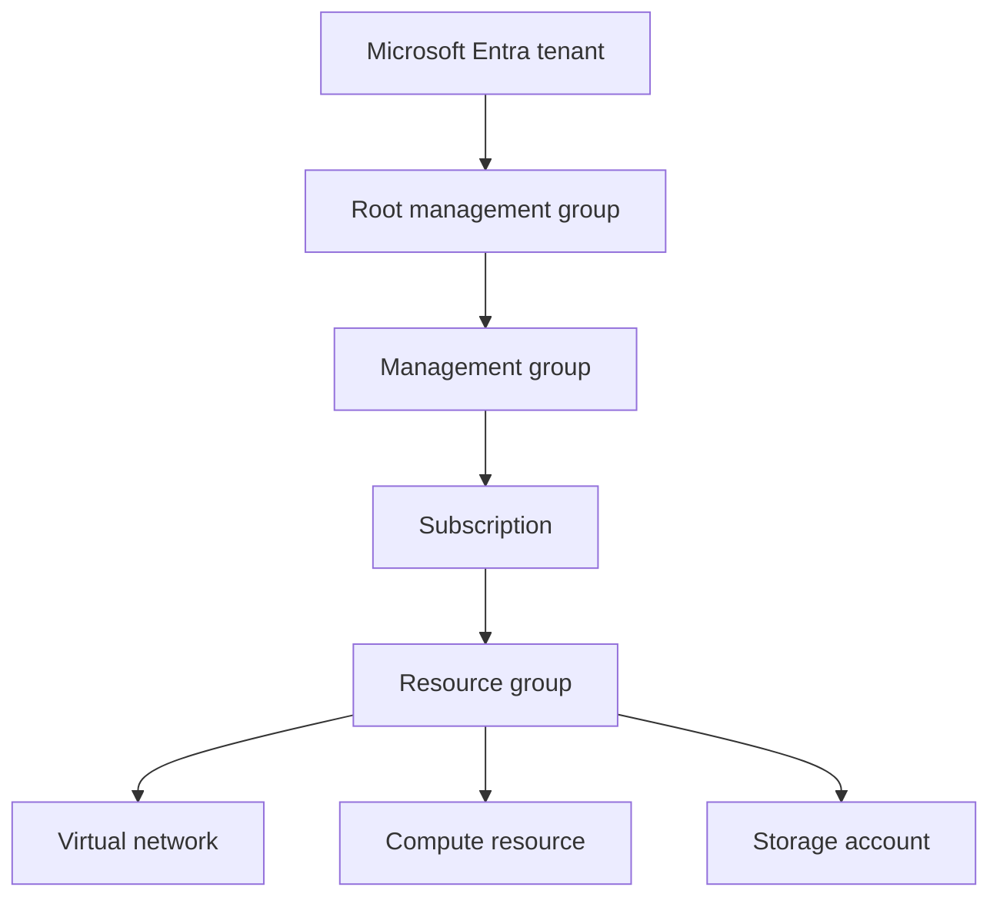
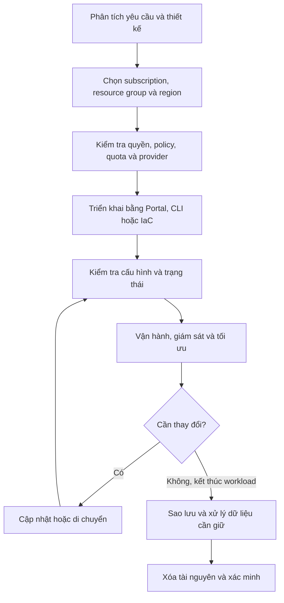

# Azure Resource Manager và vòng đời tài nguyên

Azure Resource Manager (ARM) là lớp quản lý thống nhất của Microsoft Azure. Khi tạo máy ảo, mạng ảo, tài khoản lưu trữ hoặc cơ sở dữ liệu, các thao tác quản lý đều đi qua ARM. Hiểu ARM giúp bạn biết tài nguyên được tổ chức ở đâu, quyền được áp dụng như thế nào, một lần triển khai thay đổi những gì và cần làm gì để vận hành hoặc loại bỏ tài nguyên an toàn.

Trong bài này, ta dùng một ứng dụng đặt hàng làm ví dụ. Ứng dụng có mạng ảo, dịch vụ tính toán, tài khoản lưu trữ và cơ sở dữ liệu. Mục tiêu là quản lý các thành phần đó theo môi trường, triển khai lặp lại được và kiểm soát quyền, thay đổi cũng như chi phí.

Sau bài học, bạn có thể:

- Giải thích vai trò của ARM và phân biệt management plane với data plane.
- Đọc cấu trúc phân cấp tenant, management group, subscription, resource group và resource.
- Hiểu resource ID, resource provider và phạm vi áp dụng của RBAC, Azure Policy, resource lock.
- Triển khai tài nguyên bằng Azure CLI và Bicep, xem trước thay đổi và kiểm tra kết quả.
- Lập kế hoạch cho các thao tác tạo, cập nhật, di chuyển, bảo vệ, giám sát và xóa tài nguyên.

## 1. Azure Resource Manager là gì?

ARM là dịch vụ quản lý và triển khai tài nguyên Azure. Có thể xem ARM như cổng điều phối cho các thao tác quản trị. Azure Portal, Azure CLI, Azure PowerShell, SDK và các công cụ Infrastructure as Code (IaC) đều gửi yêu cầu quản lý đến ARM. Nhờ đó, các công cụ khác nhau vẫn dùng chung mô hình tài nguyên, quyền truy cập và cơ chế triển khai.

Một yêu cầu quản lý thường đi qua các bước sau:

1. Người dùng hoặc workload đăng nhập và lấy token từ Microsoft Entra ID.
2. ARM xác thực danh tính, kiểm tra quyền Azure RBAC và các chính sách áp dụng cho phạm vi yêu cầu.
3. ARM chuyển yêu cầu đến resource provider tương ứng.
4. Resource provider thực hiện thao tác trên loại tài nguyên đó và trả kết quả về ARM.
5. Hoạt động quản lý được ghi nhận để có thể kiểm tra trong Azure Activity Log.

Resource provider là thành phần cung cấp các thao tác cho một họ tài nguyên. Ví dụ:

| Resource provider | Một số loại tài nguyên |
|---|---|
| `Microsoft.Compute` | Virtual machine, disk, virtual machine scale set |
| `Microsoft.Network` | Virtual network, subnet, network interface, load balancer |
| `Microsoft.Storage` | Storage account |
| `Microsoft.Sql` | Azure SQL server và database |
| `Microsoft.KeyVault` | Key vault |

Tên loại tài nguyên thường có dạng `namespace/resourceType`, ví dụ `Microsoft.Compute/virtualMachines`. Một số loại có tài nguyên con, chẳng hạn subnet nằm bên trong virtual network.

### Management plane và data plane

Hai khái niệm này rất dễ nhầm lẫn:

| Mặt phẳng | Quản lý việc gì? | Ví dụ |
|---|---|---|
| Management plane | Vòng đời và cấu hình của tài nguyên Azure | Tạo storage account, đổi SKU, cấu hình mạng, xóa database |
| Data plane | Dữ liệu hoặc thao tác bên trong dịch vụ | Đọc/ghi blob, truy vấn bản ghi SQL, lấy secret trong Key Vault |

Ví dụ, quyền tạo hoặc cấu hình storage account không tự động đồng nghĩa với quyền đọc mọi blob bên trong tài khoản đó. Quyền management plane và data plane có thể được cấp bằng các role khác nhau. Khi thiết kế bảo mật, hãy xác định người dùng cần quản trị tài nguyên hay cần truy cập dữ liệu của dịch vụ.

## 2. Cấu trúc phân cấp và phạm vi quản lý

Azure tổ chức tài nguyên theo nhiều cấp. Mỗi cấp tạo ra một phạm vi (scope) để gom nhóm, phân quyền và áp dụng chính sách.



Một tenant có root management group. Bên dưới root có thể có nhiều management group; mỗi management group chứa management group con hoặc subscription. Subscription chứa resource group, và resource group chứa các resource.

### Vai trò của từng cấp

- **Microsoft Entra tenant:** ranh giới danh tính của tổ chức, chứa người dùng, nhóm, ứng dụng và danh tính workload. Management group hierarchy được gắn với một tenant.
- **Management group:** gom nhiều subscription để quản trị theo đơn vị tổ chức, môi trường hoặc yêu cầu tuân thủ. Ví dụ có thể có nhóm `Production` và `NonProduction`.
- **Subscription:** ranh giới quản lý và thanh toán quan trọng. Subscription chứa resource group, có giới hạn/quota riêng và là phạm vi thường dùng để phân chia workload hoặc môi trường.
- **Resource group:** nhóm các tài nguyên có vòng đời hoặc mục đích vận hành liên quan. Khi xóa resource group, Azure sẽ yêu cầu xóa các tài nguyên nằm trong nhóm đó.
- **Resource:** một dịch vụ hoặc thành phần cụ thể, chẳng hạn virtual network, virtual machine, storage account hay database.

Không nhất thiết phải tạo một resource group cho từng resource. Hãy gom các thành phần có cùng vòng đời, quyền quản lý và cách vận hành. Ví dụ, các thành phần của ứng dụng đặt hàng trong môi trường thử nghiệm có thể nằm trong `rg-orders-dev`; môi trường production nên có nhóm và quyền quản trị riêng.

### Resource group có gắn với một vùng Azure không?

Resource group có thuộc tính location để lưu metadata của chính resource group. Tuy vậy, các tài nguyên bên trong một resource group có thể nằm ở những region khác nhau, miễn là dịch vụ và cấu hình đó hỗ trợ. Location của resource group không tự động quyết định location của mọi resource.

Ví dụ, resource group có metadata ở `Southeast Asia` vẫn có thể chứa một tài nguyên được triển khai ở region khác. Khi tạo từng resource, hãy chỉ định region phù hợp với yêu cầu độ trễ, tính sẵn sàng, tuân thủ dữ liệu và khả năng cung cấp SKU.

### Scope ảnh hưởng đến quyền và chính sách như thế nào?

Azure RBAC cho phép gán role ở các scope như management group, subscription, resource group hoặc resource. Một role assignment ở cấp cha thường được kế thừa xuống các cấp con. Vì vậy, gán quyền rộng ở management group hoặc subscription có thể trao quyền trên rất nhiều tài nguyên.

Azure Policy cũng có thể được gán ở các scope này để kiểm soát cấu hình, ví dụ chỉ cho phép triển khai ở một số region hoặc yêu cầu tài nguyên có tag `environment`. Resource lock có thể được đặt ở subscription, resource group hoặc resource để hạn chế thao tác xóa hay chỉnh sửa.

Tag là metadata dạng cặp key-value, thường dùng để ghi nhận owner, ứng dụng, môi trường hoặc cost center. Tag trên resource group không tự động xuất hiện trên các resource con. Nếu cần kế thừa hoặc bắt buộc tag, hãy dùng Azure Policy phù hợp và kiểm tra loại tài nguyên có hỗ trợ tag hay không.

## 3. Resource ID và resource provider

Mỗi resource trong Azure có một resource ID xác định vị trí của nó trong hệ thống quản lý. Một resource ID điển hình có dạng:

```text
/subscriptions/{subscriptionId}/resourceGroups/{resourceGroupName}/providers/{providerNamespace}/{resourceType}/{resourceName}
```

Ví dụ:

```text
/subscriptions/00000000-0000-0000-0000-000000000000/resourceGroups/rg-orders-dev/providers/Microsoft.Storage/storageAccounts/stordersdev001
```

Resource ID thường xuất hiện trong output của CLI, cấu hình role assignment, template, log và các tham chiếu giữa tài nguyên. Với tài nguyên con, ID có thêm các đoạn thể hiện đường dẫn đến tài nguyên cha, ví dụ:

```text
/subscriptions/{subscriptionId}/resourceGroups/{resourceGroupName}/providers/Microsoft.Network/virtualNetworks/{vnetName}/subnets/{subnetName}
```

Resource provider cần được đăng ký ở subscription trước khi subscription thực hiện một số thao tác với namespace đó. Nhiều provider được đăng ký tự động khi cần, nhưng trong một số trường hợp bạn phải đăng ký thủ công. Có thể kiểm tra và đăng ký bằng Azure CLI:

```bash
# Kiểm tra trạng thái đăng ký của provider
az provider show \
  --namespace Microsoft.Compute \
  --query registrationState \
  --output tsv

# Đăng ký provider nếu subscription chưa đăng ký
az provider register --namespace Microsoft.Compute
```

Thay `Microsoft.Compute` bằng namespace mà workload cần, chẳng hạn `Microsoft.Network` hoặc `Microsoft.Storage`. Sau khi gửi yêu cầu đăng ký, hãy kiểm tra lại trạng thái trước khi triển khai nếu thao tác tạo resource vẫn báo provider chưa sẵn sàng.

## 4. Vòng đời của tài nguyên Azure

Vòng đời tài nguyên không chỉ là tạo rồi xóa. Một quy trình vận hành tốt cần có bước thiết kế, triển khai, cập nhật, bảo vệ, giám sát và kết thúc tài nguyên.



### 4.1. Lập kế hoạch trước khi tạo

Trước khi triển khai, hãy trả lời các câu hỏi sau:

- Tài nguyên thuộc subscription nào? Ai chịu trách nhiệm và ai thanh toán?
- Tài nguyên thuộc ứng dụng, môi trường và vòng đời nào? Có nên đặt cùng resource group không?
- Region nào đáp ứng yêu cầu độ trễ, nơi lưu dữ liệu, khả năng phục hồi và SKU?
- Cần role nào ở từng scope? Workload có nên dùng managed identity thay cho secret tĩnh không?
- Azure Policy có giới hạn region, loại SKU, public access hoặc tag bắt buộc không?
- Có đủ quota và resource provider đã đăng ký chưa?
- Tên tài nguyên có tuân theo quy ước của tổ chức và giới hạn đặt tên của dịch vụ không?

Ví dụ quy ước tên có thể dùng `rg-orders-dev-sea` cho resource group của ứng dụng orders ở môi trường dev. Tên thực tế cần tuân theo giới hạn của từng dịch vụ; storage account chẳng hạn yêu cầu tên duy nhất trên phạm vi dịch vụ, chỉ dùng chữ thường và chữ số, dài từ 3 đến 24 ký tự.

### 4.2. Tạo resource group

Đăng nhập Azure CLI, chọn đúng subscription rồi tạo resource group:

```bash
az login

# Xem subscription đang được chọn
az account show --output table

# Chọn subscription đích bằng ID hoặc tên
az account set --subscription "<subscription-id>"

# Tạo resource group
az group create \
  --name rg-orders-dev \
  --location southeastasia \
  --tags environment=dev application=orders owner=team-orders
```

Hãy kiểm tra subscription trước khi chạy lệnh tạo hoặc xóa. Trong môi trường có nhiều subscription, chọn nhầm subscription có thể khiến tài nguyên được tạo sai nơi hoặc thao tác dọn dẹp ảnh hưởng nhầm workload.

### 4.3. Triển khai bằng Bicep

Bicep là ngôn ngữ khai báo hạ tầng của Azure. Bạn mô tả trạng thái mong muốn của resource; Azure triển khai mô tả đó thông qua ARM. Bicep được biên dịch thành ARM JSON template, nhưng cú pháp thường ngắn gọn và dễ tổ chức hơn JSON thuần.

Tạo file `main.bicep`:

```bicep
@description('Tên storage account: 3-24 ký tự, chữ thường và chữ số')
@minLength(3)
@maxLength(24)
param storageAccountName string

@description('Mã môi trường triển khai')
param environment string = 'dev'

param location string = resourceGroup().location

resource storageAccount 'Microsoft.Storage/storageAccounts@2023-05-01' = {
  name: storageAccountName
  location: location
  kind: 'StorageV2'
  sku: {
    name: 'Standard_LRS'
  }
  tags: {
    application: 'orders'
    environment: environment
    managedBy: 'bicep'
  }
  properties: {
    supportsHttpsTrafficOnly: true
    minimumTlsVersion: 'TLS1_2'
    allowBlobPublicAccess: false
  }
}

output storageAccountId string = storageAccount.id
```

Trong ví dụ, `resourceGroup().location` lấy location của resource group làm mặc định cho storage account. Các thuộc tính bảo mật được khai báo ngay trong mã để cấu hình mong muốn có thể được xem xét và triển khai lặp lại. Tên storage account phải là tên chưa được sử dụng trên phạm vi Azure Storage.

Xem trước thay đổi rồi triển khai:

```bash
# Xem các thay đổi dự kiến trước khi áp dụng
az deployment group what-if \
  --resource-group rg-orders-dev \
  --template-file main.bicep \
  --parameters storageAccountName=stordersdev001 environment=dev

# Triển khai ở scope resource group
az deployment group create \
  --name deploy-orders-dev \
  --resource-group rg-orders-dev \
  --template-file main.bicep \
  --parameters storageAccountName=stordersdev001 environment=dev
```

`what-if` giúp xem resource nào sẽ được tạo, sửa hoặc xóa theo kế hoạch triển khai trước khi áp dụng. Hãy đọc kết quả, kiểm tra tên, scope và cấu hình nhạy cảm rồi mới chạy lệnh triển khai.

### 4.4. Hiểu cập nhật và tính khai báo

Với triển khai ARM ở chế độ incremental (chế độ mặc định của nhiều lệnh triển khai), resource được khai báo trong template sẽ được tạo hoặc cập nhật; resource khác trong resource group mà template không nhắc đến vẫn được giữ nguyên.

Điều này không có nghĩa template chỉ gửi một vài thuộc tính thay đổi. Khi một resource được khai báo lại, cấu hình của resource đó được áp dụng theo mô tả trong template. Nếu bỏ sót thuộc tính, resource provider có thể đưa thuộc tính đó về giá trị mặc định. Vì vậy, hãy duy trì mô tả đầy đủ trạng thái mong muốn của resource và xem trước thay đổi trước khi triển khai.

Tính khai báo giúp cùng một cấu hình có thể được triển khai ở nhiều môi trường bằng parameter khác nhau. Ví dụ, cùng một `main.bicep` có thể triển khai cho dev và staging, trong khi tên, SKU, region hoặc cấu hình theo môi trường được truyền qua parameter. Nên lưu Bicep và parameter không chứa bí mật trong hệ thống quản lý phiên bản; bí mật nên lấy từ Key Vault hoặc cơ chế quản lý secret phù hợp.

Khi cần loại bỏ một resource, hãy xác định rõ resource đó có được quản lý bởi template/deployment stack hay không và chọn quy trình xóa có kiểm soát. Đừng giả định rằng chỉ cần xóa một dòng khỏi template là mọi resource tương ứng sẽ tự động bị xóa trong mọi chế độ triển khai.

### 4.5. Kiểm tra sau triển khai

Sau khi triển khai, kiểm tra resource group và resource ID:

```bash
az group show --name rg-orders-dev --output table

az resource list \
  --resource-group rg-orders-dev \
  --output table

az storage account show \
  --name stordersdev001 \
  --resource-group rg-orders-dev \
  --query "{id:id,location:location,sku:sku.name,httpsOnly:enableHttpsTrafficOnly}" \
  --output json
```

Trạng thái `provisioningState` thường được resource provider cung cấp để mô tả tiến trình tạo hoặc cập nhật, nhưng trường và các giá trị cụ thể phụ thuộc loại resource. Một deployment thành công cũng chưa chứng minh ứng dụng hoạt động đúng: hãy kiểm tra kết nối, quyền data plane, health check và log của dịch vụ.

### 4.6. Di chuyển resource

Azure hỗ trợ di chuyển một số loại resource giữa resource group hoặc subscription. Việc di chuyển có thể hữu ích khi tổ chức lại môi trường hoặc quyền quản trị, nhưng không phải loại resource nào cũng hỗ trợ.

Trước khi di chuyển, cần:

1. Kiểm tra loại resource và cặp scope nguồn/đích có hỗ trợ move hay không.
2. Kiểm tra các resource phụ thuộc, chẳng hạn NIC tham chiếu subnet hoặc dịch vụ tham chiếu resource khác.
3. Kiểm tra yêu cầu về tenant, subscription, region và trạng thái của resource theo quy định của dịch vụ.
4. Chuẩn bị cập nhật các cấu hình đang tham chiếu resource ID cũ, role assignment, policy và công cụ giám sát nếu cần.
5. Lập kế hoạch thời gian bảo trì và kiểm tra ứng dụng sau khi di chuyển.

Khi resource chuyển sang resource group khác, resource ID có thể thay đổi vì đường dẫn chứa tên resource group. Một số dịch vụ có thêm điều kiện riêng hoặc không hỗ trợ move. Nếu không hỗ trợ, phương án phù hợp có thể là tạo resource mới rồi di chuyển dữ liệu/cấu hình theo hướng dẫn của dịch vụ.

### 4.7. Bảo vệ resource bằng lock

Resource lock giúp giảm nguy cơ thao tác nhầm trên tài nguyên quan trọng. Hai loại lock thường gặp là:

| Loại lock | Tác dụng |
|---|---|
| `CanNotDelete` | Cho phép đọc và cập nhật, nhưng chặn thao tác xóa resource trong phạm vi lock |
| `ReadOnly` | Chặn các thao tác quản lý có thể làm thay đổi resource; một số thao tác đọc vẫn được phép |

Ví dụ đặt lock chống xóa ở resource group production:

```bash
az lock create \
  --name protect-orders-prod \
  --lock-type CanNotDelete \
  --resource-group rg-orders-prod

az lock list --resource-group rg-orders-prod --output table
```

Lock ở scope cha được kế thừa xuống resource con. Lock là lớp bảo vệ cho thao tác management plane; nó không thay thế RBAC, Azure Policy, backup hay kiểm soát truy cập data plane. Người có quyền phù hợp để quản lý lock vẫn có thể gỡ lock trước khi thực hiện thao tác bị chặn, vì vậy hãy giới hạn quyền quản lý lock và theo dõi thay đổi lock.

Khi thực sự cần xóa resource group đang có lock, hãy xác minh yêu cầu thay đổi, gỡ đúng lock ở scope liên quan, thực hiện thao tác đã được phê duyệt và khôi phục lock nếu resource vẫn cần được bảo vệ.

### 4.8. Giám sát và kiểm soát chi phí

ARM quản lý thao tác trên resource; Azure cung cấp các dịch vụ khác để theo dõi vận hành:

- **Azure Activity Log:** ghi nhận các sự kiện ở management plane như tạo, cập nhật, xóa resource và thay đổi cấu hình quản trị. Dùng log này để điều tra ai đã thực hiện thao tác, ở thời điểm nào và kết quả ra sao.
- **Azure Monitor:** thu thập metrics và logs để theo dõi tình trạng, hiệu năng và hoạt động của workload. Resource cần được cấu hình diagnostic settings phù hợp để gửi log đến nơi lưu trữ hoặc phân tích.
- **Azure Resource Graph:** truy vấn inventory trên nhiều subscription để tìm resource theo loại, location, tag hoặc thuộc tính.
- **Azure Cost Management:** phân tích chi phí theo subscription, resource group, resource và tag khi dữ liệu tag được hỗ trợ.

Tag như `application`, `environment`, `owner` và `costCenter` giúp phân bổ chi phí và tìm người chịu trách nhiệm. Tuy nhiên, tag không tự động được kế thừa và không phải cơ chế chặn chi tiêu. Azure Budget có thể gửi cảnh báo khi đạt ngưỡng; bản thân budget không tự động dừng mọi tài nguyên hoặc bảo đảm chi phí không vượt ngưỡng.

## 5. Xóa tài nguyên và kết thúc vòng đời

Xóa resource group là thao tác có phạm vi ảnh hưởng lớn: Azure sẽ yêu cầu xóa các resource nằm trong resource group đó. Trước khi xóa, hãy kiểm tra:

- Resource group có đúng là môi trường hoặc workload cần kết thúc không?
- Có dữ liệu, snapshot, backup, log hoặc secret cần giữ lại không?
- Resource nào đang được workload khác tham chiếu?
- Dịch vụ có cơ chế soft delete, retention hoặc purge riêng không?
- Có resource lock đang bảo vệ resource group hoặc resource con không?
- Có yêu cầu lưu bằng chứng, log hoặc cấu hình để phục vụ kiểm toán không?

Liệt kê tài nguyên trước khi xóa:

```bash
az resource list \
  --resource-group rg-orders-dev \
  --query "[].{name:name,type:type,location:location,id:id}" \
  --output table
```

Chỉ chạy lệnh xóa sau khi xác nhận đúng subscription và resource group, đã sao lưu dữ liệu cần giữ và có phê duyệt theo quy trình của tổ chức:

```bash
az group delete --name rg-orders-dev --yes --no-wait
```

`--no-wait` khiến CLI trả về mà không chờ toàn bộ quá trình xóa hoàn tất. Hãy kiểm tra trạng thái sau đó; việc xóa có thể mất thời gian hoặc bị chặn bởi dependency, lock hay quy tắc riêng của resource provider. Một số dữ liệu có thể còn trong thời gian lưu giữ hoặc cần thao tác purge riêng theo chính sách dịch vụ.

## 6. Theo dõi deployment và xử lý lỗi

Khi deployment thất bại, thông báo ở lệnh CLI đôi khi chỉ nêu lỗi tổng quát. Hãy tìm deployment và các operation chi tiết để biết resource nào thất bại, provider trả lỗi gì và nguyên nhân nằm ở quyền, policy, quota hay template.

```bash
# Liệt kê deployment gần đây trong resource group
az deployment group list \
  --resource-group rg-orders-dev \
  --output table

# Xem chi tiết các operation của deployment
az deployment operation group list \
  --name deploy-orders-dev \
  --resource-group rg-orders-dev \
  --output jsonc

# Xem hoạt động quản lý gần đây trong resource group
az monitor activity-log list \
  --resource-group rg-orders-dev \
  --max-events 10 \
  --output table
```

Một số lỗi thường gặp:

| Dấu hiệu | Nguyên nhân có thể | Hướng kiểm tra |
|---|---|---|
| `AuthorizationFailed` | Danh tính thiếu role hoặc role được gán sai scope | Kiểm tra tài khoản đang dùng, role assignment và scope; xem cả quyền quản lý lẫn quyền data plane |
| Provider chưa đăng ký | Namespace của resource provider chưa ở trạng thái Registered | Dùng `az provider show`, sau đó đăng ký provider nếu cần |
| `RequestDisallowedByPolicy` | Cấu hình vi phạm Azure Policy | Xem policy assignment và policy details ở scope áp dụng; sửa region, SKU, tag hoặc cấu hình bị từ chối |
| `InvalidTemplate` hoặc `DeploymentFailed` | Template sai cú pháp, API version không phù hợp, parameter sai hoặc resource provider trả lỗi | Xem deployment operation chi tiết và kiểm tra template/parameter |
| Location hoặc SKU không khả dụng | Dịch vụ/SKU không được cung cấp ở region hoặc subscription hiện tại | Kiểm tra region, SKU, quota và giới hạn subscription |
| Không thể xóa resource | Có lock, dependency hoặc điều kiện riêng của dịch vụ | Kiểm tra lock, resource đang tham chiếu và thông báo từ provider |
| Không thể move resource | Loại resource hoặc cấu hình hiện tại không hỗ trợ di chuyển | Kiểm tra hướng dẫn move của đúng resource provider; cân nhắc tạo mới và di chuyển dữ liệu |

Khi điều tra, hãy giữ lại deployment name, resource ID, thời điểm và correlation ID nếu thông báo lỗi cung cấp. Những thông tin này giúp liên kết log giữa ARM, resource provider và hệ thống hỗ trợ.

## 7. Ví dụ thiết kế cho ứng dụng đặt hàng

Giả sử tổ chức có hai môi trường dev và production. Có thể thiết kế ban đầu như sau:

| Thành phần | Dev | Production | Lý do tổ chức |
|---|---|---|---|
| Subscription | `sub-apps-dev` | `sub-apps-prod` | Phân tách quyền, quota, chi phí và chính sách môi trường |
| Resource group | `rg-orders-dev` | `rg-orders-prod` | Gom các resource theo vòng đời ứng dụng và môi trường |
| Resource | VNet, compute, storage, database | VNet, compute, storage, database | Mỗi resource có region, SKU và cấu hình riêng |
| Quyền | Nhóm phát triển có quyền phù hợp trên dev | Nhóm vận hành có quyền giới hạn trên production | Giảm phạm vi ảnh hưởng khi có thao tác nhầm |
| Bảo vệ | Lock theo nhu cầu | `CanNotDelete` cho resource quan trọng | Giảm nguy cơ xóa ngoài kế hoạch |
| Theo dõi | Tag, Activity Log, Monitor, budget | Tag, Activity Log, Monitor, budget và cảnh báo vận hành | Theo dõi thay đổi, độ tin cậy và chi phí |

Quy trình triển khai production nên dùng cùng mã Bicep đã được kiểm tra ở dev, nhưng truyền parameter production đã được review. Trước khi triển khai, xem `what-if`, xác nhận subscription và scope, kiểm tra policy/quota, rồi theo dõi deployment và health check sau khi hoàn tất.

## 8. Những nhầm lẫn cần tránh

1. **Cho rằng resource group là một region chứa mọi resource cùng vùng.** Location của resource group lưu metadata; resource bên trong có thể nằm ở region khác.
2. **Cho rằng có quyền tạo resource thì có quyền đọc dữ liệu bên trong.** Management plane và data plane có hệ thống quyền riêng.
3. **Cho rằng tag tự động kế thừa.** Tag không tự động lan từ resource group xuống resource; cần policy nếu muốn áp dụng quy tắc đó.
4. **Cho rằng template incremental sẽ xóa resource bị bỏ khỏi file.** Resource không còn được nhắc đến thường vẫn tồn tại trong resource group; cần quy trình xóa được xác định rõ.
5. **Cho rằng mọi resource đều có thể move.** Khả năng di chuyển phụ thuộc resource provider, loại resource, dependency và scope nguồn/đích.
6. **Cho rằng lock thay thế RBAC hoặc backup.** Lock chỉ bổ sung lớp bảo vệ cho thao tác quản lý; cần kết hợp quyền tối thiểu, sao lưu và giám sát.
7. **Cho rằng deployment thành công đồng nghĩa ứng dụng đã sẵn sàng.** Cần kiểm tra cả kết nối, quyền truy cập dữ liệu, health check và log của ứng dụng.

## 9. Bài tập thực hành

1. Vẽ sơ đồ scope cho một tổ chức có subscription dev và production. Đặt các resource group theo ứng dụng và giải thích vì sao các resource trong cùng nhóm có chung vòng đời.
2. Tạo một resource group thử nghiệm bằng Azure CLI. Gắn tag `application`, `environment` và `owner`; sau đó dùng `az group show` để xác minh.
3. Dùng Bicep triển khai một storage account có HTTPS bắt buộc và tắt blob public access. Chạy `what-if` trước, triển khai sau, rồi kiểm tra cấu hình bằng CLI.
4. Tạo lock `CanNotDelete` trên resource group thử nghiệm. Quan sát thao tác xóa bị chặn như thế nào, sau đó gỡ lock và chỉ xóa resource group khi đã xác minh không còn dữ liệu cần giữ.
5. Tìm một deployment gần đây, đọc operation chi tiết và mô tả cách phân biệt lỗi quyền, policy, quota và lỗi template.

## 10. Tài liệu tham khảo

- [Azure Resource Manager overview](https://learn.microsoft.com/azure/azure-resource-manager/management/overview)
- [Azure resource groups](https://learn.microsoft.com/azure/azure-resource-manager/management/manage-resource-groups-portal)
- [Bicep overview](https://learn.microsoft.com/azure/azure-resource-manager/bicep/overview)
- [Move Azure resources to a new resource group or subscription](https://learn.microsoft.com/azure/azure-resource-manager/management/move-resource-group-and-subscription)
- [Lock resources to prevent unexpected changes](https://learn.microsoft.com/azure/azure-resource-manager/management/lock-resources)
- [Apply tags to your Azure resources](https://learn.microsoft.com/azure/azure-resource-manager/management/tag-resources)

