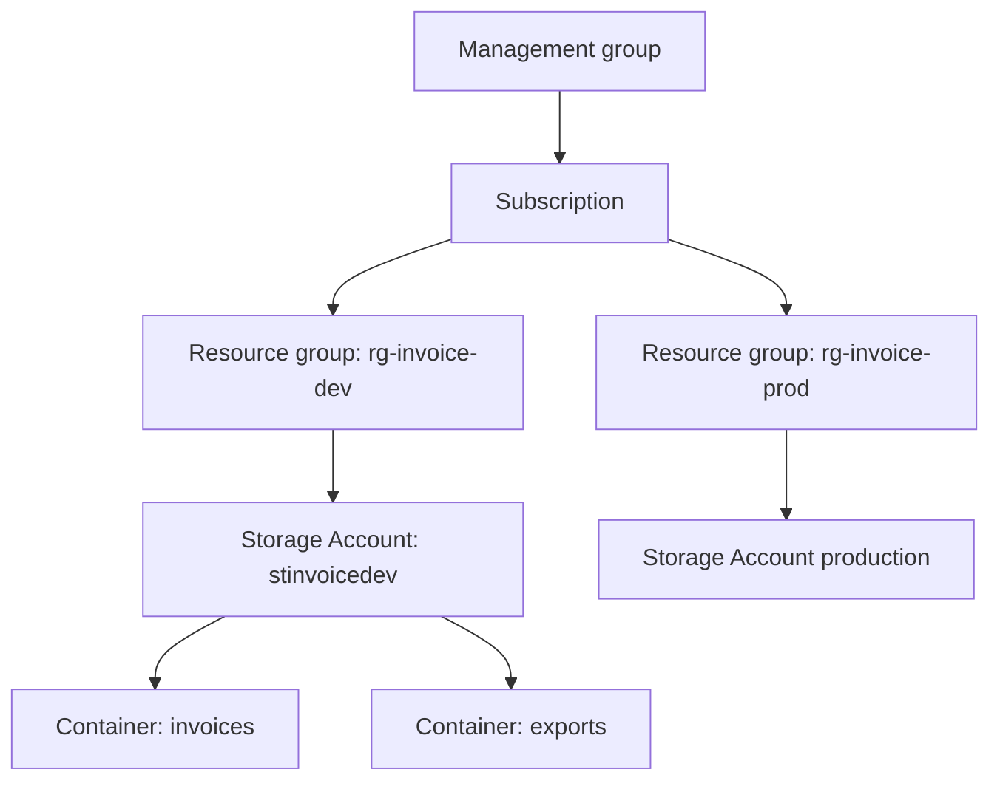

# Control plane, data plane và phạm vi phân quyền

Trong chương **Nền tảng Azure** của module **CLOUD_PROVIDERS_AZURE**, bài này giải thích cách tách quyền quản lý hạ tầng khỏi quyền sử dụng dữ liệu. Đây là cơ sở để phân quyền cho người vận hành, pipeline triển khai và ứng dụng khi làm việc với subscription, resource group, Microsoft Entra ID, mạng, dịch vụ tính toán và lưu trữ.

Xét một ứng dụng nhận hóa đơn: pipeline cần triển khai Storage Account, ứng dụng cần ghi tệp vào một container, còn nhân viên đối soát chỉ cần đọc các hóa đơn. Ba nhu cầu này liên quan cùng một tài nguyên nhưng cần những quyền khác nhau. Cấp quyền quản trị toàn bộ subscription cho cả ba chủ thể sẽ làm phạm vi tác động lớn hơn nhu cầu thực tế.

Sau bài học, bạn có thể:

- Phân loại một yêu cầu vào control plane hoặc data plane.
- Mô tả quyền theo ba thành phần: chủ thể, role và scope.
- Chọn phạm vi cấp quyền phù hợp, tính cả quyền kế thừa.
- Nhận ra các đường truy cập gián tiếp qua khóa và cấu hình.
- Kiểm tra quyền quản lý, quyền dữ liệu và đường mạng như các lớp riêng biệt.

## 1. Hai mặt phẳng của một tài nguyên Azure

**Control plane**, còn gọi là management plane, xử lý việc quản lý tài nguyên. **Data plane** xử lý việc sử dụng chức năng mà tài nguyên cung cấp.

Trong Azure public cloud, yêu cầu quản lý đi qua Azure Resource Manager, thường viết tắt là ARM, tại `https://management.azure.com`. Yêu cầu dữ liệu đi đến endpoint của dịch vụ, chẳng hạn `https://<account>.blob.core.windows.net`. Vì có đường phục vụ riêng, data plane có thể tiếp tục hoạt động khi control plane gặp sự cố; điều này không bảo đảm mọi sự cố đều được cô lập. [Nguồn: Control plane and data plane](https://learn.microsoft.com/en-us/azure/azure-resource-manager/management/control-plane-and-data-plane).

| Thao tác | Mặt phẳng | Điều cần phân biệt |
| --- | --- | --- |
| Tạo Storage Account hoặc đổi cấu hình của account | Control plane | Quản lý tài nguyên Azure |
| Tải nội dung một blob | Data plane | Sử dụng dữ liệu trong account |
| Tạo Key Vault hoặc sửa tag của vault | Control plane | Quản lý vault |
| Đọc giá trị một secret | Data plane | Sử dụng dữ liệu trong vault |

Tên công cụ không quyết định mặt phẳng. Azure Portal, CLI và SDK đều có thể phát sinh nhiều loại yêu cầu. Khi phân tích một thao tác, hãy xác định API được gọi, endpoint và hành động cần được cho phép.

Một thao tác ghi cũng có thể thuộc control plane: cập nhật tag là ghi cấu hình tài nguyên. Một thao tác đọc cũng có thể thuộc data plane: tải hóa đơn là đọc dữ liệu nghiệp vụ. Phân loại theo ý nghĩa của tài nguyên và API giúp tránh suy luận chỉ từ động từ “đọc”, “ghi” hay “xóa”.

## 2. Xác thực, phân quyền và chủ thể thực sự gọi dịch vụ

**Authentication — xác thực** trả lời “ai đang gọi?”. **Authorization — phân quyền** trả lời “chủ thể đó được làm gì?”. Với Key Vault, cả hai mặt phẳng dùng Microsoft Entra ID để xác thực nhưng kiểm tra quyền truy cập theo từng mặt phẳng. Một token hợp lệ vẫn có thể không đủ quyền thực hiện yêu cầu. [Nguồn: Key Vault access model](https://learn.microsoft.com/en-us/azure/key-vault/general/rbac-guide#key-vault-access-model-overview).

Azure RBAC có thể cấp role cho user, group, service principal hoặc managed identity. Một role assignment kết hợp **principal + role definition + scope**. [Nguồn: Azure RBAC](https://learn.microsoft.com/en-us/azure/role-based-access-control/overview).

Ví dụ thiết kế cho ứng dụng hóa đơn:

| Chủ thể | Nhu cầu | Quyền dự kiến |
| --- | --- | --- |
| Nhóm vận hành | Xem cấu hình để hỗ trợ ứng dụng | Quyền đọc quản lý tại môi trường phụ trách |
| Danh tính pipeline | Triển khai hạ tầng | Quyền quản lý cần thiết trong resource group ứng dụng |
| Managed identity của ứng dụng | Đọc và ghi hóa đơn | Quyền dữ liệu trên container hóa đơn |
| Nhóm đối soát | Đọc hóa đơn | Quyền đọc dữ liệu trên container hóa đơn |
| Nhóm quản trị truy cập | Cấp và thu hồi role | Quyền quản lý role assignment tại scope được giao |

Khi người phát triển đăng nhập trên máy cá nhân, principal là tài khoản của người đó. Khi ứng dụng chạy trên Azure bằng managed identity, principal là danh tính của ứng dụng. Một lần thử thành công dưới tài khoản người phát triển chưa chứng minh ứng dụng đã được cấp quyền đúng.

Cần phân biệt thêm **Azure RBAC roles** với **Microsoft Entra roles**. Azure RBAC quản lý quyền trên tài nguyên Azure; Entra roles quản lý các đối tượng thư mục như user, group và ứng dụng. Global Administrator không tự động đồng nghĩa với Owner trên mọi subscription. Việc nâng quyền quản lý tài nguyên của Global Administrator là một cơ chế riêng. [Nguồn: Azure roles và Microsoft Entra roles](https://learn.microsoft.com/en-us/azure/role-based-access-control/rbac-and-directory-admin-roles).

## 3. Scope xác định quyền có hiệu lực ở đâu

Azure RBAC có bốn mức scope chính: management group, subscription, resource group và resource. Quyền được gán ở mức cha được kế thừa xuống các mức con. Tài nguyên con do dịch vụ hỗ trợ có thể cung cấp phạm vi chi tiết hơn, chẳng hạn container trong Storage Account. [Nguồn: Scope trong Azure RBAC](https://learn.microsoft.com/en-us/azure/role-based-access-control/scope-overview).



Ví dụ các resource ID tương ứng:

```text
/subscriptions/<subscription-id>

/subscriptions/<subscription-id>/resourceGroups/rg-invoice-dev

/subscriptions/<subscription-id>/resourceGroups/rg-invoice-dev/providers/Microsoft.Storage/storageAccounts/stinvoicedev

/subscriptions/<subscription-id>/resourceGroups/rg-invoice-dev/providers/Microsoft.Storage/storageAccounts/stinvoicedev/blobServices/default/containers/invoices
```

Đường dẫn scope biểu diễn vị trí của tài nguyên trong cây quản lý, không phải URL để tải blob.

Trong sơ đồ trên:

- Gán quyền ở `rg-invoice-dev` có thể tác động đến các tài nguyên con của nhóm đó.
- Gán quyền trên container `invoices` không tự mở rộng sang container anh em `exports`.
- Quyền ở resource group development không tự lan sang resource group production.
- Nếu một principal đã có quyền rộng từ subscription, thêm một role hẹp ở container không làm quyền rộng biến mất.

Ví dụ, nhóm đối soát chỉ cần xem hóa đơn thì scope container `invoices` phù hợp hơn scope subscription. Tuy nhiên, kết luận “chỉ xem hóa đơn” chỉ đúng sau khi kiểm tra principal không nhận quyền rộng hơn qua group hoặc assignment ở scope cha.

Không nên dùng tên nhóm, tag `environment=dev` hay quy ước đặt tên để thay thế việc kiểm tra scope. Trong thiết kế này, ranh giới development/production phải được thể hiện bằng cấu trúc tài nguyên và các assignment thực tế.

## 4. Role định nghĩa loại thao tác nào được phép

Trong định nghĩa role:

| Field | Ý nghĩa |
| --- | --- |
| `Actions` | Quyền thao tác control plane |
| `NotActions` | Phần loại khỏi `Actions` của role đó |
| `DataActions` | Quyền data plane được dịch vụ tích hợp với Azure RBAC |
| `NotDataActions` | Phần loại khỏi `DataActions` của role đó |
| `AssignableScopes` | Nơi role có thể được gán, chưa phải một lần cấp quyền |

`NotActions` không phải lệnh cấm toàn cục. Role khác vẫn có thể cấp lại thao tác đã bị loại. Deny assignment là cơ chế riêng, cần được xét khi đánh giá quyền hiệu lực. [Nguồn: Azure role definitions](https://learn.microsoft.com/en-us/azure/role-based-access-control/role-definitions).

Ví dụ suy luận:

```text
Role A: cho phép đọc cấu hình Storage Account.
Role B: cho phép đọc blob trong container invoices.

Có A và B:
- Đọc cấu hình theo scope của A.
- Đọc blob theo scope của B.
- Không suy ra quyền ghi blob chỉ vì có hai role.
```

Một role có thể chứa cả quyền quản lý lẫn quyền dữ liệu. Vì vậy, khi chọn role, hãy xem định nghĩa quyền thay vì chỉ dựa vào tên có chữ “Reader”, “Contributor” hoặc “Data”.

## 5. Chọn role theo nhu cầu công việc

Các role quản lý thông dụng có phạm vi chức năng khác nhau:

| Role | Khả năng chính | Cách dùng trong ví dụ |
| --- | --- | --- |
| Reader | Xem tài nguyên và cấu hình quản lý | Nhóm hỗ trợ cần quan sát môi trường |
| Contributor | Quản lý tài nguyên, không cấp role Azure RBAC | Pipeline triển khai hạ tầng |
| Owner | Quản lý tài nguyên và cấp role | Quản trị có trách nhiệm rộng |
| Role Based Access Control Administrator | Quản lý quyền truy cập Azure RBAC | Nhóm quản trị phân quyền |

Các khả năng này phải được xét trong scope của assignment và các giới hạn áp dụng. [Nguồn: Các Azure role cơ bản](https://learn.microsoft.com/en-us/azure/role-based-access-control/rbac-and-directory-admin-roles#azure-roles).

Đối với Blob Storage:

| Role | Quyền dữ liệu điển hình |
| --- | --- |
| Storage Blob Data Reader | Đọc container và blob |
| Storage Blob Data Contributor | Đọc, ghi, xóa container và blob |
| Storage Account Contributor | Quản lý Storage Account; có quyền lấy account key |

Storage Blob Data Contributor chứa quyền xóa. Nếu yêu cầu chỉ là “ghi thêm hóa đơn”, cần đánh giá role này có quá rộng hay không trước khi chọn role tùy chỉnh. [Nguồn: Built-in roles cho Storage](https://learn.microsoft.com/en-us/azure/role-based-access-control/built-in-roles/storage).

Đối với Key Vault, **Key Vault Contributor** quản lý vault nhưng không trực tiếp cấp quyền đọc giá trị secret theo mô hình RBAC. **Key Vault Secrets User** cho phép đọc nội dung secret; **Key Vault Reader** chỉ đọc metadata phù hợp, không đọc giá trị secret. [Nguồn: Built-in roles cho Security](https://learn.microsoft.com/en-us/azure/role-based-access-control/built-in-roles/security).

Một cách chọn quyền có thể giải trình được là viết rõ câu yêu cầu trước: “managed identity của ứng dụng cần đọc blob trong container invoices của development”. Từ câu này mới chọn role và scope. Tránh bắt đầu từ “cấp Contributor cho xong” rồi tìm cách thu hẹp sau.

## 6. Quyền quản lý có thể tạo đường truy cập dữ liệu gián tiếp

### 6.1. Storage Account và account key

Việc không có `DataActions` đọc blob chưa đủ chứng minh một principal không thể tiếp cận dữ liệu. Với Blob Storage, quyền `Microsoft.Storage/storageAccounts/listkeys/action` cho phép lấy account key. Các role như Contributor hoặc Storage Account Contributor có thể bao gồm quyền này. Nếu Shared Key được chấp nhận, người có khóa có thể dùng đường xác thực bằng khóa để truy cập dữ liệu. [Nguồn: Quyền truy cập Blob trong Azure Portal](https://learn.microsoft.com/en-us/azure/storage/blobs/authorize-data-operations-portal).

Ví dụ hai đường truy cập cần được đánh giá độc lập:

```text
Đường A:
Principal -> Entra token -> kiểm tra data role -> blob

Đường B:
Principal -> quyền listKeys trên control plane
          -> lấy account key -> Shared Key -> blob
```

Thiết kế chỉ kiểm tra đường A sẽ bỏ sót đường B.

Với workload phù hợp, có thể chuyển sang Entra ID và vô hiệu hóa Shared Key sau khi đánh giá các client đang dùng. Khi Shared Key bị vô hiệu hóa, account SAS và service SAS bị từ chối; user delegation SAS cho Blob có cơ chế khác và vẫn có thể được chấp nhận theo quyền tương ứng. [Nguồn: Ngăn Shared Key authorization](https://learn.microsoft.com/en-us/azure/storage/common/shared-key-authorization-prevent).

Cần xem xét cả quyền sửa cấu hình của người vận hành. Nếu một principal có thể bật lại cơ chế xác thực bằng khóa hoặc thay đổi đường truy cập, việc tắt Shared Key tại một thời điểm chưa tạo thành sự phân tách trách nhiệm bền vững.

### 6.2. Key Vault và mô hình access policy cũ

Key Vault có mô hình data-plane authorization bằng Azure RBAC và mô hình access policy cũ. Với access policy, người có quyền quản lý vault thích hợp, bao gồm `Microsoft.KeyVault/vaults/write`, có thể cấu hình policy để tự cấp quyền dữ liệu. Vì vậy cần kiểm tra mô hình đang bật trên vault trước khi kết luận Contributor không tiếp cận được secret. Microsoft khuyến nghị dùng mô hình RBAC cho triển khai mới. [Nguồn: Key Vault access policy — legacy](https://learn.microsoft.com/en-us/azure/key-vault/general/assign-access-policy).

### 6.3. Áp dụng vào thiết kế trách nhiệm

Từ hai ví dụ trên, có thể rút ra nguyên tắc thiết kế: người có quyền thay đổi cơ chế cấp quyền hoặc thay đổi môi trường chạy ứng dụng có thể tác động đến đường truy cập dữ liệu.

Trong hệ thống hóa đơn, nên đánh giá riêng quyền triển khai hạ tầng, quyền sửa mã/cấu hình ứng dụng, quyền cấp role và quyền đọc dữ liệu. Một bảng role assignment đẹp chưa phản ánh đầy đủ các đường tiếp cận nếu pipeline vẫn có thể thay thế ứng dụng đang chạy bằng mã dùng danh tính của ứng dụng đó.

## 7. Quyền truy cập còn phụ thuộc vào mạng và quy tắc quản trị

### 7.1. Kết nối mạng và quyền dữ liệu

Với Azure Storage, client nằm trong nguồn mạng được cho phép vẫn phải đáp ứng yêu cầu authorization. Được firewall chấp nhận không tự cấp quyền đọc blob. Ngược lại, một principal có data role phù hợp vẫn có thể thất bại khi đường mạng bị chặn. [Nguồn: Storage network security](https://learn.microsoft.com/en-us/azure/storage/common/storage-network-security).

Key Vault cũng phân biệt truy cập mạng với quyền dùng secret. Khả năng quản lý vault qua ARM không chứng minh máy đang chạy ứng dụng có đường mạng phù hợp đến endpoint dữ liệu của vault. [Nguồn: Key Vault network security](https://learn.microsoft.com/en-us/azure/key-vault/general/network-security).

Trong ví dụ, ứng dụng có Storage Blob Data Contributor trên `invoices` nhưng DNS hoặc đường đến private endpoint không đúng vẫn có thể không truy cập được. Thêm Owner không sửa được nguyên nhân đường mạng đó.

### 7.2. Resource lock

Management lock áp dụng cho thao tác control plane, không khóa trực tiếp thao tác data plane. Đặt `CanNotDelete` trên Storage Account giúp ngăn xóa tài nguyên qua ARM nhưng không tự ngăn principal có quyền dữ liệu xóa blob. Một thao tác như lấy account key có thể bị ảnh hưởng bởi `ReadOnly` lock vì đó là thao tác quản lý. [Nguồn: Resource locks](https://learn.microsoft.com/en-us/azure/azure-resource-manager/management/lock-resources).

Do đó, bảo vệ account khỏi xóa nhầm và bảo vệ hóa đơn khỏi xóa nhầm là hai yêu cầu cần các biện pháp thích hợp riêng.

### 7.3. Azure Policy

Azure Policy đánh giá các quy tắc quản trị, chẳng hạn giới hạn region hoặc yêu cầu cấu hình theo chuẩn tổ chức. Một yêu cầu có đủ RBAC vẫn có thể bị policy áp dụng từ chối. Policy cũng không thay thế role cấp quyền đọc dữ liệu. Phải xem định nghĩa, effect và phạm vi hỗ trợ của policy cụ thể. [Nguồn: Azure Policy](https://learn.microsoft.com/en-us/azure/governance/policy/overview).

Với ứng dụng hóa đơn, có thể đặt yêu cầu “chỉ triển khai ở region được phê duyệt” song song với yêu cầu “chỉ nhóm đối soát được đọc hóa đơn”. Hai yêu cầu giải quyết hai khía cạnh khác nhau.

## 8. Thực hành: tách quyền xem account và quyền đọc blob

### 8.1. Điều kiện và mục tiêu

Ví dụ sau dùng **PowerShell với Azure CLI**, làm việc trên tài nguyên development đã tồn tại. Các lệnh là tài liệu thực hành để người học chạy trong môi trường của mình.

Chuẩn bị:

- Một Storage Account có container `invoices` và ít nhất một blob mẫu.
- Một user thử nghiệm riêng, không có role rộng hoặc quyền kế thừa khác.
- Một người quản trị có quyền tạo role assignment tại scope cần thiết.
- Đường mạng từ máy thử nghiệm đến Blob endpoint được cho phép.
- Không truyền account key, connection string hoặc SAS vào các lệnh thử quyền bằng Entra ID.

Mục tiêu là cấp cho user thử nghiệm Reader trên account và Storage Blob Data Reader trên đúng container. Reader phục vụ việc xem tài nguyên quản lý; data role phục vụ việc đọc blob.

### 8.2. Tạo hai assignment dưới danh tính quản trị

Thay toàn bộ giá trị mẫu trước khi chạy:

```powershell
$subscriptionId = "<subscription-id>"
$resourceGroup = "rg-invoice-dev"
$storageName = "<storage-account-name>"
$containerName = "invoices"
$testUserObjectId = "<object-id-of-test-user>"

az login
az account set --subscription $subscriptionId

$storageId = "/subscriptions/$subscriptionId/resourceGroups/$resourceGroup/providers/Microsoft.Storage/storageAccounts/$storageName"
$containerScope = "$storageId/blobServices/default/containers/$containerName"

az role assignment create --assignee-object-id $testUserObjectId --assignee-principal-type User --role "Reader" --scope $storageId

az role assignment create --assignee-object-id $testUserObjectId --assignee-principal-type User --role "Storage Blob Data Reader" --scope $containerScope

az role assignment list --assignee $testUserObjectId --scope $containerScope --include-inherited --all --query "[].{Role:roleDefinitionName,Scope:scope,Principal:principalId}" --output table
```

Lệnh `az role assignment create` thực sự thay đổi quyền truy cập. Người chạy phải có quyền `Microsoft.Authorization/roleAssignments/write` phù hợp. Tham số object ID trong ví dụ là object ID của **user thử nghiệm**; khi cấp cho service principal hoặc managed identity, cần dùng object ID và loại principal tương ứng. [Nguồn: Azure CLI role assignment](https://learn.microsoft.com/en-us/cli/azure/role/assignment?view=azure-cli-latest).

Danh sách trên là một đầu vào để kiểm tra assignment, chưa phải bằng chứng đầy đủ cho mọi quyền hiệu lực qua group, điều kiện hay cơ chế truy cập khác.

### 8.3. Chuyển sang tài khoản thử nghiệm

Dùng phiên CLI riêng hoặc đăng xuất khỏi tài khoản quản trị rồi đăng nhập user thử nghiệm. Khai báo lại các biến tài nguyên trong phiên mới nếu cần.

```powershell
az logout
az login
az account set --subscription $subscriptionId

# Yêu cầu quản lý: xem cấu hình Storage Account.
az storage account show --name $storageName --resource-group $resourceGroup --query "{name:name,location:location,id:id}" --output json

# Yêu cầu dữ liệu: liệt kê blob bằng tài khoản Entra đã đăng nhập.
az storage blob list --account-name $storageName --container-name $containerName --auth-mode login --query "[].name" --output table
```

`--auth-mode login` chọn đường đăng nhập Entra cho thao tác blob. Việc chỉ rõ chế độ xác thực giúp phép thử phản ánh quyền của tài khoản đăng nhập thay vì vô tình kiểm tra bằng khóa có sẵn. [Nguồn: Azure CLI storage blob](https://learn.microsoft.com/en-us/cli/azure/storage/blob?view=azure-cli-latest).

Nếu sử dụng Azure Portal để duyệt blob bằng Entra ID, cần cả quyền quản lý để điều hướng và data role thích hợp. Reader một mình không cho phép đọc nội dung blob. [Nguồn: Assign an Azure role for Blob data access](https://learn.microsoft.com/en-us/azure/storage/common/storage-auth-aad-rbac-portal).

### 8.4. Đọc kết quả theo từng lớp

| Phép thử trong môi trường đã chuẩn bị | Kết quả mong đợi |
| --- | --- |
| Xem cấu hình account đã được cấp Reader | Thành công |
| Liệt kê hoặc đọc blob trong `invoices` | Thành công |
| Ghi hoặc xóa blob bằng user chỉ có Data Reader | Bị từ chối |
| Đọc blob trong container anh em `exports` chưa được cấp quyền | Bị từ chối |
| Đọc dữ liệu production chưa được cấp quyền | Bị từ chối |

Các kỳ vọng này giả định container không cho truy cập công khai và user không có quyền bổ sung từ nguồn khác. Phép thử cần chứng minh được cả khả năng làm đúng việc và khả năng bị chặn ngoài phạm vi.

Không cần thử ghi hoặc xóa trên dữ liệu thật. Nếu kiểm tra các thao tác đó, dùng tài nguyên mẫu của development với dữ liệu có thể tạo lại.

## 9. Chẩn đoán lỗi truy cập theo thứ tự

Khi ứng dụng hoặc người dùng nhận lỗi, thu thập **principal, endpoint, thao tác, resource ID, thời điểm và request ID/correlation ID** trước khi thay đổi quyền.

Một luồng chẩn đoán có thể áp dụng cho ví dụ hóa đơn:

1. **Xác nhận danh tính.** Yêu cầu phát sinh từ user, pipeline hay managed identity nào? Có nhầm tenant hoặc đăng nhập bằng tài khoản quản trị không?
2. **Xác nhận mặt phẳng.** Lỗi xảy ra khi xem account qua ARM hay khi gọi Blob endpoint?
3. **Xác nhận phương thức xác thực.** Phép thử dùng Entra token, account key hay SAS?
4. **Xác nhận hành động và scope.** Role có quyền cho thao tác đang gọi không, và assignment có bao phủ đúng container không?
5. **Kiểm tra quyền bổ sung và giới hạn.** Xem assignment trực tiếp, qua group, kế thừa, điều kiện và deny assignment nếu có.
6. **Kiểm tra thời điểm cấp quyền.** Thay đổi RBAC có thể cần thời gian lan truyền; làm mới phiên/token khi thích hợp rồi thử lại.
7. **Kiểm tra đường mạng và cấu hình dịch vụ.** DNS, private endpoint, firewall và permission model có phù hợp không?

Không nên giải quyết lỗi bằng cách tăng lên Owner khi chưa xác định lớp đang từ chối. Khi RBAC vừa thay đổi, việc thử lại ngay có thể chưa phản ánh trạng thái mới. [Nguồn: Troubleshoot Azure RBAC](https://learn.microsoft.com/en-us/azure/role-based-access-control/troubleshooting).

Một lỗi 403 cần được đọc cùng mã lỗi chi tiết của dịch vụ. Cùng biểu hiện “không truy cập được”, trường hợp thiếu data role và trường hợp mạng bị chặn sẽ cần cách xử lý khác nhau.

## 10. Chọn đúng nguồn log để quan sát

**Activity Log** phục vụ quan sát các thao tác quản lý như triển khai hoặc thay đổi tài nguyên. Nó không ghi đầy đủ mọi yêu cầu đọc và không phải nhật ký hoàn chỉnh cho mọi lần xác thực/phân quyền bị ARM từ chối trước khi thao tác bắt đầu. Vì thế, không thấy sự kiện trong Activity Log chưa đủ kết luận yêu cầu chưa xảy ra. [Nguồn: Activity Log](https://learn.microsoft.com/en-us/azure/azure-monitor/fundamentals/activity-log).

**Resource logs** cung cấp chi tiết theo dịch vụ cho các thao tác bên trong tài nguyên. Cần cấu hình diagnostic settings và loại log phù hợp; nội dung và đích nhận log phụ thuộc dịch vụ. Không mặc định rằng việc đọc blob đã được lưu vào Log Analytics chỉ vì account xuất hiện trong Activity Log. [Nguồn: Resource logs](https://learn.microsoft.com/en-us/azure/azure-monitor/logs/resource-logs).

Trong hệ thống hóa đơn, thiết kế quan sát nên trả lời được hai câu riêng:

- Ai thay đổi cấu hình hoặc quyền của Storage Account?
- Principal nào đã truy cập dữ liệu, gọi thao tác gì và nhận kết quả nào?

Khi lưu log lâu hơn hoặc thu thập thêm loại log, cần tính chi phí thu thập, lưu trữ và truy vấn. Thông tin ghi lại phải đủ để điều tra nhưng tránh đưa nội dung hóa đơn, secret, token hoặc account key vào log ứng dụng.

## 11. Áp dụng thành một thiết kế phân quyền có thể vận hành

Với ứng dụng hóa đơn, một phương án khởi đầu là:

| Thành phần | Quyền và phạm vi đề xuất | Điều cần kiểm chứng |
| --- | --- | --- |
| Pipeline development | Quyền quản lý hạ tầng trong resource group development | Có quyền lấy khóa, sửa ứng dụng hay thay đổi cơ chế truy cập không? |
| Ứng dụng | Data role phù hợp trên container hóa đơn | Có thực sự cần xóa hay chỉ đọc/ghi? |
| Nhóm đối soát | Data Reader trên container hóa đơn | Có quyền khác từ subscription hoặc group không? |
| Nhóm hỗ trợ | Reader trên tài nguyên cần quan sát | Có cần xem dữ liệu nghiệp vụ không? |
| Nhóm quản trị truy cập | Quyền quản lý assignment tại scope được giao | Có thể tự cấp quyền vượt trách nhiệm không? |

Đây là phương án thiết kế cho tình huống minh họa, cần điều chỉnh theo yêu cầu của hệ thống. Nếu đưa toàn bộ ứng dụng vào một resource group chứa tài nguyên của nhiều nhóm, scope resource group có thể rộng hơn trách nhiệm của pipeline. Nếu dùng chung account cho nhiều loại dữ liệu, scope account có thể rộng hơn nhu cầu của ứng dụng.

Khi bàn giao quyền, nên ghi rõ principal ID, role, scope, lý do, chủ sở hữu nghiệp vụ và điều kiện thu hồi. Với mỗi yêu cầu, cần xác định cả đường quản lý lẫn đường dữ liệu, kiểm tra nguồn quyền kế thừa và thử dưới đúng danh tính chạy thực tế.

Khả năng triển khai tài nguyên, khả năng sử dụng dữ liệu và khả năng cấp quyền là ba trách nhiệm có liên hệ nhưng cần được mô tả rõ. Việc xác định đúng mặt phẳng, hành động và scope giúp triển khai Azure nhất quán hơn, điều tra lỗi nhanh hơn và giới hạn tác động khi một danh tính bị sử dụng sai.
