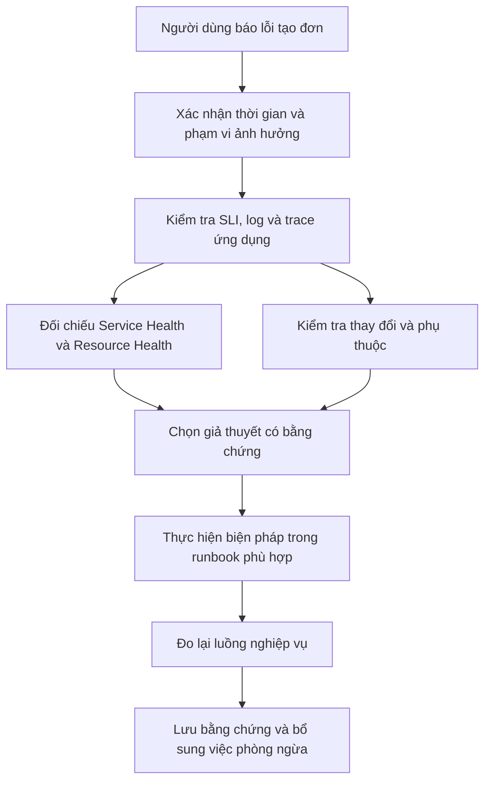

# Đọc tài liệu, SLA và trạng thái dịch vụ Azure

> Chương: Nền tảng Azure

Khi sử dụng Azure, bạn cần trả lời ba câu hỏi khác nhau: **dịch vụ được dùng như thế nào**, **nhà cung cấp cam kết điều gì** và **hệ thống đang gặp vấn đề gì**. Tài liệu kỹ thuật, thỏa thuận mức dịch vụ và thông tin sức khỏe dịch vụ lần lượt cung cấp các loại bằng chứng đó. Đọc đúng nguồn giúp bạn chọn dịch vụ, triển khai ứng dụng và điều tra sự cố mà không nhầm một hướng dẫn mẫu với một cam kết vận hành.

Trong bài này, các tỷ lệ dùng để tính toán đều là **số giả định phục vụ học tập**, không phải tỷ lệ SLA hiện hành của một dịch vụ Azure. Khi quyết định cho hệ thống thật, cần mở đúng tài liệu và điều khoản áp dụng cho dịch vụ, cấu hình và thời điểm liên quan.

## 1. Mục tiêu và tình huống thực tế

Sau bài học, bạn có thể:

- Chọn đúng loại tài liệu để tìm hiểu khái niệm, thực hiện thao tác hoặc tra cứu tham số.
- Kiểm tra phạm vi áp dụng: dịch vụ, SKU, hệ điều hành, region, phiên bản và trạng thái tính năng.
- Phân biệt SLA, SLO, SLI, RTO và RPO; đọc tỷ lệ khả dụng cùng các điều kiện đi kèm.
- Phân biệt Azure Status, Service Health, Resource Health và tín hiệu giám sát ứng dụng.
- Thu thập bằng chứng và tổ chức các bước xử lý khi ứng dụng chạy trên Azure gặp lỗi.

Tình huống xuyên suốt là một API bán hàng viết bằng Java, chạy trên Azure App Service, lưu dữ liệu đơn hàng trong Azure SQL Database và ảnh sản phẩm trong Blob Storage. Nhóm cần đọc tài liệu để triển khai đúng, đặt mục tiêu vận hành và xác định nguyên nhân khi người dùng không tạo được đơn hàng.

Ba câu hỏi cần được tách rõ:

| Câu hỏi | Nguồn nên bắt đầu | Kết quả cần có |
| --- | --- | --- |
| Làm thế nào triển khai API Java theo cấu hình dự định? | Tài liệu kỹ thuật của dịch vụ | Các bước, điều kiện và giới hạn phù hợp |
| Dịch vụ có cam kết nào đối với cấu hình đã chọn? | SLA và các điều khoản áp dụng | Phạm vi đo, điều kiện đủ và cơ chế xử lý khi không đạt |
| Vì sao người dùng đang gặp lỗi? | Giám sát ứng dụng kết hợp các nguồn sức khỏe Azure | Phạm vi ảnh hưởng, mốc thời gian và giả thuyết có bằng chứng |

## 2. Tìm và đọc tài liệu kỹ thuật có mục đích

### 2.1. Bắt đầu từ tên dịch vụ và câu hỏi cụ thể

[Trang tài liệu Azure trên Microsoft Learn](https://learn.microsoft.com/en-us/azure/) là điểm vào để tìm tài liệu theo sản phẩm, ví dụ mã và hướng dẫn kiến trúc.

Thay vì tìm chung chung “Azure Java”, hãy viết câu hỏi có phạm vi: “Ứng dụng Java đóng gói JAR của nhóm cần được triển khai lên App Service Linux như thế nào?” hoặc “Khi API mở nhiều kết nối cơ sở dữ liệu, cần kiểm tra giới hạn ở đâu?”.

Quy trình tìm kiếm gợi ý:

1. Xác định tên sản phẩm chính xác, chẳng hạn App Service hay Azure Functions.
2. Thêm tác vụ hoặc triệu chứng: triển khai Java, kết nối riêng, lỗi xác thực, giới hạn kết nối.
3. Mở kết quả chính thức và kiểm tra tiêu đề, phạm vi áp dụng, ngày cập nhật.
4. Đọc mục lục để đi đến phần trả lời câu hỏi, đồng thời đọc các điều kiện tiên quyết và ghi chú liên quan.
5. Theo các liên kết tới giới hạn, bảo mật hoặc độ tin cậy khi quyết định cần nhiều hơn một trang hướng dẫn.

Bài viết cộng đồng có thể giúp phát hiện một hướng điều tra, nhưng tên tham số, điều kiện hỗ trợ và kết luận về cam kết cần được đối chiếu với nguồn chính thức phù hợp.

### 2.2. Nhận diện loại tài liệu

Các nhãn dưới đây thường gặp trong tài liệu kỹ thuật; một số dịch vụ có thể tổ chức mục lục khác nhau:

| Loại nội dung | Câu hỏi thường trả lời | Cách sử dụng |
| --- | --- | --- |
| Overview | Dịch vụ giải quyết việc gì? | Đọc để xác định có đúng sản phẩm cần tìm không |
| Concepts | Thành phần hoạt động và liên hệ với nhau ra sao? | Đọc trước khi đưa ra quyết định kiến trúc |
| Quickstart | Làm cách nào có một ví dụ chạy được? | Dùng để học luồng tối thiểu, kiểm tra các giả định của ví dụ |
| Tutorial | Làm thế nào hoàn thành một kịch bản qua nhiều bước? | Theo dõi các tài nguyên và phụ thuộc được tạo qua từng bước |
| How-to guide | Thực hiện một tác vụ cụ thể ra sao? | Dùng khi đã hiểu bối cảnh và cần giải quyết một việc |
| Reference | Tên tham số, trường dữ liệu và kiểu trả về là gì? | Đối chiếu chính xác phiên bản công cụ hoặc API |
| Troubleshooting | Triệu chứng này có những nguyên nhân và cách kiểm tra nào? | So khớp với bằng chứng thu được từ môi trường của mình |
| Limits, quotas, support | Giới hạn và điều kiện sử dụng là gì? | Đọc trước khi chốt cấu hình và tải dự kiến |

Đây là cách phân loại để tổ chức việc đọc, không phải thứ tự bắt buộc. Khi xử lý lỗi, bạn có thể bắt đầu từ phần Troubleshooting rồi quay về Concepts để hiểu nguyên nhân.

### 2.3. Đọc điều kiện trước khi sao chép bước thực hiện

Ví dụ, [quickstart Java trên App Service](https://learn.microsoft.com/en-us/azure/app-service/quickstart-java) minh họa triển khai ứng dụng web Java bằng một cách đóng gói và môi trường cụ thể. Đó là điểm khởi đầu học thao tác; bạn vẫn cần đối chiếu ứng dụng thực tế với giả định của hướng dẫn.

Trước khi áp dụng bất kỳ mẫu nào, hãy trả lời:

- Tài liệu dùng Linux hay Windows, runtime tích hợp hay container tùy chỉnh?
- Ứng dụng mẫu và ứng dụng thật có cùng cách đóng gói, cách khởi động không?
- Tài liệu dùng công cụ nào và yêu cầu phiên bản nào?
- Tài khoản cần quyền ở subscription, resource group hay tài nguyên cụ thể?
- Các bước có tạo tài nguyên tính phí hoặc mở quyền truy cập công khai không?
- Sau khi thử, tài nguyên nào còn tồn tại và cần được quản lý?

Một quickstart hoàn thành thành công chỉ cho thấy kịch bản mẫu chạy được trong các điều kiện tương ứng. Nó chưa chứng minh ứng dụng đạt yêu cầu về bảo mật, khả năng phục hồi hoặc tải thật.

### 2.4. Phân biệt các loại phiên bản

Trong một hướng dẫn có thể xuất hiện nhiều phiên bản cùng lúc:

| Loại phiên bản | Ví dụ khái niệm | Vì sao cần kiểm tra |
| --- | --- | --- |
| Runtime ứng dụng | Phiên bản Java hoặc máy chủ ứng dụng | Mã và thư viện cần tương thích |
| SDK | Phiên bản thư viện mà mã gọi vào | API lập trình có thể khác giữa các phiên bản |
| Công cụ triển khai | Phiên bản CLI hoặc plugin | Tên và cách xử lý tùy chọn có thể thay đổi |
| API quản lý tài nguyên | Giá trị phiên bản API trong yêu cầu hoặc mô tả hạ tầng | Thuộc tính được chấp nhận phụ thuộc API |
| Tài liệu | Ngày cập nhật và nhánh nội dung | Một ví dụ cũ có thể không khớp môi trường hiện tại |

Không thể suy ra phiên bản runtime chỉ từ phiên bản API quản lý. Khi một tham số bị từ chối, hãy kiểm tra đúng lớp đang phát sinh lỗi thay vì nâng cấp mọi thứ cùng lúc.

## 3. Xác định tài liệu có áp dụng cho cấu hình của mình không

### 3.1. Lập một bản mô tả cấu hình ngắn

Trước khi đối chiếu tài liệu, ghi lại cấu hình cần đánh giá. Ví dụ dưới đây là mẫu ghi chép để học, không phải cấu hình triển khai:

```text
Khối lượng công việc: API bán hàng Java
Dịch vụ chạy API: Azure App Service
Môi trường: thử nghiệm
Hệ điều hành/cách đóng gói: cần xác nhận
Runtime: cần xác nhận
SKU hoặc gói dịch vụ: cần xác nhận
Region: cần xác nhận
Mạng và danh tính truy cập: cần xác nhận
Phụ thuộc: cơ sở dữ liệu, lưu trữ đối tượng, hệ thống danh tính
```

Các ô chưa xác nhận là thông tin còn thiếu, không phải chỗ để đoán. Chẳng hạn, một tính năng có trong tài liệu tổng quan không có nghĩa mọi SKU đều sử dụng được tính năng đó.

### 3.2. Những điều kiện dễ bị bỏ sót

- **Region:** dịch vụ hoặc một khả năng cụ thể có được cung cấp tại nơi dự định triển khai không?
- **SKU hoặc tier:** khả năng mở rộng, dự phòng, mạng và giới hạn có áp dụng cho gói đã chọn không?
- **Môi trường cloud:** trang đang mô tả Azure công cộng hay môi trường cloud có phạm vi riêng?
- **Trạng thái tính năng:** tính năng đã phát hành rộng rãi hay vẫn đang preview; điều kiện hỗ trợ và sử dụng là gì?
- **Quyền truy cập:** người thao tác có đủ quyền và ứng dụng có được cấp quyền dữ liệu cần thiết không?
- **Giới hạn và hạn mức:** giới hạn nào cố định, giới hạn nào có thể yêu cầu điều chỉnh?
- **Vòng đời:** có thông báo ngừng hỗ trợ, thay thế hoặc thay đổi không tương thích không?

Không áp dụng một quy tắc tuyệt đối rằng mọi preview đều có cùng điều kiện. Hãy tìm điều khoản và phạm vi hỗ trợ của đúng tính năng đang đánh giá.

### 3.3. Ghi kết luận có thể kiểm tra lại

Mỗi kết luận nên đi kèm nguồn và phạm vi. Ví dụ:

```text
Câu hỏi: Cấu hình dự định có đáp ứng yêu cầu triển khai API không?
Trang tài liệu: liên kết chính thức đã đọc
Ngày đọc và ngày cập nhật trên trang: ghi riêng từng loại
Phạm vi: dịch vụ, SKU, region, hệ điều hành, phiên bản
Điều kiện bắt buộc: liệt kê điều kiện đã xác nhận
Điểm còn thiếu: liệt kê việc cần kiểm tra tiếp
Kết luận: phù hợp / chưa đủ dữ kiện / không phù hợp vì lý do cụ thể
```

Ngày đọc không thay thế ngày hiệu lực của điều khoản. Tài liệu mới cập nhật cũng không tự động áp dụng cho mọi phiên bản hoặc mọi tài nguyên cũ.

## 4. SLA, SLO và SLI trả lời những câu hỏi khác nhau

### 4.1. Định nghĩa và ví dụ

| Khái niệm | Ý nghĩa | Ví dụ trong bài học |
| --- | --- | --- |
| SLA — Service Level Agreement | Thỏa thuận mức dịch vụ giữa bên cung cấp và khách hàng | Điều khoản của một dịch vụ về mức khả dụng trong phạm vi xác định |
| SLO — Service Level Objective | Mục tiêu chất lượng cụ thể cho một khối lượng công việc hoặc luồng nghiệp vụ | Nhóm đặt mục tiêu tỷ lệ tạo đơn thành công trong một kỳ đo |
| SLI — Service Level Indicator | Chỉ số đo để đánh giá mục tiêu | Số yêu cầu tạo đơn hợp lệ thành công chia số yêu cầu hợp lệ được quan sát |
| RTO — Recovery Time Objective | Thời gian gián đoạn tối đa có thể chấp nhận theo mục tiêu phục hồi | Nhóm cần phục hồi luồng tạo đơn trong khoảng thời gian đã thỏa thuận |
| RPO — Recovery Point Objective | Mức mất dữ liệu tối đa chấp nhận được, biểu diễn theo thời gian | Nhóm xác định có thể chấp nhận mất bao nhiêu phút dữ liệu |

Microsoft phân biệt các khái niệm này trong [hướng dẫn xác định mục tiêu độ tin cậy](https://learn.microsoft.com/en-us/azure/well-architected/reliability/metrics). Với hệ thống thực tế, cần đặt mục tiêu dựa trên luồng nghiệp vụ và đo từ trải nghiệm mà người dùng cần.

### 4.2. Đo đúng luồng nghiệp vụ

Ví dụ, một endpoint trả lời HTTP 200 cho câu hỏi “tiến trình có đang chạy không?” chưa chứng minh người dùng tạo được đơn hàng. Tiến trình Java có thể đang chạy trong khi kết nối cơ sở dữ liệu lỗi.

Bạn có thể đặt một SLI giả định như sau:

```text
SLI tạo đơn
  = số yêu cầu tạo đơn hợp lệ hoàn thành đúng trong ngưỡng thời gian
    / tổng số yêu cầu tạo đơn hợp lệ được quan sát
```

Cần định nghĩa thêm thế nào là yêu cầu hợp lệ, thành công và đúng thời gian. Một yêu cầu bị từ chối vì dữ liệu đầu vào không hợp lệ không nhất thiết là lỗi khả dụng; ngược lại, trả mã thành công nhưng không lưu được đơn hàng vẫn là thất bại nghiệp vụ.

Kỳ đo theo yêu cầu cũng khác kỳ đo theo thời gian. Một khoảng gián đoạn ngắn vào giờ cao điểm có thể tác động đến nhiều giao dịch hơn khoảng gián đoạn dài vào giờ ít người dùng.

### 4.3. SLA không phải thời gian khắc phục tối đa

Một tỷ lệ khả dụng theo kỳ không cho biết mỗi lần sự cố sẽ được sửa trong bao lâu. RTO là mục tiêu phục hồi của hệ thống; thời gian phản hồi hỗ trợ là một cam kết khác nếu được quy định trong gói hỗ trợ. Không nên dùng một trong các con số đó để thay cho hai khái niệm còn lại.

## 5. Đọc SLA cùng phạm vi và điều kiện

### 5.1. Tìm đúng văn bản

[Trang SLA cho Microsoft Online Services](https://www.microsoft.com/licensing/docs/view/Service-Level-Agreements-SLA-for-Online-Services) cung cấp các bản hiện hành và bản lưu trữ, bao gồm các cam kết về uptime và kết nối của dịch vụ trực tuyến Microsoft.

Khi đánh giá một dịch vụ Azure, hãy xác định phiên bản văn bản, thời điểm và thỏa thuận liên quan đến trường hợp của mình. Trang giới thiệu sản phẩm có thể giúp tìm điểm bắt đầu; kết luận về cam kết phải dựa trên điều khoản áp dụng.

Không dùng tỷ lệ SLA của sản phẩm có tên gần giống, của cấu hình khác hoặc của một bài viết cũ để kết luận cho tài nguyên đang vận hành.

### 5.2. Phiếu đọc SLA

| Mục cần tìm | Câu hỏi phải trả lời |
| --- | --- |
| Định danh dịch vụ | Điều khoản đang nói đến sản phẩm hoặc khả năng nào? |
| Đối tượng đo | Đo một tài nguyên, một endpoint, một thao tác hay một cấu hình triển khai? |
| Điều kiện cấu hình | Yêu cầu SKU, số instance, dự phòng hoặc cách phân bố tài nguyên nào? |
| Định nghĩa khả dụng | Sự kiện nào được coi là không khả dụng theo văn bản? |
| Kỳ đo và công thức | Đo theo tháng, theo yêu cầu hay theo cách khác được chỉ rõ? |
| Loại trừ | Những nguyên nhân hoặc khoảng thời gian nào được xử lý riêng? |
| Phạm vi trách nhiệm | Yếu tố nào thuộc nền tảng, cấu hình khách hàng hoặc hệ thống bên ngoài? |
| Cơ chế xử lý khi không đạt | Có service credit hay biện pháp nào khác, với điều kiện gì? |
| Yêu cầu hồ sơ | Cần bằng chứng, thủ tục, kênh gửi và thời hạn nào? |
| Phiên bản và ngày áp dụng | Văn bản nào có hiệu lực với trường hợp đang đánh giá? |

Đây là danh sách câu hỏi để đọc, không phải khẳng định rằng mọi dịch vụ có cùng điều khoản. Nếu chưa tìm được câu trả lời, ghi “chưa xác nhận” và tiếp tục đối chiếu.

Service credit, nếu được quy định và chấp thuận, là cơ chế theo điều khoản dịch vụ. Không nên tự suy ra đó là khoản hoàn tiền mặt, bồi thường toàn bộ thiệt hại kinh doanh hoặc kết quả tự động khi ứng dụng gặp lỗi.

### 5.3. Quy đổi tỷ lệ thành thời gian để hiểu quy mô

Giả sử một kỳ đo có 30 ngày và mô hình học tập coi mọi phút trong kỳ có trọng số bằng nhau:

```text
Tổng thời gian = 30 × 24 × 60 = 43.200 phút
Thời gian không đạt mục tiêu = tổng thời gian × (1 − tỷ lệ mục tiêu)
```

| Tỷ lệ giả định | Thời gian tương ứng trong kỳ 30 ngày |
| --- | --- |
| 99,9% | 43,2 phút, tức 43 phút 12 giây |
| 99,95% | 21,6 phút, tức 21 phút 36 giây |
| 99,99% | 4,32 phút, tức 4 phút 19,2 giây |

Bảng giúp cảm nhận khác biệt giữa các tỷ lệ. Nó không thay thế công thức SLA của dịch vụ: kỳ tính có thể khác, tiêu chí không khả dụng có định nghĩa riêng và một số dịch vụ sử dụng cách đo khác mô hình thời gian đơn giản này.

Không diễn giải 43,2 phút thành quyền được lên lịch dừng hệ thống, giới hạn cho một lần sự cố hoặc lời hứa rằng mọi sự cố đều ngắn hơn khoảng đó.

### 5.4. Error budget thuộc mục tiêu của nhóm

Giả sử nhóm chọn SLO theo thời gian là 99,9% cho một kỳ 30 ngày. Theo mô hình tính trên, phần thời gian không đạt mục tiêu tương ứng là 43,2 phút. Nhóm có thể dùng phần ngân sách lỗi này để theo dõi mức độ tiêu hao độ tin cậy và cân nhắc rủi ro khi triển khai thay đổi.

Error budget không tự trở thành điều khoản pháp lý của Azure. Nếu SLO đo theo tỷ lệ yêu cầu thành công, ngân sách lỗi phải được tính theo yêu cầu tương ứng; không đổi thẳng thành phút khi chưa có mô hình phù hợp.

## 6. Từ SLA từng dịch vụ đến độ tin cậy của ứng dụng

### 6.1. Nhiều phụ thuộc có thể làm giảm khả dụng của luồng

Giả sử một yêu cầu tạo đơn chỉ thành công khi cả API và cơ sở dữ liệu đều sẵn sàng. Trong mô hình đơn giản, nếu hai thành phần có độ khả dụng độc lập:

```text
A_luồng ≈ A_API × A_CSDL

Giả định: A_API = 0,9995 và A_CSDL = 0,9995
A_luồng ≈ 0,9995 × 0,9995
        = 0,99900025
        = 99,900025%
```

Phép tính cho thấy hai thành phần có cùng một tỷ lệ không làm luồng đạt tỷ lệ đó một cách mặc định. Nhưng kết quả trên chỉ là mô hình học tập, không phải SLA tổng hợp có tính hợp đồng.

Giới hạn của mô hình cần được ghi rõ:

- Hai con số là giả định về khả dụng thành phần trong cùng kỳ và cùng cách đo.
- Sự cố thực tế có thể tương quan do dùng chung region, mạng, danh tính hoặc cấu hình.
- Các phụ thuộc khác như DNS, kết nối người dùng và dịch vụ bên ngoài chưa được đưa vào phép tính.
- Hai SLA riêng có thể dùng định nghĩa và tiêu chí đo khác nhau, nên không thể cứ lấy tỷ lệ công bố nhân với nhau rồi coi là cam kết thực tế.
- Cơ chế dự phòng, bộ nhớ đệm hoặc xử lý bất đồng bộ có thể thay đổi điều kiện để một luồng nghiệp vụ thành công.

### 6.2. Chọn ranh giới đo theo điều người dùng cần

Nếu ảnh phụ không tải được nhưng người dùng vẫn đặt hàng, nhóm cần xác định đó là suy giảm trải nghiệm hay thất bại của SLO tạo đơn. Nếu thông báo gửi chậm nhưng đơn đã được lưu đúng, độ trễ thông báo có thể cần một SLO riêng.

Việc chia luồng như vậy giúp ưu tiên đúng. Không nên gộp tất cả chức năng thành một đèn xanh duy nhất, cũng không nên coi mọi lỗi phụ đều tương đương việc ngừng toàn bộ dịch vụ.

Khả năng chịu lỗi phụ thuộc vào thiết kế, cấu hình và vận hành bên cạnh những khả năng Azure cung cấp. [Tổng quan độ tin cậy trong Azure](https://learn.microsoft.com/en-us/azure/reliability/overview) trình bày vai trò của cả nền tảng và khối lượng công việc.

## 7. Chọn đúng nguồn trạng thái dịch vụ

### 7.1. Bốn lớp thông tin cần kết hợp

| Nguồn | Phạm vi trả lời | Cách dùng trong điều tra |
| --- | --- | --- |
| Azure Status | Thông tin công khai về các sự cố có phạm vi ảnh hưởng rộng | Kiểm tra bối cảnh chung, nhất là khi khó truy cập kênh cá nhân hóa |
| Service Health | Sự kiện dịch vụ, bảo trì và khuyến cáo liên quan môi trường Azure của khách hàng | Đối chiếu dịch vụ, subscription, region và thời gian ảnh hưởng |
| Resource Health | Sức khỏe tài nguyên cụ thể được hỗ trợ | Kiểm tra tài nguyên đang dùng và lịch sử sức khỏe liên quan |
| Giám sát ứng dụng | Chỉ số, log, trace và kết quả kiểm tra luồng người dùng | Xác nhận ảnh hưởng thật và vị trí lỗi trong ứng dụng |

Ba nguồn đầu được Microsoft giới thiệu trong [tổng quan Service Health](https://learn.microsoft.com/en-us/azure/service-health/overview). Lớp ứng dụng cần được thiết kế riêng để đo điều người dùng thực hiện được.

### 7.2. Azure Status: thông tin công khai

Từ [hướng dẫn Azure Status](https://learn.microsoft.com/en-us/azure/service-health/azure-status-overview), bạn có thể đi tới trang trạng thái công khai hiện hành. Trang này phục vụ thông tin về các sự cố có ảnh hưởng rộng và một số tình huống cần thông báo công khai.

Vì vậy, không có sự cố được hiển thị trên trang công khai chưa đủ để kết luận tài nguyên của bạn hoạt động bình thường. Hãy tiếp tục xem nguồn cá nhân hóa và dữ liệu ứng dụng.

Khi đọc một thông báo, chú ý phạm vi dịch vụ, vùng, thời điểm cập nhật và mô tả ảnh hưởng. Một tiêu đề có tên dịch vụ bạn dùng chưa đủ chứng minh chính sự kiện đó gây ra lỗi của ứng dụng.

### 7.3. Service Health: sự kiện liên quan môi trường

Service Health giúp theo dõi sự cố dịch vụ, bảo trì đã lên kế hoạch và các khuyến cáo liên quan. Khi xem thông tin, cần chọn đúng subscription và phạm vi liên quan. [FAQ Service Health](https://learn.microsoft.com/en-us/azure/service-health/service-health-faq) giải thích sự khác nhau giữa nguồn này với trang trạng thái công khai và Resource Health.

Một cách đọc có hệ thống:

1. Kiểm tra các bộ lọc trước khi kết luận không có sự kiện.
2. Đọc dịch vụ và region được nêu, đối chiếu với tài nguyên ứng dụng sử dụng.
3. So sánh thời điểm bắt đầu ảnh hưởng với log và cảnh báo của nhóm.
4. Ghi mã theo dõi sự kiện, thời điểm cập nhật và hướng dẫn hành động nếu có.
5. Theo dõi các cập nhật tiếp theo, đồng thời tiếp tục kiểm tra trải nghiệm người dùng.

Đây là quy trình điều tra gợi ý. Một sự kiện trùng thời gian là bằng chứng tương quan; bạn vẫn cần kiểm tra đường đi yêu cầu và phụ thuộc để xác định mối liên hệ.

### 7.4. Resource Health: sức khỏe một tài nguyên

[Resource Health](https://learn.microsoft.com/en-us/azure/service-health/resource-health-overview) dùng tín hiệu của dịch vụ để đánh giá tài nguyên cụ thể. Các trạng thái được mô tả gồm:

| Trạng thái | Cách hiểu cơ bản |
| --- | --- |
| Available | Không phát hiện sự kiện ảnh hưởng sức khỏe tài nguyên theo tín hiệu của dịch vụ |
| Unavailable | Phát hiện sự kiện đang ảnh hưởng sức khỏe, có thể liên quan nền tảng hoặc nguyên nhân ngoài nền tảng |
| Degraded | Tài nguyên vẫn dùng được nhưng có suy giảm theo tiêu chí của loại tài nguyên |
| Unknown | Chưa có đủ thông tin cập nhật để kết luận tình trạng tài nguyên |

Khả năng hỗ trợ và tiêu chí đánh giá phụ thuộc loại tài nguyên. Unknown không tự chứng minh tài nguyên đã hỏng; Available cũng không xác nhận mọi chức năng nghiệp vụ của ứng dụng đều đúng.

### 7.5. Giám sát ứng dụng: kiểm tra điều nền tảng không biết

Một API có thể trả lỗi do hết kết nối cơ sở dữ liệu, cấu hình sai quyền, lỗi mã hoặc dịch vụ bên ngoài gặp vấn đề. Các nguyên nhân đó cần được kiểm tra bằng tín hiệu phù hợp:

- Tỷ lệ thành công và thời gian xử lý của từng luồng quan trọng.
- Log lỗi và trace liên kết yêu cầu với lời gọi phụ thuộc.
- Chỉ số sử dụng tài nguyên và kết nối.
- Kết quả kiểm tra tổng hợp từ góc nhìn gần người sử dụng.
- Các thay đổi triển khai, cấu hình, quyền hoặc chứng thư trước thời điểm lỗi.

Không chọn giữa trạng thái nền tảng và log ứng dụng như hai bằng chứng loại trừ nhau. Chúng quan sát các lớp khác nhau và giúp thu hẹp giả thuyết khi được đặt trên cùng dòng thời gian.

## 8. Quy trình xử lý khi API Java gặp lỗi

### 8.1. Bắt đầu từ ảnh hưởng có thể quan sát

Giả sử người dùng báo không tạo được đơn hàng. Quy trình gợi ý sau không yêu cầu bạn thay đổi cấu hình ngay:



### 8.2. Thu thập dữ kiện tối thiểu

| Dữ kiện | Ví dụ cách ghi | Vì sao hữu ích |
| --- | --- | --- |
| Thời gian bắt đầu và kết thúc ảnh hưởng | Timestamp kèm múi giờ rõ ràng | Đối chiếu được với thông báo và log |
| Tài nguyên và môi trường | Resource ID, subscription, region, môi trường | Tránh điều tra nhầm tài nguyên |
| Luồng bị ảnh hưởng | Tạo đơn lỗi, xem sản phẩm vẫn được | Xác định ưu tiên và phạm vi |
| Triệu chứng | Mã phản hồi, loại exception, độ trễ | Hướng tới lớp cần kiểm tra |
| Mã liên kết | Request ID hoặc trace ID nếu có | Lần theo chuỗi xử lý |
| Thay đổi gần nhất | Phiên bản triển khai, thay đổi quyền hoặc mạng | Tìm giả thuyết liên quan thay đổi |
| Sự kiện nền tảng | Mã theo dõi và nội dung liên quan | Liên kết với thông tin từ nhà cung cấp |

Không đưa mật khẩu, token, khóa truy cập hoặc dữ liệu khách hàng không cần thiết vào ghi chép sự cố. Khi cung cấp log hỗ trợ, lọc thông tin theo yêu cầu điều tra và quy trình của tổ chức.

### 8.3. Chuẩn hóa thời gian

Azure và các công cụ vận hành có thể hiển thị thời gian theo cách khác nhau. Hãy ghi rõ timezone, đồng thời thống nhất một trục thời gian chung khi so sánh.

Ví dụ giả định:

```text
Thời điểm quan sát: 2026-01-15T09:00:00+07:00
Cùng thời điểm UTC: 2026-01-15T02:00:00Z
```

Nếu một biểu đồ bắt đầu lỗi lúc 09:00 giờ Việt Nam và thông báo ghi 02:00 UTC, hai mốc có thể trùng nhau. Nếu bỏ thông tin múi giờ, bạn có thể đánh giá sai sự tương quan.

### 8.4. Tình huống A: không có sự kiện nền tảng phù hợp

Giả sử Service Health không có sự kiện khớp phạm vi và Resource Health không phát hiện vấn đề, nhưng trace API cho thấy lỗi xác thực khi gọi cơ sở dữ liệu.

Bước tiếp theo hợp lý là kiểm tra danh tính và cấu hình kết nối của ứng dụng, các thay đổi quyền gần nhất và lỗi chi tiết. Trạng thái nền tảng là một đầu mối, không phải lý do để bác bỏ báo cáo của người dùng.

Trong tình huống này, tự động khởi động lại mọi tài nguyên có thể không sửa được quyền truy cập và còn làm mất một số bằng chứng hữu ích. Chọn hành động dựa trên giả thuyết đang kiểm tra.

### 8.5. Tình huống B: có sự kiện dịch vụ phù hợp

Giả sử Service Health thông báo sự cố của dịch vụ cơ sở dữ liệu tại region liên quan và thời gian khớp với lỗi kết nối của API.

Nhóm ghi lại mã sự kiện, đối chiếu tài nguyên, theo dõi cập nhật và thực hiện biện pháp đã được chuẩn bị trong runbook. Tùy thiết kế, biện pháp có thể là giảm chức năng phụ, hạn chế thử lại hoặc chuyển sang phương án dự phòng đã kiểm tra.

Không thực hiện failover chỉ vì nhìn thấy một thông báo sự cố. Cần đánh giá điều kiện chuyển đổi, quyền quyết định, tính nhất quán dữ liệu và tác động theo RTO/RPO. Một thao tác phục hồi chưa được chuẩn bị có thể làm tình hình phức tạp hơn.

### 8.6. Xác nhận phục hồi bằng luồng người dùng

Khi thông báo nền tảng được cập nhật, hãy kiểm tra lại API từ góc nhìn nghiệp vụ: tạo đơn có thành công, dữ liệu có đúng và tác vụ phía sau có xử lý được phần tồn đọng không?

Việc giảm lỗi trong vài phút chưa đủ để khẳng định toàn bộ hệ thống đã ổn định. Cần theo dõi trong khoảng phù hợp với chu kỳ tải, đồng thời kiểm tra các dấu hiệu còn lại như hàng đợi tăng, kết nối cạn hoặc giao dịch cần đối soát.

## 9. Chủ động nhận thông báo và phân công xử lý

### 9.1. Kết hợp cảnh báo nền tảng với cảnh báo ứng dụng

Không nên chỉ mở trang trạng thái khi người dùng đã báo lỗi. Nhóm cần có người chịu trách nhiệm đọc thông báo, đánh giá tác động và thực hiện hành động khi cần.

Azure hỗ trợ [tạo cảnh báo Service Health](https://learn.microsoft.com/en-us/azure/service-health/alerts-activity-log-service-notifications-portal) theo phạm vi và loại thông báo. Việc cấu hình cần đúng quyền và kênh nhận; cảnh báo Service Health không thay cho cảnh báo Resource Health hoặc cảnh báo chất lượng ứng dụng.

Các lớp cảnh báo phục vụ những mục tiêu khác nhau:

- **Sự kiện dịch vụ:** biết có thông báo nền tảng liên quan.
- **Sức khỏe tài nguyên:** biết tài nguyên cụ thể có thay đổi trạng thái được phát hiện.
- **SLI ứng dụng:** biết tỷ lệ thành công hoặc độ trễ luồng nghiệp vụ đang không đạt mong muốn.
- **Năng lực và phụ thuộc:** biết xu hướng tải, giới hạn hoặc tác vụ tồn đọng trước khi ảnh hưởng lớn.

### 9.2. Thiết kế quy trình nhận và hành động

Với mỗi cảnh báo, ghi rõ:

1. Phạm vi tài nguyên và môi trường được theo dõi.
2. Tín hiệu hoặc loại sự kiện gây cảnh báo.
3. Người hoặc nhóm nhận, cùng cách chuyển cấp khi cần.
4. Hành động kiểm tra đầu tiên và đường dẫn runbook.
5. Cách xác nhận cảnh báo đã được xử lý.
6. Cách kiểm tra định kỳ để biết kênh nhận còn hoạt động.

Không cần để mỗi tín hiệu gọi người trực ngay lập tức. Một thông báo bảo trì trong tương lai thường cần lập kế hoạch; một lỗi liên tục ở luồng tạo đơn đang hoạt động có thể cần phản ứng sớm hơn. Phân loại theo tác động giúp cảnh báo có giá trị.

## 10. Từ sự cố đến cải thiện tài liệu và kiến trúc

Sau khi giảm ảnh hưởng, nhóm nên tổ chức lại dữ kiện thành một bản ghi có thể dùng cho lần sau:

```text
Luồng và tài nguyên bị ảnh hưởng
Thời gian: phát hiện → xác nhận → giảm ảnh hưởng → phục hồi
Bằng chứng: chỉ số, trace, mã sự kiện và thay đổi liên quan
Nguyên nhân đã xác nhận và giả thuyết còn mở
Biện pháp đã làm và kết quả quan sát
Việc phòng ngừa: chủ sở hữu, mục tiêu và cách kiểm chứng
```

Phân biệt **triệu chứng**, **biện pháp giảm ảnh hưởng** và **nguyên nhân**. “Khởi động lại thì hết lỗi” mô tả kết quả một hành động; nó chưa giải thích vì sao lỗi xuất hiện.

Nếu cần đánh giá yêu cầu theo SLA, giữ các bằng chứng về tài nguyên, cấu hình, khoảng thời gian và sự kiện liên quan, rồi đối chiếu thủ tục trong điều khoản áp dụng. Không tự đánh dấu vi phạm SLA chỉ dựa vào một đợt tăng HTTP 500.

Nhóm cũng cần cập nhật runbook khi phát hiện hướng dẫn cũ không còn phù hợp. Một runbook hữu ích chỉ ra cách xác nhận phạm vi, điều kiện thực hiện hành động và cách đo kết quả; nó không chỉ là danh sách lệnh.

## 11. Thực hành đọc tài liệu mà chưa cần tạo tài nguyên

### 11.1. Chuẩn bị bài thực hành

Chọn một dịch vụ trong kiến trúc minh họa, chẳng hạn App Service. Mục tiêu là lập hồ sơ đọc và xác định thông tin còn thiếu. Bạn không cần triển khai ứng dụng hoặc tạo cảnh báo để hoàn thành bài tập này.

### 11.2. Các bước thực hiện

1. Mở trang tài liệu chính thức của dịch vụ từ Microsoft Learn.
2. Tìm một trang tổng quan, một hướng dẫn phù hợp với ứng dụng Java và một trang về giới hạn hoặc độ tin cậy.
3. Ghi rõ môi trường, runtime và cấu hình mà hướng dẫn đang nói đến.
4. Tìm đường dẫn tới SLA; xác định điều kiện nào cần có trước khi kết luận cho cấu hình dự định.
5. Đọc cách xem Service Health và Resource Health; ghi lại hai nguồn này quan sát những phạm vi nào.
6. Đề xuất một SLI cho luồng tạo đơn và hai loại bằng chứng cần thu khi xảy ra lỗi.
7. Liệt kê điểm đã xác nhận và điểm cần kiểm tra tiếp, kèm liên kết nguồn.

### 11.3. Mẫu kết quả

| Nội dung | Kết quả cần điền |
| --- | --- |
| Câu hỏi kỹ thuật | Tác vụ hoặc quyết định cụ thể cần hỗ trợ |
| Phạm vi | Dịch vụ, region, SKU, hệ điều hành, runtime |
| Nguồn | URL chính thức, ngày đọc và ngày cập nhật nếu có |
| Điều kiện tài liệu | Quyền, phụ thuộc, giới hạn và cấu hình cần thiết |
| Phạm vi SLA | Đối tượng đo, kỳ đo, điều kiện cấu hình đã tìm thấy |
| Phần chưa xác nhận | Điều kiện còn thiếu, chưa có tài nguyên hoặc chưa đủ dữ liệu |
| SLI ứng dụng | Định nghĩa tử số, mẫu số và kỳ đo |
| Kịch bản lỗi | Triệu chứng, nguồn cần xem và bằng chứng cần thu |

Kết quả tốt có thể là “chưa đủ dữ kiện để kết luận SLA vì chưa chọn SKU”. Kết luận có điều kiện và biết rõ phần còn thiếu đáng tin cậy hơn một tỷ lệ được sao chép mà không có phạm vi.

## 12. Các nhầm lẫn thường gặp

| Nhận định | Cách hiểu đúng |
| --- | --- |
| Quickstart là kiến trúc sẵn sàng vận hành thật | Đây là ví dụ có phạm vi và giả định; cần đánh giá thêm các yêu cầu thực tế |
| Một tính năng có trong tài liệu thì mọi cấu hình đều dùng được | Cần đối chiếu region, SKU, phiên bản và các điều kiện đi kèm |
| SLA của một dịch vụ là SLO của toàn bộ ứng dụng | SLO của luồng cần tính đến trải nghiệm người dùng và các phụ thuộc |
| Tỷ lệ khả dụng cho biết tối đa bao lâu sẽ sửa xong sự cố | Tỷ lệ theo kỳ khác mục tiêu phục hồi và thời gian phản hồi hỗ trợ |
| Trang trạng thái công khai không có sự cố thì ứng dụng chắc chắn bình thường | Cần đối chiếu nguồn cá nhân hóa, tài nguyên và tín hiệu ứng dụng |
| Resource Health Available chứng minh nghiệp vụ chạy đúng | Sức khỏe tài nguyên không bao quát mọi lỗi logic và phụ thuộc |
| Có sự kiện Azure trùng giờ là đã xác định nguyên nhân | Cần kiểm tra phạm vi ảnh hưởng và bằng chứng từ luồng thực tế |
| Đáp ứng SLA là đủ, không cần kế hoạch phục hồi | Mục tiêu vận hành cần cả khả năng chịu lỗi và phục hồi theo yêu cầu |

## 13. Câu hỏi tự kiểm tra và gợi ý trả lời

**1. Tài liệu mẫu sử dụng cấu hình khác cấu hình dự định của bạn. Có thể áp dụng nguyên xi không?**

Chưa nên kết luận. Hãy kiểm tra điều kiện tiên quyết, runtime, hệ điều hành, SKU và những bước phụ thuộc cấu hình. Cần xác định phần nào áp dụng được và phần nào cần hướng dẫn khác.

**2. Một mục tiêu giả định 99,95% tương ứng bao nhiêu thời gian trong kỳ 30 ngày theo mô hình thời gian đơn giản?**

43.200 × 0,0005 = 21,6 phút. Kết quả phục vụ học cách quy đổi; khi đánh giá SLA thật phải dùng định nghĩa và công thức trong điều khoản.

**3. API và cơ sở dữ liệu đều có tỷ lệ giả định 99,95%. Luồng có tự đạt 99,95% không?**

Không thể kết luận như vậy. Trong mô hình phụ thuộc nối tiếp và độc lập, tích hai tỷ lệ là 99,900025%. Trong hệ thống thật, còn phải xét tương quan sự cố, các phụ thuộc khác và thiết kế phục hồi.

**4. Người dùng không tạo được đơn hàng nhưng trang Azure Status không có thông báo. Nên làm gì?**

Xác nhận triệu chứng và thời gian; xem SLI, log, trace và phụ thuộc; đối chiếu Service Health, Resource Health và thay đổi gần nhất. Không bỏ qua sự cố chỉ vì trang công khai chưa hiển thị sự kiện.

**5. Resource Health hiển thị Unknown có nghĩa tài nguyên chắc chắn ngừng hoạt động không?**

Không. Trạng thái này cho biết thiếu thông tin để đánh giá; cần kiểm tra tài nguyên và tín hiệu ứng dụng trước khi kết luận.

**6. Khi nào có thể nói một đợt lỗi thuộc phạm vi yêu cầu theo SLA?**

Khi đã đối chiếu đúng điều khoản áp dụng, điều kiện cấu hình, định nghĩa sự cố và bằng chứng liên quan. Việc được xử lý theo cơ chế nào còn phải tuân theo thủ tục và kết quả đánh giá tương ứng.

**7. Dữ kiện nào nên ghi ngay khi sự cố bắt đầu?**

Luồng bị ảnh hưởng, timestamp có múi giờ, tài nguyên và môi trường, triệu chứng, mã liên kết yêu cầu, các thay đổi gần nhất và mã sự kiện nền tảng nếu có. Những dữ kiện này giúp điều tra và kiểm tra lại kết luận.

**8. Sau khi nền tảng báo đã giảm ảnh hưởng, điều gì xác nhận ứng dụng phục hồi?**

Kết quả đo luồng nghiệp vụ, sự đúng đắn của dữ liệu và trạng thái các tác vụ phía sau. Thông báo nền tảng là đầu vào để đối chiếu; nhóm vẫn cần quan sát hệ thống của mình.
