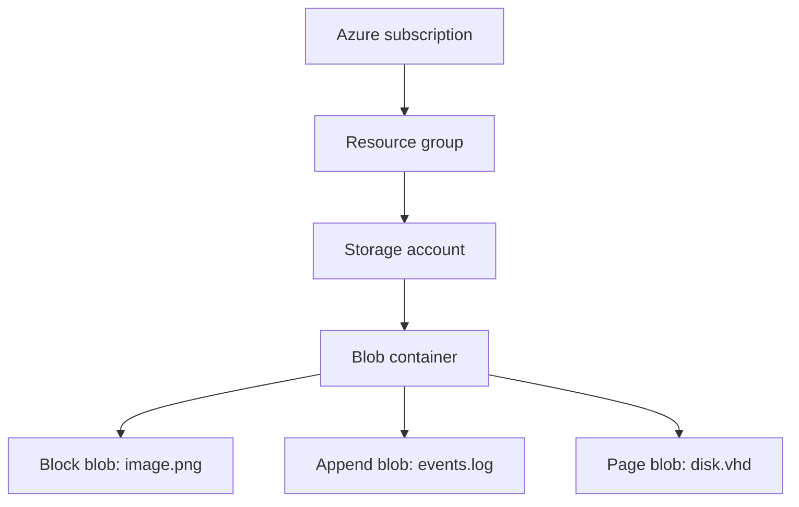
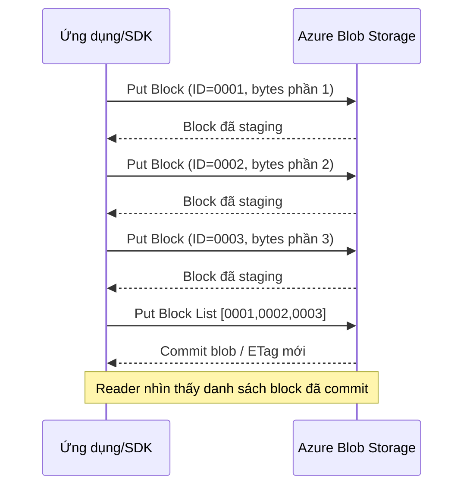
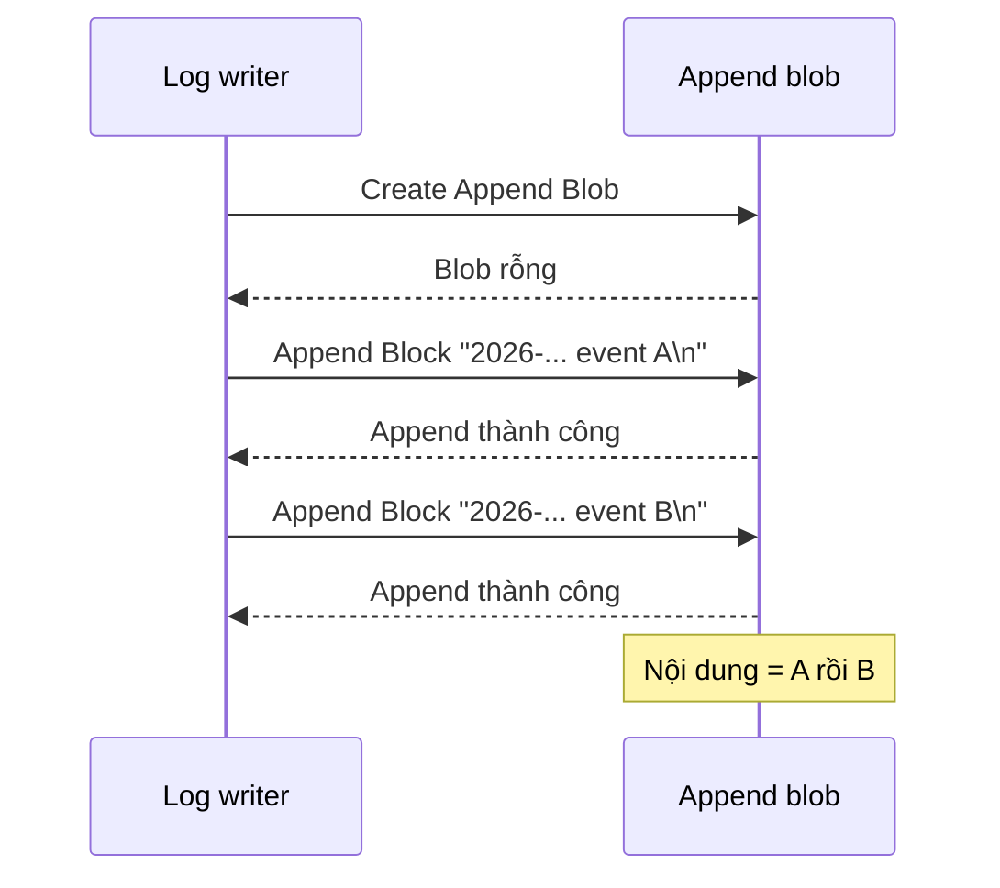
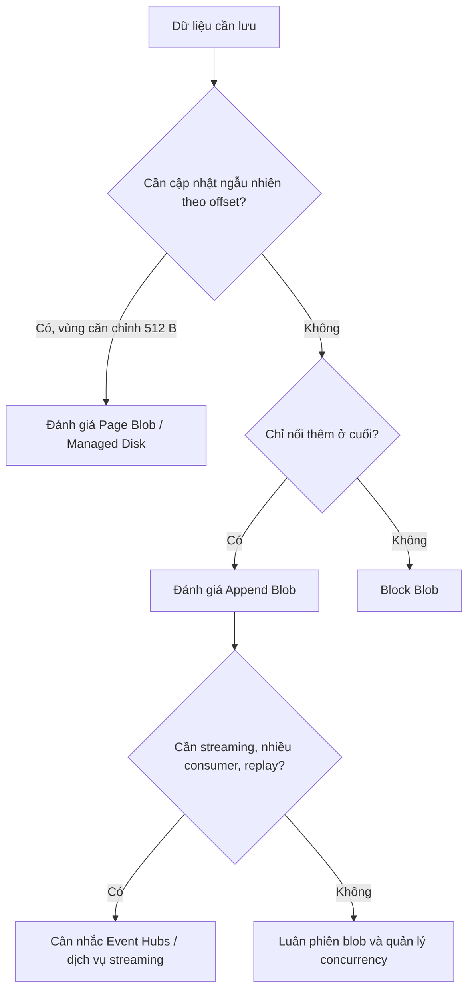
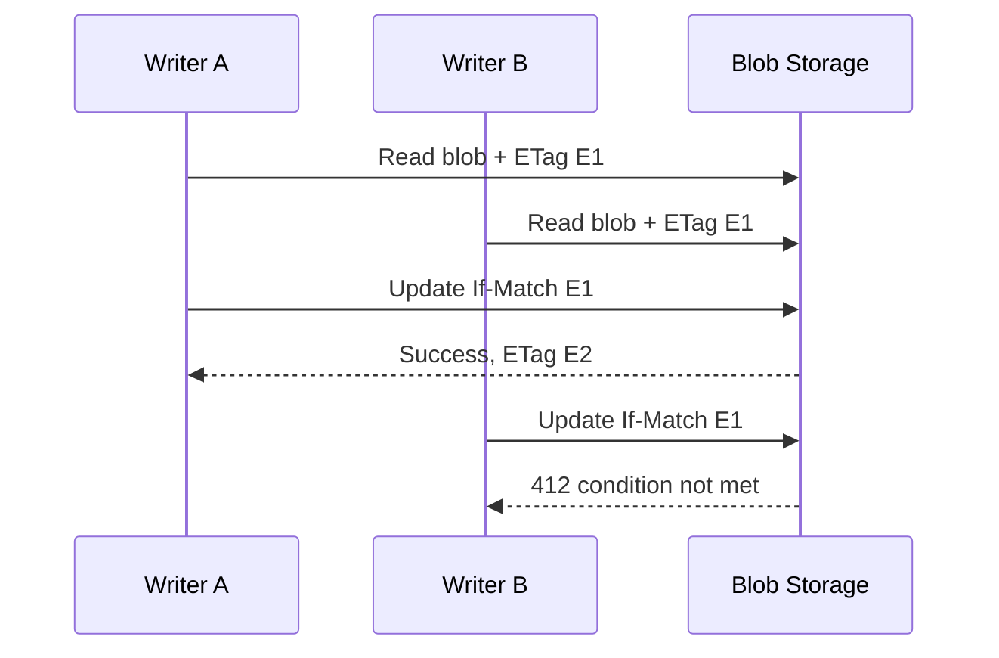
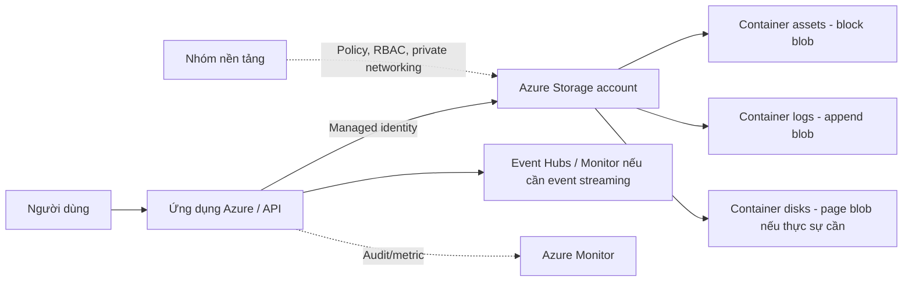

# Block blob, append blob và page blob

Khi xây dựng một ứng dụng trên Microsoft Azure, nhóm phát triển thường cần lưu các loại dữ liệu rất khác nhau: ảnh sản phẩm để người dùng tải về, các bản ghi được bổ sung liên tục và dữ liệu dạng đĩa ảo có thể ghi đè từng vùng. **Azure Blob Storage** cung cấp ba loại blob chính — **block blob, append blob và page blob** — để xử lý các kiểu truy cập đó. Chúng đều là đối tượng lưu trữ trong container nhưng khác đáng kể về cách ghi, cập nhật, giới hạn và bài toán sử dụng.

Bài học thuộc chương **Lưu trữ đối tượng với Blob Storage**, trong module **CLOUD_PROVIDERS_AZURE**. Nội dung đặt Blob Storage vào kiến trúc Azure hoàn chỉnh: storage account được quản lý dưới subscription và resource group; ứng dụng dùng danh tính Microsoft Entra ID hoặc managed identity để truy cập; mạng ảo, private endpoint, phân quyền dữ liệu, giám sát và chi phí đều ảnh hưởng đến thiết kế. Mục tiêu không chỉ là nhớ định nghĩa ba loại blob mà còn biết **chọn đúng loại, gọi đúng thao tác và dự đoán hành vi khi có lỗi hoặc nhiều người ghi đồng thời**.

Sau khi học, bạn có thể:

- Phân biệt mục đích và mô hình ghi của block, append và page blob.
- Giải thích các thao tác `Put Block`/`Put Block List`, `Append Block` và `Put Page`.
- Chọn loại blob cho ảnh, tài liệu, bản sao lưu, nhật ký nối thêm và dữ liệu đĩa ảo.
- Thiết kế kiểm soát đồng thời, retry, phân quyền và kết nối mạng phù hợp.
- Tạo và thao tác ba loại blob bằng Azure SDK trong một bài thực hành có kiểm soát.
- Nhận diện các sai lầm về access tier, tính bất biến, giới hạn kích thước và chi phí.

## 1. Bức tranh tổng thể của Azure Blob Storage

**Blob (Binary Large Object)** là một đối tượng lưu trữ dữ liệu phi cấu trúc hoặc bán cấu trúc, chẳng hạn file ảnh, tệp JSON, video, log hay nội dung nhị phân. Khi lưu vào Azure Blob Storage, bạn không nhất thiết phải triển khai và tự vận hành một file server.

Quan hệ tổ chức cơ bản:



- **Storage account** cung cấp namespace và cấu hình liên quan như độ dự phòng, chính sách mạng, mã hóa và giám sát.
- **Container** nhóm các blob, là phạm vi tổ chức và có thể là phạm vi cấp quyền dữ liệu phù hợp.
- **Blob** có tên, nội dung, loại blob, thuộc tính và metadata tương ứng.
- Tên blob có thể chứa dấu `/` để mô phỏng cấu trúc thư mục trong namespace phẳng; điều đó không biến Blob Storage thành một filesystem POSIX thông thường. Nếu bật **hierarchical namespace** (Azure Data Lake Storage Gen2), cần hiểu thêm quy tắc và API của hệ thống namespace đó.

Một đường dẫn truy cập thường có dạng:

```text
https://<storage-account>.blob.core.windows.net/<container>/<blob-name>
```

URL là địa chỉ tài nguyên, **không phải bằng chứng ai cũng được đọc dữ liệu**. Quyền truy cập phụ thuộc thiết lập account/container, chính sách mạng và cơ chế xác thực, ủy quyền được sử dụng.

### Ba câu hỏi trước khi chọn loại blob

1. File được **tải lên một lần rồi đọc lại**, hay sẽ được **ghi thêm** suốt vòng đời?
2. Ứng dụng có cần **ghi đè một vùng byte bất kỳ** mà không thay toàn bộ nội dung không?
3. Loại dữ liệu và cách truy cập có thật sự phù hợp với **object storage**, hay cần dịch vụ hàng đợi, log streaming, database, file share hoặc managed disk?

Nếu file gần như bất biến hoặc được thay thế như một đối tượng hoàn chỉnh, bắt đầu cân nhắc **block blob**. Nếu bản ghi chỉ nối vào cuối, cân nhắc **append blob**. Nếu cần các lần ghi theo **offset** trên một không gian byte có kích thước xác định, xem xét **page blob**.

## 2. Bảng so sánh nhanh ba loại blob

| Tiêu chí | Block blob | Append blob | Page blob |
|---|---|---|---|
| Mô hình dữ liệu | Dãy block hợp thành một đối tượng | Dãy block chỉ được nối thêm | Dải byte tổ chức thành các page |
| Thao tác ghi đặc trưng | `Put Blob`, `Put Block`, `Put Block List` | Tạo append blob, sau đó `Append Block` | Tạo page blob, `Put Page` theo offset |
| Ghi vào giữa nội dung | Không ghi đè trực tiếp một range tại chỗ; cần tạo danh sách block mới hoặc thay đối tượng | Không; thao tác chính là thêm ở **cuối** | Có; cập nhật/xóa vùng page được căn chỉnh |
| Tải file lớn theo nhiều phần | Rất phù hợp; có thể tải block song song rồi commit | Thêm tuần tự theo vị trí cuối; cần xử lý đồng thời | Ghi các range căn chỉnh theo trang |
| Trường hợp dùng điển hình | Ảnh, video, package, tài liệu, backup, dữ liệu ứng dụng | Log nối thêm, chuỗi bản ghi theo thời gian | VHD và dữ liệu cần truy cập theo offset |
| Quy tắc quan trọng | Block chưa commit khác block đã commit | Không phải hệ thống stream vô hạn; append không xóa/sửa bản ghi cũ | Offset và độ dài page phải theo bội số **512 byte** |
| Access tier theo từng blob | Là trường hợp thông dụng được hỗ trợ, tùy account/tier | Không được giả định hỗ trợ tier blob-level giống block | Có mô hình lưu trữ và pricing riêng, nhất là Premium Page Blob |

**Không có loại nào là “blob nhanh nhất” cho mọi tình huống.** Hiệu năng phụ thuộc vào loại storage account, kiểu request, số request đồng thời, độ lớn mỗi lần ghi, độ trễ mạng, quyền truy cập và giới hạn của dịch vụ.

Một blob có **loại được xác định khi tạo**. Không thể chỉ chỉnh một property để biến append blob thành page blob. Khi cần đổi loại, thường phải tạo một blob đích thích hợp và di chuyển/chuyển đổi nội dung bằng quy trình được hỗ trợ; sau đó kiểm tra tên, quyền, metadata và tính toàn vẹn.

## 3. Block blob: lựa chọn mặc định cho phần lớn file

**Block blob** phù hợp với dữ liệu được tải lên như một đối tượng và sau đó đọc, tải xuống, sao chép hoặc thay bằng phiên bản mới. Nó đặc biệt hữu ích cho các file lớn vì dịch vụ cho phép chia nội dung thành các **block** và chỉ công bố một danh sách block đã được commit.

### 3.1. Cách ghi: `Put Blob` và `Put Block`

Có hai cách cơ bản:

- **`Put Blob`:** tải nội dung của một blob trong một request, phù hợp khi file đủ nhỏ trong giới hạn request của phiên bản API và SDK.
- **`Put Block` + `Put Block List`:** tải từng phần với block ID, sau đó commit danh sách block theo thứ tự mong muốn. Azure SDK thường tự chọn chiến lược chia phần khi tải file lớn.

Sơ đồ một lần upload đa phần:



**Staging block không phải commit blob.** Khi chỉ gọi `Put Block`, các block có thể tồn tại ở trạng thái **uncommitted** và chưa tạo ra phiên bản nội dung đã công bố cho người đọc. `Put Block List` xác định thứ tự các block tham gia cấu thành nội dung đã commit; đây là ranh giới quan trọng đối với tính nhất quán quan sát được.

Nếu đang cập nhật một blob đã tồn tại, việc staging block mới **không lập tức thay đổi nội dung hiện hành mà client đang đọc**. Sau khi commit thành công danh sách mới, các request đọc mới nhìn thấy nội dung đã được công bố; với ứng dụng cần đọc nhất quán qua nhiều request/range, nên quản lý ETag hoặc version ID để tránh ghép dữ liệu từ hai phiên bản khác nhau.

### 3.2. Block ID và giới hạn

- Mỗi block được nhận diện bằng **block ID**; các ID cho cùng một blob phải thỏa yêu cầu định dạng/độ dài của API, thường được mã hóa Base64 khi gọi REST.
- Danh sách block commit có giới hạn số lượng (thông dụng tối đa **50.000 block đã commit**). Kích thước block tối đa phụ thuộc phiên bản API và điều kiện dịch vụ; do đó giới hạn kích thước tối đa của block blob cũng thay đổi theo phiên bản.
- Block chưa commit không nên được xem là nơi giữ dữ liệu lâu dài; dịch vụ có quy tắc dọn block chưa commit và giới hạn riêng.
- Việc ghi đè hoặc commit danh sách block có thể tiêu thụ nhiều transaction; cân nhắc kích thước block và mức song song dựa trên dung lượng, RAM, băng thông và throughput thực tế.

Thay vì ghi cố định một con số dung lượng tối đa từ một bản hướng dẫn cũ, hãy kiểm tra **giới hạn theo service version** đang dùng của SDK/REST API trước khi thiết kế upload cho dữ liệu rất lớn.

### 3.3. Ví dụ: tải file backup 10 GiB

Giả sử ứng dụng chia tệp backup 10 GiB thành các phần 8 MiB:

```text
10 GiB = 10 x 1.024 MiB = 10.240 MiB
10.240 MiB / 8 MiB = 1.280 phần
```

Ứng dụng hoặc SDK tải các phần với một mức concurrency có kiểm soát, retry từng phần khi gặp lỗi tạm thời, sau đó commit danh sách block đúng thứ tự. Phải kiểm chứng ETag, kích thước và checksum/hàm băm ở cấp ứng dụng khi yêu cầu toàn vẹn dữ liệu. Với backup quan trọng, chỉ thấy HTTP success sau upload chưa đủ; cần diễn tập download và restore.

### 3.4. Những thao tác cần phân biệt

| Thao tác | Ý nghĩa thực tế |
|---|---|
| `Upload` thông qua SDK | Có thể chọn `Put Blob` hoặc upload nhiều block tùy kích thước/cấu hình |
| `Put Block` | Staging một phần nội dung |
| `Put Block List` | Commit danh sách block theo thứ tự và tạo nội dung được công bố |
| `Get Blob` / `Get Blob Properties` | Tải nội dung hoặc đọc thuộc tính/ETag |
| `Get Block List` | Kiểm tra block đã commit/chưa commit theo điều kiện API |
| Tạo snapshot/version | Giữ bản ghi nhận một trạng thái nội dung theo chức năng được bật/hỗ trợ |

Một block blob có thể được **đọc theo range** nếu ứng dụng chỉ cần một phần tệp. Tuy nhiên, hỗ trợ range read không có nghĩa có thể `Put Page` vào giữa block blob: hai loại blob có giao thức ghi khác nhau.

### 3.5. Khi nào chọn block blob?

Block blob thường là lựa chọn đầu tiên cho:

- Ảnh, tài liệu PDF, video, JSON, file xuất báo cáo.
- Artifact build, package được tải lên rồi phân phối.
- File backup, snapshot ứng dụng hoặc dữ liệu phân tích lưu theo đối tượng.
- Nội dung web tĩnh và file do người dùng tải lên.

Nếu ứng dụng chỉnh sửa một phần file rất thường xuyên, cần cân nhắc: ghi lại object block blob hay đổi thiết kế sang database/managed disk/file service sẽ hiệu quả hơn? Tránh dùng block blob như một ổ đĩa ngẫu nhiên có hàng nghìn thay đổi byte nhỏ trong một giây.

## 4. Append blob: chỉ thêm dữ liệu vào cuối

**Append blob** tối ưu cho mẫu truy cập *append-only ở cuối*: tạo blob một lần, sau đó thêm các block dữ liệu theo thứ tự thời gian hoặc thứ tự xử lý. API đặc trưng là **`Append Block`**.



Ví dụ nội dung `order-events.log`:

```text
2026-11-20T09:00:01Z order-created orderId=101
2026-11-20T09:00:02Z payment-authorized orderId=101
2026-11-20T09:00:03Z order-confirmed orderId=101
```

### 4.1. Tính chất quan trọng

- Thao tác thông dụng là **tạo blob rỗng rồi append block**. Mỗi append thành công nối dữ liệu vào cuối.
- Không thể dùng `Put Page` để sửa một vùng ở giữa append blob. Khi cần sửa các bản ghi cũ, phải thiết kế lại dữ liệu hoặc tạo object mới.
- Append blob có **giới hạn số block (thông dụng 50.000)** và giới hạn kích thước cho mỗi `Append Block` theo phiên bản REST API/SDK. Không xem đó là log dài vô hạn.
- Một append blob **không tự tạo timestamp, sequence number hoặc ranh giới record của ứng dụng**. Ứng dụng phải tự định dạng dữ liệu, newline/JSON Lines, mã hóa UTF-8 và ID sự kiện.
- Nối thêm dữ liệu **không đồng nghĩa dữ liệu là WORM/immutable**. Tài khoản có quyền đủ cao vẫn có thể có thao tác xóa hoặc thay thế tùy chính sách. Nếu cần bảo đảm tuân thủ, cần cấu hình **immutability policy/legal hold** được hỗ trợ và kiểm tra khả năng append phù hợp.

### 4.2. Nhiều writer và tính đúng thứ tự

Khi hai dịch vụ cùng ghi vào một append blob, không nên giả định mỗi client luôn biết chính xác vị trí cuối tại thời điểm nó gửi request. Append là thao tác tại phía service, nhưng thứ tự giữa các request đồng thời có thể khác thứ tự sự kiện xảy ra trong ứng dụng.

Một số cơ chế giúp quản lý xung đột:

- **Append position condition:** chỉ append nếu chiều dài hiện tại của blob đúng vị trí client kỳ vọng. Nếu không còn đúng, request bị từ chối theo điều kiện; client phải đọc lại trạng thái và quyết định thử lại.
- **Max size condition:** không append vượt một ngưỡng dữ liệu mong muốn.
- **Lease hoặc cơ chế single-writer ở tầng ứng dụng:** có thể hữu ích khi một luồng cần giữ thứ tự chặt chẽ.
- **Idempotency key/sequence number:** giúp nhận biết request được retry, vì timeout sau khi gửi không luôn cho biết lần append trước đã được service chấp nhận hay chưa.

**Ví dụ:** writer A và B cùng nhìn thấy chiều dài blob là 1.024 byte. Nếu cả hai gửi append với điều kiện vị trí là 1.024, một request có thể thành công trước; request còn lại không thỏa điều kiện và cần xử lý xung đột. Điều này an toàn hơn việc cả hai giả định mình được ghi ở cùng offset.

### 4.3. Tránh bẫy retry trùng dữ liệu

Giả sử ứng dụng gửi một block chứa event 101, mất kết nối mạng trước khi nhận response. Có hai khả năng:

1. Request chưa thành công: retry là cần thiết.
2. Append đã thành công nhưng response bị mất: retry mù quáng có thể nối event 101 **lần thứ hai**.

Vì vậy, nếu hệ thống yêu cầu đúng một lần xử lý nghiệp vụ, cần ghi event ID và cơ chế chống trùng hoặc dùng hàng đợi/log platform được thiết kế cho semantics phù hợp. Append blob một mình **không đảm bảo exactly-once event processing**.

### 4.4. Vòng đời log: rotate và archive

Append blob không phù hợp với một file log duy nhất kéo dài mãi. Có thể chia theo giờ/ngày, service và tenant:

```text
logs/orders/2026/11/20/09/events.log
logs/orders/2026/11/20/10/events.log
logs/payments/2026/11/20/09/events.log
```

Quy tắc đặt tên giúp giới hạn kích thước, dễ phân quyền và lưu giữ. Cần đánh giá khả năng lifecycle/tier theo **loại blob** và tính năng account trước khi đặt kế hoạch “đẩy mọi append blob vào Archive”: không phải mọi loại blob đều hỗ trợ các access tier hoặc hành vi chuyển tier giống block blob.

### 4.5. Khi nào nên chọn dịch vụ khác?

- Với audit log nối thêm có lưu lượng vừa phải, append blob có thể phù hợp.
- Với **event streaming nhiều producer, consumer group, offset, replay theo partition**, cân nhắc **Azure Event Hubs** hoặc hệ thống streaming khác.
- Với log ứng dụng cần tìm kiếm, cảnh báo, truy vấn thống kê gần thời gian thực, cân nhắc **Azure Monitor / Log Analytics** phù hợp; không phải tự viết truy vấn trên một append blob lớn.
- Với dữ liệu cần sửa bản ghi, query theo index hoặc giao dịch nhiều dòng, cân nhắc database thay vì append blob.

## 5. Page blob: ghi/đọc theo vùng byte

**Page blob** được tổ chức như một không gian byte có dung lượng được khai báo khi tạo, cho phép cập nhật **những vùng byte căn chỉnh** mà không cần tải lại toàn bộ object. Đơn vị căn chỉnh của page blob là **512 byte**; thao tác ghi đặc trưng là **`Put Page`** theo offset. Đây là mô hình hợp với dữ liệu kiểu virtual hard disk (VHD) hoặc các bài toán I/O theo offset.

```text
Page blob có logical size 4.096 byte

Offset (byte):    0     512    1024   1536   2048   2560   3072   3584
                +------+------+------+------+------+------+------+------+
Pages:          |  A   |  A   | trống| trống|  B   |  B   | trống| trống|
                +------+------+------+------+------+------+------+------+

Put Page(offset=0,    length=1024): ghi A vào hai page đầu
Put Page(offset=2048, length=1024): ghi B vào page thứ 5 và 6
Clear Page(offset=2048, length=512): giải phóng/xóa nội dung page thứ 5
```

### 5.1. Các ràng buộc ghi

- Cần **tạo page blob với kích thước logic định trước**, là bội số của 512 byte và thỏa giới hạn của dịch vụ.
- Với `Put Page`, **offset và độ dài phải căn chỉnh theo bội số 512 byte**. Ví dụ ghi 700 byte từ offset 100 là sai, phải chuyển sang một vùng căn chỉnh phù hợp hoặc áp dụng cơ chế read-modify-write có kiểm soát.
- Thao tác có thể **ghi đè page/range đang tồn tại**, khác append blob.
- Có thể **clear page** để làm vùng không còn dữ liệu đã ghi; khi đọc vùng chưa được cấp phát/được clear, ứng dụng có thể nhận byte zero theo semantics của dịch vụ.
- Kích thước tối đa của object và kích thước tối đa mỗi request page phụ thuộc phiên bản API và loại storage account; cần kiểm tra giới hạn hiện hành cho workload lớn.

Page blob có thể dùng **sparse allocation**: không cần ghi đầy toàn bộ dải byte logic để biểu diễn một vùng đĩa ảo. Tuy nhiên, **cách tính phí dung lượng phụ thuộc Standard/Premium, kiểu tài khoản và chính sách dịch vụ**; không được suy ra rằng một file 1 TiB logic chỉ tốn phí cho vài page trong mọi SKU.

### 5.2. Ví dụ về dữ liệu đĩa ảo

Giả sử phần mềm cần duy trì một VHD có nhiều lần cập nhật sector theo offset. Nếu lưu dữ liệu này thành một block blob và mỗi thay đổi lại tạo toàn bộ danh sách block mới, cách ghi có thể không phù hợp. Page blob cho phép thao tác theo vùng nhỏ hơn.

**Phân biệt với Azure Managed Disks:** Azure VM hiện đại thường dùng **managed disks**, do Azure quản lý vòng đời và trừu tượng lưu trữ. Không nên xây dựng mới hệ thống VM bằng cách tự tạo page blob rồi giả định đó là managed disk. Page blob có lịch sử gắn với **unmanaged VHD** và vẫn có use case riêng, nhưng lựa chọn cho ổ đĩa VM sản xuất thường nên là managed disk phù hợp.

### 5.3. Page blob không phải file share

Page blob cung cấp thao tác cập nhật byte range, nhưng không biến nó thành hệ thống file với thư mục, file lock, POSIX semantics và SMB share. Nếu nhiều máy cần mount và chia sẻ file theo giao thức SMB/NFS, đánh giá **Azure Files** hoặc dịch vụ file phù hợp. Nếu ứng dụng cần random I/O mức block device, đánh giá **managed disk** hoặc lưu trữ chuyên dụng.

## 6. Nhìn cùng một yêu cầu dưới ba mô hình ghi

Giả sử một hệ thống quản lý video có ba nhóm dữ liệu:

| Dữ liệu | Cách cập nhật | Loại blob ưu tiên | Vì sao |
|---|---|---|---|
| Video đã upload | Chia file lớn thành phần, commit khi hoàn tất | **Block blob** | Tải song song, có thể thay object và đọc/range |
| Nhật ký truy cập video | Mỗi sự kiện tạo thêm một dòng | **Append blob** nếu lưu lượng/semantics phù hợp | Thêm cuối đơn giản, luân phiên theo giờ/ngày |
| Ảnh đĩa ảo chuyên dụng | Cập nhật vùng byte tại offset xác định | **Page blob** trong những bài toán phù hợp | Hỗ trợ ghi ngẫu nhiên trên các page 512 byte |

**Quy tắc chọn nhanh:**



Sơ đồ mang tính định hướng, không phải luật cứng. Đối với log phân tích, một hệ thống có thể ghi **block blob dạng file Parquet theo batch** thay vì append blob để tối ưu phân tích. Với dữ liệu nhiều bản ghi cần giao dịch, một database thường phù hợp hơn cả ba loại blob.

## 7. Tính nhất quán và điều khiển truy cập đồng thời

Azure Blob Storage cung cấp mô hình nhất quán mạnh cho các thao tác với đối tượng theo hợp đồng dịch vụ. Tuy vậy, **nhất quán của một blob không tự giải quyết xung đột nghiệp vụ khi nhiều client cùng cập nhật** hoặc thực hiện một quy trình gồm nhiều blob. Cần thiết kế điều kiện ghi thay vì để mọi client overwrite tùy ý.

### 7.1. ETag và optimistic concurrency

ETag là mã phiên bản trạng thái tài nguyên do dịch vụ trả về. Một client có thể:

1. Đọc blob và ghi nhận ETag hiện tại.
2. Tạo dữ liệu hoặc danh sách block mới.
3. Ghi với điều kiện `If-Match` chứa ETag đã đọc.
4. Nếu blob đã bị một client khác thay đổi, thao tác có thể bị từ chối với lỗi điều kiện không thỏa; client đọc lại rồi quyết định hợp nhất hoặc thử lại.



Không sử dụng `overwrite=True` một cách vô điều kiện nếu nghiệp vụ không cho phép mất cập nhật. Với thao tác **tạo mới** theo tên duy nhất, điều kiện `If-None-Match: *` giúp tránh vô tình ghi đè tài nguyên đã tồn tại. Thư viện SDK thường cung cấp tham số cho các điều kiện này.

### 7.2. Khi nào dùng lease?

**Blob lease** là cơ chế phối hợp truy cập có điều kiện. Khi một client có lease phù hợp, những thao tác ghi được bảo vệ bởi lease phải cung cấp lease ID theo quy tắc dịch vụ; client khác không thể tùy ý thay đổi nội dung như khi không có lease.

Lease hữu ích cho mô hình single-writer hoặc khóa trong thời gian xử lý. Nhưng cần quản lý gia hạn, hết hạn, phục hồi khi client lỗi và xử lý tranh chấp. **Lease không biến Blob Storage thành database transaction cho nhiều đối tượng**; thiết kế phải bao gồm cách hoàn tất hoặc rollback ở tầng ứng dụng.

### 7.3. So sánh xung đột theo loại

| Loại | Nguy cơ khi nhiều writer | Chiến lược |
|---|---|---|
| Block blob | Client B commit danh sách block sau client A, tạo phiên bản không mong muốn | ETag/conditional write; một writer sở hữu object; versioning phù hợp |
| Append blob | Request đến không đúng thứ tự sự kiện; retry sinh bản ghi trùng | Append-position condition, sequence number, event ID, single-writer hoặc xử lý trùng |
| Page blob | Hai client sửa chung page/range làm mất dữ liệu của nhau | Chia range sở hữu, ETag/lease, giao thức đồng bộ ở tầng ứng dụng |

**Snapshot và versioning không phải cơ chế khóa.** Chúng có thể giúp phát hiện/khôi phục phiên bản cũ ở những trường hợp được hỗ trợ, nhưng vẫn cần quy tắc cập nhật đồng thời.

## 8. Bài thực hành an toàn: chọn storage account và xác thực

Để quan sát ba loại blob, bạn cần một storage account hỗ trợ các thao tác tương ứng và một container thử nghiệm. Trong ví dụ dưới đây sử dụng **standard general-purpose v2 (`StorageV2`)** ở môi trường lab. Không nên suy rộng giới hạn hiệu năng/tiering của standard account sang premium page blob hoặc các loại account chuyên biệt.

### 8.1. Chuẩn bị

Yêu cầu:

- Một Azure subscription được phép tạo hoặc sử dụng storage account thử nghiệm.
- Người thực hiện có quyền cần thiết trên resource group, và vai trò **Storage Blob Data Contributor** hoặc quyền dữ liệu tương đương tại phạm vi phù hợp để tạo/ghi blob.
- Azure CLI và Python 3 nếu thực hiện ví dụ SDK.
- Một tên storage account hợp lệ, duy nhất trên namespace công khai của Azure; account, container và nội dung chỉ dành cho lab.

Trong ví dụ, các biến shell có thể được khai báo:

```bash
az login
SUBSCRIPTION_ID="<subscription-id-lab>"
RG="rg-blob-types-lab"
LOCATION="southeastasia"
ACCOUNT="<globally-unique-storage-account>"
CONTAINER="blob-types-lab"

az account set --subscription "$SUBSCRIPTION_ID"
az account show --query "{id:id, name:name, tenantId:tenantId}" -o table
```

Các giá trị trong dấu `<...>` là placeholder, **không chạy nguyên xi**. Chỉ tạo resource group mới trong subscription được phép, tránh chọn nhầm production:

```bash
az group create --name "$RG" --location "$LOCATION"

az storage account create \
  --resource-group "$RG" \
  --name "$ACCOUNT" \
  --location "$LOCATION" \
  --sku Standard_LRS \
  --kind StorageV2 \
  --https-only true \
  --min-tls-version TLS1_2 \
  --allow-blob-public-access false
```

`Standard_LRS` trong lab nhằm đơn giản hóa và giới hạn chi phí, **không phải khuyến nghị mặc định cho production**. Khi triển khai thật, phải đánh giá loại dự phòng (LRS/ZRS/GRS/GZRS và biến thể hỗ trợ), RPO/RTO và yêu cầu dữ liệu. Lựa chọn bảo mật như chặn shared-key authorization, network deny-default hoặc private endpoint nên được quy định theo baseline của tổ chức; tránh thay đổi một account có sẵn mà chưa kiểm tra các ứng dụng phụ thuộc.

Tạo container riêng tư bằng quyền Microsoft Entra:

```bash
az storage container create \
  --account-name "$ACCOUNT" \
  --name "$CONTAINER" \
  --auth-mode login
```

Nếu gặp `AuthorizationPermissionMismatch`, kiểm tra **vai trò data plane**, phạm vi được gán, thời gian lan truyền RBAC và tenant/subscription của người dùng. Vai trò quản lý `Contributor` ở control plane không tự đồng nghĩa đã có quyền đọc/ghi nội dung blob bằng token Entra. Việc tạo storage account cũng **không tự cấp** vai trò data plane cho người tạo trong mọi mô hình tổ chức.

### 8.2. Upload một block blob bằng Azure CLI

Chuẩn bị một tệp thử nghiệm trên máy/Cloud Shell:

```bash
printf 'OrderId,Status\n101,Created\n102,Paid\n' > orders.csv

az storage blob upload \
  --account-name "$ACCOUNT" \
  --container-name "$CONTAINER" \
  --name "datasets/orders.csv" \
  --file "orders.csv" \
  --type block \
  --auth-mode login \
  --overwrite false
```

Ở đây `--type block` khai báo loại blob. `--overwrite false` giúp bài lab không tự ý thay một blob đã tồn tại khi chạy lại. Tùy phiên bản Azure CLI, tham số `--overwrite` có thể dùng dưới dạng cờ boolean tương ứng; hãy kiểm tra `az storage blob upload --help` tại môi trường CLI trước khi tự động hóa.

Kiểm tra blob vừa upload:

```bash
az storage blob show \
  --account-name "$ACCOUNT" \
  --container-name "$CONTAINER" \
  --name "datasets/orders.csv" \
  --auth-mode login \
  --query "{name:name, properties:properties}" \
  --output json
```

Kết quả cho phép quan sát thuộc tính object, ví dụ ETag, kích thước và blob type. **Không cần tạo public access hoặc phát hành SAS công khai** để kiểm tra.

## 9. Azure SDK: thao tác với cả ba loại blob

Azure SDK giúp ứng dụng xử lý upload, retry, xác thực và các lời gọi REST phức tạp. Mẫu Python dưới đây minh họa cách làm trong một **storage account và container lab đã tồn tại**. Đoạn mã **không được thực thi trong lúc tạo bài học**; người học cần chuẩn bị quyền, cài package và chạy trong môi trường được phép.

### 9.1. Chuẩn bị thư viện và danh tính

```bash
python -m pip install azure-identity azure-storage-blob
```

`DefaultAzureCredential` là lựa chọn thực hành tốt cho mã có thể chạy local và trên Azure. Ở máy cá nhân, nó có thể sử dụng thông tin đăng nhập từ công cụ phát triển được hỗ trợ; trên tài nguyên Azure có **managed identity**, nó có thể lấy token mà không giữ client secret trong mã nguồn.

~~~python
import os
from azure.identity import DefaultAzureCredential
from azure.storage.blob import (
    AppendBlobClient,
    BlobServiceClient,
    PageBlobClient,
)

account = os.environ["AZURE_STORAGE_ACCOUNT"]
container = "blob-types-lab"
account_url = f"https://{account}.blob.core.windows.net"

credential = DefaultAzureCredential()
service = BlobServiceClient(
    account_url=account_url,
    credential=credential,
)
~~~

Trước khi chạy, thiết lập biến môi trường `AZURE_STORAGE_ACCOUNT` thành **tên storage account**, không phải connection string chứa key. Danh tính chạy mã cần được cấp quyền Blob Data phù hợp, account phải cho phép đường mạng từ máy chạy và container đã được tạo.

### 9.2. Block blob: upload và thay nội dung

~~~python
block = service.get_blob_client(
    container=container,
    blob="documents/readme.txt",
)

payload = "Tài liệu hướng dẫn phiên bản 1\n".encode("utf-8")
block.upload_blob(payload, overwrite=False)

downloaded = block.download_blob().readall()
print(downloaded.decode("utf-8"))
~~~

`upload_blob` thường tạo **block blob** theo mặc định trong trường hợp thông dụng; SDK có thể chọn cách upload phù hợp với kích thước file. `overwrite=False` từ chối ghi nếu object đã tồn tại. Để cập nhật, không đơn giản đổi thành `overwrite=True` cho production nếu nhiều writer cùng sửa: nên dùng điều kiện ETag hoặc versioning để tránh mất thay đổi.

Khi upload file lớn, có thể mở file ở chế độ `rb` và truyền stream:

~~~python
with open("archive.zip", "rb") as stream:
    service.get_blob_client(
        container=container,
        blob="backups/archive.zip",
    ).upload_blob(stream, overwrite=False)
~~~

SDK có cấu hình tối ưu kích thước block, mức đồng thời và retry; phải kiểm thử với bandwidth, memory, kích thước file và giới hạn thực của storage account. Đừng tự chia file thành hàng triệu block siêu nhỏ khi SDK đã hỗ trợ multipart upload.

### 9.3. Append blob: tạo rồi nối thêm hai block

~~~python
append = AppendBlobClient(
    account_url=account_url,
    container_name=container,
    blob_name="logs/orders-2026-11-20.log",
    credential=credential,
)

append.create_append_blob()
append.append_block(b"2026-11-20T09:00:01Z order=101 created\n")
append.append_block(b"2026-11-20T09:00:02Z order=101 paid\n")

print(append.download_blob().readall().decode("utf-8"))
~~~

Phần `create_append_blob` là thao tác tạo object: **không chạy lại trên tên blob đã có dữ liệu mà thiếu điều kiện bảo vệ**, vì việc tạo lại có thể thay thế/khởi tạo lại nội dung tùy semantics của API và cấu hình. Trước khi chạy lại, hãy dùng tên mới hoặc cơ chế create-only/conditional request được SDK hỗ trợ; quyết định rõ sẽ **tiếp tục append** hay **tạo lại** trong môi trường lab. Mỗi request `append_block` cần tuân thủ giới hạn kích thước block của phiên bản service; API này không phải lời gọi sửa block cũ.

Đoạn mẫu cố ý có **một writer**, vì ứng dụng production nhiều writer cần thêm append-position condition, event ID và cách xử lý retry như phần 4 đã nêu.

### 9.4. Page blob: tạo, ghi và clear một vùng 512 byte

~~~python
page = PageBlobClient(
    account_url=account_url,
    container_name=container,
    blob_name="pages/demo.bin",
    credential=credential,
)

# Dung lượng logic là 4 KiB = 4096 byte, chia hết cho 512.
page.create_page_blob(size=4096)

# Ghi 512 byte bắt đầu tại offset 0.
page.upload_page(b"A" * 512, offset=0, length=512)

# Ghi 1024 byte tại offset 2048; hai thông số đều căn chỉnh 512.
page.upload_page(b"B" * 1024, offset=2048, length=1024)

# Clear page đầu tiên theo đơn vị 512 byte.
page.clear_page(offset=0, length=512)

content = page.download_blob().readall()
print(len(content), content[2048:2052])
~~~

Vì ví dụ đã clear trang đầu, các byte trong phạm vi đó sẽ có semantics “trống/zero” của page blob. Vùng ở offset 2048 vẫn chứa các byte `B` đã ghi nếu không có cập nhật khác.

**Quan trọng:** không chạy cùng một tên object nhiều lần mà không xử lý trường hợp object đã tồn tại. Với page blob, `create_page_blob` phải tạo object đúng loại và kích thước; việc chạy lại khi blob đã có có thể thay đổi hoặc bị từ chối tùy tham số/điều kiện. Nếu muốn thử ghi đồng thời, hãy dùng blob thử nghiệm riêng và thêm điều kiện bảo vệ.

### 9.5. Điều gì diễn ra phía sau SDK?

| Đoạn mã SDK | Loại blob | Nhóm thao tác REST được trừu tượng hóa |
|---|---|---|
| `block.upload_blob(...)` | Block blob | `Put Blob` hoặc `Put Block` + `Put Block List` |
| `append.create_append_blob()` | Append blob | Tạo object với `x-ms-blob-type: AppendBlob` |
| `append.append_block(...)` | Append blob | `Append Block` |
| `page.create_page_blob(size=...)` | Page blob | Tạo object với `x-ms-blob-type: PageBlob` và size |
| `page.upload_page(...)` | Page blob | `Put Page` ở range chỉ định |
| `page.clear_page(...)` | Page blob | `Put Page` với tùy chọn clear phù hợp |

Người học nên đọc **tài liệu SDK đúng phiên bản package** khi nâng cấp hoặc triển khai hệ thống lớn. Cùng tên ý tưởng nhưng cú pháp, tham số điều kiện, API version, giới hạn kích thước và chế độ retry có thể khác giữa SDK Python, Java, .NET hoặc JavaScript.

## 10. Phân biệt Append Blob với API “append” của Data Lake

Trong **Azure Data Lake Storage Gen2** có hierarchical namespace, ứng dụng có thể dùng API kiểu **Path Create**, **Path Update/Append**, **Flush** để ghi file. Tên thao tác “append” trong Data Lake **không có nghĩa file đó nhất thiết là Azure Append Blob type**.

| Khái niệm | Ý nghĩa |
|---|---|
| Azure Append Blob | Một **loại blob** riêng với thao tác `Append Block` |
| ADLS Gen2 append/flush | Một **giao thức cập nhật nội dung file** trong mô hình hierarchical namespace |
| Append to log (ý nghĩa nghiệp vụ) | Cách ứng dụng thêm bản ghi vào cuối; có thể dùng append blob, block blob theo batch hoặc streaming service |

Nhầm lẫn này dễ dẫn đến thiết kế sai khi chuyển ứng dụng Spark/Hadoop dùng `abfss://` sang SDK Blob. Khi dùng ADLS Gen2, phải kiểm tra các loại blob và thao tác được phép trong account có hierarchical namespace; không mặc định ví dụ AppendBlobClient/PageBlobClient áp dụng cho tất cả tài nguyên ADLS Gen2 theo cùng cách.

## 11. Thiết kế bảo mật cho ba loại blob

Loại blob **không quyết định ai được phép truy cập**. Một append blob dùng cho audit log cũng có thể bị lộ nếu container bật public access ngoài ý muốn hoặc một credential có quyền rộng bị đánh cắp.

### 11.1. Xác thực và ủy quyền

Với ứng dụng chạy trên Azure App Service, Functions hoặc VM được hỗ trợ, ưu tiên **managed identity** và token Microsoft Entra ID. Cấp quyền ở phạm vi nhỏ nhất, ví dụ đúng container cần dùng thay vì cả storage account nếu mô hình quyền hỗ trợ.

| Vai trò/cơ chế | Mục đích thực hành | Cảnh báo |
|---|---|---|
| **Storage Blob Data Reader** | Đọc nội dung blob theo scope được cấp | Không mặc nhiên cho phép ghi |
| **Storage Blob Data Contributor** | Đọc/ghi và quản lý dữ liệu blob theo quyền của role | Quyền mạnh; không cấp cho ứng dụng chỉ cần đọc |
| **Storage Blob Data Owner** | Quyền dữ liệu rộng; có thể quản lý ACL trong môi trường hierarchical namespace được hỗ trợ | Không mặc nhiên được gán Azure RBAC role assignments; cần kiểm soát chặt chẽ |
| **Azure RBAC management role** | Quản trị tài nguyên account, policy, network | Phân biệt quyền **control plane** với **data plane** |
| **SAS** | Cấp truy cập có giới hạn theo quyền, đối tượng, thời hạn, điều kiện hỗ trợ | Bảo vệ URL/token; ưu tiên user delegation SAS khi phù hợp |
| **Storage account key** | Chứng thực bằng khóa chia sẻ | Quyền rất rộng; giảm phụ thuộc, cất giữ và xoay vòng nghiêm ngặt |

SAS không phải giải pháp “không cần quản lý bảo mật”: ai nắm được SAS hợp lệ thường có thể sử dụng nó trong phạm vi quyền, thời hạn và điều kiện. Tránh ghi SAS chứa chữ ký vào log, URL chia sẻ công khai hoặc source code.

### 11.2. Giới hạn truy cập mạng

- Với workload dùng VNet, cân nhắc **Private Endpoint** và private DNS cho Blob endpoint nếu muốn đi qua đường mạng riêng.
- Kiểm tra **public network access** riêng; việc tạo private endpoint **không luôn tự tắt** public endpoint.
- Nếu ứng dụng chỉ gọi qua private network, cấu hình DNS và route từ đúng môi trường chạy: một endpoint trả IP riêng trên máy quản trị không chứng minh App Service/AKS phân giải giống vậy.
- Dùng HTTPS/TLS, giới hạn IP/network khi phù hợp và áp dụng Microsoft Entra/RBAC ở data plane ngay cả khi đã có private endpoint.
- Không mặc định đã tạo subnet hoặc VNet peering là có quyền đọc blob: mạng và xác thực là hai lớp riêng.

### 11.3. Mã hóa, chống xóa và tuân thủ

Azure Storage hỗ trợ mã hóa khi lưu trữ theo khả năng dịch vụ; yêu cầu đặc biệt có thể cần customer-managed key hoặc chính sách quản lý khóa chặt hơn. Với dữ liệu quan trọng:

1. Chọn chiến lược **soft delete**, snapshot/versioning hoặc backup phù hợp **loại blob và loại account**.
2. Xem xét **immutability policy** hoặc **legal hold** cho yêu cầu lưu giữ không được sửa/xóa.
3. Kiểm tra tác động của retention policy đến quyền xóa, cập nhật và ghi append.
4. Bật logging/audit theo nghĩa vụ tuân thủ và bảo vệ quyền truy cập log.
5. Tài liệu hóa thời hạn giữ dữ liệu và thủ tục hủy dữ liệu hợp pháp.

**Append-only về kiểu thao tác khác với immutable/WORM.** Một API chỉ cho nối thêm không đảm bảo không ai xóa blob nếu họ có quyền và không bị chính sách lưu giữ ngăn cản. Ngược lại, một retention policy có thể ngăn những thay đổi tưởng như hợp lệ; cần thử đúng chính sách trước khi áp dụng cho production.

## 12. Access tier, loại tài khoản và tính sẵn sàng của dữ liệu

Một sai lầm phổ biến là cho rằng **mọi blob đều chuyển được giữa Hot, Cool, Cold và Archive giống nhau**. Trên Azure, mức hỗ trợ access tier gắn với loại blob, loại storage account, tính năng namespace và phiên bản dịch vụ.

### 12.1. Access tier cho block blob

Với account và region hỗ trợ, block blob thường có các lớp truy cập để cân bằng phí dung lượng với chi phí thao tác/truy xuất:

| Tier | Truy cập điển hình | Cân nhắc |
|---|---|---|
| **Hot** | Đọc/ghi thường xuyên | Phí lưu trữ mỗi đơn vị dung lượng thường cao hơn tier lạnh hơn, nhưng truy cập thuận tiện |
| **Cool** | Dữ liệu ít truy cập | Chi phí truy xuất, thời gian lưu tối thiểu hoặc phí xóa sớm có thể áp dụng |
| **Cold** | Dữ liệu hiếm khi truy cập nhưng còn cần online | Phụ thuộc khả năng hỗ trợ account/region và chính sách tính phí |
| **Archive** | Lưu trữ dài hạn, hiếm cần đọc ngay | Trạng thái offline; phải rehydrate trước khi truy cập nội dung, có độ trễ và phí tương ứng |

Archive **không phải** kho nội dung có thể trả response tương tác ngay cho ứng dụng. Đưa báo cáo đang được người dùng xem mỗi phút vào Archive sẽ làm gián đoạn trải nghiệm. Đồng thời, việc chọn tier lạnh không miễn trách nhiệm quản lý quyền, mã hóa, versioning hoặc retention.

### 12.2. Append blob và page blob có ràng buộc riêng

Không mặc định áp dụng lệnh `Set Blob Tier` lên một append blob hoặc page blob như với block blob. Các khả năng blob-level tier và lifecycle trong standard account thường tập trung vào **block blob**; với **page blob**, đặc biệt loại **premium page blob**, việc tính phí và mô hình performance/capacity khác.

Nếu yêu cầu lưu log lâu dài và rất ít đọc, bạn có thể:

1. Append vào các đối tượng ngắn hạn trong thời gian hoạt động.
2. Khi chốt một kỳ log, chuyển đổi hoặc xuất dữ liệu sang **block blob** theo batch nếu phù hợp.
3. Sau đó mới áp dụng lifecycle/tier policy được hỗ trợ cho block blob đích.

Đây là một **thiết kế pipeline riêng**, không phải một khả năng chuyển đổi blob type tự động. Cần cân nhắc tính bất biến, checksum, metadata, thứ tự bản ghi, quyền và nghĩa vụ lưu giữ khi chuyển dữ liệu.

### 12.3. Chọn redundancy

| Tùy chọn | Ý nghĩa ở mức khái quát | Cần đánh giá |
|---|---|---|
| **LRS** | Sao chép trong một địa điểm theo mô hình dịch vụ | Chi phí thấp hơn thường đi kèm phạm vi chịu lỗi hẹp hơn |
| **ZRS** | Sao chép đồng bộ giữa các availability zone trong một region hỗ trợ | Phù hợp khi cần chịu lỗi ở phạm vi zone |
| **GRS / RA-GRS** | Thêm bản sao ở region thứ cấp; tùy biến thể có thể cho đọc ở secondary | Sao chép liên vùng có thể **bất đồng bộ**, cần xác định khả năng mất dữ liệu khi thảm họa |
| **GZRS / RA-GZRS** | Kết hợp vùng khả dụng ở primary với bản sao secondary theo khả năng hỗ trợ | Khả dụng và chi phí phụ thuộc account, region và tier |

Độ dự phòng của storage account **không tự thay cho backup hoặc bảo vệ khỏi xóa nhầm**. Nếu ứng dụng xóa một blob bằng quyền hợp lệ, lỗi logic có thể được phản ánh trong hệ thống sao chép. Cần kết hợp soft delete, versioning/snapshot, immutability hoặc backup phù hợp loại blob. Đối với failover liên vùng, lập kế hoạch **RPO/RTO** và kiểm chứng ứng dụng nhận endpoint sau chuyển đổi.

## 13. Hiệu năng và tối ưu chi phí theo mô hình ghi

Tổng chi phí thường gồm **dung lượng lưu**, **số thao tác**, **dữ liệu đọc/ghi và truyền ra**, **replication**, cùng các dịch vụ đi kèm như private endpoint, log ingestion, khóa hoặc giám sát tùy kiến trúc. Giá không cố định giữa các region, account, tier và thời điểm, nên phải tham khảo bảng giá/Cost Management của subscription thực tế trước khi dự toán.

| Kiểu dùng | Rủi ro hiệu năng/chi phí | Cải thiện |
|---|---|---|
| Block blob lớn tải nhiều phần | Quá nhiều block nhỏ → nhiều request, metadata/transaction và overhead | Chọn block size/concurrency phù hợp, dùng SDK upload manager |
| Block blob bị thay liên tục | Nhiều bản commit, version/snapshot chiếm dung lượng | Tách dữ liệu thay đổi thường xuyên sang database hoặc định dạng log/batch |
| Append blob với một record cực nhỏ mỗi request | Nhiều transaction và dễ va giới hạn request/throughput | Batch record hợp lý, luân phiên theo kỳ, xử lý retry và trùng |
| Append blob nhiều writer | Tranh chấp thứ tự, duplicate append khi timeout | Single writer/queue, conditional append, idempotency |
| Page blob nhiều random write | Nhiều request page, lock/concurrency và chi phí theo SKU | Gộp page căn chỉnh khi hợp lý, kiểm thử IOPS và throughput |
| Dữ liệu ít đọc ở Hot tier | Phí dung lượng không tối ưu | Lifecycle cho block blob, cân nhắc tier và minimum retention |
| Dữ liệu cần đọc ngay bị archive | Rehydrate chậm/phí ngoài dự tính | Phân loại dữ liệu theo SLA, chỉ archive khi có kế hoạch phục hồi |

### Ví dụ tính transaction cho append log

Một service sinh **240.000 bản ghi/ngày**, trung bình 200 byte mỗi bản ghi:

- Nếu gửi **1 append request / bản ghi**: xấp xỉ 240.000 request ghi/ngày.
- Nếu batch **100 bản ghi / append request**: xấp xỉ 2.400 request ghi/ngày, bỏ qua phần request quản lý bổ sung.
- Dung lượng nội dung thô trong cả hai trường hợp gần giống nhau, nhưng số transaction và áp lực networking khác biệt đáng kể.

Batch phải phù hợp giới hạn append block, độ trễ cho phép, xử lý crash và nguyên tắc chống ghi trùng; không giữ sự kiện trong bộ nhớ vô thời hạn để tiết kiệm transaction. Với nhu cầu stream nhiều producer/consumer, mô hình hàng đợi/streaming có thể hợp lý hơn tự ghép append blob.

### Vấn đề khi tối ưu file lớn

Với block blob, tối ưu không chỉ là tăng đồng thời: một quá trình tải 500 GiB có thể nghẽn băng thông client, CPU checksum, network limit, quota account hoặc request retry. Nên:

1. Đo throughput/latency thực tế theo từng kích cỡ block và mức concurrency.
2. Dùng retry có exponential backoff/jitter cho lỗi tạm thời và giới hạn tổng thời gian.
3. Kiểm tra integrity bằng các cơ chế SDK và checksum/manifest cấp ứng dụng khi quan trọng.
4. Dùng tên object có chiến lược rõ ràng để tránh client cùng ghi một blob.
5. Xem metric `Transactions`, `Ingress`, `Egress`, `SuccessE2ELatency` và trạng thái lỗi theo khả năng dịch vụ.

## 14. Giám sát và vận hành Blob Storage

Một ứng dụng đang chạy cần biết **dữ liệu đã ghi thành công chưa**, **đã đọc đúng bản nào**, **có lỗi quyền hoặc giới hạn không** và **chi phí tăng do đâu**.

### 14.1. Nguồn dữ liệu quan sát

| Nguồn | Câu hỏi trả lời |
|---|---|
| **Azure Monitor metrics** | Số request, dung lượng ingress/egress, độ trễ, lỗi và khả năng dịch vụ biến động thế nào? |
| **Storage diagnostic/resource logs** | Thao tác nào thất bại, bị từ chối hoặc có latency cao? |
| **Azure Activity Log** | Ai thay đổi account, network rule, policy hoặc cấu hình quản trị? |
| **Application telemetry** | Upload nào thuộc đơn hàng nào, mã correlation ID gì, retry bao nhiêu lần? |
| **Azure Cost Management** | Phí capacity, read/write transactions, egress hoặc retention có vượt dự toán không? |
| **Defender for Storage / công cụ bảo mật** | Có dấu hiệu hành vi bất thường khi khả năng bảo vệ được bật không? |

Tạo Log Analytics workspace **không có nghĩa** mọi storage log được thu tự động. Cần cấu hình diagnostic settings, metric alert hoặc nguồn log tương ứng. Log ứng dụng nên ghi tên blob hoặc correlation ID cần thiết nhưng **không ghi SAS token, storage account key hoặc dữ liệu riêng tư** vào log.

### 14.2. Chỉ số theo từng loại

| Loại | Chỉ số hữu ích |
|---|---|
| Block blob | Tỷ lệ upload thành công, bytes upload, thời gian commit, số retry, lỗi checksum |
| Append blob | Số event chờ ghi, duplicate event, append conflict, request count, số blob phải rotate |
| Page blob | I/O latency, số request range, lỗi căn chỉnh, mức sử dụng/chi phí capacity theo SKU |
| Tất cả | 403/404/409/412, latency, lỗi 5xx, phí mạng, dung lượng và đường truy cập |

Một lỗi `403` có thể do RBAC/SAS hoặc policy mạng; không nên chỉ tăng số lần retry. Một lỗi `412` do điều kiện ETag có thể là **xung đột nghiệp vụ hợp lệ** cần xử lý, không phải sự cố platform.

### 14.3. Runbook xử lý upload thất bại

1. **Xác định ngữ cảnh:** subscription, account, container, tên blob, loại blob, client/SDK version, thời điểm, operation ID.
2. **Đọc mã lỗi chi tiết:** HTTP status và Storage error code; phân biệt auth, condition, type mismatch, quota, network và lỗi dịch vụ tạm thời.
3. **Kiểm tra danh tính/mạng:** token đúng tenant? Vai trò Blob Data ở scope phù hợp? Private DNS và endpoint có hoạt động?
4. **Kiểm tra object:** blob đã tồn tại? Đúng blob type? Có lease/immutability/retention/versioning nào ảnh hưởng?
5. **Kiểm tra thao tác:** block list đã commit? Append có retry trùng? Offset PageBlob có chia hết 512?
6. **Phục hồi có kiểm chứng:** retry có điều kiện khi an toàn, đọc lại ETag/kích thước/checksum hoặc số event; không ghi đè mù quáng.
7. **Rút kinh nghiệm:** bổ sung metric/alert, idempotency và test để lỗi không lặp lại.

## 15. Các lỗi thường gặp và cách điều tra

| Dấu hiệu | Nguyên nhân có thể | Cách xử lý phù hợp |
|---|---|---|
| `BlobAlreadyExists` hoặc 409 | Tên blob đã được tạo; script chạy lại | Dùng tên duy nhất, kiểm tra điều kiện create/overwrite |
| `InvalidBlobType` | Gọi `Put Page` trên block blob hoặc `Append Block` không đúng loại | Đọc properties của object, dùng API tương ứng hoặc tạo object khác |
| `AuthorizationPermissionMismatch`/403 | Thiếu quyền data plane, sai principal/scope hoặc policy truy cập | Kiểm tra Entra RBAC, token/SAS, network policy |
| `ConditionNotMet`/412 | ETag, append position, lease hoặc điều kiện ghi không khớp | Đọc lại trạng thái, xử lý xung đột theo nghiệp vụ |
| `InvalidRange` hoặc lỗi căn chỉnh | Page blob ghi ở offset/length không đúng bội số 512 | Căn chỉnh range, tính lại độ dài và vị trí |
| Upload block xong nhưng reader không thấy file mới | Chỉ staging block, chưa commit `Put Block List` | Kiểm tra block list và thao tác commit |
| Nhật ký có event trùng | Retry append khi response trước bị thất lạc | Gắn event ID, dedup, retry có kiểm soát |
| Dữ liệu Archive không tải ngay được | Object offline/cần rehydrate | Lập kế hoạch rehydrate và SLA đọc dữ liệu |
| Timeout khi gọi qua Private Endpoint | DNS/route/private endpoint chưa đúng | Kiểm tra IP phân giải, peering/VNet integration, NSG, firewall |
| Phí tăng dù lượng file không đổi | Version/snapshot, transaction, tier retrieval hoặc retention | Xem chi phí theo nhóm, policy, lifecycle và cách ghi thực tế |

Điều quan trọng là **phân biệt lỗi dữ liệu, lỗi thao tác và lỗi kết nối**. Tạo lại storage account hoặc đổi toàn bộ role assignment thường không cần thiết để sửa một request có offset page không hợp lệ.

## 16. Tình huống kiến trúc: ứng dụng thương mại điện tử

Giả sử doanh nghiệp có ba nguồn dữ liệu:

1. **Ảnh sản phẩm và file hóa đơn:** kích thước từ vài KB đến vài GB; tải lên, tải về nhiều lần, cập nhật bằng phiên bản mới.
2. **Log truy cập và sự kiện vận hành:** nhiều record mới, không cần sửa bản ghi cũ; có yêu cầu retention và điều tra sự cố.
3. **Dữ liệu đĩa ảo của phần mềm cũ:** đọc/ghi range theo offset, không phải file bất biến.

Thiết kế đề xuất:



**Luồng ảnh:** ứng dụng tạo tên đối tượng an toàn (ví dụ theo product ID và content hash), upload block blob, ghi metadata/tham chiếu vào database và phục vụ cho người dùng với chính sách CDN/SAS hoặc proxy phù hợp. Nếu file thay đổi, tạo phiên bản khác hoặc cập nhật có kiểm soát.

**Luồng log:** dịch vụ gom bản ghi thành batch, append vào file theo giờ và ghi event ID để xử lý trùng. Nếu cần tìm kiếm tức thời hoặc nhiều subscriber, đẩy event tới nền tảng telemetry/streaming phù hợp rồi định kỳ xuất batch sang block blob phục vụ lưu giữ và phân tích.

**Luồng đĩa ảo:** trước khi chọn page blob, đánh giá có thể chuyển sang Azure Managed Disks không. Nếu một ứng dụng legacy thật sự yêu cầu VHD page blob, thiết kế truy cập, căn chỉnh và điều kiện ghi chặt chẽ; không chia một vùng dữ liệu cho nhiều writer không có cơ chế phối hợp.

### Checklist triển khai trước production

- Mỗi nhóm dữ liệu đã chọn **đúng loại blob**, storage account và mô hình redundancy?
- Đã có **quy tắc đặt tên, kích thước tối đa và chính sách rotation/lifecycle**?
- Ứng dụng dùng **managed identity/RBAC tối thiểu** hay credential vẫn hardcode?
- Container có bị mở public ngoài yêu cầu? Private Endpoint/DNS có được kiểm thử không?
- Có điều kiện ETag/append-position/lease và cơ chế chống duplicate phù hợp?
- Dữ liệu nhạy cảm có retention, soft delete/versioning/immutability theo khả năng hỗ trợ?
- Có metric/alert cho lỗi 403/409/412, upload failure, latency và chi phí?
- Có thử download/restore, region failure theo RPO/RTO và quy trình xóa an toàn?

## 17. Bài thực hành tự kiểm tra

**Đề bài:** Một nền tảng đào tạo trực tuyến lưu video đã xuất bản, audit log đăng nhập, và một ảnh đĩa ảo do thành phần legacy cần sửa các range 512 byte. Công ty còn muốn lưu log 5 năm để kiểm toán, cho phép hai worker cùng ghi sự kiện, tránh mất cập nhật và không để key/SAS lộ.

Hãy thực hiện:

1. Chọn loại blob cho **video, log, đĩa ảo**, giải thích thao tác ghi và giới hạn quan trọng của từng loại.
2. Vẽ trình tự upload video lớn bằng `Put Block` và `Put Block List`; giải thích chuyện gì xảy ra nếu ứng dụng crash trước commit.
3. Đề xuất cách đặt tên blob log theo ngày/giờ và cách xử lý hai writer cùng append.
4. Nêu rủi ro khi retry một `Append Block` sau timeout; thiết kế event ID/dedup phù hợp.
5. Một page blob có size 8.192 byte. Kiểm tra request **`offset=1.024, length=1.536`** có hợp lệ về căn chỉnh không; so với **`offset=1.000, length=1.536`**.
6. Đề xuất mô hình RBAC để API chỉ upload vào container assets và một job log chỉ ghi vào container logs.
7. Thiết kế đường mạng riêng từ Azure workload tới Blob Storage; cho biết DNS phải trả địa chỉ loại nào và tại sao private endpoint không thay thế RBAC.
8. Xây dựng phương án lưu log dài hạn có xem xét immutability, loại blob và khả năng lifecycle; không giả định append blob có thể archive trực tiếp giống block blob.
9. Chọn tối thiểu năm metric/log cần quan sát và hai cảnh báo liên quan chi phí.
10. Viết cách xác minh toàn vẹn nội dung sau khi upload và phục hồi khi user vô tình xóa file.

### Hướng giải tham khảo

| Dữ liệu | Lựa chọn ban đầu | Kiểm soát quan trọng |
|---|---|---|
| Video đã xuất bản | Block blob | Multipart upload/commit, hash, CDN/SAS hoặc backend proxy theo policy, lifecycle |
| Audit log theo dòng | Append blob hoặc batch block blob nếu phù hợp | Event ID, conditional append, rotation, retention/immutable chính xác |
| Ảnh đĩa ảo cần random write | Page blob nếu use case thật sự phù hợp; ưu tiên managed disk khi khả thi | Offset và length bội số 512, lease/ETag, backup |

Trong câu 5, `1.024 = 2 × 512` và `1.536 = 3 × 512`: hợp lệ về **căn chỉnh** và không vượt kích thước 8.192. Offset `1.000` không chia hết cho 512 nên không hợp lệ cho thao tác `Put Page` theo offset. Một yêu cầu thực tế còn phải thỏa giới hạn request, trạng thái blob, quyền ghi và điều kiện đồng thời.

Bài thực hành đạt yêu cầu khi người học không chỉ phân loại đúng mà còn dự đoán **hành vi khi upload bị gián đoạn, retry trùng, xung đột cập nhật và lỗi quyền**.

## 18. Dọn dẹp lab và kiểm tra chi phí

Sau khi thử nghiệm, hãy kiểm kê các blob/containers của **đúng storage account lab** trước khi xóa. Nếu resource group được tạo dành riêng cho lab và không chứa tài nguyên dùng chung, có thể xem trước:

```bash
az resource list --resource-group "$RG" --output table

az storage blob list \
  --account-name "$ACCOUNT" \
  --container-name "$CONTAINER" \
  --auth-mode login \
  --output table

# Chỉ xóa cả resource group khi đã xác nhận không chứa
# bất cứ tài nguyên production hoặc tài nguyên dùng chung nào.
# az group delete --name "$RG" --yes
```

Xóa resource group là thao tác phá hủy tài nguyên. Nếu account có policy retention hoặc legal hold, việc xóa có thể bị chặn hoặc có yêu cầu xử lý riêng; **không tìm cách vượt chính sách tuân thủ**. Hãy xác nhận chi phí storage, transaction, egress và các thành phần kết nối/giám sát còn phát sinh. Budget alert chỉ nhắc nhở, không phải giới hạn chi phí cứng.

## 19. Ghi nhớ

- **Block blob:** phù hợp nhất với đa số file và đối tượng lớn; có thể staging nhiều block rồi **commit danh sách block**. Upload block chưa commit không đồng nghĩa dữ liệu đã được công bố cho reader.
- **Append blob:** cho thao tác **nối thêm cuối đối tượng**; phù hợp một số loại log, nhưng không phải streaming platform, không tự đảm bảo exactly-once và không tự tạo tính bất biến về tuân thủ.
- **Page blob:** hỗ trợ cập nhật các **range căn chỉnh 512 byte**; phù hợp một số use case dữ liệu kiểu đĩa, nhưng không thay thế filesystem hoặc Azure Managed Disks.
- **Bảo mật/đồng thời:** loại blob không quyết định quyền truy cập; sử dụng Microsoft Entra/managed identity, RBAC, Private Endpoint khi phù hợp, ETag/lease/conditional append và cơ chế retry an toàn.
- **Vận hành:** xác minh access tier/tính năng theo loại blob, theo dõi transaction và dung lượng, thiết kế retention/khôi phục rồi kiểm thử từ đúng workload thực tế.

Lựa chọn đúng loại blob không đơn thuần là tối ưu hiệu năng. Đó là quyết định về **hợp đồng ghi dữ liệu, khả năng phục hồi, an toàn khi nhiều writer và chi phí dài hạn** của cả kiến trúc ứng dụng Azure.
