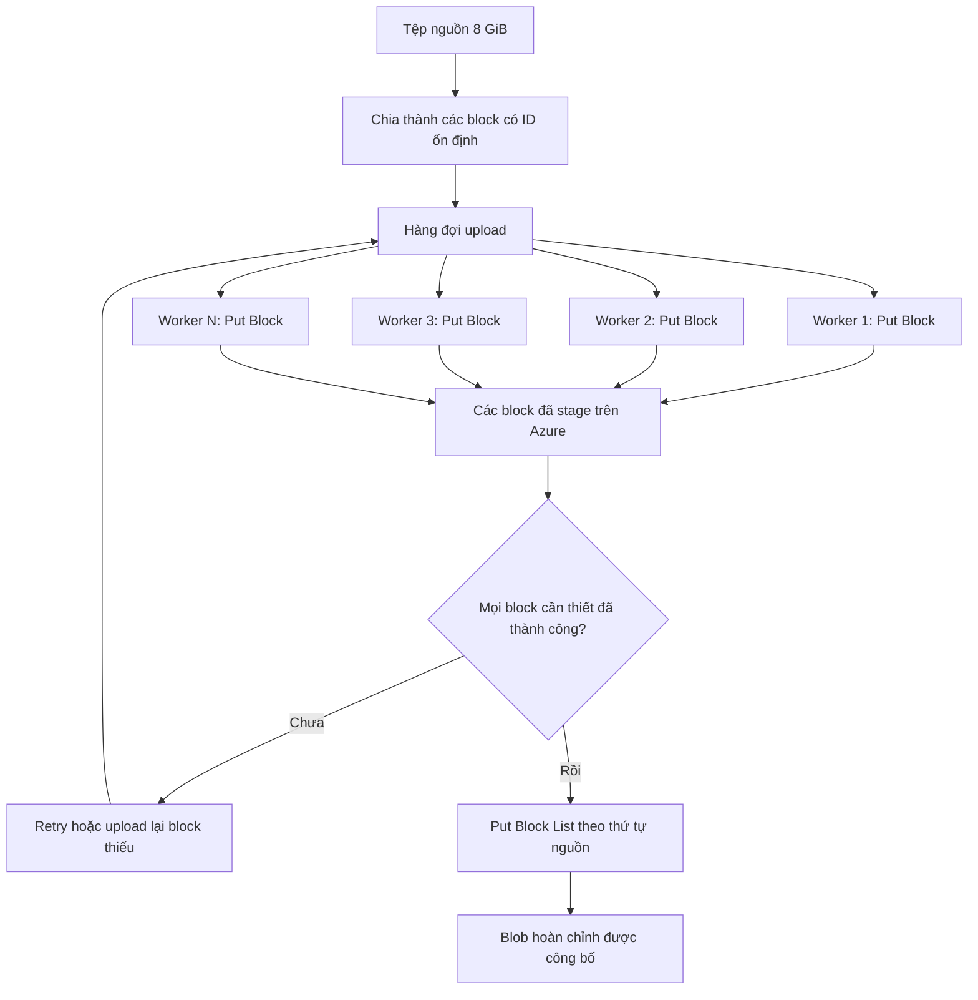

# Upload tệp lớn bằng block và truyền tải song song

Một ứng dụng có thể cần tải lên Azure Blob Storage những đối tượng có kích thước hàng gigabyte: bản sao lưu cơ sở dữ liệu, video, ảnh máy ảo, tệp log lưu trữ dài hạn hoặc dữ liệu phân tích. Nếu gửi toàn bộ tệp bằng một request duy nhất, khi kết nối đứt gần cuối quá trình, ứng dụng có thể phải truyền lại rất nhiều dữ liệu. Với đường mạng không ổn định hoặc cần khai thác nhiều kết nối đồng thời, cách truyền theo **block** thường phù hợp hơn.

**Block blob** hỗ trợ chia dữ liệu thành các khối, tải các khối lên độc lập, rồi công bố phiên bản blob hoàn chỉnh bằng một thao tác commit. Azure SDK và AzCopy có thể tổ chức nhiều request upload song song, tự retry những phần bị lỗi và hạn chế phải làm lại từ đầu.

Trong module `CLOUD_PROVIDERS_AZURE`, bạn tìm hiểu Azure từ subscription, resource group và Microsoft Entra ID đến mạng ảo, tính toán, lưu trữ, dữ liệu, triển khai, giám sát, bảo mật và chi phí. Bài thuộc chương **Lưu trữ đối tượng với Blob Storage**, hướng dẫn cơ chế block blob, thực hành upload tệp lớn, tinh chỉnh hiệu năng và vận hành an toàn.

## 1. Mục tiêu học tập

Sau bài học, bạn có thể:

- Giải thích sự khác nhau giữa upload một lần và upload bằng nhiều block.
- Mô tả chu trình **Put Block → Put Block List**, vai trò của block ID và thứ tự commit.
- Tính số block từ kích thước tệp, chọn kích thước block và độ song song thích hợp.
- Upload tệp lớn bằng **AzCopy** và **Azure Storage SDK for Java** với Microsoft Entra ID.
- Hiểu cơ chế retry, resume, điều kiện ghi, kiểm tra tính toàn vẹn và tránh ghi đè ngoài ý muốn.
- Phân biệt lỗi từ quyền dữ liệu, mạng, throttling, giới hạn dịch vụ và cấu hình ứng dụng.
- Theo dõi tiến độ, chi phí request, băng thông và bộ nhớ của chương trình upload.

## 2. Block blob là gì?

Azure Blob Storage là dịch vụ lưu trữ đối tượng. Ba loại blob chính là **block blob**, **append blob** và **page blob**, với cách tổ chức dữ liệu khác nhau. **Block blob** là lựa chọn phổ biến cho tệp, media, tài liệu và backup được upload theo từng phần.

| Loại blob | Cách sử dụng thường gặp | Điểm đặc trưng |
|---|---|---|
| **Block blob** | Tệp, video, backup, dữ liệu ứng dụng | Có thể upload các block rồi commit danh sách block |
| **Append blob** | Một số luồng ghi nối tiếp, log append-only | Được thiết kế cho thao tác thêm dữ liệu vào cuối |
| **Page blob** | Các tác vụ cập nhật vùng dữ liệu theo trang, chẳng hạn VHD | Hỗ trợ đọc/ghi theo phạm vi trang |

Với block blob, mỗi **block** là một mảnh dữ liệu có ID. Azure nhận các block qua các request riêng biệt. Khi client gửi danh sách block theo thứ tự cần ghép, dịch vụ commit chúng thành nội dung blob.

Hai thao tác REST nền tảng:

1. **Put Block:** tải một block, gắn với một `block ID` trong blob đích. Trước khi commit, block ở trạng thái **uncommitted**.
2. **Put Block List:** gửi danh sách các block ID theo thứ tự mong muốn. Blob được tạo mới hoặc cập nhật để phản ánh các block đã được commit trong danh sách.

Một SDK cấp cao có thể tự thực hiện các thao tác này; lập trình viên thường chỉ cần cung cấp tệp, kích thước block và số request được phép chạy đồng thời.

### Sơ đồ upload song song



**Song song ở bước Put Block không quyết định thứ tự nội dung.** Thứ tự block trong **Put Block List** mới quyết định thứ tự ghép. Vì vậy, block số 20 có thể upload xong trước block số 3 mà tệp đích vẫn đúng sau khi commit danh sách theo thứ tự ban đầu.

## 3. So sánh upload một request và upload theo block

| Tiêu chí | Upload một request | Upload nhiều block |
|---|---|---|
| Cách truyền | Gửi toàn bộ nội dung trong một thao tác, tùy giới hạn REST API | Tách thành nhiều Put Block, cuối cùng Put Block List |
| Khi lỗi giữa chừng | Có thể phải gửi lại toàn bộ nội dung | Có thể retry block bị lỗi mà không gửi lại mọi block đã stage |
| Mức song song | Một request đơn lẻ | Có thể chạy nhiều request đồng thời |
| Kiểm soát bộ nhớ | Phụ thuộc cách client đọc dữ liệu | Có thể stream từng block, giới hạn số block đang xử lý |
| Phù hợp | Tệp nhỏ, đường mạng ổn định, client đơn giản | Tệp lớn, muốn tối ưu throughput hoặc retry hiệu quả |
| Độ phức tạp | Thấp | Cao hơn nếu tự quản lý block ID, hàng đợi và commit |

Không phải tệp nào cũng cần tự chia block. Các SDK thường có **ngưỡng single upload**: với tệp nhỏ, SDK có thể dùng một request; với tệp lớn, SDK tự dùng block và truyền song song theo cấu hình. Việc một phương thức có tên `uploadFromFile` không có nghĩa nó luôn truyền toàn bộ tệp bằng một request.

## 4. Giới hạn block và cách tính số block

Azure Blob Storage giới hạn **số block đã commit trong một block blob** và **kích thước tối đa mỗi block**. Những giới hạn này phụ thuộc phiên bản REST API và khả năng dịch vụ mà client sử dụng. Với các phiên bản API hiện đại, một block blob hỗ trợ tối đa **50.000 committed blocks**; mức tối đa của mỗi block có thể lên tới **4.000 MiB** với phiên bản API phù hợp. Hãy đối chiếu tài liệu giới hạn Azure Storage và SDK đang dùng khi thiết kế hệ thống tệp rất lớn.

Số block cần dùng được tính bằng:

\[
N = \left\lceil\frac{\text{Kích thước tệp (byte)}}{\text{Kích thước block (byte)}}\right\rceil
\]

### Ví dụ với một tệp 8 GiB

Giả sử tệp có kích thước **8 GiB = 8.192 MiB**. Các phương án:

| Block size | Số block ước tính | Nhận xét |
|---|---:|---|
| 4 MiB | 2.048 | Nhiều request, mỗi request nhẹ |
| 8 MiB | 1.024 | Cân bằng số request và bộ nhớ |
| 16 MiB | 512 | Ít request hơn nhưng mỗi request lớn hơn |
| 64 MiB | 128 | Ít request; tốn bộ nhớ hơn khi upload song song |

Tất cả phương án đều dưới giới hạn 50.000 committed blocks. Để thiết kế một block size đủ lớn cho tệp có kích thước tối đa dự kiến, cần bảo đảm:

\[
\text{Block size} \geq \left\lceil\frac{\text{Kích thước tệp tối đa}}{50.000}\right\rceil
\]

Đồng thời block size không được vượt giới hạn của API/SKU và phải phù hợp tài nguyên client. Nếu ứng dụng chỉ dùng block 4 MiB, giới hạn số block có thể khiến ứng dụng không thể commit tệp cực lớn dù Storage hỗ trợ kích thước blob lớn hơn.

## 5. Chọn độ song song và block size

**Concurrency** là số thao tác upload được phép tiến hành cùng lúc. Ví dụ, concurrency bằng 8 nghĩa là client có thể có tối đa 8 request Put Block đang xử lý, tùy cách SDK lập lịch.

Thông lượng upload phụ thuộc vào nhiều yếu tố: tốc độ đọc đĩa, băng thông uplink, độ trễ mạng, giới hạn client, CPU, khả năng phục vụ của Storage, số request song song và tình trạng throttling.

Một ước lượng sơ bộ về bộ nhớ dùng để giữ các block đang upload:

\[
\text{Bộ nhớ vùng đệm} \approx \text{Block size} \times \text{Concurrency}
\]

Ví dụ, 16 MiB × 8 request = **khoảng 128 MiB** dữ liệu đang xử lý. Đây chỉ là ước lượng định hướng: SDK có thể thêm các buffer, stream, hàng đợi và overhead khác. Không dùng công thức này làm bảo đảm bộ nhớ đỉnh.

### Tác động của các tham số

| Khi thay đổi | Lợi ích có thể có | Rủi ro/chi phí |
|---|---|---|
| Tăng block size | Giảm số request và chi phí xử lý trên mỗi byte | Một block retry lớn hơn, sử dụng buffer lớn hơn |
| Giảm block size | Retry ít byte hơn khi lỗi, dễ điều tiết bộ nhớ | Nhiều Put Block request hơn và overhead lớn |
| Tăng concurrency | Tận dụng đường mạng có độ trễ cao, tăng throughput đến một ngưỡng | Có thể tăng RAM, CPU, socket, throttling |
| Giảm concurrency | Ít tiêu thụ tài nguyên và dễ ổn định hơn | Có thể không khai thác hết băng thông |
| Tăng timeout tùy tình huống | Hỗ trợ mạng chậm cho request hợp lệ | Có thể che giấu sự cố; retry chậm và kéo dài tiến độ |

**Quy trình tinh chỉnh phù hợp:**

1. Đo tốc độ cơ sở với block size và concurrency vừa phải.
2. Tăng concurrency từng bước, theo dõi throughput thực tế, RAM, CPU, lỗi `429`/`503` và độ trễ.
3. Nếu số request quá nhiều, xem xét tăng block size trong giới hạn của API và bộ nhớ.
4. Dừng tăng concurrency khi tốc độ không còn cải thiện hoặc tỷ lệ lỗi/tài nguyên tiêu thụ tăng rõ rệt.
5. Ghi lại bộ tham số riêng cho môi trường thực tế: máy trạm, VM trong Azure, kết nối liên vùng hoặc mạng doanh nghiệp.

Không có một cấu hình block size và concurrency tối ưu cho mọi đường mạng hay mọi tệp.

## 6. Chuẩn bị môi trường thực hành

Ví dụ sử dụng:

| Thành phần | Giá trị minh họa |
|---|---|
| Storage account | `stuploadlab01` |
| Container | `large-files` |
| Tệp nguồn | `./backup-large.tar` |
| Blob đích | `backups/backup-large.tar` |
| Danh tính | User hoặc managed identity có quyền dữ liệu |
| Role | **Storage Blob Data Contributor** tại scope phù hợp |
| Thông số thử nghiệm | 16 MiB/block, 8 request song song |

Tên account phải là tên duy nhất thực tế đã tồn tại; tên trên chỉ minh họa. Container cần được tạo trước khi upload. Tệp nguồn phải nằm trên đĩa cục bộ hoặc một filesystem mà công cụ có thể đọc. Những thao tác upload có thể phát sinh phí lưu trữ, request và truyền dữ liệu; chỉ thực hành trong subscription được phép.

### Quyền và mạng

**Microsoft Entra ID** xác thực user/managed identity; **Azure RBAC data plane** quyết định danh tính có được ghi blob không. Với thao tác upload, role thường dùng là **Storage Blob Data Contributor** tại storage account hoặc container.

Chỉ có Reader hoặc Contributor trên management plane không bảo đảm upload blob bằng OAuth thành công. Mặt khác, một số role quản trị có thể lấy storage account key khi Shared Key được bật; nên phân biệt đường truy cập thực tế khi kiểm tra quyền.

Nếu account dùng firewall, private endpoint hoặc private DNS, máy chạy AzCopy/SDK phải có kết nối tới **blob endpoint** đúng theo kiến trúc. Có role phù hợp mà bị chặn bởi network rules vẫn có thể nhận lỗi truy cập.

## 7. Upload tệp lớn bằng AzCopy

**AzCopy v10** là công cụ dòng lệnh tối ưu cho truyền dữ liệu tới/từ Azure Storage. Nó hỗ trợ chia dữ liệu thành nhiều request, xử lý truyền song song và lưu thông tin job để tiếp tục các truyền tải bị gián đoạn trong những điều kiện được hỗ trợ.

### Bước 1. Đăng nhập và xác nhận quyền

Trên thiết bị có AzCopy và tài khoản Microsoft Entra được cấp **Storage Blob Data Contributor**, chạy:

```bash
azcopy login
```

Lệnh đăng nhập này dùng danh tính Entra cho request Storage. Nếu chạy trên VM/App Service dùng managed identity hoặc môi trường tự động hóa, có thể dùng phương thức đăng nhập bằng identity được AzCopy hỗ trợ; cần xác minh loại identity và quyền của principal đó.

### Bước 2. Upload tệp

```bash
azcopy copy "./backup-large.tar" \
  "https://stuploadlab01.blob.core.windows.net/large-files/backups/backup-large.tar" \
  --overwrite=false
```

Đường dẫn là URL blob, **không cần SAS** khi AzCopy đang dùng Microsoft Entra authorization tương thích và danh tính có đủ quyền. `--overwrite=false` giúp tránh ghi đè một blob đã tồn tại; kiểm tra chính sách ghi đè của môi trường thực trước khi dùng với dữ liệu quan trọng.

### Bước 3. Tinh chỉnh song song và kích thước block

Trong Bash/Linux, có thể đặt mức concurrency cho **một lần chạy** bằng biến môi trường:

```bash
AZCOPY_CONCURRENCY_VALUE=8 azcopy copy "./backup-large.tar" \
  "https://stuploadlab01.blob.core.windows.net/large-files/backups/backup-large.tar" \
  --overwrite=false \
  --block-size-mb 16
```

Trong PowerShell, cách đặt biến môi trường sẽ khác:

```powershell
$env:AZCOPY_CONCURRENCY_VALUE = "8"
azcopy copy ".\backup-large.tar" `
  "https://stuploadlab01.blob.core.windows.net/large-files/backups/backup-large.tar" `
  --overwrite=false `
  --block-size-mb 16
```

Ý nghĩa:

- `AZCOPY_CONCURRENCY_VALUE` ảnh hưởng số request đồng thời mà AzCopy lập lịch.
- `--block-size-mb` cấu hình kích thước block theo MiB cho trường hợp và phiên bản AzCopy hỗ trợ.
- AzCopy còn có thuật toán tự điều chỉnh và giới hạn riêng; thông số truyền vào không bảo đảm số connection hoặc throughput cố định.

Trước khi sửa hiệu năng trên production, chạy `azcopy copy --help` để đối chiếu các tham số của **phiên bản AzCopy hiện đang cài**.

### Bước 4. Kiểm tra job và tiếp tục khi gián đoạn

```bash
# Xem danh sách job được AzCopy ghi lại cục bộ
azcopy jobs list

# Xem chi tiết một job sau khi đã có job ID từ output
azcopy jobs show "<job-id>"

# Thử tiếp tục một job bị gián đoạn khi job plan còn khả dụng
azcopy jobs resume "<job-id>"
```

AzCopy sử dụng thông tin job plan và log trên **máy đã chạy job**. Nếu job plan đã bị xóa, thay máy hoặc phương thức xác thực/token không còn hợp lệ, `jobs resume` có thể không sử dụng được như mong đợi. Việc resume cần được thử trong môi trường thật thay vì giả định có thể tiếp tục trên bất kỳ máy nào.

**Không lưu access token, SAS URL còn hiệu lực hoặc account key trong log chia sẻ.** Khi cần chia sẻ thông tin lỗi, che giấu credential và dữ liệu nhạy cảm.

## 8. Upload song song bằng Azure Storage SDK for Java

Với ứng dụng Java, **Azure Storage Blob SDK v12** cho phép upload trực tiếp từ file. SDK có thể tự chia file thành block, gửi các request song song, retry lỗi tạm thời và commit blob. Bạn cấu hình thông số truyền tải thay vì tự tạo thread và quản lý block ID.

Các dependency cần có trong build:

- `com.azure:azure-storage-blob` — client Blob Storage.
- `com.azure:azure-identity` — xác thực với Microsoft Entra ID, bao gồm managed identity.

Chọn phiên bản dependency tương thích theo BOM/quy trình quản lý thư viện của dự án. Ví dụ dưới đây không gắn cứng số phiên bản vì cần đối chiếu SDK đang sử dụng.

### Mã Java minh họa

```java
import com.azure.core.util.Context;
import com.azure.identity.DefaultAzureCredentialBuilder;
import com.azure.storage.blob.BlobClient;
import com.azure.storage.blob.BlobClientBuilder;
import com.azure.storage.blob.models.BlobHttpHeaders;
import com.azure.storage.blob.models.BlobRequestConditions;
import com.azure.storage.blob.options.BlobUploadFromFileOptions;
import com.azure.storage.common.ParallelTransferOptions;

import java.nio.file.Files;
import java.nio.file.Path;

public class LargeBlobUpload {
    public static void main(String[] args) throws Exception {
        String accountName = "stuploadlab01";
        String containerName = "large-files";
        String blobName = "backups/backup-large.tar";
        Path source = Path.of("./backup-large.tar");

        if (!Files.isRegularFile(source)) {
            throw new IllegalArgumentException("Không tìm thấy tệp: " + source);
        }

        BlobClient blobClient = new BlobClientBuilder()
                .endpoint("https://" + accountName + ".blob.core.windows.net")
                .containerName(containerName)
                .blobName(blobName)
                .credential(new DefaultAzureCredentialBuilder().build())
                .buildClient();

        ParallelTransferOptions parallelOptions = new ParallelTransferOptions()
                .setBlockSizeLong(16L * 1024 * 1024) // 16 MiB
                .setMaxConcurrency(8);

        BlobUploadFromFileOptions uploadOptions =
                new BlobUploadFromFileOptions(source.toString())
                        .setParallelTransferOptions(parallelOptions)
                        .setHeaders(new BlobHttpHeaders()
                                .setContentType("application/octet-stream"))
                        // Chỉ tạo nếu chưa có blob cùng tên.
                        .setRequestConditions(
                                new BlobRequestConditions().setIfNoneMatch("*"));

        blobClient.uploadFromFileWithResponse(uploadOptions, null, Context.NONE);

        long localSize = Files.size(source);
        long remoteSize = blobClient.getProperties().getBlobSize();
        if (localSize != remoteSize) {
            throw new IllegalStateException("Kích thước blob không khớp");
        }

        System.out.println("Upload hoàn thành: " + blobName
                + " (" + remoteSize + " byte)");
    }
}
```

**Giải thích những lựa chọn trong code:**

1. `DefaultAzureCredential` chọn nguồn credential phù hợp với môi trường: tài khoản developer khi chạy local, hoặc managed identity trong môi trường Azure đã cấu hình. Bạn phải cấp role dữ liệu cho **đúng principal**.
2. `BlobUploadFromFileOptions` dùng đường dẫn tệp, tránh yêu cầu đọc toàn bộ tệp vào một mảng byte trong ứng dụng.
3. `ParallelTransferOptions` đặt block size 16 MiB và concurrency 8. SDK sẽ áp dụng logic upload phù hợp, dựa trên kích thước tệp và ngưỡng truyền tải.
4. Điều kiện `If-None-Match: *` giúp tránh commit ghi đè blob đã tồn tại. Ở hệ thống production, cần thiết kế thêm chính sách versioning, retry và xử lý xung đột tên.
5. So sánh `localSize` và `remoteSize` là kiểm tra cơ bản sau khi upload, **chưa phải bằng chứng toàn bộ byte đều giống nhau**. Khi có yêu cầu toàn vẹn cao, hãy dùng checksum/hash và quy trình kiểm chứng phù hợp.

Khi chạy nhiều instance ứng dụng cùng upload một tên blob, cần quyết định rõ một lần upload có được phép ghi đè lần khác hay không. Có thể dùng blob name duy nhất, điều kiện theo ETag, lease hoặc một cơ chế điều phối khác. Chỉ tăng concurrency của upload **trong một file** không có nghĩa hai tiến trình cùng ghi vào một blob sẽ tự đồng bộ an toàn.

## 9. Nếu tự điều khiển Put Block và Put Block List

Với nhu cầu đặc biệt như lưu checkpoint ở cấp block hoặc upload từ một nguồn stream tự quản lý, bạn có thể dùng **BlockBlobClient** hoặc REST API cấp thấp. Tuy nhiên, mức độ phức tạp lớn hơn: lập trình viên phải giữ ID ổn định, stage đủ block và commit đúng danh sách.

### Nguyên tắc thiết kế block ID

- Mỗi block có một `block ID` là chuỗi được mã hóa Base64 theo quy tắc API.
- Các block ID trong cùng blob phải tuân thủ quy định độ dài và định dạng thống nhất của API.
- Sinh ID **xác định theo vị trí** (ví dụ thứ tự 000001, 000002...) để upload lại một block có thể sử dụng lại chính ID đó.
- Không dùng thứ tự **hoàn thành** của request để quyết định thứ tự commit.

Ví dụ, trước khi Base64 hóa:

```text
block-000001 -> [byte 0 ... blockSize-1]
block-000002 -> [byte blockSize ... 2*blockSize-1]
block-000003 -> [byte 2*blockSize ... 3*blockSize-1]
...
```

Giả sử ba block đã stage thành công theo thứ tự thực tế **3, 1, 2**. Client vẫn commit danh sách **[1, 2, 3]** để nội dung blob đúng với file nguồn.

### Pseudocode điều phối

```text
blockSize = 16 MiB
concurrency = 8
blocks = splitFileByRange(sourcePath, blockSize)

for each block:
    block.id = base64(fixedWidthIndex(block.index))

parallelMap(blocks, maxWorkers=concurrency):
    retryTransientErrorsWithBackoff():
        putBlock(blobUrl, block.id, readFileRange(block.offset, block.length))
    checkpoint(block.id, block.offset, block.length, success)

if any block missing:
    failWithoutCommitting()

orderedIds = blocks.sortByIndex().map(block.id)
putBlockList(blobUrl, orderedIds, conditionalWritePolicy)

verifyBlobMetadataAndIntegrity()
```

Đây là pseudocode giải thích thuật toán, không phải chương trình có thể chạy trực tiếp. Triển khai thực tế phải xử lý stream/file channel, token, timeout, response status, request condition, checkpoint an toàn và kiểm tra lỗi.

### Điều gì xảy ra khi commit lỗi?

- **Put Block thành công**: block đã được stage nhưng không nhất thiết xuất hiện trong nội dung blob đọc được.
- **Chưa gửi hoặc chưa thành công Put Block List**: một blob mới có thể chưa tồn tại như blob hoàn chỉnh; với blob đã có dữ liệu, phiên bản committed trước đó thường vẫn là nội dung đang được phục vụ.
- **Put Block List thành công**: Azure công bố danh sách block theo thứ tự đã gửi.
- **Request commit timeout**: client chưa thể kết luận commit thất bại; cần kiểm tra blob đích/ETag/size hoặc metadata trước khi retry để tránh thao tác ghi ngoài dự kiến.

Những uncommitted blocks không được commit có thể được dịch vụ thu hồi theo vòng đời nội bộ. Không nên dựa vào chúng làm bản sao lưu dài hạn hoặc giả định checkpoint phía client luôn tồn tại mãi.

## 10. Retry, resume và tính idempotent

Mạng thực tế có thể gặp timeout, TCP reset, throttling hoặc máy chạy upload bị khởi động lại. Thiết kế tải tệp lớn cần xem xét **những lỗi có thể thử lại** và **những lỗi phải dừng để sửa cấu hình**.

| Lỗi/tình trạng | Hướng xử lý |
|---|---|
| Timeout, kết nối đứt giữa chừng | Retry request block với cùng block ID và dữ liệu tương ứng, hoặc để SDK xử lý |
| HTTP `429 Too Many Requests`, `503 Server Busy` | Dùng exponential backoff, jitter, tôn trọng `Retry-After` khi có; giảm concurrency nếu thường xuyên bị throttling |
| HTTP `401 Unauthorized` | Kiểm tra token, tenant, credential; làm mới token theo cơ chế SDK |
| HTTP `403 AuthorizationPermissionMismatch` | Kiểm tra role Blob Data Contributor, scope, identity; không retry liên tục khi thiếu quyền |
| HTTP `403` do network/firewall | Kiểm tra Storage firewall, private endpoint, DNS, routing |
| HTTP `409` hoặc `412` khi có điều kiện ghi | Kiểm tra lease, ETag, blob đã tồn tại và xung đột đồng thời |
| Kích thước block vượt giới hạn API | Giảm kích thước block hoặc dùng phiên bản API/SDK phù hợp |
| Dữ liệu nguồn thay đổi trong lúc upload | Dừng hoặc restart dựa trên snapshot/file version cố định để tránh ghép block của nhiều phiên bản nguồn |

**Idempotency ở cấp block**: với block ID ổn định, retry `Put Block` có thể stage lại cùng dữ liệu; lần ghi cuối cho cùng ID sẽ quyết định nội dung uncommitted của ID đó. Vì thế, khi retry cần bảo đảm dữ liệu của ID không bị thay đổi.

**Idempotency ở cấp blob**: commit lên cùng blob name có thể ghi đè hoặc tạo phiên bản dữ liệu mới. Dùng **ETag/conditional headers**, blob versioning hoặc tên blob có mã phiên upload để tránh hai job tranh nhau cập nhật một đích.

**Resume không phải chỉ nhớ số byte đã gửi.** Nếu tự viết client, phải biết danh sách block đã stage, nguồn dữ liệu tương ứng, block ID, thứ tự và trạng thái commit. Một số SDK cấp cao chỉ tự retry trong một lần gọi hàm; khả năng resume xuyên tiến trình cần xác minh hoặc lập trình riêng. AzCopy có cơ chế job plan phục vụ kịch bản tiếp tục job.

## 11. Kiểm tra tính toàn vẹn sau upload

Upload trả kết quả thành công nghĩa là Azure đã chấp nhận thao tác tương ứng. Với dữ liệu nhạy cảm hoặc backup quan trọng, cần kiểm chứng thêm.

**Các mức xác minh:**

1. **Trạng thái commit:** request upload/`Put Block List` thành công và blob đích tồn tại.
2. **Kích thước:** số byte của blob khớp với file nguồn.
3. **ETag và Last-Modified:** ghi lại để theo dõi phiên bản đã được commit; ETag không phải checksum nội dung.
4. **Checksum trên request:** SDK hoặc giao thức có thể dùng MD5/CRC64 ở cấp request theo khả năng hỗ trợ; điều này bảo vệ đường truyền của request nhưng không mặc nhiên là checksum cho toàn bộ blob.
5. **End-to-end hash:** nếu yêu cầu toàn vẹn cao, tính SHA-256 cho file nguồn và xác minh bên nhận qua một quy trình tải xuống/đọc lại có kiểm soát hoặc kiểm chứng ứng dụng. Metadata lưu hash nguồn chỉ có ý nghĩa khi được đối chiếu bằng phép tính độc lập.

### Kiểm tra metadata blob bằng Azure CLI

```bash
az login
az account set --subscription "<subscription-id>"

az storage blob show \
  --account-name "stuploadlab01" \
  --container-name "large-files" \
  --name "backups/backup-large.tar" \
  --auth-mode login \
  --query "{size:properties.contentLength,etag:properties.etag,lastModified:properties.lastModified}" \
  --output json
```

Lệnh này **chỉ đọc metadata**, không kiểm chứng toàn bộ byte. Cần role dữ liệu cho việc đọc blob/metadata. Khi so sánh hash với dữ liệu thật, cần tính thêm thời gian và lưu lượng đọc; tránh tải tệp nhiều gigabyte về máy chỉ để kiểm tra nếu quy trình vận hành có phương án kiểm chứng hiệu quả hơn.

## 12. Bảo mật và quản trị upload lớn

Block upload cũng phải tuân thủ các biện pháp bảo mật như mọi thao tác ghi dữ liệu khác:

- **Ưu tiên Microsoft Entra ID/managed identity** cho ứng dụng chạy trên Azure và role `Storage Blob Data Contributor` ở scope cần thiết.
- **Giữ credential an toàn:** không đưa account key, SAS URL hoặc bearer token vào source code, command history chia sẻ hoặc log công khai.
- **Dùng HTTPS:** kiểm chứng endpoint Storage và chứng chỉ TLS; không tắt kiểm tra chứng chỉ chỉ để xử lý lỗi truyền tải.
- **Giới hạn quyền và mạng:** kiểm tra Storage firewall, private endpoint, private DNS, route và quyền của identity upload.
- **Bảo vệ đích:** cân nhắc blob versioning, soft delete, immutability và điều kiện ghi khi dữ liệu có giá trị hoặc quy định tuân thủ.
- **Tách pipeline theo môi trường:** không cho workload dev upload nhầm container production; dùng account/container/identity riêng theo nhu cầu.
- **Quan sát lưu lượng:** thu thập metrics/request log phù hợp, thiết lập cảnh báo throttling, lỗi và dung lượng; lưu chứng cứ vận hành theo thời gian cần thiết.
- **Không commit dữ liệu thiếu:** chỉ commit khi mọi block yêu cầu đã upload và kiểm tra thành công.

Nếu dùng SAS để cho client bên ngoài trực tiếp upload, nên phát hành token có **phạm vi và thời hạn tối thiểu**, xem xét user delegation SAS cho Blob, giới hạn quyền ghi cần thiết và ngăn client ghi đè tên blob ngoài phạm vi được phép. SAS là credential; URL bị lộ có thể bị sử dụng cho đến khi hết hiệu lực hoặc bị thu hồi qua cơ chế áp dụng.

## 13. Hiệu năng, giám sát và chi phí

Upload lớn tiêu thụ nhiều loại tài nguyên:

| Yếu tố | Có thể đo bằng | Ý nghĩa |
|---|---|---|
| Throughput | MiB/s hoặc GiB/phút từ client | Hiệu quả truyền thực tế |
| Thời gian hoàn thành | Đồng hồ job, log AzCopy/ứng dụng | SLA upload |
| Số request | Metrics/diagnostics Storage nếu được cấu hình | Request nhiều có thể tăng chi phí giao dịch |
| Tỷ lệ retry, `429`, `503` | Log ứng dụng/Storage | Chỉ dấu throttling hoặc mạng thiếu ổn định |
| CPU và RAM của uploader | Metrics hệ điều hành/VM/container | Concurrency quá cao có thể làm nghẽn client |
| Network throughput/latency | Metrics mạng và phép đo client | Phát hiện giới hạn băng thông và độ trễ |
| Dung lượng blob, phiên bản, tier | Azure portal/Storage metrics | Chi phí lưu trữ và retention |

Đơn giá phụ thuộc storage account, region, tier, loại request, dung lượng và chính sách truyền dữ liệu. Nhiều Put Block request làm tăng số thao tác; tăng block size có thể giảm số request nhưng đổi lại tăng chi phí retry và bộ nhớ. Trong Azure, dữ liệu truyền **vào** thường có chính sách tính phí khác dữ liệu truyền **ra**, song phải kiểm tra biểu giá thực tế, các dịch vụ trung gian và đường truyền liên vùng.

**Giữ chi phí lab trong kiểm soát:** chọn file thử nghiệm không chứa dữ liệu thật, theo dõi Azure Cost Management, không bật log chi tiết quá mức trong thời gian dài nếu không cần. Khi xóa file lab, xem liệu blob versioning, snapshot, soft delete hoặc retention policy có giữ dữ liệu và tiếp tục phát sinh chi phí hay không.

## 14. Tình huống thực tế: upload bản sao lưu 8 GiB

Một dịch vụ mỗi đêm tạo file backup khoảng **8 GiB**, cần upload vào container `backups`. Đường truyền của VM upload có băng thông tốt nhưng thỉnh thoảng bị ngắt trong thời gian ngắn.

**Phương án đề xuất ban đầu:**

1. Tạo backup hoàn chỉnh vào đường dẫn tạm; chỉ bắt đầu upload khi file không còn bị ghi thêm.
2. Tạo tên blob có ngày/giờ hoặc ID job, ví dụ `nightly/2026-11-20/backup.tar`, để tránh hai job ghi đè nhau.
3. Dùng managed identity và cấp `Storage Blob Data Contributor` chỉ tại container `backups`.
4. Bắt đầu thử với block size **16 MiB**, concurrency **8**. Với 8 GiB, client tạo khoảng **512 blocks**; vùng đệm dữ liệu ước tính khoảng **128 MiB** nếu giữ đồng thời một block mỗi worker, chưa tính overhead SDK.
5. Dùng SDK/AzCopy retry lỗi tạm thời; theo dõi throughput, RAM, số lần retry và thời gian kết thúc.
6. Chỉ đánh dấu backup **sẵn sàng khôi phục** khi upload commit thành công và kiểm tra metadata/checksum theo chính sách backup.
7. Ghi lại blob name, kích thước, ETag, checksum và trạng thái job vào danh mục backup; áp dụng retention/versioning phù hợp.
8. Thực hiện diễn tập **restore** để xác minh backup thật sự dùng được. Không coi thành công của upload là bằng chứng dữ liệu có thể phục hồi.

Giả sử một kết nối đơn chỉ đạt 20 MiB/s nhưng có thể truyền nhiều request độc lập, concurrency hợp lý có thể tăng throughput. Tuy vậy, nếu tổng uplink của VM chỉ có 20 MiB/s, tăng từ 8 lên 64 request song song không thể vượt giới hạn vật lý của đường mạng và có thể làm tệ hơn do overhead.

## 15. Bài tập tự kiểm tra

**Câu 1.** Tệp 8 GiB được chia thành block 32 MiB. Cần bao nhiêu block và thao tác nào quyết định thứ tự nội dung cuối cùng?

*Gợi ý:* `8192 / 32 = 256` block. Thứ tự trong `Put Block List` quyết định nội dung blob.

**Câu 2.** Hai block tải lên thất bại sau khi 510 block khác đã stage thành công. Có cần upload lại toàn bộ file?

*Gợi ý:* Thông thường không. Retry các block thất bại bằng block ID và dữ liệu ổn định, rồi commit danh sách đủ block.

**Câu 3.** Vì sao tăng concurrency từ 8 lên 64 có thể khiến tổng thời gian upload tăng?

*Gợi ý:* RAM/CPU, socket, bandwidth, throttling và retry; không có bảo đảm throughput tăng tuyến tính.

**Câu 4.** Một ứng dụng có Azure RBAC Reader trên storage account, gọi Azure SDK với Microsoft Entra token và nhận `403` khi upload. Nên cấp quyền gì?

*Gợi ý:* Role data plane có quyền ghi như `Storage Blob Data Contributor` trên container/account, sau khi kiểm tra identity, scope và network.

**Câu 5.** Upload báo thành công, blob có số byte đúng. Đã đủ để khẳng định backup chắc chắn phục hồi được chưa?

*Gợi ý:* Chưa. Cần cơ chế kiểm chứng hash/toàn vẹn phù hợp và diễn tập restore.

## 16. Checklist trước khi đưa vào production

- [ ] Chọn **block blob** và kiểm tra giới hạn block/blob phù hợp phiên bản API/SDK đang dùng.
- [ ] Biết kích thước file tối đa và đã tính số block ở cấu hình đã chọn.
- [ ] File nguồn ổn định, không thay đổi trong quá trình upload.
- [ ] Block ID và thứ tự commit được SDK hoặc quy trình tự viết quản lý đúng.
- [ ] Block size và concurrency được đo kiểm trên đường mạng thực tế, theo dõi RAM/CPU.
- [ ] Có retry có giới hạn, backoff và phân biệt lỗi tạm thời với lỗi quyền/cấu hình.
- [ ] Có phương án resume/checkpoint nếu yêu cầu phục hồi sau khi tiến trình dừng.
- [ ] Có chính sách ghi đè, xử lý nhiều uploader đồng thời và blob versioning/ETag khi phù hợp.
- [ ] Principal có Blob Data Contributor ở scope cần dùng; không dùng account key cố định nếu có thể thay bằng managed identity.
- [ ] Storage firewall, private endpoint, DNS, TLS và mạng đã được kiểm tra.
- [ ] Đã kiểm tra kích thước, trạng thái commit, metadata và hash/restore khi cần.
- [ ] Có metrics/logs, cảnh báo lỗi, dự báo chi phí request/dung lượng và retention.

## Kết luận

Upload tệp lớn lên Azure Blob Storage hiệu quả nhất khi hiểu rõ **block blob**, cách **Put Block** stage dữ liệu và **Put Block List** công bố blob theo thứ tự chính xác. Dùng AzCopy hoặc Azure SDK để xử lý chia block, chạy song song, retry và quản lý tài nguyên client; tự triển khai cấp block chỉ khi có nhu cầu đặc biệt. Một hệ thống upload đáng tin cậy còn phải bảo đảm danh tính và quyền đúng, chống ghi đè ngoài ý muốn, kiểm chứng tính toàn vẹn, theo dõi thông lượng và kiểm soát chi phí vận hành.
