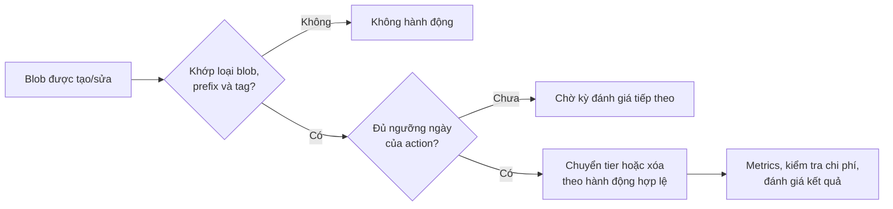
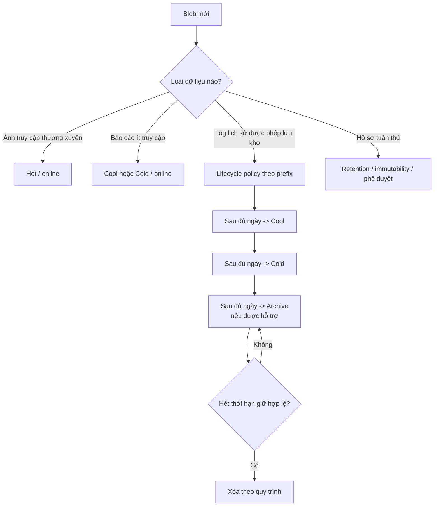
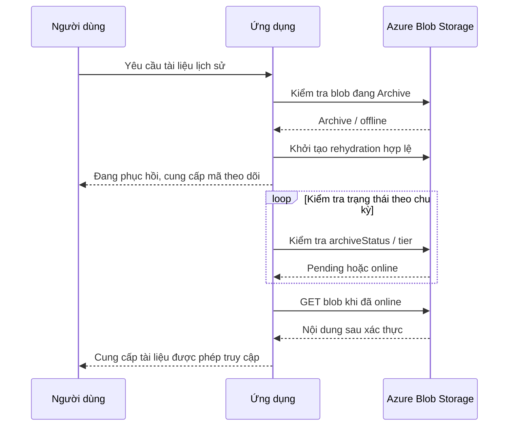

# Lựa chọn access tier và quy tắc lifecycle management

Một hệ thống trên Azure có thể lưu cả ảnh sản phẩm được tải hàng nghìn lần mỗi ngày, báo cáo chỉ được xem vài lần một tháng và bản xuất dữ liệu cũ gần như không ai mở lại. Nếu đặt mọi đối tượng trong cùng một mức lưu trữ, doanh nghiệp có thể trả quá nhiều cho dung lượng hoặc phải chịu phí truy xuất không cần thiết. **Azure Blob Storage access tier** giúp cân bằng chi phí lưu trữ với tần suất truy cập và thời gian chấp nhận chờ dữ liệu; **lifecycle management** tự động chuyển tier hoặc xóa dữ liệu theo chính sách đã kiểm soát.

Bài học thuộc chương **Lưu trữ đối tượng với Blob Storage** của module **CLOUD_PROVIDERS_AZURE**. Module hướng dẫn khám phá Microsoft Azure từ subscription, resource group và Microsoft Entra ID đến mạng ảo, dịch vụ tính toán, lưu trữ, dữ liệu; đồng thời triển khai, giám sát, bảo vệ và kiểm soát chi phí kiến trúc ứng dụng. Với Blob Storage, việc chọn tier phải gắn với **yêu cầu nghiệp vụ, quyền truy cập, độ sẵn sàng và tổng chi phí trong vòng đời của dữ liệu**, thay vì chỉ nhìn giá lưu trữ mỗi GB.

Sau bài học, bạn có thể:

- Phân biệt các access tier **Hot, Cool, Cold và Archive**.
- Phân tích chi phí lưu trữ, giao dịch, truy xuất, truyền dữ liệu, lưu giữ tối thiểu và rehydration.
- Chọn tier theo tần suất đọc và thời gian cần truy cập, không chỉ theo tuổi của blob.
- Hiểu phạm vi và cú pháp cơ bản của lifecycle management policy.
- Viết quy tắc chuyển tier hoặc xóa theo prefix, loại blob và số ngày phù hợp.
- Xây dựng kế hoạch kiểm thử, triển khai và giám sát để tránh xóa nhầm hoặc đưa dữ liệu thiết yếu vào Archive.

## 1. Access tier là gì?

Access tier là lựa chọn tối ưu hóa cách **một đối tượng blob** được lưu trữ và tính phí dựa trên tần suất sử dụng dự kiến. Với các loại tài khoản và block blob được hỗ trợ, tier có thể được đặt ở cấp blob; ở một số tài khoản, các blob không đặt tier riêng sẽ dùng access tier mặc định của account.

Mỗi tier có sự đánh đổi:

- Tier dùng cho truy cập thường xuyên có **chi phí dung lượng cao hơn** nhưng thông thường **chi phí đọc/truy xuất thấp hơn**.
- Tier cho dữ liệu ít đọc có **chi phí dung lượng thấp hơn**, đổi lại giao dịch, truy xuất hoặc chuyển tier có thể tốn kém hơn.
- **Archive** dành cho dữ liệu không cần đọc ngay; để đọc nội dung, thường phải thực hiện **rehydration** về một tier online được hỗ trợ.

Các tier không tự biến một blob thành bản sao lưu độc lập, không thay thế quyền truy cập dữ liệu, và không làm thay đổi nhu cầu thiết kế redundancy (LRS, ZRS, GRS, v.v.) theo khả năng tài khoản.

### 1.1. Bảng so sánh Hot, Cool, Cold và Archive

| Tiêu chí | Hot | Cool | Cold | Archive |
|---|---|---|---|---|
| Mục đích điển hình | Dữ liệu truy cập thường xuyên | Dữ liệu ít truy cập, vẫn cần online | Dữ liệu rất ít truy cập nhưng phải đọc online | Lưu trữ lâu dài, không yêu cầu truy xuất ngay |
| Trạng thái truy cập | **Online** | **Online** | **Online** | **Offline** đối với nội dung blob |
| Khả năng đọc ngay | Có, theo điều kiện dịch vụ/mạng/quyền | Có | Có | Không; cần rehydrate/copy về tier online theo hỗ trợ |
| Chi phí dung lượng tương đối | Thường cao nhất | Thấp hơn Hot | Thấp hơn Cool | Thường thấp nhất |
| Chi phí truy xuất/giao dịch | Thường thấp hơn | Thường cao hơn Hot | Thường cao hơn Cool | Có chi phí truy xuất/rehydration và giao dịch riêng |
| Thời gian lưu giữ tối thiểu để tránh phí xóa sớm | Không có mức tối thiểu tương đương Cool/Cold/Archive | **30 ngày** | **90 ngày** | **180 ngày** |
| Ví dụ | Ảnh sản phẩm đang bán, file vừa upload | Báo cáo tháng trước | Log cũ hiếm khi tra cứu | Hồ sơ lịch sử chỉ phục hồi theo yêu cầu |

Các so sánh trên chỉ mang tính định hướng. Giá trị tính phí thực tế phụ thuộc region, redundancy, loại account, dung lượng, kiểu thao tác và bảng giá Azure đang áp dụng. **Không đồng nhất Cold với Archive**: Cold vẫn là tier online, còn Archive cần thời gian đưa nội dung trở lại online.

### 1.2. Vì sao thời gian lưu giữ tối thiểu quan trọng?

Giả sử một blob được chuyển vào **Cool** và chỉ sau 5 ngày đã bị xóa. Vì Cool có giai đoạn lưu giữ tối thiểu thông thường là 30 ngày, tài khoản có thể phát sinh **phí xóa sớm** cho phần thời gian còn lại. Nguyên tắc tương tự áp dụng cho Cold (90 ngày) và Archive (180 ngày); việc đổi tier trước khi đủ thời gian cũng có thể kích hoạt khoản phí tương ứng.

Ví dụ:

```text
Ngày 0  : Blob vào Cool
Ngày 5  : Ứng dụng xóa Blob
Tối thiểu Cool: 30 ngày
=> Có thể bị tính phí tương đương phần thời gian lưu còn thiếu.
```

Hãy phân biệt **quy tắc tính thời gian lưu tối thiểu của tier** với **số ngày kể từ lần sửa cuối được dùng trong lifecycle policy**. Chúng là hai phép đo phục vụ hai mục đích khác nhau, không nên cho rằng cứ đạt ngưỡng lifecycle thì không còn phí xóa sớm ở tier hiện tại.

## 2. Lựa chọn tier theo vòng đời thực tế

### 2.1. Dữ liệu cần đáp ứng nhanh

Ứng dụng website có ảnh sản phẩm, tài liệu mới tải lên hoặc dữ liệu người dùng thường xuyên truy vấn nên bắt đầu từ **Hot** nếu tỷ lệ đọc cao hoặc rất khó dự đoán. Mỗi lần truy xuất phải tính vào chi phí tổng, vì tier rẻ về dung lượng có thể đắt khi đọc nhiều.

**Ví dụ:** một ảnh sản phẩm kích thước 1 MB được tải 20.000 lần mỗi ngày. Việc chuyển ảnh sang Cool chỉ vì ảnh được upload từ ba tháng trước có thể làm tăng chi phí truy xuất và giao dịch.

### 2.2. Dữ liệu ít đọc nhưng phải có ngay

Các báo cáo theo tháng, biên bản đã hoàn tất hoặc log được tra cứu không thường xuyên có thể thích hợp với **Cool** hoặc **Cold**, miễn là dịch vụ, account và workload hỗ trợ. Cả hai vẫn là tier online, nên client được cấp quyền có thể đọc dữ liệu qua API mà không phải thực hiện quá trình rehydration kéo dài như Archive.

**Ví dụ:** dữ liệu báo cáo quý trước chỉ được người kiểm toán đọc một vài lần mỗi năm, nhưng hợp đồng yêu cầu tải xuống ngay khi cần. Cold có thể là lựa chọn đáng đánh giá hơn Archive nếu thời gian truy cập phải rất ngắn.

### 2.3. Dữ liệu lưu lâu và chấp nhận chờ

Hồ sơ lịch sử được lưu vì yêu cầu pháp lý hoặc bản ghi điều tra có thể phù hợp với **Archive** khi:

1. Có chính sách lưu giữ rõ ràng.
2. Xác suất truy xuất rất thấp.
3. Nghiệp vụ chấp nhận quy trình yêu cầu mở kho và chờ rehydration.
4. Chi phí rehydration/truy xuất đã được tính.
5. Hỗ trợ Archive được xác nhận cho **account kind, blob type, region và redundancy** hiện tại.

Với blob Archive, nội dung không đọc trực tiếp bằng thao tác GET thông thường trước khi rehydrate. Việc rehydration có thể mất nhiều giờ tùy kích thước, ưu tiên và khả năng dịch vụ. Đừng dùng Archive cho tệp mà API phải trả cho khách trong vài giây.

### 2.4. Không có một quy tắc “sau N ngày là Archive” cho mọi dữ liệu

Tuổi dữ liệu là **tín hiệu**, không phải tiêu chí duy nhất. Một tệp hợp đồng 2 năm tuổi vẫn có thể được tải liên tục; một file log tạo hôm qua lại có thể không bao giờ cần đọc. Trước khi chọn tier, hãy trả lời:

- Dữ liệu có được đọc đều đặn, theo mùa hay bất ngờ không?
- Thời gian phục vụ đọc cho phép là giây/phút hay nhiều giờ?
- Có thể đọc dữ liệu ở dạng cũ hoặc bản sao khác không?
- Blob có bị cập nhật thường xuyên hay thực chất là bất biến?
- Khi có sự cố, loại dữ liệu nào phải phục hồi đầu tiên?
- Thời hạn lưu giữ theo pháp lý/hợp đồng là bao lâu?
- Có chính sách versioning, soft delete hoặc immutability ảnh hưởng đến vòng đời không?

## 3. Tính tổng chi phí thay vì chỉ nhìn giá GB/tháng

Một mô hình chi phí tham khảo:

```text
Tổng chi phí ước tính =
    phí lưu trữ dung lượng theo tier và redundancy
  + phí giao dịch (read/write/list, thao tác chuyển tier, v.v.)
  + phí truy xuất dữ liệu từ các tier tương ứng
  + phí rehydration từ Archive (nếu có)
  + phí truyền dữ liệu ra ngoài theo biểu giá áp dụng
  + phí xóa sớm/di chuyển tier trước hạn (nếu phát sinh)
  + chi phí bản sao, version, snapshot hoặc log liên quan
```

### 3.1. Bài toán định lượng đơn giản

Giả sử một nhóm có **1.000 GB** tài liệu. Để minh họa phương pháp, không dùng bảng giá thực, ta đặt các **đơn vị chi phí giả định**:

| Biến | Hot | Cool |
|---|---:|---:|
| Lưu trữ 1 GB trong một tháng | 2 đơn vị | 1 đơn vị |
| Phí truy xuất mỗi GB được đọc | 0 đơn vị | 0,5 đơn vị |

Nếu tháng đó đọc **100 GB** (không tính giao dịch và các chi phí khác):

- Hot: `1.000 × 2 = 2.000` đơn vị.
- Cool: `1.000 × 1 + 100 × 0,5 = 1.050` đơn vị.

Nếu đọc **3.000 GB** (cùng tệp được đọc nhiều lần):

- Hot: `1.000 × 2 = 2.000` đơn vị.
- Cool: `1.000 × 1 + 3.000 × 0,5 = 2.500` đơn vị.

Trong mô hình giả định này, Cool tốt hơn khi ít đọc, nhưng Hot lại tốt hơn khi đọc nhiều. Ngoài đời, phải bổ sung mức phí giao dịch, bậc dung lượng, thời gian lưu tối thiểu, cách tính operation và chi phí mạng. **Các con số chỉ giúp luyện cách tính, không phải đơn giá Azure**.

### 3.2. Tại sao Archive đôi khi đắt?

Archive giảm phí dung lượng cho dữ liệu hầu như không được truy xuất, nhưng có thể làm tổng chi phí tăng nếu:

- Phải rehydrate một khối lượng lớn sau thời gian ngắn.
- Chuyển hoặc xóa blob trước thời gian lưu giữ tối thiểu.
- Cần mở kho nhiều lần cho kiểm toán đột xuất.
- Phải duy trì bản sao Hot/Cool riêng để phục vụ nhu cầu đọc nhanh.
- Quy trình ứng dụng phải thêm hàng đợi, kiểm soát trạng thái, thông báo và xử lý thời gian chờ.

Vì vậy, bài toán chi phí phải tính theo **vòng đời dữ liệu**, không chỉ so sánh giá Archive với Hot tại một thời điểm.

## 4. Access tier mặc định và tier ở từng blob

Trong các tài khoản Blob Storage được hỗ trợ, **default access tier** của storage account thường là **Hot hoặc Cool**. Một blob có thể có tier được chỉ định riêng; khi không được gán explicit tier và loại account hỗ trợ kế thừa, blob nhận tier mặc định tương ứng của account.

Điều cần lưu ý:

- Tier mặc định ở cấp account không phải cơ chế tự động đo tần suất truy cập.
- Chuyển tier blob có thể tạo phí và làm phát sinh yêu cầu lưu giữ tối thiểu mới.
- Blob online (Hot/Cool/Cold) có thể truy cập qua Blob API nếu quyền và mạng cho phép; Archive cần rehydrate.
- Khả năng sử dụng **Cold/Archive**, loại blob hỗ trợ, các thao tác chuyển tier và redundancy có thể khác nhau theo account kind và khả năng dịch vụ.
- **Tiering là tối ưu hóa lưu trữ, không phải sao lưu**. Nếu xóa một blob, sự tồn tại của tier khác không bảo đảm có bản khôi phục.

Phân biệt thao tác **đổi tier cho một blob** với việc **thay default access tier của storage account**. Hai thao tác có phạm vi ảnh hưởng, mô hình tính phí và điều kiện hỗ trợ khác nhau. Khi đổi default của account, cần xác định các blob đang kế thừa tier mặc định, thay vì cho rằng mọi blob sẽ không bị tác động.

## 5. Lifecycle management là gì?

**Blob lifecycle management** dùng các quy tắc (*rules*) để tự động thực hiện hành động trên những blob thỏa điều kiện. Đây là tính năng của Azure Storage có thể được cấu hình tại storage account được hỗ trợ. Một rule thường gồm:

1. **Tên và trạng thái**: `name` và `enabled`.
2. **Loại policy**: `type: "Lifecycle"`.
3. **Bộ lọc**: loại blob, prefix tên blob và/hoặc blob index tag nếu hỗ trợ.
4. **Hành động**: chuyển base blob sang Cool, Cold hoặc Archive; xóa blob; và quản lý snapshot/version theo các hành động được hỗ trợ.
5. **Điều kiện tuổi**: ví dụ số ngày kể từ lúc sửa đổi cuối, từ lần truy cập gần nhất khi có dữ liệu last-access tracking, hoặc từ lúc tạo snapshot/phiên bản.



Lifecycle management thực thi **bất đồng bộ theo chu kỳ** chứ không phải timer chạy đúng ngay giây đầu tiên vượt ngưỡng. Không thiết kế deadline nghiệp vụ theo giả định một blob sẽ chuyển tier hoặc bị xóa chính xác lúc 00:00 của ngày thứ N. Cần quan sát kết quả thực tế và những điều kiện ngoại lệ của dịch vụ.

### 5.1. Cơ chế lọc: prefix, loại blob và blob index tag

| Thành phần | Ví dụ | Ý nghĩa |
|---|---|---|
| `blobTypes` | `["blockBlob"]` | Chỉ áp dụng cho loại blob được liệt kê |
| `prefixMatch` | `["logs/diagnostic/"]` | Chọn blob có tên bắt đầu bằng đường dẫn container/prefix đó |
| `blobIndexMatch` | `{"name":"DataClass","op":"==","value":"Internal"}` | Chọn theo blob index tag nếu account/tính năng hỗ trợ |

**Cảnh báo:** `prefixMatch` không phải cú pháp glob/regex; container name là một phần của giá trị prefix. Blob index tags khác với metadata thông thường của blob. Không giả định rule có thể lọc theo bất kỳ metadata nào hoặc diễn đạt điều kiện nghiệp vụ phức tạp.

Nên dùng prefix có cấu trúc, ví dụ `logs/diagnostic/` khác với `logs/security/`. Một prefix quá rộng có thể vô tình chuyển tier hoặc xóa dữ liệu cần giữ lại.

### 5.2. Điều kiện thời gian và last access tracking

Một số điều kiện thường dùng:

- `daysAfterModificationGreaterThan`: dựa trên thời gian sửa đổi cuối của base blob; phù hợp với dữ liệu không thay đổi sau khi được tạo.
- `daysAfterLastAccessTimeGreaterThan`: dựa trên thông tin lần truy cập gần nhất, **chỉ dùng khi tính năng last access time tracking được cấu hình và được hỗ trợ**.
- `daysAfterCreationGreaterThan`: dùng trong những hành động hỗ trợ snapshot hoặc version, theo thời điểm tạo đối tượng liên quan.

**Không đánh đồng một lần đọc HTTP với việc lifecycle luôn lập tức cập nhật timestamp.** Theo dõi thời gian truy cập có điều kiện hỗ trợ, cách cập nhật và độ trễ riêng; cần xác minh hành vi của tài khoản/SDK và chấp nhận rằng policy không phù hợp để phản ứng tức thời với mỗi lần đọc.

Ví dụ, nếu dữ liệu cũ bất biến và ít truy cập, điều kiện theo **last modified** có thể đơn giản. Nếu có tài liệu rất cũ nhưng vẫn thường xuyên đọc, cân nhắc **last access** hoặc bộ lọc nghiệp vụ để tránh tự động đưa chúng vào Archive; đồng thời tính thêm chi phí và giới hạn vận hành của việc theo dõi truy cập.

## 6. Ví dụ lifecycle policy đầy đủ cho log chẩn đoán

Giả sử Storage Account chứa log chẩn đoán dưới prefix `logs/diagnostic/`. Doanh nghiệp đã **phê duyệt** thời gian giữ các log này tối đa khoảng 400 ngày và chấp nhận chờ rehydration với log rất cũ. Ta muốn:

- Sau **30 ngày** kể từ lần sửa đổi cuối: đưa sang **Cool**.
- Sau **90 ngày**: đưa sang **Cold**.
- Sau **180 ngày**: đưa sang **Archive** nếu account hỗ trợ.
- Sau **400 ngày**: **xóa**, nhưng chỉ khi phù hợp retention và quy định lưu giữ.

Đây là một cách minh họa các ngưỡng, **không phải khuyến nghị phổ quát**. Các khoảng giữa ngưỡng đã được chọn để giảm nguy cơ phí xóa sớm khi đối tượng trải qua chuỗi Cool → Cold → Archive; vẫn phải kiểm tra hành động thực tế và thời điểm blob vào từng tier.

### 6.1. JSON policy minh họa

```json
{
  "rules": [
    {
      "name": "diagnostic-logs-retention",
      "enabled": true,
      "type": "Lifecycle",
      "definition": {
        "filters": {
          "blobTypes": ["blockBlob"],
          "prefixMatch": ["logs/diagnostic/"]
        },
        "actions": {
          "baseBlob": {
            "tierToCool": {
              "daysAfterModificationGreaterThan": 30
            },
            "tierToCold": {
              "daysAfterModificationGreaterThan": 90
            },
            "tierToArchive": {
              "daysAfterModificationGreaterThan": 180
            },
            "delete": {
              "daysAfterModificationGreaterThan": 400
            }
          }
        }
      }
    }
  ]
}
```

Giải thích:

1. `rules` là danh sách các lifecycle rules của account.
2. `enabled: true` giúp rule được xét thực thi.
3. `blobTypes: ["blockBlob"]` giới hạn vào block blob.
4. `prefixMatch` chọn những blob dưới **container `logs`, prefix `diagnostic/`**, không áp dụng cho cả account.
5. `baseBlob` mô tả hành động trên phiên bản hiện hành/base blob; việc xử lý snapshot hoặc previous versions không mặc nhiên giống hệt.
6. Các ngưỡng xác định thời điểm **đủ điều kiện** chuyển tier hoặc xóa, không bảo đảm thời gian chạy chính xác và không đảm bảo account nào cũng hỗ trợ đủ bốn hành động.

Để một rule chạy đúng, tài khoản phải hỗ trợ từng tier/operation; nếu region, redundancy, loại blob hoặc tính năng khác không hỗ trợ Archive/Cold, cần **điều chỉnh thiết kế** thay vì ép dùng nguyên policy. Không dùng ngay rule có `delete` trên dữ liệu production khi chưa xác nhận retention và quy trình khôi phục.

### 6.2. Vì sao không dùng cùng rule cho ảnh sản phẩm?

Ảnh sản phẩm được tải nhiều lần mỗi ngày có thể có **last modified** rất xa trong quá khứ. Nếu chỉ dựa vào tuổi, policy trên sẽ đẩy ảnh vào Archive và khiến website không đọc trực tiếp được. Vì thế, nên tách container hoặc prefix theo chính sách vòng đời:

```text
images/products/              -> Dữ liệu online, giữ Hot/Cool theo nhu cầu
reports/monthly/              -> Cân nhắc Cool hoặc Cold, vẫn cần đọc nhanh
logs/diagnostic/              -> Quy tắc 30/90/180/400 ngày đã phê duyệt
contracts/legal/              -> Theo chính sách lưu giữ, không tự xóa
```

Sự phân loại này có thể phản ánh business owner, SLA và quy định retention. Đừng dùng một policy chỉ vì nhóm dữ liệu cùng nằm trong một Storage Account.

## 7. Các quy tắc cho snapshot và previous versions

Nếu ứng dụng bật **Blob versioning** hoặc dùng **snapshots**, các bản cũ có thể tiếp tục chiếm dung lượng dù base blob đã chuyển tier hoặc bị xóa. Lifecycle management có các hành động riêng cho những loại đối tượng này khi được hỗ trợ.

Ví dụ minh họa một rule chỉ xử lý **previous versions**, không tác động base blob:

```json
{
  "rules": [
    {
      "name": "old-invoice-draft-versions",
      "enabled": true,
      "type": "Lifecycle",
      "definition": {
        "filters": {
          "blobTypes": ["blockBlob"],
          "prefixMatch": ["drafts/invoices/"]
        },
        "actions": {
          "version": {
            "delete": {
              "daysAfterCreationGreaterThan": 180
            }
          }
        }
      }
    }
  ]
}
```

**Lưu ý:** ví dụ thứ hai minh họa cấu trúc action riêng, không phải file cần ghép vô điều kiện với policy ở mục trước. Trước khi sử dụng phải xác nhận loại account và các tính năng versioning/soft delete được hỗ trợ. Nếu cần vừa quản lý base blob, snapshots và versions, hãy thiết kế rõ retention từng nhóm; trường `snapshot` hoặc `version` chỉ dùng với các hành động, điều kiện được Storage hỗ trợ.

Nếu có yêu cầu phục hồi ghi đè hoặc xóa nhầm, cần kiểm tra:

- **Blob soft delete** và **container soft delete** đã bật chưa? Thời gian giữ lại có phù hợp không?
- **Versioning/snapshots** đã có chưa? Các bản cũ cũng có chính sách làm sạch phù hợp chưa?
- Dữ liệu có **immutability policy, legal hold** hoặc nghĩa vụ tuân thủ ngăn xóa không?
- Một lifecycle rule liệu có thể khiến khả năng khôi phục biến mất **trước khi** hết thời hạn nghiệp vụ mong muốn không?

Lifecycle deletion là hành động mang tính phá hủy dữ liệu. Không được xem policy là phương án backup hoặc một hệ thống “thùng rác vĩnh viễn”.

## 8. Thực hành Azure CLI: kiểm tra tier và policy

Phần này cung cấp các lệnh **chỉ đọc** để thu thập bằng chứng trước khi thay đổi cấu hình. Ví dụ dùng Bash và Azure CLI đã đăng nhập. Cần quyền tương ứng cho control plane và, khi xem một blob cụ thể, quyền data plane hợp lệ.

### 8.1. Xem account kind và default tier

```bash
az account show \
  --query "{subscription:name,subscriptionId:id,tenantId:tenantId}" \
  -o table

RG="rg-blob-lab"
ACCOUNT="stbloblab"

az storage account show \
  --resource-group "$RG" \
  --name "$ACCOUNT" \
  --query "{name:name,kind:kind,sku:sku.name,defaultAccessTier:accessTier,location:location}" \
  -o json
```

Kết quả giúp xác minh account kind, redundancy, region và default access tier. Khi thay đổi chính sách, đừng chỉ dựa vào `accessTier` mặc định: từng blob có thể mang tier explicit khác.

### 8.2. Xem tier của một blob

```bash
az storage blob show \
  --account-name "$ACCOUNT" \
  --container-name "reports" \
  --name "monthly/report-2026-01.csv" \
  --auth-mode login \
  --query "{name:name,tier:properties.blobTier,tierInferred:properties.blobTierInferred,lastModified:properties.lastModified}" \
  -o json
```

Với `--auth-mode login`, danh tính hiện tại cần role data plane phù hợp, chẳng hạn `Storage Blob Data Reader`, và không bị firewall/network policy chặn. Một lỗi `403` không nói lên tier; phải kiểm tra authorization và đường mạng.

### 8.3. Xem lifecycle management policy hiện tại

```bash
az storage account management-policy show \
  --resource-group "$RG" \
  --account-name "$ACCOUNT" \
  -o json
```

Nếu account chưa cấu hình policy, lệnh có thể trả lỗi hoặc báo không tìm thấy policy; đây không phải bằng chứng dữ liệu chắc chắn không có hành động quản lý vòng đời khác (ví dụ quy trình ứng dụng tự xóa blob). Cần kiểm tra cả automation, pipeline và các quy định dữ liệu.

### 8.4. Cách triển khai policy có kiểm soát

Trong lab hoặc môi trường được phê duyệt, người vận hành có thể tạo một file JSON theo mẫu ở mục 6, **chỉnh scope và xóa các action không phù hợp**, rồi áp dụng:

```bash
az storage account management-policy create \
  --resource-group "$RG" \
  --account-name "$ACCOUNT" \
  --policy @policy.json
```

Đây là **lệnh thay đổi trạng thái** và có nguy cơ xóa/chuyển tier dữ liệu; chỉ chạy sau khi kiểm tra tài khoản đúng, JSON hợp lệ, phạm vi prefix, quyền phê duyệt và kế hoạch rollback. Trong ví dụ bài học, chúng ta **không thực thi** lệnh này. Khi cập nhật policy đã tồn tại, phải xem các rule hiện có để tránh ghi đè cấu hình của nhóm khác.

## 9. Thiết kế lifecycle cho hệ thống thương mại điện tử

Xét hệ thống lưu bốn nhóm đối tượng:

| Nhóm dữ liệu | Mẫu truy cập | SLA đọc | Quyết định gợi ý |
|---|---|---|---|
| Ảnh sản phẩm đang bán | Nhiều lượt đọc mỗi ngày | Đọc online ngay | Thường giữ Hot, cân nhắc cache/CDN |
| Báo cáo tài chính tháng trước | Ít lượt đọc, đôi khi kiểm toán | Đọc ngay | Đánh giá Cool hoặc Cold |
| Log ứng dụng đã qua 6 tháng | Hiếm khi cần | Có thể đợi giờ nếu cần | Cân nhắc Archive nếu được phép |
| Hồ sơ pháp lý phải lưu giữ | Không thường đọc nhưng phải giữ nguyên | Theo hợp đồng | Tier tùy SLA, kết hợp immutability/retention |

Giả định ứng dụng dùng Blob Storage, App Service/Functions, managed identity và Application Insights để giám sát.

### 9.1. Kết nối tuổi dữ liệu với chi phí



Điều quan trọng là **kết hợp metadata nghiệp vụ và cấu trúc tên** trong thiết kế, không cố biến mỗi blob thành một quyết định hoàn toàn dựa trên last modified. Dữ liệu có retention pháp lý phải được loại khỏi rule delete nếu chưa hết nghĩa vụ giữ lại.

### 9.2. Ví dụ tính toán retention tránh phí xóa sớm

Đối với log chẩn đoán bất biến, các mốc ở ví dụ 6 tạo khoảng thời gian:

```text
Tạo/sửa cuối     30 ngày       90 ngày       180 ngày           400 ngày
     |              |              |              |                  |
     v              v              v              v                  v
    Hot  ------->  Cool  ------->  Cold  ------->  Archive  ------->   Xóa
                    60 ngày        90 ngày           220 ngày
```

Các khoảng minh họa này lớn hơn hoặc bằng ngưỡng lưu giữ tối thiểu Cool/Cold/Archive tương ứng, **nếu các lần chuyển tier diễn ra tại các mốc dự kiến và blob không bị sửa/di chuyển ngoài luồng**. Trong thực tế lifecycle chạy bất đồng bộ và blob có thể được đưa vào tier khác bằng tay, nên phải theo dõi ngày vào tier và phí thực tế.

### 9.3. Tránh sự cố “hóa đơn không còn đọc được”

Nếu hệ thống đưa hóa đơn khách hàng vào Archive ngay sau 180 ngày, API tải hóa đơn không thể trả file ngay khi khách truy cập trang lịch sử. Có ba hướng thiết kế:

1. **Giữ online** cho hóa đơn nếu hợp đồng yêu cầu truy xuất tức thời; cân nhắc Cold thay vì Archive.
2. **Thiết kế quy trình yêu cầu khôi phục**: lưu thông tin trạng thái, gửi job rehydration, thông báo thời gian chờ, theo dõi job và cấp file sau khi hoàn tất.
3. **Chia lớp dữ liệu**: giữ bản đại diện/bản tải thường dùng ở online, lưu bản gốc lịch sử trong Archive nếu luật và yêu cầu độ chính xác cho phép.

Mọi lựa chọn phải bảo vệ quyền dữ liệu, tránh công khai SAS URL dài hạn và có cơ chế đối soát khi rehydrate/khôi phục.

## 10. Thực tế vận hành: rehydration, phục hồi và bảo mật

### 10.1. Rehydrate từ Archive

Khi cần sử dụng nội dung Archive, có thể dùng thao tác đặt lại tier của blob hoặc sao chép blob sang một blob mới ở online tier, theo khả năng dịch vụ. Thời gian và phí phụ thuộc kích thước, mức ưu tiên và quy định của Azure.



Không triển khai API đồng bộ chờ nhiều giờ giữ một HTTP request. Nên dùng job/hàng đợi và lưu trạng thái, kiểm soát retry và thông báo khi quá hạn. Nếu hồ sơ thường xuyên được yêu cầu mở kho, hãy đánh giá lại tier.

### 10.2. Archive không phải bản sao lưu chống xóa nhầm

Lifecycle, replication, backup và retention giải quyết các bài toán khác nhau:

- **Tiering** tối ưu chi phí/truy cập của một blob.
- **Replication** bảo vệ trước lỗi hạ tầng trong phạm vi redundancy đã chọn.
- **Soft delete/versioning** hỗ trợ khôi phục sau xóa hoặc thay đổi nhầm theo điều kiện.
- **Backup** và bản sao độc lập có quy tắc giữ lại/khôi phục riêng.
- **Immutability/legal hold** nhằm đáp ứng một số yêu cầu bảo toàn dữ liệu.

Nếu lifecycle xóa blob và không còn bản phục hồi hợp lệ, việc nó từng nằm trong Archive **không tạo ra bản sao để lấy lại**. Cần kiểm tra restore test và retention policy trước khi áp dụng delete action.

### 10.3. Quyền và mạng vẫn áp dụng ở mọi tier

Việc chuyển Hot → Cold hoặc Archive không tự làm blob công khai hay riêng tư hơn. Client cần quyền Blob data plane thích hợp và kết nối qua HTTPS theo network controls của account. Với ứng dụng trên Azure, ưu tiên managed identity và role tối thiểu; với SAS, giới hạn quyền/thời hạn và tránh ghi URL chứa token vào log.

Các endpoint Private Link/Private Endpoint, firewall, public network access và Azure RBAC vẫn cần được quản trị khi chuyển tier hoặc rehydrate. Một lỗi `403` khi thử đọc Cold có thể là lỗi quyền/mạng chứ không phải biểu hiện tier offline.

## 11. Kiểm thử, triển khai và giám sát policy

### 11.1. Quy trình triển khai an toàn

1. **Kiểm kê dữ liệu**: tổng dung lượng, loại blob, prefixes, last modified, tần suất truy cập và tuổi dữ liệu.
2. **Phê duyệt retention**: nêu rõ chủ sở hữu, yêu cầu pháp lý, thời gian lưu tối thiểu và dữ liệu không được tự xóa.
3. **Ước tính chi phí**: tính dung lượng, số lần đọc, retrieval, transaction, rehydration và phí xóa sớm.
4. **Giới hạn phạm vi rule**: ưu tiên một prefix test rõ ràng thay vì toàn bộ account.
5. **Thử trên môi trường lab**: dữ liệu giả có thể xóa, kiểm tra account hỗ trợ actions và permission.
6. **Quan sát tác động**: đối chiếu tier thực tế, ứng dụng đọc dữ liệu, thông số chi phí và log vận hành.
7. **Triển khai có kiểm soát**: thay policy qua IaC/review, dùng change window phù hợp và lưu bản policy trước đó.
8. **Theo dõi lâu dài**: rà soát quy tắc khi sản phẩm thay đổi, thêm container hoặc thay đổi cam kết retention.

Lifecycle không phải công cụ “dry run” tự động chứng minh mọi blob sẽ bị tác động chính xác. Có thể kiểm kê/prefix-filter trên dữ liệu mẫu và **ước lượng trước** các đối tượng đủ điều kiện, sau đó theo dõi hoạt động thực tế ở quy mô nhỏ.

### 11.2. Các chỉ số cần theo dõi

| Chỉ số / tín hiệu | Ý nghĩa |
|---|---|
| Dung lượng theo tier | Xác minh các lớp dữ liệu có phân bố đúng thiết kế không |
| Số blob, tuổi dữ liệu, phân bố theo prefix | Tìm container tăng trưởng bất thường hoặc đối tượng không được rule quản lý |
| Phí transaction, retrieval, rehydration | Phát hiện tối ưu sai khi dữ liệu bị đọc quá nhiều từ tier lạnh |
| Early deletion charges | Phát hiện chuyển/xóa trước thời gian lưu tối thiểu |
| Tỉ lệ lỗi `404`/`403` và thời gian đọc | Tách dữ liệu không sẵn sàng với lỗi quyền hoặc xóa nhầm |
| Thời gian rehydration thực tế | Đo xem SLA nghiệp vụ có bị vi phạm không |
| Kết quả kiểm thử restore | Chứng minh khả năng phục hồi chứ không chỉ dựa vào policy |
| Lịch sử thay đổi management policy | Truy vết ai sửa rule, khi nào và vì sao |

Azure Monitor, Storage metrics, Azure Cost Management và Activity Log có thể hỗ trợ các góc nhìn này tùy cấu hình. Không phải mọi sự kiện lifecycle đều có cùng mức chi tiết trong mọi tài khoản; cần chọn nguồn đo phù hợp và biết giới hạn quan sát.

### 11.3. Các lỗi thường gặp và cách xử lý

| Triệu chứng | Nguyên nhân có thể | Hướng kiểm tra |
|---|---|---|
| Blob chưa chuyển tier ngay khi đạt 30 ngày | Lifecycle chạy theo chu kỳ/bất đồng bộ | Kiểm tra rule enabled, thời gian, loại blob, trạng thái job và chờ đánh giá hợp lý |
| Không blob nào khớp rule | Sai `prefixMatch` hoặc `blobTypes` | Kiểm tra container/prefix thật, tên blob, chữ hoa/thường |
| Rule không dùng được Archive | Account kind, redundancy, region hoặc tính năng không hỗ trợ | Xem giới hạn dịch vụ/tier; đổi thiết kế phù hợp |
| Blob Archive không đọc được ngay | Archive là offline tier | Thiết kế rehydration và xử lý thời gian chờ |
| Chi phí tăng sau khi chuyển sang Cool/Cold | Lượng retrieval cao, transaction nhiều, phí xóa sớm | Phân tích usage theo tier và truy cập thực tế |
| Blob bị xóa dù còn cần dùng | Policy delete quá rộng hoặc retention chưa được kiểm soát | Dừng/giới hạn rule, kiểm tra soft delete/version/backup và quy trình incident |
| Blob không bị xóa dù đủ tuổi | Immutability, legal hold, trạng thái/tính năng hạn chế hoặc rule chưa chạy | Kiểm tra retention/lock, scope và thời gian xử lý |
| Ứng dụng báo `403` sau khi đổi tier | Quyền mạng/data plane/SAS hoặc auth bị thay đổi | Kiểm tra identity, role, firewall, không vội quy cho tier |
| Dung lượng còn lớn dù base blob đã xóa | Versions, snapshots hoặc soft-deleted data vẫn được giữ | Kiểm tra retention và policy riêng cho đối tượng phụ |

## 12. Các nguyên tắc thiết kế cần ghi nhớ

- **Chọn tier theo nhu cầu đọc và SLA**, không chỉ theo ngày tạo hoặc sửa cuối.
- **Hot/Cool/Cold là online; Archive là offline** và yêu cầu quy trình rehydration khi cần đọc nội dung.
- **Tổng chi phí** gồm dung lượng, transaction, retrieval, truyền dữ liệu, rehydration và phí xóa sớm.
- **Lưu giữ tối thiểu** là ràng buộc tính phí, khác với điều kiện tuổi của lifecycle policy.
- **Prefix và blob index tags** nên phản ánh phân loại nghiệp vụ; kiểm tra phạm vi thật của rule.
- **Đừng áp dụng delete action** lên dữ liệu có nghĩa vụ lưu giữ trước khi hoàn tất review.
- **Lifecycle hoạt động theo chu kỳ**, không bảo đảm chạy đúng thời khắc qua ngưỡng.
- **Replicas, soft delete, versioning, backup và immutability** là những lớp khác nhau.
- **Quyền truy cập và mạng** phải được bảo vệ ở cả quá trình lưu trữ, chuyển tier và rehydration.
- **Kiểm thử khôi phục và đo chi phí thực tế** quan trọng hơn chỉ nhìn một policy JSON trông hợp lệ.

## 13. Câu hỏi tự kiểm tra

1. Vì sao một blob 200 ngày tuổi nhưng được đọc 20.000 lần/ngày có thể không phù hợp với Archive?
2. Hot, Cool, Cold và Archive khác nhau thế nào về khả năng đọc online?
3. Các mức lưu giữ tối thiểu thông thường của Cool, Cold và Archive là bao nhiêu? Điều gì xảy ra khi blob bị xóa sớm?
4. Một file chứa 1 TB dữ liệu được đọc nhiều lần trong tháng. Bạn cần tính thêm những thành phần chi phí nào ngoài giá GB/tháng?
5. `prefixMatch: ["logs/diagnostic/"]` chọn những blob nào? Có phải regex hay không?
6. Sự khác nhau giữa `daysAfterModificationGreaterThan` và `daysAfterLastAccessTimeGreaterThan` là gì? Điều kiện nào cần cấu hình tính năng bổ sung?
7. Một policy có action chuyển sang Archive sau 180 ngày. Vì sao người dùng có thể vẫn thấy file ở Cool tại thời điểm vừa qua 180 ngày?
8. Làm sao bảo đảm lifecycle không tự xóa hợp đồng đang chịu legal hold hoặc nghĩa vụ retention?
9. Vì sao Blob versioning và soft delete cần được cân nhắc riêng với action xóa base blob?
10. Khách hàng yêu cầu tải một hóa đơn nằm trong Archive ngay lập tức. Ứng dụng nên phản hồi và tổ chức rehydration thế nào?
11. Khi truy cập blob Cold gặp `403`, vì sao không nên kết luận dữ liệu đã bị archive?
12. Nếu một rule được cập nhật, những bước kiểm tra nào giúp giảm rủi ro vô tình áp dụng cho cả account production?

## Kết luận

Lựa chọn access tier trong Azure Blob Storage là bài toán cân bằng **tần suất truy cập, độ trễ chấp nhận được, thời gian lưu và tổng chi phí**. Hot dành cho dữ liệu thường đọc; Cool và Cold cho dữ liệu ít đọc nhưng vẫn cần online; Archive cho dữ liệu hiếm khi truy xuất và chấp nhận rehydration. Lifecycle management tự động chuyển tier hoặc xóa theo loại blob, prefix/tag và điều kiện thời gian nhưng phải được triển khai có kiểm soát, vì chuyển/xóa sớm có thể phát sinh phí hoặc làm mất dữ liệu cần thiết. Kết hợp phân loại dữ liệu, retention, versioning/soft delete, backup, quyền dữ liệu, giám sát chi phí và kiểm thử khôi phục để thiết kế Blob Storage tiết kiệm mà vẫn phục vụ đúng yêu cầu ứng dụng Azure.
