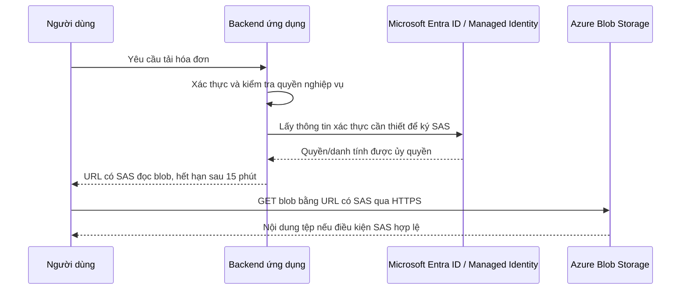
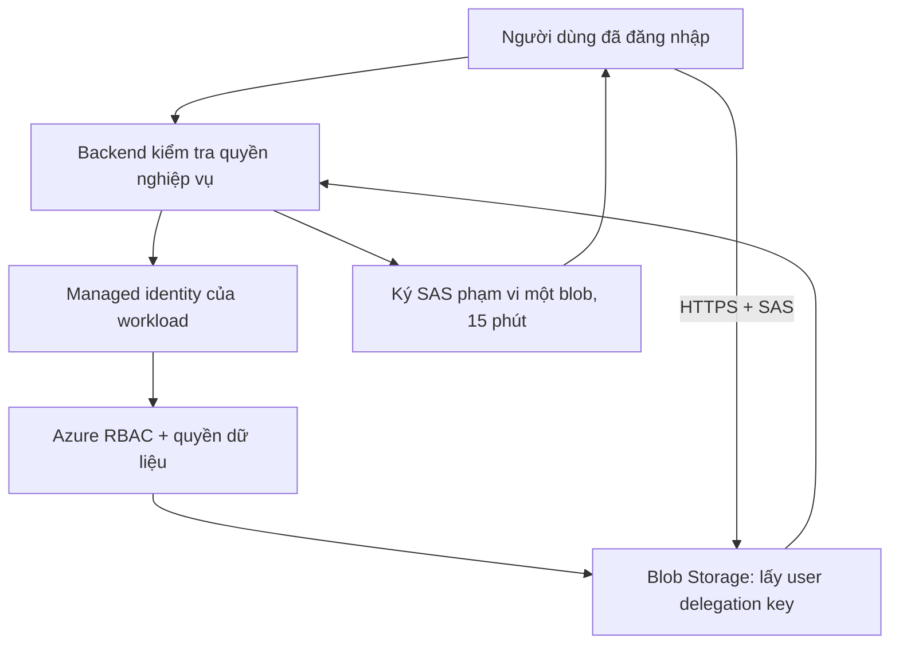
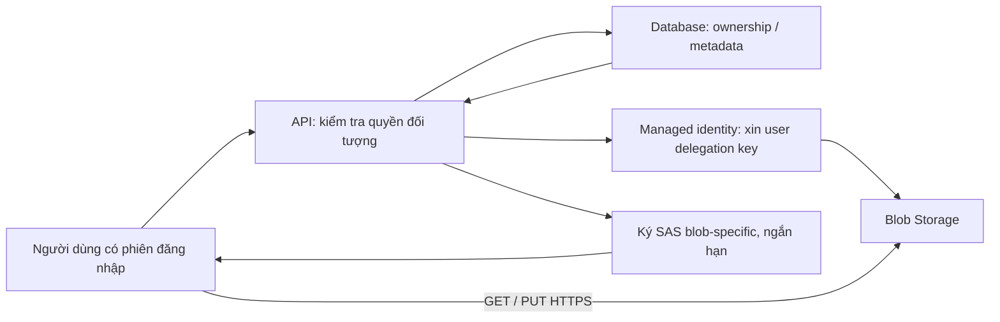

# Truy cập tệp bằng SAS có thời hạn

Trong một ứng dụng triển khai trên Microsoft Azure, người dùng có thể cần tải hóa đơn PDF, gửi ảnh đại diện hoặc chia sẻ tệp cho đối tác trong vài phút. Nếu cho phép tất cả mọi người đọc Blob Storage công khai, dữ liệu có nguy cơ lộ. Nếu cấp tài khoản Azure hoặc storage account key cho từng người tải tệp, phạm vi quyền quá rộng và rất khó thu hồi. **Shared Access Signature (SAS)** giải quyết một phần bài toán này bằng cách cấp **quyền truy cập có giới hạn vào tài nguyên Azure Storage**, thường thông qua một URL được ký và chỉ có hiệu lực trong khoảng thời gian xác định.

Bài học thuộc chương **Lưu trữ đối tượng với Blob Storage** trong hệ sinh thái Microsoft Azure. Nội dung hướng dẫn cách lựa chọn loại SAS, đặt quyền và thời hạn, tạo liên kết tải lên/tải xuống, bảo vệ SAS trong ứng dụng, xử lý lỗi và hiểu chính xác giới hạn của việc thu hồi quyền. Ví dụ sử dụng Azure Blob Storage, Microsoft Entra ID, Azure CLI, Azure RBAC và mạng riêng khi cần.

## Mục tiêu học tập

Sau bài học, bạn có thể:

1. Giải thích SAS là gì và tại sao URL chứa SAS phải được xem như một thông tin bí mật.
2. Phân biệt **user delegation SAS**, **service SAS** và **account SAS**.
3. Hiểu các trường về resource, permission, expiry, protocol và chữ ký trong SAS token.
4. Tạo **user delegation SAS** chỉ đọc cho một blob, hiệu lực trong 15 phút bằng Azure CLI.
5. Thiết kế luồng cấp SAS từ backend để người dùng tải xuống hoặc tải lên trực tiếp Blob Storage.
6. Hiểu sự khác nhau giữa **hết hạn**, **thu hồi khóa**, **stored access policy** và **xóa/đổi quyền tài nguyên**.
7. Chẩn đoán lỗi truy cập SAS và hạn chế nguy cơ rò rỉ qua log, trình duyệt, proxy hoặc cấu hình mạng.

## 1. SAS là gì và giải quyết bài toán nào?

**Shared Access Signature** là một tập tham số được ký bằng khóa phù hợp, cho phép client thực hiện những thao tác được cấp trên tài nguyên Azure Storage. Với Blob Storage, SAS thường được đính vào query string của URL:

```text
https://<storage-account>.blob.core.windows.net/<container>/<blob>?<sas-query-string>
```

URL có SAS cho phép một client truy cập theo các quyền mà chữ ký biểu thị, **không cần cung cấp account key hoặc access token Entra ID riêng cho chính client đó**. Đây là mô hình **capability URL**: người giữ được URL hợp lệ có thể sử dụng các quyền được mã hóa trong token, miễn là các điều kiện khác của Azure Storage cũng được thỏa mãn.

Ví dụ công ty bán hàng muốn khách tải hóa đơn `invoices/invoice-1025.pdf` trong 15 phút. Backend xác thực người dùng và kiểm tra hóa đơn thuộc về họ, sau đó tạo SAS chỉ cho phép đọc đúng blob đó. Khách sử dụng liên kết tải xuống, và sau thời điểm hết hạn, Azure Storage không chấp nhận chữ ký cũ nữa.



Sơ đồ ở mức khái niệm: đối với user delegation SAS, backend dùng danh tính Entra ID có quyền phù hợp để yêu cầu **user delegation key** từ Blob Storage, rồi dùng khóa đó ký SAS. Không phải Microsoft Entra ID trực tiếp ký từng URL Blob SAS. Trình duyệt được cấp URL, **không được nhận khóa dùng để ký**.

### Những điều SAS làm và không làm

- **Làm được:** giới hạn quyền thao tác, tài nguyên, thời gian, giao thức và có thể giới hạn IP nguồn trong kịch bản phù hợp.
- **Không làm được:** xác thực từng người sử dụng URL sau khi phát hành; ai có URL vẫn có thể sử dụng trong phạm vi quyền nếu các điều kiện được thỏa mãn.
- **Không làm được:** tự giới hạn số lần tải xuống còn một lần; nhiều GET hợp lệ có thể xảy ra trước khi hết hạn.
- **Không thay thế:** phân quyền nghiệp vụ ở backend, network firewall, antivirus quét file, mã hóa TLS, Azure RBAC hoặc quy trình giám sát.

**SAS là quyền được ủy thác có giới hạn, không phải giấy phép công khai dữ liệu.** Một blob nằm trong container private vẫn có thể được đọc bằng SAS hợp lệ; ngược lại, tắt anonymous public access không vô hiệu hóa những request được ủy quyền bằng SAS.

## 2. Ba loại SAS và khi nào sử dụng

Azure Storage hỗ trợ các cơ chế SAS khác nhau. Lựa chọn phụ thuộc vào loại dịch vụ, nguồn khóa ký và phạm vi cần cấp.

| Loại SAS | Khóa/ủy quyền dùng để ký | Phạm vi điển hình | Điểm cần lưu ý |
|---|---|---|---|
| **User delegation SAS** | **User delegation key** được Blob Storage cấp sau khi caller xác thực bằng Microsoft Entra ID. | Blob hoặc container được hỗ trợ trong Blob Storage/ADLS Gen2. | **Ưu tiên khi có thể**; không cần trao hoặc dùng storage account key để ký. |
| **Service SAS** | Khóa của storage account (**Shared Key**). | Một tài nguyên trong dịch vụ Storage, ví dụ blob/container. | Có thể gắn **stored access policy** cho một số loại tài nguyên/dịch vụ được hỗ trợ. |
| **Account SAS** | Khóa của storage account (**Shared Key**). | Phạm vi lớn hơn: một hoặc nhiều Storage service, resource type và operation được chỉ định. | Dễ cấp quá rộng; stored access policy không áp dụng theo cách của service SAS. |

### 2.1. User delegation SAS: lựa chọn ưu tiên cho Blob Storage

User delegation SAS dùng danh tính Microsoft Entra ID (người dùng, service principal hoặc managed identity), kết hợp quyền Azure RBAC, thay vì yêu cầu ứng dụng giữ account key dài hạn. Với ứng dụng Azure, backend có thể sử dụng **managed identity** để lấy user delegation key, giảm việc lưu bí mật trong mã nguồn.

Những điều kiện chính:

1. Danh tính được phép yêu cầu user delegation key, với action `Microsoft.Storage/storageAccounts/blobServices/generateUserDelegationKey/action` ở **scope storage account hoặc cao hơn** theo cấu hình role assignment.
2. Danh tính có quyền dữ liệu phù hợp với thao tác định cấp, theo cơ chế authorization của Blob Storage.
3. SAS được ký cho đúng resource, quyền, thời gian và giao thức.
4. Storage account, firewall/private endpoint và các chính sách bổ sung tiếp tục được áp dụng khi client gửi request.

Role dựng sẵn như **Storage Blob Data Contributor** có thể dùng cho những kịch bản cần đọc/ghi blob; role **Storage Blob Delegator** chỉ phục vụ việc lấy user delegation key và cần kết hợp quyền dữ liệu phù hợp khi thiết kế truy cập. Không được hiểu rằng quyền `Reader` trên resource group tự động đủ để sinh user delegation SAS hoặc đọc nội dung blob.

**Giới hạn thời gian:** user delegation key có thời hạn tối đa **7 ngày**. User delegation SAS chỉ còn hiệu lực trong giới hạn của user delegation key tương ứng; ngay cả khi SAS ghi expiry dài hơn thì không thể vượt qua giới hạn của key. Trong ví dụ chia sẻ file cho khách, nên dùng thời hạn ngắn như 5–15 phút, không dùng toàn bộ 7 ngày chỉ vì hệ thống cho phép.

### 2.2. Service SAS: khi cần mô hình dựa trên account key

Service SAS được ký bằng storage account key và dùng cho tài nguyên của một dịch vụ. Với Blob Storage, có thể tạo SAS cho blob hoặc container. Trong một số mô hình, service SAS tham chiếu **stored access policy** được định nghĩa ở container; từ đó quản trị viên có thể thay đổi hoặc xóa policy để tác động đến các SAS tham chiếu policy đó.

Nhược điểm là ứng dụng ký SAS cần tiếp cận account key hoặc một thành phần ký có quyền sử dụng key. Account key cấp năng lực rộng hơn nhiều so với một URL SAS, vì vậy phải bảo vệ cực kỳ nghiêm ngặt. Nếu tổ chức **tắt Shared Key authorization** trên storage account, những cách truy cập dựa trên account key như service SAS/account SAS sẽ không dùng được theo chính sách này; cần chọn user delegation SAS hoặc cơ chế hỗ trợ khác.

### 2.3. Account SAS: phạm vi rộng và cần thận trọng

Account SAS có thể cho phép thao tác trên nhiều service và resource type trong storage account theo các tham số của chữ ký. Ví dụ một token có thể đại diện cho nhiều hoạt động ở cấp container/blob thay vì chỉ một file. Đây là lựa chọn khó bảo đảm least privilege nếu mục tiêu chỉ là “cho khách đọc một hóa đơn”.

**Quy tắc thực hành:** với download/upload một file Blob cụ thể, ưu tiên **user delegation SAS giới hạn tới đúng blob**. Chỉ đánh giá service/account SAS khi workload thực sự cần và đã kiểm tra phạm vi quyền, cách lưu key, chính sách Shared Key và kế hoạch thu hồi.

## 3. Cấu trúc SAS URL

Một URL minh họa (chữ ký bên dưới chỉ là placeholder, không phải token sử dụng được):

```text
https://stappdemo.blob.core.windows.net/invoices/invoice-1025.pdf
  ?sv=<service-version>
  &sr=b
  &sp=r
  &st=<utc-start-time>
  &se=<utc-expiry-time>
  &spr=https
  &sig=<url-encoded-signature>
```

**Khi sử dụng thực tế, URL phải nằm trên một dòng** và được tạo bởi SDK/CLI đáng tin cậy; không tự nối chữ ký hoặc thay đổi thứ tự/cách encode tùy tiện. Bộ tham số thực tế phụ thuộc loại SAS và phiên bản Storage API. Một user delegation SAS còn có các trường mô tả delegation key, chẳng hạn `skoid`, `sktid`, `skt`, `ske`, `sks`, `skv`.

| Trường | Ý nghĩa điển hình | Lưu ý |
|---|---|---|
| `sv` | Phiên bản dịch vụ Storage dùng để diễn giải SAS. | Không giống thời hạn. |
| `sr` | **Signed resource**, ví dụ `b` là blob, `c` là container trong các kịch bản tương ứng. | Chọn phạm vi hẹp. |
| `sp` | **Signed permissions**, ví dụ `r` là read, `w` là write, `c` là create, `d` là delete theo loại SAS/resource hỗ trợ. | Không cấp `w`/`d` khi chỉ cần tải xuống. |
| `st` | Thời điểm bắt đầu hiệu lực (UTC), có thể không cần trong một số cách tạo SAS. | Nếu đặt sát thời điểm hiện tại, có thể gặp clock skew. |
| `se` | Thời điểm kết thúc hiệu lực (UTC). | Chọn ngắn theo thời gian tải/chức năng. |
| `spr` | Protocol được phép, có thể giới hạn `https`. | Kết hợp bật secure transfer trên account. |
| `sip` | Dải IP nguồn được phép khi áp dụng. | Phải xét NAT/proxy, mạng và đường đi thực tế. |
| `sig` | Chữ ký mật mã xác thực token. | Đây là thành phần nhạy cảm; không chia sẻ/log. |
| `si` | ID của stored access policy nếu service SAS dùng policy. | Không áp dụng chung cho mọi loại SAS. |

SAS giống một vé có **phạm vi** (resource), **hành động được phép** (permission), **cửa sổ hiệu lực** (time), và **điều kiện** (protocol/IP). Ví dụ `sp=r&sr=b` phù hợp với một lần tải file cụ thể hơn `sp=rwd` trên cả container.

### 3.1. Thời hạn và đồng hồ hệ thống

Thời gian SAS sử dụng UTC. Nên dùng công cụ tạo thời gian UTC đúng định dạng được Azure Storage chấp nhận. Nếu đặt `st` đúng thời điểm vừa phát hành, sai lệch vài phút giữa đồng hồ các hệ thống có thể tạo lỗi **SAS chưa có hiệu lực**. Với trường hợp không cần khóa cửa sổ hiệu lực chính xác, có thể bỏ `st` theo API/tool hỗ trợ hoặc chọn thời điểm bắt đầu lùi vài phút trong phạm vi chính sách.

Trong nhiều trường hợp, chỉ cần đặt expiry ngắn. Không lấy thời gian địa phương rồi gắn chữ `Z` nếu chưa chuyển sang UTC. Nếu ứng dụng gửi tệp lớn qua mạng chậm, hãy thiết kế thời hạn vừa đủ để bắt đầu và hoàn tất thao tác theo hành vi của dịch vụ, tránh tạo SAS kéo dài hàng ngày vì sợ timeout.

### 3.2. Quyền tối thiểu theo thao tác

| Nhu cầu | Phạm vi gợi ý | Quyền gợi ý | Cảnh báo |
|---|---|---|---|
| Người dùng tải một hóa đơn | Một blob | `r` | Tránh cấp quyền liệt kê cả container. |
| Người dùng tải file do chính mình tạo lên | Một blob đích chưa tồn tại | `c`/`w` theo API thao tác, thường `cw` cho upload BlockBlob | Không cấp quyền `d` hay liệt kê container. |
| Nhân viên cần liệt kê và tải một tập tài liệu | Container hoặc nhiều URL riêng theo nhu cầu | Quyền list/read phù hợp | Cân nhắc mức độ nhạy cảm nếu dùng container SAS. |
| Xóa tệp | Một blob hoặc scope hẹp khác | `d` khi thực sự cần | Nên ưu tiên yêu cầu backend xác thực và thực hiện xóa có audit thay vì cấp SAS xóa ra client. |

**Permissions của SAS phải khớp operation cụ thể.** Một upload dùng `PUT Blob`, `Put Block` hoặc `Put Block List` có yêu cầu khác nhau về quyền; nên kiểm thử với client/API thật. Không đoán rằng chỉ cần `r` là ghi được hoặc `w` luôn đủ mọi cách tạo blob mới.

## 4. Thiết kế quyền với Microsoft Entra ID và Azure RBAC

Trước khi tạo SAS, backend cần có danh tính và quyền thích hợp để yêu cầu khóa ủy quyền. Trong kiến trúc cloud-native:



Đây là hai lớp authorization **khác nhau**:

1. **Authorization nghiệp vụ ở API:** user A có quyền xem hóa đơn của chính họ, nhưng không được nhập tên blob bất kỳ để xem tài liệu của user B.
2. **Authorization ở Azure Storage:** một SAS đã phát hành phải giới hạn tài nguyên/thao tác/thời gian, và request vẫn chịu kiểm soát của Storage.

Backend tuyệt đối không tin tên blob do client truyền lên mà không đối chiếu ownership trong database. Ví dụ `/download?blob=customers/another-user/passport.pdf` phải bị từ chối nếu người gọi không được phép, **trước khi** phát hành SAS.

### 4.1. Quyền yêu cầu user delegation key

Để yêu cầu user delegation key, principal cần được cấp action:

```text
Microsoft.Storage/storageAccounts/blobServices/generateUserDelegationKey/action
```

Action này cần có hiệu lực ở scope **storage account hoặc cao hơn**. Nếu ứng dụng còn cần thao tác với blobs, cần kiểm tra quyền data plane phù hợp tại phạm vi dữ liệu. Với môi trường phân quyền nghiêm ngặt, có thể dùng role chuyên biệt để lấy delegation key và role data-plane riêng để giới hạn loại dữ liệu cần truy cập; chính sách phải được đánh giá theo hợp đồng authorization của dịch vụ.

SAS tự nó không yêu cầu client phải có role assignment Azure RBAC riêng. Tuy nhiên, **người tạo user delegation SAS và quyền được ký** chịu sự kiểm soát từ danh tính và mô hình cấp quyền của Azure Storage. Không được nhầm quyền tạo SAS với việc cấp cho mọi client quyền Azure RBAC tại subscription.

### 4.2. Dùng managed identity thay cho secret dài hạn

Trong Azure App Service, Functions, VM hoặc một workload hỗ trợ, quản trị viên có thể bật managed identity và gán role phù hợp cho workload. Ứng dụng dùng SDK Azure Identity để lấy token, yêu cầu user delegation key và ký SAS. Không cần đặt account key trong biến môi trường hoặc repository.

**Managed identity không tự cấp quyền:** sau khi bật identity, phải gán đúng role và scope cho Storage, kiểm tra thời gian lan truyền role assignment và thử operation cụ thể. Nếu ứng dụng có nhiều tài nguyên, nên tách danh tính hoặc scope để giảm ảnh hưởng khi một service bị xâm nhập.

## 5. Thực hành: tạo user delegation SAS đọc một blob trong 15 phút

Ví dụ dùng **Azure Cloud Shell (Bash)** hoặc máy Linux có Azure CLI, lệnh `date` GNU và `curl`. Bạn cần một storage account, container và blob đã tồn tại; tài khoản thực hành có quyền **data plane** và quyền tạo user delegation key phù hợp. Các thao tác CLI dưới đây chỉ được thực hiện trên tài nguyên thử nghiệm của bạn.

### 5.1. Chuẩn bị môi trường

```bash
az login
az account list --output table
az account set --subscription "<subscription-id>"

ACCOUNT="<storage-account-name>"
CONTAINER="private-documents"
BLOB="invoice-1025.pdf"
```

Nếu sử dụng Cloud Shell, phiên đã đăng nhập sẵn có thể không cần `az login` lần nữa. `ACCOUNT` phải là tên storage account thật, `CONTAINER` phải tồn tại và chứa blob `invoice-1025.pdf` hoặc thay bằng tên file thử nghiệm.

### 5.2. Kiểm tra quyền đọc Blob bằng Entra ID

```bash
az storage blob show \
  --account-name "$ACCOUNT" \
  --container-name "$CONTAINER" \
  --name "$BLOB" \
  --auth-mode login \
  --query "{name:name,contentLength:properties.contentLength}" \
  --output json
```

Lệnh yêu cầu quyền đọc dữ liệu phù hợp. Nếu gặp `403`, đừng tự chuyển sang account key cho nhanh: hãy kiểm tra role assignment, scope, storage network restrictions và danh tính CLI hiện tại. **Có quyền đọc một blob không đồng nghĩa tự động có quyền yêu cầu user delegation key** nếu role chỉ gán ở scope container.

### 5.3. Tạo expiry UTC và SAS chỉ đọc

Sử dụng thời điểm 15 phút kể từ hiện tại, không đặt `st` để giảm rủi ro lệch đồng hồ trong ví dụ:

```bash
EXPIRY="$(date -u -d '+15 minutes' '+%Y-%m-%dT%H:%MZ')"

SIGNED_URL="$(az storage blob generate-sas \
  --account-name "$ACCOUNT" \
  --container-name "$CONTAINER" \
  --name "$BLOB" \
  --permissions r \
  --expiry "$EXPIRY" \
  --https-only \
  --auth-mode login \
  --as-user \
  --full-uri \
  --output tsv)"
```

Giải thích các tham số:

- `--permissions r`: chỉ cho phép đọc blob.
- `--expiry`: thời điểm hết hạn (UTC), được tạo động để không dùng một ngày đã qua.
- `--https-only`: ràng buộc sử dụng HTTPS.
- `--auth-mode login --as-user`: sử dụng phiên đăng nhập Microsoft Entra ID và **user delegation SAS**, không dùng account key để ký.
- `--full-uri`: nhận URL đầy đủ, bao gồm SAS query string.

**Không chạy `echo "$SIGNED_URL"` vào log CI/CD, terminal được ghi hình hoặc ticket hỗ trợ.** Biến môi trường chứa toàn bộ SAS URL là một bearer credential trong thời gian hiệu lực. Kết quả của lệnh nên chỉ được trả cho đúng client được ủy quyền qua kênh an toàn.

### 5.4. Tải tệp bằng URL có SAS

```bash
curl --fail --silent --show-error \
  --output "./downloaded-invoice.pdf" \
  "$SIGNED_URL"

unset SIGNED_URL
```

Nếu câu lệnh thành công, client tải được blob mà **không cần** truyền thêm account key hoặc Authorization header của Entra ID. `curl` được dùng qua HTTPS, giữ URL trong dấu ngoặc kép để dấu `&` trong query string không bị shell tách thành các lệnh nền.

**Lưu ý:** ví dụ dùng Azure Cloud Shell Bash/GNU `date`. Trên macOS/BSD, cú pháp `date -d` có thể không được hỗ trợ; cần thay bằng cách tính UTC tương đương hoặc sử dụng SDK tạo datetime UTC. Việc xóa biến khỏi shell không thu hồi một SAS đã phát hành.

### 5.5. Những lỗi dễ gặp

- `AuthorizationPermissionMismatch`: danh tính ký SAS chưa có quyền phù hợp hoặc chữ ký đã cấp operation không đúng, ví dụ tải về nhưng thiếu `r`.
- `AuthenticationFailed`: token/chữ ký không hợp lệ, bị đổi khi copy/paste hoặc trường thời gian sai.
- `AuthorizationFailure`: account firewall, endpoint/network hoặc những hạn chế bổ sung có thể từ chối request.
- `ResourceNotFound`/`BlobNotFound`: tên account/container/blob sai hoặc blob đã được xóa.
- `403` sau 15 phút: có thể do SAS hết hạn, cần đọc mã lỗi XML/response và kiểm tra thời gian thay vì chỉ thấy HTTP 403.

Khi cần debug, chỉ log **request ID, HTTP status, mã lỗi, resource đã che thông tin nhạy cảm và thời gian**; không log nguyên URL chứa `sig`.

## 6. Ví dụ upload file bằng SAS có thời hạn

Với chức năng “khách tải ảnh lên”, backend có thể phát hành một SAS cho **blob đích cụ thể** như `uploads/user-42/photo-unique-id.jpg`, chứ không cho quyền ghi tùy ý toàn container.

Mô hình upload an toàn:

1. Client đăng nhập vào API bằng cơ chế của ứng dụng.
2. API kiểm tra quyền, hạn mức, định dạng dự kiến và tạo **blob name duy nhất**, tránh client ghi đè file của người khác.
3. API cấp SAS có quyền **create/write** phù hợp với API upload và thời hạn ngắn.
4. Client gửi `PUT Blob` trực tiếp tới Azure Blob Storage bằng URL có SAS.
5. API xác minh blob tồn tại, kiểm tra kích thước, content type và quét nội dung nếu chính sách yêu cầu **trước khi** đưa file vào luồng xử lý tin cậy.

Ví dụ CLI tạo URL upload cho một blob mới:

```bash
ACCOUNT="<storage-account-name>"
CONTAINER="uploads"
BLOB="user-42/photo-unique-id.jpg"
EXPIRY="$(date -u -d '+10 minutes' '+%Y-%m-%dT%H:%MZ')"

UPLOAD_URL="$(az storage blob generate-sas \
  --account-name "$ACCOUNT" \
  --container-name "$CONTAINER" \
  --name "$BLOB" \
  --permissions cw \
  --expiry "$EXPIRY" \
  --https-only \
  --as-user \
  --auth-mode login \
  --full-uri \
  --output tsv)"
```

Sau đó client dùng Blob REST API `PUT` tạo một block blob mới:

```bash
curl --fail --silent --show-error \
  --request PUT \
  --header "x-ms-blob-type: BlockBlob" \
  --header "Content-Type: image/jpeg" \
  --data-binary "@./photo.jpg" \
  "$UPLOAD_URL"

unset UPLOAD_URL
```

`c` là quyền tạo và `w` là quyền ghi, phù hợp với nhiều tình huống upload block blob. **Quyền chính xác phải kiểm tra theo operation REST hoặc SDK được sử dụng.** Nếu client upload theo block nhiều phần (`Put Block`/`Put Block List`), cần kiểm tra giới hạn kích thước, thứ tự thao tác và quyền tương ứng.

Không sử dụng token cấp quyền `d` (delete) hoặc `l` (list) nếu chỉ cần upload một file. Một URL chỉ ghi cũng không tự bảo đảm file an toàn: backend vẫn phải thực hiện **authorization và content validation**, có thể áp dụng upload staging container, chính sách giới hạn dung lượng và kiểm tra mã độc theo yêu cầu.

### 6.1. CORS khi upload trực tiếp từ trình duyệt

Khi JavaScript trong trình duyệt gọi Azure Blob Storage từ origin khác origin của website, **Cross-Origin Resource Sharing (CORS)** có thể chặn request mặc dù SAS vẫn hợp lệ. Cần cấu hình CORS cho Blob service, cho phép đúng origin, method và header mà client sử dụng (ví dụ `PUT` và `x-ms-blob-type`).

CORS là chính sách trình duyệt; **không phải cơ chế authorization thay thế SAS**. Đừng mở mọi origin `*` chỉ để khắc phục CORS khi ứng dụng có yêu cầu bảo mật cụ thể.

## 7. Thiết kế backend phát hành SAS cho ứng dụng

Không phải client nào cũng nên tự sinh SAS. Trong kiến trúc bảo mật, backend hoặc một dịch vụ phát hành liên kết đóng vai trò **SAS issuer**. Client chỉ nhận URL sau khi backend xác thực và kiểm tra quyền.



### Pseudocode cấp link tải hóa đơn

```text
function issueDownloadUrl(authenticatedUser, invoiceId):
    invoice = database.findInvoice(invoiceId)
    if invoice is null:
        return 404
    if not canReadInvoice(authenticatedUser, invoice):
        return 403

    blob = invoice.storageBlobName  // Lấy từ dữ liệu tin cậy
    delegationKey = blobService.getUserDelegationKey(
        managedIdentity,
        duration = shortKeyLifetime
    )

    sas = signUserDelegationSas(
        container = invoice.container,
        blobName = blob,
        permissions = READ_ONLY,
        expiresUtc = nowUtc() + 15 minutes,
        protocol = HTTPS_ONLY,
        delegationKey = delegationKey
    )

    audit('issued-download-link', authenticatedUser.id, invoiceId)
    return { url: blobUrl(blob) + '?' + sas, expiresAt: expiresUtc }
```

Pseudocode mô tả luồng nghiệp vụ, không phải cú pháp SDK của một ngôn ngữ cụ thể. Khi triển khai, dùng SDK Azure Storage chính thức để tạo user delegation SAS và encode URL đúng cách, đồng thời **không ghi SAS/token hoặc delegation key vào audit log**. Có thể cache user delegation key trong khoảng hiệu lực được cấp để tránh xin key cho mỗi request, nhưng phải bảo vệ key và giới hạn vòng đời của nó.

### 7.1. Đảm bảo phạm vi tài nguyên

Đừng để client gửi nguyên đường dẫn tùy ý và nhận SAS ngay. Backend nên tra cứu mapping giữa ID nghiệp vụ và blob path từ database đáng tin cậy, kiểm tra tenant/organization ID và quyền sở hữu. Nếu dùng chung một container cho nhiều khách hàng, đặt prefix có tổ chức giúp quản lý dữ liệu, nhưng **prefix đặt tên không tự là ranh giới phân quyền**: việc cấp SAS phải đúng blob hoặc phạm vi được phép.

### 7.2. Tránh tạo URL quá rộng hoặc quá dài hạn

Đối với hóa đơn, ảnh hồ sơ hoặc tệp bí mật, backend nên cấp từng link ngắn hạn theo hành động của người dùng. Nếu cần tải nhiều file, có thể cân nhắc backend chuẩn bị một file ZIP có thời hạn hoặc cấp tập URL riêng từng blob, thay vì SAS cho cả container mà không kiểm tra quyền từng tài liệu.

### 7.3. Thiết kế sử dụng URL trong frontend

- Chỉ nhận SAS qua **HTTPS** từ API đã xác thực.
- Không lưu SAS vào local storage lâu dài hoặc gửi nó cho analytics bên thứ ba.
- Tránh đưa URL chứa SAS vào log truy cập, crash report, breadcrumbs và công cụ ghi lại phiên người dùng.
- Hạn chế tải qua trang trung gian có thể gửi URL trong `Referer`; áp dụng Referrer-Policy phù hợp với luồng browser của ứng dụng.
- Với file nhạy cảm, xem xét phương án **backend streaming/proxy có xác thực** thay vì SAS trực tiếp nếu cần kiểm soát chi tiết từng lượt tải hoặc thu hồi tức thì.

## 8. Hết hạn và thu hồi SAS: cần hiểu đúng giới hạn

**Hết hạn tự nhiên** là phương pháp đơn giản nhất để giới hạn exposure. Tuy nhiên, có những tình huống phải thu hồi link trước khi hết hạn, ví dụ phát hiện email chứa SAS gửi nhầm cho người không có quyền.

| Cơ chế | User delegation SAS | Service SAS | Account SAS |
|---|---|---|---|
| Chờ `se` hết hạn | Có | Có | Có |
| Stored access policy | **Không áp dụng** | **Có trong các kịch bản hỗ trợ** | **Không áp dụng** |
| Thu hồi user delegation keys tại storage account | Có thể vô hiệu hóa SAS liên quan theo cơ chế dịch vụ, ảnh hưởng phạm vi rộng | Không | Không |
| Xoay vòng storage account key dùng để ký | Không phải cách thu hồi user delegation SAS | Có, nhưng ảnh hưởng mọi SAS/ứng dụng ký bằng key bị đổi | Có, nhưng ảnh hưởng mọi SAS/ứng dụng ký bằng key bị đổi |
| Thu hồi từng URL lập tức bằng một nút chung | Không có cơ chế token-level chung | Chỉ có thể quản lý gián tiếp qua policy hoặc khóa khi thiết kế phù hợp | Không có cơ chế token-level chung |

### 8.1. Thu hồi user delegation SAS

User delegation SAS không tham chiếu stored access policy. Có thể sử dụng khả năng **revoke user delegation keys** của storage account để làm mất hiệu lực các SAS dùng những key tương ứng, theo hành vi dịch vụ. Đây là thao tác **phạm vi rộng**, có thể khiến nhiều ứng dụng hoặc nhiều link khác bị lỗi, không phải nút “hủy một URL”. Cần kiểm tra quyền quản trị, tác động, quá trình lan truyền thay đổi và kế hoạch phát hành lại link hợp lệ trước khi thực hiện.

Không mặc định rằng chỉ cần xóa role assignment hoặc chặn người tạo SAS là **mọi SAS đã phát hành ngay lập tức bị vô hiệu hóa**. Khi xử lý sự cố, phải kiểm tra cơ chế key, cache và thời hạn còn lại; cần thiết kế khả năng thu hồi chủ động ngay từ đầu nếu nghiệp vụ yêu cầu.

### 8.2. Thu hồi service SAS qua stored access policy

Trong các mô hình Blob **service SAS** hỗ trợ stored access policy ở container, SAS có thể tham chiếu ID của policy (`si`). Thay đổi/xóa policy có thể ảnh hưởng đến những SAS sử dụng policy đó, giúp quản lý hàng loạt link. Đây không phải đặc tính của user delegation SAS hay account SAS. Cần cân nhắc giới hạn số policy, phạm vi dùng chung và độ trễ áp dụng thay đổi.

Nếu service SAS được ký trực tiếp với thời gian/quyền riêng và **không tham chiếu policy**, xóa một policy không liên quan sẽ không thu hồi URL đó.

### 8.3. Xoay vòng account key

Regenerate storage account key có thể làm vô hiệu hóa những SAS được ký bằng key cũ. Nhưng account key cũng có thể đang được ứng dụng, automation hoặc job khác sử dụng; xoay vòng không có kế hoạch có thể gây gián đoạn diện rộng. Ưu tiên định danh Entra ID, managed identity và user delegation SAS để giảm phụ thuộc vào Shared Key.

### 8.4. Khi cần thu hồi ngay từng lượt truy cập

Nếu hợp đồng nghiệp vụ yêu cầu link bị hủy tức thì theo người dùng hoặc chỉ tải một lần, **SAS đơn lẻ thường không đủ**. Cân nhắc:

- Backend kiểm tra phiên và quyền với từng request rồi proxy/stream file.
- Backend lưu bản ghi link và kiểm tra token nghiệp vụ một lần trước khi phát hành một SAS ngắn hạn.
- Kết hợp thay đổi quyền blob, di chuyển/xóa đối tượng có kiểm soát hoặc chiến lược token phát hành rất ngắn; đánh giá ảnh hưởng lên client hợp lệ.

Hết hạn SAS và việc client đã tải tệp về cũng là hai sự kiện khác nhau. Sau khi tệp đã được tải xuống thiết bị, **thu hồi SAS không tự xóa bản sao đã tải**.

## 9. Các lớp bảo mật bổ sung khi dùng SAS

### 9.1. HTTPS và phạm vi mạng

Luôn sử dụng HTTPS và đặt `spr=https` khi tạo SAS nếu công cụ hỗ trợ. Bật **Secure transfer required** của storage account để giảm nguy cơ truyền token/dữ liệu qua HTTP. Với hệ thống nội bộ, có thể kết hợp Private Endpoint, firewall và quy tắc mạng; **SAS không vượt qua giới hạn network** mà storage account áp dụng.

Nếu SAS bị giới hạn bằng `sip`, cần hiểu IP mà Azure Storage nhìn thấy có thể là IP của NAT gateway hoặc proxy, không phải IP LAN của thiết bị. Các đường đi qua Private Endpoint có hành vi định tuyến khác với public endpoint; hãy kiểm thử điều kiện IP thực tế. Không bật giới hạn IP máy khách một cách cứng nhắc nếu người dùng thường xuyên đổi mạng hoặc truy cập qua CDN/proxy.

### 9.2. Không cấp account key cho frontend

Account key có mức quyền rộng và cho phép ký nhiều SAS. Không đưa account key, connection string chứa key hay user delegation key vào JavaScript, app mobile, repository, ticket hoặc response API. **Frontend chỉ nên thấy SAS đã giới hạn**, backend phải giữ năng lực ký và dùng danh tính có quyền tối thiểu.

### 9.3. Bảo vệ SAS khỏi rò rỉ qua hệ thống khác

Vì SAS nằm ở query string, nó dễ bị vô tình lưu vào:

- Reverse-proxy access logs, CDN logs hoặc APM traces.
- URL analytics, error telemetry, crash reporting.
- Lịch sử trình duyệt, ảnh chụp màn hình, email hoặc ứng dụng chat.
- HTTP Referer trong những luồng điều hướng không được kiểm soát.

Nên cấu hình redaction `sig` và những tham số SAS, ẩn query string trong log và đặt retention phù hợp. Không đưa một URL đang có hiệu lực vào tài liệu hướng dẫn hoặc bài test công khai.

### 9.4. Bảo vệ trước upload độc hại

SAS có quyền ghi cho phép client truyền dữ liệu lên đúng phạm vi ký, nhưng không bảo đảm nội dung là ảnh hay PDF sạch. Không tin `Content-Type` do client gửi; phải xác minh magic bytes/format, kích thước, nội dung theo nghiệp vụ và quét malware khi yêu cầu. Có thể dùng container staging và chỉ chuyển file sang vùng sử dụng sau khi kiểm tra thành công.

## 10. Giám sát, kiểm toán và chi phí

Để vận hành SAS an toàn, cần biết ai được API **phát hành quyền**, lúc nào và tới đối tượng nào. Azure Storage nhìn thấy request SAS nhưng có thể không biết user nghiệp vụ nào đang cầm URL trong mọi tình huống; vì vậy cần kết hợp audit ở backend.

| Nguồn thông tin | Nên ghi nhận | Không nên ghi |
|---|---|---|
| **Backend audit** | User ID, document ID, hành động, scope, expiry, request/correlation ID. | URL có SAS đầy đủ, delegation key hoặc account key. |
| **Storage diagnostics/logs** | Thời điểm, operation, kết quả, status code, resource path đã được bảo vệ và request ID theo cấu hình. | SAS signature hoặc query string nguyên vẹn ở nơi truy cập rộng. |
| **Azure Monitor / Defender** | Tỷ lệ lỗi 403/404, lưu lượng bất thường, spike download/upload, tín hiệu rủi ro theo khả năng dịch vụ. | Dữ liệu cá nhân hoặc secret không cần thiết. |
| **Cost Management** | Dung lượng lưu, số thao tác, dữ liệu truyền ra ngoài, chi phí dựa trên tier và region. | Không lưu token ở hệ thống tài chính. |

SAS bản thân thường không phải một sản phẩm được tính phí riêng theo số token phát hành, nhưng **các thao tác đọc/ghi dữ liệu, dung lượng, băng thông/egress và các tính năng Storage liên quan vẫn có thể tạo chi phí**. Một URL bị lộ có thể bị sử dụng lặp lại, dẫn đến cả rủi ro dữ liệu và hóa đơn tăng. Giới hạn thời hạn, phạm vi và lượng dữ liệu ở tầng ứng dụng, theo dõi các download bất thường.

## 11. Xử lý sự cố có hệ thống

Khi URL SAS không hoạt động, **không** khắc phục bằng cách tự động bật anonymous public access hoặc gửi account key cho client. Hãy phân tích từng lớp.

| Triệu chứng | Nguyên nhân thường gặp | Cách xử lý |
|---|---|---|
| `403 AuthenticationFailed` | Chữ ký bị sửa, URL encode sai, dùng key không phù hợp, phiên bản không tương thích. | Tạo lại token bằng SDK/CLI, giữ nguyên toàn bộ query và kiểm tra UTC. |
| `403` trước khi đến `se` | `st` ở tương lai do clock skew; sai permission; network restriction; account policy. | Đọc mã lỗi thực tế, kiểm tra `st`/`se`, `sp`, `spr`, firewall và shared-key policy. |
| `403` sau khi hết hạn | SAS expired hoặc user delegation key hết hiệu lực. | Phát hành SAS mới sau khi xác thực lại user; không kéo dài token cũ bằng sửa query. |
| `404 BlobNotFound` | Blob name/container sai, URL bị encode sai hoặc đối tượng đã xóa. | So sánh exact blob path và kiểm tra tồn tại bằng danh tính quản trị phù hợp. |
| Upload bị `403` nhưng download được | SAS chỉ có quyền `r`, thiếu create/write theo operation. | Cấp quyền tối thiểu đúng cho phương thức upload và thử lại. |
| Browser báo CORS, CLI tải được | CORS Blob service chưa cho phép origin/method/header. | Cấu hình CORS hẹp, không sửa SAS thành quyền rộng. |
| Thành công từ Azure VM nhưng thất bại từ laptop | Storage firewall, Private Endpoint/DNS, tuyến mạng hoặc điều kiện IP. | Kiểm tra public/private endpoint và IP nguồn nhìn thấy bởi Storage. |
| Link quá dài hoặc bị cắt mất dấu `&` | Copy qua chat/email, HTML escaping hoặc shell không quote URL. | Dùng URL do SDK trả về, encode đúng, giữ trong dấu ngoặc kép. |
| Service SAS không bị thu hồi sau khi sửa policy khác | SAS không liên kết policy đó hoặc thay đổi chưa lan truyền. | Kiểm tra `si` và policy thực sự tham chiếu. |

### Quy trình kiểm tra từng bước

1. Xác nhận URL trỏ đúng **account → container → blob** và không bị cắt/encode sai.
2. Đọc `sp` (permission), `sr` (resource), `se` và `st` theo UTC; không công khai `sig`.
3. Kiểm tra SAS thuộc loại nào: user delegation, service hay account; chọn cơ chế ký/thu hồi tương ứng.
4. Đọc HTTP status và **error code** do Storage trả về, ghi request ID để đối chiếu log.
5. Kiểm tra Shared Key access policy, RBAC/data-plane permission và user delegation key khi tạo SAS.
6. Kiểm tra network firewall, Private Endpoint, DNS, HTTPS/TLS và giới hạn IP nguồn.
7. Nếu trình duyệt thất bại nhưng `curl` thành công, kiểm tra **CORS** và request headers.
8. Sau khi sửa, thử bằng một SAS mới thật ngắn trong môi trường được phép; không làm lộ token cũ.

## 12. Những nhầm lẫn phổ biến

- **“Có URL SAS thì chắc chắn ai cũng truy cập được.”** Sai: URL còn phải trong thời gian hiệu lực, có đúng quyền, chữ ký hợp lệ và thỏa mãn network/account restrictions.
- **“SAS là tài khoản đăng nhập của người dùng.”** Sai: SAS là token trao quyền cho người giữ URL; backend phải xác thực và phân quyền nghiệp vụ trước khi phát hành.
- **“Chỉ cần `se` là chắc chắn chỉ tải được một lần.”** Sai: SAS thường được sử dụng nhiều lần trong thời gian còn hiệu lực; không có mặc định một-lần-sử-dụng.
- **“User delegation SAS dùng stored access policy.”** Sai: stored access policy áp dụng cho một số kịch bản service SAS, không cho user delegation SAS.
- **“Xóa quyền RBAC của người tạo SAS thì mọi link cũ biến mất ngay.”** Không thể giả định như vậy; phải hiểu trạng thái delegation key, thời hạn và cơ chế revoke.
- **“Đổi storage account key là thao tác thu hồi không ảnh hưởng ai khác.”** Sai: có thể phá các client khác dùng key và SAS được ký bằng key đó.
- **“Tắt public blob access là ngăn mọi SAS.”** Sai: cấm anonymous public access không đồng nghĩa chặn request được ủy quyền đúng cách.
- **“CORS cho phép là đủ bảo vệ blob.”** Sai: CORS là chính sách phía trình duyệt, cần SAS/RBAC và network policy.
- **“HTTPS chỉ cần ở API, SAS có thể gửi qua HTTP.”** Sai: SAS token trên HTTP có thể bị lộ trên đường truyền; cần HTTPS và bảo vệ token đầu cuối.

## 13. Bài tập tình huống

Một bệnh viện lưu tài liệu kết quả khám trong container private trên Azure Blob Storage. Người dùng đăng nhập ứng dụng, chỉ được tải file của mình và link cần hết hạn sau 10 phút. Hệ thống phải giảm nguy cơ mất tài khoản lưu trữ, không cho client liệt kê container và cần ghi nhận mỗi lần cấp link.

**Thiết kế đề xuất:**

1. Người dùng xác thực tại API. API lấy file ID, kiểm tra ownership và quyền theo chính sách ứng dụng.
2. API dùng managed identity với role Azure RBAC tối thiểu để xin **user delegation key** và ký SAS cho đúng blob.
3. Đặt `sp=r`, `sr=b`, `se=UTC now + 10 minutes`, `spr=https`; không cấp `l`, `w`, `d`.
4. API trả URL qua HTTPS và audit user ID/document ID/expiry nhưng **không log URL chứa SAS**.
5. Azure Blob Storage vẫn chỉ cho phép request hợp lệ theo Storage authentication, firewall/private access và các chính sách đã thiết lập.
6. Nếu phải thu hồi **từng link** ngay lập tức, chuyển sang mô hình backend kiểm tra request/stream file hoặc thiết kế một lớp cấp quyền nghiệp vụ bổ sung; không hứa user delegation SAS có nút hủy từng URL.
7. Thiết lập monitoring cho download bất thường và kiểm thử lỗi hết hạn, sai quyền, mất tuyến mạng, download lặp lại.

**Câu hỏi tự kiểm tra:**

1. Vì sao nên ưu tiên user delegation SAS thay cho account SAS đối với một link tải file ngắn hạn?
2. Trong SAS URL, `sp=r`, `sr=b` và `se` biểu thị điều gì?
3. Vì sao phải kiểm tra quyền của người yêu cầu tại backend trước khi ký SAS?
4. Tại sao một URL SAS vừa tạo có thể bị lỗi vì clock skew?
5. Khi phát hiện URL bị chia sẻ nhầm, thao tác nào có thể thu hồi một service SAS gắn stored access policy? Tại sao cách đó không áp dụng cho user delegation SAS?
6. Một SAS có `se` sau 15 phút có bảo đảm client chỉ tải được file một lần không?

**Gợi ý trả lời:** SAS user delegation giảm phụ thuộc vào account key; `sp` xác định permission, `sr` resource, `se` expiry; backend bảo vệ ownership; sai lệch thời gian làm `st` chưa có hiệu lực; sửa/xóa stored access policy chỉ ảnh hưởng service SAS tham chiếu policy; và SAS có thể được tái sử dụng cho đến khi hết hạn hoặc bị vô hiệu hóa bởi điều kiện khác.

## 14. Checklist trước khi triển khai production

- [ ] Đã xác định tệp nào cần chia sẻ, thời hạn và permission tối thiểu cho mỗi thao tác.
- [ ] Ưu tiên **user delegation SAS** khi làm việc với Blob Storage và môi trường hỗ trợ.
- [ ] Backend có xác thực người dùng, kiểm tra ownership và không dùng đường dẫn blob do client đưa vào một cách mù quáng.
- [ ] Danh tính ký SAS dùng managed identity/Entra ID; quyền lấy delegation key và quyền dữ liệu được gán đúng scope.
- [ ] Không cung cấp storage account key, delegation key hoặc URL SAS rộng quyền cho frontend.
- [ ] SAS ràng buộc đúng blob, method/permission cần dùng, expiry UTC ngắn và HTTPS-only.
- [ ] Đã kiểm tra tác động của Storage firewall, Private Endpoint, DNS, TLS và điều kiện IP nguồn.
- [ ] Có chính sách redaction SAS/query string trong logs, APM, browser telemetry và công cụ hỗ trợ.
- [ ] Upload có kiểm tra nội dung, dung lượng, tên file và cơ chế chống ghi đè trái phép.
- [ ] Đã kiểm thử upload/download từ client thật, CORS, mã lỗi 403/404 và thời điểm hết hạn.
- [ ] Hiểu và có kế hoạch **revoke** cho loại SAS được chọn, kể cả phạm vi ảnh hưởng của key rotation.
- [ ] Có giám sát truy cập bất thường, audit phát hành link và theo dõi chi phí Blob operations/egress.

## Kết luận

**Shared Access Signature (SAS)** cho phép cấp quyền truy cập tệp trong Azure Blob Storage theo **phạm vi, permission và thời gian** mà không phải đưa account key cho người tải hoặc gửi tệp. Với ứng dụng cloud-native, **user delegation SAS** kết hợp Microsoft Entra ID, managed identity và Azure RBAC là lựa chọn nên ưu tiên khi phù hợp; service SAS và account SAS cần quản trị Shared Key chặt chẽ. Một URL SAS có hiệu lực là một quyền truy cập thực sự, vì vậy phải phát hành sau khi kiểm tra quyền nghiệp vụ, giới hạn vào đúng blob, dùng HTTPS, hạn ngắn, tránh ghi log và chuẩn bị phương án thu hồi đúng với loại SAS. Kết hợp những nguyên tắc này với Blob Storage networking, monitoring và kiểm soát chi phí giúp ứng dụng Azure chia sẻ tệp thuận tiện mà không mở rộng quyền ngoài nhu cầu.
