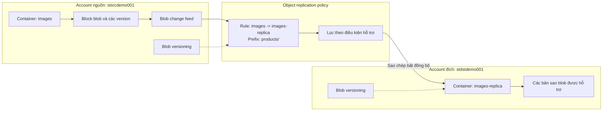
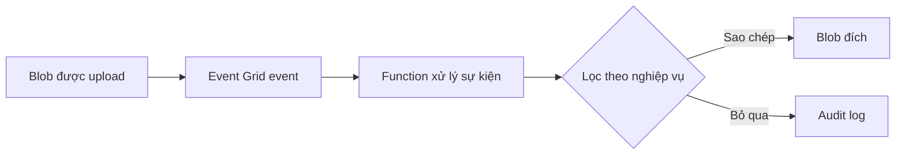
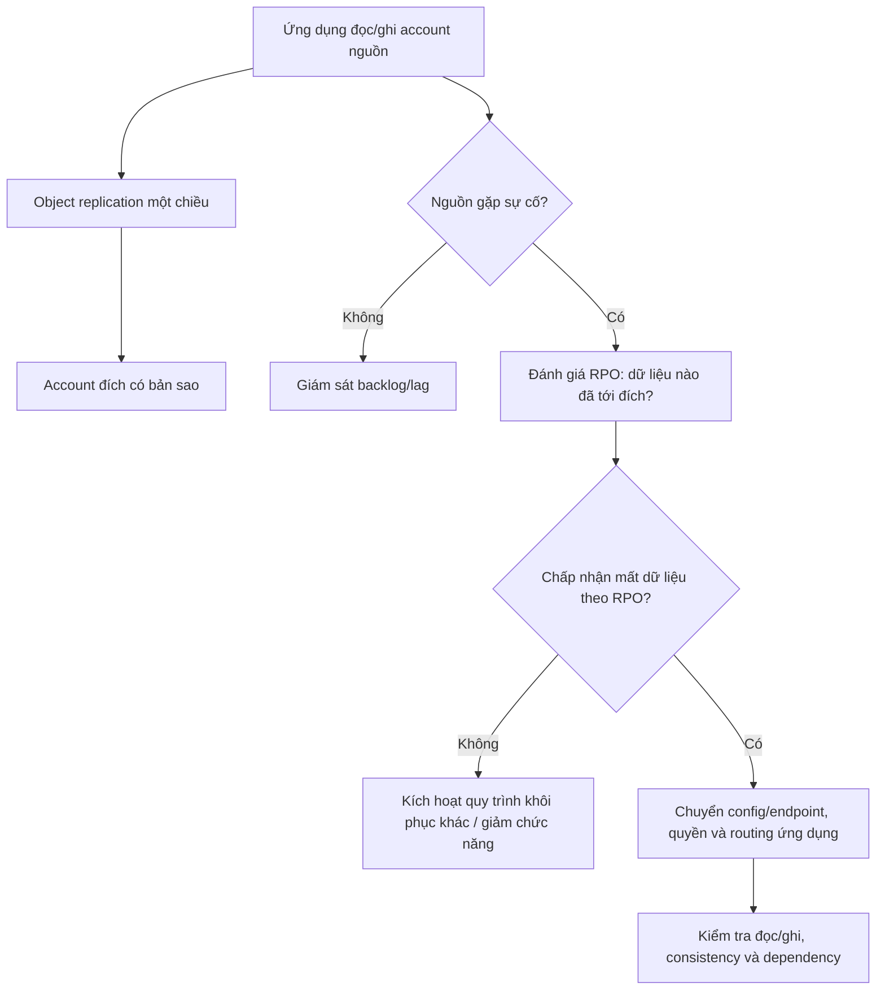
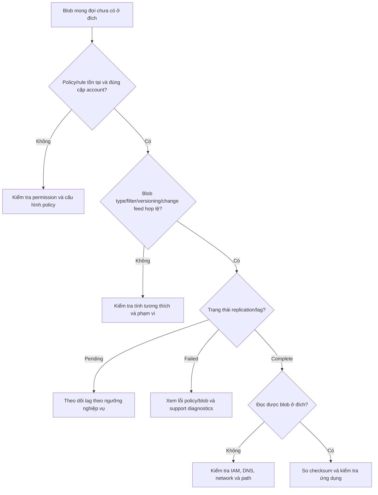

# Object replication và sao chép dữ liệu giữa tài khoản

Một doanh nghiệp lưu ảnh sản phẩm tại Azure Blob Storage ở khu vực chính. Nhóm phân tích cần bản sao dữ liệu tại một storage account khác; đồng thời, nhóm vận hành muốn chuẩn bị dữ liệu sẵn ở khu vực dự phòng khi một khu vực gặp sự cố. Nếu chỉ sao chép một lần, có thể dùng công cụ chuyển tệp; nhưng nếu các đối tượng liên tục được thêm hoặc cập nhật, tổ chức phải quyết định **khi nào sao chép, theo quy tắc nào, chấp nhận độ trễ bao nhiêu và khôi phục thế nào khi sao chép thất bại**.

**Object replication** là một tính năng của Azure Blob Storage giúp **sao chép bất đồng bộ các block blob được hỗ trợ từ container của storage account nguồn sang container của storage account đích** theo chính sách. Đây là một lựa chọn quan trọng nhưng không phải lựa chọn duy nhất để chuyển dữ liệu giữa các tài khoản.

Bài học thuộc chương **Lưu trữ đối tượng với Blob Storage** trong module `CLOUD_PROVIDERS_AZURE`. Trong lộ trình nghiên cứu Azure từ subscription, resource group, Microsoft Entra ID đến mạng ảo, tính toán, lưu trữ, dữ liệu, bảo mật, giám sát và chi phí, bạn sẽ học cách chọn đúng cơ chế sao chép, kiểm soát tài nguyên liên quan và xây dựng quy trình vận hành đáng tin cậy.

## Mục tiêu học tập

Sau bài học, bạn có thể:

- Giải thích object replication là gì, vì sao nó **bất đồng bộ** và khác với sao chép thủ công hoặc geo-redundancy.
- Phân biệt **source account**, **destination account**, container, replication policy, replication rule và các điều kiện lọc.
- Nhận biết các điều kiện cấu hình thường gặp như **Blob versioning ở nguồn và đích**, **Blob change feed ở nguồn**, loại account/blob và tương thích tính năng.
- Thiết kế một chính sách sao chép một chiều theo container/prefix, kiểm tra trạng thái và đánh giá độ trễ.
- Chọn giữa **Object replication**, **AzCopy**, **Azure Data Factory**, ứng dụng dùng SDK và cơ chế dự phòng LRS/ZRS/GRS/GZRS.
- Phân tích giới hạn liên quan đến xóa dữ liệu, tính nhất quán, phân quyền, mạng, chi phí và failover/failback.
- Thực hiện bài thực hành minh họa và lập danh sách bằng chứng kiểm tra trước khi triển khai production.

## 1. Phân biệt các loại “sao chép” trong Azure Storage

Từ “replication” có thể chỉ nhiều cơ chế rất khác nhau:

| Cơ chế | Đơn vị/phạm vi | Ai điều khiển? | Khi nào chọn? |
|---|---|---|---|
| **LRS/ZRS/GRS/GZRS** | Bản sao dữ liệu theo mức redundancy của một storage account | Azure thực hiện theo cấu hình redundancy của account | Tăng khả năng bền vững trước lỗi hạ tầng/zone/region theo tính năng |
| **Blob Object replication** | Block blob từ container ở account nguồn sang container ở account đích | Khách hàng khai báo policy; Azure sao chép bất đồng bộ | Đồng bộ các thay đổi được hỗ trợ sang account độc lập |
| **AzCopy** | Blob/file được chọn giữa các endpoint hỗ trợ | Người vận hành hoặc job gọi lệnh | Chuyển dữ liệu một lần, chạy theo đợt, sao chép số lượng lớn |
| **Azure Data Factory Copy activity** | Dữ liệu theo nguồn/đích và pipeline được hỗ trợ | Pipeline có lịch/triggers/monitoring | ETL, biến đổi hoặc điều phối nhiều nguồn và đích |
| **SDK / REST API / ứng dụng riêng** | Từng object hoặc batch theo logic ứng dụng | Mã nguồn ứng dụng | Quy tắc nghiệp vụ phức tạp, kiểm soát chi tiết và xử lý sự kiện |
| **Backup, versioning, soft delete, immutability** | Lịch sử và khả năng bảo vệ/phục hồi dữ liệu | Theo chính sách bảo vệ dữ liệu | Phục hồi thao tác xóa/ghi đè và đáp ứng lưu giữ; không thay bằng việc chỉ sao chép |

**Điểm khác biệt lớn:** bản sao từ tính năng redundancy như GRS không phải storage account độc lập mà bạn tùy ý đặt tên, phân quyền và chỉnh sửa như một account khác. Với object replication, **nguồn và đích là các account riêng**, mỗi account có cấu hình quản trị, network, RBAC và chi phí của nó.

### Những câu hỏi trước khi chọn giải pháp

1. Cần **sao chép một lần** hay **liên tục sau khi dữ liệu thay đổi**?
2. Dữ liệu là **block blob**, append blob, page blob, Azure Files, queue hay dữ liệu dạng bảng?
3. Có cần **lọc container/prefix** hoặc chọn các đối tượng theo mốc thời gian không?
4. Độ trễ chấp nhận được là bao nhiêu? Có cần cam kết RPO chặt chẽ không?
5. Đích có cần **độc lập với nguồn** về subscription, vùng, nhóm quản trị hay chính sách truy cập không?
6. Có cần **đồng bộ xóa**, biến đổi schema/metadata hoặc tạo bản sao có thể ghi hai chiều không?
7. Cần tự động kiểm tra, cảnh báo, chứng minh đủ dữ liệu và lên kế hoạch khôi phục thế nào?

Nếu chỉ tải một thư mục blob đến account khác vào cuối tháng, AzCopy thường đơn giản hơn việc tạo policy chạy liên tục. Nếu cần sao chép block blob mới/cập nhật tự động theo quy tắc được hỗ trợ, object replication là ứng viên phù hợp.

## 2. Cách Object replication hoạt động

Object replication hoạt động giữa **source storage account** và **destination storage account** theo **replication policy**. Một policy có thể chứa những **rule** ánh xạ container nguồn sang container đích cùng các điều kiện lọc được hỗ trợ.



Các bước khái quát:

1. Ứng dụng tạo hoặc cập nhật một **block blob** trong container nguồn.
2. Blob Storage ghi nhận các thay đổi theo cơ chế theo dõi được tính năng sử dụng; **change feed** ở nguồn đóng vai trò quan trọng.
3. Chính sách object replication xét các rule và bộ lọc để xác định blob đủ điều kiện sao chép.
4. Dịch vụ sao chép bất đồng bộ đến container đã ánh xạ tại account đích.
5. Người vận hành xem trạng thái sao chép, kiểm tra blob ở đích và xử lý trường hợp trễ hoặc không đủ điều kiện.

**Bất đồng bộ** nghĩa là thao tác ghi vào nguồn có thể hoàn thành trước khi bản sao đến đích. Giữa hai account tồn tại một khoảng thời gian mà blob nguồn đã có dữ liệu mới nhưng blob đích chưa cập nhật. **Không được giả định sao chép tức thì, RPO bằng 0 hoặc số giây cố định** nếu chưa có cam kết tương ứng và kết quả đo thực tế.

### Một chiều, không phải cơ chế đồng bộ hai chiều chung

Một policy xác định chiều **source → destination**. Nó không mặc nhiên chuyển các thay đổi ở đích trở lại nguồn, không giải quyết ghi đồng thời từ hai bên và không cung cấp bộ giải quyết xung đột ứng dụng.

Ví dụ: từ `stsrcdemo001/images` sang `stdstdemo001/images-replica`. Nếu người dùng muốn thay đổi dữ liệu ở account đích và gửi ngược lại account nguồn, cần thiết kế quy trình riêng, gồm quyền ghi, quy tắc xung đột và kiểm tra tương thích. Không nên biến mô hình một chiều thành active-active chỉ bằng cách tạo cấu hình ngược mà chưa đánh giá rủi ro vòng lặp, overwrite và giới hạn của dịch vụ.

## 3. Source, destination, policy và rule

### Source account

Nguồn là account chứa các blob gốc. Nó phải đáp ứng điều kiện về loại tài khoản, Blob versioning, change feed và tính năng được hỗ trợ. Các thay đổi có thể được sao chép là những thay đổi mà dịch vụ object replication hỗ trợ, không phải mọi sự kiện hay mọi loại dữ liệu trong storage account.

### Destination account

Đích là account độc lập với nguồn, chứa các container nhận bản sao. Bản sao có thể được ứng dụng hoặc nhóm phân tích đọc theo quyền và trạng thái dữ liệu thực tế. Account đích có **RBAC, firewall, private endpoint, khóa mã hóa, redundancy và lifecycle** riêng; những cấu hình này không tự được sao chép từ account nguồn.

### Policy và rule

Một replication policy định nghĩa cặp tài khoản và tập quy tắc. Một rule thường mô tả:

- **Source container:** ví dụ `images`.
- **Destination container:** ví dụ `images-replica`.
- **Prefix filter** (nếu dùng): chỉ sao chép blob có tên bắt đầu bằng tiền tố được chỉ định, ví dụ `products/`.
- **Mốc thời gian/lọc thay đổi** nếu tính năng và API cho phép: kiểm soát đối tượng được xét từ thời điểm nào.

Ví dụ **mô hình logic** (không phải tài liệu JSON để gọi API trực tiếp):

```yaml
sourceAccount: stsrcdemo001
destinationAccount: stdstdemo001
rules:
  - sourceContainer: images
    destinationContainer: images-replica
    prefixMatch:
      - products/
  - sourceContainer: reports
    destinationContainer: reports-copy
    prefixMatch:
      - 2026/
```

Đối với rule thứ nhất, `images/products/shirt-01.jpg` thuộc phạm vi sao chép, còn `images/internal/tmp.txt` thì không. Với rule thứ hai, `reports/2026/january.csv` được xét; `reports/2025/december.csv` nằm ngoài prefix.

**Không nhầm filter prefix với ACL.** Prefix quyết định đối tượng được đưa vào replication; nó không thay thế quyền truy cập dữ liệu Blob. Quy tắc đặt tên container và yêu cầu hiện hành về số rule, số prefix hay hình thức xác định mốc thời gian phải kiểm tra theo giới hạn dịch vụ tại thời điểm triển khai.

## 4. Điều kiện trước khi tạo Object replication

Không phải account nào cũng bật được object replication. Danh sách kiểm tra trước khi thao tác:

| Nhóm điều kiện | Nội dung cần xác nhận | Tại sao quan trọng? |
|---|---|---|
| Loại account | Source/destination là loại storage account hỗ trợ object replication | Tính năng không áp dụng chung cho mọi kiểu account |
| Loại blob | Tập dữ liệu cần sao chép là **block blobs** được hỗ trợ | Không coi page/append blobs, Azure Files, queues hoặc tables là đối tượng của tính năng |
| **Blob versioning** | Bật trên **cả nguồn và đích** theo yêu cầu tính năng | Dịch vụ dựa vào phiên bản để quản lý các thay đổi được sao chép |
| **Blob change feed** | Bật trên **nguồn** | Theo dõi thay đổi giúp thực hiện replication |
| HNS/ADLS Gen2 | Kiểm tra tương thích; không áp dụng giả định object replication hoạt động trên account HNS | Blob API và DFS/HNS có đặc điểm tính năng riêng |
| Container | Container nguồn và đích cần tồn tại, có tên và mapping đúng | Rule sẽ ánh xạ giữa các container |
| Access tier và trạng thái blob | Kiểm tra hỗ trợ block blob/tier, đặc biệt dữ liệu đã archive | Không phải mọi blob trong mọi tier đều được sao chép theo cùng cơ chế |
| Chính sách tenant | Nếu hai account ở tenant khác nhau, kiểm tra cấu hình cho phép sao chép xuyên tenant và điều kiện bảo mật | Chính sách tổ chức có thể chặn |
| Quyền quản trị | Người cấu hình có quyền quản lý policy và các thiết lập liên quan | Tránh tạo policy với tài khoản có quyền quá rộng |
| Mạng và bảo mật | Kiểm tra storage networking, CMK và các giới hạn tích hợp đang dùng | Không giả định account đích kế thừa cấu hình nguồn |

### Blob versioning và change feed có vai trò gì?

**Blob versioning** giúp duy trì các phiên bản khi block blob thay đổi trong những tình huống hỗ trợ. Với object replication, versioning là thành phần cơ sở để dịch vụ theo dõi và sao chép những thay đổi của blob. Nó cũng phát sinh chi phí lưu trữ phiên bản khi dữ liệu thường xuyên bị ghi đè.

**Blob change feed** duy trì thông tin về các sự kiện thay đổi đối với blob được hỗ trợ. Tính năng object replication sử dụng dữ liệu thay đổi này ở nguồn để nhận biết nội dung cần sao chép. Change feed có chi phí lưu trữ và cần chiến lược giữ dữ liệu phù hợp nếu hệ thống còn dùng nó cho mục đích khác.

Hai cơ chế này **không tự sao chép dữ liệu** khi chưa có replication policy. Ngược lại, một policy không thể hoạt động đúng chỉ nhờ gán tên hai account mà bỏ qua các điều kiện phiên bản/change feed.

### Giới hạn cần nhận biết sớm

- Object replication hướng tới **block blobs**; không dùng để sao chép Azure Files share, Queue messages, Table entities hoặc các volume/disk chung chung.
- Các account có **hierarchical namespace (ADLS Gen2)** và một số tính năng Blob đặc biệt có giới hạn tương thích. Khi lập kế hoạch, kiểm tra tài liệu hỗ trợ hiện hành thay vì giả định một tính năng của Blob truyền thống áp dụng hoàn toàn cho HNS.
- **Blob snapshots** và những loại metadata/tags hoặc đặc tính phiên bản có thể không được mang sang đích theo cách bạn mong đợi; xác minh từng thuộc tính được nghiệp vụ cần.
- **Archive-tier blobs** và các kết hợp tier/tính năng có giới hạn riêng. Phải kiểm tra yêu cầu rehydration hoặc quy trình sao chép thay thế.
- Chính sách **immutability**, lifecycle management, encryption và cấu hình networking có thể ảnh hưởng khả năng thiết lập hoặc sử dụng dữ liệu. Không suy ra mọi chính sách nguồn sẽ được tái tạo ở đích.
- Nếu cần copy cả nguồn dữ liệu ngoài Blob, đổi định dạng dữ liệu hoặc chuyển đổi schema, nên cân nhắc pipeline/công cụ khác.

## 5. Object replication khác GRS và RA-GRS như thế nào?

Đây là cặp khái niệm rất dễ nhầm lẫn khi thiết kế disaster recovery (DR).

### Geo-redundancy của một account

Khi account được cấu hình **GRS/GZRS**, Azure duy trì bản sao dữ liệu sang vùng thứ cấp theo cơ chế dịch vụ. **RA-GRS/RA-GZRS** có thể cho phép đọc dữ liệu từ endpoint secondary theo điều kiện hỗ trợ. Người dùng không tự quản trị một destination account độc lập với tên và quyền riêng như object replication.

### Object replication giữa hai account

Với object replication, khách hàng tạo **hai storage account riêng biệt**, có thể ở hai region và có container mapping. Mỗi account có lựa chọn redundancy, IAM, network và lifecycle riêng. Bản sao đến đích theo rule và độ trễ bất đồng bộ.

| Khía cạnh | GRS / RA-GRS | Object replication |
|---|---|---|
| Tài nguyên quản trị | Một storage account với cơ chế bản sao vùng phụ | Hai storage account riêng biệt |
| Quy tắc chọn dữ liệu | Theo cơ chế redundancy của dịch vụ | Theo policy/rule cho các block blob đủ điều kiện |
| Địa chỉ đích | Secondary endpoint/khả năng failover theo mô hình redundancy | Endpoint của destination account độc lập |
| Đọc dữ liệu ở bên phụ | Theo loại redundancy và trạng thái tính năng | Dùng tài khoản đích và quyền dữ liệu phù hợp |
| Tùy chỉnh IAM, firewall, region/tier | Gắn với account theo tính năng redundancy | Cấu hình riêng ở hai account |
| Đồng bộ | Theo cơ chế của Azure, với các đặc tính bất đồng bộ khi sao chép địa lý | Bất đồng bộ theo policy |
| Sao chép toàn bộ loại dữ liệu | Trong phạm vi khả năng redundancy của account | Phạm vi tính năng object replication, chủ yếu block blob |
| Phương án DR | Account failover/read-secondary khi hỗ trợ | Chuyển ứng dụng sang account đích, cập nhật quyền/endpoint và kế hoạch dữ liệu |

**Cả hai đều không tự giải quyết mọi yêu cầu backup và phục hồi thao tác xóa nhầm.** Một bản sao có thể phản ánh nội dung đã bị thay đổi sai; chính sách dữ liệu cần thêm retention, backup/versioning/soft delete và cách khôi phục đã được kiểm thử.

## 6. Tính nhất quán, độ trễ và dữ liệu đã tồn tại

### Eventual consistency giữa nguồn và đích

Ví dụ:

```text
10:00  Ứng dụng upload images/products/a.jpg vào nguồn.
10:00  Upload thành công, client nguồn đọc được blob mới.
10:01  Ứng dụng ở đích truy vấn: có thể chưa thấy phiên bản mới.
10:03  Replication hoàn tất: bản sao đủ điều kiện xuất hiện ở đích.
```

Các mốc phút ở trên **chỉ để minh họa**, không phải SLA hay RPO cam kết. Độ trễ thực tế phụ thuộc số lượng và kích thước blob, điều kiện hệ thống, backlog, vùng triển khai và tình trạng chính sách.

Nếu nghiệp vụ yêu cầu “vừa upload xong phải đọc được ngay tại đích”, object replication **không phải giao thức xác nhận giao dịch đồng bộ**. Cần điều chỉnh kiến trúc: đọc từ nguồn cho đến khi xác minh replication hoàn tất, dùng luồng copy có xác nhận, hoặc định nghĩa một cơ chế nhất quán khác.

### Có sao chép mọi blob cũ không?

Không nên mặc định rằng toàn bộ dữ liệu tồn tại từ nhiều năm trước sẽ được sao chép chỉ vì vừa bật policy. **Thời điểm tạo policy, thời điểm bật versioning/change feed và bộ lọc mốc thời gian** có thể ảnh hưởng tập blob được xử lý. Một số luồng thiết lập có lựa chọn về minimum creation time hoặc phạm vi thay đổi; cần xác định đúng khả năng hỗ trợ và cách áp dụng tại thời điểm tạo policy.

Với dự án **di chuyển hàng terabyte dữ liệu lịch sử**, hãy cân nhắc quy trình:

1. Kiểm kê tập dữ liệu cũ, số lượng/kích thước và những đối tượng phải sao chép.
2. Sao chép dữ liệu lịch sử qua **AzCopy** hoặc pipeline phù hợp nếu object replication không xử lý đủ tập dữ liệu đó theo policy.
3. Dùng object replication cho các thay đổi mới theo điều kiện được hỗ trợ.
4. Dùng danh sách/manifest, số lượng, dung lượng và checksum độc lập để kiểm tra, không chỉ dựa vào “đã bật policy”.
5. Chỉ chuyển workload đọc/ghi sang đích khi đã đối chiếu trạng thái và đáp ứng RPO/RTO đã kiểm chứng.

### Xóa và ghi đè: không đoán từ tên “replication”

Object replication **không phải công cụ đồng bộ thư mục hai chiều có hành vi xóa giống hệ thống tệp**. Không giả định thao tác xóa một blob nguồn sẽ xóa bản sao đích tương ứng. Hành vi đối với xóa, version, soft delete và những thuộc tính có thể sao chép phải được đối chiếu với tính năng và chính sách đang dùng.

Đối với hệ thống phải tuân thủ GDPR hoặc chính sách xóa dữ liệu cá nhân, cần thiết kế **quy trình xóa trên cả nguồn và đích** (và các bản backup/version còn lưu), ghi nhận bằng chứng thực thi. Không dựa vào object replication như cơ chế thực thi yêu cầu xóa dữ liệu.

## 7. Thiết kế container mapping và bộ lọc prefix

Giả sử ứng dụng có hai container tại nguồn:

```text
stsrcdemo001
├── images
│   ├── products/2026/shirt-01.jpg
│   ├── products/2026/shirt-02.jpg
│   └── internal/tmp/test.png
└── reports
    ├── 2026/november.csv
    └── 2025/december.csv
```

Yêu cầu: đội phân tích ở account đích chỉ cần **ảnh sản phẩm** và **báo cáo từ năm 2026**.

Thiết kế:

| Rule | Container nguồn | Container đích | Prefix filter |
|---|---|---|---|
| 1 | `images` | `images-replica` | `products/` |
| 2 | `reports` | `reports-copy` | `2026/` |

Kết quả mong đợi:

```text
stdstdemo001
├── images-replica
│   ├── products/2026/shirt-01.jpg
│   └── products/2026/shirt-02.jpg
└── reports-copy
    └── 2026/november.csv
```

**Filter prefix chỉ so khớp tên**. Nó không hiểu “năm 2026” như một thuộc tính thời gian nếu ứng dụng không đặt tên blob theo quy ước đó. Blob `reports/2026-old.csv` cũng có thể khớp prefix `2026` trong những cách đặt tên khác; cần thiết kế tiền tố có dấu phân cách rõ ràng, ví dụ `2026/`.

Nên gắn **một owner và một mục đích sử dụng** cho từng destination container. Việc dùng chung đích cho cả ứng dụng và phân tích có thể tạo ra xung đột quyền, lifecycle hoặc kỳ vọng độ trễ.

## 8. Tạo Object replication policy bằng Azure Portal

Tình huống minh họa:

- Source: `stsrcdemo001`, container `images`.
- Destination: `stdstdemo001`, container `images-replica`.
- Đối tượng: block blob dưới prefix `products/`.
- Mục tiêu: bản sao **bất đồng bộ, một chiều**, dùng cho phân tích hoặc DR có độ trễ chấp nhận được.

### Bước 1. Xác nhận phạm vi và quyền

Trong Azure Portal, chọn đúng **tenant, subscription và resource group** của cả hai account. Kiểm tra mỗi account đáp ứng loại tài khoản được hỗ trợ và người thao tác có quyền cấu hình tính năng quản lý Blob. Nếu hai account do các team khác nhau quản lý, cần có sự đồng ý của bên quản trị đích và tránh sửa cấu hình production khi chưa có kế hoạch.

### Bước 2. Bật các tính năng yêu cầu

Kiểm tra **Blob versioning** ở **source và destination**, và **Blob change feed** ở **source**. Trong Portal, các thiết lập thường nằm trong nhóm **Data protection** của storage account. Nếu tài khoản có HNS hoặc tính năng không tương thích, dừng và chuyển sang đánh giá phương án sao chép khác.

Đừng bật versioning/change feed mà bỏ qua chi phí phát sinh từ lịch sử phiên bản, retention và số lượng thay đổi. Nên dự kiến lifecycle management cho dữ liệu lịch sử theo yêu cầu lưu giữ.

### Bước 3. Chuẩn bị container đích

Tạo hoặc xác minh container `images-replica` trong account đích. Container và dữ liệu ở đích phải có chính sách phân quyền, mạng và retention riêng. Không công khai container vì lý do “bản sao chỉ để thử nghiệm”.

### Bước 4. Tạo replication policy

Mở phần **Object replication** trong khu vực quản trị dữ liệu của storage account theo giao diện Portal hiện tại. Chọn source/destination account, tạo một rule ánh xạ:

```text
Source account:       stsrcdemo001
Source container:     images
Destination account:  stdstdemo001
Destination container:images-replica
Blob prefix:          products/
Direction:            Source -> Destination
```

Xác minh policy được phản ánh ở đúng hai phía theo cơ chế dịch vụ và xem trạng thái rule. Quy trình Portal có thể yêu cầu thao tác trên cả account nguồn/đích hoặc chấp thuận theo cách triển khai tài khoản và tenant; không giả định quyền trên một subscription đồng nghĩa có quyền ở mọi account.

### Bước 5. Thử bằng một block blob mới

Sau khi policy đã có hiệu lực, ghi một block blob thử nghiệm vào `images/products/lab-test.txt` ở nguồn bằng account/identity được cấp quyền dữ liệu hợp lệ. Kiểm tra tại đích:

- Có xuất hiện `images-replica/products/lab-test.txt` hay không?
- Nội dung, kích thước và checksum có khớp với đầu vào không?
- Blob nào ngoài prefix `products/` không được sao chép?
- Có độ trễ bao lâu từ thời điểm ghi thành công ở nguồn tới khi đọc được đích?

Không sử dụng dữ liệu nhạy cảm thật cho bài thử nếu môi trường đích chưa được phê duyệt về bảo mật và vị trí lưu trữ.

### Bước 6. Ghi bằng chứng trước khi chấp nhận

Ghi policy ID, source/destination account IDs, container mapping, filter, ngày giờ, versioning/change feed settings, danh tính thao tác, log và thời gian hoàn tất của ít nhất một đợt thử. Lập kế hoạch đánh giá sai lệch dữ liệu định kỳ nếu workload cần đảm bảo tập blob đầy đủ.

## 9. Kiểm tra cấu hình bằng Azure CLI

Ví dụ sau sử dụng Azure CLI và giả định bạn có quyền **đọc cấu hình quản trị** của cả hai account. Chúng **không tự tạo policy**; thao tác tạo nên thực hiện theo quy trình phê duyệt của môi trường. Thay placeholder theo tài nguyên thực.

### 9.1 Đăng nhập và chọn subscription

```bash
az login
az account set --subscription "<subscription-id>"

az account show \
  --query "{subscription:id,tenant:tenantId,name:name}" \
  --output json
```

Nếu nguồn và đích thuộc những subscription khác nhau, dùng `az account set` trước từng lệnh truy vấn và xác minh tenant/subscription thật. Đừng để script âm thầm chạy vào account có tên gần giống trong môi trường khác.

### 9.2 Kiểm tra loại account và HNS

```bash
az storage account show \
  --resource-group "rg-blob-source" \
  --name "stsrcdemo001" \
  --query "{id:id,kind:kind,sku:sku.name,location:location,hns:isHnsEnabled}" \
  --output json

az storage account show \
  --resource-group "rg-blob-destination" \
  --name "stdstdemo001" \
  --query "{id:id,kind:kind,sku:sku.name,location:location,hns:isHnsEnabled}" \
  --output json
```

### 9.3 Kiểm tra Blob versioning và change feed

```bash
az storage account blob-service-properties show \
  --resource-group "rg-blob-source" \
  --account-name "stsrcdemo001" \
  --query "{versioning:isVersioningEnabled,changeFeed:changeFeed}" \
  --output json

az storage account blob-service-properties show \
  --resource-group "rg-blob-destination" \
  --account-name "stdstdemo001" \
  --query "{versioning:isVersioningEnabled,changeFeed:changeFeed}" \
  --output json
```

Đối chiếu: `isVersioningEnabled` nên đáp ứng điều kiện ở cả hai account; `changeFeed.enabled` cần đáp ứng ở nguồn. Đừng chỉ xem hai giá trị ở đích rồi kết luận toàn bộ điều kiện đã đủ: account kind, blob type, region/tenant và các ràng buộc khác vẫn cần kiểm tra.

### 9.4 Liệt kê policy đã cấu hình

Các bản Azure CLI có hỗ trợ nhóm quản trị Object Replication thường cung cấp lệnh:

```bash
az storage account or-policy list \
  --resource-group "rg-blob-source" \
  --account-name "stsrcdemo001" \
  --output json
```

Kiểm tra policy ID, cặp source/destination và các rule. Nếu CLI hiện tại chưa có nhóm lệnh phù hợp, kiểm tra `az storage account or-policy -h`, phiên bản CLI hoặc quản lý qua Portal/ARM API thay vì tự suy đoán cú pháp ghi cấu hình.

### 9.5 Đọc blob bằng Entra ID để xác minh bản sao

Danh tính dùng để kiểm tra cần quyền dữ liệu, ví dụ `Storage Blob Data Reader`, ở phạm vi phù hợp trên từng account.

```bash
az storage blob list \
  --account-name "stsrcdemo001" \
  --container-name "images" \
  --auth-mode login \
  --query "[].{name:name,size:properties.contentLength}" \
  --output table

az storage blob list \
  --account-name "stdstdemo001" \
  --container-name "images-replica" \
  --auth-mode login \
  --query "[].{name:name,size:properties.contentLength}" \
  --output table
```

Liệt kê tên/kích thước chỉ là kiểm tra sơ bộ; để xác minh dữ liệu quan trọng, cần thêm **content checksum**, phiên bản mong đợi, điều kiện lọc và thời điểm quan sát. **ETag giữa hai tài nguyên ở hai account không nên được dùng đơn độc như một mã hash bảo đảm nội dung giống nhau.**

## 10. AzCopy: sao chép dữ liệu theo đợt giữa các account

**AzCopy** là công cụ dòng lệnh chuyên chuyển dữ liệu khối lượng lớn tới/giữa các endpoint lưu trữ được hỗ trợ. Nó phù hợp khi:

- Sao chép dữ liệu lịch sử một lần trước khi bật object replication cho thay đổi mới.
- Thực hiện một chiến dịch migration có ngày cắt chuyển rõ ràng.
- Cần kiểm soát job, log và kết quả copy theo đợt.
- Không thể dùng object replication vì loại blob/account/tính năng không tương thích.

### Ví dụ sao chép một container

Trong môi trường có AzCopy và quyền dữ liệu phù hợp, đăng nhập bằng Microsoft Entra ID:

```bash
azcopy login

azcopy copy \
  "https://stsrcdemo001.blob.core.windows.net/images/*" \
  "https://stdstdemo001.blob.core.windows.net/images-replica" \
  --recursive=true
```

Ví dụ giả định **container đích đã tồn tại** và tài khoản đã đăng nhập có quyền đọc nguồn/ghi đích. Một số hệ điều hành hoặc shell xử lý wildcard/quote khác nhau; dùng đúng cú pháp được AzCopy hỗ trợ trong môi trường. Có thể dùng SAS theo phương thức được cho phép, nhưng **không in SAS vào log, không commit vào Git và không gửi nguyên SAS URL trong ticket**.

### Object replication và AzCopy khác nhau ở điều gì?

| Câu hỏi | Object replication | AzCopy |
|---|---|---|
| Ai khởi phát copy? | Dịch vụ theo policy và thay đổi blob được hỗ trợ | Người dùng, script, CI job hoặc lịch chạy |
| Tần suất | Tự động bất đồng bộ | Mỗi lần chạy job |
| Phạm vi | Theo policy/rules với các block blob được hỗ trợ | Theo đường dẫn và tùy chọn copy được công cụ hỗ trợ |
| Biến đổi dữ liệu | Không phải ETL transformation engine | Chủ yếu sao chép; không phải ETL transformation engine |
| Copy lịch sử | Tùy điều kiện/filter và tính năng | Thích hợp cho bulk copy có kiểm soát |
| Giám sát | Trạng thái policy/blob và log/metrics liên quan | Job output, transfer logs và job status |
| Truy cập | Policy dịch vụ; người quản trị cần quyền quản lý | Identity/SAS có quyền đọc nguồn, ghi đích |

### Cẩn trọng với AzCopy sync và xóa

AzCopy có thao tác `sync` để so sánh nguồn và đích rồi đồng bộ theo điều kiện hỗ trợ. **Sync không phải Object replication**: nó phụ thuộc việc chạy job và có thể có lựa chọn **xóa đối tượng đích**. Không bật tùy chọn xóa chỉ để “hai thư mục cho giống nhau” khi dữ liệu đích được dùng cho backup, lưu giữ pháp lý hay DR.

Với quy trình quan trọng, lưu manifest đầu vào, log transfer, số thành công/thất bại và chạy bước xác minh sau copy. Một job copy báo thành công không chứng minh ứng dụng đã sẵn sàng failover nếu thiếu DB, permission, connection string và networking.

## 11. Azure Data Factory và mô hình sao chép theo sự kiện

### Khi dùng Azure Data Factory

**Azure Data Factory Copy activity** phù hợp khi cần điều phối:

- Sao chép theo lịch hoặc trigger.
- Trích dữ liệu từ Blob, database hay nguồn khác.
- Chuyển định dạng hoặc xử lý cùng các bước pipeline khác khi tính năng phù hợp.
- Giám sát pipeline run, retry, alert và truy vết lỗi có cấu trúc.

Ví dụ: dữ liệu JSON lưu vào container `landing` của account A, mỗi đêm pipeline chuyển một phần sang Parquet trong account B. Object replication **không chuyển JSON thành Parquet**; ADF hoặc công cụ xử lý dữ liệu khác thích hợp hơn.

### Khi tự viết ứng dụng theo sự kiện

Kiến trúc có thể dùng Event Grid + Azure Functions để xử lý thay đổi blob, sau đó copy hoặc biến đổi đối tượng theo logic riêng:



Với kiểu xử lý theo sự kiện cần giải quyết **at-least-once delivery, sự kiện trùng, thứ tự sự kiện, retry, idempotency và dead-letter**. Nó linh hoạt hơn replication policy nhưng cũng tăng phần mã nguồn và công việc vận hành.

## 12. Bảo mật, quyền và quản trị giữa hai account

Việc có hai account độc lập là lợi thế quản trị, nhưng cũng tạo thêm hai phạm vi bảo mật.

### Phân biệt quản trị policy với truy cập dữ liệu

- **Control plane:** quyền tạo/đọc/sửa Object replication policy và thay đổi cấu hình account. Cần role Azure RBAC có các hành động quản lý phù hợp ở scope account.
- **Data plane:** quyền đọc/ghi blob khi kiểm thử hoặc dùng AzCopy, SDK, ứng dụng. Ví dụ `Storage Blob Data Reader` ở nguồn và `Storage Blob Data Contributor` ở đích cho nhân sự thực hiện copy theo đợt, tùy nhu cầu.
- **Cơ chế Object replication do Azure vận hành:** không nên mặc định nó dùng account key/SAS mà ứng dụng đã giữ. Phải cấu hình policy và điều kiện dịch vụ theo tài liệu thay vì cung cấp bí mật của ứng dụng cho một quy trình không yêu cầu.

Không cấp quyền `Owner` trên subscription chỉ để xem policy. Nhóm quản trị nguồn và đích nên thống nhất phạm vi quyền, người chịu trách nhiệm và cách thu hồi policy.

### Tenant, subscription và mạng

Nguồn/đích có thể thuộc các phạm vi tổ chức khác nhau theo khả năng hỗ trợ, nhưng cần kiểm tra chính sách **cross-tenant replication**, loại account và quyền quản trị của mỗi bên. Nếu có yêu cầu sao chép xuyên tenant, không tự coi tính năng luôn được bật hoặc được tổ chức cho phép.

**Private Endpoint** là đường kết nối phục vụ client vào data plane. Account nguồn và đích có DNS, firewall, private endpoint và rules độc lập; **Object replication không nhân bản các cấu hình network**. Đội vận hành phải kiểm thử đường truy cập của **ứng dụng đọc ở đích**, kể cả khi quá trình replication ở mức dịch vụ đã thành công.

### Mã hóa và kiểm soát dữ liệu

Mỗi account có chính sách encryption và customer-managed key (CMK) riêng khi dùng tính năng hỗ trợ. Nếu destination dùng CMK, quyền dùng khóa và khả năng khôi phục khóa ở đích phải đáp ứng yêu cầu. Không giả định copy blob đồng nghĩa copy toàn bộ cấu hình Key Vault, role assignments, RBAC, retention hay network rules từ nguồn.

Đối với dữ liệu chịu kiểm soát vị trí lưu trữ, phải xem **region thực** của account đích. Mục tiêu “phục hồi ở region khác” có thể mâu thuẫn với chính sách dữ liệu chỉ được lưu trong một vùng pháp lý; cần đánh giá trước khi cấu hình.

## 13. Giám sát trạng thái và xác minh dữ liệu

### Những trạng thái cần theo dõi

Tùy API/SDK/Portal được sử dụng, trạng thái object replication của một blob có thể cho biết đã hoàn tất hay vẫn đang chờ/thất bại theo policy/rule. Khi đánh giá hãy xem:

- Policy và rule vẫn tồn tại, đúng tài khoản/container/mapping.
- Blob có **nằm trong phạm vi lọc** không.
- Phiên bản hoặc thay đổi mong đợi có **đủ điều kiện** được sao chép không.
- Trạng thái sao chép được công cụ hiển thị là pending, complete hay failed theo cách biểu diễn được hỗ trợ.
- Bản sao đích tồn tại, nội dung/size/checksum và những metadata quan trọng theo yêu cầu nghiệp vụ có đúng không.
- Chênh lệch thời gian ghi nguồn và hoàn tất tại đích là bao nhiêu.

Không nên định nghĩa cảnh báo chỉ bằng “có file mới ở đích” vì một file nhỏ có thể được sao chép trước trong khi file lớn hoặc một số rule khác đang trễ.

### Chỉ số phục vụ RPO

**Recovery Point Objective (RPO)** là mức mất dữ liệu theo thời gian mà doanh nghiệp chấp nhận khi chuyển sang nơi dự phòng. Với replication bất đồng bộ, có thể đo:

```text
Replication lag cho một blob đủ điều kiện
  = Thời điểm xác minh blob/version tương ứng tại đích
    - Thời điểm thay đổi nguồn hoàn tất
```

Đây là cách đo thực nghiệm, không phải thuộc tính SLA cố định. Nếu dữ liệu được ghi liên tục, nên đo phân phối độ trễ (ví dụ p50/p95/p99), phần trăm blob còn pending theo khoảng thời gian, số lần thất bại và độ tuổi của bản ghi chưa sao chép lâu nhất.

### Không xác minh bằng ETag đơn độc

Hai bản sao ở hai account có thể có ETag hoặc metadata hệ thống khác nhau do từng tài nguyên được tạo/cập nhật độc lập. Muốn đối chiếu nội dung, nên dùng:

1. Manifest gồm tên blob và version mong đợi.
2. Kích thước thực.
3. Hash/checksum nội dung theo cách ứng dụng tin cậy; chú ý không phải blob nào cũng có Content-MD5 do người dùng cung cấp.
4. Kiểm tra tải/đọc thử từ đúng mạng và identity sẽ dùng khi failover.
5. Kiểm tra ngẫu nhiên và kiểm toán toàn bộ nếu yêu cầu độ chính xác cao.

### Audit và cảnh báo

Theo dõi Azure Activity Log với thay đổi cấu hình account/policy, diagnostics và storage metrics phù hợp ở nguồn/đích. Tạo cảnh báo khi:

- Policy bị xóa hoặc rule bị thay đổi ngoài kế hoạch.
- Versioning/change feed hoặc điều kiện nguồn không còn hợp lệ.
- Độ trễ sao chép vượt ngưỡng nghiệp vụ.
- Dung lượng, số lượng versions, log và lưu lượng tăng bất thường.
- Destination mất quyền truy cập hoặc không thể khôi phục trong bài diễn tập.

## 14. Kế hoạch failover và failback

Object replication **không tự động đổi địa chỉ ứng dụng** từ source account sang destination account khi region chính gặp sự cố. Để DR có hiệu lực, cần một quy trình cấp ứng dụng.



### Checklist trước khi diễn tập

- Destination có đủ dữ liệu theo **cutover point** được phê duyệt chưa?
- Ứng dụng dùng hostname của account đích và có cấu hình identity/secret phù hợp chưa?
- NSG, firewall, private endpoint, DNS và đường đi từ ứng dụng dự phòng có cho phép truy cập đích không?
- Các backend khác như database, queue, cache, file share và Key Vault đã có phương án DR chưa?
- Khi chuyển từ **read-only** sang **write** tại đích (nếu nghiệp vụ cần), cơ chế đồng bộ ngược được xử lý thế nào?
- Có chặn ghi ở nguồn cũ để tránh **split-brain** và xung đột dữ liệu không?
- Sau khi nguồn phục hồi, sẽ **reconcile** và chuyển lại thế nào, có checksum/manifest và phê duyệt cutback không?

**Failback cần thiết kế riêng.** Không tự giả định tạo một rule source/destination ngược là đủ để “gộp” mọi thay đổi ở đích về nguồn mà không mất dữ liệu. Phải dừng/điều phối luồng ghi, xác định nguồn chân lý và kiểm tra trùng lặp/xung đột.

## 15. Chi phí và hiệu năng của chiến lược sao chép

Tổng chi phí không chỉ là dung lượng blob ở nguồn:

| Thành phần | Vì sao có chi phí? |
|---|---|
| Storage account đích | Lưu dữ liệu nhân bản và các version tương ứng |
| Versioning | Mỗi lần cập nhật có thể tạo thêm phiên bản cần lưu |
| Change feed | Ghi/lưu thông tin thay đổi ở nguồn |
| Replication/copy operations | Các thao tác sao chép và đọc/ghi được tính theo quy tắc giá dịch vụ |
| Egress/inter-region transfer | Sao chép giữa vùng có thể phát sinh phí truyền dữ liệu |
| Redundancy | Mỗi account có SKU và mức redundancy riêng |
| Diagnostics và monitoring | Log Analytics, storage logs, alerting, retention và công cụ kiểm tra |
| Khôi phục và DR test | Compute, mạng, nhân lực, thử nghiệm ứng dụng và bản sao dữ liệu |

Nếu một blob dung lượng 500 MB bị cập nhật thường xuyên, versioning và replication có thể làm tổng dữ liệu được giữ và lượng truyền tăng đáng kể. Các giá trị tính phí thay đổi theo region/SKU/tính năng; phải dùng bảng giá hiện hành và Azure Cost Management của subscription để ước tính.

Các biện pháp giảm chi phí cần cân bằng với dữ liệu và khả năng khôi phục:

- Lọc chỉ các container/prefix phục vụ nghiệp vụ.
- Sử dụng lifecycle policy cho version không còn cần lưu giữ, sau khi đối chiếu yêu cầu kiểm toán và recovery.
- Tránh sao chép bản test/temp/log không cần thiết.
- Theo dõi khối lượng dữ liệu thay đổi, không chỉ dung lượng tổng.
- Chọn redundancy ở đích theo mục tiêu availability/DR thực tế.
- Giới hạn diagnostic retention, không tắt hết log khi vẫn cần bằng chứng sự cố.

## 16. Bài thực hành: sao chép ảnh sản phẩm sang account khác

Bài lab này dùng hai account **giả định**:

| Thành phần | Giá trị minh họa |
|---|---|
| Account nguồn | `stsrcdemo001` |
| Container nguồn | `images` |
| Account đích | `stdstdemo001` |
| Container đích | `images-replica` |
| Rule prefix | `products/` |
| Blob đúng phạm vi | `products/lab-test.txt` |
| Blob ngoài phạm vi | `internal/lab-private.txt` |
| Mục tiêu | Xác minh sao chép một chiều bất đồng bộ và rule filter |

### Phần A. Thiết kế trước khi thay đổi

1. Xác nhận hai account là loại được hỗ trợ và phù hợp với chính sách dữ liệu.
2. Xác nhận `Blob versioning` ở cả hai, `Blob change feed` ở nguồn.
3. Xác nhận không có xung đột HNS/tier/tính năng, và rule prefix/retention đúng.
4. Chỉ định người quản trị nguồn/đích, quyền quản trị policy và quyền kiểm tra dữ liệu.
5. Dự kiến dữ liệu test, khoảng thời gian quan sát, tiêu chí thành công và cách hoàn nguyên.

### Phần B. Cấu hình rule trong sandbox

Trên Portal, tạo policy `images → images-replica` với prefix `products/`. Đảm bảo rule hiển thị ở các vị trí quản trị liên quan. Nếu tài nguyên thuộc tenant/subscription khác, xem kỹ chính sách cho phép replication và quyền của nhóm đích.

### Phần C. Upload và quan sát

Sử dụng công cụ hoặc SDK phù hợp với quyền dữ liệu của tài khoản thử nghiệm:

```bash
az storage blob upload \
  --account-name "stsrcdemo001" \
  --container-name "images" \
  --name "products/lab-test.txt" \
  --file "./lab-test.txt" \
  --auth-mode login
```

Đây là lệnh dành cho **block blob theo mặc định phù hợp với việc tải tệp thường gặp**, với giả định file `./lab-test.txt` đã tồn tại và container đã được tạo. Một số loại upload/SDK có tham số blob type riêng; cần xác nhận dữ liệu tạo ra là block blob.

Tiếp tục tải `internal/lab-private.txt` (nếu muốn kiểm tra bộ lọc) bằng cách thay giá trị `--name`. Quan sát theo thời gian:

- Blob `products/lab-test.txt` xuất hiện tại `images-replica` sau một độ trễ bất đồng bộ.
- Blob `internal/lab-private.txt` **không được đưa vào** rule có prefix `products/`.
- Nội dung tệp, số byte và checksum của bản sao khớp đầu vào.
- Account đích có những quyền mạng và data-plane đúng với ứng dụng đọc dữ liệu thử nghiệm.

### Phần D. Đọc dữ liệu ở đích

```bash
az storage blob show \
  --account-name "stdstdemo001" \
  --container-name "images-replica" \
  --name "products/lab-test.txt" \
  --auth-mode login \
  --output json
```

Nếu chưa tìm thấy blob ngay, không kết luận thất bại tức thì. Kiểm tra độ trễ, phạm vi rule, phiên bản/change feed và trạng thái object replication. Nếu lỗi là `403`, cần điều tra quyền dữ liệu hoặc network rules của account đích trước khi coi chính sách sao chép sai.

### Phần E. Đối chiếu và dọn dẹp

Lưu kết quả, thời điểm và quan sát. Theo kế hoạch đã được chấp thuận, xóa tài nguyên test không còn cần thiết hoặc giữ lại trong thời gian phục vụ kiểm tra. **Không xóa policy/account production hoặc purge versions chỉ để làm sạch bài lab.** Lưu ý soft delete/versioning có thể tiếp tục giữ và tính phí cho dữ liệu đã xóa logic.

## 17. Sự cố thường gặp và cách điều tra

| Triệu chứng | Cần kiểm tra | Hướng xử lý |
|---|---|---|
| Không tạo được policy | Account kind không hỗ trợ, HNS hoặc tính năng xung đột, quyền thiếu | Kiểm tra điều kiện dịch vụ và role quản trị |
| Policy đã tạo nhưng không thấy bản sao | Rule chưa đúng, prefix sai, blob không đủ điều kiện, độ trễ bất đồng bộ | Kiểm tra mapping/filter, blob type và trạng thái replication |
| Blob tạo từ lâu không được sao chép | Mốc thời gian của policy, thời điểm bật versioning/change feed, phạm vi filter | Đánh giá copy lịch sử bằng AzCopy/pipeline |
| Một số blob được copy, một số không | Block blob/tier/feature khác nhau, filter không khớp | Soát blob properties, rule và giới hạn tính năng |
| Không thể xem blob đích | RBAC data plane, firewall, private endpoint, DNS, container name | Phân biệt lỗi policy với lỗi truy cập đích |
| Copy bằng AzCopy báo `403` | Thiếu quyền đọc nguồn/ghi đích, SAS hết hạn, network policy | Kiểm tra Entra login/roles hoặc SAS phù hợp |
| Dữ liệu đích cũ hơn nguồn | Replication lag, backlog, phiên bản mới chưa tới | Theo dõi thời gian, trạng thái và kiểm tra RPO |
| Dung lượng tăng ngoài dự kiến | Versioning, change feed, destination versions và logs | Kiểm kê versions và áp dụng lifecycle phù hợp |
| Cần xóa dữ liệu đích nhưng nguồn đã xóa | Object replication không phải quy trình xóa dữ liệu hai phía | Thiết kế deletion workflow và bằng chứng xóa |
| Failover đọc được blob nhưng API vẫn lỗi | Endpoint, identity, DNS, CORS, Key Vault, backend khác chưa chuyển | Diễn tập failover ứng dụng end-to-end |

### Quy trình xử lý có thứ tự



Không “sửa lỗi” bằng cách tắt mạng riêng, cấp account key cho mọi người hoặc bỏ hoàn toàn prefix filter. Những thay đổi đó có thể làm tăng phạm vi lộ dữ liệu mà không giải quyết nguyên nhân chính.

## 18. Câu hỏi tự kiểm tra

**Câu 1.** Object replication là đồng bộ hay bất đồng bộ?

**Đáp án:** Bất đồng bộ. Nguồn có thể ghi thành công trong khi đích chưa nhận được phiên bản mới; cần đo và giám sát replication lag theo RPO nghiệp vụ.

**Câu 2.** Vì sao phải kiểm tra Blob versioning và change feed?

**Đáp án:** Đây là các cơ chế nền tảng mà object replication sử dụng. Versioning cần được bật trên cả nguồn/đích và change feed ở nguồn theo điều kiện tính năng.

**Câu 3.** Một storage account chứa Azure Files share có thể sao chép share đó bằng Blob Object replication không?

**Đáp án:** Không. Blob Object replication hướng tới block blob được hỗ trợ, không phải dịch vụ Azure Files.

**Câu 4.** Đã cấu hình prefix `products/`. Blob tên `internal/tmp.jpg` có được sao chép bởi rule này không?

**Đáp án:** Không, vì tên blob không bắt đầu bằng prefix `products/`.

**Câu 5.** GRS và Object replication đều có dữ liệu ở nhiều nơi. Điểm khác biệt về tài khoản là gì?

**Đáp án:** GRS thực hiện geo-redundancy trong mô hình một account; object replication dùng hai storage account riêng với policy và cấu hình bảo mật/chi phí độc lập.

**Câu 6.** Object replication có tự chuyển application connection string sang account đích khi region chính hỏng không?

**Đáp án:** Không. Ứng dụng phải có runbook failover, cấu hình endpoint/danh tính/network và kiểm tra dependency.

**Câu 7.** Sao chép dữ liệu lịch sử một lần với hàng trăm nghìn blob nên bắt đầu đánh giá công cụ nào?

**Đáp án:** AzCopy (hoặc pipeline phù hợp nếu cần điều phối/biến đổi). Object replication có thể tiếp tục dùng cho các thay đổi mới được hỗ trợ.

**Câu 8.** Vì sao không dùng ETag giữa nguồn và đích làm bằng chứng nội dung chắc chắn giống nhau?

**Đáp án:** ETag là định danh phiên bản/trạng thái của tài nguyên theo dịch vụ, không phải checksum nội dung toàn cục giữa hai account. Nên dùng hash/manifest và kiểm tra dữ liệu thực tế.

**Câu 9.** Object replication có thay thế quy trình xóa dữ liệu theo yêu cầu pháp lý không?

**Đáp án:** Không. Phải xử lý dữ liệu ở nguồn, đích và những version/backup có liên quan theo chính sách lưu giữ và kiểm toán.

**Câu 10.** Hai account đều có private endpoint; điều đó có bảo đảm ứng dụng DR đọc được blob đích không?

**Đáp án:** Không. Cần đúng private DNS, route, firewall, identity và data-plane role ở account đích, cùng kiểm tra từ môi trường DR thực tế.

**Câu 11.** Nếu ứng dụng cần chuyển JSON thành Parquet khi sao chép, object replication có phù hợp không?

**Đáp án:** Object replication không phải công cụ biến đổi dữ liệu. Hãy đánh giá Azure Data Factory hoặc một pipeline ETL khác.

**Câu 12.** Một blob đã upload thành công ở nguồn nhưng chưa xuất hiện sau một phút ở đích. Có chắc policy bị lỗi không?

**Đáp án:** Chưa. Cần kiểm tra trạng thái, độ trễ thực tế, rule/filter, tính tương thích và các điều kiện nền tảng; không có đảm bảo đồng bộ tức thì.

## Tổng kết

**Blob Object replication** cho phép khai báo việc sao chép **bất đồng bộ, một chiều** các block blob được hỗ trợ giữa những storage account độc lập, dựa trên replication policy và rule theo container/filter. Để dùng đúng, cần hiểu yêu cầu về versioning/change feed, phạm vi blob được sao chép, trạng thái/độ trễ và quyền quản trị ở cả nguồn lẫn đích.

Object replication **không giống** GRS/RA-GRS, không thay thế AzCopy khi cần chuyển dữ liệu lịch sử theo đợt, không phải ETL engine và không thay thế backup hoặc chính sách xóa dữ liệu. Với kiến trúc production, hãy xây dựng thêm **bằng chứng kiểm tra dữ liệu, quản lý phiên bản, bảo mật, giám sát replication lag, phương án failover/failback và dự toán chi phí** để bản sao thực sự có giá trị khi ứng dụng cần dùng.
