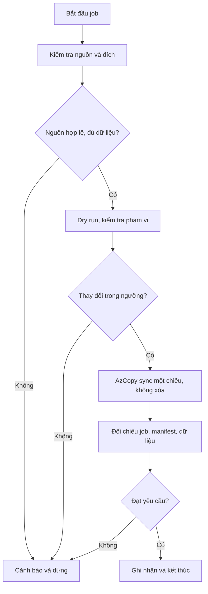

# Đồng bộ dữ liệu bằng AzCopy và Azure Storage Explorer

Azure Blob Storage là dịch vụ lưu trữ đối tượng cho ảnh, tài liệu, bản sao lưu, log và dữ liệu phân tích. Trong thực tế, dữ liệu có thể nằm trên máy tính, máy chủ nội bộ, máy ảo Azure hoặc một Storage account khác. Để đưa dữ liệu lên Azure, cập nhật các tệp mới, tải dữ liệu về hoặc chuyển dữ liệu giữa các vùng lưu trữ, chúng ta cần công cụ truyền tải vừa hiệu quả vừa dễ kiểm soát.

**AzCopy** là công cụ dòng lệnh dành cho sao chép và đồng bộ dữ liệu với Azure Storage. **Azure Storage Explorer** là ứng dụng giao diện đồ họa giúp duyệt container, xem blob, upload/download và thao tác dữ liệu trực quan. AzCopy phù hợp với script, tập dữ liệu lớn và tác vụ lặp lại; Storage Explorer phù hợp với kiểm tra, thao tác thủ công và chẩn đoán tình huống vận hành.

Bài học thuộc chương **Lưu trữ đối tượng với Blob Storage** của module Microsoft Azure. Các ví dụ gắn với kiến thức về subscription, resource group, Microsoft Entra ID, Azure RBAC, mạng ảo, giám sát, bảo mật và kiểm soát chi phí. Mục tiêu là **chuyển đúng dữ liệu, tới đúng đích, với đúng quyền và có bằng chứng đã chuyển thành công**.

## Mục tiêu học tập

Sau bài học, bạn có thể:

- Giải thích quan hệ giữa Storage account, container, blob và prefix.
- Phân biệt `azcopy copy` với `azcopy sync`, đặc biệt là hành vi cập nhật và xóa.
- Đăng nhập AzCopy bằng Microsoft Entra ID, phân biệt cơ chế này với SAS và account key.
- Upload, download, đồng bộ một chiều và sao chép dữ liệu giữa các container bằng AzCopy.
- Sử dụng Azure Storage Explorer để kết nối, duyệt, upload/download và kiểm tra blob.
- Chạy thử bằng `--dry-run` và hạn chế xóa ngoài ý muốn bằng `--delete-destination=false`.
- Xác minh transfer bằng job status, danh sách blob và checksum khi cần.
- Chẩn đoán lỗi permission, firewall, private endpoint, đường dẫn, timestamp hoặc throttling.
- Thiết kế một quy trình sync định kỳ an toàn, có log, cảnh báo và kiểm soát chi phí.

## 1. Cấu trúc dữ liệu trong Azure Blob Storage

Blob Storage được tổ chức theo mô hình:

```text
Azure subscription
└── Resource group
    └── Storage account: storderslab
        ├── Blob container: incoming
        │   ├── invoices/2026/01/a.pdf
        │   ├── invoices/2026/01/b.pdf
        │   └── metadata.json
        └── Blob container: archive
            └── exports/report.csv
```

- **Storage account:** tài nguyên Azure quản lý namespace, bảo mật, network access, mã hóa và redundancy.
- **Blob container:** nhóm logic chứa các blob, thường là phạm vi hợp lý để phân quyền dữ liệu.
- **Blob:** đối tượng có tên, nội dung và một số thuộc tính, metadata.
- **Prefix:** phần đầu tên blob trông giống thư mục, ví dụ `invoices/2026/01/`. Với Blob Storage thông thường, đây là quy ước đặt tên; ứng dụng có thể hiển thị dạng cây thư mục.
- **Hierarchical namespace (HNS):** khi bật cho Data Lake Storage Gen2, thư mục và ACL có ngữ nghĩa khác; cần kiểm tra tương thích của các lệnh truyền tải.

Địa chỉ blob thường có dạng:

```text
https://<STORAGE_ACCOUNT>.blob.core.windows.net/<CONTAINER>/<BLOB_NAME>
```

Ví dụ tên `incoming/invoices/2026/01/a.pdf` chứa container `incoming` và tên blob `invoices/2026/01/a.pdf`. Khi truyền thư mục local, công cụ ánh xạ tên tệp thành tên blob. Vì vậy, **nguồn, container và prefix đích** đều quan trọng, đặc biệt khi chạy lệnh lặp lại.

### Các hướng truyền thường gặp

1. Thư mục local → Azure Blob container.
2. Blob container/prefix → thư mục local.
3. Storage account A/container A → Storage account B/container B.
4. Một prefix → prefix khác trong phạm vi dịch vụ và quyền hỗ trợ.

Với đồng bộ một chiều, hãy xác định **source of truth**: nguồn là dữ liệu được xem là bản chính cho job, đích là bản nhận cập nhật. Chọn nhầm hướng có thể ghi đè hoặc xóa dữ liệu.

## 2. Copy và sync khác nhau như thế nào?

| Công cụ/thao tác | Mục tiêu | Đặc điểm | Rủi ro |
|---|---|---|---|
| **AzCopy copy** | Sao chép các tệp hoặc blob được chọn | Có thể chạy một lần hoặc chạy lại, có tùy chọn ghi đè | Ghi đè đối tượng cùng tên nếu cấu hình cho phép |
| **AzCopy sync** | So sánh nguồn và đích theo một hướng | Cập nhật các đối tượng cần thiết, có tùy chọn xóa ở đích | Xóa dữ liệu đích khi bật chế độ xóa |
| **Storage Explorer Upload/Download** | Truyền tệp qua GUI | Chọn thủ công và theo dõi trong Activities | Chọn sai container hoặc ghi đè |
| **Storage Explorer Copy/Paste** | Sao chép blob giữa các vị trí hỗ trợ | Thuận tiện cho tập đối tượng cần kiểm tra | Không đồng nghĩa tự động đồng bộ liên tục |
| **Azure Storage redundancy** | Tăng độ bền/khả dụng của dữ liệu | Do dịch vụ quản lý, ví dụ LRS/ZRS/GRS | Không phải cơ chế đồng bộ thư mục nghiệp vụ |

**AzCopy sync là đồng bộ một chiều tại thời điểm chạy**, không tự theo dõi thay đổi liên tục và không tự hòa giải xung đột giữa hai người cùng chỉnh một đối tượng ở hai phía. Nếu cần hai chiều, cần thiết kế một giao thức riêng để phát hiện xung đột và xác định bản thắng.

**Storage Explorer** là cách trực quan để upload, download và kiểm tra. Các thao tác GUI lặp lại không tự tạo một hệ thống sync chạy nền có lịch và xử lý xung đột.

## 3. Chuẩn bị môi trường và xác minh quyền

Bài thực hành giả định:

- Có Azure subscription được phép dùng cho lab.
- Một Storage account và Blob container `incoming` đã tồn tại.
- Tài khoản người dùng được cấp quyền đọc/ghi vào container.
- AzCopy v10 chạy được trên terminal hoặc một máy được phép kết nối Azure Storage.
- Azure Storage Explorer đã được cài trên máy desktop nếu thực hiện các bước GUI.

### Azure RBAC: quyền control plane khác data plane

| Quyền | Ví dụ role | Ý nghĩa |
|---|---|---|
| **Control plane** | Reader, Contributor, Storage Account Contributor | Xem hoặc quản lý cấu hình Storage account |
| **Data plane đọc** | Storage Blob Data Reader | Đọc/list blob trong phạm vi được cấp |
| **Data plane ghi** | Storage Blob Data Contributor | Thao tác đọc/ghi/xóa blob theo quyền role và phạm vi |
| **Data plane quản trị sâu** | Storage Blob Data Owner | Quyền dữ liệu bổ sung theo định nghĩa role |

Để upload bằng danh tính Microsoft Entra ID, người chạy thường cần **Storage Blob Data Contributor** ở container hoặc phạm vi cha phù hợp. Vai trò `Reader` ở subscription **không tự động cấp quyền đọc nội dung blob**.

Với Storage Explorer, khả năng duyệt account theo cây subscription và quyền đọc/ghi blob có thể khác nhau. Một người có quyền data plane ở container nhưng không có quyền duyệt account bằng management API có thể cần attach tài nguyên qua cơ chế được phép, chẳng hạn SAS URI riêng.

### Chọn phương thức xác thực

- **Microsoft Entra ID:** thường là lựa chọn ưu tiên khi người dùng/workload hỗ trợ. Quyền được quản lý bằng Azure RBAC; không cần chia sẻ account key.
- **Managed identity:** phù hợp với job chạy trên dịch vụ Azure có hỗ trợ, tránh phải lưu secret dài hạn.
- **SAS (Shared Access Signature):** cấp quyền giới hạn theo resource, operation và thời gian; dùng khi có nhu cầu chia sẻ truy cập có kiểm soát. Với Blob Storage, cân nhắc user delegation SAS khi khả thi.
- **Storage account key:** bí mật có phạm vi quyền rộng. Chỉ dùng nếu kiến trúc và chính sách thật sự cần; không đưa key vào script, ticket hoặc tài liệu.

Dù xác thực thành công, **Storage firewall và network access** vẫn có thể từ chối yêu cầu từ mạng không hợp lệ. Data permission và network permission là hai lớp độc lập.

## 4. Cài đặt và đăng nhập AzCopy

AzCopy v10 là executable riêng, không nên giả định nó được cài chỉ vì Azure CLI đã có. Kiểm tra trong Bash:

```bash
azcopy --version
azcopy --help
```

Nếu không tìm thấy lệnh, cần cài AzCopy v10 từ nguồn Microsoft phù hợp với hệ điều hành và cấu hình `PATH`.

### Đăng nhập bằng Microsoft Entra ID

```bash
azcopy login
```

Nếu phải chỉ rõ tenant:

```bash
azcopy login --tenant-id "<TENANT_ID>"
```

Đối với môi trường hỗ trợ managed identity đã được cấp data-plane role:

```bash
azcopy login --identity
```

Lệnh cuối không có ý nghĩa trên máy cá nhân không có managed identity. Việc đã chạy `az login` cho Azure CLI **không chứng minh phiên AzCopy đã đăng nhập**, bởi đây là hai công cụ riêng.

### Kiểm tra mạng từ nơi chạy AzCopy

Trước khi upload, xác nhận:

- Storage account có cho phép public network access từ nguồn đó hoặc đã có rule mạng tương ứng chưa?
- Nếu account chỉ có **Private Endpoint**, máy thực thi có đường VPN/ExpressRoute hoặc nằm trong VNet được kết nối không?
- Private DNS có phân giải endpoint blob về private IP đúng khi cần không?
- Proxy hoặc firewall doanh nghiệp có cho phép HTTPS/TCP 443 theo thiết kế không?
- Danh tính AzCopy có role/credential hợp lệ tại nguồn và đích không?

Azure Cloud Shell **không tự động nằm trong subnet do bạn tạo**. Vì vậy, không thể dùng Cloud Shell làm bằng chứng một Private Endpoint trong VNet đang kết nối tốt nếu không có đường mạng thích hợp.

## 5. AzCopy copy: upload file và thư mục

Dùng Bash để tạo dữ liệu lab nhỏ:

```bash
mkdir -p ./lab-data/reports
printf 'order_id,total\n1001,150\n1002,230\n' > ./lab-data/reports/orders.csv
printf '{"source":"azcopy-lab","version":1}\n' > ./lab-data/manifest.json
```

Khai báo tài nguyên đích bằng tên account/container thực tế:

```bash
ACCOUNT="<STORAGE_ACCOUNT>"
CONTAINER="incoming"
DEST_URL="https://$ACCOUNT.blob.core.windows.net/$CONTAINER/lab"
```

Sau khi xác thực, upload **nội dung** thư mục local vào prefix `lab`:

```bash
azcopy copy "./lab-data/*" "$DEST_URL" --recursive=true
```

Wildcard `/*` biểu thị ý định sao chép nội dung thư mục, còn `--recursive=true` giúp đi vào các thư mục con. Quy tắc ánh xạ đường dẫn của AzCopy phụ thuộc nguồn/đích và cú pháp; hãy xem tên blob tạo ra sau lần thử đầu tiên trước khi xử lý dữ liệu thật.

### Upload một tệp

```bash
azcopy copy \
  "./lab-data/manifest.json" \
  "https://$ACCOUNT.blob.core.windows.net/$CONTAINER/lab/manifest.json"
```

### Tránh ghi đè khi upload

```bash
azcopy copy \
  "./lab-data/*" \
  "$DEST_URL" \
  --recursive=true \
  --overwrite=false
```

Tùy chọn `--overwrite=false` giúp không ghi đè đối tượng đã tồn tại trong lần copy. Những quy tắc cập nhật khác như `--overwrite=ifSourceNewer` có thể hữu ích khi được hỗ trợ, nhưng cần kiểm tra phiên bản AzCopy và hành vi timestamp cụ thể.

**Copy không có nghĩa tự xóa tệp cũ ở đích.** Nếu xóa một file local rồi chạy lại copy, blob cũ thường vẫn còn. Muốn so sánh hai phía theo một hướng, hãy dùng `sync`.

## 6. AzCopy sync: đồng bộ một chiều

`azcopy sync` so sánh nguồn và đích dựa trên các thuộc tính được công cụ hỗ trợ (chẳng hạn thời gian sửa đổi, kích thước và một số điều kiện khác theo loại nguồn/đích). Không nên mặc định công cụ so sánh từng byte hay chỉ truyền phần nội dung thay đổi của blob.

### Xem trước bằng dry run

```bash
azcopy sync \
  "./lab-data" \
  "$DEST_URL" \
  --recursive=true \
  --delete-destination=false \
  --dry-run
```

Hai tùy chọn quan trọng:

- `--dry-run`: hiển thị những hành động dự kiến mà không thực sự truyền/xóa trong lần chạy thử.
- `--delete-destination=false`: không xóa các đối tượng chỉ có ở đích nhưng không còn ở nguồn.

Đọc danh sách đường dẫn dự kiến. Nếu công cụ báo cập nhật nhầm một prefix hoặc số lượng file bất thường, cần dừng và kiểm tra.

### Thực hiện sau khi xem kết quả dự kiến

```bash
azcopy sync \
  "./lab-data" \
  "$DEST_URL" \
  --recursive=true \
  --delete-destination=false
```

Sửa một file local hoặc thêm file mới, sau đó chạy lại dry run rồi sync. AzCopy sẽ xác định các đối tượng cần cập nhật theo quy tắc so sánh. Với dữ liệu quan trọng, nên có kiểm chứng bổ sung vì timestamp và thuộc tính file không phải bằng chứng toàn vẹn tuyệt đối.

### Xóa file ở nguồn có làm xóa blob đích không?

Giả sử blob tại đích:

```text
lab/manifest.json
lab/reports/orders.csv
lab/old-export.csv
```

Nhưng thư mục local chỉ còn:

```text
manifest.json
reports/orders.csv
```

Khi dùng `--delete-destination=false`, `lab/old-export.csv` vẫn được giữ lại.

AzCopy cũng có tùy chọn **xóa ở đích những đối tượng không tồn tại ở nguồn** như `--delete-destination=true`. Đây là thao tác có thể làm mất dữ liệu. Chỉ dùng sau khi xác nhận nguồn thực sự đầy đủ, xác định prefix đích riêng, có bản khôi phục và được phê duyệt theo quy trình tổ chức.

### Vấn đề xung đột hai chiều

Nếu người A sửa file ở local trong khi người B cập nhật blob cùng tên trên cloud, chạy sync một chiều có thể ghi đè bản thay đổi của một người. Cần:

- Quy định bên nào là **source of truth**.
- Tránh nhiều tiến trình ghi cùng một prefix nếu chưa có kiểm soát xung đột.
- Đánh giá versioning, soft delete, snapshot hoặc quy trình lưu phiên bản.
- Không dùng hai job sync ngược chiều như một giải pháp đồng bộ hai chiều tự động khi chưa thiết kế tính nhất quán.

## 7. Download và sync từ Blob về máy

Download bằng `copy`:

```bash
mkdir -p ./downloaded-data

azcopy copy \
  "$DEST_URL/*" \
  "./downloaded-data" \
  --recursive=true
```

Với bộ dữ liệu lớn, chỉ định rõ prefix cần tải; kiểm tra cấu trúc tệp và thư mục con sau khi tải.

Nếu muốn so sánh một nguồn cloud với thư mục local:

```bash
azcopy sync \
  "$DEST_URL" \
  "./downloaded-data" \
  --recursive=true \
  --delete-destination=false \
  --dry-run
```

Sau khi xác nhận các thao tác dự kiến, bỏ `--dry-run` để thực thi. Đừng bật chế độ xóa trên một thư mục local đang chứa dữ liệu khác ngoài phạm vi của job.

Trong cả hai trường hợp, phiên làm việc cần quyền đọc dữ liệu blob và khả năng kết nối mạng tới endpoint hợp lệ.

## 8. Copy giữa hai Storage account hoặc container

AzCopy có thể sao chép từ một URL Azure Storage được hỗ trợ sang một URL khác mà không cần tải thủ công về laptop trước:

```bash
SOURCE_URL="https://<SOURCE_ACCOUNT>.blob.core.windows.net/<SOURCE_CONTAINER>/export"
TARGET_URL="https://<TARGET_ACCOUNT>.blob.core.windows.net/<TARGET_CONTAINER>/import"

azcopy copy \
  "$SOURCE_URL" \
  "$TARGET_URL" \
  --recursive=true
```

Trước khi chạy, cần xác minh:

- Những blob nào nằm dưới prefix nguồn, và chúng sẽ xuất hiện với tên nào ở đích?
- Danh tính hoặc SAS có **quyền đọc ở nguồn** và **quyền ghi ở đích** không?
- Firewall ở cả hai account có cho phép kiểu truyền tải này không?
- Region nguồn/đích có đáp ứng yêu cầu vị trí dữ liệu không?
- Có chính sách versioning, retention hoặc khóa bất biến ngăn ghi đè không?
- Chi phí giao dịch, egress hoặc truyền dữ liệu liên vùng có chấp nhận được không?

Một số trường hợp copy giữa dịch vụ sử dụng xử lý phía Azure để tránh đưa toàn bộ dữ liệu qua máy trạm, nhưng không nên mặc định mọi mô hình đều có chi phí bằng không hoặc không có giới hạn tốc độ.

## 9. Theo dõi và khôi phục AzCopy jobs

AzCopy có khả năng tổ chức một phiên truyền thành **job**, với báo cáo transfer thành công, lỗi hoặc bị bỏ qua.

Xem danh sách job:

```bash
azcopy jobs list
```

Xem chi tiết:

```bash
azcopy jobs show "<JOB_ID>"
```

Khi còn job plan cần thiết và điều kiện hỗ trợ, có thể tiếp tục job:

```bash
azcopy jobs resume "<JOB_ID>"
```

Khả năng resume phụ thuộc trạng thái job, phiên bản công cụ, dữ liệu job plan/log và quyền truy cập hiện tại. Nếu phiên shell đã bị xóa dữ liệu local hoặc SAS hết hạn, có thể cần xác thực lại và đánh giá cách chạy lại.

### Khi job gặp lỗi một phần

1. Ghi nhận job ID, thời điểm chạy, phiên bản AzCopy và đường dẫn nguồn/đích.
2. Xem số lượng transfer đã thành công và thất bại.
3. Đọc lỗi cụ thể của đối tượng thất bại: permission, firewall, timeout, throttling, tên đường dẫn, file đang bị khóa.
4. Sửa nguyên nhân, kiểm tra xem có job khác đang chạy trên cùng prefix không.
5. Resume nếu phù hợp hoặc chạy lại với tham số an toàn và kiểm chứng sau truyền.

### Log và bảo mật

AzCopy có cơ chế lưu log/job plan; các biến cấu hình được hỗ trợ như `AZCOPY_LOG_LOCATION` và `AZCOPY_JOB_PLAN_LOCATION` giúp chọn nơi lưu trong môi trường cần kiểm soát.

- Giới hạn quyền đọc log và job plan.
- Không đính kèm SAS token, account key hoặc thông tin xác thực vào ticket công khai.
- Tránh log đường dẫn chứa dữ liệu cá nhân nếu không cần thiết.
- Kiểm tra thời hạn lưu log và dọn dữ liệu sau khi hoàn tất.
- Với môi trường Cloud Shell/container tạm thời, xác nhận log/job plan có được giữ qua các phiên hay không trước khi dựa vào resume.

## 10. Azure Storage Explorer: quản lý dữ liệu bằng GUI

Azure Storage Explorer cho phép làm việc với Blob Storage qua giao diện trực quan, hữu ích khi người vận hành muốn xác nhận blob tồn tại, xem metadata, upload/download một lô nhỏ hoặc kiểm tra kết quả của AzCopy.

### Bước 1: đăng nhập hoặc attach

1. Cài Azure Storage Explorer từ nguồn chính thức tương ứng hệ điều hành.
2. Mở ứng dụng và phần quản lý tài khoản/kết nối.
3. Chọn đăng nhập với tài khoản Microsoft Entra ID nếu tổ chức sử dụng cách này.
4. Chọn tenant và subscription đúng.
5. Duyệt cây tài nguyên tới Storage account → **Blob Containers**.

Nếu tài khoản chỉ có quyền trực tiếp trên container mà không có quyền duyệt account trong subscription, xem xét cơ chế **attach** bằng SAS URI hoặc phương thức được phê duyệt. Không yêu cầu account key chỉ để sửa một lỗi duyệt tài nguyên chưa rõ nguyên nhân.

### Bước 2: kiểm tra container

Chọn container `incoming`. Đọc lại tên Storage account, subscription và vị trí đang mở. Với dữ liệu quan trọng, nên đối chiếu kỹ prefix trước khi chọn Upload hoặc Delete.

Storage Explorer thường hiển thị tên blob có dấu `/` dưới dạng thư mục trực quan. Trong Blob Storage thông thường, những thư mục này có thể chỉ là phần của tên blob.

### Bước 3: Upload Files hoặc Upload Folder

1. Điều hướng tới vị trí đích trong container.
2. Chọn **Upload → Upload Files** hoặc **Upload Folder** tùy giao diện.
3. Chọn dữ liệu local cần truyền.
4. Kiểm tra lựa chọn ghi đè, prefix và tên file.
5. Xác nhận, theo dõi khu vực **Activities** hoặc báo cáo transfer tương ứng.
6. Refresh danh sách blob và đối chiếu tên, dung lượng, trạng thái.

Nếu một số file thất bại, không nên coi việc nhìn thấy vài blob trong container là chứng minh toàn bộ thư mục đã được upload.

### Bước 4: Download và Copy/Paste

- Chọn blob hoặc nhóm blob rồi dùng **Download**, chọn thư mục đích và kiểm tra file đã tải.
- Khi được phiên bản công cụ hỗ trợ, dùng **Copy/Paste** để sao chép blob tới container hoặc vị trí được phép.
- Kiểm tra cấu trúc prefix và thuộc tính dữ liệu sau mỗi thao tác.

Các thao tác này rất phù hợp cho việc **kiểm tra thủ công**, nhưng không nên xem chúng là quy trình đồng bộ hai chiều, chạy định kỳ hoặc có khả năng tự xử lý xung đột. Với khối lượng lớn, AzCopy/script thường thích hợp hơn.

### Bước 5: khi GUI báo lỗi

Kiểm tra lần lượt account/tenant, quyền data plane, SAS scope/expiration, Storage firewall, Private Endpoint/DNS, trạng thái container và thông báo lỗi cụ thể. Đăng nhập GUI thành công không mặc nhiên cấp quyền đọc/ghi blob.

## 11. Chọn AzCopy hay Storage Explorer

| Tình huống | Công cụ ưu tiên | Lý do |
|---|---|---|
| Upload vài file để kiểm tra một tính năng | Storage Explorer | Chọn file, xem kết quả trực quan |
| Đồng bộ thư mục báo cáo hàng ngày | AzCopy sync + scheduler/monitoring | Có thể lặp và kiểm soát tham số |
| Di chuyển tập dữ liệu rất lớn | AzCopy | Tối ưu truyền dữ liệu và theo dõi job |
| Xem thuộc tính hoặc download một blob | Storage Explorer | Dễ duyệt và thao tác nhanh |
| Copy hai container theo kế hoạch migration | AzCopy, có thể dùng Explorer kiểm tra | Có thể tái lập và lưu log |
| Khôi phục tệp bị xóa/ghi đè | Versioning/soft delete/backup thích hợp | Copy/sync không thay cơ chế bảo vệ phiên bản |
| Nhiều nhóm cùng sửa một bộ file | Quy trình quản lý phiên bản/xung đột | Không thể giao cho sync một chiều tự hòa giải |

Khi cần kết hợp, một quy trình hợp lý là **truyền bằng AzCopy** và **kiểm tra thủ công bằng Storage Explorer** trên một số mẫu đại diện, bên cạnh kiểm chứng tự động.

## 12. Lọc file và quản lý đường dẫn

Khi chỉ muốn bỏ qua file tạm, AzCopy hỗ trợ tùy chọn lọc theo tên/đường dẫn trong một số lệnh. Ví dụ:

```bash
azcopy copy \
  "./lab-data/*" \
  "$DEST_URL" \
  --recursive=true \
  --exclude-pattern="*.tmp;*.bak"
```

Cách diễn giải pattern phụ thuộc quy tắc của AzCopy; không nên mặc định pattern trên chỉ định một đường dẫn tuyệt đối. Với yêu cầu lọc theo prefix, thời gian hoặc loại file, hãy đọc trợ giúp lệnh hiện hành và thử trên một thư mục nhỏ.

### Đường dẫn và tên đối tượng

Kiểm tra những điểm sau:

- Dùng wildcard `/*` để copy **nội dung thư mục** hay copy cả tên thư mục?
- Blob đích có prefix đúng không?
- Local filesystem có phân biệt chữ hoa/chữ thường không?
- Tên tệp chứa dấu cách, Unicode hoặc ký tự cần escape không?
- Có blob trùng tên ở đích không?
- Có yêu cầu bảo toàn content type, metadata, tags, access tier hoặc ACL không?

Một số thuộc tính của local filesystem không tự bảo toàn trên Blob Storage. Với ADLS Gen2/HNS, thư mục và ACL có đặc tính riêng; cần xác minh trước khi chuyển dữ liệu nghiệp vụ quan trọng.

### Hiệu năng

Tốc độ truyền chịu ảnh hưởng bởi băng thông, số lượng blob, kích thước blob, CPU/đĩa máy nguồn, proxy, độ trễ và giới hạn request của Storage account. AzCopy có cấu hình concurrency và log tùy phiên bản, nhưng tăng concurrency quá cao có thể gây throttling. Hãy thử lô dữ liệu nhỏ, đo tốc độ và quan sát lỗi trước khi tối ưu.

## 13. Kiểm chứng sau truyền tải

Một command trả exit code thành công là dấu hiệu quan trọng nhưng không thay thế việc kiểm tra dữ liệu đích.

### Xem blob bằng AzCopy

```bash
azcopy list "$DEST_URL"
```

Cần có quyền list và đường mạng hợp lệ. Đối chiếu tên blob dưới prefix `lab` với dữ liệu nguồn.

### Xem bằng Azure CLI

Khi Azure CLI đã đăng nhập với data-plane role thích hợp:

```bash
az storage blob list \
  --account-name "$ACCOUNT" \
  --container-name "$CONTAINER" \
  --prefix "lab/" \
  --auth-mode login \
  --query "[].{name:name,size:properties.contentLength}" \
  --output table
```

Truy vấn trên giúp so sánh **tên** và **kích thước**. Với số lượng blob rất lớn, cần chú ý giới hạn phân trang hoặc sử dụng inventory/report phù hợp thay vì coi một phần kết quả là toàn bộ dữ liệu.

### Khi cần xác minh toàn vẹn

Với bản phát hành phần mềm, hồ sơ nghiệp vụ hoặc kho lưu trữ lâu dài:

1. Ghi nhận danh sách tên file, tổng số file, kích thước và thời điểm nguồn.
2. Lập manifest có checksum như **SHA-256** theo quy trình đã duyệt.
3. Upload vào prefix staging.
4. Xác minh blob đích bằng phương pháp đọc/hash phù hợp.
5. Chỉ công bố dữ liệu cho ứng dụng sau khi so khớp kết quả.
6. Lưu manifest, job ID và kết quả kiểm tra làm bằng chứng.

Không mặc định **ETag** là hash nội dung, hoặc **Last-Modified** chứng minh mọi byte của nội dung khớp với nguồn. Tính toàn vẹn nghiệp vụ cần được kiểm chứng theo mức rủi ro.

## 14. Bảo mật và lưu trú dữ liệu

### Nguyên tắc quyền tối thiểu

Job chỉ upload một container nên được cấp quyền trong phạm vi container khi khả thi. Với job đọc account A và ghi account B, phân biệt quyền cần thiết ở từng phía. Không dùng Owner/Contributor toàn subscription chỉ vì lệnh cần data-plane permission.

### SAS và key

SAS URL có thể dùng như một bearer credential trong thời hạn còn hiệu lực. Tránh để lộ trong clipboard chia sẻ, shell history, log hoặc tài liệu. Nếu tổ chức bắt buộc dùng SAS, chọn scope, quyền và expiry tối thiểu; dùng cơ chế phát hành/thu hồi thích hợp. Không đặt account key vào ví dụ code hay file được commit.

### Mạng riêng

- Với **Storage firewall**, địa chỉ máy truyền phải được phép theo chính sách.
- Với **service endpoint**, traffic từ subnet Azure được nhận diện theo virtual network rule của Storage account.
- Với **Private Endpoint**, máy hoặc workload phải có kết nối tới private IP và phân giải private DNS hợp lệ.
- Với môi trường on-premises, VPN/ExpressRoute và DNS phải được thiết kế riêng.

AzCopy/Storage Explorer không tự vượt firewall chỉ vì xác thực thành công. Azure Cloud Shell cũng không tự nằm trong subnet VNet của bạn.

### Data residency và chi phí

Sao chép blob sang region khác, máy tính cá nhân hoặc dịch vụ đối tác có thể tạo luồng dữ liệu xuyên biên giới. Xác định loại dữ liệu, quy định về vị trí lưu trữ/xử lý, bên có quyền truy cập và phương án xóa. Đồng thời xem xét phí lưu trữ, giao dịch, băng thông egress và retention theo cấu hình.

## 15. Tránh xóa nhầm hoặc ghi đè dữ liệu quan trọng

Một job sync cấu hình sai có thể gây tổn thất dù công cụ hoạt động đúng. Nên kết hợp các lớp sau:

1. **Prefix riêng:** dùng `incoming/lab/` hoặc prefix ứng dụng cụ thể thay vì root production.
2. **Dry run:** xem trước danh sách cập nhật, đặc biệt khi lần đầu đồng bộ.
3. **Không xóa mặc định:** giữ `--delete-destination=false` trừ khi có phê duyệt mirror.
4. **Kiểm tra nguồn không rỗng bất thường:** nếu ổ đĩa mount bị mất, không cho job tiếp tục.
5. **Soft delete và versioning:** xem xét bật tính năng phục hồi theo yêu cầu dữ liệu.
6. **Retention/immutability:** áp dụng khi có yêu cầu lưu giữ, đồng thời tính đến tác động đến thao tác ghi/xóa.
7. **Staging:** tải vào prefix tạm, xác minh rồi mới công bố.
8. **Quyền hạn chế:** không cấp quyền xóa rộng khi nghiệp vụ chỉ cần ghi nếu có mô hình phù hợp.
9. **Cảnh báo:** phát hiện đột biến số file xóa, số transfer thất bại hoặc chi phí bất thường.

**Azure Storage redundancy không tự thay thế backup độc lập có lịch sử.** Một thao tác ghi đè hoặc xóa có thể được phản ánh sang bản sao theo cơ chế redundancy. Khả năng khôi phục cần được thiết kế riêng.

## 16. Tổ chức đồng bộ định kỳ

AzCopy chạy theo lệnh, không tự chạy lịch nền. Nếu cần đồng bộ mỗi ngày, dùng scheduler, pipeline hoặc nền tảng điều phối được tổ chức phê duyệt.



Một job production nên:

- Đọc cấu hình nguồn/đích từ nơi được quản lý, không hardcode token.
- Kiểm tra đường dẫn local tồn tại và ổ đĩa đã mount thật.
- Ngăn các phiên chạy đồng thời trên cùng prefix nếu chưa có thiết kế xung đột.
- Ghi lại exit code, job ID, số transfer và tổng dữ liệu.
- Có retry giới hạn, phân biệt lỗi tạm thời với lỗi cần can thiệp.
- Theo dõi số file thay đổi bất thường trước khi truyền/xóa.
- Gửi cảnh báo cho người vận hành khi thất bại và có runbook khôi phục.
- Tính chi phí request/listing, lưu trữ, egress và Log Analytics khi cần.

Ví dụ nguy hiểm: job đọc `/mnt/export` nhưng volume chưa mount và thư mục trống. Nếu job được phép xóa đích để mirror, rất nhiều blob có thể bị xóa. Cần coi kiểm tra **precondition** là bắt buộc.

## 17. Lỗi thường gặp và xử lý

| Hiện tượng | Nguyên nhân khả dĩ | Cách xử lý |
|---|---|---|
| Không tìm thấy `azcopy` | Chưa cài hoặc sai PATH | Kiểm tra `azcopy --version`, cài đúng bản |
| Đăng nhập thành công nhưng upload trả 403 | Thiếu data role hoặc Storage firewall chặn | Kiểm tra Blob Data Contributor, scope, mạng và lỗi chi tiết |
| `AuthorizationPermissionMismatch` | SAS thiếu quyền hoặc danh tính không có data action tương ứng | Kiểm tra permission/scope của credential |
| Storage Explorer không hiện account | Sai tenant, thiếu quyền duyệt hoặc chưa attach | Kiểm tra subscription/tenant và cơ chế attach hợp lệ |
| Storage Explorer không truy cập được Private Endpoint | Máy thiếu route hoặc private DNS | Kiểm tra VPN/ExpressRoute, DNS và firewall |
| Sync không cập nhật một số file | Timestamp/size, filter hoặc đường dẫn không đúng | Xem dry run, log và so sánh thuộc tính |
| Có blob cũ dù file local đã bị xóa | Đang dùng `--delete-destination=false` | Đây là hành vi bảo vệ; đánh giá yêu cầu mirror trước khi xóa |
| Một số tệp nằm sai prefix | Wildcard hoặc mapping thư mục sai | Thử với một lô nhỏ, đối chiếu tên blob |
| Upload chậm, có lỗi throttling | Băng thông/account/request rate/concurrency | Đọc log, đo tải, điều chỉnh tốc độ/lịch |
| Job bị ngắt | Mạng gián đoạn, token/SAS hết hạn, terminal đóng | Xem jobs show và resume khi còn job plan hợp lệ |
| Số lượng file không khớp | Prefix/filter, quyền list, paging hoặc lỗi transfer | Đối chiếu manifest, job status và inventory |
| Copy giữa account khác region lỗi | Quyền hai phía, firewall, đường truyền hoặc policy | Xác minh nguồn/đích độc lập rồi thử lại |

Khi điều tra, ưu tiên xác định **đúng nguồn–đích–danh tính–mạng–mã lỗi**. Không mở public network access hoặc dùng account key quá rộng để che giấu lỗi quyền.

## 18. Thực hành tổng hợp: đồng bộ báo cáo hằng ngày

Một nhóm phân tích có thư mục local `./daily-reports` và muốn cập nhật lên container `incoming`, prefix `daily-reports/`. Yêu cầu là **không xóa blob cũ** và người kiểm toán có thể đọc kết quả bằng Storage Explorer.

### Bước 1: chuẩn bị

Tạo thư mục, vài tệp CSV giả lập và xác minh không có dữ liệu nhạy cảm không được phép truyền:

```bash
mkdir -p ./daily-reports
printf 'day,total\n2026-11-19,380\n' > ./daily-reports/orders-2026-11-19.csv
printf 'day,total\n2026-11-20,450\n' > ./daily-reports/orders-2026-11-20.csv
```

### Bước 2: chọn account/container

```bash
ACCOUNT="<STORAGE_ACCOUNT>"
CONTAINER="incoming"
SRC="./daily-reports"
DEST="https://$ACCOUNT.blob.core.windows.net/$CONTAINER/daily-reports"
```

### Bước 3: dry run

```bash
azcopy sync "$SRC" "$DEST" \
  --recursive=true \
  --delete-destination=false \
  --dry-run
```

Xem danh sách file dự kiến. Nếu sai, sửa đường dẫn trước khi tiếp tục.

### Bước 4: đồng bộ

```bash
azcopy sync "$SRC" "$DEST" \
  --recursive=true \
  --delete-destination=false
```

### Bước 5: kiểm chứng

```bash
azcopy jobs list
azcopy list "$DEST"
```

Ghi lại job ID và đối chiếu danh sách blob. Mở Azure Storage Explorer bằng danh tính kiểm toán chỉ đọc, tìm container và prefix trên, kiểm tra tên/dung lượng, thử download một file rồi đối chiếu nội dung.

### Bước 6: kiểm tra tình huống cập nhật

- Sửa một CSV ở local và thêm một CSV mới.
- Chạy lại dry run rồi sync; ghi nhận file được thay đổi.
- Xóa một CSV local và chạy dry run với `--delete-destination=false`; xác nhận blob ở cloud vẫn được giữ.
- Chỉ xóa dữ liệu lab ở đích sau khi xác nhận đúng phạm vi và có quyền phê duyệt.

### Ma trận kiểm thử

| Tình huống | Kết quả kỳ vọng |
|---|---|
| Sync lần đầu | Blob mới xuất hiện đúng prefix |
| Chạy lại không có thay đổi | Không upload lại toàn bộ nếu không cần theo logic sync |
| Thêm hoặc sửa file local | Cập nhật blob tương ứng theo điều kiện so sánh |
| Xóa file local, không cho xóa đích | Blob cũ tiếp tục tồn tại |
| Tài khoản kiểm toán chỉ đọc | Xem/tải blob, không được ghi/xóa |
| Máy ngoài Storage firewall allowlist | Không truy cập được dù credential hợp lệ khi không có ngoại lệ |
| Tải file xuống rồi so checksum | Nội dung đúng với bản nguồn được xác nhận |

## 19. Checklist trước khi áp dụng production

- [ ] Xác nhận subscription, Storage account, container và prefix nguồn/đích.
- [ ] Chỉ định source of truth và hướng sync rõ ràng.
- [ ] Dùng Entra ID/managed identity hoặc SAS có phạm vi và thời hạn thích hợp.
- [ ] Cấp data-plane role tối thiểu, không đưa account key vào script.
- [ ] Kiểm tra firewall, private endpoint, DNS và route của máy chạy job.
- [ ] Xem xét soft delete, versioning, retention và backup khi dữ liệu quan trọng.
- [ ] Thử trên dữ liệu nhỏ, xác minh mapping và prefix.
- [ ] Dùng dry run trước thay đổi lớn và quy trình có thể xóa.
- [ ] Giữ `--delete-destination=false` trừ khi mirror có xóa được phê duyệt.
- [ ] Xác minh nguồn có dữ liệu kỳ vọng, mount hoạt động và không có job trùng.
- [ ] Lưu log/job ID/exit code và có cảnh báo khi thất bại.
- [ ] Kiểm tra số đối tượng, kích thước và checksum khi yêu cầu.
- [ ] Đánh giá tier, redundancy, giao dịch, egress và retention theo chi phí.
- [ ] Có người phụ trách, runbook khôi phục và quy trình thay đổi.

## 20. Câu hỏi tự kiểm tra

1. AzCopy và Azure Storage Explorer thích hợp cho những nhóm tác vụ nào?
2. Vì sao `azcopy copy` không có mục tiêu làm đích giống hệt nguồn?
3. `azcopy sync` có phải công cụ đồng bộ hai chiều và liên tục không?
4. `--delete-destination=false` bảo vệ dữ liệu đích trước hành vi nào?
5. Khi nào cần `--dry-run`, và tại sao không bỏ qua khi chuyển production?
6. Một role Reader ở subscription có tự cấp quyền đọc blob không?
7. Người dùng có quyền Blob Data Contributor có thể bị Storage firewall chặn không?
8. Vì sao Storage Explorer trên laptop không tự truy cập được Private Endpoint?
9. Để xác minh transfer, cần kiểm tra gì ngoài dòng thông báo thành công?
10. Vì sao ETag hoặc Last-Modified không tự là checksum nội dung đầu cuối?
11. Nếu ổ đĩa nguồn chưa mount và job được phép xóa đích, nguy cơ là gì?
12. Một job đồng bộ định kỳ cần log và cảnh báo những thông tin nào?
13. Việc sao chép blob qua region có thể phát sinh vấn đề bảo mật, tuân thủ và chi phí nào?

## Kết luận

**AzCopy** giúp sao chép và đồng bộ dữ liệu Azure Blob Storage theo hướng được chỉ định bằng lệnh và script. **Azure Storage Explorer** giúp duyệt, kiểm tra và truyền dữ liệu trực quan. Cả hai công cụ cần được sử dụng với hiểu biết về container/prefix, xác thực Microsoft Entra ID hoặc SAS, quyền Azure RBAC và giới hạn mạng.

Quy trình tin cậy luôn xác nhận **nguồn–đích–phạm vi–quyền**, chạy thử trước khi thay đổi lớn, bảo vệ khỏi xóa ngoài dự kiến, kiểm tra kết quả sau truyền và chuẩn bị phương án khôi phục. Khi kết hợp các công cụ với Storage firewall/Private Endpoint, logging và kiểm soát chi phí, nhóm vận hành có thể quản lý dữ liệu Azure an toàn, nhất quán và có thể kiểm toán.
