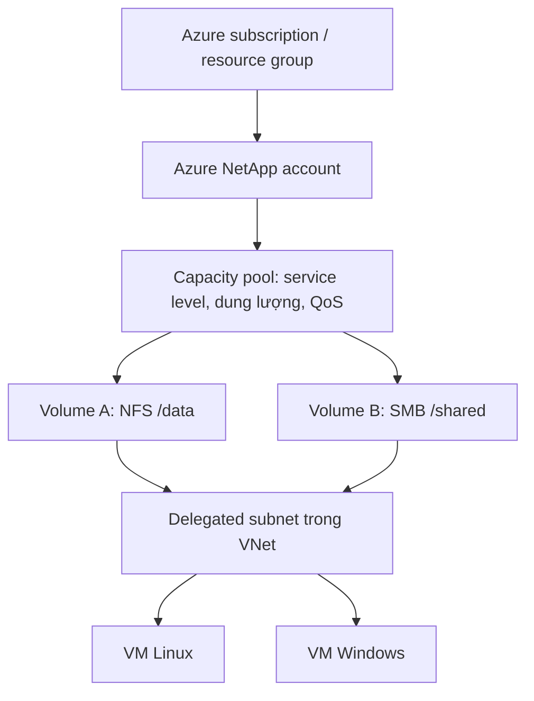

# Azure NetApp Files và workload cần chia sẻ tệp hiệu năng cao

Nhiều ứng dụng doanh nghiệp không chỉ cần một nơi lưu file. Chúng cần **nhiều máy chủ cùng đọc/ghi một hệ thống tệp**, duy trì độ trễ thấp, đáp ứng lượng I/O lớn, bảo toàn quyền truy cập ở cấp file và phục hồi nhanh khi xảy ra lỗi. Ví dụ: ứng dụng SAP, hệ thống phân tích dữ liệu, môi trường dựng hình, phần mềm kỹ thuật, ứng dụng Linux sử dụng NFS hoặc ứng dụng Windows dùng SMB.

**Azure NetApp Files (ANF)** là dịch vụ lưu trữ tệp được quản lý trên Azure, cung cấp volume hiệu năng cao cho các workload phù hợp. Thay vì vận hành một máy chủ file server riêng, nhóm nền tảng tạo volume, chọn giao thức, cấp quyền truy cập và để ứng dụng mount volume đó qua mạng riêng.

Bài học thuộc chương **Lưu trữ tệp và đĩa** của module **CLOUD_PROVIDERS_AZURE**. Kiến thức này kết nối việc tổ chức resource group và subscription với VNet, định danh, bảo mật, triển khai, giám sát và quản trị chi phí kiến trúc ứng dụng Azure.

> Phạm vi: bài học giải thích mô hình và quy trình triển khai ANF cho workload chia sẻ tệp hiệu năng cao. Quota, giá, tính năng theo region, service level và các tùy chọn giao thức có thể thay đổi; khi triển khai cần kiểm tra khả năng hỗ trợ trên subscription, region và loại volume cụ thể.

## 1. Mục tiêu học tập

Sau bài học, bạn có thể:

1. Phân biệt Azure NetApp Files với Azure Files, Blob Storage và Azure Managed Disks.
2. Giải thích mô hình **NetApp account → capacity pool → volume**, subnet được ủy quyền và mount target.
3. Chọn giao thức **NFS**, **SMB** hoặc dual-protocol theo hệ điều hành, ứng dụng và yêu cầu quyền truy cập.
4. Hiểu mối quan hệ giữa quota, service level, QoS, IOPS, throughput và latency.
5. Thiết kế kết nối mạng riêng, DNS, Active Directory, export policy và quyền ở cấp file.
6. Tạo volume bằng Azure Portal, mount từ VM và kiểm thử chức năng/hiệu năng có kiểm soát.
7. Thiết kế snapshot, backup, replication, monitoring, alert và chi phí cho môi trường production.

## 2. ANF giải quyết bài toán nào?

Giả sử doanh nghiệp chạy một ứng dụng xử lý video trên bốn VM Linux. Mỗi VM cần xem cùng thư mục `/media/projects`. Nếu dữ liệu nằm trên ổ đĩa riêng của từng VM, nhóm vận hành phải tự đồng bộ. Nếu đặt trên một file server VM duy nhất, file server trở thành thành phần cần quản lý hiệu năng, cập nhật, backup và khả năng sẵn sàng.

Với ANF, nhiều VM trong phạm vi mạng và quyền được cho phép có thể mount **cùng một volume NFS** để truy cập chung tập dữ liệu. Dịch vụ lưu trữ được Azure quản lý, còn nhóm ứng dụng tập trung vào cấu trúc file, quyền truy cập, hiệu năng và độ bền dữ liệu.

Các đặc trưng quan trọng:

- **File-level access:** ứng dụng dùng file, thư mục và thao tác mở/đọc/ghi/đổi tên, không phải API đối tượng blob.
- **Shared access:** nhiều client có thể truy cập cùng volume nếu giao thức và ứng dụng cho phép.
- **Hiệu năng được hoạch định:** lựa chọn service level, dung lượng/quota và QoS giúp thiết kế thông lượng.
- **Mạng riêng:** volume được truy cập qua kết nối trong Azure VNet/hybrid phù hợp, không phải một public URL dành cho Internet.
- **Data protection:** snapshot và những khả năng bảo vệ khác được cấu hình theo yêu cầu; không mặc định mọi volume đều được backup hoặc nhân bản sang region khác.

**Không nên chọn ANF chỉ vì nó “cao cấp”.** Nếu ứng dụng phù hợp với object storage, cache hoặc Azure Files với yêu cầu vừa phải, một giải pháp khác có thể đơn giản và tiết kiệm hơn.

## 3. So sánh Azure NetApp Files với các loại lưu trữ khác

| Dịch vụ | Mô hình | Tình huống phù hợp | Điểm cần lưu ý |
|---|---|---|---|
| **Azure NetApp Files** | Managed file volumes qua NFS/SMB | Shared file workload yêu cầu hiệu năng/độ trễ, ứng dụng legacy hoặc enterprise | Cần thiết kế capacity pool, volume, mạng riêng, giao thức và chi phí |
| **Azure Files** | Managed SMB/NFS file shares theo lựa chọn dịch vụ | Chia sẻ file phổ biến, migration file server và tích hợp ứng dụng phù hợp | Kiểm tra tier, giao thức, mạng và mục tiêu hiệu năng riêng |
| **Azure Blob Storage** | Object storage qua API/HTTP(S) | Ảnh, video, bản sao, dữ liệu phi cấu trúc, data lake | Không phải file system POSIX/SMB thông thường cho mọi ứng dụng |
| **Azure Managed Disks** | Block storage gắn vào VM | Ổ hệ điều hành, dữ liệu local của VM, database block I/O | Không tự thành shared filesystem nhiều VM; cần thiết kế riêng nếu chia sẻ |
| **File server tự quản lý trên VM** | Máy chủ NFS/SMB do doanh nghiệp vận hành | Yêu cầu tùy biến đặc biệt hoặc hệ thống không phù hợp dịch vụ managed | Phải tự quản lý HA, bản vá, backup, performance và file server OS |

**Câu hỏi quyết định:** workload có thực sự cần một **file system chia sẻ** với semantics NFS/SMB và đặc tính hiệu năng ANF không? Hay chỉ cần lưu object và lấy qua HTTPS? Phân loại đúng nhu cầu giúp tránh đưa dữ liệu vào sai loại dịch vụ.

## 4. Kiến trúc tài nguyên: account, pool và volume

Azure NetApp Files thường được tổ chức theo ba lớp:



Sơ đồ chỉ thể hiện quan hệ logic; mỗi volume có cấu hình mạng và giao thức riêng. Các client chỉ mount được volume nếu **protocol, network path, identity và quyền truy cập** cho phép.

### Azure NetApp account

**NetApp account** là tài nguyên quản lý để nhóm capacity pool, volume và một số cấu hình dịch vụ. Nó không phải user account dùng để đăng nhập SMB hay danh tính trực tiếp của ứng dụng.

Người vận hành cần quyền Azure RBAC phù hợp để tạo hoặc thay đổi account, pool và volume; quyền này **khác** với quyền đọc/ghi file của người dùng NFS/SMB khi truy cập data plane.

### Capacity pool

**Capacity pool** là đơn vị dung lượng và hiệu năng mà các volume lấy tài nguyên từ đó. Khi tạo pool, chọn service level và dung lượng được cấp phát (theo các mức và giới hạn được dịch vụ hỗ trợ), cùng mô hình Quality of Service (QoS) phù hợp.

Một pool có thể chứa nhiều volume. Dung lượng pool còn trống và hạn mức dịch vụ quyết định có thể tạo/mở rộng thêm volume hay không.

### Volume

**Volume** là hệ thống tệp được ứng dụng mount và sử dụng. Volume có:

- Tên tài nguyên và đường dẫn volume/export.
- Quota hoặc dung lượng được cấu hình.
- Giao thức truy cập được hỗ trợ và cấu hình liên quan.
- VNet/subnet và địa chỉ mount target.
- Export policy đối với NFS hoặc cấu hình danh tính phù hợp với SMB.
- Snapshot, backup hoặc replication được cấu hình khi cần.
- Một số tùy chọn hiệu năng và network features theo dịch vụ.

**Volume quota không đồng nghĩa với số byte file đã ghi.** Quota là giới hạn/không gian logic theo cấu hình; dung lượng dữ liệu đã sử dụng và dung lượng snapshot phải được giám sát riêng.

## 5. Service level, QoS và bài toán hiệu năng

ANF có các **service level** với mục tiêu hiệu năng và giá khác nhau. Các tên level thường gặp gồm **Standard**, **Premium** và **Ultra**; tùy khu vực, thời điểm hoặc loại pool có thể có lựa chọn khác. Không nên dựa vào một bảng throughput cố định được chép lại từ môi trường cũ: hãy dùng thông số được Azure công bố cho **đúng loại pool và region hiện tại**.

### Throughput, IOPS, latency khác nhau thế nào?

| Chỉ số | Ý nghĩa | Câu hỏi cần trả lời |
|---|---|---|
| **Throughput** | Lượng dữ liệu đọc/ghi mỗi giây | Có đủ MiB/s cho file lớn, xử lý tuần tự hoặc batch? |
| **IOPS** | Số thao tác đọc/ghi mỗi giây | Có đáp ứng nhiều I/O nhỏ và metadata operations? |
| **Latency** | Thời gian hoàn thành thao tác | Có phù hợp database/file workload nhạy độ trễ? |
| **Concurrency** | Số tác vụ/client cùng truy cập | Hiệu năng thay đổi ra sao khi tăng worker? |
| **Quota/dung lượng** | Không gian logic được cấu hình | Có đủ cho dữ liệu và tăng trưởng không? |

Ví dụ, 8.000 thao tác/giây với kích thước I/O 64 KiB tương đương khoảng:

```text
8.000 IOPS × 64 KiB = 512.000 KiB/s ≈ 500 MiB/s
```

Đây là phép quy đổi **lý thuyết**, không phải cam kết ANF đạt 500 MiB/s. Overhead, cách truy cập, client, mạng, protocol, mix read/write, QoS và giới hạn dịch vụ đều ảnh hưởng tốc độ thực tế.

### Automatic QoS và manual QoS

Tùy loại capacity pool, ANF hỗ trợ mô hình QoS phù hợp:

- **Automatic QoS:** mức throughput của volume được xác định từ quy mô/quota và service level theo cơ chế của dịch vụ. Mở rộng volume có thể thay đổi throughput được phân bổ.
- **Manual QoS:** người vận hành có thể cấu hình throughput của volume theo mức được hỗ trợ, độc lập hơn với volume quota, nhưng vẫn bị ràng buộc bởi dung lượng/khả năng pool và giới hạn dịch vụ.

Đừng hiểu Manual QoS nghĩa là có thể đặt throughput tùy ý. Cần lập ngân sách tổng throughput của các volume, kiểm tra pool capacity và giới hạn cụ thể.

### Ví dụ sizing

Ba volume dùng chung pool:

| Volume | Nhu cầu | Điều cần đo |
|---|---|---|
| `vol-app` | Nhiều file nhỏ, nhiều client | IOPS, metadata latency, concurrency |
| `vol-media` | Đọc/ghi file lớn tuần tự | Read/write throughput, băng thông VM |
| `vol-backup-stage` | Burst ghi dữ liệu theo lịch | Peak throughput, thời gian hoàn tất, lưu lượng đột biến |

Không thể chọn cùng một QoS chỉ dựa trên “mỗi volume 1 TiB”. Nên benchmark với kích thước file, thao tác và độ song song tương tự production rồi điều chỉnh pool/volume.

## 6. Thiết kế mạng: delegated subnet và mount target

Azure NetApp Files truy cập thông qua **kết nối mạng riêng**. Khi tạo volume, cần sử dụng subnet được **delegated** cho resource provider `Microsoft.NetApp/volumes` trong VNet phù hợp.

Ví dụ:

```text
VNet: 10.70.0.0/16

  snet-app: 10.70.1.0/24
    VM Linux A: 10.70.1.10
    VM Linux B: 10.70.1.11

  snet-anf: 10.70.10.0/24
    Delegation: Microsoft.NetApp/volumes
    ANF volume mount target: địa chỉ riêng do Azure cấp
```

Các client nằm ở subnet ứng dụng có thể truy cập volume nếu có tuyến mạng và quyền phù hợp. Không cần đặt VM trong chính subnet dành cho volume.

### Nguyên tắc về delegated subnet

1. Dùng một subnet được dự trù cho ANF, không trộn tài nguyên VM thông thường vào subnet đã ủy quyền cho ANF.
2. Chọn prefix đủ lớn cho nhu cầu hiện tại và tương lai theo giới hạn tối thiểu/tối đa được dịch vụ hỗ trợ; tránh dùng cạn địa chỉ subnet.
3. Bảo đảm VNet, region của volume và các thiết lập network features tương thích.
4. Kiểm tra kết nối từ VNet khác qua peering hoặc từ on-premises qua VPN/ExpressRoute nếu yêu cầu hybrid.
5. Xem xét **Basic/Standard network features** và khả năng hỗ trợ của region trước khi dựa vào NSG, UDR hoặc mô hình kết nối nâng cao.
6. Không cấu hình route hoặc firewall theo giả định volume là một VM có NIC do bạn tự quản lý.

Khả năng gắn NSG/UDR và cách các tính năng mạng hoạt động phụ thuộc **network features** của volume/subnet và quy định dịch vụ. Hãy kiểm tra effective routes, chính sách mạng và tài liệu của loại triển khai thay vì mặc định mọi subnet ANF xử lý giống subnet VM.

### Độ trễ mạng và locality

Đặt compute và volume ở vị trí mạng phù hợp với ứng dụng, thường là trong cùng region khi workload nhạy latency. Việc truy cập từ xa qua hybrid hoặc peering có thể tăng RTT và ảnh hưởng các I/O nhỏ, ngay cả khi thông lượng công bố của pool cao.

Nếu ứng dụng gọi hàng chục nghìn thao tác metadata nhỏ, **latency và số vòng trao đổi protocol** có thể quan trọng hơn băng thông tối đa. Hãy kiểm thử từ đúng loại VM và đường kết nối dự kiến.

### DNS không thay thế connectivity

SMB thường cần tên máy/chia sẻ và đặc biệt cần DNS/Active Directory hoạt động đúng. Với NFS, mount target có thể được cung cấp dưới dạng địa chỉ và export path từ hướng dẫn mount. Dù dùng tên hay IP, client vẫn phải có đường mạng đến dịch vụ và protocol port được cho phép.

**ANF không phải public file share qua Internet.** Nếu một nhân viên cần truy cập file từ ngoài Azure, hãy cung cấp đường VPN, ExpressRoute hoặc giải pháp truy cập doanh nghiệp được phê duyệt, không cố mở volume thành public endpoint.

## 7. Chọn giao thức: NFS, SMB và dual-protocol

Việc chọn protocol phải bám sát workload, hệ điều hành, semantics tệp, danh tính và quyền truy cập.

| Giao thức | Workload điển hình | Vấn đề thiết kế |
|---|---|---|
| **NFSv3** | Linux/Unix, ứng dụng legacy, HPC hoặc pipeline phù hợp | Export policy, UID/GID, quyền UNIX, mạng và tùy chọn bảo mật |
| **NFSv4.1** | Linux/Unix cần tính năng và semantics của NFSv4.1 | Client compatibility, state/locking, identity, bảo mật Kerberos nếu áp dụng |
| **SMB** | Windows file shares, ứng dụng enterprise, user/group ACL | Active Directory DS, DNS, Kerberos, NTFS ACL, khả năng tương thích phiên bản SMB |
| **Dual-protocol** | Workload cần cả NFS và SMB trên một tập dữ liệu | Danh tính thống nhất, ánh xạ UID/SID, security style, giới hạn và hỗ trợ giao thức cụ thể |

Các kết hợp NFS/SMB được hỗ trợ trong dual-protocol và các hạn chế về authentication/volume features cần xác minh tại thời điểm tạo volume. Không suy ra rằng mọi tính năng của một volume NFS đơn giao thức cũng hoạt động giống nhau trên dual-protocol.

### Quyền trên NFS

Với NFS, export policy quyết định **client/subnet nào được phép truy cập** và các thuộc tính như read-only/read-write, root access hoặc security type khi được hỗ trợ. Sau khi mount được, quyền file Linux vẫn có ý nghĩa: UID, GID, mode bit, ACL và cách ứng dụng tạo file.

Ví dụ, hai VM cùng mount volume nhưng user `app` trên VM A có UID 1001, còn trên VM B có UID 2001. Dù tên người dùng giống nhau, quyền truy cập tệp có thể khác nếu hệ thống dựa trên UID/GID. Cần chiến lược danh tính Linux nhất quán.

**Không dùng export policy rộng như “mọi IP được ghi, root access không giới hạn” chỉ để làm bài lab.** Nên giới hạn dải IP client và quyền tối thiểu.

### Quyền trên SMB

SMB trong ANF thường tích hợp với **Active Directory Domain Services** theo cấu hình và điều kiện hỗ trợ. Cần:

- DNS phân giải đúng domain controller và bản ghi liên quan.
- Kết nối mạng tới domain controller cùng các cổng dịch vụ cần thiết.
- Tài khoản và quyền quản trị được phê duyệt để cấu hình kết nối AD.
- Người dùng/nhóm thích hợp cùng quyền share và file/NTFS ACL.
- Đồng bộ thời gian và hoạt động xác thực Kerberos phù hợp.

**Azure RBAC quản lý tài nguyên ANF không tự cấp quyền mở file SMB.** Quyền data plane do giao thức, AD và ACL chi phối. Một user là Contributor ở resource group vẫn có thể không đọc được một thư mục trong share.

### Khi nào tránh dual-protocol?

Nếu ứng dụng Windows và Linux không cần cùng ghi lên một tập dữ liệu, việc tách volume theo giao thức thường dễ quản trị hơn. Dual-protocol đòi hỏi thiết kế chặt chẽ về identity mapping, file ownership, ACL và các trường hợp khóa tệp; không nên dùng chỉ vì muốn “hỗ trợ mọi thứ”.

## 8. Chuẩn bị triển khai bằng Azure Portal

Bài thực hành giả định bạn có subscription thử nghiệm, quyền quản lý Azure NetApp Files, VNet và quota/tính năng dịch vụ phù hợp trong region.

**Trước khi tạo tài nguyên, kiểm tra:**

- Azure NetApp Files có khả dụng trong region chọn và subscription được phép sử dụng.
- Resource provider `Microsoft.NetApp` đã được đăng ký nếu môi trường yêu cầu.
- Hạn mức tài nguyên, capacity pool minimum, service level và các tính năng dự kiến.
- Dải CIDR của VNet và delegated subnet không chồng lấn kết nối hybrid.
- Có khách hàng (VM Linux/Windows) dùng để mount và kiểm thử.
- Có ngân sách; capacity pool có thể phát sinh phí ngay khi cấp phát tài nguyên, không phụ thuộc việc đã lưu nhiều file hay chưa.

### Bước 1 — Tạo NetApp account

Trong Azure Portal, tìm **Azure NetApp Files**, chọn tạo NetApp account tại subscription, resource group và region phù hợp. Đặt tên dễ nhận diện theo môi trường, ví dụ `anf-lab`. Ghi owner, project và tags theo chuẩn quản trị.

### Bước 2 — Tạo capacity pool

Trong account, tạo capacity pool với service level được phép (ví dụ Premium cho bài thử, nếu được hỗ trợ), dung lượng tối thiểu/hạn mức và mô hình QoS phù hợp. Đừng chọn dung lượng chỉ theo số GiB dữ liệu mẫu: pool được cấp phát theo mô hình và mức tối thiểu của dịch vụ, có thể tạo chi phí đáng kể.

Với production, lựa chọn pool dựa trên mục tiêu throughput, tăng trưởng quota và số volume phải phục vụ chứ không chỉ dung lượng dữ liệu hiện tại.

### Bước 3 — Chuẩn bị delegated subnet

Trong VNet, tạo subnet riêng, cấu hình delegation cho `Microsoft.NetApp/volumes` theo giao diện Azure. Kiểm tra region, VNet và **network features** dự định cho volume trước khi tiếp tục.

### Bước 4 — Tạo NFS volume

Chọn capacity pool, tạo volume và cấu hình:

- Tên volume và đường dẫn file/export duy nhất theo quy tắc dịch vụ.
- Quota phù hợp.
- Giao thức **NFSv3** hoặc **NFSv4.1** theo yêu cầu.
- VNet/subnet đã delegation.
- Export policy chỉ cho phép CIDR của VM thử nghiệm hoặc subnet client phù hợp.
- Quyền đọc/ghi và root access ở mức cần thiết.
- Snapshot policy hoặc data protection sau khi đã thiết kế.

Tạo volume thành công cho biết tài nguyên có cấu hình ở control plane, **không chứng minh ứng dụng đã mount hoặc có quyền ghi dữ liệu**.

### Bước 5 — Lấy mount instructions

Mở chi tiết volume và chọn **Mount instructions**. Tại đây Azure cung cấp mount target và export path phù hợp với protocol. Sử dụng đúng lệnh được portal cung cấp cho hệ điều hành, phiên bản NFS và cấu hình volume thực tế.

### Bước 6 — Gắn từ VM và xác nhận

SSH vào VM Linux thử nghiệm trong subnet client (qua đường quản trị được phê duyệt), chuẩn bị NFS client và mount. Xác nhận quyền và đường mạng trước khi tạo file thử.

## 9. Ví dụ Linux mount NFS có kiểm soát

Đoạn lệnh minh họa cho một **NFSv4.1 volume đã tạo**. Đường dẫn và IP là placeholder; chúng phải được lấy từ Mount instructions của volume, không tự đoán.

```bash
sudo mkdir -p /mnt/anf-data

sudo mount -t nfs \
  -o vers=4.1,proto=tcp \
  "<MOUNT_TARGET_IP>:/<VOLUME_EXPORT_PATH>" \
  /mnt/anf-data

mount | grep /mnt/anf-data
df -h /mnt/anf-data
```

Giải thích:

- `vers=4.1` chỉ phù hợp khi volume được cấu hình và client hỗ trợ NFSv4.1. Với NFSv3 cần dùng lựa chọn thích hợp, không thay version tùy tiện.
- Chuỗi `<MOUNT_TARGET_IP>:/<VOLUME_EXPORT_PATH>` phải khớp mount target Azure cung cấp.
- `df -h` hiển thị dung lượng theo góc nhìn client, không thay thế metric quota và consumption tại dịch vụ.
- `mount` thành công chưa bảo đảm ứng dụng có quyền ghi vào tất cả thư mục.

Thử quyền **trong thư mục được phép**:

```bash
cd /mnt/anf-data
printf 'test-an-fs\n' > ./anf-connectivity-test.txt
cat ./anf-connectivity-test.txt
rm ./anf-connectivity-test.txt
```

Nếu `Permission denied`, kiểm tra export policy, UID/GID, quyền thư mục và security type; đừng ngay lập tức chạy `chmod -R 777` hoặc bật root access trên toàn volume.

**Chú ý tính nhất quán:** khi nhiều client dùng cùng volume, việc khóa file, ghi đồng thời và xử lý cập nhật phải tuân theo semantics ứng dụng. ANF cung cấp file system, không tự xử lý mọi xung đột nghiệp vụ của hai tiến trình ghi cùng file.

### Mount lâu dài

Nếu cần mount sau reboot, cấu hình `/etc/fstab` hoặc cơ chế mount tự động theo hướng dẫn OS và yêu cầu vận hành. Trước khi bật tự mount production, phải kiểm tra thứ tự khởi động mạng, timeout, tùy chọn NFS, xử lý mất kết nối và khả năng reboot VM không bị treo quá trình khởi động.

Không sao chép một chuỗi mount option từ blog cũ nếu không kiểm tra lại khả năng hỗ trợ của NFS client/kernel và Azure NetApp Files.

## 10. Kết nối SMB từ Windows

Với volume SMB, điều kiện tiên quyết thường gồm cấu hình Active Directory phù hợp trong ANF, DNS/đường mạng tới domain controller và tài khoản có quyền mở share.

Trên Windows client đã tham gia domain hoặc có ngữ cảnh xác thực được hỗ trợ:

```powershell
Test-NetConnection -ComputerName "<SMB_SERVER_HOSTNAME>" -Port 445
```

Sau khi xác nhận port và DNS, mở share từ File Explorer bằng đường dẫn:

```text
\\<SMB_SERVER_HOSTNAME>\<SHARE_NAME>
```

Hoặc dùng PowerShell trong phiên có ngữ cảnh xác thực thích hợp:

```powershell
New-PSDrive -Name "N" -PSProvider FileSystem `
  -Root "\\<SMB_SERVER_HOSTNAME>\<SHARE_NAME>" -Persist
```

Thay hostname và share theo **Mount instructions** của volume. Nếu cách map drive hoặc ngữ cảnh PowerShell không hỗ trợ tham số `-Persist`, dùng phương pháp kết nối SMB của Windows phù hợp môi trường.

Nếu đăng nhập được domain nhưng không thấy file, cần phân biệt:

- DNS của tên share.
- Kết nối TCP/445 từ client.
- Xác thực Kerberos/AD.
- Quyền ở cấp share và ACL của thư mục.
- Tài khoản người dùng thực sự được sử dụng khi mở share.

Không ghi mật khẩu hoặc token AD vào script, connection string hoặc log; dùng phương pháp quản lý credential được tổ chức chấp thuận.

## 11. Azure CLI: kiểm kê và quan sát tài nguyên ANF

Azure CLI có nhóm lệnh `az netappfiles` để quản trị tài nguyên Azure NetApp Files. Cú pháp hoặc tùy chọn của một số thao tác có thể thay đổi theo phiên bản Azure CLI và loại volume; hãy kiểm tra `--help` trước khi chạy lệnh có tác dụng thay đổi.

Các ví dụ dưới đây là **lệnh chỉ đọc**, dành cho Azure Cloud Shell (Bash) hoặc Bash đã đăng nhập:

```bash
az account show \
  --query "{subscription:name, subscriptionId:id}" \
  --output table

RG="rg-anf-lab"
ACCOUNT="anf-lab"
POOL="pool-perf"
VOLUME="vol-data"
```

Liệt kê NetApp account:

```bash
az netappfiles account list \
  --resource-group "$RG" \
  --output table
```

Liệt kê capacity pool trong account:

```bash
az netappfiles pool list \
  --resource-group "$RG" \
  --account-name "$ACCOUNT" \
  --output table
```

Liệt kê volume trong capacity pool:

```bash
az netappfiles volume list \
  --resource-group "$RG" \
  --account-name "$ACCOUNT" \
  --pool-name "$POOL" \
  --output table
```

Xem chi tiết volume và lấy resource ID:

```bash
az netappfiles volume show \
  --resource-group "$RG" \
  --account-name "$ACCOUNT" \
  --pool-name "$POOL" \
  --volume-name "$VOLUME" \
  --output json

VOLUME_ID=$(az netappfiles volume show \
  --resource-group "$RG" \
  --account-name "$ACCOUNT" \
  --pool-name "$POOL" \
  --volume-name "$VOLUME" \
  --query id --output tsv)
```

Các lệnh này không yêu cầu xuất giá trị bí mật; tuy nhiên, thông tin mount path, AD connection và thông số mạng vẫn nên được chia sẻ theo đúng phân quyền.

### Kiểm tra Azure Monitor metric definitions

```bash
az monitor metrics list-definitions \
  --resource "$VOLUME_ID" \
  --output table
```

Danh sách metric được Azure trả về cho đúng loại resource là nguồn xác định tên metric, đơn vị và aggregation phù hợp. Sau khi biết tên metric, dùng `az monitor metrics list` để lấy series; không tự đoán metric name cho mọi vùng/tier/loại volume.

## 12. Đo hiệu năng và xác định điểm nghẽn

Trước khi kết luận ANF “chậm” hoặc “thiếu throughput”, hãy đặt mục tiêu đo:

| Loại workload | Chỉ số cần chú ý |
|---|---|
| Đọc file lớn tuần tự | MiB/s đọc, độ trễ theo kích thước I/O, giới hạn mạng VM |
| Ghi file lớn | MiB/s ghi, mức độ song song, chính sách đồng bộ/flush |
| Nhiều file nhỏ | IOPS, metadata latency, số thao tác mở/đóng, directory operations |
| Nhiều client cùng truy cập | Tổng concurrency, lock contention, client latency |
| SMB doanh nghiệp | Độ trễ file operations, AD/DNS, SMB session, file ACL/locking |
| Database hoặc application đặc thù | Pattern fsync/commit, yêu cầu của nhà cung cấp ứng dụng, consistency và latency |

Các lớp cần kiểm tra:

1. **Client/VM:** kích thước VM, hiệu năng NIC, CPU, RAM, NFS/SMB client, số kết nối và cấu hình filesystem.
2. **Đường mạng:** VNet peering, hybrid RTT, firewall/route, DNS và độ trễ.
3. **Protocol:** NFS version, mount options, SMB dialect, locks, identity mapping và overhead.
4. **ANF volume/pool:** QoS, service level, quota, throughput allocation, mức sử dụng và throttling nếu metric hỗ trợ.
5. **Ứng dụng:** I/O size, IOPS, số worker, lock contention, thao tác metadata và thời gian chờ I/O.

### Benchmark bằng fio

Trên **volume thử nghiệm**, không chạy tải ghi vào volume production, có thể dùng `fio` để đo pattern gần giống ứng dụng. Ví dụ đọc ngẫu nhiên từ một file benchmark **đã được chuẩn bị trên volume lab**:

```bash
fio --name=anf-randread-lab \
    --filename=/mnt/anf-data/benchmark-file \
    --rw=randread \
    --bs=64k \
    --iodepth=8 \
    --numjobs=2 \
    --direct=1 \
    --time_based=1 \
    --runtime=60 \
    --group_reporting
```

Đảm bảo `benchmark-file` là dữ liệu **không nhạy cảm và đã được tạo riêng để benchmark**, đủ kích thước để phép đo có ý nghĩa. Cấu hình `--direct=1` và mức song song có thể khác cách ứng dụng thực dùng cache/locking; `fio` không tự tái hiện mọi workload SMB/NFS. Không dùng lệnh ghi ngẫu nhiên trên file nghiệp vụ.

**Báo cáo kết quả:** ghi IOPS, bandwidth, latency trung bình và percentile, số job, block size, phiên bản protocol, cấu hình VM, service level/QoS, vùng triển khai và thời điểm benchmark. Chỉ so sánh kết quả khi điều kiện thử tương đương.

### Đọc kết quả đúng

Một volume đạt MiB/s cao khi đọc file lớn nhưng chậm khi liệt kê hàng triệu file nhỏ là chuyện có thể xảy ra. Thông lượng và IOPS là hai đặc tính khác nhau; metadata operations và lock cũng ảnh hưởng hiệu năng.

Nếu thay đổi QoS, pool hoặc volume quota, nên chạy lại bài đo chuẩn, đồng thời xem ứng dụng thực tế. Không suy luận hiệu quả nâng cấp chỉ từ cấu hình control plane.

## 13. Monitoring và cảnh báo

Azure Monitor hỗ trợ theo dõi những metric do ANF công bố cho tài nguyên volume hoặc pool. Các nhóm quan trọng:

- **Dung lượng:** volume quota, logical/consumed/allocated size theo metric khả dụng, tốc độ tăng dữ liệu.
- **I/O:** read/write operations, IOPS và bytes đọc/ghi.
- **Độ trễ:** read/write latency hoặc latency metric tương ứng.
- **Throughput:** dữ liệu đọc/ghi mỗi giây, throughput limit và khả năng đạt QoS khi có metric phù hợp.
- **Snapshot/data protection:** dung lượng hoặc trạng thái bảo vệ được công bố; không suy ra snapshot luôn được backup.
- **Sức khỏe truy cập:** client mount failures, NFS/SMB error, AD/DNS, timeout và application SLO từ telemetry ở client.

Tên metric, độ phân giải và aggregation thay đổi theo loại resource; không lấy một metric `AverageLatency` tưởng tượng rồi cấu hình alert nếu API không liệt kê tên đó.

### Dashboard đề xuất

| Biểu đồ | Phân tích |
|---|---|
| Volume used/quota theo 30 ngày | Rủi ro hết không gian và xu hướng tăng |
| Read + write throughput | Peak so với mức được cấp phát |
| Read/write latency và p95 ứng dụng | Phân biệt mức trung bình với trải nghiệm xấu ở tail |
| Read/write IOPS | Có bị chi phối bởi nhiều I/O nhỏ? |
| Số lỗi NFS/SMB và timeout | Ứng dụng có mất kết nối hoặc gặp lỗi permission? |
| Pool capacity được phân bổ và sử dụng | Có đủ dư địa mở rộng volume không? |
| Tình trạng backup/replication | Hoạt động bảo vệ có hoàn thành đúng kỳ? |

Có thể thêm alert khi dung lượng tiến sát quota, latency cao kéo dài hoặc throughput gần giới hạn kết hợp lỗi ứng dụng. Ngưỡng nên dựa vào baseline và SLO, tránh đặt một ngưỡng cứng áp cho mọi workload.

### Log ngoài Azure Monitor

Nhiều sự cố file system chỉ thể hiện rõ ở client:

```bash
mount | grep /mnt/anf-data
df -h /mnt/anf-data
nfsstat -m
dmesg | tail -n 30
```

Đây là lệnh đọc trạng thái; dùng quyền phù hợp và cẩn trọng khi gửi log vì tên file/path có thể chứa thông tin nội bộ. Với Windows, xem Event Viewer, SMB client logs, tình trạng kết nối và log ứng dụng, đồng thời kiểm tra DNS/AD.

Một VM bị nghẽn CPU hoặc network có thể thấy latency cao dù metric phía volume vẫn bình thường. Cần đối chiếu client và service.

## 14. Snapshot, backup và replication: không phải một thứ

ANF có các khả năng bảo vệ dữ liệu, nhưng mỗi cơ chế giải quyết một rủi ro khác nhau.

| Cơ chế | Mục đích | Điều không nên giả định |
|---|---|---|
| **Snapshot** | Điểm khôi phục dữ liệu của volume, thường tạo nhanh và phù hợp phục hồi thay đổi/xóa nhầm | Snapshot không tự là bản backup độc lập ở region khác |
| **Snapshot policy** | Tự động tạo/giữ snapshot theo lịch và khả năng dịch vụ | Không bảo đảm ứng dụng đã quiesce hoặc dữ liệu nhất quán giao dịch |
| **Azure NetApp Files backup** | Bảo vệ dữ liệu theo khả năng hỗ trợ và lịch/đích được cấu hình | Không mặc định có backup khi vừa tạo volume |
| **Cross-region replication** | Nhân bản dữ liệu sang region khác theo cấu hình và khoảng thời gian phù hợp | Không mặc định đồng bộ tức thời hoặc failover hoàn toàn tự động |
| **Thiết kế HA của ứng dụng** | Khôi phục cả ứng dụng, compute, identity, network và dữ liệu | Replicated files không tự phục hồi được database, session hoặc API |

### Ứng dụng nhất quán dữ liệu

Snapshot cấp file system có thể phản ánh dữ liệu tại một thời điểm, nhưng nếu ứng dụng đang ghi nhiều file hoặc transaction chưa commit, khôi phục snapshot không tự đảm bảo **application consistency**. Với database, SAP, ứng dụng enterprise hoặc hệ thống có yêu cầu nhất quán cao, cần tuân thủ cơ chế quiesce, backup integration và hướng dẫn từ nhà cung cấp ứng dụng.

### Chọn RPO và RTO

- **RPO (Recovery Point Objective):** doanh nghiệp chấp nhận mất tối đa bao nhiêu dữ liệu tính theo thời gian?
- **RTO (Recovery Time Objective):** cần phục hồi dịch vụ trong bao lâu?

Snapshot theo lịch nhiều lần mỗi ngày không tự đáp ứng RPO vài phút. Cross-region replication có độ trễ và quy trình chuyển đổi riêng; phải đánh giá khả năng hỗ trợ, giám sát replication health và **thực hành failover/failback** theo runbook.

### Bảo vệ khỏi xóa nhầm và ransomware

Cần tách quyền:

1. Người dùng ứng dụng có quyền đọc/ghi đúng thư mục.
2. Nhóm vận hành ứng dụng không mặc nhiên có quyền xóa volume/snapshot.
3. Nhóm quản trị ANF dùng Azure RBAC tối thiểu và quy trình phê duyệt.
4. Backup/replication được giám sát và kiểm thử khôi phục độc lập.
5. Log hoạt động quản lý tài nguyên được lưu theo chính sách.

Một tài khoản có quyền ghi file bị xâm nhập vẫn có thể mã hóa hoặc xóa dữ liệu trong volume. Snapshot và backup giúp giảm thiệt hại **chỉ khi** được cấu hình, bảo vệ và kiểm thử khôi phục đúng.

## 15. Tính sẵn sàng, mở rộng và vòng đời volume

### Tăng dung lượng và throughput

Khi cần thêm không gian hoặc hiệu năng:

- Kiểm tra volume quota, pool available capacity và giới hạn mở rộng.
- Xác định đang dùng Automatic hay Manual QoS; thay đổi quota có thể ảnh hưởng throughput theo mô hình đã chọn.
- Dự báo chi phí do cấp phát capacity pool hoặc thay đổi service level.
- Kiểm tra giới hạn protocol/client để tránh tăng pool nhưng không tăng hiệu năng ứng dụng.
- Lập lịch thay đổi, sao lưu/điểm khôi phục phù hợp và xác minh kết quả từ client.

Không nên đợi volume đầy 100% mới mở rộng. Các ứng dụng ghi file tạm, checkpoint hoặc log có thể mất ổn định trước khi dashboard cập nhật.

### Di chuyển dữ liệu

Đối với migration từ NFS/SMB self-hosted hoặc Azure Files:

1. Kiểm kê dung lượng, số file, ACL, UID/GID, file locks và ứng dụng dùng share.
2. Xác định giao thức đích và thiết kế identity.
3. Chuẩn bị volume ANF và kết nối hybrid/private.
4. Thực hiện initial copy bằng công cụ phù hợp, giữ quyền và metadata.
5. Đồng bộ phần thay đổi, tổ chức cutover có kiểm soát.
6. Xác minh ứng dụng, quyền, path, latency và dữ liệu.
7. Giữ phương án khôi phục cho tới khi nghiệm thu, rồi decommission nguồn theo quy trình.

**Copy file thành công không bảo đảm file server migration thành công.** Với SMB cần kiểm thử ACL/AD; với NFS cần kiểm tra UID/GID, symlink, permissions và hành vi ứng dụng.

### Sự cố vùng hoặc subnet

Kiến trúc cần đánh giá điểm lỗi ở compute, mạng, AD/DNS, volume và region. Một volume hiệu năng cao không tự biến hệ thống thành multi-region. Với workload có yêu cầu phục hồi thảm họa, kết hợp cơ chế replication, backup, DNS, runbook và compute dự phòng phù hợp.

## 16. Chi phí và quyết định tối ưu

ANF được thiết kế cho những nhu cầu file storage có hiệu năng và tính năng doanh nghiệp cụ thể. Chi phí không nên được đánh giá chỉ theo số GB file hiện hữu.

Các nguồn chi phí có thể gồm:

- Capacity pool được provision theo service level và mô hình tính phí tương ứng.
- Dung lượng và throughput được cấp phát; mức dư thừa capacity hoặc cấu hình QoS.
- Snapshot, backup, cross-region replication hoặc các tính năng theo biểu giá.
- Dữ liệu truyền liên vùng, hybrid, private connectivity và tài nguyên mạng khác.
- VM client, giám sát, log, hệ thống danh tính/AD và giải pháp backup liên quan.

**Ví dụ quyết định:** ứng dụng có 200 GiB dữ liệu nhưng cần latency thấp và shared NFS với hàng nghìn I/O/s. ANF có thể là lựa chọn đáng đánh giá, song chi phí vẫn phụ thuộc mức cấp phát pool tối thiểu và service level. Ngược lại, nếu ứng dụng chỉ lưu 20 TiB ảnh hiếm khi truy cập qua HTTP, Blob Storage có thể phù hợp hơn.

### Quy trình tối ưu

1. Đo dữ liệu thực tế và tốc độ tăng.
2. Đo peak IOPS/throughput/latency theo workload.
3. Chọn service level và QoS có headroom hợp lý.
4. Kiểm tra có volume nhàn rỗi hoặc pool quá lớn so với nhu cầu không.
5. Tối ưu quyền truy cập và retention snapshot, backup theo RPO/RTO.
6. So sánh tổng chi phí sở hữu với Azure Files hoặc phương án khác, bao gồm công vận hành và rủi ro sự cố.
7. Thiết lập Azure Cost Management budget và tag theo owner/project.

Đừng giảm quota/pool chỉ dựa vào một ngày ít traffic. Workload theo lịch tháng hoặc mùa có thể có peak cao hơn nhiều so với baseline hằng ngày.

## 17. Xử lý các sự cố thường gặp

| Triệu chứng | Nguyên nhân có thể | Hướng điều tra |
|---|---|---|
| Linux mount `No route to host` hoặc timeout | Sai mount target, VNet/peering/VPN/UDR/firewall | Kiểm tra IP, route, protocol port, network features và kết nối từ VM |
| `access denied by server` khi mount NFS | Export policy không chứa CIDR client, cấu hình security type không phù hợp | Xác minh export policy và IP nguồn thực |
| Mount thành công nhưng không ghi file | UID/GID, mode, ACL hoặc quyền thư mục | Kiểm tra `id`, `ls -ln`, user của tiến trình và quyền dữ liệu |
| Windows không mở được share | DNS, AD/Kerberos, TCP/445, tên share hoặc user không có quyền | Kiểm tra DNS, domain controller, SMB connection, share/NTFS ACL |
| Volume báo đầy | Quota gần hết, dữ liệu tăng, snapshot/đối tượng giữ lại | Xem quota/consumption và metric, mở rộng có kiểm soát |
| Latency cao nhưng IOPS thấp | Client/network RTT, metadata, lock contention, DNS/AD hoặc ứng dụng tuần tự | Đo latency từng lớp, protocol, file operations và VM |
| Throughput không đạt kỳ vọng | VM/network giới hạn, QoS, volume/pool size, benchmark chưa đủ parallelism | Đối chiếu metric với limit và benchmark có điều kiện |
| Các client thấy quyền không nhất quán | UID/GID khác nhau hoặc identity mapping dual-protocol | Chuẩn hóa danh tính, ACL và kiểm tra security style |
| Snapshot tồn tại nhưng ứng dụng phục hồi lỗi | Snapshot không nhất quán ở cấp ứng dụng hoặc restore chưa đủ phụ thuộc | Kiểm tra quy trình quiesce/backup, chạy thử restore |
| Không tạo được volume | Chưa đủ capacity pool, subnet không delegated, thiếu quyền/quota/feature | Kiểm tra provisioning error, subscription, region, subnet và quota |

Khi điều tra, đừng thay đổi hàng loạt NSG, export policy và quyền file cùng lúc. Xác định **lỗi ở lớp nào** rồi xử lý phạm vi nhỏ nhất.

## 18. Bài thực hành tổng hợp

### Tình huống

Một hệ thống xử lý ảnh chạy trên ba VM Linux trong Azure, tất cả cần cùng truy cập thư mục `/media`. Ứng dụng đọc/ghi nhiều file và có những đợt xử lý dữ liệu lớn. Nhóm vận hành muốn chia sẻ file mà không phải tự quản lý máy chủ NFS.

### Nhiệm vụ

1. Giải thích vì sao **Azure NetApp Files** đáng cân nhắc hơn ba Managed Disks riêng lẻ; so sánh với Azure Files hoặc Blob Storage theo kiểu truy cập.
2. Vẽ quan hệ NetApp account, capacity pool, volume, delegated subnet và các VM client.
3. Đề xuất service level/QoS và **danh sách số liệu cần đo trước khi sizing**; chưa cần chọn mức throughput theo một con số giới hạn chưa được kiểm chứng.
4. Tạo (hoặc mô tả các bước tạo) NetApp account, capacity pool và NFS volume trong subscription lab được cấp quyền.
5. Kiểm tra subnet được delegated cho `Microsoft.NetApp/volumes` và kết nối từ VM đến mount target.
6. Dùng Mount instructions để mount volume NFS từ hai VM và kiểm tra file được ghi từ máy này có thể đọc trên máy kia.
7. Thiết kế export policy chỉ cho phép dải client cần thiết, tránh mở rộng quyền root.
8. Kiểm tra UID/GID và quyền file khi hai VM dùng cùng dữ liệu.
9. Thực hiện bài đo đọc trên file benchmark thử nghiệm, ghi lại IOPS, MiB/s, latency và cấu hình client.
10. Đề xuất dashboard capacity, throughput, latency, lỗi mount và alert sớm khi quota tăng.
11. Lập kế hoạch snapshot và backup phù hợp với một RPO/RTO giả định; nêu cách kiểm thử restore.
12. Dự báo các chi phí chính và kế hoạch dọn tài nguyên lab sau khi hoàn tất.

### Câu hỏi tự kiểm tra

**Câu 1.** NetApp account, capacity pool và volume khác nhau thế nào? Đối tượng nào là nơi ứng dụng mount file?

**Câu 2.** Vì sao delegated subnet `Microsoft.NetApp/volumes` không được dùng như subnet VM thông thường?

**Câu 3.** Một volume có nhiều IOPS nhưng thông lượng MiB/s thấp có nhất thiết là lỗi dịch vụ không? Hãy liên hệ kích thước I/O.

**Câu 4.** Hai VM Linux có tên user giống nhau nhưng UID/GID khác nhau sẽ gặp vấn đề nào khi cùng truy cập NFS?

**Câu 5.** Một người có quyền Contributor trong resource group có tự động được đọc file SMB trên volume không? Vì sao?

**Câu 6.** Automatic QoS và Manual QoS khác nhau thế nào khi điều chỉnh quota và throughput?

**Câu 7.** Vì sao snapshot không thay thế hoàn toàn backup và cross-region replication?

**Câu 8.** Volume báo latency cao; bạn sẽ kiểm tra client, network, protocol, QoS và ứng dụng theo thứ tự nào?

**Tiêu chí hoàn thành:** người học giải thích được kiến trúc ANF, chọn protocol và QoS dựa trên workload, xác minh mạng và mount, phân quyền dữ liệu đúng, quan sát được hiệu năng và mô tả kế hoạch bảo vệ dữ liệu cùng chi phí.

## Kết luận

**Azure NetApp Files** là lựa chọn lưu trữ tệp được quản lý dành cho các workload cần chia sẻ file qua NFS/SMB với yêu cầu hiệu năng và khả năng quản trị phù hợp. Điểm cốt lõi không chỉ là tạo một volume, mà là **thiết kế đúng capacity pool, service level, QoS, protocol, delegated subnet, danh tính, quyền file và đường mạng của client**.

Khi triển khai production, hãy đo **IOPS, throughput, latency và tốc độ tăng dữ liệu** theo tải thực tế, kết hợp snapshot/backup/replication có kiểm thử phục hồi và theo dõi chi phí của phần capacity được cấp phát. Quy trình đó giúp workload chia sẻ tệp hoạt động ổn định mà không đánh đổi bảo mật, tính liên tục dịch vụ hoặc hiệu quả ngân sách trên Azure.

