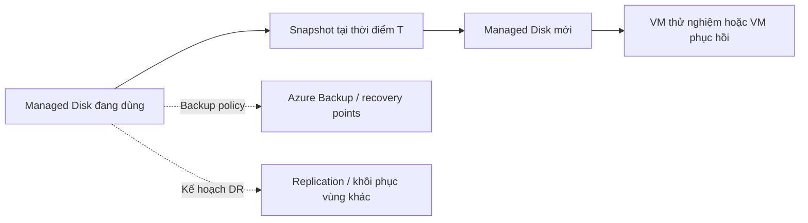
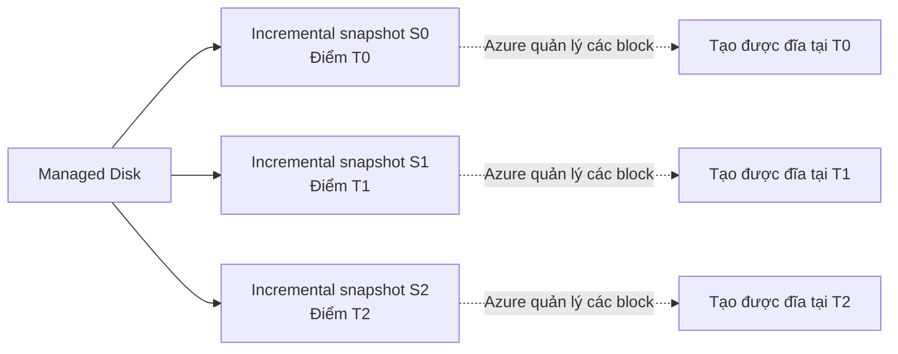
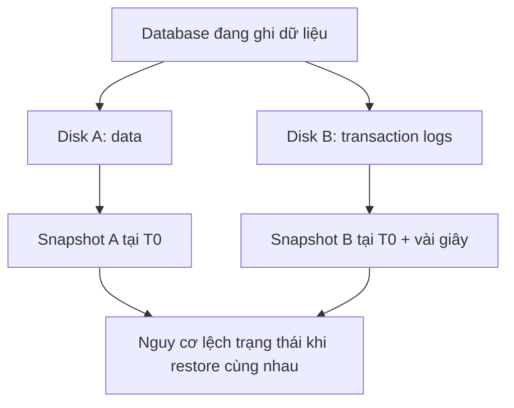
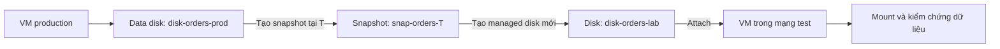
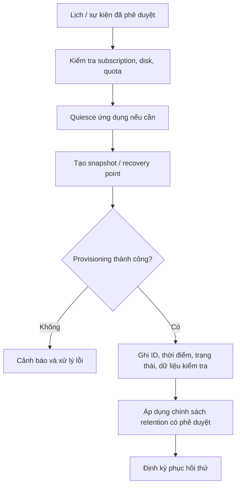

# Snapshot đĩa và tạo bản sao dữ liệu

Khi vận hành một ứng dụng trên Microsoft Azure, có những thời điểm bạn cần giữ lại trạng thái dữ liệu trước khi nâng cấp phần mềm, thử nghiệm một bản vá, di chuyển workload hoặc khôi phục sau thao tác nhầm. Ví dụ, một máy ảo chứa dữ liệu ứng dụng trên **Azure Managed Disk** cần được sao chép để kiểm thử mà không làm thay đổi dữ liệu đang phục vụ khách hàng. **Disk snapshot** cung cấp một ảnh chụp chỉ đọc của đĩa tại một thời điểm, từ đó bạn có thể tạo đĩa mới và triển khai một bản sao độc lập.

Bài học thuộc chương **Lưu trữ tệp và đĩa** trong mô-đun Microsoft Azure. Chúng ta sẽ phân biệt snapshot, clone, backup và replication; học cách chụp snapshot của OS disk/data disk, đánh giá tính nhất quán, tạo bản sao dữ liệu bằng Azure CLI, kiểm tra khả năng phục hồi, mã hóa và kiểm soát chi phí. Nội dung đặt trong bối cảnh subscription, resource group, Azure VM, mạng ảo, danh tính Microsoft Entra ID và chính sách bảo vệ tài nguyên Azure.

## Mục tiêu học tập

Sau khi hoàn thành bài học, bạn có thể:

1. Giải thích điểm khác biệt giữa **disk snapshot**, **managed disk mới từ snapshot**, **backup** và **replication**.
2. Phân biệt snapshot đầy đủ (full) với snapshot gia tăng (incremental), và chọn hình thức phù hợp theo mục đích.
3. Phân tích **crash-consistent** và **application-consistent**, đặc biệt với database hoặc ứng dụng ghi nhiều đĩa.
4. Tạo snapshot một Azure Managed Disk, khôi phục thành đĩa mới và gắn vào VM bằng Azure CLI.
5. Nhận diện những dữ liệu không được bảo vệ chỉ bằng managed disk snapshot, như đĩa tạm cục bộ, dữ liệu đang ở RAM và một số trạng thái ứng dụng.
6. Thiết kế lịch snapshot/backup với **RPO, RTO, retention**, bảo mật khóa mã hóa và chi phí lưu trữ.
7. Tìm lỗi thường gặp khi khôi phục dữ liệu hoặc tạo bản sao môi trường và biết cách kiểm chứng kết quả.

## 1. Mô hình vấn đề: cần một bản sao dữ liệu để làm gì?

Hãy xem ba yêu cầu khác nhau:

- **Trước khi nâng cấp:** nhóm vận hành muốn giữ một điểm phục hồi của đĩa dữ liệu trong trường hợp bản cập nhật làm hỏng file.
- **Tạo môi trường thử nghiệm:** nhóm phát triển cần một đĩa độc lập chứa dữ liệu tương tự production để chạy kiểm tra tương thích.
- **Khôi phục sau thảm họa:** doanh nghiệp phải có khả năng phục hồi hệ thống nếu mất cả VM, storage hoặc region và cần giữ nhiều phiên bản trong thời gian dài.

Yêu cầu thứ nhất có thể dùng snapshot ngắn hạn; yêu cầu thứ hai có thể dùng **snapshot → managed disk mới**; yêu cầu thứ ba thường cần giải pháp **backup/DR** có chính sách retention, bảo vệ độc lập và diễn tập khôi phục. Một snapshot đơn lẻ không tự động thỏa mãn mọi nhu cầu.



**Mục tiêu học tập thực hành:** sau khi tạo bản sao dữ liệu, bạn cần **đọc lại dữ liệu trên đĩa phục hồi** và kiểm chứng nó đúng với điểm cần khôi phục, thay vì chỉ nhìn trạng thái `Succeeded` của tài nguyên Azure.

## 2. Phân biệt snapshot, disk clone, image, backup và replication

| Khái niệm | Bản chất | Mục đích chính | Giới hạn cần nhớ |
|---|---|---|---|
| **Managed disk snapshot** | Tài nguyên Azure dạng **point-in-time**, chỉ đọc, lưu trạng thái một managed disk. | Tạo điểm phục hồi hoặc nguồn tạo đĩa mới. | Thường bảo vệ **một đĩa**, không tự đồng bộ transaction giữa nhiều đĩa. |
| **Disk copy / disk clone** | Một **managed disk mới** tạo từ snapshot hoặc nguồn đĩa hợp lệ. | Gắn vào VM khác, thử nghiệm hoặc thay thế đĩa hỏng. | Bản sao là tài nguyên riêng; dữ liệu không tự đồng bộ hai chiều với đĩa gốc. |
| **VM image / Azure Compute Gallery** | Mẫu triển khai VM, có thể chứa OS và cấu hình image theo mô hình hỗ trợ. | Tạo nhiều VM thống nhất, quản lý phiên bản image. | Không thay thế backup dữ liệu vận hành liên tục. |
| **Backup / recovery point** | Quá trình bảo vệ có lịch, chính sách lưu giữ và cơ chế restore. | Phục hồi sau xóa nhầm, lỗi dữ liệu hoặc hỏng hệ thống. | Phải kiểm tra scope, mức nhất quán, retention và khả năng restore. |
| **Replication** | Duy trì bản sao gần hiện tại ở nơi khác theo cơ chế đồng bộ/bất đồng bộ. | Khả dụng cao hoặc disaster recovery. | Thao tác xóa/hỏng dữ liệu có thể được nhân bản; không mặc nhiên có lịch sử phiên bản. |
| **File copy** | Sao chép file ở tầng filesystem hoặc ứng dụng, ví dụ AzCopy/rsync. | Chuyển một tập file hoặc thư mục cụ thể. | Không tạo point-in-time nhất quán cho toàn block device khi có ghi đồng thời. |

**Snapshot không phải backup hoàn chỉnh** nếu bạn chưa quản lý lịch, thời gian giữ bản sao, quyền xóa, vị trí lưu, khả năng phục hồi và tính nhất quán ứng dụng. Snapshot cũng không làm các VM tự động chuyển sang bản sao khi đĩa gốc gặp sự cố.

## 3. Azure Managed Disk snapshot hoạt động như thế nào?

**Azure Managed Disks** là block storage do Azure quản lý dành cho máy ảo. VM sử dụng đĩa hệ điều hành (OS disk) và có thể gắn thêm nhiều data disk. Khi tạo snapshot, Azure ghi nhận trạng thái dữ liệu trên **một managed disk** ở thời điểm tương ứng. Snapshot trở thành một tài nguyên Azure riêng và có vòng đời, quyền truy cập, cấu hình lưu trữ, chi phí riêng.

Đặc điểm cơ bản:

- **Chỉ đọc:** snapshot không được mount và ghi trực tiếp như managed disk đang hoạt động. Muốn dùng dữ liệu dưới dạng ổ đĩa ghi được, bạn tạo **managed disk mới từ snapshot**.
- **Point-in-time:** snapshot phản ánh một thời điểm, không tiếp tục nhận các thay đổi của đĩa nguồn sau đó.
- **Độc lập ở cấp tài nguyên:** snapshot có tên, resource ID và được quản trị trong Azure Resource Manager, nhưng tính khả dụng dữ liệu có thể phụ thuộc vào loại snapshot, region và cấu hình lưu trữ.
- **Có thể dùng để tạo đĩa mới:** đĩa phục hồi thường có thể được gắn vào VM tương thích sau khi kiểm tra region, dung lượng, SKU, mã hóa và trạng thái attachment.
- **Không bao gồm mọi trạng thái của VM:** RAM, kết nối mạng, tiến trình đang chạy và một số đĩa tạm cục bộ không được bảo vệ bằng snapshot của managed disk.

### 3.1. OS disk và data disk

**OS disk** chứa hệ điều hành và các thành phần boot. Snapshot OS disk có thể dùng trong quy trình phục hồi hệ điều hành hoặc tạo bản sao ở mức đĩa, nhưng phải cẩn trọng với **machine identity**, hostname, domain membership, SSH host keys, certificate, secrets và các định danh được sao chép. Nếu mục tiêu là tạo hàng loạt VM chuẩn hóa, nên dùng quy trình image/generalization phù hợp thay vì nhân bản nguyên trạng một OS disk production rồi chạy nhiều bản sao trong cùng mạng.

**Data disk** thường chứa file ứng dụng hoặc database. Snapshot data disk hữu ích để tạo bản sao thử nghiệm, nhưng cần xem dữ liệu có đang được ứng dụng ghi đồng thời, có nhiều data disk trong volume/RAID/LVM hay không, và các bước mở volume sau khi gắn lại.

**Temporary disk, ephemeral OS disk hoặc local NVMe** không nên được coi như managed data disk có thể snapshot theo cùng cách. Dữ liệu tạm có thể mất khi host thay đổi, VM redeploy hoặc khi vòng đời máy ảo diễn ra theo đặc tính của sản phẩm. Nếu dữ liệu quan trọng, hãy lưu vào loại storage có cơ chế bảo vệ phù hợp.

## 4. Snapshot đầy đủ và snapshot gia tăng

Azure hỗ trợ các mô hình snapshot khác nhau, trong đó **incremental snapshot** thường phù hợp với chuỗi điểm khôi phục của managed disks. Cần phân biệt cách lưu trữ với khả năng khôi phục.

### 4.1. Full snapshot

**Full snapshot** là một ảnh chụp dữ liệu của đĩa tại một thời điểm theo cơ chế lưu trữ snapshot tương ứng. Nó hữu ích khi cần một điểm sao chép độc lập để phục hồi hoặc thử nghiệm. Chi phí và cách tính dung lượng thực tế tùy SKU và loại snapshot; không nên mặc định được tính đúng bằng dung lượng dữ liệu sử dụng trên filesystem.

### 4.2. Incremental snapshot

**Incremental snapshot** tận dụng việc chỉ lưu những thay đổi ở mức block kể từ điểm snapshot trước trong chuỗi do Azure quản lý. Ví dụ:

```text
T0: Đĩa có dữ liệu A B C D
    Snapshot S0: trạng thái ban đầu

T1: B thay đổi thành B', D thay đổi thành D'
    Snapshot S1: ghi nhận thay đổi tương ứng

T2: Thêm E, C thay đổi thành C'
    Snapshot S2: ghi nhận thay đổi tiếp theo
```



Điểm quan trọng là **mỗi incremental snapshot có thể được dùng như một điểm phục hồi đầy đủ** theo cơ chế quản lý dữ liệu của Azure; người dùng không cần tự ghép các file delta bằng tay. Azure quản lý dữ liệu block phụ thuộc để việc giữ hoặc xóa các snapshot theo điều kiện dịch vụ không làm hỏng các điểm phục hồi còn được giữ hợp lệ.

Lợi ích thường thấy:

- Giảm dữ liệu phải ghi/lưu thêm khi chỉ một phần nhỏ của đĩa thay đổi giữa các lần chụp.
- Phù hợp với những chuỗi snapshot định kỳ khi có yêu cầu nhiều điểm phục hồi.
- Có thể đánh giá chi phí theo mức thay đổi block thay vì giả định mỗi lần chụp là một bản sao toàn bộ dữ liệu.

Tuy nhiên, **incremental không bảo đảm chi phí luôn rẻ trong mọi workload**: database ghi đè nhiều block hoặc workload có tốc độ thay đổi cao sẽ tạo mức churn lớn. Hãy theo dõi kích thước snapshots, số lượng điểm phục hồi và giá theo region/SKU. Khả năng incremental snapshot, tính năng sao chép vùng khác và những giới hạn có thể khác nhau theo loại đĩa và cấu hình.

### 4.3. Chọn full hay incremental?

| Tình huống | Cách cân nhắc |
|---|---|
| Tạo một bản sao trước khi nâng cấp nhỏ | Một snapshot đúng thời điểm có thể đủ, miễn khả năng restore đã được kiểm chứng. |
| Tạo điểm phục hồi định kỳ nhiều lần trong ngày | Incremental snapshots có thể giảm chi phí tăng thêm; cân nhắc tự động hóa và retention. |
| Cần phục hồi dữ liệu nhiều tháng/năm | Đánh giá Azure Backup hoặc giải pháp retention phù hợp, không chỉ giữ snapshots thủ công. |
| Workload thay đổi phần lớn blocks liên tục | Ước lượng churn và chi phí thực tế; lợi ích incremental có thể thấp hơn dự kiến. |
| Khôi phục ứng dụng đa đĩa có giao dịch | Ưu tiên giải pháp tạo điểm phục hồi nhất quán ở cấp ứng dụng/VM, không chỉ chọn loại snapshot. |

## 5. Tính nhất quán: crash-consistent và application-consistent

**Đây là rủi ro quan trọng nhất khi chụp snapshot một đĩa đang được sử dụng.** Có bản sao block không đồng nghĩa toàn bộ dữ liệu đang được chương trình ghi đã ở trạng thái nhất quán với nghiệp vụ.

### 5.1. Crash-consistent snapshot

Một snapshot được tạo khi VM và ứng dụng vẫn chạy có thể chỉ đạt mức **crash-consistent**: trạng thái dữ liệu trên đĩa tương tự khi hệ thống đột ngột mất nguồn tại một thời điểm. Dữ liệu trong RAM hoặc những thao tác chưa flush có thể không nằm trong snapshot. Journal của filesystem hoặc transaction log của database có thể hỗ trợ phục hồi, nhưng cần ứng dụng và cấu hình phù hợp.

Ví dụ database vừa ghi vào transaction log nhưng chưa ghi đủ các trang dữ liệu liên quan. Nếu snapshot được tạo đúng lúc, một database có cơ chế crash recovery có thể tự phục hồi khi khởi động lại, nhưng không nên mặc định rằng **mọi** database hoặc mọi thao tác nghiệp vụ đều có thể phục hồi chính xác.

### 5.2. Application-consistent snapshot

**Application-consistent** nghĩa là hoạt động ghi dữ liệu của ứng dụng và các thành phần liên quan được phối hợp để tạo điểm phục hồi có ý nghĩa nhất quán ở cấp ứng dụng. Điều này có thể yêu cầu:

1. Tạm dừng/quiesce những thành phần ghi dữ liệu.
2. Flush bộ nhớ đệm và giao dịch xuống storage theo cơ chế ứng dụng hỗ trợ.
3. Phối hợp transaction logs và nhiều data disk nếu workload sử dụng chúng.
4. Tạo điểm phục hồi bằng công cụ có bảo đảm nhất quán tương ứng.
5. Cho ứng dụng tiếp tục hoạt động và xác minh sức khỏe.

Với VM Windows, một số cơ chế sao lưu có thể phối hợp **Volume Shadow Copy Service (VSS)** khi được hỗ trợ. Với Linux, có thể cần bước quiesce riêng ở filesystem/database. **Azure Backup** hoặc những giải pháp bảo vệ ứng dụng được hỗ trợ thường thuận tiện hơn việc tự chạy snapshot lẻ nếu workload cần application consistency, lịch sao lưu và retention.

### 5.3. Multi-disk consistency

Một VM có thể dùng nhiều đĩa để chứa database data files, transaction logs, index hoặc volume RAID/LVM. Tạo snapshot đĩa A lúc 10:00:00 và snapshot đĩa B lúc 10:00:07 **không tạo một thời điểm nguyên tử duy nhất** trên cả hai đĩa.



Nếu cần điểm phục hồi nhất quán cho cả VM/multi-disk, hãy đánh giá **VM restore points, Azure Backup hoặc cơ chế snapshot do ứng dụng điều phối** theo yêu cầu và tính năng hỗ trợ. Không quảng bá một tập snapshot tạo nối tiếp bằng CLI là một transaction xuyên nhiều volume.

### 5.4. Lựa chọn thực tế theo rủi ro

| Workload | Snapshot đang chạy có thể đáp ứng? | Hướng bảo vệ nên đánh giá |
|---|---|---|
| Thư mục tĩnh, hiếm ghi | Có thể phù hợp nếu dừng ghi hoặc không có thay đổi tại thời điểm snapshot. | Snapshot có kiểm tra, backup định kỳ. |
| Build cache có thể tạo lại | Thường chấp nhận nhất quán thấp, thậm chí không cần snapshot. | Tái tạo từ pipeline, lưu artifacts cần thiết ở storage phù hợp. |
| Web app lưu file cục bộ | Phụ thuộc vào cách ghi/rename file. | Quiesce hoặc ứng dụng hỗ trợ consistency. |
| SQL Server/PostgreSQL trên VM | Không nên chỉ dựa vào snapshot crash-consistent khi yêu cầu khôi phục nghiêm ngặt. | Backup engine/app-consistent, transaction log và diễn tập restore. |
| Database có data và log trên nhiều disks | Snapshot từng disk riêng có rủi ro không cùng thời điểm. | Backup/restore points nhất quán nhiều disk theo hỗ trợ. |
| VM dùng ephemeral/local temp disk | Không được bảo vệ bằng snapshot managed data disk khác. | Di chuyển dữ liệu quan trọng vào lưu trữ bền vững. |

## 6. Kiến trúc snapshot và tạo bản sao dữ liệu

Một luồng phổ biến khi cần sao chép data disk từ production sang test:



Ở sơ đồ này:

- **Đĩa production** không bị thay thế bởi snapshot; ứng dụng tiếp tục dùng đĩa cũ.
- **Snapshot** là điểm dữ liệu chỉ đọc, không phải volume để VM ghi trực tiếp.
- **Đĩa lab** là một managed disk mới có vòng đời và chi phí riêng. Khi ứng dụng lab ghi thay đổi, đĩa production không tự nhận các thay đổi ấy.
- **VNet test, Azure RBAC và quyền quản trị VM** cần tách biệt để tránh vô tình kết nối bản sao dữ liệu nhạy cảm tới các dịch vụ production.

Nếu dùng **OS disk clone**, còn phải xử lý identity, domain membership, tên máy và phương án boot của VM mới. Ví dụ khôi phục OS disk của một VM bị hỏng khác với việc tạo một **golden image** dùng nhiều lần; lựa chọn quy trình phụ thuộc mục đích.

## 7. Thực hành Azure CLI: snapshot một data disk và khôi phục thành disk mới

Mục tiêu là minh họa **luồng trọn vẹn** bằng một data disk đã tồn tại. Không bắt buộc phải tạo VM mới trong bài học; thao tác gắn đĩa là bước tùy chọn, chỉ thực hiện khi bạn có một VM thử nghiệm phù hợp. **Không chạy trực tiếp trên production khi chưa có phê duyệt và kế hoạch quiesce/restore.**

### 7.1. Điều kiện chuẩn bị

- Có subscription thử nghiệm và Azure CLI đã đăng nhập.
- Có resource group `rg-disk-lab` và một Azure Managed Disk `disk-data-source` trong region phù hợp.
- Có quyền Azure RBAC để đọc disk, tạo snapshot, tạo disk mới; nếu cần attach thì có quyền sửa VM/NIC và disk theo scope tương ứng.
- Dữ liệu trong disk có thể chụp tại thời điểm thực hành hoặc đã được ứng dụng quiesce theo yêu cầu nhất quán.
- Có đủ quota, loại snapshot/SKU/region hỗ trợ và ngân sách cho snapshot và disk mới.
- Nếu dùng CMK hoặc disk encryption set, đã xác nhận quyền khóa và khả năng tương thích của disk khôi phục.

### Bước 1. Đăng nhập, chọn subscription và đặt biến

```bash
az login
az account list --output table
az account set --subscription "<subscription-id>"

RG="rg-disk-lab"
SOURCE_DISK="disk-data-source"
SNAPSHOT="snap-data-before-upgrade"
RESTORE_DISK="disk-data-restored"
```

Đặt biến `RG`, `SOURCE_DISK`, `SNAPSHOT` và `RESTORE_DISK` theo tài nguyên thực tế. Chạy các lệnh `show` để kiểm tra **đúng disk nguồn** trước khi ghi bất kỳ tài nguyên mới nào.

### Bước 2. Đọc thông tin đĩa nguồn

```bash
az disk show \
  --resource-group "$RG" \
  --name "$SOURCE_DISK" \
  --query "{name:name,id:id,location:location,sizeGb:diskSizeGb,sku:sku.name,managedBy:managedBy,provisioningState:provisioningState}" \
  --output json

DISK_ID="$(az disk show \
  --resource-group "$RG" \
  --name "$SOURCE_DISK" \
  --query id --output tsv)"

LOCATION="$(az disk show \
  --resource-group "$RG" \
  --name "$SOURCE_DISK" \
  --query location --output tsv)"
```

`DISK_ID` là **resource ID** của đĩa cần snapshot. `LOCATION` lấy từ chính disk, tránh ngầm giả định resource group và disk luôn được triển khai cùng region. Nếu disk đang được VM dùng, hãy đánh giá tính nhất quán ứng dụng ở bước trước thay vì cho rằng snapshot sẽ quiesce database tự động.

### Bước 3. Tạo incremental snapshot

```bash
az snapshot create \
  --resource-group "$RG" \
  --name "$SNAPSHOT" \
  --location "$LOCATION" \
  --source "$DISK_ID" \
  --incremental true \
  --sku Standard_LRS
```

Lệnh tạo một **incremental snapshot** từ managed disk đã chọn. `Standard_LRS` là ví dụ SKU snapshot; khả năng hỗ trợ redundancy/SKU có thể thay đổi theo loại snapshot, disk và region. Khi triển khai thực tế, hãy kiểm tra yêu cầu zone, encryption và snapshot compatibility trước khi dùng cùng cú pháp cho mọi loại disk.

**Không nhầm `az snapshot create` với `az disk create`:** sau bước này mới có snapshot chỉ đọc, chưa có một disk mới được gắn vào VM.

### Bước 4. Đọc lại snapshot vừa tạo

```bash
az snapshot show \
  --resource-group "$RG" \
  --name "$SNAPSHOT" \
  --query "{name:name,id:id,location:location,incremental:incremental,provisioningState:provisioningState,sourceDisk:creationData.sourceResourceId}" \
  --output json

SNAPSHOT_ID="$(az snapshot show \
  --resource-group "$RG" \
  --name "$SNAPSHOT" \
  --query id --output tsv)"
```

Kiểm tra `provisioningState` thành công, `sourceDisk` là ID mong đợi và `incremental` phản ánh lựa chọn. Đây chỉ là bước xác minh **tài nguyên snapshot được tạo**, chưa chứng minh database/application restore thành công. Với disk có dữ liệu nhạy cảm, hạn chế quyền đọc/export snapshot giống như disk nguồn.

### Bước 5. Tạo một managed disk mới từ snapshot

```bash
az disk create \
  --resource-group "$RG" \
  --name "$RESTORE_DISK" \
  --location "$LOCATION" \
  --source "$SNAPSHOT_ID" \
  --sku StandardSSD_LRS
```

Disk mới được tạo với dữ liệu từ snapshot và trở thành một resource độc lập. Trong bài lab, `StandardSSD_LRS` dùng làm ví dụ cho data disk thử nghiệm, **không bảo đảm mọi snapshot đều hỗ trợ restore sang SKU đó**. Kiểm tra disk size, region, tính tương thích giữa snapshot và disk SKU/zone, mã hóa và quota. Nếu workload cần IOPS/throughput cao, chọn disk SKU theo yêu cầu hiệu năng của VM thay vì theo ví dụ.

Xác minh:

```bash
az disk show \
  --resource-group "$RG" \
  --name "$RESTORE_DISK" \
  --query "{name:name,id:id,sizeGb:diskSizeGb,sku:sku.name,provisioningState:provisioningState,managedBy:managedBy}" \
  --output json
```

Tới đây đã có **bản sao dữ liệu ở dạng đĩa**; đĩa sẽ xuất hiện ở trạng thái chưa gắn VM nếu chưa attach. Không thay đổi disk production hoặc xóa snapshot cho tới khi thử phục hồi thành công.

### Bước 6. Gắn data disk vào VM thử nghiệm (tùy chọn)

Giả sử có VM `vm-restore-lab` tương thích trong region, hỗ trợ loại disk và còn chỗ gắn data disk:

```bash
VM="vm-restore-lab"

az vm disk attach \
  --resource-group "$RG" \
  --vm-name "$VM" \
  --name "$RESTORE_DISK"
```

**Chỉ attach bản sao vào VM thử nghiệm, không attach lại vào VM production theo cách không được thiết kế.** Nếu nguồn và bản sao cùng xuất hiện trên một VM, cần đặc biệt chú ý trùng filesystem UUID, LVM volume group name hoặc Windows disk signature. Bản sao có thể được hệ điều hành đưa về offline hoặc gắn sai mount point để tránh xung đột; thao tác xử lý phải dựa trên chính hệ điều hành và cấu trúc volume.

Trên **Linux**, kiểm tra trước khi mount:

```bash
lsblk -o NAME,SIZE,FSTYPE,UUID,MOUNTPOINT
sudo blkid
```

Sau khi xác định chắc chắn thiết bị nào là **disk phục hồi**, quản trị viên mới chọn mount vào thư mục test; không chạy `mkfs` vì thao tác format sẽ xóa dữ liệu bạn vừa khôi phục. Với filesystem và cơ chế volume phức tạp, kiểm tra tài liệu tương ứng để tránh làm thay đổi log hoặc metadata khi mount.

Trên **Windows**, dùng Disk Management hoặc PowerShell để kiểm tra trạng thái disk/partition, signature, ký tự ổ đĩa và trạng thái online/offline. Không initialize hoặc format một disk được khôi phục chỉ vì Windows hiển thị cảnh báo khi chưa xác minh đây là đúng bản sao.

### Bước 7. Kiểm tra dữ liệu ứng dụng

Xác nhận bằng **bằng chứng dữ liệu**, không chỉ lệnh Azure CLI thành công:

1. So sánh tập file hoặc thư mục cần thiết với danh sách dự kiến tại thời điểm snapshot.
2. Kiểm tra kích thước file, checksum/hash những file đại diện hoặc manifest đáng tin cậy.
3. Nếu là database, chạy quy trình khôi phục/consistency check của database engine trong môi trường cô lập.
4. Đánh giá ứng dụng có mở được dữ liệu mà không phá hủy schema, format hoặc quyền file hay không.
5. Ghi thời gian thực hiện và kết quả để biết **RTO** thực tế của giải pháp.

Một snapshot có `Succeeded` nhưng dữ liệu ứng dụng không mở được **không được xem là điểm phục hồi đã kiểm chứng**. Khi lab hoàn tất, gỡ disk khỏi VM đúng quy trình rồi xóa những tài nguyên test được xác nhận không còn cần thiết để tránh chi phí.

### Bước 8. Dọn dẹp an toàn

Nếu bài lab có snapshot/disk riêng và đã sao lưu hoặc kiểm chứng không cần giữ nữa, quản trị viên có thể xóa **đúng hai tài nguyên lab** bằng Azure Portal hoặc CLI sau khi disk được detach. Không tự động xóa disk nguồn hoặc resource group dùng chung. Nếu snapshot phục vụ yêu cầu retention, **không xóa** chỉ vì đã tạo disk mới.

## 8. Tạo snapshot bằng Azure Portal

Nếu không dùng CLI, một quy trình tương đương trong Azure Portal:

1. Mở **Disks** và chọn đúng **managed disk** nguồn.
2. Xác minh subscription, resource group, region, tình trạng attached/managedBy, SKU và encryption.
3. Chọn chức năng **Create snapshot** hoặc tạo resource Snapshot mới từ disk theo giao diện Portal hiện hành.
4. Chọn tên, resource group, loại snapshot/replication khi được hỗ trợ, kiểm tra chính sách mã hóa và tạo tài nguyên.
5. Mở snapshot mới, xác minh trạng thái Provisioning và nguồn dữ liệu.
6. Từ snapshot, chọn **Create disk** để tạo managed disk mới, rồi gắn vào VM thử nghiệm tương thích.
7. Mount/kiểm tra ở tầng hệ điều hành và ứng dụng; lưu lại kết quả phục hồi.

Tên menu Portal có thể thay đổi theo phiên bản giao diện. Quy tắc an toàn không đổi: **đọc đúng disk nguồn, snapshot ở đúng thời điểm, restore sang một disk mới và thử dữ liệu trước khi tin tưởng bản sao**.

## 9. Tạo bản sao qua resource group, subscription và region

Mục tiêu sao chép quyết định những kiểm tra cần thêm:

| Nhu cầu | Cách tiếp cận | Điều kiện và cảnh báo |
|---|---|---|
| **Cùng resource group, cùng region** | Snapshot → managed disk mới. | Dễ quản lý nhất; cần tên disk mới không trùng, quota và encryption phù hợp. |
| **Khác resource group, cùng subscription/region** | Dùng resource ID làm nguồn và cấp quyền ở hai scope. | Role assignment cho nguồn/đích, network/VM compatibility. |
| **Khác subscription** | Dùng cơ chế sao chép/xuất nhập được Azure hỗ trợ với ủy quyền thích hợp. | Tenant, RBAC, SAS export, encryption và giới hạn từng resource type. |
| **Khác region** | Sao chép snapshot hoặc dữ liệu theo workflow cross-region được hỗ trợ, tạo disk tại đích. | Không mặc định một snapshot regional tự bảo vệ mất region; kiểm tra phương thức copy, thời gian truyền và chi phí. |
| **Sao chép định kỳ cho DR** | Azure Backup, Azure Site Recovery hoặc giải pháp được thiết kế theo mục tiêu RPO/RTO. | Failover, thứ tự ứng dụng, DNS, VM/network và diễn tập phục hồi. |

**Snapshot của Managed Disk có phạm vi triển khai và khả năng khôi phục riêng**. Khi cần bản sao ở region khác, hãy kiểm tra khả năng **cross-region copy** theo loại snapshot và disk đang dùng. Không chỉ tạo một snapshot trong region A rồi tuyên bố dữ liệu đã chống được sự cố toàn region; cần kiểm chứng bản sao đã hiện diện và có thể restore tại region B.

Một VM khôi phục ở region mới cũng cần **VNet/subnet, NSG, route, DNS, public/private IP, managed identity, secrets, load balancer và database dependencies** phù hợp. Có disk đã copy chưa đủ để ứng dụng hoạt động tại site dự phòng.

### 9.1. Sao chép OS disk khác với tạo image chuẩn hóa

Nếu cần **khôi phục đúng máy cũ**, snapshot OS disk có thể phù hợp trong quy trình recovery. Nếu cần **tạo hàng chục VM giống nhau**, dùng quy trình image/generalize hoặc Azure Compute Gallery theo nhu cầu, có quản lý phiên bản. Sao chép OS disk chuyên biệt còn giữ nguyên thông tin định danh và các secrets có trong hệ điều hành, có thể gây xung đột hoặc rủi ro bảo mật khi khởi chạy nhiều bản sao cùng lúc.

### 9.2. Sao chép dữ liệu nhạy cảm sang test

Khi tạo bản sao từ production, **dữ liệu thật được nhân bản theo snapshot**. Nhóm phát triển không nên tự nhiên có quyền xem PII, bí mật ứng dụng hoặc dữ liệu thanh toán chỉ vì disk đang ở resource group test. Nếu cần môi trường QA, hãy làm sạch/mask dữ liệu hoặc tạo dataset giả theo chính sách, tách network, khóa và danh tính. Bản sao dữ liệu có vòng đời riêng cần được tính đến trong kiểm toán và retention.

## 10. Mã hóa, quyền truy cập và chia sẻ snapshot

### 10.1. Encryption at rest

Azure Managed Disks và snapshot có cơ chế **mã hóa dữ liệu khi lưu trữ**, với các lựa chọn khóa do nền tảng quản lý hoặc **customer-managed keys (CMK)** tùy loại disk/snapshot, region và cấu hình. Nếu nguồn dùng **Disk Encryption Set** hoặc Key Vault, hãy xác minh disk khôi phục vẫn có quyền sử dụng key đúng cách và cấu hình mã hóa tương thích.

Không giả định rằng copy snapshot sang subscription hoặc region khác sẽ tự động tạo sẵn managed identity, quyền Key Vault và Disk Encryption Set tương đương. Khi mất quyền truy cập key, snapshot hoặc disk phục hồi có thể không sử dụng được như kỳ vọng. Trước khi sao chép dữ liệu nhạy cảm, cần kiểm tra chính sách vùng lưu trữ và vòng đời khóa.

### 10.2. Azure RBAC

Snapshot là một **resource Azure**. Người có quyền quản lý snapshot, tạo disk từ snapshot hoặc xuất dữ liệu có thể tiếp cận thông tin rất nhạy cảm ở tầng dữ liệu, dù không đăng nhập được vào VM đang chạy. Cấp quyền tối thiểu cho operator, automation và đội QA; tách quyền tạo snapshot, xóa snapshot và xuất dữ liệu nếu chính sách cho phép.

**Role Contributor trên resource group chứa snapshot có thể là quyền rất mạnh** đối với dữ liệu. Không chỉ nhìn quyền filesystem bên trong VM mà bỏ qua quyền Azure control plane cho disk/snapshot.

### 10.3. SAS export và rủi ro rò rỉ

Một số quy trình xuất/nhập dữ liệu Managed Disk hoặc snapshot sử dụng **temporary SAS URL** khi tính năng được hỗ trợ và có quyền phù hợp. URL kiểu này có thể cấp khả năng đọc nội dung đĩa ở phạm vi cho phép trong thời gian token còn hiệu lực. Phải coi nó là **bí mật**, không đưa vào log, chat, repository hay ticket công khai; giới hạn thời gian và kiểm soát phương thức xuất.

Khi sử dụng copy/export ra ngoài Azure, đánh giá thêm bandwidth, egress, encryption in transit và data residency. Không mặc định snapshot trở thành private chỉ vì VM nguồn nằm trong một VNet có NSG chặn inbound.

## 11. Retention, RPO/RTO và quy trình backup

Lịch snapshot phải dựa trên yêu cầu nghiệp vụ:

- **RPO (Recovery Point Objective):** tổ chức có thể chấp nhận mất tối đa bao nhiêu phút/giờ dữ liệu kể từ lần phục hồi gần nhất.
- **RTO (Recovery Time Objective):** tổ chức chấp nhận mất bao lâu để ứng dụng hoạt động trở lại.
- **Retention:** giữ bao nhiêu bản trong mấy ngày/tuần/tháng; có nghĩa vụ lưu dữ liệu bao lâu không.
- **Recovery validation:** kiểm tra phục hồi thực tế theo định kỳ và sau khi có thay đổi lớn.

Ví dụ một workload phát sinh dữ liệu giao dịch liên tục cần RPO 15 phút và RTO 1 giờ. Snapshot data disk mỗi ngày một lần **không thể tự đáp ứng RPO 15 phút**. Có thể cần backup log, replication ở cấp database hoặc một dịch vụ PaaS có cơ chế point-in-time restore phù hợp. Ngược lại, một hệ thống chỉ lưu tập file cấu hình thay đổi hàng tuần có thể không cần snapshot mỗi giờ.

### 11.1. Snapshot thủ công so với Azure Backup

| Tiêu chí | Tự quản lý disk snapshots | Azure Backup / giải pháp backup được hỗ trợ |
|---|---|---|
| Lịch tạo | Tự thực hiện bằng CLI/automation hoặc thao tác thủ công. | Có chính sách và lịch bảo vệ theo workload/tính năng. |
| Retention | Phải tự quản lý và xác minh xóa đúng hạn. | Có quản lý retention/recovery points theo policy hỗ trợ. |
| Application consistency | Snapshot đơn lẻ không tự bảo đảm. | Có thể tích hợp cơ chế application-aware/VM backup theo workload hỗ trợ. |
| Restore | Tạo disk từ snapshot, attach và tự phục hồi ứng dụng. | Có quy trình khôi phục được dịch vụ hỗ trợ, cần diễn tập. |
| Bảo vệ xóa nhầm/quyền | Phải tự thiết kế Azure RBAC và quy trình kiểm soát. | Có những cơ chế bảo vệ và vault phù hợp, vẫn cần cấu hình đúng. |
| Khả năng DR liên region | Cần workflow copy và kiểm chứng riêng. | Tùy tính năng backup/replication, cấu hình region và policy. |

Không nên coi Azure Backup là cách duy nhất trong mọi tình huống; nhưng nếu mục tiêu là phục hồi hệ thống liên tục, có quản trị retention và audit, nó thường là lựa chọn đáng đánh giá hơn chuỗi script snapshot thủ công không được giám sát.

### 11.2. Một kế hoạch retention minh họa

Một ứng dụng nội bộ có RPO một ngày và RTO bốn giờ có thể đưa ra **phương án ban đầu**:

1. Chụp snapshot hoặc backup phù hợp vào cuối ngày sau khi xử lý batch.
2. Giữ các điểm phục hồi ngắn hạn theo chính sách, ví dụ bảy ngày.
3. Bảo vệ một số bản dài hạn bằng chính sách backup thích hợp nếu có yêu cầu kiểm toán.
4. Diễn tập phục hồi trên VM test theo kỳ, xác minh cả dữ liệu và ứng dụng.
5. Báo động khi job thất bại, khi không có điểm phục hồi mới hoặc khi khả năng restore bị ảnh hưởng.

Đây chỉ là mô hình minh họa, **không phải khuyến nghị đủ để đạt RPO/RTO trong mọi hệ thống**. Độ nhất quán, thời gian snapshot/copy, volume size và phụ thuộc ứng dụng phải được đo thực tế.

## 12. Kiểm soát chi phí snapshot và bản sao đĩa

Khi tạo một snapshot rồi restore thành disk mới, bạn có thể trả phí cho **cả hai loại tài nguyên** và các chi phí phụ trợ:

```text
Tổng chi phí gần đúng
  = lưu trữ snapshots theo loại/SKU và dung lượng tính phí
  + managed disks mới theo SKU, kích thước/hiệu năng được cấp
  + lưu trữ các điểm phục hồi khác hoặc backup
  + chi phí copy/egress giữa region hoặc dịch vụ khi áp dụng
  + VM dùng để kiểm tra/khôi phục + mạng + monitoring
```

Các yếu tố tác động mạnh:

- **Snapshot type:** full hoặc incremental, lượng block thay đổi và lịch chụp.
- **Số điểm phục hồi được giữ:** retention càng dài, tổng dữ liệu bảo vệ càng có thể tăng.
- **Disk SKU của bản sao:** VM test gắn Premium SSD/Ultra Disk không cần thiết có thể làm tăng phí.
- **Dung lượng thay đổi:** workload ghi đè nhiều dữ liệu có thể phát sinh incremental storage lớn.
- **Region:** sao chép snapshot ra vùng khác có thể có phí dữ liệu, resource và thời gian chuyển.
- **Cleanup:** snapshot hoặc disk lab không còn dùng vẫn có thể phát sinh phí cho đến khi xóa theo chính sách.

Giá và cách tính phí có thể thay đổi theo region/SKU. Dùng Azure Pricing Calculator để lập dự toán và **Cost Management** để kiểm chứng hóa đơn thực. Gắn tag như `environment=test`, `owner=platform-team`, `createdFor=restore-test` và `reviewAfter=<date>` để giúp quản trị tài nguyên lab, nhưng tags không tự động xóa disk hoặc thực thi retention.

## 13. Tự động hóa có kiểm soát

Nếu nhu cầu lặp lại, việc tạo snapshot thủ công dễ dẫn đến bỏ sót hoặc nhầm disk. Một workflow tự động có thể gồm:



Các thực hành nên có:

- **Managed identity** cho automation với Azure RBAC tối thiểu, tránh nhúng service principal secret vào script.
- Kiểm tra **subscription, resource ID** và trạng thái nguồn trước khi tạo/xóa snapshot.
- Tên snapshot thể hiện nguồn và mốc thời gian UTC, hoặc có tag đủ để truy vết.
- Xử lý retry có giới hạn cho lỗi tạm thời, không tạo hàng chục snapshot trùng lặp khi job được chạy lại.
- Cảnh báo nếu thiếu điểm phục hồi hoặc tạo snapshot thất bại, không chỉ log thông báo `Started`.
- Quy trình xóa dựa trên retention, trạng thái xác minh và quyền phê duyệt; không xóa hàng loạt theo tiền tố tên thiếu kiểm soát.
- Diễn tập restore độc lập với job tạo snapshot để đo khả năng phục hồi thực tế.

**Lưu ý:** Azure Backup hoặc dịch vụ backup có policy sẵn có thể giảm nhu cầu tự phát triển automation. Hãy so sánh chi phí vận hành và rủi ro trước khi xây một hệ thống bảo vệ dữ liệu riêng.

## 14. Troubleshooting: snapshot có nhưng không phục hồi được

| Hiện tượng | Nguyên nhân có thể | Hướng xử lý |
|---|---|---|
| `az snapshot create` bị từ chối | Thiếu Azure RBAC, sai source ID, quota/region hoặc không hỗ trợ loại disk. | Kiểm tra disk ID, role, SKU, region, feature support và mã lỗi Azure. |
| Snapshot tạo thành công nhưng không có dữ liệu mới | Snapshot chụp trước khi ứng dụng flush ghi hoặc snapshot từ nhầm disk. | Kiểm tra timestamp, disk ID, phương án quiesce và log ứng dụng. |
| Không tạo được disk từ snapshot | SKU/region/size/encryption không tương thích, quota thiếu hoặc snapshot chưa sẵn sàng. | Xem trạng thái snapshot, chọn disk SKU phù hợp, kiểm tra quota và key access. |
| Disk mới được tạo nhưng VM không attach được | VM khác đang sử dụng disk, region/zone không khớp, VM size giới hạn số disk hoặc RBAC. | Kiểm tra `managedBy`, zone, số LUN và quyền. |
| Disk đã attach nhưng không thấy dữ liệu | Hệ điều hành chưa nhận disk, partition offline, filesystem chưa mount hoặc chọn sai thiết bị. | `lsblk`/Disk Management; không format trước khi xác minh. |
| Trùng UUID, VG name hoặc Windows disk signature | Bản sao block giữ metadata định danh của đĩa nguồn. | Dùng workflow an toàn cho hệ điều hành/volume manager, tránh mount nhầm. |
| Database không mở được sau restore | Snapshot crash-consistent hoặc các disk không đồng thời, thiếu log, schema/dependency. | Dùng restore app-aware/backup engine, kiểm tra multi-disk consistency và recovery logs. |
| Không khôi phục được do khóa mã hóa | Disk Encryption Set/Key Vault/CMK không sẵn sàng hoặc thiếu quyền. | Kiểm tra identity, key version, region và quyền crypto. |
| Sao chép disk sang region khác nhưng app không chạy | Có disk nhưng thiếu VNet/NSG/DNS/identity và backend dependencies. | Khôi phục toàn bộ kiến trúc, không chỉ storage. |
| Chi phí tăng bất thường | Retention quá dài, nhiều snapshot, full copies hoặc disk lab không dọn. | Kiểm tra Cost Management, tag, cleanup và churn. |

### 14.1. Kiểm tra trạng thái các điểm phục hồi

Azure CLI có thể liệt kê các snapshots được tạo trong resource group:

```bash
az snapshot list \
  --resource-group "$RG" \
  --query "[].{name:name,location:location,incremental:incremental,provisioningState:provisioningState}" \
  --output table
```

Lệnh này kiểm tra **metadata**; không chứng minh ứng dụng phục hồi được. Trong một subscription có nhiều resource group, cần tìm đúng phạm vi nguồn/đích. Đừng tự động xóa snapshot dựa vào việc tên giống nhau mà chưa xác minh owner và retention.

### 14.2. Phân biệt lỗi lưu trữ và lỗi ứng dụng

Nếu `az disk show` trả `Succeeded` nhưng file trong VM báo lỗi, hãy tách lớp:

1. Disk có được attach đúng VM và đúng LUN không?
2. Guest OS có nhận partition/filesystem chưa, và mount có đúng đường dẫn không?
3. File có bị thiếu do snapshot không nhất quán hoặc do chọn nhầm nguồn không?
4. Database/application có yêu cầu replay transaction log hay migrations không?
5. VM test có đúng secret/configuration/connection string để mở dữ liệu không?

Kết hợp **Azure Activity Log** cho thay đổi control plane, metrics của disk/VM khi có, log hệ điều hành và log database để điều tra. Không hiển thị nội dung dữ liệu nhạy cảm hoặc khóa mã hóa trong log hỗ trợ.

## 15. Tình huống thiết kế: sao chép data disk trước khi cập nhật ứng dụng

Một doanh nghiệp chạy ứng dụng kế toán trên hai VM. `vm-app-01` xử lý web, `vm-db-01` chạy database tự quản với **data disk** và **log disk** riêng. Nhóm vận hành cần:

- Có khả năng rollback nếu bản cập nhật cuối tuần làm lỗi database.
- Dùng bản sao dữ liệu để kiểm thử trên một VM nằm trong VNet test.
- Không cho đội phát triển xem dữ liệu cá nhân chưa được masking.
- Đạt RPO dưới một giờ và RTO dưới hai giờ cho dữ liệu tài chính.

### Phân tích

**Không đủ nếu chỉ chụp hai snapshot độc lập** của data disk và log disk rồi giả định chúng nhất quán. Cần chọn một cơ chế có **application-consistent recovery point**, hoặc quy trình backup của database engine có transaction logs phù hợp với RPO. Các snapshot thủ công có thể dùng cho một số điểm sao chép lab, nhưng phải điều phối trạng thái ghi khi tạo bản sao.

Đề xuất:

1. **Đặt mục tiêu phục hồi:** xác định RPO/RTO thực tế và mốc dữ liệu quan trọng.
2. **Chọn cơ chế bảo vệ:** đánh giá Azure Backup/backup theo engine và log backups để đáp ứng mục tiêu tài chính.
3. **Tạo điểm phục hồi kiểm thử:** bảo đảm các đĩa dữ liệu và log nhất quán, ghi nhận thời gian.
4. **Tạo disk mới/restore trong môi trường cô lập:** không gắn đĩa production vào VM test, không kết nối DB test tới network production khi chưa được phép.
5. **Mask dữ liệu nhạy cảm:** trước khi cấp quyền cho đội phát triển.
6. **Kiểm chứng:** chạy consistency check, bài test chức năng và đo thời gian khôi phục; ghi kết quả audit.
7. **Bổ sung backup/DR liên vùng:** nếu yêu cầu ứng phó mất region, bản sao ở một region duy nhất chưa đủ.

### Câu hỏi tự kiểm tra

1. Vì sao snapshot managed disk là point-in-time nhưng không tự bảo đảm application consistency?
2. Incremental snapshot có yêu cầu bạn tự ghép toàn bộ block từ nhiều snapshot trước đó khi tạo disk phục hồi không?
3. Khi dữ liệu của một database nằm trên hai disk, vì sao chụp snapshot lần lượt có rủi ro?
4. Tại sao tạo disk từ snapshot không đồng nghĩa đã khôi phục được ứng dụng?
5. Redundancy và backup khác nhau ở nguy cơ xóa nhầm như thế nào?
6. Việc tạo disk test từ snapshot production có thể làm lộ loại dữ liệu gì?

**Gợi ý trả lời:** snapshot đang chạy có thể không ghi nhận dữ liệu RAM hoặc transaction chưa flush; Azure quản lý incremental blocks để một điểm snapshot vẫn restore được; nhiều disk không được chụp nguyên tử cùng thời điểm nếu chỉ chạy hai lệnh riêng; VM và dependency phải tương thích; replication có thể lặp lại lỗi logic; data clone có thể chứa toàn bộ PII, credentials và secrets đã lưu trên đĩa nguồn.

## 16. Checklist trước khi sử dụng trong production

- [ ] Đã xác định rõ mục tiêu: snapshot ngắn hạn, clone để thử nghiệm, backup dài hạn hay DR.
- [ ] Đã nhận diện đúng disk nguồn, loại OS/data disk, region, SKU và tình trạng attached.
- [ ] Đã phân tích tính nhất quán: crash-consistent, application-consistent và dữ liệu nằm trên nhiều đĩa.
- [ ] Đã chọn full/incremental theo mức churn, lịch chụp, tính năng hỗ trợ và tổng chi phí.
- [ ] Đã kiểm tra khả năng snapshot của disk type/region và giới hạn SKU/encryption.
- [ ] Snapshot có tên, resource ID, timestamp, tag/owner và trạng thái provisioning rõ ràng.
- [ ] Disk phục hồi được tạo thành tài nguyên **riêng**, gắn vào VM phù hợp và không làm hỏng disk nguồn.
- [ ] Đã mount/đọc dữ liệu an toàn; database được kiểm tra bằng công cụ phục hồi của engine.
- [ ] Đã thử restore định kỳ, đo RTO thực tế và đối chiếu RPO theo mức dữ liệu chấp nhận mất.
- [ ] Azure RBAC, CMK/Key Vault, quyền export SAS và dữ liệu cá nhân trong bản sao được bảo vệ.
- [ ] Backup, retention và quyền xóa bản sao tuân theo chính sách; không coi replication là backup.
- [ ] Nếu cần chống mất region, đã kiểm tra bản sao thật ở region đích và khả năng dựng lại cả network, identity, dịch vụ ứng dụng.
- [ ] Đã có monitoring, cảnh báo lỗi snapshot/backup và kiểm soát chi phí snapshot/disk không còn dùng.

## Kết luận

**Snapshot Azure Managed Disk** giúp ghi nhận trạng thái một đĩa tại một thời điểm và **tạo bản sao dữ liệu** bằng cách khôi phục snapshot thành một managed disk mới. **Incremental snapshot** tối ưu phần dữ liệu thay đổi theo thời gian, nhưng bản sao chỉ đáng tin khi đã xác minh tính nhất quán và diễn tập restore. Với workload đa đĩa hoặc database có giao dịch, cần giải pháp application-aware thay vì coi các snapshot lẻ là một transaction duy nhất. Trong kiến trúc Microsoft Azure, hãy kết hợp snapshot với backup, mục tiêu RPO/RTO, Azure RBAC, mã hóa, giám sát và kiểm soát chi phí để bảo vệ dữ liệu mà không đánh đổi tính sẵn sàng hoặc quyền riêng tư.
