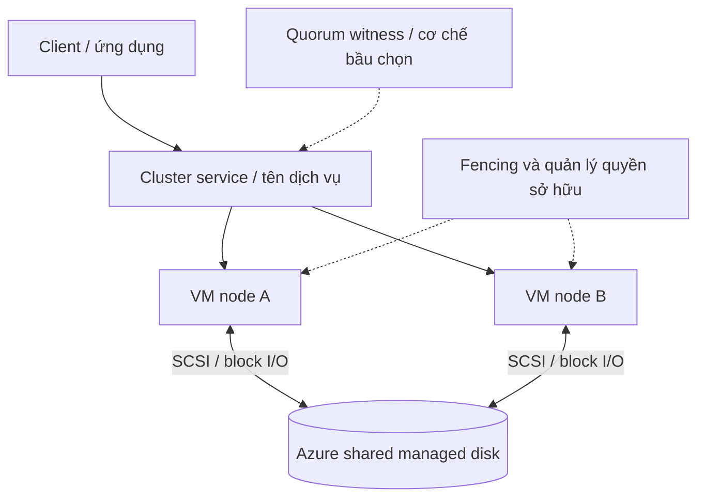
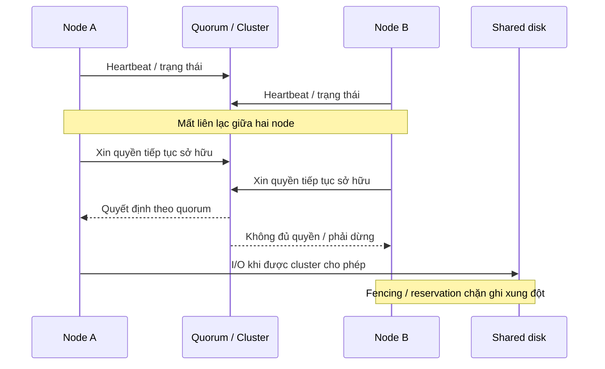
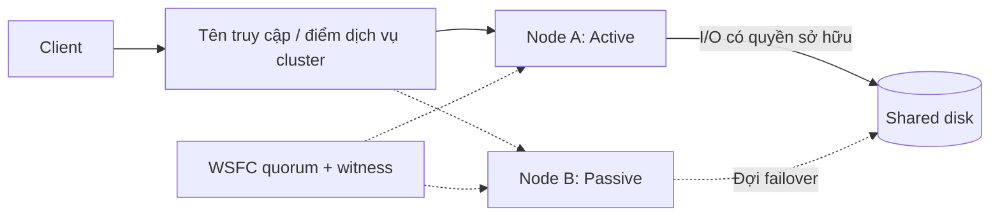
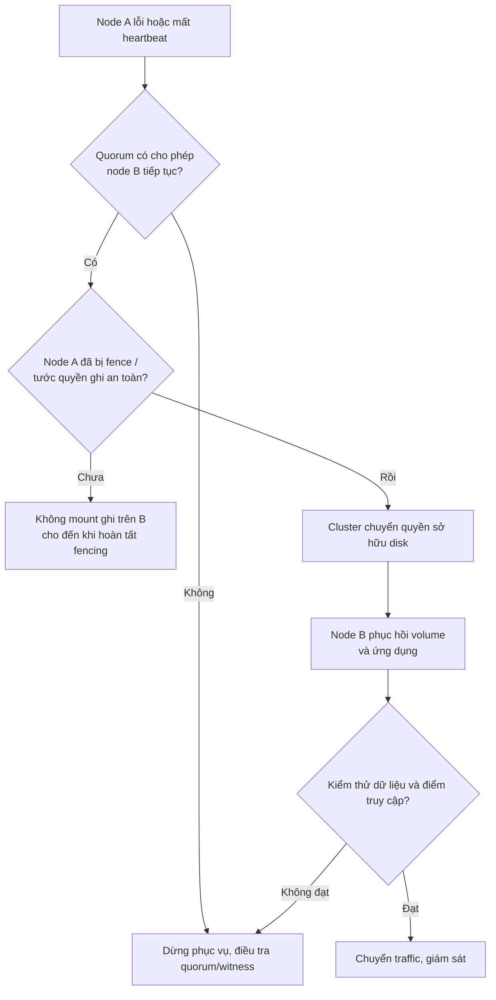

# Shared disk và yêu cầu của ứng dụng cluster

Hai máy ảo Azure có thể cần truy cập **cùng một tập dữ liệu dạng block** để triển khai một ứng dụng có khả năng chuyển đổi khi nút chính gặp lỗi, chẳng hạn một hệ thống dùng **Windows Server Failover Clustering (WSFC)**. Tuy nhiên, việc gắn cùng một đĩa vào hai máy ảo **không** tự biến hệ thống thành cluster an toàn. Nếu cả hai nút cùng ghi vào một hệ thống tệp không hỗ trợ truy cập đồng thời, dữ liệu có thể bị hỏng ngay cả khi Azure Managed Disks vẫn hoạt động hoàn hảo.

Bài học thuộc chương **Lưu trữ tệp và đĩa** của module **CLOUD_PROVIDERS_AZURE**. Module khám phá Microsoft Azure từ subscription, resource group và Microsoft Entra ID đến mạng ảo, dịch vụ tính toán, lưu trữ và dữ liệu; đồng thời hướng dẫn triển khai, giám sát, bảo vệ và kiểm soát chi phí kiến trúc ứng dụng. Trong chương này, *shared disk* là một thành phần của kiến trúc cluster, cần được thiết kế đồng thời với compute, networking, hệ điều hành, quyền truy cập và vận hành.

Sau bài học, bạn có thể:

- Giải thích Azure shared managed disk là gì và khác gì với Azure Files, Azure NetApp Files hoặc đĩa độc lập của từng VM.
- Phân biệt **multi-attach**, **cluster-aware filesystem**, **shared-disk failover** và **high availability**.
- Hiểu vai trò của **SCSI Persistent Reservations (PR)**, quorum, witness và fencing để ngăn split-brain.
- Xác định điều kiện hỗ trợ liên quan đến disk SKU, `maxShares`, VM size, availability zone, caching và OS.
- Lập sơ đồ triển khai WSFC hoặc Linux cluster ở mức kiến trúc, biết bước nào cần xác minh trước production.
- Chẩn đoán sự cố gắn đĩa, quyền sở hữu ổ đĩa, failover và hiệu năng khi nhiều nút dùng chung.

## 1. Shared disk là gì?

**Azure shared managed disk** là một managed disk được cấu hình để có thể **gắn đồng thời vào nhiều Azure VM**. Mỗi VM nhìn thấy cùng một thiết bị lưu trữ block. Tính năng dùng cơ chế *shared disks* của Azure Managed Disks và giới hạn số lượng VM đồng thời qua thuộc tính `maxShares`.

Ví dụ kiến trúc hai nút:



Điểm cần hiểu: **một disk, hai kết nối gắn đĩa**, chứ không phải hai bản sao dữ liệu được đồng bộ ở tầng ứng dụng. Tại mỗi thời điểm, một cluster có thể cho một nút sở hữu volume hoặc cho nhiều nút sử dụng theo cơ chế cluster-aware được hỗ trợ. Điều đó phụ thuộc phần mềm cluster, filesystem và cách ứng dụng đồng bộ I/O.

### 1.1. Vì sao nhiều ứng dụng cluster cần shared block storage?

Một ứng dụng *failover cluster instance* có thể cần các file dữ liệu được giữ ở cùng một nơi, bất kể node A hay node B đang chạy tiến trình chính. Nếu node A mất điện, node B có thể tiếp quản ổ đĩa được cluster bảo vệ và tiếp tục phục vụ sau khi khôi phục trạng thái ứng dụng.

Trong mô hình này:

1. Shared disk giữ dữ liệu dùng chung.
2. Các VM cung cấp năng lực tính toán dự phòng.
3. Cluster software quyết định **nút nào đang có quyền dùng dữ liệu**.
4. Quorum và fencing giảm nguy cơ hai nút cùng nghĩ mình đang là chủ sở hữu.
5. Ứng dụng thực hiện recovery/transaction replay theo khả năng của nó.

Không nên dùng shared disk chỉ vì cần hai VM cùng “thấy một thư mục”. Nếu nhu cầu chỉ là **chia sẻ file qua SMB/NFS**, một dịch vụ file share được quản lý có thể đơn giản hơn.

## 2. Shared managed disk khác các lựa chọn lưu trữ nào?

| Lựa chọn | Đơn vị truy cập | Ai kiểm soát truy cập đồng thời? | Tình huống phù hợp |
|---|---|---|---|
| **Shared managed disk** | Block device gắn vào nhiều VM | Cluster/application + SCSI PR hoặc cơ chế tương đương được hỗ trợ | Workload cluster cần shared block LUN |
| Managed disk thông thường | Block device dành cho một VM tại một thời điểm | Một hệ điều hành chủ sở hữu | OS disk và data disk của VM độc lập |
| **Azure Files** | File share SMB/NFS theo cấu hình hỗ trợ | Dịch vụ file server và giao thức chia sẻ file | Nhiều client cùng truy cập thư mục/file |
| **Azure NetApp Files** | Managed NFS/SMB file volumes | Giao thức file và semantics được hỗ trợ | File workload cần hiệu năng, tính năng doanh nghiệp |
| Replication ở tầng ứng dụng | Mỗi nút có dữ liệu độc lập | Database/application protocol | SQL Always On Availability Groups, các hệ CSDL replica, distributed systems |
| Object storage (Azure Blob) | Object/API | Ứng dụng + ETag/lease/concurrency controls | Ảnh, tài liệu, backup và dữ liệu object |

**Không nhầm:** Azure Files/NFS/SMB cũng là “shared storage”, nhưng **không tương đương** một disk block được multi-attach. Dịch vụ file share xử lý đồng thời thông qua filesystem/giao thức từ phía dịch vụ; shared managed disk trao trách nhiệm kiểm soát xung đột ghi cho cluster và guest OS.

### 2.1. Shared disk không đồng nghĩa “tăng gấp đôi độ bền”

Việc có hai VM cùng gắn một disk không tạo thêm bản sao dữ liệu để phòng xóa nhầm hoặc hỏng logic. Độ bền hạ tầng của disk phụ thuộc **Azure Managed Disks redundancy/SKU**; khả năng phục hồi lỗi ứng dụng vẫn cần backup và cơ chế khôi phục.

Nếu cả hai node cùng ghi sai dữ liệu, shared disk sẽ lưu dữ liệu sai giống nhau. Nếu volume bị xóa hoặc filesystem bị hỏng, cluster có thể chuyển node nhưng không tự khôi phục dữ liệu.

## 3. Ba lớp phải cùng đúng để cluster hoạt động

Hãy phân biệt:

| Lớp | Câu hỏi | Ví dụ |
|---|---|---|
| **Azure platform** | Disk có hỗ trợ multi-attach, giới hạn VM/zone/SKU và đủ hiệu năng không? | Disk có `maxShares=2` và cả hai VM gắn được |
| **Guest OS / cluster stack** | Có cơ chế reservation, arbitration và filesystem thích hợp không? | WSFC quản lý disk resource, SCSI PR và chuyển ownership |
| **Ứng dụng** | Ứng dụng có hỗ trợ shared-disk failover và phục hồi dữ liệu sau lỗi không? | Một failover cluster instance được vendor xác nhận hỗ trợ |

Nếu chỉ lớp Azure đúng, việc gắn disk vào cả hai VM có thể **thành công về kỹ thuật nhưng không an toàn về dữ liệu**. Cần xác minh cả ba lớp trước khi chạy workload production.

### 3.1. Multi-attach không phải multi-writer an toàn

Một filesystem phổ biến như NTFS hoặc ext4/xfs khi được mount **read-write độc lập trên nhiều host** mà không có lớp cluster coordination phù hợp có nguy cơ hỏng metadata và data blocks. Các host có cache/bộ quản lý filesystem riêng, nên mỗi host có thể tin một block đang ở trạng thái khác.

Các mô hình khả thi, tùy hệ điều hành và sản phẩm:

- **Active-passive:** một nút sở hữu và ghi volume, nút khác chờ tiếp quản.
- **Cluster Shared Volumes / clustered filesystem:** nhiều nút truy cập theo cơ chế coordination chuyên dụng và đúng phạm vi hỗ trợ.
- **Ứng dụng quản lý I/O bằng reservation và fencing riêng:** chỉ khi vendor xác nhận và đã kiểm thử.

**Quy tắc an toàn:** không tự ý format, mount writable hoặc chạy `fsck`/repair đồng thời từ hai VM trên cùng một shared LUN.

## 4. Cơ chế SCSI Persistent Reservations, fencing và split-brain

### 4.1. SCSI Persistent Reservations là gì?

**SCSI Persistent Reservations (SCSI PR)** cho phép một nhóm host đăng ký và điều phối quyền truy cập tới một thiết bị block theo những loại reservation được hỗ trợ. Cluster software có thể sử dụng SCSI PR để ngăn một node không có quyền vẫn thực hiện các thao tác I/O xung đột trên shared disk.

Khái niệm quan trọng:

- **Registration:** một initiator/node đăng ký key với thiết bị.
- **Reservation:** cluster giữ một kiểu quyền truy cập theo quy tắc SCSI PR.
- **Preempt:** cluster được phép thay đổi chủ thể có quyền theo quy trình failover được hỗ trợ.
- **Fence:** cách ngăn node lỗi hoặc node bị tách mạng tiếp tục gây ghi xung đột.

SCSI PR là **cơ chế nguyên thủy của block storage**, không thay cho quá trình cluster validation. Khả năng hỗ trợ SCSI PR, loại reservation, firmware/driver, guest OS và cluster product **phụ thuộc tổ hợp SKU + VM + hệ điều hành + ứng dụng**. Trước triển khai cần đối chiếu ma trận hỗ trợ hiện hành của Azure và nhà cung cấp cluster.

### 4.2. Split-brain là gì?

Giả sử hai node không còn nhìn thấy nhau do sự cố mạng heartbeat. Node A tưởng B chết, node B tưởng A chết. Nếu cả hai cùng khởi chạy dịch vụ và ghi shared disk, dữ liệu có thể bị hỏng.



Sơ đồ là mô hình ý tưởng. Trong thực tế, quyết định phụ thuộc thuật toán quorum, khả năng truy cập witness và trạng thái cluster; **không bảo đảm luôn là node A thắng**.

### 4.3. Quorum và witness

**Quorum** giúp cluster quyết định tập node nào có quyền tiếp tục chạy. Trong cluster ít node, **witness** cung cấp thêm phiếu bầu/điểm phân xử để tránh tình huống cả hai phía cùng tuyên bố hoạt động hợp lệ.

Ví dụ với **Windows Server Failover Cluster hai node**, có thể xem xét **Cloud Witness** dùng Azure Storage theo điều kiện hỗ trợ của WSFC. Witness không phải nơi chứa database dùng chung và **không thay** shared data disk.

| Thành phần | Mục tiêu | Không nên dùng để |
|---|---|---|
| Shared data disk | Lưu block dữ liệu của ứng dụng | Quyết định quorum thay cho cluster |
| Cluster heartbeat | Nhận biết tình trạng peer | Chứng minh node kia không còn ghi khi mạng tách |
| Quorum/witness | Quyết định tập node được tiếp tục hoạt động | Lưu file dữ liệu giao dịch |
| SCSI PR / fencing | Chặn I/O hoặc cách ly node không còn quyền | Thay cho backup dữ liệu |

Với Linux cluster sử dụng **Pacemaker** hoặc stack khác, có thể cần **STONITH/fencing**, cơ chế block reservation hoặc hệ thống tệp cluster được vendor hỗ trợ. Không cấu hình chỉ “heartbeat + mount chung” rồi coi là đủ.

## 5. Điều kiện hỗ trợ và giới hạn của Azure shared disks

Tính năng shared disks được hỗ trợ trên **các loại managed data disk, kích thước VM, vùng triển khai và hệ điều hành nhất định**. Các tổ hợp có thể khác nhau theo thời điểm và dịch vụ; phải xác minh trước khi chọn SKU.

### 5.1. Disk SKU và `maxShares`

Azure có các dòng managed disk như **Premium SSD**, **Premium SSD v2**, **Ultra Disk** và **Standard SSD** với khả năng/giới hạn shared disks tùy cấu hình được hỗ trợ. Không suy rằng mọi disk SKU, mọi tier hoặc mọi region đều cho multi-attach. **OS disk không phải mục đích của Azure shared managed disk**.

`maxShares` có nghĩa là số VM tối đa được phép **gắn cùng lúc** vào disk, không phải:

- Số lượng node cluster tự được tạo ra.
- Số writer được phép ghi đồng thời.
- Số bản sao dữ liệu.
- Hệ số nhân IOPS hoặc throughput.

Ví dụ `maxShares=2` cho phép thiết kế tối đa hai VM gắn disk đồng thời theo điều kiện hỗ trợ. Nó **không** chỉ định node nào là active owner và không xác thực tính đúng đắn của cluster.

### 5.2. Tương thích VM, region và availability zone

Trước khi triển khai cần xác minh:

1. VM size có hỗ trợ loại disk và số data disk/LUN yêu cầu không?
2. Disk SKU/size có cho phép giá trị `maxShares` dự kiến không?
3. VM và disk có tương thích region, availability zone và redundancy không?
4. Nếu cluster đặt node ở nhiều **availability zone**, loại **ZRS managed disk/shared disk** được chọn có hỗ trợ mô hình cross-zone đó hay không?
5. Có ràng buộc liên quan tới VM generation, guest OS, driver, SCSI PR hoặc phiên bản cluster software không?
6. Disk có thể gắn cùng loại bus và cùng LUN hợp lý trên các node cluster không?

**Lưu ý:** hai VM đặt ở các availability zone khác nhau **không tự bảo đảm high availability** nếu disk chỉ thuộc một failure domain và không hỗ trợ truy cập từ các zone đó. Ngược lại, chọn redundancy cao cũng không thay thế việc bảo vệ ứng dụng/cluster.

### 5.3. Host caching và giới hạn I/O

Đối với shared managed disk, host caching thường cần được đặt **`None`** theo hướng dẫn hỗ trợ của loại disk và kiểu VM. Không bật cache ghi riêng tại mỗi host chỉ để tăng tốc khi cluster chưa xác nhận an toàn: các cache độc lập có thể làm sai nhất quán I/O.

Hiệu năng là **ngân sách tổng của disk**:

- Hai VM cùng gửi I/O tới một disk **cùng tranh** IOPS và throughput của disk đó.
- VM có giới hạn IOPS/throughput riêng và có thể là nút nghẽn, kể cả khi disk còn dư khả năng.
- Mẫu I/O random/sequential, kích thước block, read/write ratio và yêu cầu latency của ứng dụng ảnh hưởng mạnh tới kết quả.
- Failover có thể làm node B tiếp tục khối lượng I/O khác với lúc chạy thử, vì vậy cần thử tải trước và sau chuyển node.

Không lấy throughput quảng cáo của từng VM rồi cộng thành tốc độ của một shared disk.

## 6. Thiết kế Windows Server Failover Cluster

### 6.1. Kịch bản active-passive

Giả sử hệ thống có một ứng dụng giao dịch chạy trên Windows VM và cần shared data volume:

```text
Resource group: rg-cluster-prod
VNet / subnet:  vnet-app-prod / snet-cluster
Node A:         vm-cluster-a
Node B:         vm-cluster-b
Disk:           disk-cluster-data, maxShares = 2
Quorum:         Cloud Witness hoặc witness được WSFC hỗ trợ
Application:    Failover Cluster Role do vendor hỗ trợ
```

Luồng hoạt động:

1. Cluster xác minh sức khỏe node và quyền sở hữu disk.
2. Node A đang active giữ disk resource phù hợp và chạy ứng dụng.
3. Node B có disk được attach nhưng không tự mount/ghi như một máy đơn lẻ.
4. Khi node A gặp lỗi, quorum và cluster logic xác định điều kiện chuyển quyền.
5. WSFC chuyển ownership/reservation của shared disk sang node B.
6. Node B kích hoạt volume/cluster role và khởi động lại thành phần ứng dụng theo quy trình.



Ở production, **điểm truy cập ứng dụng** có thể cần load balancer, tên ảo, probe, DNS và cấu hình được hỗ trợ theo vai trò WSFC/vendor. Không suy rằng disk được gắn thành công sẽ tự tạo địa chỉ IP/tên ứng dụng có khả năng failover.

### 6.2. Các việc phải làm trong guest OS

Quy trình khái quát:

1. Cài phiên bản Windows Server và tính năng Failover Clustering được hỗ trợ.
2. Cấu hình domain, DNS, mạng cluster, identity và firewall/port cần thiết cho ứng dụng.
3. Dùng **Test-Cluster** hoặc công cụ cluster validation phù hợp để xác minh node, network và disk; kiểm tra kết quả theo khuyến nghị của vendor.
4. Đưa disk vào quyền quản lý của **WSFC** như một clustered disk resource; chỉ định quyền sở hữu và truy cập theo thiết kế.
5. Nếu dùng **Cluster Shared Volumes (CSV)**, tuân thủ kiểu workload và filesystem được hỗ trợ; CSV không có nghĩa mọi ứng dụng có thể ghi không phối hợp.
6. Tạo role ứng dụng, cấu hình service dependencies và kiểm thử failover.

Ví dụ lệnh kiểm tra trên Windows PowerShell (chạy trong môi trường đã có feature/cluster và đúng quyền):

```powershell
# Kiểm tra trạng thái cluster và các resource đã được cấu hình.
Get-ClusterNode
Get-ClusterGroup
Get-ClusterResource

# Nếu workload sử dụng CSV:
Get-ClusterSharedVolume
```

**Không chạy** thao tác đưa shared disk online/format bằng Disk Management trên từng node độc lập. Với clustered disk, hãy để cluster điều phối và tuân thủ quy trình khởi tạo volume được hỗ trợ.

### 6.3. SQL Server FCI và Availability Groups khác nhau

- **SQL Server Failover Cluster Instance (FCI)** sử dụng mô hình cluster với storage dùng chung theo cấu hình được Microsoft và Azure hỗ trợ; yêu cầu cả WSFC và shared disk/quyền sở hữu tài nguyên.
- **SQL Server Always On Availability Groups (AG)** thường dùng **đĩa dữ liệu riêng trên mỗi replica**, còn dữ liệu được đồng bộ/replicate ở tầng SQL Server; không tự yêu cầu shared disk.
- **Azure SQL Database/Managed Instance** là dịch vụ dữ liệu được quản lý với mô hình sẵn sàng riêng; không phải cứ cần HA là phải tự xây WSFC trên VM.

Chọn mô hình theo yêu cầu license, tính năng SQL, RPO/RTO, quản trị OS, yêu cầu migration và chi phí. Không chuyển workload sang shared disk chỉ vì cụm từ “always-on”.

## 7. Thiết kế Linux cluster với shared disk

Linux cũng có những nền tảng cluster như Pacemaker/Corosync và các giải pháp của vendor ứng dụng. Tuy nhiên, hỗ trợ shared disks phụ thuộc kernel, distribution, agent, disk SKU và cơ chế fencing/reservation.

### 7.1. Hai cách tổ chức truy cập

**Mô hình A — active-passive filesystem**: chỉ node sở hữu được mount writable và chạy dịch vụ. Khi failover, cluster phải đảm bảo node cũ không còn quyền ghi, sau đó node mới mới được mount và chạy ứng dụng.

**Mô hình B — clustered filesystem**: giải pháp như GFS2/OCFS2 trong tổ hợp được hỗ trợ cung cấp cơ chế phối hợp nhiều node; cần distributed lock manager, fencing và cấu hình theo vendor. Không tự kết luận “nhiều node cùng mount được” là bằng chứng cluster filesystem đã sẵn sàng.

Ví dụ các bước kiểm tra ở mức quan sát (không format hay mount):

```bash
lsblk -o NAME,TYPE,SIZE,FSTYPE,MOUNTPOINTS
findmnt
systemctl status pacemaker
```

Câu lệnh `systemctl status pacemaker` chỉ có ý nghĩa nếu môi trường dùng Pacemaker. Trên một số bản phân phối, công cụ cluster có lệnh kiểm tra riêng; hãy tuân thủ runbook hệ điều hành. Không chạy `mkfs`, `fsck -y` hoặc mount `-o rw` trên shared disk từ nhiều node để “thử xem có ghi được không”.

### 7.2. Fencing là yêu cầu an toàn, không chỉ là tính năng phụ

Nếu node A mất heartbeat nhưng vẫn chạy và còn đường I/O đến shared disk, node B không thể coi A đã dừng chỉ dựa vào việc không ping được. **STONITH/fencing** (qua cơ chế được hỗ trợ) phải cách ly hoặc tước khả năng ghi của node cũ trước khi node mới sở hữu dữ liệu.

Trong thiết kế Linux HA, phải xác minh:

- Cơ chế fencing có hoạt động với Azure VM/cluster product không?
- SCSI PR của SKU/guest OS có được stack cluster hỗ trợ không?
- Quorum hoạt động thế nào khi mất một node, witness hoặc đường heartbeat?
- Filesystem/ứng dụng có khả năng recovery sau crash và fencing không?
- Node reboot hoặc mạng bị phân vùng có dẫn đến split-brain không?

## 8. Thực hành kiến trúc: tạo shared managed disk trong Azure

Ví dụ dùng Azure CLI để minh họa quy trình **ở môi trường lab đã được phê duyệt**. Các lệnh tạo/gắn tài nguyên **có thay đổi trạng thái và có thể phát sinh chi phí**; không thực thi vô điều kiện trên production. Để các lệnh hoạt động, phải có subscription, resource group, hai VM tương thích cùng thiết kế và quyền Azure RBAC phù hợp.

### 8.1. Chuẩn bị cấu hình

Giả sử:

```text
Resource group: rg-cluster-lab
Disk:           disk-shared-lab
SKU minh họa:   Premium_LRS (kiểm tra hỗ trợ shared disk trước)
Kích thước:     128 GiB
maxShares:      2
Nodes:          vm-cluster-a và vm-cluster-b
LUN:            1 trên cả hai node
Host caching:   None
```

Kích thước trên chỉ là ví dụ; hỗ trợ shared disk và giá trị `maxShares` theo **tier/size/SKU/region** cần được xác minh. Nếu yêu cầu multi-zone, cần chọn SKU/redundancy cho phép thay vì mặc định dùng LRS.

### 8.2. Tạo shared disk

```bash
RG="rg-cluster-lab"
DISK="disk-shared-lab"

az disk create \
  --resource-group "$RG" \
  --name "$DISK" \
  --sku Premium_LRS \
  --size-gb 128 \
  --max-shares 2
```

Lệnh trên tạo **managed data disk** cho multi-attach, không cài cluster hoặc định dạng filesystem. Azure CLI/API có thể từ chối nếu disk SKU/size, region hoặc tính năng của subscription không hỗ trợ cấu hình được yêu cầu.

### 8.3. Gắn vào hai VM

```bash
az vm disk attach \
  --resource-group "$RG" \
  --vm-name "vm-cluster-a" \
  --name "$DISK" \
  --lun 1 \
  --caching None

az vm disk attach \
  --resource-group "$RG" \
  --vm-name "vm-cluster-b" \
  --name "$DISK" \
  --lun 1 \
  --caching None
```

Các ví dụ giả định cả disk và hai VM đã được chuẩn bị với vị trí và quyền phù hợp. Nếu VM nằm ở resource group khác, cú pháp tham chiếu có thể cần dùng **resource ID** thay vì tên ngắn và phải xác minh CLI hỗ trợ. Tránh tình huống mỗi VM dùng một disk khác nhau chỉ vì tên trùng.

Chọn LUN nhất quán giữa các node khi ứng dụng/cluster cần, nhưng **LUN không phải cơ chế bảo vệ ghi đồng thời**. Không khởi tạo volume từ cả hai OS; chỉ tiến hành bước khởi tạo/cluster configuration khi đã có quorum và fencing theo thiết kế.

### 8.4. Đọc lại trạng thái tài nguyên

```bash
az disk show \
  --resource-group "$RG" \
  --name "$DISK" \
  --query "{id:id,sku:sku.name,maxShares:maxShares,diskState:diskState,managedBy:managedBy,managedByExtended:managedByExtended,zones:zones}" \
  -o json

az vm show \
  --resource-group "$RG" \
  --name "vm-cluster-a" \
  --query "storageProfile.dataDisks[].{name:name,lun:lun,caching:caching,managedDiskId:managedDisk.id}" \
  -o json

az vm show \
  --resource-group "$RG" \
  --name "vm-cluster-b" \
  --query "storageProfile.dataDisks[].{name:name,lun:lun,caching:caching,managedDiskId:managedDisk.id}" \
  -o json
```

Kiểm tra **resource ID của disk** trong cả hai VM phải giống nhau; `maxShares` và trạng thái attach phù hợp; caching không xung đột với hạn chế SKU. Sau đó **bắt buộc** chạy cluster validation và kiểm tra reservation/ownership trong guest OS. Azure Portal báo disk đã attach chỉ là một phần của kiểm thử.

## 9. Khả năng sẵn sàng của ứng dụng cluster

### 9.1. Shared disk giúp chịu lỗi gì?

Shared disk trong một cluster được cấu hình đúng giúp **node dự phòng** truy cập dữ liệu khi node đang chạy ứng dụng không còn hoạt động. Nó **không tự bảo đảm**:

- Mất một availability zone nhưng node dự phòng và disk vẫn hoạt động theo thiết kế.
- Mất toàn region mà không có DR sang region khác.
- Địa chỉ truy cập ứng dụng chuyển sang node mới.
- Không mất giao dịch đang xử lý tại thời điểm node lỗi.
- Backup/restore và phục hồi sau lỗi xóa dữ liệu.

RPO/RTO phụ thuộc phần mềm cluster, storage redundancy, recovery của ứng dụng, network failover và thời gian vận hành. Nên đo qua các bài kiểm thử có kiểm soát, không gán một con số SLA cho shared disk tự thân.

### 9.2. Failure domains và redundancy

Các node nên được phân bố failure domain theo khả năng hỗ trợ của VM, disk SKU và cluster. Nếu cần chạy node ở các availability zone khác nhau, xác minh **shared disk có thể truy cập cross-zone** trong cấu hình ZRS/dịch vụ thực tế. Disk được nhân bản ở tầng storage không đồng nghĩa có khả năng **gắn multi-attach xuyên region**.

Nếu yêu cầu disaster recovery toàn region, cân nhắc backup/restore, application replication hoặc giải pháp DR được vendor hỗ trợ. Shared disk thường là **lưu trữ chung trong phạm vi triển khai**, không phải một cơ chế sao chép block đồng bộ giữa nhiều region cho mọi ứng dụng.

### 9.3. Quorum, witness và mạng

Với cluster hai node, lỗi kết nối giữa các node có thể tạo ra tình trạng mỗi phía còn sống nhưng không nhìn thấy nhau. Quorum/witness phải được thiết kế sao cho:

- Một nhóm node duy nhất có quyền tiếp tục phục vụ khi chia tách.
- Node không có quorum không thể tùy ý tiếp tục ghi shared storage.
- Heartbeat, DNS, port cluster, firewall/NSG và endpoint của witness đều có đường truy cập phù hợp.
- Failover của điểm truy cập ứng dụng được kiểm thử độc lập với failover sở hữu disk.

Ví dụ, nếu witness dùng Azure Storage, cần xác minh IAM/credential, kết nối mạng và khả năng truy cập tới dịch vụ witness theo hướng dẫn WSFC. Không dùng cùng một shared data volume làm công cụ phân xử quorum.

## 10. Hiệu năng và ước tính chi phí

### 10.1. Ngân sách hiệu năng chung

Giả sử shared disk có giới hạn thực tế tại thời điểm chạy là **5.000 IOPS**. Đây là một con số **giả định** để minh họa. Nếu node A dùng 4.000 IOPS và node B phát sinh thêm 3.000 IOPS, tổng nhu cầu 7.000 IOPS sẽ **vượt** ngân sách của disk trong ví dụ; latency hoặc throttling có thể tăng.

```text
Nhu cầu IOPS từ các node:
  Node A: 4.000
  Node B: 3.000
  Tổng  : 7.000

Ngân sách disk giả định: 5.000 IOPS
=> Không thể coi mỗi VM có riêng 5.000 IOPS.
```

Khi sizing:

1. Tính workload I/O hiện tại và peak sau failover.
2. So với IOPS/throughput của SKU/size disk và giới hạn VM.
3. Đánh giá latency nhạy cảm với random write, fsync và recovery của ứng dụng.
4. Dùng số đo Azure Monitor và công cụ guest OS để tìm bottleneck.
5. Kiểm thử tình huống backup, antivirus, rebuild index hoặc cluster recovery chạy cùng lúc.

### 10.2. Tổng chi phí không chỉ là giá disk

Chi phí gồm:

- Managed disk (SKU, size, provisioned performance nếu áp dụng, redundancy).
- Hai hoặc nhiều VM, license OS/database/cluster theo điều kiện áp dụng.
- Backup, snapshot hoặc cơ chế phục hồi được hỗ trợ.
- Mạng, Load Balancer, giám sát, witness, truyền dữ liệu và DR.
- Công vận hành cluster validation, patching, testing, capacity planning.

Shared disk không tự làm chi phí thấp hơn dịch vụ PaaS hoặc kiến trúc replicated database. Hãy so sánh **TCO và trách nhiệm vận hành**, không chỉ mức giá dung lượng.

## 11. Backup, khôi phục và bảo vệ dữ liệu

### 11.1. Snapshot có nhất quán không?

Snapshot ở tầng disk có thể ghi lại trạng thái block tại một thời điểm, nhưng **không tự bảo đảm nhất quán giao dịch của ứng dụng cluster**. Nếu database còn nhiều trang dữ liệu trong bộ nhớ hoặc đang có giao dịch dở dang, một snapshot không được điều phối có thể chỉ đạt **crash consistency**.

Trước khi lập kế hoạch backup:

- Xác nhận loại shared disk được **Azure Backup hoặc giải pháp backup của vendor** hỗ trợ ở thời điểm triển khai.
- Thiết kế ứng dụng có cơ chế quiesce/VSS hoặc backup API tương ứng hay không.
- Chỉ chạy backup/snapshot dưới cơ chế ownership/coordination an toàn.
- Kiểm tra khả năng restore sang cluster mới, quản lý LUN và disk identity.
- Thử **recovery time** trên dữ liệu không chứa thông tin nhạy cảm hoặc môi trường kiểm soát.

Không cho rằng “có snapshot” nghĩa là có thể khôi phục database về trạng thái hợp lệ. Ngoài backup block, một số ứng dụng còn cần transaction log backup và quy trình restore theo vendor.

### 11.2. Mã hóa và quyền truy cập

Azure Managed Disks có cơ chế mã hóa dữ liệu khi lưu trữ theo khả năng dịch vụ. Có thể tồn tại lựa chọn về encryption key/disk encryption set tùy loại disk, nhưng shared disk có các hạn chế hỗ trợ riêng cần kiểm tra.

Phân biệt:

- **Azure RBAC trên disk**: ai có thể tạo, sửa, attach/detach hoặc xóa tài nguyên disk ở control plane.
- **Quyền trong guest OS**: ai có thể đọc/ghi filesystem/application data sau khi VM được quyền truy cập block device.
- **Cluster fencing/ownership**: node nào được phép phát I/O khi failover.
- **Mạng và identity của ứng dụng**: client nào được gọi service đang dùng disk.

Khi một VM có quyền truy cập block device, Azure RBAC `Reader` của một người dùng **không** tự ngăn tiến trình có đặc quyền trong VM đọc các block đó. Bảo vệ dữ liệu cần phân quyền đúng ở cả tầng hạ tầng và guest OS.

## 12. Lỗi thường gặp và quy trình chẩn đoán

| Triệu chứng | Nguyên nhân có thể | Kiểm tra ưu tiên |
|---|---|---|
| Không attach được disk vào VM thứ hai | `maxShares` chưa phù hợp, SKU/size/VM/zone không hỗ trợ | `az disk show`, loại disk, vị trí VM và giới hạn multi-attach |
| VM thấy disk nhưng cluster không nhận | Thiếu driver/cluster feature, disk không đạt validation, reservation không hỗ trợ | Cluster validation, guest OS, SCSI PR và vendor matrix |
| Hai node cùng thấy volume nhưng filesystem lỗi | Mount/format không qua coordination, split-brain, fencing thiếu | Dừng thao tác ghi, thu thập log và xử lý theo incident runbook |
| Failover xong disk không online | Ownership/reservation chưa chuyển, cluster resource lỗi, volume không nhất quán | Quorum, cluster logs, disk resource và SCSI PR |
| Disk online nhưng client không kết nối được dịch vụ | Tên ảo, listener, load balancer, firewall, DNS hoặc cluster role chưa khởi động | Kiểm tra application endpoint riêng khỏi disk |
| Mất heartbeat và cả hai node chạy ứng dụng | Quorum/fencing sai hoặc thiếu bảo vệ split-brain | Cách ly writer sai, phân tích quorum/STONITH/PR |
| Latency tăng mạnh khi có node thứ hai | Hai VM cùng tranh IOPS/throughput hoặc host caching cấu hình sai | Disk metrics, VM metrics, load test |
| Snapshot tạo được nhưng restore DB lỗi | Snapshot không application-consistent hoặc thiếu log backup | Kiểm thử restore đúng cơ chế ứng dụng |
| Cluster chạy được trong một zone nhưng không cross-zone | Disk redundancy hoặc VM/zone không hỗ trợ sơ đồ multi-attach | SKU/ZRS/zone constraints và topology |

### 12.1. Quy trình chẩn đoán có bằng chứng

1. **Azure layer:** kiểm tra disk ID, `maxShares`, disk state, zone/SKU, hai attachment, host caching và quyền thay đổi cấu hình.
2. **Guest OS:** xác nhận cùng LUN/disk identity, driver, cluster feature, trạng thái disk resource và không có mount writable ngoài cluster.
3. **Quorum/fencing:** kiểm tra witness, cluster membership, reservation/fence event và trạng thái node vừa lỗi.
4. **Application:** kiểm tra cluster role, dependency, listener/IP/DNS và recovery logs.
5. **Performance:** so sánh IOPS/throughput/latency tại thời điểm lỗi, tình trạng throttling và tải phụ.
6. **Recovery:** kiểm thử failover/failback được phê duyệt, khôi phục trạng thái và xác thực dữ liệu sau sự cố.

Đừng “sửa nhanh” bằng cách ép cả hai node online writable cùng một volume. Nếu nghi có split-brain hoặc filesystem corruption, ưu tiên **dừng ghi và bảo toàn bằng chứng** trước khi chạy sửa chữa dữ liệu.

## 13. Runbook failover tối thiểu

Trước khi vận hành, ghi rõ:

- Chủ sở hữu cluster, quyền quyết định chuyển node và người trực sự cố.
- Danh sách VM/disk resource IDs, `maxShares`, SKU, OS, patch level và ứng dụng.
- Mô hình quorum, witness, fencing và đường mạng cần hoạt động.
- Cách phân biệt node “mất heartbeat” với node “đã thực sự bị fence”.
- Chỉ số và log chứng minh I/O writer cũ đã dừng.
- Thủ tục khởi động node dự phòng và kiểm tra volume/transaction recovery.
- Cách kiểm tra client kết nối trở lại dịch vụ qua DNS/load balancer/listener.
- Bước đối soát dữ liệu và rollback/failback theo vendor.



Tùy sản phẩm, cluster stack có thể tự động hóa một phần quy trình này. **Các bước an toàn về fencing và quyền sở hữu vẫn phải được đáp ứng**, không nên xóa khỏi thiết kế chỉ vì công cụ có nút “Failover”.

## 14. Bài tập vận dụng

**Bài 1 — Multi-attach.** Một disk có `maxShares=3` được gắn vào ba VM. Có thể cho cả ba VM mount NTFS/ext4 `read-write` độc lập không? Nếu không, yêu cầu nào còn thiếu?

**Bài 2 — Chọn loại storage.** Ba web server cần đọc chung thư mục ảnh sản phẩm qua SMB, không có nhu cầu block device. Shared managed disk, Azure Files hay Azure NetApp Files là cách tiếp cận dễ phù hợp hơn? Vì sao?

**Bài 3 — Thiết kế WSFC.** Một ứng dụng active-passive cần hai Windows VM và shared data disk. Hãy liệt kê vai trò của `maxShares`, SCSI PR, WSFC, quorum/witness và cluster role.

**Bài 4 — Split-brain.** Node A và B không còn trao đổi heartbeat, nhưng A vẫn truy cập disk. Node B được phép online writable volume ngay không? Cần bằng chứng fencing/quorum gì?

**Bài 5 — So sánh SQL.** Vì sao SQL Server FCI có thể cần shared storage, trong khi Always On AG thường dùng disk riêng ở từng replica?

**Bài 6 — Sizing.** Disk đáp ứng tối đa 5.000 IOPS trong mô hình giả định. Hai node muốn chạy 3.000 và 4.000 IOPS đồng thời. Hãy giải thích bottleneck và cách kiểm thử peak/failover.

**Bài 7 — Cross-zone.** Muốn đặt node A và B ở hai availability zone, những điều kiện hỗ trợ của disk redundancy/SKU/VM và cluster cần được xác minh?

**Bài 8 — Backup.** Một nhóm tạo snapshot shared disk rồi tuyên bố “backup SQL đã application-consistent”. Hãy chỉ ra những bước kiểm chứng hoặc cơ chế backup còn thiếu.

## Kết luận

Azure **shared managed disk** cho phép nhiều VM gắn cùng một thiết bị block, hỗ trợ những workload cluster cần storage dùng chung. Nhưng **multi-attach không phải multi-writer an toàn**: cluster phải điều phối quyền sở hữu, SCSI Persistent Reservations/fencing, quorum và filesystem/ứng dụng có hỗ trợ truy cập đồng thời. Thiết kế production cần kiểm tra SKU, `maxShares`, VM/zone compatibility, host caching, hiệu năng tổng, backup/restore và điểm truy cập ứng dụng sau failover. Khi được cấu hình đúng và kiểm thử đầy đủ, shared disk là một thành phần hữu ích của kiến trúc high availability trên Azure; nó không thay thế replication theo ứng dụng, disaster recovery, backup hoặc vận hành cluster có kỷ luật.
