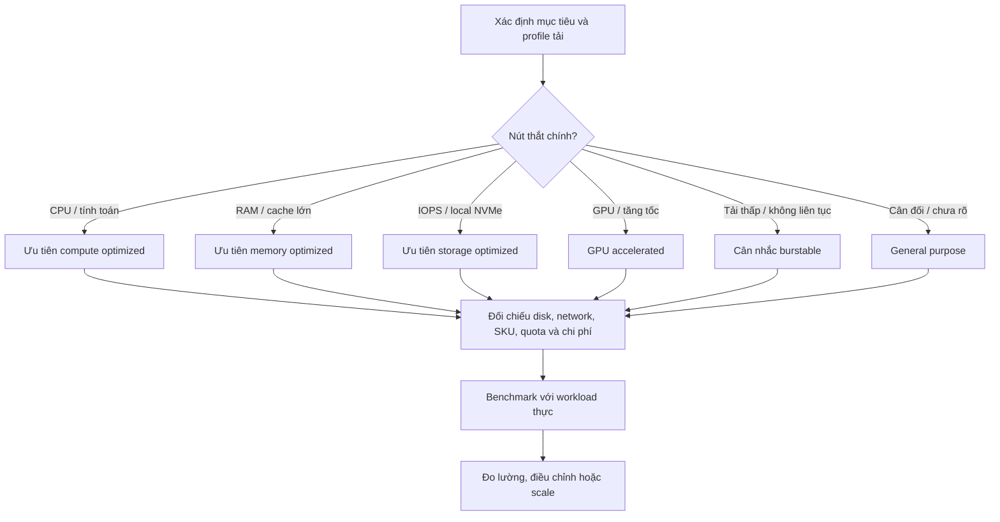

# Lựa chọn Virtual Machine theo CPU, bộ nhớ và workload

Chọn sai kích thước máy ảo (VM size) trên Microsoft Azure thường dẫn đến hai vấn đề trái ngược: ứng dụng chậm hoặc lỗi khi tải tăng; hoặc doanh nghiệp phải trả tiền cho CPU và RAM phần lớn thời gian không được sử dụng. Một VM có nhiều vCPU chưa chắc xử lý tốt một tác vụ bị nghẽn ở bộ nhớ, ổ đĩa hay mạng. Ngược lại, chọn VM có RAM rất lớn không giúp ích nhiều nếu chương trình chỉ tiêu thụ ít bộ nhớ và giới hạn bởi tốc độ xử lý một luồng.

Trong module **CLOUD_PROVIDERS_AZURE**, bạn khám phá Azure từ subscription, resource group, Microsoft Entra ID đến mạng ảo, dịch vụ tính toán, lưu trữ, dữ liệu, triển khai, giám sát, bảo mật và chi phí. Bài học thuộc chương **Máy ảo Azure** hướng dẫn đọc thông số VM, nhận biết đặc tính workload, chọn họ máy phù hợp, kiểm tra quota và khả năng cung cấp, sau đó xác minh quyết định bằng đo đạc thực tế.

## 1. Mục tiêu học tập

Sau bài học, bạn có thể:

- Phân biệt **vCPU**, RAM, CPU frequency, hiệu năng đơn luồng, bộ nhớ khả dụng và tài nguyên I/O.
- Nhận biết những họ VM thường dùng trên Azure: B, D, E, F, L, M, N, H cùng các biến thể.
- Tính nhu cầu CPU/RAM ở mức sơ bộ từ metrics và tải đỉnh, có dự phòng hợp lý.
- Chọn VM cho API, dịch vụ Java, database, cache, xử lý dữ liệu, GPU và môi trường phát triển.
- Kiểm tra SKU theo region, quota vCPU, capacity, hình ảnh hệ điều hành và khả năng hỗ trợ tính năng.
- Dùng Azure portal và Azure CLI để xem VM size, thu thập metrics và đánh giá thao tác resize.
- So sánh chi phí tính toán cùng disk, network, bản quyền, giám sát và các phương án scale.

## 2. VM size là gì và vì sao phải chọn theo workload?

**Azure Virtual Machine** là tài nguyên máy tính ảo có hệ điều hành, CPU, bộ nhớ, mạng và các thiết bị lưu trữ. Khi tạo VM, bạn chọn **size**: một cấu hình định trước của các tài nguyên đó. Azure quản lý hạ tầng vật lý; người vận hành vẫn chịu trách nhiệm hệ điều hành, cấu hình, bản vá, bảo mật và phần mềm chạy trên VM.

Một size không chỉ quyết định số lượng vCPU và GiB RAM. Tùy họ và thế hệ, nó còn liên quan đến:

- Kiến trúc CPU, đời vi xử lý, khả năng chạy lệnh phù hợp với ứng dụng.
- Số vCPU, bộ nhớ và tỷ lệ GiB RAM/vCPU.
- Giới hạn băng thông mạng và số interface được hỗ trợ.
- Giới hạn số data disk, thông lượng và IOPS của hệ thống lưu trữ được VM hỗ trợ.
- Local/temporary storage, khả năng dùng SSD hoặc NVMe tại host.
- Tính năng hỗ trợ như Premium SSD, Accelerated Networking, GPU, confidential computing và kiểu image/OS tương thích.
- Giá theo region, kiểu hệ điều hành, model thanh toán và tình trạng cung cấp tài nguyên.

**Workload** là công việc VM phải xử lý: chẳng hạn API web với hàng nghìn request/phút, máy chủ database cần nhiều RAM cho cache, batch job tính toán ngắn hạn, máy học cần GPU hoặc server dev chỉ bật giờ hành chính. Mỗi loại tạo ra mẫu sử dụng tài nguyên khác nhau.

### Một sơ đồ ra quyết định ban đầu



Sơ đồ là **bước lọc ban đầu**, không thay cho benchmark. Ví dụ, một database có thể vừa thiếu RAM vừa bị giới hạn IOPS, hoặc một job AI có thể bị hạn chế dung lượng GPU VRAM thay vì CPU.

## 3. Hiểu các thông số CPU và bộ nhớ

### 3.1. vCPU không đồng nghĩa số lõi vật lý độc lập

**vCPU** là đơn vị CPU mà VM được cấp để hệ điều hành và ứng dụng sử dụng. Quan hệ giữa vCPU và core/thread vật lý phụ thuộc vào cấu trúc CPU và SKU; có size hỗ trợ SMT/hyperthreading, có size khác dùng cấu hình khác. Vì vậy, **8 vCPU trên hai thế hệ hoặc hai họ VM không bảo đảm có thông lượng giống nhau**.

Để so sánh ứng viên, cần xem:

1. Số vCPU mà workload có thể thực sự sử dụng.
2. Hiệu năng mỗi vCPU và khả năng chạy đơn luồng của chương trình.
3. Mức độ song song: số worker/thread hoạt động, contention và thời gian chờ.
4. CPU architecture (x86-64 hoặc Arm64 nếu size hỗ trợ) và khả năng tương thích image, native library, driver.

Một job chạy tuần tự trên một luồng thường không tăng tốc tương ứng khi nâng từ 4 lên 16 vCPU. Với workload nhiều tác vụ độc lập, thêm vCPU có thể tăng throughput nếu disk, network và bộ nhớ đủ đáp ứng.

### 3.2. RAM và tỷ lệ GiB/vCPU

RAM chứa bộ nhớ của hệ điều hành, tiến trình, cache và bộ đệm. Với chương trình Java, bộ nhớ VM phải đủ cho **Java heap**, metaspace, thread stacks, native/off-heap allocations, hệ điều hành và các agent monitoring.

Một ước lượng mức bộ nhớ cần thiết:

\[
\text{RAM dự kiến} \approx \text{working set ứng dụng} + \text{OS/agent} + \text{cache/buffer} + \text{headroom}
\]

Chọn RAM lớn hơn chỉ vì biểu đồ “used memory” cao có thể gây lãng phí: hệ điều hành thường tận dụng bộ nhớ trống làm file cache và có thể thu hồi khi ứng dụng cần. Hãy phân biệt bộ nhớ *available*, memory pressure, paging/swap, lỗi OOM và garbage collection. Một Java service có heap 8 GiB vẫn có thể cần VM lớn hơn 8 GiB đáng kể vì còn bộ nhớ ngoài heap và OS.

### 3.3. CPU-bound và memory-bound

| Dấu hiệu quan sát | Khả năng nguyên nhân | Hành động cần cân nhắc |
|---|---|---|
| CPU cao kéo dài, hàng đợi xử lý tăng, RAM còn dư | CPU-bound | Tối ưu mã, tăng vCPU hoặc scale out |
| Một core bận gần tối đa, tổng CPU trung bình chưa cao | Giới hạn đơn luồng | Cải thiện thuật toán/parallelism, so sánh hiệu năng đơn luồng |
| Memory available thấp, swap/page fault tăng, OOM | Memory-bound | Tìm memory leak, tăng RAM hoặc chọn họ E/M |
| CPU/RAM đều thấp nhưng request vẫn chậm | Nút thắt có thể ở disk/network/DB/lock | Đo latency phụ thuộc trước khi tăng VM |
| CPU tăng ngắn hạn theo đợt, thấp phần lớn thời gian | Bursty workload | Cân nhắc B-series và cơ chế CPU credits |
| GPU utilization hoặc VRAM chạm ngưỡng | GPU-bound | Chọn N-series theo loại accelerator, VRAM và driver |

**Average CPU** một mình thường che mất tải đỉnh. Dùng cả mức trung bình, tối đa, phân vị phù hợp, số request, latency và error rate để hiểu ứng dụng.

## 4. Các họ VM Azure thường gặp

Tên và khả năng của một họ VM thay đổi theo thế hệ và SKU cụ thể. Dưới đây là định hướng phổ biến; mọi chi tiết như số vCPU, RAM, loại CPU, disk và giá phải **tra cứu SKU thực tế theo region và thời điểm triển khai**.

| Họ VM | Đặc tính điển hình | Workload phù hợp | Điểm cần chú ý |
|---|---|---|---|
| **B-series** | Burstable, có cơ chế CPU credits trên những SKU hỗ trợ | Dev/test, dịch vụ nhỏ ít tải, workload không liên tục | CPU cao kéo dài có thể hết credits và giảm hiệu năng |
| **D-series** | General purpose, tương đối cân đối CPU/RAM | API, application server, dịch vụ nghiệp vụ | Phù hợp ứng viên đầu tiên khi chưa xác định rõ nút thắt |
| **E-series** | Memory optimized, nhiều RAM hơn trên mỗi vCPU | Database, in-memory cache, Java heap lớn | Cần xem working set thật để tránh mua RAM dư |
| **F-series** | Compute optimized, ưu tiên CPU so với RAM | Batch compute, build, xử lý thuật toán | Không phù hợp khi workload cần nhiều RAM/vCPU |
| **L-series** | Storage optimized, có tùy chọn local NVMe/SSD hiệu năng cao | Data-processing, search, cache dữ liệu có thể tái tạo | Local disk có tính chất tạm thời; cần chiến lược dữ liệu bền vững |
| **M-series** | RAM rất lớn, một số cấu hình CPU/RAM đặc biệt | Cơ sở dữ liệu và ứng dụng in-memory quy mô lớn | Giá/capacity cao; không dùng khi chưa có nhu cầu chứng minh |
| **N-series** | Tăng tốc bằng GPU, nhiều dòng phục vụ đồ họa/HPC/AI | AI/ML, inference, render, mô phỏng GPU | Kiểm tra GPU model, VRAM, driver, quota và vùng hỗ trợ |
| **H-series / các dòng HPC** | Tối ưu điện toán hiệu năng cao và kết nối phù hợp | Mô phỏng khoa học, CFD, MPI/HPC | Cần đánh giá interconnect, thư viện và tính sẵn có |

Một số SKU đặc thù phục vụ **confidential computing** hoặc có ràng buộc bảo mật, CPU architecture và hệ điều hành riêng. Các hậu tố ký hiệu của Azure size có thể thể hiện biến thể tính năng, nhưng không nên suy đoán mọi khả năng chỉ từ tên; xác minh trong catalog SKU.

### Ví dụ đọc một tên VM size

Tên như `Standard_D4s_v5` minh họa một SKU thuộc D-series với 4 vCPU trong một thế hệ nhất định; hậu tố và thế hệ cung cấp thêm ngữ cảnh. Tuy nhiên, không nên suy ra đầy đủ dung lượng RAM, disk hoặc giá chỉ từ tên. Hãy tra cứu thông số chính xác và khả dụng của SKU.

Một VM size có thể **không hỗ trợ local temporary disk**, trong khi biến thể khác có. Tương tự, GPU được cung cấp với số lượng, đời card, VRAM và trình điều khiển khác nhau tùy dòng. Việc chọn “N-series” nói chung chưa đủ để bảo đảm mô hình AI có thể chạy.

## 5. Đặc điểm workload quyết định họ VM nào

### 5.1. Web/API và các dịch vụ Java

Với API REST hoặc microservice Java, **D-series** là nhóm ứng viên khởi đầu phổ biến vì nhu cầu CPU và bộ nhớ thường tương đối cân đối. Nếu profiling cho thấy heap/off-heap lớn và memory pressure, chuyển sang **E-series** có thể hợp lý. Nếu mã xử lý tính toán nặng nhưng footprint bộ nhớ thấp, cân nhắc **F-series**.

Ví dụ workload:

- Ứng dụng nhận request đồng thời, truy cập database và gọi API ngoài: kiểm tra p95/p99 latency, connection pool, CPU và mạng.
- Java batch worker mã hóa/nén tệp: kiểm tra khả năng chạy nhiều worker và CPU usage liên tục.
- Dịch vụ Java dùng cache tại tiến trình: kiểm tra heap, GC pause, swap và lượng RAM dùng cho cache.

Đừng chọn VM chỉ từ tổng request/giây; hai API có cùng RPS vẫn có chi phí CPU cho mỗi request khác nhau rất lớn.

### 5.2. Database và hệ thống cache

Database thường hưởng lợi từ RAM cho buffer pool/cache nhưng cũng cần disk latency và IOPS ổn định. **E-series** phù hợp để thử nghiệm khi working set lớn. Nếu cơ sở dữ liệu dùng storage nhanh nhưng VM size giới hạn IOPS/throughput thấp, tăng cấp disk có thể **không** giúp đạt tốc độ mong muốn; giới hạn tổng của VM vẫn cần được tính.

Một số trường hợp dùng **L-series** với NVMe local để tăng tốc lớp cache hoặc dữ liệu có thể tái dựng. Local disk không được coi là nơi lưu duy nhất cho dữ liệu quan trọng. Với nhiều workload, dịch vụ database được Azure quản lý có thể giảm gánh nặng vận hành; quyết định VM hay PaaS cần xét yêu cầu tương thích, kiểm soát và chi phí tổng thể.

### 5.3. Build server, ETL và công việc theo lô

Build, biên dịch, xử lý ảnh, chuyển đổi log và ETL có thể CPU-heavy hoặc I/O-heavy tùy bước. Với batch dễ chạy lại, **F-series** hoặc D-series là ứng viên khi CPU chiếm ưu thế. Nếu job đọc/ghi dữ liệu rất lớn ở disk, cần tính throughput storage và network thay vì chỉ tăng vCPU.

Với job có thể dừng và chạy lại, cần cân nhắc cơ chế autoscale, VM Scale Sets hoặc **Spot VM** khi chấp nhận bị thu hồi. Một batch quan trọng chưa có checkpoint thường không phù hợp với Spot.

### 5.4. AI/ML, inference và đồ họa

Nếu thuật toán được hỗ trợ bởi GPU, cân nhắc **N-series**. Phải biết:

- Framework và phiên bản CUDA/driver hay API tăng tốc tương ứng.
- VRAM cần để chứa model, batch, activation và phần bộ nhớ dự phòng.
- Tỷ lệ bận GPU, throughput token/frame, latency và hiệu năng truyền dữ liệu CPU–GPU.
- Số GPU cần thiết, interconnect khi multi-GPU và khả năng GPU model được cung cấp tại region.

Không phải tác vụ AI nào cũng cần GPU. Inference nhỏ, xử lý dữ liệu nhẹ hoặc công việc không có mã tăng tốc phù hợp đôi khi hiệu quả hơn trên CPU. Ngược lại, chọn GPU nhiều VRAM nhưng nghẽn CPU hoặc mạng cũng có thể lãng phí.

### 5.5. Môi trường dev/test và dịch vụ ít truy cập

**B-series** có thể phù hợp nếu CPU thấp phần lớn thời gian, chỉ tăng ngắn hạn. VM B-series thường dùng CPU credits theo SKU: credits được tích lũy khi sử dụng thấp hơn mức baseline và tiêu thụ khi burst cao hơn baseline. Khi credits cạn, CPU bị giới hạn theo cơ chế size đó.

Đừng chọn B-series cho server liên tục chạy CPU gần 100% mà không phân tích credit behavior. Ngoài ra, **stop** và **deallocate** khác nhau về trạng thái cấp phát/chi phí; nếu muốn ngừng tính tiền compute cho VM không dùng, cần xác minh VM đã **deallocated** (các chi phí disk/public IP vẫn có thể tiếp tục).

## 6. Đừng bỏ qua disk, IOPS và mạng

Khi ứng dụng chậm, vCPU và RAM chỉ là hai trong nhiều nguyên nhân. Một VM size còn có **giới hạn I/O riêng** ngay cả khi bạn gắn disk có thông số rất cao.

### 6.1. OS disk, data disk và local disk

| Thành phần | Vai trò | Lưu ý khi chọn VM |
|---|---|---|
| **OS disk** | Chứa hệ điều hành và phần mềm | Chọn loại disk tương thích, hiệu năng phù hợp thời gian boot và I/O của OS |
| **Managed data disk** | Chứa dữ liệu ứng dụng, database, log | Tính IOPS/throughput disk lẫn giới hạn tổng của VM |
| **Local/temporary disk** | Scratch space, cache hoặc dữ liệu có thể tái tạo | Dữ liệu có thể mất khi host thay đổi, redeploy hoặc sự kiện hạ tầng |
| **Ephemeral OS disk** | Lưu OS trên tài nguyên local được SKU hỗ trợ | Có các ràng buộc riêng; không phù hợp nếu cần OS disk bền vững theo cách thông thường |

**IOPS** là số thao tác đọc/ghi mỗi giây; **throughput** là lượng dữ liệu truyền mỗi giây; **latency** là độ trễ của mỗi thao tác. Một workload xử lý nhiều truy vấn nhỏ và một workload đọc file tuần tự lớn có thể cần cùng throughput nhưng IOPS rất khác.

Ví dụ: một Premium SSD có thể cung cấp hiệu năng cao hơn disk thường, nhưng nếu VM size chỉ cho phép tổng throughput thấp hơn khả năng disk, bạn vẫn bị giới hạn bởi VM. Cũng cần kiểm tra khả năng **cached/uncached IOPS**, số disk có thể gắn và hỗ trợ Premium SSD hoặc Ultra Disk của size.

### 6.2. Mạng

Workload chuyển nhiều dữ liệu giữa VM, database, storage hoặc Internet phải tính thêm:

- Thông lượng mạng tối đa/ước lượng của VM size, giới hạn NIC và khả năng dùng Accelerated Networking.
- Độ trễ giữa client, VM và database; region hoặc availability zone được chọn.
- Quy tắc Network Security Group, firewall, route và private endpoint.
- Chi phí network egress hoặc lưu lượng liên vùng/đường kết nối phù hợp.

Chọn size lớn hơn chưa chắc cải thiện latency do vị trí địa lý, số lần gọi phụ thuộc hoặc cấu hình mạng. Đặt workload gần dữ liệu và giảm request vòng lặp đôi khi hiệu quả hơn tăng CPU.

## 7. Quy trình chọn VM theo số liệu

Một lựa chọn có căn cứ thường đi qua **thu thập tải → xác định nút thắt → chọn ứng viên → benchmark → tối ưu**. Nếu mới xây ứng dụng, cần tạo workload đại diện bằng load test và ước tính nhu cầu từ hệ thống tương tự.

### Bước 1: Viết rõ nhu cầu công việc

Trước khi vào danh sách SKU, hãy trả lời:

1. Workload chạy **24/7**, chỉ vào giờ làm việc hay theo lịch batch?
2. Có bao nhiêu request/tác vụ đồng thời ở tải thông thường và tải đỉnh?
3. SLA/SLO là gì: p95 latency, throughput, thời gian xử lý batch hay thời gian phục hồi?
4. Dữ liệu/OS chạy trên Linux hoặc Windows? Có yêu cầu x86-64, Arm64, GPU, nested virtualization hay driver đặc thù?
5. Ứng dụng giữ trạng thái trên VM hay có thể tăng/giảm số instance linh hoạt?
6. Region/availability zone nào bắt buộc vì khách hàng, dữ liệu, độ trễ hoặc yêu cầu quản trị?

### Bước 2: Đo ở tải đại diện

Với hệ thống đã chạy, ghi lại ít nhất một chu kỳ nghiệp vụ đủ đại diện: giờ cao điểm, batch cuối ngày, cuối tháng hoặc sự kiện tăng tải. Thu thập:

| Dữ liệu | Chỉ số gợi ý | Điều nó cho biết |
|---|---|---|
| CPU | Average, peak và xu hướng `Percentage CPU`; CPU từng core nếu có guest metrics | Bão hòa CPU hoặc giới hạn đơn luồng |
| RAM | Available memory, working set, swap/page fault, OOM, GC | Bộ nhớ thực sự cần và memory pressure |
| Disk | IOPS, bytes/s, latency, queue depth | Nút thắt lưu trữ |
| Network | Bytes/s, connection count, errors và latency | Giới hạn đường truyền hoặc kết nối |
| Ứng dụng | RPS, queue length, p95/p99 latency, error rate | Hiệu quả từ góc nhìn người dùng |
| Chi phí | Compute giờ chạy, managed disk, network egress | Khả năng chi trả và cơ hội giảm lãng phí |

**Azure Monitor** cung cấp các platform metrics như `Percentage CPU` cho VM; số liệu **bộ nhớ trong hệ điều hành** thường cần Azure Monitor Agent, VM insights hoặc telemetry trong guest. Không nên kết luận một VM dư RAM chỉ vì bạn chưa có memory metrics.

### Bước 3: Ước lượng vCPU cần thiết

Một công thức sơ bộ cho workload nhiều luồng, khi năng lực CPU trên các size giả định tương đương:

\[
\text{vCPU mục tiêu} \approx
\left\lceil
\frac{\text{vCPU hiện tại}\times\text{CPU utilization quan sát}\times\text{hệ số tăng tải}}
{\text{mức CPU mục tiêu}}
\right\rceil
\]

Ví dụ: VM hiện có **4 vCPU**, thời gian cao điểm CPU sử dụng khoảng **75%**, nhu cầu dự kiến tăng **20%** và muốn giữ CPU ở khoảng **60%** vào thời điểm tương tự:

\[
\left\lceil\frac{4\times0{,}75\times1{,}20}{0{,}60}\right\rceil=6\text{ vCPU}
\]

Bạn có thể so sánh ứng viên 8 vCPU (nếu SKU phù hợp) hoặc tăng số instance để đáp ứng mức tải. **Đây chỉ là phương pháp ước lượng**, không chứng minh tăng vCPU sẽ cải thiện tuyến tính. CPU thế hệ mới, GC, disk, network, lock, giới hạn license và single-thread đều có thể làm kết quả khác.

### Bước 4: Ước lượng RAM

Giả sử workload cần **18 GiB** cho ứng dụng/cache và **2 GiB** cho OS/agent; muốn dành thêm **20%** headroom:

\[
(18+2)\times1{,}20=24\text{ GiB}
\]

Ứng viên 24 GiB hoặc 32 GiB RAM (tùy SKU và chi phí thực tế) có thể phù hợp để benchmark. Hãy tiếp tục kiểm tra peak working set, GC/paging và tăng trưởng dữ liệu, nhất là với database hoặc cache dài hạn.

### Bước 5: Lọc theo disk, network, SKU và zone

Loại các ứng viên không đạt IOPS/throughput, số NIC/disk, khả năng GPU, image OS, CPU architecture, region, availability zone hoặc tính năng bảo mật. Sau đó kiểm tra **quota**, hạn mức và capacity tại nơi triển khai.

### Bước 6: Benchmark ít nhất hai ứng viên

Tạo môi trường kiểm thử tương đồng production, chạy cùng dataset và load profile. So sánh:

- Throughput, p95/p99 latency, tỷ lệ lỗi và thời gian hoàn thành.
- CPU/RAM/GC, disk latency và network saturation.
- Chi phí mỗi đơn vị công việc: **chi phí cho 1.000 request**, 1 job, 1 GiB xử lý hoặc mỗi giờ đáp ứng SLO.
- Khả năng chịu tải đỉnh và sự phục hồi khi một instance lỗi.

Chỉ chọn size cuối cùng sau khi kết quả đáp ứng SLO **và** chi phí chấp nhận được. Khi không thể benchmark production, ghi lại giả định và lên lịch đo đạc sau khi triển khai.

## 8. Tìm VM size, SKU, quota trên Azure

### 8.1. Kiểm tra bằng Azure portal

1. Mở [Azure portal](https://portal.azure.com/), chọn đúng tenant và subscription.
2. Vào **Virtual machines → Create** hoặc chọn VM hiện có rồi vào mục **Size**.
3. Chọn region/availability zone mà workload sẽ sử dụng; danh sách size có thể thay đổi theo lựa chọn.
4. Xem số vCPU, RAM, disk I/O, network, dòng VM và thông tin giá ước tính được portal cung cấp.
5. Đối chiếu giới hạn kỹ thuật của từng size với nhu cầu CPU/RAM/I/O đã xác định.
6. Nếu size không xuất hiện hoặc không chọn được, kiểm tra SKU restrictions, quota/capacity và chính sách subscription trước khi kết luận toàn bộ họ VM không được hỗ trợ.

### 8.2. Dùng Azure CLI để tra cứu

Đoạn lệnh dưới đây **chỉ đọc metadata** và cần Azure CLI được cài đặt, người dùng có quyền phù hợp, đã đăng nhập vào subscription cần kiểm tra.

```bash
# Đăng nhập; xác nhận subscription và tenant
az login
az account set --subscription "<subscription-id>"
az account show \
  --query "{subscription:id,tenant:tenantId,name:name}" \
  --output table

# Tra cứu danh sách SKU VM tại region được chọn
az vm list-skus \
  --location southeastasia \
  --resource-type virtualMachines \
  --output table

# Xem thêm chi tiết capability/restriction cho các SKU nếu cần
az vm list-skus \
  --location southeastasia \
  --resource-type virtualMachines \
  --all \
  --output json

# Kiểm tra usage/quota compute tại region
az vm list-usage \
  --location southeastasia \
  --output table
```

Lệnh `az vm list-skus` giúp tra cứu SKU được Azure công bố và các thông tin restriction/capability có thể có; `--all` hữu ích khi cần xem rộng hơn, nhưng **SKU hiện diện trong kết quả không bảo đảm luôn có capacity để tạo VM ngay lúc đó**. `az vm list-usage` phản ánh các quota compute mà API trả về, không thay thế kiểm tra tất cả quota của mọi dịch vụ.

### 8.3. Xem VM đang chạy và size có thể resize

```bash
RESOURCE_GROUP="rg-app-prod"
VM_NAME="vm-api-01"

# Xem size và vị trí của VM hiện tại
az vm show \
  --resource-group "$RESOURCE_GROUP" \
  --name "$VM_NAME" \
  --query "{name:name,location:location,size:hardwareProfile.vmSize}" \
  --output table

# Liệt kê những size mà Azure báo có thể dùng để resize VM này
az vm list-vm-resize-options \
  --resource-group "$RESOURCE_GROUP" \
  --name "$VM_NAME" \
  --output table
```

Danh sách resize có thể bị chi phối bởi trạng thái VM và cluster đang chứa VM. Nếu size không hiện ra hoặc thao tác thất bại, cần xem liệu có phải **stop/deallocate** rồi resize hay không; ngay cả thế vẫn phụ thuộc capacity, quota, image và các ràng buộc hiện có.

### 8.4. Đọc CPU metrics với Azure Monitor

Ví dụ dưới đây chỉ đọc metrics đã được Azure thu thập cho VM:

```bash
# Lấy resource ID của VM
VM_ID=$(az vm show \
  --resource-group "rg-app-prod" \
  --name "vm-api-01" \
  --query id --output tsv)

# Lấy số liệu CPU; khoảng thời gian mặc định theo hành vi CLI
az monitor metrics list \
  --resource "$VM_ID" \
  --metric "Percentage CPU" \
  --interval PT5M \
  --aggregation Average Maximum \
  --output json
```

Kết quả phụ thuộc khoảng thời gian lấy mẫu, quyền đọc metrics và dữ liệu còn lưu. Để phân tích tải đỉnh, bạn nên **chỉ định time range phù hợp** theo phiên bản CLI đang dùng hoặc xuất dữ liệu vào công cụ phân tích. Đây là metrics CPU cấp VM; đo memory/GC hoặc CPU từng process cần telemetry phù hợp trong hệ điều hành/ứng dụng.

## 9. Quota, capacity, vùng triển khai và tính tương thích

Chọn được một size về mặt kỹ thuật chưa đủ để triển khai thành công. Azure có thể từ chối tạo VM do nhiều nguyên nhân độc lập.

| Vấn đề | Ví dụ biểu hiện | Cách kiểm tra |
|---|---|---|
| **Quota** | Đã đạt giới hạn vCPU tại region hoặc giới hạn theo VM family | Trang **Quotas** và `az vm list-usage`, yêu cầu tăng quota nếu cần |
| **Capacity** | Còn quota nhưng không còn khả năng cấp một SKU ở zone/cluster được chọn | Kiểm tra SKU/zone khác hoặc phương án dự phòng được cho phép |
| **SKU restriction** | Subscription hoặc region chưa hỗ trợ size | Xem SKU capabilities/restrictions và chính sách subscription |
| **OS/image compatibility** | Image, thế hệ VM, CPU architecture hoặc feature không tương thích | Xem khả năng của image và size cụ thể |
| **Disk/network incompatibility** | Size không hỗ trợ tính năng disk/NIC/accelerated networking cần thiết | Kiểm tra điều kiện trong catalog VM size |
| **Azure Policy/RBAC** | Tạo VM bị từ chối do policy hoặc quyền | Kiểm tra policy assignment, resource group và Azure RBAC |

Nhiều quota VM được theo dõi theo **subscription + region** và có thể gồm cả **tổng vCPU** lẫn **vCPU theo VM family**. Ví dụ, subscription còn quota tổng nhưng quota của E-series đã chạm mức vẫn có thể không tạo thêm size E-series. Yêu cầu tăng quota **không bảo đảm Azure có ngay capacity vật lý** ở một zone cụ thể.

Ngoài ra, region gần người dùng có thể cải thiện latency nhưng chưa chắc có mọi loại GPU hoặc size đặc biệt. Đừng lựa chọn region chỉ dựa trên giá thấp nếu kiến trúc bị ràng buộc bởi độ trễ, chủ quyền dữ liệu, DR hoặc tính sẵn có.

### Availability zone và tính sẵn sàng

Một VM kích thước rất lớn không tự đảm bảo high availability. Khi ứng dụng cần chịu lỗi:

- Phân tán các instance qua **availability zones** được hỗ trợ, hoặc thiết kế theo các miền lỗi phù hợp.
- Đặt load balancer và health checks trước các instance phục vụ request.
- Dùng **VM Scale Sets** khi bài toán phù hợp với nhóm VM có cấu hình và vòng đời tương tự.
- Thiết kế ứng dụng stateless khi có thể; lưu dữ liệu bền vững ở lớp phù hợp thay vì phụ thuộc vào local temporary disk.
- Chuẩn bị backup, phục hồi, giám sát và kiểm thử failover. Lựa chọn VM size chỉ là một phần của bài toán reliability.

## 10. Scale up, scale out và right-sizing

### 10.1. Scale up / scale down

**Vertical scaling** thay đổi kích thước của một VM, chẳng hạn từ size 4 vCPU lên một size 8 vCPU có RAM cao hơn. Cách này hữu ích cho ứng dụng khó chia nhỏ hoặc cần tài nguyên lớn trên một instance.

Ưu điểm: cách triển khai tương đối trực tiếp, ít thay đổi kiến trúc ứng dụng. Giới hạn: còn phụ thuộc size lớn nhất, single point of failure, quota/capacity và thường có tác động đến thời gian hoạt động khi thay đổi kích thước.

Trước khi resize VM đang phục vụ production:

1. Đọc size, disk/NIC, availability zone, image và các giới hạn tương thích.
2. Sao lưu hoặc có kế hoạch khôi phục nếu thay đổi bị lỗi.
3. Kiểm tra quota và size khả dụng; kiểm tra VM có cần **stop/deallocate** không.
4. Xác nhận việc đổi size có thể khiến VM **restart**, gây downtime hoặc thay đổi dữ liệu temporary disk.
5. Hẹn maintenance window, giảm lưu lượng hoặc failover sang instance khác.
6. Resize và đo lại metrics/SLO sau khi ứng dụng ổn định.

Ví dụ lệnh thay đổi size dưới đây **có tác động tới tài nguyên** và chỉ dùng khi đã được tổ chức phê duyệt:

```bash
# Ví dụ minh họa; không chạy trực tiếp trên production khi chưa phê duyệt.
# VM có thể cần stop/deallocate trước, tùy size và capacity.
az vm resize \
  --resource-group "rg-app-prod" \
  --name "vm-api-01" \
  --size "Standard_D8s_v5"

# Đọc lại size sau khi hoàn thành
az vm show \
  --resource-group "rg-app-prod" \
  --name "vm-api-01" \
  --query hardwareProfile.vmSize \
  --output tsv
```

Size `Standard_D8s_v5` chỉ là ví dụ cú pháp; không bảo đảm được hỗ trợ tại subscription/region hoặc cho phép resize từ VM hiện tại. Việc resize không tự nâng hiệu năng disk/network theo mọi chiều và không giải quyết memory leak hay truy vấn SQL không tối ưu.

### 10.2. Scale out / scale in

**Horizontal scaling** tăng hoặc giảm **số instance**. Ví dụ thay vì một VM 16 vCPU, bạn có thể vận hành nhiều VM nhỏ hơn sau load balancer, tùy mục tiêu availability và chi phí.

Phù hợp khi:

- Ứng dụng có thể xử lý request song song trên nhiều máy.
- Session hoặc dữ liệu trạng thái đã được đặt ở lớp dùng chung.
- Cần nâng tính sẵn sàng khi một instance lỗi.
- Lượng tải biến động và có thể dùng quy tắc autoscale dựa trên CPU, queue length hoặc application metrics.

Scale out cũng có chi phí quản trị, load balancer, monitoring và đồng bộ cấu hình. Database không tự scale ngang chỉ bằng việc thêm VM; cần mô hình phân vùng, replica hoặc tính năng chuyên biệt.

### 10.3. Right-sizing liên tục

**Right-sizing** là điều chỉnh VM size và số instance theo dữ liệu vận hành để vừa đạt SLO vừa không lãng phí. Định kỳ kiểm tra VM CPU thấp kéo dài, RAM dư nhiều, môi trường dev/test chạy ngoài giờ và các VM cũ chưa chuyển sang thế hệ phù hợp. Tuy nhiên, không được thu nhỏ dựa trên average CPU nếu workload có tải đỉnh đột biến hoặc dự phòng HA bắt buộc.

Sử dụng **Azure Monitor** và đề xuất từ **Azure Advisor** như nguồn tham khảo, sau đó kiểm chứng với người phụ trách ứng dụng. Advisor không biết đầy đủ mọi yêu cầu nghiệp vụ hoặc sự kiện sắp diễn ra.

## 11. Tính tổng chi phí của VM

Giá VM theo giờ là phần nổi bật nhất, nhưng **Total Cost of Ownership (TCO)** cần tính thêm các thành phần khác:

\[
\begin{aligned}
\text{Chi phí tháng ước tính} \approx {} &
\text{Compute} + \text{Managed disks} + \text{Network} \\
&+ \text{Backup} + \text{Monitoring} + \text{Licensing}\\
&+ \text{Tài nguyên phụ trợ}
\end{aligned}
\]

Trong đó chi phí compute thường có dạng:

\[
\text{Compute} = \text{Đơn giá theo giờ}\times\text{Số giờ được tính phí}\times\text{Số VM}
\]

Không dùng mặc định 730 giờ cho mọi workload: môi trường dev chỉ chạy giờ làm việc, VM bật/tắt theo lịch hoặc hệ thống autoscale có số giờ thực tế khác nhau.

### Những mô hình mua compute

| Mô hình | Phù hợp | Điểm cần xem xét |
|---|---|---|
| **Pay-as-you-go** | Khối lượng linh hoạt, chưa rõ thời gian chạy | Đơn giá theo giờ và chi phí theo sử dụng |
| **Reserved VM Instances** | Khối lượng ổn định, dự đoán được trong thời hạn cam kết | Ràng buộc về cam kết, khả năng áp dụng và điều khoản thay đổi |
| **Azure savings plan for compute** | Có nhu cầu compute đều đặn nhưng muốn linh hoạt trong phạm vi điều kiện áp dụng | Cam kết chi tiêu theo giờ và quy tắc chiết khấu |
| **Spot VM** | Job có checkpoint, có thể chịu gián đoạn/eviction | Không phù hợp workload bắt buộc hoạt động liên tục nếu chưa thiết kế chống gián đoạn |
| **Azure Hybrid Benefit** | Tổ chức có giấy phép đủ điều kiện | Kiểm tra điều khoản bản quyền theo OS/SKU và giấy phép hiện có |

Không thể kết luận phương án nào rẻ nhất chỉ từ mô tả trên. Cần so sánh bằng **Azure Pricing Calculator**, chính sách mua hàng và mức sử dụng dự kiến của từng subscription. Với VM GPU, Windows hoặc license phần mềm riêng, chi phí có thể khác rất nhiều so với máy Linux general-purpose.

### Ví dụ so sánh hai phương án cùng SLO

Giả sử một API production có hai cấu hình đã được load test:

- **Phương án A:** một VM lớn, đạt thông lượng mong muốn khi không có sự cố.
- **Phương án B:** hai VM nhỏ hơn sau load balancer, mỗi VM đủ đáp ứng một phần tải; khi mất một VM, hệ thống phải có cơ chế giảm tải hoặc dự phòng phù hợp để vẫn đáp ứng SLO.

Hãy so sánh compute, disk, load balancer, networking, khả năng chịu lỗi, thời gian triển khai và mức độ phức tạp vận hành. Tổng chi phí của phương án B không đơn giản là hai lần giá của một VM nhỏ; đổi lại, phương án A tiềm ẩn single point of failure nếu không có kiến trúc bổ sung.

## 12. Tình huống thực tế: chọn VM cho ứng dụng Java

Một nhóm xây API đặt hàng bằng Java và PostgreSQL. Giai đoạn đầu có khoảng 1.000 người dùng hoạt động, sau đó có thể tăng mạnh trong đợt khuyến mãi. Nhóm sử dụng VM cho API, còn database đặt trên dịch vụ được quản lý.

### Thu thập dữ liệu

Từ load test trên ứng viên **4 vCPU / 16 GiB RAM** (cấu hình minh họa), nhóm ghi nhận:

- CPU cao điểm đạt 75% trong thời gian thử tải, CPU trung bình thấp hơn.
- Java heap dùng tối đa khoảng 8 GiB; ứng dụng và OS chưa có dấu hiệu swap.
- p95 latency đang sát ngưỡng SLO khi số request tăng.
- Disk I/O thấp; phần lớn thao tác truy cập database qua mạng.

Nhóm dự báo tải tăng 20% và muốn giữ CPU ở khoảng 60% tại peak dự kiến. Công thức sơ bộ cho ra nhu cầu khoảng 6 vCPU. **Hai ứng viên để benchmark** có thể là một size D-series có 8 vCPU hoặc nhiều instance D-series nhỏ hơn kết hợp load balancer, tùy chiến lược availability.

### Ra quyết định

1. **Không chọn E-series chỉ vì có Java.** Heap 8 GiB chưa đủ chứng minh workload cần rất nhiều RAM; cần xem tổng memory pressure và GC.
2. **Không chọn F-series ngay nếu thiếu bằng chứng.** Có thể phù hợp khi CPU nặng và RAM nhẹ, nhưng cần kiểm tra tỷ lệ RAM/vCPU.
3. **Chạy lại load test** trên hai cấu hình, giữ dataset, truy vấn DB và profile tải nhất quán.
4. **So sánh p95/p99 latency và error rate** bên cạnh CPU, RAM, GC, network; xem hệ thống có bị nghẽn database connection pool không.
5. **Xét availability:** production quan trọng có thể cần từ hai instance trở lên tại các fault domain/zone phù hợp.
6. **Xét giá:** tính chi phí mỗi 1.000 request đạt SLO và chi phí vận hành toàn hệ thống.

Giả sử ứng viên 8 vCPU chạy nhanh hơn ít nhưng giá tăng nhiều, nhóm cần tìm nguyên nhân thay vì tiếp tục scale CPU. Nếu database mới là nút thắt, giải pháp phù hợp có thể là tối ưu truy vấn, index, connection pool hoặc caching.

## 13. Bài tập thực hành

### Bài tập A: Lập bảng so sánh ba VM size

Trong một subscription được phép đọc metadata:

1. Chọn một region thật như `southeastasia` và tra cứu các size D/E/F có mặt ở region đó.
2. Ghi vào bảng: size, vCPU, RAM, tỷ lệ RAM/vCPU, hỗ trợ disk, giới hạn network và mức giá ước tính.
3. Đánh dấu size bị hạn chế bởi quota, SKU restrictions hoặc vấn đề capacity.
4. Đề xuất mỗi size cho một workload có lý do cụ thể, thay vì chỉ dựa trên họ VM.
5. Viết rõ thông số nào chưa thể xác minh từ kết quả CLI và cần tra cứu tài liệu SKU.

### Bài tập B: Đánh giá server memory-bound

Một VM đang chạy với CPU 25% nhưng liên tục swap và bị OOM khi thực hiện report. Tăng gấp đôi vCPU có phải là giải pháp ưu tiên?

**Gợi ý:** chưa. Cần đo working set và memory pressure, phát hiện leak, tối ưu truy vấn/report, rồi chọn RAM phù hợp; so sánh E-series hoặc size có RAM lớn hơn nếu cần.

### Bài tập C: Chọn B-series

Một công cụ nội bộ chạy ít giờ mỗi ngày; CPU thấp phần lớn thời gian nhưng thỉnh thoảng đạt 90% trong 2 phút. Một dịch vụ khác chạy CPU 80% liên tục nhiều giờ. Dịch vụ nào thích hợp để thử B-series hơn?

**Gợi ý:** workload có burst ngắn có thể phù hợp hơn. Với CPU cao liên tục, cơ chế credits và baseline cần được kiểm tra, đồng thời phải chạy benchmark.

### Bài tập D: Tính CPU sơ bộ

VM có 8 vCPU, CPU cao điểm 60%. Dự kiến tải tăng 50%, nhóm muốn giữ CPU cao điểm khoảng 60% với cùng hiệu năng mỗi vCPU. Tính nhu cầu vCPU sơ bộ.

**Gợi ý:** `ceil(8 × 0,60 × 1,50 / 0,60) = 12` vCPU. Chọn size hoặc cách scale thực tế đáp ứng yêu cầu sau khi benchmark.

## 14. Checklist trước khi tạo hoặc resize VM

- [ ] Đã xác định workload, SLA/SLO, tải thông thường, peak và thời gian vận hành.
- [ ] Đã quan sát CPU, mức sử dụng từng core khi cần, RAM, disk I/O, mạng và metrics ứng dụng.
- [ ] Đã phân biệt nút thắt CPU, RAM, disk, network, database hoặc ứng dụng.
- [ ] Đã tính vCPU/RAM sơ bộ, có headroom và kế hoạch tăng trưởng.
- [ ] Đã chọn ít nhất hai VM size ứng viên và kiểm tra tỷ lệ RAM/vCPU, đời CPU, architecture.
- [ ] Đã đối chiếu giới hạn disk IOPS/throughput, số data disk, NIC và tính năng VM cần thiết.
- [ ] Đã xác minh SKU availability, quota tổng và quota theo family, capacity/zone, OS image và Azure Policy.
- [ ] Đã chọn phương án availability: một VM, nhiều VM, Scale Sets và cơ chế backup/failover phù hợp.
- [ ] Đã benchmark với tải đại diện, có p95/p99 latency, throughput, error rate và metrics tài nguyên.
- [ ] Đã dự báo tổng chi phí compute, disk, network, backup, license, monitoring và mua compute.
- [ ] Nếu resize, đã có maintenance window, kế hoạch khôi phục và xác nhận ảnh hưởng khi restart/deallocate.
- [ ] Đã thiết lập Azure Monitor/Advisor, budget và lịch right-sizing sau triển khai.

## Kết luận

Lựa chọn Azure Virtual Machine tốt bắt đầu từ **đặc tính workload và dữ liệu đo đạc**, sau đó mới đến tên dòng VM. D-series phù hợp làm điểm xuất phát cho nhiều ứng dụng cân đối; E/F/L/N/M/H và B-series đáp ứng những nhu cầu bộ nhớ, CPU, I/O, GPU, tài nguyên lớn hoặc tải bùng phát. Tuy nhiên, hiệu quả thực tế còn phụ thuộc disk, mạng, quyền triển khai, quota, capacity và region. Hãy benchmark nhiều ứng viên, tính chi phí toàn vòng đời rồi tiếp tục right-sizing theo metrics và mục tiêu vận hành của ứng dụng.
