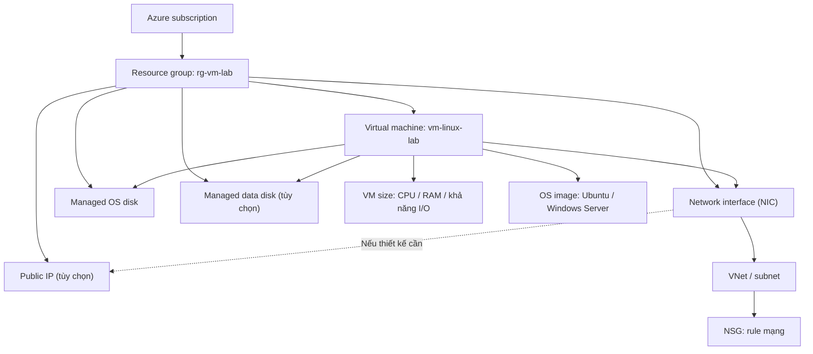
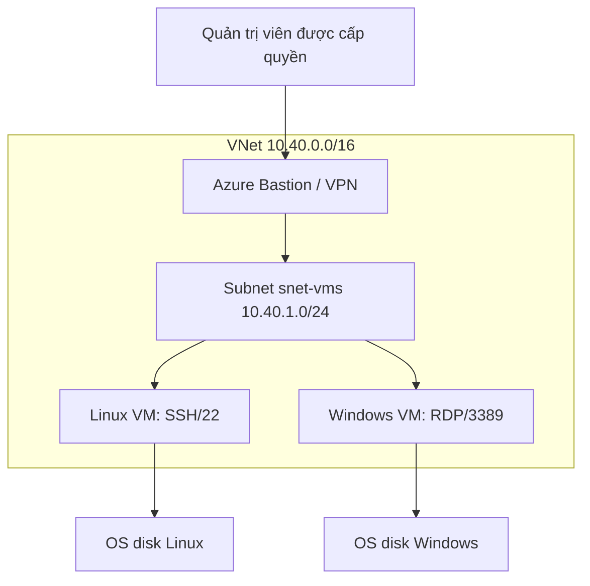
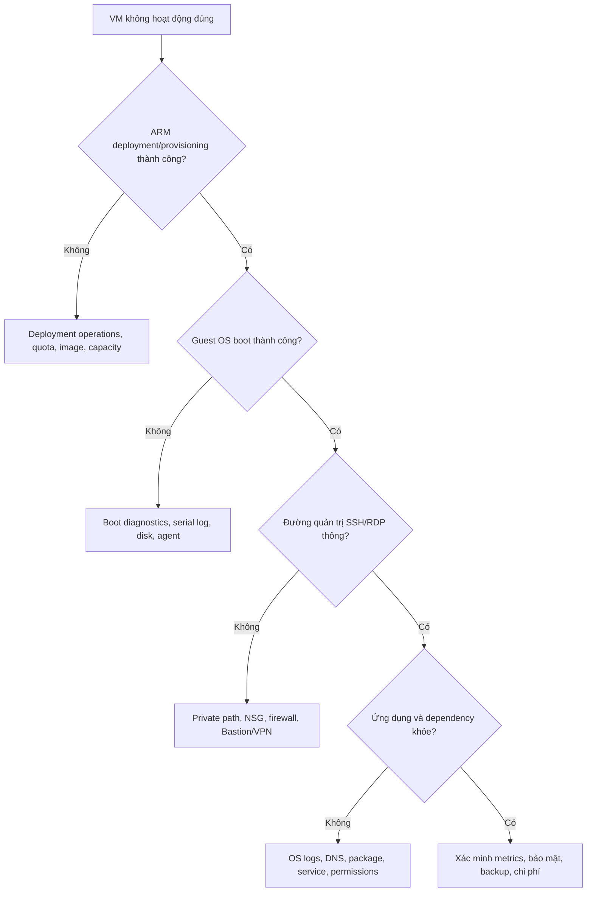

# Tạo máy ảo Linux và Windows

Khi một ứng dụng cần hệ điều hành, phần mềm tùy chỉnh hoặc quyền quản trị ở cấp máy chủ, **Azure Virtual Machines (Azure VMs)** cung cấp tài nguyên tính toán dạng Infrastructure as a Service (IaaS). Nhóm phát triển có thể tạo một máy ảo chạy **Linux** cho web/API hoặc **Windows Server** cho phần mềm .NET, dịch vụ Windows và ứng dụng kế thừa. Tuy nhiên, tạo được VM chưa đủ: phải chọn image, kích thước, đĩa, mạng, cách đăng nhập, cơ chế bảo vệ và phương án xử lý chi phí.

Bài thuộc chương **Máy ảo Azure** trong module `CLOUD_PROVIDERS_AZURE`. Trong hành trình tìm hiểu Azure từ subscription, resource group và Microsoft Entra ID đến mạng ảo, compute, lưu trữ, dữ liệu, giám sát, bảo mật và kiểm soát chi phí, bài này tập trung vào quy trình tạo **một VM Linux và một VM Windows an toàn, có thể kiểm chứng và có thể dọn dẹp sau thực hành**.

## Mục tiêu học tập

Sau bài học, bạn có thể:

- Mô tả VM và các tài nguyên phụ thuộc: **VM size, image, managed disks, NIC, VNet/subnet, NSG, identity**.
- Chuẩn bị subscription, quyền quản trị, quota, region, image và ngân sách trước khi cấp phát.
- Tạo Ubuntu Linux VM và Windows Server VM bằng **Azure Portal** hoặc **Azure CLI**.
- Thiết kế đường quản trị qua **SSH/RDP với Azure Bastion hoặc đường mạng riêng**, hạn chế mở cổng 22/3389 ra Internet.
- Xác minh trạng thái cấp phát, boot, agent và truy cập hệ điều hành sau khi VM được tạo.
- Hiểu khác biệt về đăng nhập, cập nhật, image, disk và chi phí giữa Linux và Windows.
- Giám sát VM, bảo vệ dữ liệu, xử lý các lỗi thường gặp và giải phóng đúng tài nguyên khi hoàn tất.

## 1. VM trong Azure gồm những gì?

Một VM Azure không chỉ là một “máy tính” duy nhất. Trong phần lớn kiến trúc, Azure Resource Manager (ARM) quản lý **VM resource** và các tài nguyên liên quan:



**VM size** xác định số vCPU, bộ nhớ, khả năng I/O và đặc tính phần cứng theo SKU. **Image** cung cấp hệ điều hành gốc. **OS disk** chứa phân vùng hệ điều hành; **data disk** chứa dữ liệu ứng dụng khi được gắn thêm. **NIC** đưa VM vào mạng, nhận private IP, chịu ảnh hưởng của subnet, route và các Network Security Group (NSG).

Trong Azure, **resource group** giúp tập hợp tài nguyên để quản trị và xóa theo phạm vi; nó **không** phải ranh giới mạng hoặc môi trường bảo mật tự động. Quyền kiểm soát cần được thiết kế qua Microsoft Entra ID, Azure RBAC, NSG, chính sách mạng và các dịch vụ bảo vệ khác.

### VM và managed service khác nhau thế nào?

| Lựa chọn | Bạn quản lý | Khi nào phù hợp |
|---|---|---|
| **Azure VM (IaaS)** | Guest OS, phần mềm, bản vá hệ điều hành/ứng dụng, cấu hình máy, một phần mạng và dữ liệu | Cần tùy chỉnh OS, chạy phần mềm kế thừa, quản trị máy chủ |
| **Azure App Service / Container Apps** | Chủ yếu ứng dụng và cấu hình nền tảng được cung cấp | Web/API có thể chạy trên dịch vụ được quản lý, ít muốn vận hành OS |
| **Azure Kubernetes Service (AKS)** | Ứng dụng container và nhiều thành phần cụm/workload | Nhiều dịch vụ container, cần điều phối và khả năng mở rộng phức tạp |
| **Azure Virtual Machine Scale Sets (VMSS)** | Mẫu VM, chính sách scale, workload và hệ điều hành theo mô hình | Nhiều VM tương tự cần scale/out và phân phối tải |

**Không nên dùng VM cho mọi ứng dụng**: nếu yêu cầu chỉ là triển khai một API thuần web, dịch vụ PaaS có thể giảm đáng kể công việc vá lỗi, bảo vệ máy và quản trị hệ điều hành. VM thích hợp khi quyền kiểm soát đó thực sự cần thiết.

## 2. Các quyết định phải đưa ra trước khi tạo

### Subscription, region và quota

Mỗi VM cần được tạo trong **subscription** và **region** cụ thể. Trước khi chọn vùng, hãy xem:

1. **Vị trí người dùng và dữ liệu:** đặt VM gần database/storage phù hợp để giảm độ trễ; tuân thủ yêu cầu vị trí lưu dữ liệu.
2. **Availability Zones:** workload cần chịu lỗi zone không? Region và VM size có hỗ trợ zone muốn chọn không?
3. **Quota và khả năng cấp phát:** subscription có đủ vCPU quota theo VM family và region không? SKU còn capacity không?
4. **Tính năng image/SKU:** OS image có được hỗ trợ trên kiến trúc CPU, security type, generation, VM size và region đang chọn không?
5. **Chi phí:** Linux và Windows có chi phí license khác nhau; managed disk, backup, IP, truyền dữ liệu, monitoring và Bastion cũng có thể bị tính phí.

Ví dụ `southeastasia` là tên region Azure ở Đông Nam Á; tài nguyên thực tế phải được chọn theo yêu cầu doanh nghiệp. Không dùng một region hay size trong ví dụ như cam kết mọi subscription đều còn quota/capacity.

### Image Linux và Windows

**Image** là nguồn để Azure cấp phát OS disk và cấu hình hệ điều hành ban đầu:

- Linux: thường chọn Ubuntu LTS, Debian, Red Hat Enterprise Linux hoặc bản phân phối được hỗ trợ.
- Windows: thường chọn Windows Server phiên bản được hỗ trợ, ví dụ Windows Server 2022 Datacenter.
- Marketplace image của bên thứ ba có thể đi kèm điều kiện thanh toán, license và yêu cầu chấp nhận điều khoản.
- Custom image hoặc Azure Compute Gallery hỗ trợ chuẩn hóa VM cho tổ chức, nhưng cần quy trình cập nhật/bảo trì image.

Ưu tiên image được nhà cung cấp cập nhật bảo mật, còn vòng đời hỗ trợ và tương thích ứng dụng. **Không suy ra tên alias image trong Azure CLI sẽ tồn tại mãi hoặc khả dụng ở mọi cloud/region**; cần xác minh trước khi tự động hóa.

### Chọn VM size

| Loại nhu cầu | Hướng lựa chọn | Điều cần kiểm chứng |
|---|---|---|
| Lab, web nhỏ, dev/test | VM dòng B-series có burst CPU theo mức hỗ trợ | CPU credits, RAM và network/IO limits |
| Web/API có tải ổn định | General purpose (ví dụ dòng D) | vCPU/RAM, zone, bandwidth, autoscale |
| Cần RAM lớn | Memory optimized (ví dụ dòng E) | Chi phí, dung lượng RAM, application sizing |
| Xử lý tính toán | Compute optimized (ví dụ dòng F) | Số core, hiệu năng CPU và workload benchmark |
| GPU/AI/đồ họa | GPU VM families | Driver, quota, vùng, phí GPU cao |

Kích thước ví dụ `Standard_B2s` có thể phù hợp với một lab nhỏ, nhưng đây không phải cấu hình khuyến nghị cho production. Workload Windows Server có thể cần thêm RAM và đĩa hơn Linux. Hãy dựa trên chỉ số CPU, RAM, disk IOPS, throughput và thử nghiệm thực tế.

## 3. Thiết kế mạng an toàn cho hai VM

Bài thực hành dùng một VNet riêng:

| Thành phần | Ví dụ |
|---|---|
| Resource group | `rg-vm-lab` |
| Region | `southeastasia` |
| Virtual network | `vnet-vm-lab` |
| CIDR của VNet | `10.40.0.0/16` |
| Subnet cho VM | `snet-vms`: `10.40.1.0/24` |
| Linux VM | `vm-linux-lab` |
| Windows VM | `vm-windows-lab` |
| Truy cập quản trị | Azure Bastion hoặc VPN/ExpressRoute tới private IP |
| Public IP của hai VM | **Không tạo** trong phương án mặc định |



**Đây là hướng thiết kế an toàn cho lab:** VM vẫn có private IP trong VNet nhưng không trực tiếp công khai cổng SSH/RDP. Để điều khiển từ máy cá nhân, cần một kênh quản trị được triển khai và cấu hình phù hợp; **không có public IP không có nghĩa tự nhiên truy cập được từ Internet**.

### Network Security Group (NSG)

NSG áp dụng rule mạng theo hướng inbound/outbound tại subnet/NIC theo cấu hình:

- Không mở SSH `22` hoặc RDP `3389` cho `0.0.0.0/0` trong môi trường production.
- Nếu phải dùng public access trong một lab được phê duyệt, giới hạn source IP, thời gian và rule; cân nhắc **Just-in-Time (JIT) VM access** qua Defender for Cloud khi khả dụng.
- Nếu dùng **Azure Bastion**, bảo đảm subnet/NSG của VM cho phép đường quản trị từ Bastion theo yêu cầu tính năng, đồng thời Bastion được triển khai đúng vào subnet riêng tên `AzureBastionSubnet`.
- VNet, private IP và NSG không thay thế firewall ở hệ điều hành; cần kiểm tra cả hai lớp.

**Azure Bastion là dịch vụ riêng, có cấu hình và chi phí riêng.** Một VM không tự đi kèm Bastion; phải triển khai hoặc dùng Bastion đã có. Với mạng hybrid, VPN/ExpressRoute và DNS/routing phải được cấu hình đúng.

## 4. Quy trình tạo Ubuntu Linux VM bằng Azure Portal

Ví dụ này tạo một VM cho môi trường lab trên VNet đã quy hoạch.

### Bước 1. Mở trình tạo VM

Trên Azure Portal, vào **Virtual machines → Create → Azure virtual machine**. Xác nhận đúng **Directory/Subscription** đang dùng. Chọn resource group `rg-vm-lab` (tạo mới nếu chưa có và bạn được phép).

### Bước 2. Tab Basics

Điền các thông tin:

1. **Virtual machine name:** `vm-linux-lab`.
2. **Region:** region của resource group hoặc vùng dự kiến, ví dụ Southeast Asia.
3. **Availability options:** chọn phù hợp với zone/availability yêu cầu; có thể chọn phương án mặc định cho lab, nhưng production cần đánh giá zone/availability set.
4. **Security type:** đánh giá **Trusted launch** (Secure Boot, vTPM) khi image, generation và size hỗ trợ.
5. **Image:** Ubuntu Server LTS được hỗ trợ, ví dụ Ubuntu 22.04 LTS.
6. **Size:** chọn SKU phù hợp quota và ngân sách lab.
7. **Authentication type:** ưu tiên **SSH public key** thay vì password cho Linux.
8. **Username:** ví dụ `azureuser`; chọn tên không vi phạm danh sách reserved usernames.
9. **SSH key:** dùng public key sẵn có hoặc tạo cặp khóa mới qua Portal theo hướng dẫn.
10. **Inbound port rules:** không cần mở SSH cho Internet khi dùng Bastion/private management.

Nếu tạo key pair mới qua Portal, hãy **tải và bảo vệ private key ngay khi được cung cấp**; không đưa private key vào Git, tài liệu chia sẻ hoặc chat. Public key có thể được cấu hình vào VM; private key phải ở nơi quản lý bí mật phù hợp và phân quyền chặt chẽ.

### Bước 3. Tab Disks

- **OS disk type:** cân nhắc Standard SSD cho lab khi đáp ứng nhu cầu; Premium SSD cho workload cần hiệu năng phù hợp.
- **Data disks:** thêm nếu cần lưu dữ liệu ứng dụng độc lập với OS disk; lab có thể chưa cần.
- **Encryption:** Azure Managed Disks hỗ trợ mã hóa dữ liệu lưu trữ theo cơ chế dịch vụ; CMK và các tùy chọn khác chỉ bật khi có yêu cầu và tương thích.
- **Delete with VM:** kiểm tra tùy chọn vòng đời đĩa và nhu cầu giữ dữ liệu khi xóa VM.

**OS disk và temporary/local disk khác nhau.** Không lưu dữ liệu cần tồn tại lâu dài trên temporary disk hoặc local ephemeral storage. Dữ liệu có thể mất khi VM được di chuyển, redeploy hoặc host gặp sự cố theo loại lưu trữ.

### Bước 4. Tab Networking

- Chọn `vnet-vm-lab`, subnet `snet-vms`.
- Chọn **Public IP: None** nếu quản trị qua Bastion hoặc mạng riêng.
- Kiểm tra NIC NSG và inbound rules; không mở cổng rộng hơn yêu cầu.
- Không tự bật accelerated networking nếu size/image/driver không hỗ trợ; dùng cấu hình được Azure xác nhận.

### Bước 5. Management, Monitoring, Advanced và Tags

Tùy Portal/SKU, các mục có thể nằm trong tab khác nhau:

- **Identity:** bật **system-assigned managed identity** nếu ứng dụng cần truy cập Azure API hoặc tài nguyên hỗ trợ Entra mà không muốn lưu credential dài hạn.
- **Boot diagnostics:** bật theo chính sách để xem ảnh màn hình boot và serial log khi lỗi.
- **Monitoring:** cân nhắc Azure Monitor Agent và Data Collection Rule để thu thập telemetry guest khi cần.
- **Patching/updates:** chọn cơ chế đánh giá và cập nhật phù hợp hệ điều hành và yêu cầu doanh nghiệp.
- **Automatic shutdown:** hữu ích cho dev/test để tránh quên máy chạy, nhưng phải xác minh việc **deallocate** và các chi phí vẫn tồn tại.
- **Tags:** ví dụ `environment=lab`, `owner=team-cloud`, `expiry=yyyy-mm-dd` để quản lý vòng đời và phân bổ chi phí.
- **Advanced:** cloud-init (Custom data) có thể giúp khởi tạo Linux theo kịch bản tự động.

### Bước 6. Review + create

Đọc lại cấu hình VM size, license/image, disk, IP, NSG, security type, identity và ước tính chi phí. Chọn **Review + create**, để Portal kiểm tra hợp lệ, sau đó **Create**.

Sau khi deployment báo thành công, mở VM → **Overview** và kiểm tra trạng thái. Một deployment thành công ở control plane chưa chứng minh ứng dụng bên trong VM đã hoạt động; cần đăng nhập và kiểm tra boot, agent, DNS/route và dịch vụ ứng dụng.

## 5. Quy trình tạo Windows Server VM bằng Azure Portal

Các bước nhìn chung giống Linux, nhưng có khác biệt quan trọng về image, credential, cập nhật và cách truy cập.

### Bước 1. Basics

- **Name:** `vm-windows-lab`.
- **Image:** Windows Server được hỗ trợ (ví dụ Windows Server 2022 Datacenter).
- **Size:** chọn đủ RAM/CPU cho Windows Server, kiểm tra quota và chi phí license.
- **Administrator account:** tạo local administrator username phù hợp, ví dụ `azureadmin`.
- **Password:** dùng mật khẩu đủ độ dài, độ phức tạp theo quy định Azure và chính sách tổ chức; không dùng mật khẩu cá nhân đã sử dụng ở nơi khác.
- **Inbound ports:** chọn **None** khi quản trị qua Bastion/private network; RDP mặc định dùng TCP `3389` nhưng không được mở Internet bừa bãi.

Một số image Windows có tùy chọn Azure Hybrid Benefit hoặc license theo điều kiện đủ tư cách. Chỉ chọn khi tổ chức có quyền sử dụng hợp lệ và đã xác minh điều kiện thanh toán. Windows Server VM thường có thành phần license trong chi phí tính toán nếu không có mô hình license hợp lệ khác.

### Bước 2. Disks, Networking và Management

- Chọn OS disk type theo hiệu năng và ngân sách.
- Gắn thêm data disk nếu ứng dụng Windows cần ổ riêng cho dữ liệu.
- Chọn cùng VNet/subnet lab với VM Linux nếu mục tiêu là kiểm thử liên lạc nội bộ.
- Không cấp public IP khi đã có phương án Bastion/private connectivity.
- Bật boot diagnostics và cơ chế monitoring/cập nhật phù hợp.
- Đánh giá Trusted launch và các tính năng bảo vệ endpoint tùy image, SKU và chính sách.

### Bước 3. Tạo và kiểm chứng

Sau **Review + create**, mở VM → Overview để xác nhận provisioning. Kiểm tra guest OS bằng Azure Bastion hoặc qua mạng riêng:

- Windows đã boot đến màn hình đăng nhập.
- Có thể dùng RDP theo đường quản trị an toàn đã thiết kế.
- Windows Update, thời gian hệ thống, firewall, antivirus/Defender và các dịch vụ cần thiết có trạng thái phù hợp.
- Không có service hay user thử nghiệm được mở quyền vượt nhu cầu.

Nếu VM chỉ phục vụ cho lab, đừng cài phần mềm hoặc mở inbound rule ngoài phạm vi bài tập. Nên lưu cấu hình bằng hạ tầng dưới dạng mã (IaC) nếu cần tái tạo.

## 6. Tạo hai VM bằng Azure CLI

Azure CLI giúp diễn đạt cấu hình triển khai một cách lặp lại được và tiện đưa vào script/IaC. Phần này dùng **Bash** và tài nguyên lab giả định. Các lệnh có thể phát sinh chi phí Azure thực tế nếu chạy trong subscription.

**Điều kiện:** đã cài Azure CLI phù hợp, có quyền tạo resource group/VNet/NIC/VM/disks và quản trị network trong subscription; có quota/capacity; sử dụng cloud/region hỗ trợ image và VM SKU đã chọn. Không chạy trong subscription sản xuất chỉ để thử.

### 6.1 Chọn subscription và tạo resource group

```bash
az login --tenant "<tenant-id>"
az account set --subscription "<subscription-id>"

az account show \
  --query "{subscription:id,tenant:tenantId,name:name}" \
  --output json

az group create \
  --name rg-vm-lab \
  --location southeastasia \
  --output json
```

Nếu đã có resource group tên trên, phải xác minh nó **chỉ thuộc phạm vi lab được giao** trước khi tiếp tục. Tên resource group chỉ cần duy nhất trong subscription; hai người cùng lab không nên dùng chung nhóm tài nguyên nếu không chủ động phối hợp.

### 6.2 Tạo VNet và subnet riêng cho VM

```bash
az network vnet create \
  --resource-group rg-vm-lab \
  --name vnet-vm-lab \
  --location southeastasia \
  --address-prefixes 10.40.0.0/16 \
  --subnet-name snet-vms \
  --subnet-prefixes 10.40.1.0/24 \
  --output json
```

Đảm bảo CIDR không trùng với VNet được peering hoặc mạng hybrid của tổ chức. **Lệnh này chưa tạo Bastion hoặc VPN**. Nếu không có đường mạng riêng tới VM, bạn sẽ không đăng nhập trực tiếp từ máy cá nhân vào các VM không có public IP.

### 6.3 Tạo Linux VM với SSH key

```bash
az vm create \
  --resource-group rg-vm-lab \
  --name vm-linux-lab \
  --location southeastasia \
  --image Ubuntu2204 \
  --size Standard_B2s \
  --admin-username azureuser \
  --authentication-type ssh \
  --generate-ssh-keys \
  --vnet-name vnet-vm-lab \
  --subnet snet-vms \
  --public-ip-address "" \
  --nsg-rule NONE \
  --storage-sku StandardSSD_LRS \
  --output json
```

Giải thích các tham số chính:

| Tham số | Tác dụng |
|---|---|
| `--image Ubuntu2204` | Dùng alias Ubuntu Server 22.04 LTS trong môi trường CLI hỗ trợ; kiểm tra image nếu không khả dụng |
| `--size Standard_B2s` | Chọn VM size ví dụ cho lab; cần quota/capacity |
| `--admin-username` | Tên tài khoản quản trị Linux được tạo ban đầu |
| `--authentication-type ssh` | Chọn xác thực SSH public key |
| `--generate-ssh-keys` | Azure CLI dùng/tạo SSH key theo cơ chế hỗ trợ trên máy chạy CLI |
| `--vnet-name` / `--subnet` | Gắn NIC VM vào mạng riêng đã tạo |
| `--public-ip-address ""` | Không tạo public IP theo cú pháp Azure CLI Bash |
| `--nsg-rule NONE` | Không tự mở cổng SSH/RDP inbound trên NSG được CLI tạo/quản lý trong luồng tương ứng |
| `--storage-sku StandardSSD_LRS` | Chọn SKU managed OS disk ví dụ |

**Quan trọng:** `--nsg-rule NONE` không nhất thiết nghĩa là “không có NSG” hoặc “mọi traffic đều bị chặn”. Tùy cách CLI tạo/đính NSG, các **default rules** vẫn tồn tại. Hãy kiểm tra NIC/subnet NSG và effective rules sau deployment. `--generate-ssh-keys` cần môi trường phù hợp; trong doanh nghiệp, có thể sử dụng public key đã quản lý thay vì tạo key tự động.

**Cảnh báo shell:** ví dụ dùng Bash vì cú pháp `--public-ip-address ""` có thể bị shell Windows/PowerShell diễn giải khác. Khi dùng PowerShell, kiểm tra cách truyền chuỗi rỗng hoặc tùy chọn tương đương của phiên bản Azure CLI đang dùng; xác minh **không có public IP** sau deployment.

### 6.4 Tạo Windows Server VM

CLI Windows VM cần một phương thức cấp **mật khẩu local administrator** an toàn nếu image không hỗ trợ mô hình đăng nhập khác. Trong ví dụ Bash, đọc mật khẩu từ terminal mà không in giá trị:

```bash
read -r -s -p "Nhap mat khau admin Windows cho lab: " VM_ADMIN_PASSWORD
echo

az vm create \
  --resource-group rg-vm-lab \
  --name vm-windows-lab \
  --location southeastasia \
  --image Win2022Datacenter \
  --size Standard_B2s \
  --admin-username azureadmin \
  --authentication-type password \
  --admin-password "$VM_ADMIN_PASSWORD" \
  --vnet-name vnet-vm-lab \
  --subnet snet-vms \
  --public-ip-address "" \
  --nsg-rule NONE \
  --storage-sku StandardSSD_LRS \
  --output json

unset VM_ADMIN_PASSWORD
```

Mật khẩu phải đáp ứng chính sách độ dài và độ phức tạp của Azure. Ví dụ **không ghi giá trị mật khẩu vào file**, nhưng khi triển khai bằng CLI, giá trị được truyền như tham số quá trình và có thể bị lộ nếu hệ thống theo dõi process arguments hoặc logging không được kiểm soát. Với môi trường nhạy cảm, ưu tiên quy trình bí mật được phê duyệt, cơ chế deployment bảo vệ secret hoặc **Azure Portal** với trường mật khẩu an toàn. Không đặt mật khẩu thật trong command history, Git, pipeline logs, tài liệu hay chat.

Alias `Win2022Datacenter` là ví dụ thông dụng. Nếu alias/image generation hoặc SKU không khả dụng trong cloud/region, sử dụng image reference được môi trường hỗ trợ, không thay bằng image không rõ nguồn gốc. Kích thước `Standard_B2s` là ví dụ cú pháp, **cần kiểm tra lượng RAM và CPU có đủ cho Windows workload thực tế**.

### 6.5 Xác minh hai máy ảo đã được Azure cấp phát

```bash
az vm list \
  --resource-group rg-vm-lab \
  --show-details \
  --query "[].{name:name,location:location,powerState:powerState,privateIp:privateIps,publicIp:publicIps}" \
  --output table

az vm show \
  --resource-group rg-vm-lab \
  --name vm-linux-lab \
  --query "{id:id,vmSize:hardwareProfile.vmSize,osType:storageProfile.osDisk.osType,identity:identity.type}" \
  --output json

az vm get-instance-view \
  --resource-group rg-vm-lab \
  --name vm-windows-lab \
  --query "instanceView.statuses[].displayStatus" \
  --output table
```

Kiểm tra:

- Cả hai VM có state `running` khi cần sử dụng.
- Thuộc tính `publicIps` không có địa chỉ ngoài ý muốn.
- Mỗi NIC có private IP thuộc subnet đã chọn.
- Hệ điều hành của Linux/Windows đúng image dự kiến.
- OS disk/NIC/NSG và các tài nguyên phụ thuộc được tạo đúng resource group.

CLI output có thể khác theo phiên bản Azure CLI; nếu một truy vấn `--query` không trả kết quả, hãy xem output JSON đầy đủ hoặc trợ giúp lệnh để kiểm tra tên trường thay vì kết luận VM chưa tồn tại.

## 7. Kết nối quản trị an toàn: SSH và RDP

### Linux: SSH

Linux thường được quản trị qua **SSH**. Khi đã có kết nối mạng hợp lệ tới private IP VM:

```bash
ssh -i ~/.ssh/id_rsa azureuser@10.40.1.4
```

IP `10.40.1.4` chỉ là ví dụ; lấy private IP thật từ NIC/VM. Đường dẫn private key phụ thuộc key được sử dụng, và Azure CLI có thể tạo khóa với loại hoặc tên khác. Không copy private key vào VM, không cho nhiều người dùng chung một key quản trị, và kiểm tra fingerprint của host khi kết nối lần đầu.

**SSH không tự thông từ Internet tới private IP.** Bạn cần một trong các phương án:

- **Azure Bastion**: vào VM → **Connect → Bastion** trên Portal khi subscription/VNet đã triển khai Bastion đúng cách; cấu hình xác thực theo phương thức hỗ trợ.
- **VPN/ExpressRoute**: kết nối mạng quản trị vào VNet, route/DNS/NSG phải cho phép tới private IP.
- **Jump host**: chỉ dùng khi đã được thiết kế, bảo vệ, giám sát và kiểm soát quyền; không tự tạo VM nhảy có RDP/SSH public mở rộng.

Một số image/dịch vụ hỗ trợ **Microsoft Entra login** cho Linux qua extension/cấu hình tương ứng, giúp quản lý quyền truy cập và giảm phụ thuộc local account. Đây là bước cấu hình riêng, không tự có chỉ vì VM được tạo trong subscription.

### Windows: Remote Desktop (RDP)

Windows Server thường dùng **RDP** qua TCP `3389`. Với Bastion hoặc VPN/private path, có thể dùng Remote Desktop tới private IP và tài khoản được phép.

Khi kết nối:

1. Xác nhận đường mạng quản trị đã hoạt động và NSG/Windows Defender Firewall cho phép luồng theo thiết kế.
2. Dùng đúng local/admin hoặc danh tính tổ chức được cấu hình; không giả định Azure RBAC `Reader`/`Contributor` tự trở thành quyền đăng nhập Windows.
3. Kiểm tra chứng chỉ RDP và cơ chế xác thực phù hợp; không bỏ qua cảnh báo bảo mật tùy tiện.
4. Với tổ chức dùng Microsoft Entra login cho Windows VM, cần extension, vai trò đăng nhập VM và điều kiện OS/client được hỗ trợ.

**Azure RBAC là một lớp quyền quản lý tài nguyên**, còn đăng nhập guest OS là lớp khác. Một người có quyền bật/tắt VM không đương nhiên có tài khoản đăng nhập SSH hoặc RDP trên máy.

### Azure Bastion có yêu cầu riêng

Azure Bastion không được tạo cùng VM. Để triển khai, cần quy hoạch subnet riêng tên chính xác `AzureBastionSubnet`, kích thước subnet phù hợp với SKU/khả năng hỗ trợ (thường khuyến nghị tối thiểu /26 cho deployment mới), cấu hình network/NSG và các tài nguyên liên quan. Bastion có **chi phí duy trì** khi được triển khai, kể cả lúc không có phiên SSH/RDP. Chỉ thêm Bastion khi được cấp quyền và có ngân sách lab; có thể dùng Bastion chung đã được phê duyệt.

## 8. Đĩa, dữ liệu và các chính sách vòng đời

### Managed OS disk, data disk và temporary disk

| Loại lưu trữ | Chứa gì? | Điều cần nhớ |
|---|---|---|
| **OS disk** | Hệ điều hành, một phần cấu hình và phần mềm cài đặt | Là Azure Managed Disk; có chi phí và vòng đời riêng |
| **Data disk** | Dữ liệu ứng dụng, database/file tùy workload | Có thể thêm sau khi tạo, cần format/mount và backup |
| **Temporary/local disk** | Dữ liệu tạm, cache hoặc scratch theo SKU | Không bảo đảm giữ dữ liệu qua host events/deallocation/redeploy |
| **Ephemeral OS disk** | Hệ điều hành trên local storage theo điều kiện SKU/image | Dành cho workload tái tạo được; mất dữ liệu khi VM được reimage hoặc có sự kiện ảnh hưởng local storage theo mô hình |

Trong lab cơ bản, hai máy có OS disk là đủ. Khi ứng dụng cần dữ liệu bền vững, ưu tiên data disk hoặc dịch vụ lưu trữ chuyên dụng thay vì phụ thuộc vào temporary disk.

Ví dụ thêm managed data disk vào Linux VM khi đã xác nhận quota và ngân sách:

```bash
az vm disk attach \
  --resource-group rg-vm-lab \
  --vm-name vm-linux-lab \
  --name disk-linux-data \
  --new \
  --size-gb 64 \
  --sku StandardSSD_LRS
```

Sau khi attach, **đĩa mới chưa tự có filesystem và mount point**. Trên Linux, cần xác định chính xác thiết bị bằng `lsblk`/disk ID, tạo partition/filesystem khi là đĩa mới và cấu hình mount bằng UUID; trên Windows dùng Disk Management/PowerShell để initialize, partition, format và gán drive letter. **Không chạy lệnh format trên ổ chưa xác minh**, vì có thể làm mất dữ liệu.

### Encryption và backup

Azure Managed Disks hỗ trợ mã hóa ở trạng thái nghỉ theo cơ chế dịch vụ. Nếu tổ chức yêu cầu **customer-managed key (CMK)**, cần thiết kế Disk Encryption Set, identity và quyền sử dụng khóa theo tính năng hỗ trợ; không phải mọi cấu hình VM tự hỗ trợ mọi kiểu key/security.

**Snapshot, backup và replication có mục đích khác nhau.** Backup phải có lịch, retention, phương án khôi phục được thử nghiệm và quyền bảo vệ; Azure Backup hoặc dịch vụ tương đương có thể áp dụng theo mô hình được hỗ trợ. Sao chép VM/disk đơn giản không thay thế chiến lược phục hồi cấp ứng dụng, nhất là với database có trạng thái.

## 9. Khởi tạo tự động sau cấp phát

### Cloud-init trên Linux

Nhiều image Linux hỗ trợ **cloud-init** để cấu hình máy trong quá trình provision. Có thể cấp `custom data` khi tạo VM theo cơ chế hỗ trợ, ví dụ:

```yaml
#cloud-config
package_update: true
packages:
  - nginx
runcmd:
  - systemctl enable --now nginx
```

Ví dụ dùng Ubuntu có trình quản lý package phù hợp. Nó yêu cầu VM có đường tải package từ repository; VM chỉ có private IP nhưng không có đường outbound/NAT phù hợp có thể không cài được Nginx. Không lưu password, token hoặc secret trong cloud-init/custom data vì dữ liệu khởi tạo có thể bị lộ qua quá trình triển khai, guest logs hoặc metadata theo cơ chế hệ thống.

### Windows: extensions và run command

Windows VM có thể được cấu hình bằng image chuẩn, Azure VM Extensions, scripts và công cụ quản lý cấu hình. Azure Portal cung cấp **Run command** cho các tác vụ chẩn đoán/điều chỉnh được cho phép. Ví dụ truy vấn dịch vụ hệ thống bằng PowerShell:

```powershell
Get-Service -Name WinRM
Get-ComputerInfo | Select-Object WindowsProductName, OsVersion
```

Khi dùng VM Run Command/extension, cần quyền phù hợp và kiểm soát nội dung script vì lệnh có thể chạy với **đặc quyền cao** trong guest OS. Không đưa credential vào `--scripts` hoặc output log. Run Command không thay thế quy trình cấu hình idempotent và kiểm soát thay đổi cho hệ thống production.

### Hướng tới IaC

Với ứng dụng thật, nên quản lý các cấu hình VM bằng **Bicep/ARM, Terraform hoặc pipeline IaC**: VM, NIC, subnet, NSG, identity, disk, tags và monitoring. Azure CLI phù hợp để hiểu khái niệm và làm lab; thao tác bằng tay không phải cơ chế triển khai đáng tin cậy cho hàng trăm VM.

## 10. Vận hành và giám sát VM

Sau khi VM chạy, công việc vận hành mới bắt đầu:

| Hạng mục | Linux | Windows |
|---|---|---|
| Bản vá OS | Quản lý package, kernel và reboot theo distro | Windows Update/Update Manager và reboot |
| Truy cập | SSH key, có thể tích hợp Entra theo cấu hình | RDP, local/domain/Entra login theo hỗ trợ |
| Dịch vụ OS | `systemctl`, journald và logs | Services, Event Viewer và PowerShell |
| Disk/filesystem | `lsblk`, `df -h`, mount/UUID | Disk Management, volumes và event logs |
| Guest monitoring | Azure Monitor Agent/VM Insights nếu cấu hình | Azure Monitor Agent/VM Insights nếu cấu hình |
| Baseline security | OS hardening, firewall, SSH policy | Defender, Windows Firewall, RDP policy và hardening |
| Identity tới Azure | Managed identity và RBAC dịch vụ | Managed identity và RBAC dịch vụ |

### Azure Monitor và boot diagnostics

**Platform metrics** như CPU percentage và các chỉ số hạ tầng được Azure cung cấp theo tài nguyên. **Guest metrics/logs** (memory, filesystem, Windows Event Logs, Syslog) thường cần agent hoặc cấu hình thu thập phù hợp.

Các điểm cần giám sát:

- VM availability/health và thay đổi trạng thái năng lượng.
- CPU, memory, disk latency/IOPS, dung lượng còn trống, network throughput.
- SSH/RDP attempts, thay đổi local users, lỗi cập nhật, sự kiện bảo mật.
- OS disk và data disk đầy, filesystem lỗi hoặc ứng dụng không khởi động.
- Boot diagnostics screenshot/serial log khi máy không boot được.
- Chi phí đang tăng so với budget của resource group hoặc tag dự án.

Không xem `VM Running` là bằng chứng web/API đang phục vụ tốt. Cần thêm health endpoint, application logs, synthetic tests và chỉ số nghiệp vụ.

### Managed identity và truy cập tài nguyên Azure

Nếu VM cần đọc blob trong Azure Storage hoặc secret trong Key Vault, nên xem xét **system-assigned hoặc user-assigned managed identity** theo mô hình hỗ trợ. VM/ứng dụng lấy token qua cơ chế identity của Azure, còn tài nguyên đích kiểm tra Azure RBAC/access policy phù hợp. Không hardcode storage account keys hoặc Key Vault secrets trong mã nguồn, file cấu hình bất kỳ và nhật ký VM.

## 11. Availability, scaling và thiết kế production

Một VM đơn lẻ là một điểm lỗi ở cấp compute, bất kể OS là Linux hay Windows.

### Availability Zones và Availability Sets

- **Availability Zones** là các vùng lỗi vật lý tách biệt trong region có hỗ trợ. Triển khai VM ở nhiều zone cùng load balancer và dữ liệu phù hợp có thể tăng tính chịu lỗi.
- **Availability Sets** là mô hình sắp đặt nhiều VM vào fault/update domains trong kịch bản hỗ trợ, thường gắn với phương án vùng đơn.
- **Virtual Machine Scale Sets** hỗ trợ quản lý nhiều instance theo mẫu và quy tắc scale/upgrade.
- **Azure Load Balancer** và **Application Gateway** có thể phân phối traffic tới nhóm backend phù hợp; không tự nhân bản dữ liệu ứng dụng hoặc database.

Chỉ chọn `Availability Zone 1` trong Portal không làm một VM đơn lẻ trở thành hệ thống high availability. Cần **nhiều instance, load balancing, state management, backup/DR và kiểm thử failover**.

### Vấn đề state và dữ liệu

Đối với web/API, nên tránh lưu session quan trọng chỉ trong RAM của một VM. Dữ liệu có trạng thái cần storage/database được thiết kế riêng. Nếu triển khai Windows dịch vụ kế thừa hoặc Linux database lên VM, hãy kiểm tra backup application-consistent, khả năng khôi phục và license/cluster constraints trước khi mở rộng.

## 12. Chi phí: tạo VM dễ hơn dừng tính phí

Chi phí một VM không chỉ gồm giá tính toán:

| Nhóm chi phí | Phát sinh khi nào? | Cách kiểm soát |
|---|---|---|
| **Compute** | Khi VM được cấp phát/đang chạy theo trạng thái tính phí của Azure | Chọn SKU hợp lý, deallocate khi không dùng, policy auto-shutdown |
| **Windows/license** | Theo image, hệ điều hành và điều kiện giấy phép | Chọn OS/license đúng; chỉ dùng Azure Hybrid Benefit khi đủ điều kiện |
| **Managed disks** | OS disk, data disk, snapshot tồn tại | Chọn disk tier/size hợp lý; xóa tài nguyên không dùng sau kiểm tra |
| **Public IP / NAT / Bastion** | Theo SKU, thời gian hoặc lưu lượng của dịch vụ mạng | Không tạo khi không cần, chia sẻ Bastion có kiểm soát |
| **Network egress** | Dữ liệu ra Internet/region hoặc qua dịch vụ liên quan | Thiết kế region và luồng dữ liệu gần nhau |
| **Monitoring / backup** | Thu thập logs, retention, backup vault, snapshots | Chọn chính sách retention, alert và backup phù hợp |
| **Disk hiệu năng cao và extensions** | Theo loại disk, kích thước hoặc dịch vụ bổ sung | Không chọn mặc định cho lab nếu không có nhu cầu |

### Stop và Deallocate khác nhau

Khi tắt hệ điều hành từ trong guest OS hoặc sử dụng một cách `stop` không giải phóng allocation, VM có thể tiếp tục giữ tài nguyên compute và **vẫn phát sinh phí compute**. Khi cần ngừng tính phí compute cho VM IaaS thông thường, dùng thao tác **Deallocate** ở cấp Azure và xác nhận trạng thái `Stopped (deallocated)`:

```bash
az vm deallocate \
  --resource-group rg-vm-lab \
  --name vm-linux-lab

az vm deallocate \
  --resource-group rg-vm-lab \
  --name vm-windows-lab
```

**Deallocate không xóa VM, OS disk, data disks, snapshots, backup, IP/Bastion hay logs**, vì vậy những tài nguyên này có thể vẫn bị tính phí. Khi VM được khởi động lại, địa chỉ IP động hoặc vị trí cấp phát có thể thay đổi tùy cấu hình; muốn IP ổn định, phải thiết kế private/public IP phù hợp.

### Ngân sách và tự động tắt

Với lab, nên đặt **Azure Cost Management budget/alert** ở phạm vi phù hợp và gắn tags để theo dõi. Auto-shutdown không phải cam kết ngừng mọi chi phí, đặc biệt nếu còn managed disks, Bastion, Public IP hoặc backup.

## 13. Kiểm tra sau triển khai: một checklist thực hành

Trước khi tuyên bố VM đã sẵn sàng:

1. **ARM:** VM, NIC, OS disk, subnet, NSG và tùy chọn public IP đúng thiết kế.
2. **Provisioning:** không có lỗi deployment/extension; instance view hiển thị trạng thái mong đợi.
3. **Boot:** Linux boot/SSH service hoặc Windows boot/RDP service hoạt động.
4. **Networking:** private IP, DNS, NSG, route và cơ chế quản trị (Bastion/VPN) chính xác.
5. **OS hardening:** SSH key/password, local accounts, firewall, patching, endpoint protection.
6. **Disk:** dung lượng trống, filesystem/mount hoặc Windows volume, disk encryption.
7. **Identity:** VM managed identity có đúng role cần cho dịch vụ Azure hay không.
8. **Monitoring:** metrics, boot diagnostics, guest logs/alerts ở mức yêu cầu.
9. **Application:** health check và truy cập nghiệp vụ hoạt động, không chỉ VM báo `Running`.
10. **Cost:** VM size, license, disks, IP/Bastion, backup và budget phù hợp.

Ghi lại giá trị dự kiến và kết quả kiểm thử để người khác có thể tái hiện. Nếu hai máy thuộc cùng subnet nhưng không ping được nhau, đừng vội mở mọi NSG rule: nhiều hệ điều hành mặc định chặn ICMP; hãy kiểm tra **giao thức và cổng ứng dụng thực sự cần**.

## 14. Xử lý các lỗi thường gặp

| Triệu chứng | Nguyên nhân cần xem xét | Cách xác minh |
|---|---|---|
| `QuotaExceeded` hoặc không đủ vCPU | VM family/region quota chưa đủ | Azure Portal Quotas, `az vm list-usage`, request quota |
| `AllocationFailed`, `OverconstrainedAllocationRequest` | Size/region/zone/image hoặc availability capacity không đáp ứng | Thử SKU/zone/region phù hợp, kiểm tra quota và restrictions |
| Image không hợp lệ hoặc cần chấp nhận terms | Sai alias/URN, image không có ở region, Marketplace plan | `az vm image list`/`show` và thông tin publisher/offer/SKU |
| Linux SSH timeout | Không có route private, NSG/OS firewall chặn 22, thiếu Bastion/VPN | Kiểm tra NIC/IP, Next hop, Network Watcher, sshd |
| Linux SSH báo `Permission denied (publickey)` | Sai username, private key hoặc authorized key | Xác minh key pair và user; không mở password auth bừa bãi |
| Windows RDP timeout | Private path chưa thông, NSG/Windows Firewall, RDP service | Kiểm tra Bastion/VPN, TCP 3389, VM agent, guest logs |
| Windows RDP lỗi credentials | Sai account/password, lockout, quyền đăng nhập | Kiểm tra identity và account policy; reset qua quy trình có thẩm quyền |
| VM ở `Running` nhưng ứng dụng không hoạt động | Service lỗi, startup script, database/DNS/port lỗi | Application logs, systemd/Services, health probes |
| Linux cloud-init hoặc extension failed | Không có outbound repo, script lỗi, image/agent không tương thích | Boot diagnostics, cloud-init logs/extension status |
| NIC có IP nhưng không ra Internet | Không có outbound path/NAT, NSG/UDR/firewall, DNS | Kiểm tra egress design, Network Watcher, DNS, NAT Gateway |
| Deallocate nhưng bill vẫn có | Disk, snapshot, backup, Bastion, Public IP vẫn tồn tại | Xem tài nguyên và Azure Cost Management |
| VM báo boot failure | OS disk hoặc boot configuration lỗi, guest update thất bại | Boot diagnostics, Serial Console theo hỗ trợ, backup/restore |

### Quy trình phân tích tuần tự



**Không xử lý lỗi bằng cách mở `0.0.0.0/0` vào SSH/RDP hoặc cấp Owner trên subscription cho tài khoản thử nghiệm.** Hãy phân biệt lỗi cấp phát VM, lỗi guest OS, lỗi mạng và lỗi ứng dụng trước khi sửa.

## 15. Bài thực hành tổng hợp: hai VM trong một VNet

**Tình huống:** Bạn cần xây một môi trường nhỏ để chạy web API trên Linux và một tiện ích quản trị nội bộ trên Windows Server. Cả hai VM chỉ được quản trị qua đường riêng; người học phải chứng minh rằng không có public IP gắn trực tiếp vào máy.

### Phần A. Lập kế hoạch

Điền bảng sau trước khi tạo:

| Thuộc tính | Linux VM | Windows VM |
|---|---|---|
| Name | `vm-linux-lab` | `vm-windows-lab` |
| Image | Ubuntu Server LTS | Windows Server 2022 hoặc image được hỗ trợ |
| Size | SKU lab vừa quota | SKU đủ RAM/CPU và phù hợp license |
| Resource group | `rg-vm-lab` | `rg-vm-lab` |
| VNet/subnet | `vnet-vm-lab/snet-vms` | `vnet-vm-lab/snet-vms` |
| Public IP | None | None |
| Guest login | SSH public key | Local admin password/identity được hỗ trợ |
| Management path | Bastion hoặc VPN | Bastion hoặc VPN |
| Monitoring | Boot diagnostics + metrics | Boot diagnostics + metrics |
| Cleanup plan | Deallocate, kiểm tra disk rồi xóa lab | Deallocate, kiểm tra disk rồi xóa lab |

### Phần B. Tạo VM và ghi bằng chứng

1. Chạy các lệnh Azure CLI ở mục 6 trong subscription sandbox hoặc thực hiện thao tác tương đương qua Portal.
2. Dùng `az vm list --show-details` để ghi private IP và power state của mỗi máy.
3. Mở NIC/NSG trên Portal và xác nhận **không có rule inbound Internet rộng** cho port 22/3389.
4. Xác nhận **không có public IP** gắn trực tiếp vào hai VM.
5. Kiểm tra OS disk, resource group và tags.

### Phần C. Kiểm tra guest OS

Nếu có Bastion/VPN đã được phê duyệt, đăng nhập:

Linux:

```bash
uname -a
cat /etc/os-release
df -h
ip -br addr
systemctl is-active ssh
```

Tên dịch vụ SSH có thể khác giữa distro; Ubuntu thường dùng `ssh`, một số bản Linux khác dùng `sshd`.

Windows PowerShell:

```powershell
Get-ComputerInfo | Select-Object WindowsProductName, OsVersion
Get-NetIPAddress -AddressFamily IPv4
Get-Volume
Get-Service -Name TermService
```

Đối chiếu tên máy, phiên bản OS, dung lượng disk, IP thực tế và dịch vụ quản trị. Các lệnh trên chỉ **đọc trạng thái**. Nếu Bastion/VPN chưa được triển khai, dừng ở bước xác minh control plane/boot diagnostics thay vì công khai RDP/SSH để hoàn thành lab.

### Phần D. Kiểm tra an toàn và chi phí

- Cảnh báo monitor nào phát hiện VM down hoặc OS disk gần đầy?
- Khi cả hai VM đang deallocated, chi phí nào vẫn còn?
- VM Linux và Windows có sử dụng cùng một phương thức đăng nhập không? Tại sao?
- Dữ liệu ứng dụng có nên đặt trên temporary disk không?
- Nếu cần scale web API lên ba VM, thành phần nào bổ sung để chia tải và duy trì phiên?

### Phần E. Kết thúc và dọn dẹp

Trước khi xóa, xác định chắc chắn **`rg-vm-lab` chỉ chứa tài nguyên lab do bạn sở hữu**. Trong một lab chuyên dụng, có thể:

```bash
# Chỉ sử dụng sau khi đã kiểm kê tất cả tài nguyên trong group
az resource list \
  --resource-group rg-vm-lab \
  --query "[].{name:name,type:type}" \
  --output table

# Xóa đúng resource group lab, thao tác không thể hoàn nguyên đơn giản
az group delete \
  --name rg-vm-lab \
  --yes
```

**Không dùng lệnh xóa group nếu có tài nguyên dùng chung hoặc dữ liệu quan trọng.** Xóa VM riêng lẻ có thể để lại OS/data disks, NIC, public IP, backup và tài nguyên mạng tùy cấu hình; cần kiểm kê cả phụ thuộc. Sau dọn dẹp, kiểm tra Azure Cost Management để xác nhận không còn những chi phí ngoài dự kiến.

## 16. Câu hỏi tự kiểm tra

**Câu 1.** VM được tạo thành công trên Portal có nghĩa ứng dụng web đã chạy khỏe không?

**Đáp án:** Không. Triển khai ARM thành công chỉ xác nhận phần cấp phát; còn phải kiểm tra guest boot, agent, mạng, ứng dụng và dependency.

**Câu 2.** Vì sao tạo VM mà không có public IP có thể an toàn hơn cho lab nội bộ?

**Đáp án:** Giảm bề mặt quản trị trực tiếp từ Internet. Quản trị viên phải dùng đường riêng như Bastion hoặc VPN, kết hợp NSG và xác thực phù hợp.

**Câu 3.** Với Ubuntu, nên dùng SSH key hay hardcode password quản trị?

**Đáp án:** Ưu tiên SSH key/cơ chế identity được hỗ trợ. Không hardcode credential trong script hoặc repository.

**Câu 4.** Windows VM có nhất thiết phải mở TCP/3389 cho toàn Internet để đăng nhập RDP không?

**Đáp án:** Không. Có thể dùng Azure Bastion hoặc đường mạng riêng. Chỉ mở rule tối thiểu theo yêu cầu và có kiểm soát.

**Câu 5.** VM size và OS image khác nhau ở đâu?

**Đáp án:** VM size quyết định tài nguyên tính toán/hệ phần cứng ảo; OS image chứa hệ điều hành gốc và các thành phần được nhà phát hành đóng gói.

**Câu 6.** Đã tắt VM từ trong Windows/Linux, có chắc không còn phí compute?

**Đáp án:** Không. Cần kiểm tra VM đã ở trạng thái **Stopped (deallocated)** ở Azure hay chưa; ổ đĩa và các tài nguyên khác vẫn có thể tính phí.

**Câu 7.** Vì sao không nên lưu database quan trọng trên temporary disk của VM?

**Đáp án:** Temporary/local disk không cam kết duy trì dữ liệu qua mọi sự kiện host, redeploy hoặc thay đổi máy. Dữ liệu bền vững cần managed disk hoặc dịch vụ lưu trữ thích hợp và backup.

**Câu 8.** Role Azure RBAC Contributor có tự cho phép SSH/RDP vào guest OS không?

**Đáp án:** Không. Quyền quản lý tài nguyên Azure và quyền đăng nhập hệ điều hành là hai lớp khác nhau; cần cấu hình xác thực và quyền guest phù hợp.

**Câu 9.** Muốn một web API chịu được lỗi một VM đơn lẻ, cần làm gì ngoài tạo thêm VM?

**Đáp án:** Thêm các instance, load balancer/health probes, quản lý session/state, networking và phương án quan sát/khôi phục phù hợp.

**Câu 10.** Nếu CLI báo `QuotaExceeded` khi tạo Windows VM, sửa NSG có giúp không?

**Đáp án:** Không. Cần kiểm tra vCPU quota, VM family, region và khả năng cấp phát; NSG không quyết định quota tính toán.

**Câu 11.** Vì sao một Linux VM không có public IP có thể không cài được package bằng cloud-init?

**Đáp án:** VM cần outbound path phù hợp đến repository (ví dụ NAT/firewall/proxy được hỗ trợ) và DNS hoạt động. Không có public IP không tự tạo đường Internet outbound.

**Câu 12.** Xóa VM có luôn xóa tất cả managed disks, IP, backup và chi phí liên quan không?

**Đáp án:** Không nên giả định. Tác động phụ thuộc các tùy chọn delete-with-VM và tài nguyên phụ thuộc; cần kiểm kê, phê duyệt và dọn dẹp riêng khi cần.

## Tổng kết

Để **tạo máy ảo Linux và Windows trên Azure**, cần chọn đúng subscription/region, kiểm tra image và quota, quyết định VM size, managed disk, VNet/subnet/NSG và phương pháp đăng nhập. Linux thường dùng SSH key; Windows thường dùng cơ chế đăng nhập Windows/RDP phù hợp. Trong cả hai trường hợp, hướng an toàn là **không mở trực tiếp cổng quản trị ra Internet** nếu có thể dùng Bastion hoặc mạng riêng.

Sau khi VM được cấp phát, hãy xác minh OS, kết nối, security baseline, identity, giám sát, backup và chi phí. Phân biệt **Stop** với **Deallocate**, không lưu dữ liệu bền vững trên temporary disk và kiểm kê tài nguyên khi xóa lab. Những nguyên tắc này giúp chuyển từ thao tác “tạo được VM” sang **triển khai và vận hành VM có trách nhiệm** trong một kiến trúc ứng dụng Azure.
