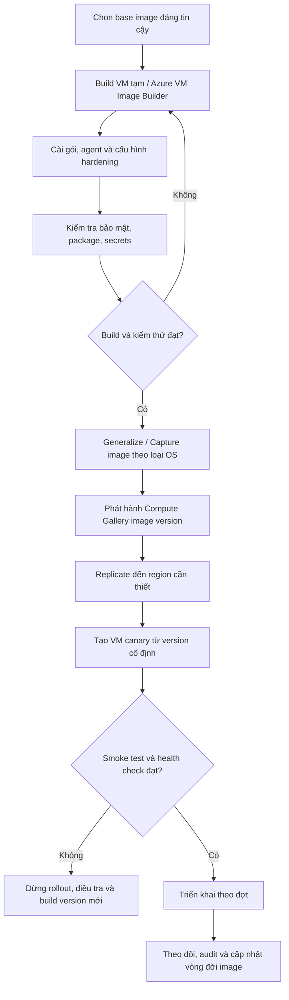

# Image, Azure Compute Gallery và chuẩn hóa máy ảo

Trong module **CLOUD_PROVIDERS_AZURE**, người học khám phá hệ sinh thái Microsoft Azure từ subscription, resource group, Microsoft Entra ID đến mạng ảo, dịch vụ tính toán, lưu trữ và dữ liệu. Mục tiêu là biết triển khai, giám sát, bảo vệ và kiểm soát chi phí một kiến trúc ứng dụng trên Azure. Ở chương **Máy ảo Azure**, việc thiết kế **VM image** và quản lý chúng qua **Azure Compute Gallery** là một nền tảng quan trọng để tạo máy ảo nhất quán, có thể truy vết phiên bản và triển khai lặp lại.

Giả sử công ty vận hành 60 máy ảo Linux cho một hệ thống đơn hàng tại hai Azure region. Nếu quản trị viên cài đặt thủ công từng máy, các VM có thể khác phiên bản thư viện, cấu hình bảo mật, công cụ giám sát và bản vá. Khi cần khôi phục hoặc mở rộng hệ thống, rất khó biết máy nào được xây dựng từ cấu hình nào. **Golden image** giúp giải quyết vấn đề đó: chuẩn hóa phần nền của VM thành một bản dựng được kiểm thử và phát hành theo phiên bản; các máy mới sử dụng bản dựng đã được phê duyệt.

Sau bài học, bạn có thể:

- Phân biệt **Marketplace image**, **managed image**, **Azure Compute Gallery image**, **disk** và **snapshot**.
- Giải thích **generalized image** và **specialized image**, cùng các rủi ro khi sao chép danh tính máy.
- Thiết kế cấu trúc **gallery → image definition → image version**, vùng nhân bản, quyền chia sẻ và vòng đời phiên bản.
- Xây quy trình tạo **golden image**: chọn nguồn đáng tin cậy, hardening, build, test, phát hành, triển khai canary, rollback.
- Nắm các bước Azure CLI minh họa để tạo gallery, image definition, image version và VM từ version cố định.
- Nhận diện lỗi cấu hình phổ biến và các yếu tố ảnh hưởng chi phí, bảo mật và vận hành.

## 1. Image của máy ảo là gì?

**VM image** là nguồn khởi tạo dùng để tạo hệ điều hành và các thành phần ban đầu cho một hoặc nhiều máy ảo. Image có thể chứa hệ điều hành, công cụ hệ thống, ứng dụng nền và những thiết lập đã được chuẩn bị. Khi triển khai một VM mới, Azure tạo những tài nguyên thích hợp như OS disk từ image và thực hiện provisioning theo kiểu image.

Một cách nhìn:

```text
Nguồn hệ điều hành + cấu hình nền đã chuẩn hóa
                  |
                  v
            VM image version 1.3.0
                  |
          +-------+-------+
          |       |       |
          v       v       v
         VM A    VM B    VM C
          |       |       |
      Mỗi VM có disk, danh tính, cấu hình lúc chạy riêng
```

Các VM tạo từ cùng một image version có **trạng thái ban đầu tương đồng** nhưng không phải cùng một VM: chúng có tài nguyên disk, hostname, định danh, NIC, lịch sử thay đổi và dữ liệu chạy riêng sau khi provisioning.

Image không phải công cụ tự động cập nhật mọi VM đã triển khai từ nó. Nếu phát hành image `1.3.1`, các VM đang chạy từ `1.3.0` **không tự thay OS disk** chỉ vì gallery có version mới. Bạn cần quy trình cập nhật/rollout hoặc cơ chế nâng cấp image được dịch vụ triển khai hỗ trợ.

### 1.1. Phân biệt image, disk, snapshot và backup

| Khái niệm | Mục đích | Điểm cần nhớ |
|---|---|---|
| **Marketplace image** | Ảnh hệ điều hành/ứng dụng do nhà phát hành cung cấp qua Azure Marketplace | Cần chọn đúng publisher/offer/SKU/version và xem điều kiện license |
| **Managed image** | Tài nguyên image của Azure chứa nguồn để tạo VM | Cách đóng gói đơn giản, nhưng khả năng phân phối/versioning tập trung hạn chế hơn gallery |
| **Azure Compute Gallery image version** | Bản image được phát hành có cấu trúc version, có thể nhân bản tới các region | Phù hợp xây catalog golden image cho nhiều môi trường/region |
| **Managed disk** | Đĩa block storage gắn với VM | Có dữ liệu thay đổi khi VM chạy; không phải catalog phát hành |
| **Snapshot** | Bản chụp một disk tại một thời điểm | Hữu ích cho một số quy trình sao lưu/copy nhưng không tự là golden image có quản trị |
| **Azure Backup** | Cơ chế backup/recovery theo chính sách cho workload hỗ trợ | Dùng cho khôi phục dữ liệu/hệ thống, không được thay bằng việc chỉ giữ image |

**Image là mẫu triển khai, không phải bản sao lưu dữ liệu nghiệp vụ.** Tạo VM từ image không khôi phục được giao dịch hoặc trạng thái ứng dụng mới phát sinh sau khi image được chụp. Với hệ thống có cơ sở dữ liệu hay dữ liệu người dùng, cần chính sách backup riêng.

### 1.2. Những gì nên và không nên đưa vào golden image

Nên có:

- Hệ điều hành và bản vá trong phạm vi release đã kiểm tra.
- Gói runtime phổ biến, dependency, cấu hình hardening và các công cụ quản trị/monitoring phù hợp.
- Thiết lập nền lặp lại được, ví dụ cấu hình audit, service agent, chính sách time sync và package repository đáng tin cậy.
- Metadata về bản dựng và thành phần phần mềm (ví dụ manifest hoặc version được quản lý trong pipeline).

Không nên có:

- Password riêng của môi trường, access token, SSH private key, client secret, storage account key.
- Dữ liệu khách hàng, bản dump database, chứng chỉ cá nhân không được thiết kế để phân phối.
- ID máy, tài khoản người dùng mẫu, host key hoặc tác vụ gắn cố định với một VM mà quá trình generalization phải loại bỏ.
- IP tĩnh, tên miền/hostname hoặc kết nối private endpoint hard-code không phù hợp khi triển khai nhiều môi trường.

Một số cấu hình được áp dụng **sau khi tạo VM** bằng cloud-init, Azure VM extensions, Configuration Management hoặc pipeline/IaC; không nên cố đóng gói mọi khác biệt môi trường vào cùng một image.

## 2. Generalized image và specialized image

Azure phân biệt hai trạng thái hệ điều hành của nguồn image:

### 2.1. Generalized

**Generalized image** được chuẩn bị để loại bỏ các thông tin riêng của VM nguồn và cho phép Azure thực hiện provisioning như một máy mới. Khi dùng loại này, quy trình tạo VM thường có thể thiết lập tên máy, tài khoản quản trị hoặc khóa SSH theo cách được OS/Azure hỗ trợ.

Ví dụ quy trình nền tảng:

| Hệ điều hành | Công đoạn trong guest thường gặp | Lưu ý |
|---|---|---|
| **Windows** | Chạy **Sysprep** với tùy chọn generalize, OOBE và shutdown theo hướng dẫn Azure | Kiểm tra ứng dụng có hỗ trợ Sysprep, license, domain membership và dịch vụ chạy lúc khởi động |
| **Linux** | Thực hiện deprovision theo công cụ provisioning đang dùng, ví dụ Azure Linux Agent (`waagent`) trong môi trường phù hợp | Lệnh chính xác phụ thuộc bản phân phối, Azure Linux Agent/cloud-init và cơ chế provisioning |

**Generalization không bảo đảm tự động xóa tất cả dữ liệu nhạy cảm.** Bạn vẫn phải kiểm kê secrets, khóa riêng, log, artifacts, dữ liệu người dùng và các agent/ứng dụng có ID riêng trước khi tạo image.

Một điểm vận hành rất quan trọng: sau khi đánh dấu VM nguồn là **generalized** trong Azure, không xem nó là VM bình thường có thể khởi động lại để tiếp tục cấu hình. Hãy dùng **VM build tạm thời**, ghi lại mọi thay đổi trong script/IaC và tạo VM build mới khi cần sửa bản image.

### 2.2. Specialized

**Specialized image** giữ trạng thái OS/máy đã cấu hình, bao gồm nhiều thông tin về danh tính và provisioning của VM nguồn. Một số kịch bản cần sao chép máy với trạng thái hệ điều hành sẵn có có thể dùng specialized image, tùy tính năng triển khai.

Tuy nhiên, specialized image **không phù hợp làm golden image đại trà** nếu mang theo hostname, tài khoản, machine identity, khóa và những thiết lập phải độc lập giữa các VM. Nếu nhân bản máy chuyên biệt không kiểm soát, bạn có thể gặp xung đột danh tính, kết nối tới domain hoặc hệ thống giám sát, và rủi ro lộ bí mật.

| Tiêu chí | Generalized | Specialized |
|---|---|---|
| Mục tiêu | Tạo VM mới có provisioning riêng | Tái tạo máy từ trạng thái OS đã tồn tại |
| Xử lý machine-specific state | Được chuẩn bị loại bỏ thông tin cần generalize | Giữ lại nhiều thông tin đặc thù |
| Tạo nhiều VM từ cùng nguồn | Thường phù hợp khi có quy trình build an toàn | Cần đánh giá kỹ xung đột danh tính và secrets |
| Provisioning tài khoản/hostname | Theo luồng của generalized VM | Khác tùy dịch vụ; không giống generalized |
| Tình huống nên cân nhắc | Golden image cho đội ứng dụng, VMSS | Workload đặc thù cần giữ trạng thái và đã đánh giá an toàn |

**Quyết định OS state ở image definition phải tương thích với nguồn image/version.** Đừng khai báo `Generalized` chỉ vì muốn một quy trình VM create tiện hơn nếu VM chưa được generalize.

## 3. Azure Compute Gallery là gì?

**Azure Compute Gallery** (tên gọi trước đây thường thấy là *Shared Image Gallery*) giúp tổ chức **lưu, chia sẻ, tổ chức và phân phối** image cùng một số loại artifact compute khác theo khả năng dịch vụ. Trong phạm vi bài này, chúng ta tập trung vào VM images.

Cấu trúc cốt lõi:

```text
Azure Compute Gallery: gal-platform-prod
|
+-- Image definition: ubuntu-java-api
|    |-- Publisher: ExampleCorp
|    |-- Offer: JavaPlatform
|    |-- SKU: Ubuntu2204LTS
|    |-- OS type: Linux
|    |-- OS state: Generalized
|    |-- Hyper-V generation / architecture / features ...
|    |
|    +-- Image version: 1.0.0
|    +-- Image version: 1.1.0
|    +-- Image version: 1.1.1
|
+-- Image definition: windows-dotnet-worker
     +-- Image version: 2.0.0
     +-- Image version: 2.1.0
```

Ba cấp cần phân biệt:

1. **Gallery:** container logic cho các image definitions và phiên bản, có nơi quản lý, chia sẻ và cấp quyền phù hợp.
2. **Image definition:** định nghĩa *dòng sản phẩm image* với metadata và các thuộc tính triển khai quan trọng.
3. **Image version:** bản phát hành cụ thể của image definition, chứa nguồn OS disk và có thể chứa các data disks thích hợp, cùng thiết lập phân phối/replication.

### 3.1. Image definition định nghĩa điều gì?

Image definition thường chứa:

- **Publisher / Offer / SKU:** bộ nhận diện dòng image do tổ chức đặt, giúp phân biệt hệ điều hành, workload hoặc cấp cấu hình.
- **OS type:** Windows hoặc Linux.
- **OS state:** Generalized hoặc Specialized.
- **Hyper-V generation:** Gen1/Gen2 theo nguồn và nhu cầu; các tính năng hiện đại có thể yêu cầu Gen2.
- **Architecture**, tính năng và metadata bổ sung khi phù hợp với API/loại hình ảnh.
- **Recommended VM vCPU/memory** hoặc các ràng buộc liên quan ở những chức năng được hỗ trợ.

Các thuộc tính ở image definition không phải tất cả đều được tự động suy đúng từ tên. Ví dụ tên `ubuntu-java-api` không bảo đảm image nguồn thực sự là Linux, Gen2 hoặc đã được deprovision. Pipeline phải xác minh các thuộc tính tương thích.

### 3.2. Image version là một bản phát hành

Image version được đặt theo dạng **`Major.Minor.Patch`**, ví dụ `1.4.2`. Quy ước phiên bản nên giải thích được sự thay đổi:

| Loại thay đổi | Ví dụ | Cách thể hiện tham khảo |
|---|---|---|
| Thay đổi lớn về runtime hoặc OS baseline | Chuyển nền tảng hệ điều hành hoặc runtime không tương thích | Tăng major, có thể tạo image definition mới khi thuộc tính khác nhau |
| Nâng cấp package/runtime có kiểm soát | Cập nhật Java LTS hoặc agent | Tăng minor theo quy ước |
| Bản vá bảo mật/sửa lỗi nhỏ | Cập nhật gói OS hoặc sửa cấu hình nhỏ | Tăng patch |

Đây là **quy ước release nội bộ**, không phải luật Azure bắt buộc về ngữ nghĩa của ba số phiên bản. Azure dùng các số để nhận diện version; tổ chức chịu trách nhiệm công bố thay đổi và quản lý khả năng tương thích.

Một version là artifact để triển khai và truy vết. Khi nội dung thay đổi, **phát hành version mới** thay vì coi image version như một ổ đĩa có thể cập nhật tùy ý. Cách làm này cho phép so sánh, quay về bản cũ khi cần và kiểm toán nguồn xuất xứ của từng VM.

## 4. Chọn Marketplace, managed image hay Azure Compute Gallery

| Tiêu chí | Marketplace | Managed image | Azure Compute Gallery |
|---|---|---|---|
| Nguồn | Nhà cung cấp/nhà phát hành công bố | Tổ chức tạo/capture | Tổ chức phát hành phiên bản từ nguồn được hỗ trợ |
| Quản lý baseline riêng | Hạn chế ở lớp image có sẵn; có thể custom sau | Có | Có, phù hợp catalog |
| Versioning theo quy trình riêng | Dùng version của publisher | Phải tự tổ chức metadata và resource | Cấu trúc image definition/version rõ ràng |
| Phân phối nhiều region | Theo khả năng publisher/Marketplace | Thường bị giới hạn theo resource/region, phải có quy trình bổ sung | Hỗ trợ target regions/replication trong phạm vi dịch vụ |
| Chia sẻ nội bộ | Theo điều kiện Marketplace/RBAC và subscription | Theo tài nguyên và cơ chế được hỗ trợ | Có các mô hình chia sẻ phù hợp với nhu cầu tổ chức |
| Phù hợp | Dùng trực tiếp OS chuẩn hoặc làm đầu vào pipeline | Kịch bản đơn giản, bản dựng trung gian | Nhiều workload, môi trường, region, đội quản trị |

Nếu mới triển khai một VM thử nghiệm, dùng image Marketplace có thể đủ. Nếu doanh nghiệp cần một **chuẩn VM nhất quán cho nhiều nhóm**, Azure Compute Gallery giúp quản lý version, replication, quyền truy cập và vòng đời rõ hơn. Nhưng gallery cũng tạo thêm chi phí, quyền quản trị và quy trình vận hành; không tạo gallery chỉ để lưu một snapshot không có kế hoạch sử dụng.

## 5. Golden image: chuẩn hóa những gì?

**Golden image** là một bản image được công ty phê duyệt làm nguồn triển khai. “Golden” không phải một loại tài nguyên Azure riêng và cũng không bảo đảm image tự động an toàn. Giá trị nằm ở **quy trình build và kiểm thử có thể lặp lại**.

Một baseline Linux ứng dụng Java có thể gồm:

| Hạng mục | Nội dung mẫu | Kiểm tra trước release |
|---|---|---|
| Hệ điều hành | Bản Linux LTS được hỗ trợ | OS version, kernel và cập nhật bảo mật |
| Runtime | Java phiên bản đã phê duyệt | Version, thư viện phụ thuộc, license |
| Agent | Azure VM Agent, monitoring/security agent phù hợp | Agent hoạt động, không chứa credential mẫu |
| Hardening | Tắt dịch vụ không dùng, thiết lập audit, SSH theo chính sách | Kiểm tra cấu hình, port mở và benchmark nội bộ |
| Tài khoản | Không để lại tài khoản debug hoặc mật khẩu build | Kiểm tra account và khả năng provisioning |
| Logs/temp | Dọn dữ liệu build, log nhạy cảm, token và file tạm | Kiểm tra sau deprovision |
| Cấu hình | Chỉ bake cấu hình dùng chung; config theo môi trường ở bước bootstrap | Cùng image chạy được dev/test/prod |
| Kiểm thử | Boot, SSH/RDP, network, application smoke test | Kiểm thử VM được tạo mới từ image |

Điều cốt lõi: **bake những thành phần ít thay đổi và chung giữa nhiều VM**, còn thông số môi trường nên được cấp ở lúc triển khai. Ví dụ, phiên bản Java nên nằm trong image nếu được quản lý theo chu kỳ release; database URL, API token và connection secret nên lấy từ cấu hình/managed identity/Key Vault của môi trường đích.

### 5.1. Cần tránh “configuration drift”

**Configuration drift** là khi VM sau triển khai bị sửa trực tiếp khiến trạng thái khác baseline. Ví dụ đội A cài thêm package bằng SSH trên VM production, nhưng quên cập nhật pipeline image; khi auto-scale hoặc tạo máy thay thế, VM mới không có package đó.

Phương án giảm drift:

- Dùng **Infrastructure as Code** cho VM, mạng, disk, identity và extension.
- Dùng pipeline và script idempotent để build golden image.
- Hạn chế sửa tay trên VM production; nếu sửa để xử lý sự cố, cập nhật mã nguồn và build lại image.
- Chọn chiến lược **immutable deployment** khi phù hợp: thay VM bằng VM mới từ image version đã duyệt thay vì chỉnh sửa mãi một VM cũ.
- Định kỳ kiểm tra version image thực tế và tình trạng bản vá của fleet.

## 6. Quy trình tạo và phát hành image chuẩn

Một pipeline an toàn có thể chia thành các bước:



Không phải mọi bước đều do cùng một công cụ đảm nhiệm. Một tổ chức có thể dùng:

- **Azure VM Image Builder** cho khâu build image tự động từ nguồn và script/customizer được khai báo.
- **Azure Compute Gallery** để lưu trữ, versioning, sharing và replication bản phát hành.
- **Bicep/ARM/Terraform** để tạo hạ tầng và triển khai VM/VM Scale Sets.
- **Azure Policy, Microsoft Defender for Cloud, Azure Monitor** và công cụ kiểm tra cấu hình để phát hiện vi phạm và theo dõi sau triển khai.

Azure VM Image Builder giúp tự động hóa nhiều công đoạn, nhưng **không thay thế kiểm thử an ninh, quản trị nguồn base image và quy trình phê duyệt**.

### 6.1. Chọn nguồn image

Khi dùng Marketplace, nên chọn một publisher, offer, SKU và version cụ thể phù hợp. Một alias như `UbuntuLTS` có thể thuận tiện cho thử nghiệm nhưng không cung cấp mức truy vết tương đương việc ghim version chính xác trong pipeline.

Cần kiểm tra:

- OS còn trong thời hạn hỗ trợ và lịch vá.
- Nhà phát hành đáng tin cậy; điều kiện Marketplace plan/licensing và quyền sử dụng.
- Kiến trúc CPU, Hyper-V generation, VM size được hỗ trợ.
- Tính tương thích của Azure VM Agent/cloud-init, network drivers và extension.
- Cấu hình Secure Boot, vTPM và **Trusted Launch** theo nhu cầu và giới hạn của image/VM size.

### 6.2. Build có thể lặp lại

Các script cài đặt package phải ghi rõ phiên bản hoặc nguồn repository đáng tin cậy. Tốt nhất, build bắt đầu từ một image nguồn đã được xác định và chạy tự động. Không đăng nhập thủ công để “chỉnh thêm một chút” rồi chụp image mà không có changelog.

Nếu pipeline cần download artifact bên ngoài, kiểm tra checksum/chữ ký phù hợp, kiểm soát network outbound và không lưu token download hoặc private key trong OS disk cuối cùng.

### 6.3. Generalize và capture

Sau khi cài và kiểm tra bản image, công đoạn generalize/capture phải phù hợp với Windows hoặc Linux, kiểu provisioning và trạng thái nguồn. **Không thực hiện trực tiếp trên VM production đang phục vụ người dùng**: generalization có thể khiến VM nguồn không còn sử dụng bình thường.

Đối với Linux dùng Azure Linux Agent, một số quy trình sử dụng `waagent -deprovision+user` trước khi đánh dấu VM `generalized`. Với distro dùng **cloud-init** hoặc provisioning khác, hãy áp dụng hướng dẫn tương ứng để không gây lỗi khi VM mới khởi động. Đối với Windows, dùng **Sysprep** và bảo đảm các ứng dụng/service tương thích. Trong cả hai trường hợp, công đoạn dọn secrets, user-specific keys và log nhạy cảm là trách nhiệm bổ sung của pipeline.

### 6.4. Kiểm thử VM mới, không chỉ VM nguồn

VM build nguồn hoạt động tốt chưa chứng minh image có thể triển khai đúng. Hãy **tạo VM mới từ image version** trong môi trường test để phát hiện:

- VM provisioning không hoàn tất do generalize không đúng.
- Lỗi cloud-init/agent hoặc extension sau boot.
- Không cấp được hostname, SSH key hoặc tài khoản mới.
- Image chứa tham chiếu đến network, domain, region hoặc secret cũ.
- Dịch vụ ứng dụng không khởi động, package hoặc driver thiếu.
- Cấu hình Secure Boot/Trusted Launch/Hyper-V không tương thích.

Chỉ phát hành cho production sau khi VM mới vượt smoke test và kiểm thử bảo mật tương ứng.

## 7. Phân phối image version tới nhiều Azure region

Khi một image version được xuất bản lên Azure Compute Gallery, bạn có thể cấu hình các **target regions** phù hợp để Azure tạo những bản replica phục vụ triển khai trong các khu vực đó. Cơ chế này đặc biệt hữu ích khi tổ chức triển khai VM hoặc VM Scale Sets trên nhiều region.

Ví dụ:

```text
Gallery: gal-platform-prod
Image definition: ubuntu-java-api
Version: 1.4.2
        |
        +-- Southeast Asia: 2 replicas (minh họa)
        |
        +-- East Asia:      1 replica  (minh họa)
        |
        +-- Australia East: 1 replica  (minh họa)
```

Số replica trong ví dụ là giá trị giả định cho lập kế hoạch, không phải mức bắt buộc. Bạn cần chọn theo nhu cầu triển khai đồng thời, quy mô, thời điểm rollout và giới hạn dịch vụ tại từng region.

### 7.1. Vì sao cần replication?

- **Tốc độ triển khai:** VM ở region đích có thể sử dụng image version được phân phối tại region đó thay vì phụ thuộc vào một resource chỉ có ở nơi khác.
- **Khả năng mở rộng:** nhiều bản replica có thể phù hợp khi cần tạo nhiều VM đồng thời, tùy khả năng triển khai.
- **Kiến trúc đa vùng:** cùng một bản nền được phê duyệt có thể dùng trong môi trường dự phòng/khôi phục, với cấu hình riêng của từng region.
- **Quản trị release:** image version cụ thể được theo dõi trong nhiều region.

Replication **không** đảm bảo một workload ứng dụng tự đạt HA hoặc DR. Bạn vẫn cần load balancing, DNS/failover, backup dữ liệu, khả năng có sẵn VM SKU, quota và chiến lược vùng dự phòng. Đưa image tới một region mới cũng không chuyển dữ liệu người dùng của các VM hiện có sang region đó.

### 7.2. Những điểm cần kiểm tra

- Region mong muốn có hỗ trợ loại image, Hyper-V generation và kích thước VM đích không.
- Image version đã hoàn tất quá trình replication tại region trước khi dùng để rollout quy mô lớn chưa.
- Replica count và cấu hình lưu trữ image version có đáp ứng nhu cầu tốc độ triển khai và ngân sách không.
- Nếu image sử dụng các thiết lập mã hóa, Trusted Launch hoặc tính năng chuyên biệt, region và hệ thống đích có đáp ứng điều kiện không.
- Gallery hoặc image version có **quyền chia sẻ** phù hợp với subscription/tenant triển khai không.

**Chi phí:** nhân bản nhiều image version đến nhiều region làm tăng lượng dữ liệu image lưu trữ và có thể phát sinh các khoản phí phân phối/lưu trữ liên quan. Giữ tất cả các version cũ ở mọi region vô thời hạn có thể khiến chi phí tăng dần mà không còn giá trị rollback tương ứng.

## 8. Quản trị quyền truy cập và chia sẻ gallery

Azure Compute Gallery có thể sử dụng các hình thức chia sẻ khác nhau trong phạm vi Azure hỗ trợ, chẳng hạn **Azure RBAC** cho truy cập tài nguyên, cơ chế direct sharing hoặc community sharing theo tính năng/điều kiện. Với hệ thống nội bộ doanh nghiệp, hãy ưu tiên **chia sẻ có kiểm soát** thay vì công khai image chứa cấu hình riêng.

Một số tình huống:

| Tình huống | Thiết kế tham khảo |
|---|---|
| Đội nền tảng tạo và phê duyệt image | Phân quyền tạo/sửa image definition/version cho pipeline và nhóm phát hành riêng |
| Đội ứng dụng triển khai VM từ image | Chỉ cấp quyền đọc/deploy cần thiết cho image, không cho phép xóa hoặc thay version |
| Nhiều subscription cùng tổ chức sử dụng | Cấp quyền và thiết lập chia sẻ phù hợp với cách tổ chức gallery, kiểm tra resource ID và subscription đích |
| Chia sẻ ra tenant hoặc tổ chức khác | Đánh giá đúng hình thức sharing được hỗ trợ, bảo mật, điều khoản license và quyền sở hữu |
| Public/community gallery | Chỉ xem xét khi thật sự muốn công bố artifact và đã hoàn tất quy trình duyệt nội dung |

Lưu ý: **quyền Reader trên gallery không đồng nghĩa có mọi quyền tạo VM ở subscription đích**. Người triển khai còn cần quyền tạo VM, NIC, disk và các resource liên quan, quota đủ và image được chia sẻ đúng theo mô hình. Với một số chế độ chia sẻ, có quy tắc bổ sung không thể suy ra chỉ từ role assignment.

Image có thể chứa công cụ nội bộ, thông tin cấu hình hoặc thành phần phần mềm có hạn chế giấy phép. Trước khi chia sẻ, kiểm tra **quyền phát hành lại phần mềm**, dữ liệu nhạy cảm và tính hợp lệ của image. Không dùng community sharing như một cách làm cho pipeline nội bộ “dễ tải” hơn.

### 8.1. Nguyên tắc least privilege

- Identity của pipeline build chỉ có quyền cần thiết để tạo image và phát hành version.
- Identity triển khai chỉ có quyền đọc image/version và tạo hạ tầng trong scope đích.
- Nhóm kiểm toán có quyền xem metadata, log và thông tin release mà không sửa artifact.
- Các thao tác xóa version, thay chia sẻ hoặc cấu hình mã hóa cần có người phê duyệt.
- Bật ghi nhận hoạt động quản trị (Azure Activity Log) và theo dõi thay đổi quyền RBAC.

Với workload chạy trên Azure, **managed identity** là một phương án phù hợp cho pipeline hoặc dịch vụ hỗ trợ nhằm giảm việc lưu client secret. Chú ý rằng managed identity để *truy cập gallery* khác với managed identity *được gán cho VM được tạo từ image*: hai danh tính có mục đích và vòng đời khác nhau.

## 9. Thực hành Azure CLI: tạo gallery và phát hành một version

Các lệnh trong phần này dành cho **Bash** với Azure CLI trong môi trường được phê duyệt. Đây là một **bài thực hành minh họa**, không phải script triển khai production hoàn chỉnh. Các bước cần có resource group, quyền và quota phù hợp. Không chạy lệnh generalize trên VM đang phục vụ người dùng.

Kịch bản: đội nền tảng đã xây dựng và kiểm tra một **managed image generalized** của Ubuntu với các runtime và security agents cần thiết. Bây giờ đội muốn phát hành image đó thành version `1.2.0` trong Azure Compute Gallery.

### 9.1. Kiểm tra subscription và biến

```bash
az account show --output table
az account set --subscription "<subscription-id>"

RG="rg-platform-images-dev"
LOCATION="southeastasia"
GALLERY="galplatformdev"
IMAGE_DEF="ubuntu-java-api"
VERSION="1.2.0"
MANAGED_IMAGE_NAME="img-ubuntu-java-api-120"
```

Giả định resource group đã tồn tại. Tên gallery/definition phải tuân thủ quy tắc của Azure và không xung đột trong phạm vi áp dụng. Đừng đặt token, mật khẩu hoặc tên khách hàng vào tên resource/tags.

### 9.2. Kiểm tra nguồn managed image trước khi phát hành

```bash
az image show \
  --resource-group "$RG" \
  --name "$MANAGED_IMAGE_NAME" \
  --query "{id:id,location:location,osType:storageProfile.osDisk.osType,osState:storageProfile.osDisk.osState,hyperVGeneration:hyperVGeneration}" \
  --output json

IMAGE_ID=$(az image show \
  --resource-group "$RG" \
  --name "$MANAGED_IMAGE_NAME" \
  --query id --output tsv)
```

Điều kiện dự kiến: image là Linux, `Generalized`, đúng Hyper-V generation/architecture của image definition sẽ tạo. Nếu thông tin không khớp, **dừng lại** để sửa quy trình build hoặc định nghĩa image; không cố đổi metadata để che sai lệch.

### 9.3. Tạo Azure Compute Gallery

```bash
az sig create \
  --resource-group "$RG" \
  --gallery-name "$GALLERY" \
  --location "$LOCATION"
```

`az sig` là nhóm lệnh Azure CLI dành cho image gallery, tên lệnh được giữ vì tương thích với cách gọi cũ *Shared Image Gallery*.

Đọc lại gallery:

```bash
az sig show \
  --resource-group "$RG" \
  --gallery-name "$GALLERY" \
  --output json
```

### 9.4. Tạo image definition

```bash
az sig image-definition create \
  --resource-group "$RG" \
  --gallery-name "$GALLERY" \
  --gallery-image-definition "$IMAGE_DEF" \
  --publisher "ExampleCorp" \
  --offer "JavaPlatform" \
  --sku "Ubuntu2204LTS" \
  --os-type Linux \
  --os-state Generalized \
  --hyper-v-generation V2
```

Ví dụ giả định nguồn managed image thực sự dùng **Hyper-V Generation V2**. Nếu nguồn sử dụng Gen1, phải tạo definition tương thích thay vì giữ `V2` theo thói quen. `publisher`, `offer`, `sku` là metadata nội bộ của dòng image trong ví dụ, không phải cách tuyên bố rằng bản dựng do Canonical/Microsoft phát hành.

Kiểm tra image definition:

```bash
az sig image-definition show \
  --resource-group "$RG" \
  --gallery-name "$GALLERY" \
  --gallery-image-definition "$IMAGE_DEF" \
  --output json
```

### 9.5. Phát hành image version từ managed image

```bash
az sig image-version create \
  --resource-group "$RG" \
  --gallery-name "$GALLERY" \
  --gallery-image-definition "$IMAGE_DEF" \
  --gallery-image-version "$VERSION" \
  --managed-image "$IMAGE_ID" \
  --target-regions southeastasia eastasia \
  --replica-count 1
```

Lệnh này yêu cầu triển khai/nhân bản một version đến các region minh họa. Khi dùng trong production, kiểm tra những tham số đang được CLI/API version hỗ trợ, vùng của nguồn image, thông tin mã hóa, quota và replication status. Không lập tức triển khai toàn fleet khi bản version chưa sẵn sàng tại region đích.

Kiểm tra version:

```bash
az sig image-version show \
  --resource-group "$RG" \
  --gallery-name "$GALLERY" \
  --gallery-image-definition "$IMAGE_DEF" \
  --gallery-image-version "$VERSION" \
  --output json

VERSION_ID=$(az sig image-version show \
  --resource-group "$RG" \
  --gallery-name "$GALLERY" \
  --gallery-image-definition "$IMAGE_DEF" \
  --gallery-image-version "$VERSION" \
  --query id --output tsv)
```

Sử dụng **Azure Resource ID của image version** đã phát hành để truy vết chính xác nguồn triển khai.

### 9.6. Tạo VM thử nghiệm từ version đã ghim

Giả định đã có workload resource group, VNet và subnet test, đồng thời người triển khai có quyền đọc gallery/image và tạo VM:

```bash
VM_RG="rg-orders-test"
VM_NAME="vm-orders-canary-01"
VNET_NAME="vnet-orders-test"
SUBNET_NAME="snet-app"

az vm create \
  --resource-group "$VM_RG" \
  --name "$VM_NAME" \
  --image "$VERSION_ID" \
  --size "Standard_D2s_v5" \
  --admin-username "azureuser" \
  --ssh-key-values "$HOME/.ssh/id_ed25519.pub" \
  --vnet-name "$VNET_NAME" \
  --subnet "$SUBNET_NAME" \
  --public-ip-address ""
```

Ví dụ hướng tới máy Linux không có public IP. VM size, vùng triển khai, image generation và hạ tầng mạng phải tương thích. Đường dẫn public key chỉ là ví dụ: trong triển khai thật, dùng **public key đã quản lý an toàn** và cơ chế truy cập riêng phù hợp với đội vận hành.

Sau khi tạo VM, xác minh cloud-init/agent, package, trạng thái bảo mật, dịch vụ ứng dụng và network connectivity. Nếu phải cấp cấu hình đặc thù môi trường, thực hiện bằng pipeline/extension được phê duyệt; **không** sửa trực tiếp golden image version đã phát hành để “sửa nhanh”.

### 9.7. Ghi nhận image version mà VM đang dùng

Khi phân tích sự cố hoặc kiểm kê fleet, kiểm tra tham chiếu image version của VM:

```bash
az vm show \
  --resource-group "$VM_RG" \
  --name "$VM_NAME" \
  --query "{name:name,location:location,imageReference:storageProfile.imageReference}" \
  --output json
```

Với một số loại nguồn hoặc cách triển khai, metadata image reference có thể được biểu diễn khác nhau. Để truy vết chắc chắn, ghi **gallery version resource ID** trong IaC/release manifest và gắn tags phù hợp lên VM khi triển khai, ví dụ `imageFamily` và `imageVersion`.

## 10. Quy trình thủ công: tạo managed image generalized từ VM build

Khi không sử dụng Azure VM Image Builder, bạn có thể tạo một VM build tạm từ nguồn đáng tin cậy, cài đặt baseline, **generalize** rồi capture thành managed image. Đây là quy trình có tác động không đảo ngược đối với VM nguồn sau khi generalized; không thực hiện trên VM production.

Ví dụ đường đi minh họa cho Linux:

1. Tạo VM build riêng trong resource group tạm.
2. Cài và kiểm tra package, security agents, cấu hình.
3. Dọn thông tin riêng và deprovision trong guest theo công cụ mà distro hỗ trợ.
4. Dừng phiên làm việc với VM nguồn; deallocate VM.
5. Đánh dấu VM đã generalized trong Azure.
6. Tạo managed image từ nguồn, rồi phát hành Compute Gallery version như phần trên.

Với Linux dùng Azure Linux Agent trong môi trường phù hợp, công đoạn deprovision **có thể** gồm:

```bash
# Chạy trong guest của VM build tạm; không chạy trên VM production.
# Xác nhận hướng dẫn distro, waagent/cloud-init và bản vá trước.
sudo waagent -deprovision+user -force
```

Sau đó thực hiện trên Azure CLI từ máy quản trị, với VM đã chuẩn bị:

```bash
BUILD_RG="rg-image-build-dev"
BUILD_VM="vm-image-builder-01"

az vm deallocate \
  --resource-group "$BUILD_RG" \
  --name "$BUILD_VM"

az vm generalize \
  --resource-group "$BUILD_RG" \
  --name "$BUILD_VM"
```

Sau khi `az vm generalize` hoàn tất, **không khởi động lại VM nguồn để tiếp tục dùng**. Tài nguyên nguồn giờ được dùng để capture theo quy trình:

```bash
az image create \
  --resource-group "$BUILD_RG" \
  --name "img-ubuntu-java-api-120" \
  --source "$BUILD_VM" \
  --location "southeastasia"
```

Trong ví dụ này managed image nằm ở `BUILD_RG`, nên khi dùng lệnh trong phần 9 cần chỉnh `RG` hoặc sử dụng **Resource ID chính xác của nguồn managed image**. Không mặc định tên image sẽ xuất hiện ở resource group gallery nếu bạn tạo nó ở group khác.

**Windows khác Linux:** để tạo generalized Windows image, chuẩn bị Windows theo hướng dẫn của nhà cung cấp ứng dụng và chạy **Sysprep** (generalize, OOBE, shutdown) trước khi thực hiện bước deallocate/generalize của Azure. Không chạy `waagent` trên Windows.

Các lệnh chỉ thể hiện khung công việc; quy trình thực tế cần chọn đúng agent/provisioning mode, điều kiện OS, quản lý disk encryption và các bước riêng của image source. Azure VM Image Builder thường phù hợp hơn nếu phải lặp lại nhiều lần vì các bước được cấu hình thành pipeline, tránh thao tác thủ công và giảm sai lệch.

## 11. Quản lý phiên bản và vòng đời image

Khi image `1.2.0` đã được phát hành, đội nền tảng có thể tiếp tục xây `1.2.1` để xử lý một bản vá bảo mật. Điều quan trọng là phải biết **version nào được phép triển khai**, version nào đang được các VM sử dụng và khi nào có thể xóa phiên bản cũ.

Một vòng đời tham khảo:

```text
Draft / Build
     |
     v
Candidate (1.2.1) -- security scan, boot test, application test
     |
     v
Approved for test -- triển khai vào staging / canary
     |
     v
Approved for production -- rollout theo đợt
     |
     v
Superseded -- thay dần bằng version mới
     |
     v
End of life -- kiểm kê phụ thuộc trước khi xóa
```

Các trạng thái trên là **quy ước quản trị nội bộ**; chúng không phải toàn bộ là status tự động có trong Azure Compute Gallery. Bạn có thể sử dụng metadata, tags, release manifest, hình thức loại phiên bản khỏi `latest`, trường end-of-life và công cụ quản lý release để triển khai quy trình.

### 11.1. Ghép phiên bản cố định thay vì “latest”

Giả sử pipeline hôm qua tạo VM bằng `latest` và nhận image `1.2.0`. Hôm nay đội nền tảng phát hành `1.2.1`; cùng template không thay đổi có thể triển khai VM khác từ phiên bản mới hơn.

Điều này gây **không thể tái lập chính xác** khi điều tra lỗi:

- Một VM production dùng `1.2.0`.
- VM được thay thế sau sự cố dùng `1.2.1`.
- Hai VM khác nhau về bản vá/agent dù cùng pipeline.

Với workload quan trọng, nên **ghim image version resource ID** trong IaC hoặc release manifest và nâng version thông qua pull request đã được review. Tính năng sử dụng `latest` có thể tiện cho môi trường thử nghiệm hoặc luồng release chủ động chấp nhận cập nhật, nhưng phải hiểu rõ việc thay đổi nguồn triển khai.

### 11.2. Exclude from latest và end-of-life

Azure Compute Gallery hỗ trợ những metadata/cấu hình phát hành liên quan đến **loại một version khỏi lựa chọn `latest`** và **mốc end-of-life** theo khả năng của image version. Chúng có thể giúp công cụ chọn image hợp lý hơn và cảnh báo trong quản trị.

**Không coi end-of-life metadata là cơ chế tự động thay OS disk của VM hoặc xóa artifact đúng thời điểm.** Một version bị đánh dấu hết vòng đời vẫn cần được quản lý theo điều kiện sử dụng thực tế, trạng thái replica và những ràng buộc xóa tài nguyên. Đừng xóa khi còn VMSS, pipeline, template hoặc quy trình khôi phục đang tham chiếu.

### 11.3. Tác động của việc xóa image version

Việc xóa một image version thường **không làm một VM đã triển khai tự động mất OS disk**, vì VM có tài nguyên disk riêng. Tuy nhiên, nó có thể phá vỡ:

- Pipeline scale-out cần tạo VM mới từ version đó.
- VM Scale Sets hoặc template thay thế instance đang tham chiếu nguồn đã bị xóa.
- Kịch bản khôi phục thảm họa tạo VM mới từ phiên bản cũ.
- Quy trình kiểm toán muốn tái tạo đúng baseline từng giai đoạn.

Trước khi dọn version, phải kiểm kê các phụ thuộc và chốt khoảng thời gian giữ lại để hỗ trợ rollback, audit và DR. Thông thường nên giữ một số phiên bản ổn định cũ theo chính sách thay vì giữ mọi bản thử nghiệm mãi mãi.

## 12. Triển khai canary, rollout và rollback

**Canary** là triển khai bản image mới cho một số VM hoặc một tỷ lệ nhỏ workload để kiểm chứng trước khi rollout toàn bộ fleet.

Ví dụ một hệ thống 60 VM:

| Giai đoạn | Số VM minh họa | Mục tiêu |
|---|---:|---|
| Build/test | 1–2 VM mới | Kiểm tra provisioning, agent, bảo mật và ứng dụng |
| Canary | 2–3 VM | Quan sát lỗi thực tế với traffic giới hạn |
| Rollout đợt 1 | 10 VM | Kiểm thử vận hành ở quy mô nhỏ |
| Rollout đợt 2 | 20 VM | Xác nhận autoscale, logs và health |
| Rollout còn lại | Số VM được duyệt | Hoàn thành chuyển phiên bản |

Số lượng ở bảng chỉ là ví dụ. Kế hoạch thật phải dựa trên topology, SLA, cấu hình load balancer, vùng khả dụng, capacity/quota, khả năng session drain và rủi ro thay đổi.

### 12.1. Kiểm tra gì trong canary?

1. **Provisioning:** VM tạo thành công từ image version, OS boot, guest agent/cloud-init sẵn sàng.
2. **Danh tính:** hostname, SSH keys, local users, managed identity và chứng chỉ được cấp riêng đúng cách.
3. **Network:** NIC, DNS, NSG, routing, private endpoints, firewall và outbound service cần thiết hoạt động.
4. **Ứng dụng:** runtime, package, dịch vụ nền, readiness/liveness endpoint, startup time, xử lý request.
5. **Bảo mật:** vulnerability scan, baseline hardening, disk encryption/Trusted Launch theo thiết kế, không chứa secrets.
6. **Quan sát:** Azure Monitor, logs, alerts và các agent gửi dữ liệu đúng môi trường.
7. **Hiệu năng:** CPU, memory, I/O, latency và hành vi khi tải tăng.

**Canary không chỉ kiểm tra “VM đã tạo thành công”.** Một VM boot được nhưng agent không đăng ký hoặc ứng dụng không kết nối database vẫn chưa đạt yêu cầu production.

### 12.2. Rollback đúng nghĩa

Giả sử sau khi rollout `1.2.1`, hệ thống gặp lỗi vì một package không tương thích. Rollback có thể thực hiện bằng cách **triển khai lại instance từ phiên bản `1.2.0` đã được phê duyệt**, sau đó chuyển traffic theo quy trình. Với VMSS, cách nâng/hạ image và thay instance phụ thuộc vào orchestration mode, upgrade policy và cấu hình dịch vụ; không giả định sửa `imageReference` sẽ tự hoàn nguyên mọi VM đang chạy.

Rollback image **không tự rollback database schema, dữ liệu hoặc cấu hình dịch vụ ngoài VM**. Nếu release kèm migration, phải có kế hoạch tương thích ngược hoặc khôi phục dữ liệu riêng.

Một quy trình rollback nên ghi rõ:

- Version trước đó và resource ID chính xác.
- Bản manifest/commit IaC đang vận hành.
- Tiêu chí kích hoạt rollback (error rate, health probe, latency, cảnh báo bảo mật).
- Cách drain/route traffic để tránh mất request.
- Cách xử lý disk có dữ liệu cục bộ hoặc stateful workload.
- Người phê duyệt, thời gian khôi phục và bước xác nhận thành công.

### 12.3. Còn VM Scale Sets thì sao?

**Azure Virtual Machine Scale Sets (VMSS)** có thể triển khai nhiều VM từ image gallery và hỗ trợ các khả năng nâng cấp OS image tùy mô hình VMSS, orchestration mode, upgrade policy, health monitoring và các điều kiện hỗ trợ.

Doanh nghiệp nên thiết kế:

- Version nguồn rõ ràng cho model của scale set.
- Cách tạo instance mới, rolling upgrade và health checks.
- Quy tắc bảo vệ capacity tối thiểu khi nâng phiên bản.
- Mức độ hỗ trợ của automatic OS image upgrades trong kiến trúc cụ thể; không bật theo suy đoán.
- Kế hoạch kiểm tra extension/agent và ứng dụng sau upgrade.

VMSS giúp quản lý fleet tốt hơn VM rời trong một số workload, nhưng phải xác minh tính tương thích của image và cơ chế nâng cấp trước khi chọn.

## 13. Bảo mật chuỗi cung ứng image

Golden image là thành phần nền cho hàng chục hoặc hàng trăm VM. Nếu image bị cài phần mềm độc hại hoặc chứa secret, ảnh hưởng có thể lan tới toàn fleet được triển khai từ version đó.

### 13.1. Bảo vệ nguồn build

- Chọn base image của publisher đáng tin cậy, kiểm tra license, nguồn repository và version.
- Dùng pipeline build có kiểm soát quyền, tách khỏi môi trường ứng dụng production.
- Hạn chế outbound từ VM build tới các nguồn package được phép và kiểm tra artifact integrity khi phù hợp.
- Tránh dùng credentials tồn tại lâu trong script, cloud-init, logs hoặc disk của VM build.
- Chạy security scan/vulnerability assessment và kiểm tra kết quả trước khi publish.

### 13.2. Dọn dữ liệu đặc thù của VM nguồn

Những thứ cần kiểm tra trước capture:

| Nhóm | Rủi ro nếu còn trong image |
|---|---|
| SSH private keys, API tokens, client secrets | Toàn bộ VM mới có thể mang cùng một credential |
| Machine ID, host keys, domain join state | VM nhân bản xung đột danh tính hoặc bị nhận nhầm |
| Tài khoản debug, password mặc định | Tạo lỗ hổng truy cập |
| Files, logs, cache chứa dữ liệu khách hàng | Phát tán dữ liệu nhạy cảm |
| Agent registration/token riêng | Các VM mới báo cáo dưới một identity trong hệ thống quản trị |
| Địa chỉ IP/DNS hard-code | VM mới kết nối sai môi trường hoặc mất kết nối |

Generalize là bước quan trọng nhưng **không thay thế kiểm tra nguồn build**. Với Windows, một số ứng dụng hoặc agent yêu cầu bước chuẩn bị riêng trước Sysprep. Với Linux, một số distribution dùng cloud-init và systemd machine-id theo cách khác; hãy dùng quy trình được hỗ trợ thay vì xóa thủ công các tệp hệ thống mà không hiểu tác dụng.

### 13.3. Trusted Launch, disk encryption và quyền chia sẻ

Nếu chính sách tổ chức yêu cầu Secure Boot/vTPM/Trusted Launch, hãy chọn image definition và VM generation/size tương thích; không đánh dấu một image là “Trusted Launch-ready” chỉ dựa trên tên. Cấu hình mã hóa OS/data disks, Disk Encryption Set hoặc customer-managed keys (nếu sử dụng) cũng cần xem xét khi phân phối image sang region/subscription khác.

Không đưa key material vào image. Các VM mới nên nhận danh tính riêng và truy cập secrets qua **Microsoft Entra ID/managed identity + Key Vault** theo nguyên tắc ít quyền nhất.

### 13.4. Kiểm toán nguồn gốc phiên bản

Mỗi version nên có một **release manifest** gồm tối thiểu:

```yaml
imageFamily: ubuntu-java-api
imageVersion: 1.2.0
baseImage:
  publisher: ExamplePublisher
  offer: ExampleOffer
  sku: ExampleSku
  version: "pinned-source-version"
osType: Linux
osState: Generalized
buildPipelineCommit: "<git-commit>"
buildTimestampUtc: "<timestamp>"
securityBaseline: "<baseline-id>"
testedRegions:
  - southeastasia
  - eastasia
approvalTicket: "<change-id>"
```

Đây là **file manifest minh họa cho quản trị release**, không phải YAML trực tiếp để Azure Compute Gallery import. Tổ chức nên lưu manifest trong hệ thống quản lý artifact/source control; không cần chứa thông tin truy cập nhạy cảm trong đó.

## 14. Kiểm soát chi phí và vệ sinh gallery

Chi phí xây dựng và sử dụng golden image có thể đến từ:

| Hạng mục | Yếu tố ảnh hưởng |
|---|---|
| VM build và kiểm thử | Kích thước VM, thời gian chạy, loại disk, region |
| Managed images / image versions | Kích thước OS/data disk nguồn, lựa chọn lưu trữ, số version |
| Replication | Số target regions, số replicas và đặc tính lưu trữ |
| VM được triển khai | VM size, OS/data disks, outbound traffic, snapshots/backups |
| Monitoring/security | Log ingestion, retention, vulnerability scanning, agents/dịch vụ quản trị |
| Quy trình release | Số VM canary, rollback, test environments và tần suất build |

Không có một mức chi phí cố định cho mọi image version. Hãy dùng **Azure Pricing Calculator** và bảng giá hiện hành theo region/SKU để dự toán, đồng thời gắn tags hỗ trợ phân bổ:

```text
workload=platform-images
environment=prod
owner=platform-team
imageFamily=ubuntu-java-api
releaseChannel=stable
```

Tags của gallery không phải lúc nào cũng tự động được thừa kế bởi VM tạo từ image. Khi triển khai fleet, gắn tags vào **VM/resource thực tế** bằng IaC hoặc Azure Policy theo yêu cầu.

### 14.1. Chính sách giữ image version

Ví dụ một chính sách nội bộ:

- Giữ các **version production đang chạy** và version cần cho scaling/DR.
- Giữ **N bản production ổn định** gần nhất để rollback theo thời gian quy định.
- Xóa bản candidate/test đã thất bại sau khi lưu bằng chứng kiểm thử.
- Cảnh báo khi version vượt số ngày giữ lại hoặc không còn được dùng.
- Chỉ xóa sau khi đã kiểm tra dependency của VMSS, IaC, pipeline và kế hoạch DR.

Giá trị N và số ngày là quyết định quản trị, không phải quy tắc Azure cố định. Việc xóa bản cũ có thể giảm lưu trữ nhưng cũng giảm khả năng tái tạo một môi trường lịch sử.

## 15. Các lỗi triển khai thường gặp

| Triệu chứng | Nguyên nhân có thể | Cách kiểm tra |
|---|---|---|
| Không tạo được VM từ image | Thiếu quyền đọc gallery/version, sai resource ID hoặc version chưa sẵn sàng | RBAC, trạng thái version/replication, subscription/region |
| Image definition không nhận nguồn | OS type/state, Hyper-V generation, architecture hoặc features không khớp | Metadata của managed image và gallery definition |
| VM mới tạo nhưng provisioning thất bại | Chưa Sysprep/deprovision đúng, cloud-init/agent lỗi | Guest provisioning logs, OS guidance, thử VM mới |
| VM clone có hostname hoặc ID trùng | Specialized image không phù hợp hoặc generalize chưa đúng | OS state, machine ID, hostname, agent registration |
| VM ở region khác không dùng được version | Target region chưa cấu hình, replication chưa hoàn tất hoặc không hỗ trợ | Target regions, publishing profile, trạng thái replication |
| Mất kết nối sau boot | IP/DNS cố định, NSG/UDR, extension/agent hoặc bootstrap script sai | Network Watcher, VM boot diagnostics và logs |
| VM size không tương thích | Image generation/architecture/features, SKU hoặc quota không đáp ứng | Image metadata, size availability/quota trong region |
| VM mới dùng package khác dự kiến | Nguồn build không ghim version hoặc script lấy package “latest” | Manifest, pipeline logs, package inventory |
| Image tạo xong nhưng thiếu security agent | Agent chỉ được cài trên VM nguồn sau capture hoặc extension chưa được đưa vào rollout | Image version pipeline, provisioning test và agent health |
| Chi phí tăng sau mỗi release | Quá nhiều versions/replicas/regions, VM build chưa dọn | Inventory version, replicas, resource costs |
| Sau khi xóa version, VMSS không scale được | Scale set đang tham chiếu version đã bị xóa | VMSS model, rollout manifest, version retention |
| Nhiều VM mới không có secrets | Image không chứa secrets (đúng) nhưng bootstrap/identity chưa được cấu hình | Managed identity, Key Vault RBAC, cloud-init/extensions |

### 15.1. Quy trình điều tra theo thứ tự

1. **Xác định artifact:** gallery, image definition, version và Resource ID chính xác.
2. **Kiểm tra quyền và phạm vi:** principal triển khai có quyền đọc image và quyền tạo tài nguyên tại subscription/resource group đích?
3. **Kiểm tra compatibility:** OS type/state, architecture, Hyper-V generation, Trusted Launch, disk options, VM size.
4. **Kiểm tra region:** image version đã replicate và có khả dụng ở region đích?
5. **Kiểm tra triển khai:** deployment operations, lỗi ARM/CLI, quota, tính sẵn sàng VM SKU.
6. **Kiểm tra trong guest:** boot diagnostics, Serial Console (khi khả dụng), VM Agent, cloud-init/Sysprep logs và trạng thái application service.
7. **Đối chiếu release manifest:** phiên bản package, base image, script và thời điểm build.
8. **Thử một VM từ version ổn định trước đó:** giúp phân biệt vấn đề image mới với lỗi nền tảng/mạng.

Không “sửa” provisioning bằng cách gắn account có đặc quyền cao hoặc mở NSG ra Internet trên production mà không xác định nguyên nhân. Khi cần sửa golden image, cập nhật pipeline và phát hành **version mới** để lưu dấu thay đổi.

## 16. Bài tập tình huống

### Tình huống A: chuẩn hóa đội máy ảo Java

Doanh nghiệp có 40 VM Linux ở Southeast Asia và 20 VM Linux ở East Asia. Đội ứng dụng cần Java runtime, monitoring agent và chính sách bảo mật giống nhau; cấu hình database và secrets khác nhau giữa dev/test/prod.

**Nhiệm vụ:**

1. Đề xuất tổ chức gallery, image definition và version cho máy Java.
2. Chọn generalized hay specialized image; giải thích lý do.
3. Cho biết phần nào nên bake vào image, phần nào nên cấu hình sau khi tạo VM.
4. Thiết kế pipeline build → test → gallery → replica → canary → rollout.
5. Xác định cách pin version trong IaC để tạo lại môi trường production đúng bản đã phê duyệt.
6. Liệt kê tối thiểu ba rủi ro và các bước kiểm tra trước khi triển khai vào East Asia.

**Hướng giải tham khảo:** một gallery cho dòng nền tảng theo ranh giới quản trị phù hợp, definition `ubuntu-java-api` với metadata Linux, Generalized và generation/architecture đúng. Phát hành version `1.2.0`, replicate đến hai region. Bake OS, runtime, agent và hardening dùng chung; cấp secrets, endpoint DB và managed identity ở thời điểm deploy. Kiểm thử VM mới tại từng region, pin Resource ID của version trong IaC và rollout theo đợt.

### Tình huống B: bản image mới gây lỗi

Đội nền tảng phát hành `1.5.0`, sau đó 10 VM canary bị lỗi khởi động Java service. Các VM cũ từ `1.4.3` vẫn hoạt động.

**Nhiệm vụ:**

- Nêu các nguồn log và metadata cần kiểm tra.
- Đề xuất tiêu chí dừng rollout và cách quay về image version ổn định.
- Giải thích vì sao đổi một thuộc tính `latest` không chắc sửa các instance đã tạo.
- Nêu những bước kiểm tra để tránh lỗi tương tự ở release kế tiếp.

**Hướng giải tham khảo:** dừng rollout, kiểm tra deployment/boot diagnostics, agent/cloud-init, package manifest và application logs của `1.5.0`; duy trì traffic trên VM từ `1.4.3` và thay canary bằng VM mới từ phiên bản ổn định theo quy trình. Tăng coverage cho smoke test/runtime compatibility và chỉ phát hành version mới khi sửa nguyên nhân.

### Tình huống C: tiết kiệm chi phí nhưng giữ khả năng khôi phục

Một gallery có 18 versions, mỗi bản nhân bản đến 4 region; nhiều version không còn được triển khai mới. Đội tài chính yêu cầu giảm chi phí lưu trữ mà không ảnh hưởng khả năng scale-out hoặc phục hồi hệ thống.

**Nhiệm vụ:** thiết kế bảng kiểm kê version nào đang dùng bởi VM/VMSS, vùng nào cần giữ, chính sách rollback/DR và thủ tục phê duyệt xóa. Giải thích vì sao chỉ xem thời điểm tạo version là chưa đủ để quyết định xóa.

## 17. Câu hỏi tự kiểm tra

**1. Azure Compute Gallery image version có giống OS disk đang ghi dữ liệu của VM không?** Không. Image là nguồn để tạo VM/disk mới; mỗi VM có disk hoạt động riêng.

**2. Vì sao golden image nên generalized?** Để tạo nhiều VM mới với thông tin provisioning và định danh độc lập, khi OS và quy trình hỗ trợ.

**3. Image definition và image version khác nhau thế nào?** Definition mô tả dòng image và thuộc tính nền; version là bản phát hành cụ thể dùng để triển khai.

**4. Khi phát hành `1.2.1`, VM đang chạy từ `1.2.0` có tự cập nhật không?** Không; cần quy trình rollout/update được hỗ trợ.

**5. Replication image version có đồng nghĩa backup dữ liệu của VM giữa các region không?** Không. Nó phân phối image để triển khai; dữ liệu ứng dụng cần cơ chế bảo vệ riêng.

**6. Để có deployment tái lập, nên dùng `latest` hay image version Resource ID cụ thể?** Thường ghim version cụ thể cho workload quan trọng.

**7. Một specialized image có thể làm lộ điều gì khi nhân bản?** Machine identity, account, keys, cấu hình và thông tin riêng của VM nguồn.

**8. Xóa image version cũ có thể gây lỗi gì nếu VM hiện tại vẫn chạy?** Có thể làm pipeline tạo VM mới/VMSS scale-out hoặc quy trình DR không còn dùng được version tham chiếu.

## 18. Checklist triển khai golden image production

- [ ] Đã chọn Marketplace/base image đáng tin cậy, ghi đúng publisher/offer/SKU/version và license.
- [ ] Đã chọn OS type, OS state, Hyper-V generation, architecture/features tương thích.
- [ ] Đã phân biệt rõ generalized và specialized, không generalize VM production.
- [ ] Đã có script/IaC build lặp lại và source control cho mọi thay đổi.
- [ ] Đã kiểm tra package, vulnerability, security baseline, agent và không chứa credentials/PII.
- [ ] Đã tạo gallery, image definition và image version theo quy ước tên/version.
- [ ] Đã xác minh target regions, replication status, replica count và quyền chia sẻ.
- [ ] Đã thử boot và provisioning VM **mới** từ version trong từng vùng cần dùng.
- [ ] Đã kiểm thử app, monitoring, network, DNS, managed identity, Key Vault và các tính năng bảo mật.
- [ ] IaC/release manifest dùng image version cố định; có tài liệu hóa việc dùng `latest` nếu có.
- [ ] Đã lập kế hoạch canary, rollout, rollback và xử lý dữ liệu stateful.
- [ ] Đã có chính sách giữ/xóa version cũ dựa trên phụ thuộc VMSS/pipeline/DR.
- [ ] Đã dự toán và giám sát chi phí build VM, image versions, replicas, logs và tài nguyên phát sinh.
- [ ] Đã phân quyền builder, publisher, deployer và auditor theo nguyên tắc ít quyền nhất.

## Kết luận

**VM image** giúp đóng gói hệ điều hành và baseline dùng để tạo máy ảo mới; **Azure Compute Gallery** cung cấp cấu trúc **gallery – image definition – image version** nhằm tổ chức, chia sẻ và phân phối các bản dựng có kiểm soát. **Golden image** là sản phẩm của một quy trình build, hardening, kiểm thử, phát hành và bảo trì lặp lại, chứ không đơn thuần là ảnh chụp một VM đang chạy.

Để chuẩn hóa máy ảo Azure an toàn, hãy sử dụng **generalized image** khi phù hợp với mô hình triển khai, ghim phiên bản trong IaC, kiểm thử VM mới, triển khai theo canary, quản lý replication và phụ thuộc đa region, không đóng gói secrets/dữ liệu người dùng và duy trì khả năng rollback. Khi kết hợp image governance với Azure RBAC, Microsoft Entra ID, mạng, giám sát và kiểm soát chi phí, doanh nghiệp có thể xây dựng fleet VM nhất quán và dễ kiểm toán hơn.
