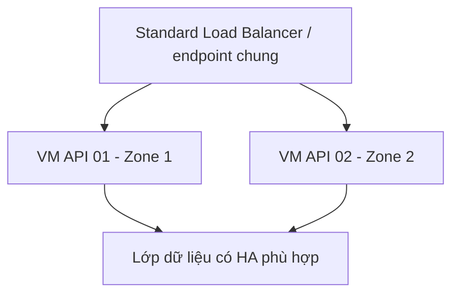
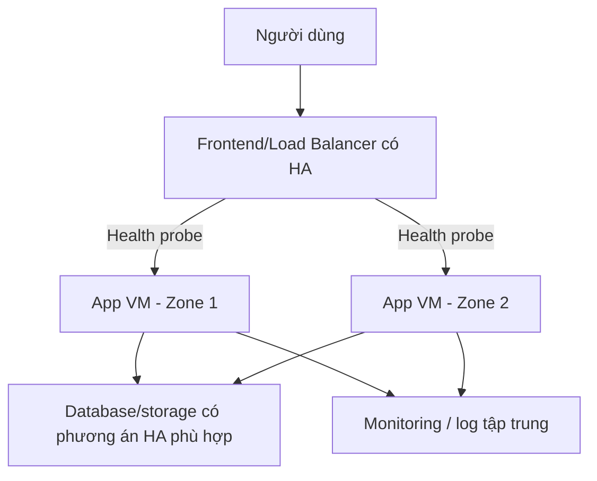

# Availability Set và triển khai máy ảo theo zone

Khi chạy ứng dụng trên một máy ảo Azure, việc máy ảo hoạt động hôm nay không bảo đảm dịch vụ luôn sẵn sàng. Máy chủ vật lý có thể hỏng, hạ tầng cần bảo trì, một nhóm thiết bị trong trung tâm dữ liệu có thể gặp sự cố hoặc thậm chí cả một **Availability Zone** có thể mất khả năng hoạt động. Nếu ứng dụng chỉ có một instance, bất kỳ sự cố nào tại điểm đó cũng có thể làm người dùng không truy cập được.

Azure cung cấp nhiều cơ chế **phân tán máy ảo theo miền lỗi** để giảm rủi ro một sự cố hạ tầng làm dừng toàn bộ ứng dụng. Hai lựa chọn quan trọng là **Availability Set** và **Availability Zone**. Chúng không giống nhau, không thay thế cơ chế backup và cũng không tự cân bằng tải giữa các VM.

Bài học thuộc chương **Máy ảo Azure** của module **CLOUD_PROVIDERS_AZURE**. Trong bức tranh kiến trúc ứng dụng Azure, việc chọn mô hình sẵn sàng cao còn liên quan tới subscription, tài nguyên tính toán, VNet/subnet, load balancer, lưu trữ, bảo mật, giám sát và chi phí.

## 1. Mục tiêu học tập

Sau bài học, bạn có thể:

1. Phân biệt **Availability Set**, **fault domain (FD)**, **update domain (UD)**, **Availability Zone** và **Azure region**.
2. Giải thích Availability Set giảm rủi ro sự cố phần cứng/bảo trì ở mức nào; Availability Zone bảo vệ trước loại sự cố nào.
3. Chọn kiến trúc phù hợp cho ứng dụng một vùng triển khai, nhiều zone hoặc nhiều region.
4. Tạo Availability Set và máy ảo có chỉ định zone bằng Azure Portal hoặc Azure CLI.
5. Hiểu các ràng buộc về VM size, disk, IP, load balancing, vùng khả dụng và quota.
6. Thiết kế lớp ứng dụng, dữ liệu, health probe và failover để VM phân tán thực sự giúp dịch vụ sẵn sàng cao.
7. Kiểm thử có kiểm soát, giám sát, dự báo chi phí và xây runbook khi một VM hoặc zone không hoạt động.

## 2. Sẵn sàng cao bắt đầu từ việc xác định miền lỗi

Không phải mọi sự cố Azure có cùng phạm vi. Một phương án phù hợp phải dựa trên loại sự cố mà ứng dụng cần chịu đựng.

| Phạm vi lỗi | Ví dụ | Cơ chế giảm ảnh hưởng |
|---|---|---|
| **Tiến trình / ứng dụng** | API chết, cấu hình sai, deadlock, memory leak | Health checks, nhiều instance, restart, triển khai an toàn |
| **VM / host vật lý** | VM không khởi động, host phần cứng gặp lỗi | Nhiều VM phân tán fault domain, tự phục hồi ở lớp ứng dụng |
| **Nhóm phần cứng / bảo trì** | Một rack hoặc nhóm thiết bị điện/mạng gặp lỗi; cập nhật hạ tầng | Availability Set với FD và UD phù hợp |
| **Availability Zone** | Mất điện/làm mát/đường mạng tại một zone | VM được triển khai qua nhiều zone và dịch vụ hỗ trợ zone redundancy |
| **Azure region** | Sự cố khu vực rộng hoặc thảm họa ảnh hưởng nhiều zone | Kiến trúc đa region, replication, failover và kế hoạch DR |
| **Dữ liệu / logic nghiệp vụ** | Xóa nhầm dữ liệu, lỗi schema, ransomware, ghi sai | Backup, point-in-time recovery, kiểm soát quyền và quy trình phục hồi |

Một kiến trúc nhiều VM không tự ngăn lỗi code được triển khai đồng loạt hoặc thao tác xóa database. Availability Set và Availability Zone chủ yếu xử lý **sự cố về vị trí/hạ tầng của compute**. Chúng phải phối hợp với cơ chế bảo vệ dữ liệu và ứng dụng.

### Hai thuật ngữ cần phân biệt

- **High Availability (HA):** cố gắng duy trì khả năng phục vụ khi một thành phần gặp lỗi; thường cần các instance dự phòng và chuyển traffic sang instance khỏe.
- **Disaster Recovery (DR):** khôi phục sau sự cố lớn, có kế hoạch phục hồi compute, dữ liệu, network, identity, DNS và các phụ thuộc.

HA có thể giảm downtime trong một region; DR đa region giải quyết phạm vi rộng hơn. Không nên coi hai thuật ngữ là đồng nghĩa.

## 3. Availability Set là gì?

**Availability Set** là tài nguyên logic dùng để nhóm các VM của một workload trong **cùng một Azure region**, giúp Azure phân bố VM trên các nhóm hạ tầng vật lý nhằm giảm khả năng cùng bị ảnh hưởng bởi một lỗi host hoặc một đợt bảo trì hạ tầng.

Khi tạo VM, bạn có thể chỉ định Availability Set đã tạo từ trước. Azure bố trí các VM thành viên dựa trên **fault domains** và **update domains** của set đó.

Availability Set không phải một máy chủ, một VNet hay một bộ cân bằng tải. Bản thân set cũng không chứa file hoặc chạy tiến trình ứng dụng. Nó ảnh hưởng **vị trí đặt VM** và nhóm hạ tầng được quản lý.

### Fault domain (FD)

Fault domain đại diện cho một nhóm hạ tầng dùng chung một số yếu tố như nguồn điện hoặc thiết bị mạng. Mục tiêu là giảm sự cố của một nhóm hạ tầng ảnh hưởng đồng thời tới tất cả VM trong set.

Ví dụ hai VM `api-01` và `api-02` được Azure phân bố trên hai FD khác nhau. Nếu một nhóm thiết bị gặp sự cố, VM trên nhóm khác có cơ hội tiếp tục phục vụ.

Số FD được hỗ trợ phụ thuộc region và cấu hình Availability Set, thường gặp lựa chọn **2 hoặc 3 fault domains**. Không yêu cầu đặt nhiều FD hơn mức Azure cho phép trong region.

### Update domain (UD)

Update domain là cách Azure chia nhóm VM để phối hợp một số hoạt động **bảo trì có kế hoạch do nền tảng khởi xướng**, nhằm tránh tác động cùng lúc đến toàn bộ VM trong Availability Set khi thực hiện loại cập nhật áp dụng cơ chế UD.

Ví dụ một Availability Set có 5 UD. Trong một số đợt bảo trì nền tảng, Azure xử lý theo từng UD thay vì đưa tất cả VM trong set vào cùng một nhóm cập nhật.

**Điểm quan trọng:** UD không giúp tránh mọi loại khởi động lại, mọi đợt triển khai do người dùng thực hiện hoặc mọi lỗi ứng dụng. Nó chỉ là một phần cơ chế phân phối tác động của bảo trì nền tảng.

### Ví dụ bố trí

```text
Availability Set: as-api-prod
  Fault domains: 2
  Update domains: 5

  api-01  -> FD0, UD0
  api-02  -> FD1, UD1
  api-03  -> FD0, UD2
  api-04  -> FD1, UD3
```

Sơ đồ mang tính **minh họa**: việc gán FD/UD thực tế do Azure quyết định, không phải người quản trị tùy ý chọn FD/UD riêng cho từng VM khi dùng Availability Set. Không nên dự đoán chính xác placement chỉ từ thứ tự tạo VM.

### Những gì Availability Set không bảo vệ

- Không phân tán các VM ra nhiều **Availability Zone độc lập**.
- Không bảo vệ khỏi lỗi toàn region.
- Không tự failover một ứng dụng stateful.
- Không tự cấp địa chỉ endpoint chung hoặc phân phối request.
- Không tự sao lưu OS disk, data disk hoặc cơ sở dữ liệu.
- Không bảo đảm ứng dụng không gián đoạn khi chỉ một VM của set thực sự có thể phục vụ.

Để Availability Set có ích, phải có **ít nhất hai VM phù hợp**, mỗi VM có khả năng phục vụ workload, kèm thiết kế traffic và dữ liệu cho tình huống mất một instance.

## 4. Availability Zone là gì?

**Availability Zone (AZ)** là một nhóm cơ sở hạ tầng trung tâm dữ liệu độc lập trong một **Azure region hỗ trợ zone**, với khả năng phân tách nguồn điện, làm mát và kết nối mạng theo thiết kế của Azure.

Trong nhiều region có hỗ trợ, zone thường được nhận diện bằng nhãn `1`, `2`, `3`. Không phải mọi region, VM size hoặc dịch vụ đều hỗ trợ toàn bộ các nhãn zone đó; hãy kiểm tra tình trạng thực tế trước khi triển khai.

VM được tạo **trong zone cụ thể** gọi là *zonal VM*. Một ứng dụng có thể dùng hai hoặc ba VM tại các zone khác nhau, kết hợp load balancer và dịch vụ dữ liệu phù hợp.



Đây là mô hình logic: load balancer cần health probe, backend pool và rule phù hợp; lớp dữ liệu phải chịu được sự cố zone theo kiến trúc đã chọn.

### Zone là nhãn logic trong subscription

Tên `Zone 1` không phải lời cam kết rằng hai subscription khác nhau luôn ánh xạ zone số 1 tới cùng một vị trí vật lý. Với các kiến trúc yêu cầu **căn chỉnh zone xuyên subscription**, cần sử dụng thông tin ánh xạ zone theo cơ chế Azure hỗ trợ thay vì suy đoán từ nhãn số.

### Zonal khác zone-redundant

- **Zonal resource:** tài nguyên được gắn với một zone xác định, ví dụ một VM đặt ở Zone 1.
- **Zone-redundant resource:** dịch vụ được thiết kế để trải hoặc có khả năng phục hồi qua nhiều zone trong region theo chức năng và cấu hình tương ứng.

Một VM đơn lẻ đặt ở Zone 1 **không tự trở thành zone-redundant**. Muốn chịu được sự cố zone, cần ít nhất hai instance ở những zone khác nhau và loại bỏ những thành phần chung dễ lỗi.

### Zone khác region

Nhiều AZ cùng thuộc một region. Phân tán zone giảm rủi ro khi một zone gặp sự cố nhưng vẫn có thể bị ảnh hưởng bởi lỗi **toàn region**. Nếu bài toán yêu cầu DR khi cả region không hoạt động, cần phương án đa region và kế hoạch dữ liệu.

## 5. So sánh Availability Set và Availability Zone

| Tiêu chí | Availability Set | Availability Zone |
|---|---|---|
| **Mức phân tách** | Fault domains và update domains trong hạ tầng của một region | Các zone hạ tầng độc lập trong một region hỗ trợ AZ |
| **Rủi ro mục tiêu** | Lỗi host/nhóm hạ tầng và tác động bảo trì nền tảng | Mất khả năng hoạt động của một zone |
| **Cách cấu hình** | Tạo set rồi gán VM vào set ngay khi tạo VM | Chỉ định zone khi tạo VM |
| **Số lượng VM** | Cần nhiều VM để có tính dự phòng thực tế | Cần VM ở từ hai zone trở lên để chịu lỗi một zone |
| **Vùng hỗ trợ** | Phụ thuộc dịch vụ/region và tính khả dụng của Availability Set | Chỉ region/SKU có hỗ trợ zone phù hợp |
| **Địa chỉ truy cập chung** | Cần load balancer hoặc cơ chế khác | Cũng cần load balancer hoặc cơ chế khác |
| **Bảo vệ dữ liệu** | Không tự backup hoặc replicate dữ liệu ứng dụng | Không tự khiến database/disk ứng dụng thành zone-redundant |
| **Thích hợp** | HA trong một region khi không dùng được đa zone | HA yêu cầu chịu lỗi zone khi region và toàn bộ phụ thuộc hỗ trợ |

**Availability Set và chỉ định Availability Zone không phải hai tùy chọn có thể đồng thời áp cho cùng một VM.** Hãy chọn một placement model phù hợp khi tạo VM.

Trong kiến trúc mới cần chịu sự cố zone, và khi workload/region có hỗ trợ, lựa chọn nhiều AZ thường đáp ứng phạm vi lỗi rộng hơn Availability Set. Tuy nhiên Availability Set vẫn hữu ích với workload cũ, VM SKU/region chưa hỗ trợ zone hoặc yêu cầu chỉ phân tán host/bảo trì.

## 6. Availability Set, VM Scale Sets và các lựa chọn khác

**Virtual Machine Scale Sets (VMSS)** hỗ trợ quản lý một nhóm VM và khả năng tự động hoặc thủ công mở rộng tùy chế độ triển khai. VMSS có thể cung cấp cấu hình phân tán instance, gồm khả năng dùng zone trong những trường hợp được hỗ trợ.

| Nhu cầu | Lựa chọn cần đánh giá |
|---|---|
| Hai hoặc ba VM độc lập, quản lý thủ công, giảm rủi ro host | Availability Set |
| Hai hoặc nhiều VM ở các zone khác nhau, tự quản lý instance | Zonal VMs kết hợp LB |
| Nhóm instance đồng nhất, cần autoscaling, rolling update | VM Scale Sets với placement và orchestration phù hợp |
| Ứng dụng web muốn giảm công quản lý VM | App Service, AKS hoặc dịch vụ được quản lý hỗ trợ vùng phù hợp |
| Yêu cầu chịu sự cố toàn region | Multi-region architecture và DR |

Không nên xem VMSS và Availability Set là cùng một tính năng. VMSS có cơ chế orchestration và phân bố riêng; chọn theo yêu cầu scale, rollout, giới hạn VM SKU và workload. Không tự gắn VMSS vào một Availability Set của nhóm VM độc lập.

## 7. Thiết kế end-to-end để máy ảo thật sự có HA

Đặt hai VM ở hai zone chỉ giải quyết phần **placement**. Hệ thống có thể vẫn dừng nếu cả hai phụ thuộc một database một zone hoặc ingress không có phương án dự phòng.

### Mô hình 2 tầng



Những điều kiện cần đủ:

1. **Các VM đều phục vụ được ứng dụng:** cùng phiên bản phần mềm hoặc các phiên bản tương thích trong giai đoạn rollout.
2. **Ingress chung:** load balancer có backend pool, health probe và rule phù hợp; không phụ thuộc IP riêng của một VM.
3. **Dữ liệu:** database, file share hoặc service phụ trợ có chiến lược HA theo vùng mong muốn; có thể cần replication hoặc dịch vụ zone-redundant.
4. **Session:** tránh lưu trạng thái phiên duy nhất trong RAM/disk cục bộ của một VM nếu yêu cầu chuyển request linh hoạt.
5. **Kết nối:** subnet, NSG, route, firewall, DNS và private endpoint phù hợp giữa các zone.
6. **Triển khai:** không dừng mọi VM cùng lúc khi cập nhật.
7. **Giám sát:** có cảnh báo khi chỉ còn một instance khỏe hoặc một zone bị ảnh hưởng.
8. **Dự phòng công suất:** instance còn lại phải đủ khả năng xử lý tải khi mất một instance/zone, hoặc có cơ chế mở rộng được kiểm thử.

### Active/active và active/passive

- **Active/active:** cả hai hoặc nhiều VM phục vụ request. Cần ứng dụng stateless hoặc cơ chế chia sẻ state an toàn.
- **Active/passive:** một VM phục vụ chính, VM còn lại chờ tiếp quản. Cần cơ chế health detection, failover, đồng bộ state và xác định quyền ghi.

Availability Set/AZ **không tự chỉ định VM nào active hay passive**. Đó là quyết định của ứng dụng, cluster software hoặc lớp cân bằng tải.

## 8. Dịch vụ mạng cần đồng bộ với mô hình zone

### Standard Load Balancer

Với các VM backend ở nhiều zone, cần chọn loại load balancer/frontend phù hợp để không vô tình tạo một điểm lỗi zonal ở trước các backend.

Các yếu tố cấu hình:

- **Standard Load Balancer** và frontend được thiết kế phù hợp với yêu cầu zone, ví dụ public frontend dùng **zone-redundant Standard Public IP** khi region/dịch vụ hỗ trợ.
- Backend pool chứa NIC/IP configuration của các VM trong các zone hợp lệ.
- Health probe kiểm tra cổng hoặc endpoint phản ánh tình trạng sẵn sàng.
- Load-balancing rule chuyển request tới backend khỏe.
- NSG cho phép traffic ứng dụng và các luồng cần thiết để health probe hoạt động.
- Outbound internet được thiết kế riêng khi cần, ví dụ NAT Gateway hoặc cơ chế egress được quản lý; không phụ thuộc mặc định vào đường ra không xác định.

Nếu frontend IP chỉ thuộc một zone trong thiết kế yêu cầu chịu lỗi zone, lớp ingress có thể vẫn là điểm lỗi. Cần xem SKU/zone properties thực tế của Public IP và Load Balancer.

### Application Gateway, Front Door và DNS

Ứng dụng HTTP/HTTPS có thể dùng Application Gateway với khả năng zone redundancy phù hợp hoặc Azure Front Door làm điểm vào toàn cầu. Tuy nhiên các dịch vụ này không thay thế thiết kế backend và dữ liệu ở nhiều zone.

DNS chỉ đưa client đến endpoint; thay DNS thủ công không thay thế health probe, failover và kiểm soát thời gian chuyển traffic. Đừng coi DNS TTL là cam kết chuyển đổi không gián đoạn.

## 9. OS disk, data disk và dữ liệu ứng dụng

Khả dụng của VM và ổ đĩa có liên quan nhưng không đồng nghĩa.

### Với Availability Set

Khi dùng **managed disks**, lựa chọn Availability Set có SKU và cấu hình phù hợp để Azure phối hợp phân bố tài nguyên đĩa/VM theo miền lỗi được hỗ trợ. Không nên sử dụng cấu hình chỉ phù hợp legacy unmanaged disk cho hệ thống mới nếu không có yêu cầu đặc biệt.

Các VM trong set nên có đĩa riêng phục vụ OS và trạng thái cần thiết; Availability Set không tự biến hai managed disks thành bản sao đồng bộ dữ liệu.

### Với zonal VM

VM chọn zone thì các đĩa đi kèm phải **tương thích với zone/SKU của VM**. Nhiều loại managed disk thông thường có placement gắn với zone; một số tùy chọn **zone-redundant storage (ZRS)** cho managed disk được hỗ trợ trong giới hạn region, disk type, VM và tính năng hiện hành.

Không thể suy ra rằng chỉ cần chọn một ZRS disk là ứng dụng có thể chạy ngay ở zone khác sau khi VM hỏng. Việc attach/detach, quyền truy cập, nhất quán dữ liệu, giới hạn đĩa và quy trình phục hồi VM phải được thiết kế, kiểm thử.

### Không dùng local/ephemeral disk làm kho dữ liệu duy nhất

Một số loại VM cung cấp local temporary disk hoặc ephemeral OS disk theo cấu hình. Những vị trí này có giới hạn về độ bền và vòng đời khác managed disks. Nếu lưu file nghiệp vụ quan trọng vào local temp, khi host hoặc VM được thay thế có thể mất dữ liệu.

**Mô hình đúng:** tính sẵn sàng của compute + độ bền/khả năng phục hồi của storage + chiến lược backup/replication ứng dụng. Chỉ phân tán compute sẽ không đủ.

## 10. Lựa chọn trước khi tạo tài nguyên

Trước khi chạy CLI hoặc mở Portal, trả lời các câu hỏi:

| Câu hỏi | Cần xác nhận |
|---|---|
| Workload chịu được lỗi nào? | Host, bảo trì, zone hay toàn region |
| Region hỗ trợ AZ không? | Danh sách zone và SKU hiện có trong subscription |
| VM size khả dụng? | SKU, capacity, quota vCPU và giới hạn theo zone |
| Ứng dụng có state? | Session, local file, database, cache và cơ chế failover |
| Có cần public endpoint? | Standard Public IP/Load Balancer có cấu hình zone phù hợp |
| Disk nào sử dụng? | Khả năng hỗ trợ theo zone, hiệu năng, backup và nhất quán |
| Cần khả năng chịu tải bao nhiêu? | Tải lúc một instance/zone không còn |
| Mục tiêu RTO/RPO? | Thời gian phục hồi, giới hạn mất dữ liệu |
| Chi phí? | VM, disk, LB, IP, transfer liên zone và monitoring |
| Thay đổi/rollback? | Kế hoạch cutover, tiêu chí kiểm thử, chủ sở hữu |

Đặc biệt, **capacity khả dụng là vấn đề theo thời điểm**: VM size hỗ trợ một zone không đồng nghĩa lúc nào zone đó cũng còn tài nguyên để cấp phát. Khi môi trường sản xuất có yêu cầu đặc biệt, cần hoạch định trước capacity/quota phù hợp.

## 11. Tạo Availability Set bằng Azure Portal

Ví dụ môi trường lab có hai VM API để giảm rủi ro host và bảo trì.

1. Đăng nhập Azure Portal với danh tính có quyền tạo tài nguyên trong subscription thử nghiệm.
2. Tìm **Availability sets**, chọn **Create**.
3. Chọn subscription, resource group, region và tên, ví dụ **as-api-lab**.
4. Chọn loại phù hợp với **managed disks** (SKU Aligned) khi giao diện cung cấp tùy chọn tương ứng.
5. Chọn số fault domains và update domains theo lựa chọn dịch vụ hỗ trợ tại region.
6. Tạo Availability Set, kiểm tra trạng thái thành công.
7. Tạo VM thứ nhất trong **cùng region**, chọn mục Availability options hoặc Availability set và chỉ định set vừa tạo.
8. Tạo VM thứ hai trong cùng set, bảo đảm cùng ứng dụng và các phụ thuộc phù hợp.
9. Cấu hình NSG, ứng dụng và load balancer/backend probe nếu cần endpoint chung.
10. Kiểm thử việc tạm ngừng một VM trong môi trường lab và xác minh VM còn lại phục vụ được.

**Lưu ý thời điểm lựa chọn:** Availability Set là đặc tính placement được chọn **khi tạo VM**. Không có thao tác đơn giản biến một VM đang tồn tại ngoài set thành VM thuộc set mà vẫn giữ nguyên mọi tài nguyên. Với hệ thống đang chạy, thường phải lập kế hoạch tạo lại VM/cutover hoặc sử dụng quy trình migration thích hợp.

## 12. Tạo Availability Set bằng Azure CLI

Ví dụ dưới đây dành cho **Azure Cloud Shell Bash** hoặc môi trường Bash đã đăng nhập. Các lệnh tạo VM có thể phát sinh chi phí. Chỉ chạy trong resource group thử nghiệm và thay các biến theo môi trường thực tế.

### Xác nhận subscription, region và tài nguyên mạng

```bash
az account show --query "{subscription:name,id:id,tenant:tenantId}" -o table

RG="rg-vm-ha-lab"
LOC="eastus"
VNET="vnet-ha-lab"
SUBNET="snet-app"
AS="as-api-lab"
```

Giả định resource group, VNet và subnet **đã tồn tại** trong region đã chọn; nếu chưa, hãy chuẩn bị riêng theo quy trình mạng của môi trường. Không dùng địa chỉ IP, VNet hoặc subnet của production cho bài lab.

### Tạo Availability Set

```bash
az vm availability-set create \
  --resource-group "$RG" \
  --name "$AS" \
  --location "$LOC" \
  --platform-fault-domain-count 2 \
  --platform-update-domain-count 5 \
  --sku aligned
```

Giá trị 2 FD và 5 UD là **một cấu hình ví dụ**, không phải quy định chung cho mọi region. Các giá trị hợp lệ phải theo Azure và region được chọn.

Xác minh:

```bash
az vm availability-set show \
  --resource-group "$RG" \
  --name "$AS" \
  --query "{name:name,sku:sku.name,FD:platformFaultDomainCount,UD:platformUpdateDomainCount}" \
  -o json
```

### Tạo hai VM trong set

Chuẩn bị hình ảnh OS, VM size và danh tính SSH theo chuẩn tổ chức. Với bài thử nghiệm, ví dụ:

```bash
az vm create \
  --resource-group "$RG" \
  --name "api-set-01" \
  --image Ubuntu2204 \
  --size Standard_D2s_v5 \
  --vnet-name "$VNET" \
  --subnet "$SUBNET" \
  --availability-set "$AS" \
  --admin-username azureuser \
  --generate-ssh-keys \
  --public-ip-address ""
```

```bash
az vm create \
  --resource-group "$RG" \
  --name "api-set-02" \
  --image Ubuntu2204 \
  --size Standard_D2s_v5 \
  --vnet-name "$VNET" \
  --subnet "$SUBNET" \
  --availability-set "$AS" \
  --admin-username azureuser \
  --generate-ssh-keys \
  --public-ip-address ""
```

**Chỉ là mẫu lệnh:** `Ubuntu2204` và `Standard_D2s_v5` phải được kiểm tra về image/size và khả năng cấp phát tại subscription/region. `--generate-ssh-keys` có thể tạo hoặc dùng khóa SSH trong môi trường chạy CLI; trong tổ chức nên sử dụng khóa/tài khoản được phê duyệt. Để VM không có public IP, ví dụ truyền giá trị rỗng tới `--public-ip-address`; kiểm tra cấu hình NIC/Public IP sau tạo.

Với VM không có public IP, truy cập quản trị qua Azure Bastion hoặc kết nối private được kiểm soát.

### Xem placement của VM

```bash
az vm show \
  --resource-group "$RG" \
  --name "api-set-01" \
  --query "{name:name,availabilitySet:availabilitySet.id,zones:zones,vmSize:hardwareProfile.vmSize}" \
  -o json
```

Tương tự cho `api-set-02`. Trường `availabilitySet.id` phải tham chiếu đúng set, còn `zones` không được hiểu là zone placement của VM trong Availability Set.

Có thể dùng thông tin **InstanceView** và chi tiết VM trong Portal để điều tra FD/UD mà Azure đã gán, khi API và quyền của môi trường hỗ trợ. Không tự đặt FD/UD bằng cấu hình trong guest OS.

## 13. Tạo VM ở Availability Zone bằng Azure Portal

Với ứng dụng cần chịu sự cố một zone, thay vì dùng Availability Set, tạo các VM tại **những zone khác nhau** trong region hỗ trợ.

1. Vào **Virtual machines > Create** và chọn resource group, region có AZ.
2. Chọn Availability options phù hợp với **Availability zone**.
3. Chọn **Zone 1** cho VM `api-zone-01`.
4. Chọn VM size còn khả dụng trong zone, image và disk type tương thích.
5. Tạo VM với VNet/subnet cùng region, không mở public SSH/RDP khi không cần.
6. Tạo VM `api-zone-02`, chọn **Zone 2** (hoặc zone khác thực sự được hỗ trợ).
7. Xác minh hai VM được gán đúng các zone khác nhau.
8. Thêm VM vào backend pool của Standard Load Balancer/frontend phù hợp với yêu cầu zone.
9. Cấu hình health probe, NSG, outbound, ứng dụng và kết nối dữ liệu.
10. Kiểm thử tính sẵn sàng khi một VM không phục vụ trong môi trường lab.

**Không thể trộn** một VM vừa là thành viên Availability Set, vừa là zonal VM thông qua lựa chọn zone trong cùng một cấu hình VM. Trong khi triển khai, chọn một placement strategy và duy trì nhất quán với kiến trúc.

## 14. Tạo VM theo zone bằng Azure CLI

Dưới đây là ví dụ độc lập với Availability Set. Không sử dụng `--availability-set` trong các lệnh tạo zonal VM.

### Kiểm tra SKU và khả năng zone

```bash
RG="rg-vm-zone-lab"
LOC="eastus"
VNET="vnet-zone-lab"
SUBNET="snet-app"

az vm list-skus \
  --location "$LOC" \
  --resource-type virtualMachines \
  --size "Standard_D2s_v5" \
  --all \
  --output json
```

Trong kết quả, xem thông tin vị trí/zone và restrictions cho VM size. Có thể kiểm tra thêm bằng Azure Portal hoặc resource SKU API phù hợp. Danh sách hỗ trợ không phải bảo đảm capacity tức thời.

### Tạo VM ở hai zone

```bash
az vm create \
  --resource-group "$RG" \
  --name "api-zone-01" \
  --location "$LOC" \
  --zone 1 \
  --image Ubuntu2204 \
  --size Standard_D2s_v5 \
  --vnet-name "$VNET" \
  --subnet "$SUBNET" \
  --admin-username azureuser \
  --generate-ssh-keys \
  --public-ip-address ""
```

```bash
az vm create \
  --resource-group "$RG" \
  --name "api-zone-02" \
  --location "$LOC" \
  --zone 2 \
  --image Ubuntu2204 \
  --size Standard_D2s_v5 \
  --vnet-name "$VNET" \
  --subnet "$SUBNET" \
  --admin-username azureuser \
  --generate-ssh-keys \
  --public-ip-address ""
```

Các biến/tên là minh họa; giả định resource group và mạng đã được cấu hình hợp lệ. Một số VM size, loại đĩa hoặc image có giới hạn theo zone. Đừng cố thay zone hoặc SKU liên tục khi thấy lỗi capacity; trước tiên xem error và kiểm tra quota/availability.

### Xác minh zone của từng VM

```bash
az vm show -g "$RG" -n "api-zone-01" \
  --query "{name:name,zones:zones,availabilitySet:availabilitySet.id}" -o json

az vm show -g "$RG" -n "api-zone-02" \
  --query "{name:name,zones:zones,availabilitySet:availabilitySet.id}" -o json
```

Kết quả kỳ vọng: VM thứ nhất có `zones: ["1"]`, VM thứ hai có `zones: ["2"]` (định dạng trả về thực tế có thể khác theo API); cả hai không thuộc Availability Set.

**Điều quan trọng:** không có cách “đổi zone tức thời” cho VM đang chạy bằng việc chỉnh một thuộc tính đơn giản. Khi cần chuyển placement sang zone khác, thường phải lập kế hoạch tạo VM mới/di chuyển workload, xử lý disk, IP, data, downtime và failover.

## 15. Ghép load balancer, VM và health probe

Sau khi tạo hai VM, cần chứng minh endpoint chung vẫn hoạt động khi một VM gặp lỗi.

### Các bước thiết kế

1. Tạo **Standard Load Balancer** (internal hoặc public tùy yêu cầu).
2. Cấu hình frontend IP và thuộc tính zone phù hợp.
3. Tạo backend pool chứa NIC/IP configuration của hai VM.
4. Cấu hình health probe, ví dụ HTTP đến `/healthz` hoặc TCP port thực sự phản ánh trạng thái.
5. Cấu hình load-balancing rule cho cổng ứng dụng.
6. Kiểm tra NSG ở subnet/NIC cho phép traffic và health probe theo cơ chế Azure.
7. Đưa ứng dụng tương thích lên cả hai VM.
8. Từ client được phép, gửi nhiều request qua frontend và xác minh ứng dụng tiếp nhận.
9. Trong lab, dừng ứng dụng trên một VM để probe đánh dấu backend không khỏe.
10. Xác minh request mới tiếp tục qua VM còn lại, rồi khôi phục backend.

### Health probe phải kiểm tra đúng điều kiện

Một endpoint chỉ trả HTTP 200 trong khi API không truy cập được database không phải readiness probe tốt. Ngược lại, probe quá nhạy có thể loại cả hai backend khi một dịch vụ phụ ít quan trọng bị lỗi.

Đặt probe theo mức ứng dụng **có thể phục vụ request cần thiết**. Xác định timeout, interval, threshold và cách phục hồi backend sau khi lỗi.

**Không dùng** việc VM `Running` trên Portal như bằng chứng ứng dụng sẵn sàng. VM có thể chạy nhưng process lỗi, cổng bị chặn hoặc dịch vụ dữ liệu không kết nối được.

## 16. Bảo trì, cập nhật và kiểm thử resilience

### Bảo trì nền tảng

Azure có thể thực hiện những tác vụ maintenance trên hạ tầng compute. Availability Set dùng FD/UD để giảm tác động tương quan trong một số tình huống. Zonal deployment giảm phụ thuộc vào một nhóm hạ tầng tại một zone.

Nhưng cả hai mô hình đều **không thay thế lịch triển khai ứng dụng**: nếu pipeline deploy sai cấu hình đồng loạt tới mọi VM, tất cả vẫn có thể lỗi.

### Rolling updates ở lớp ứng dụng

Một quy trình cập nhật đơn giản:

1. Xác nhận có ít nhất hai backend khỏe và đủ công suất.
2. Loại một VM khỏi phục vụ hoặc cho health probe chuyển nó sang trạng thái không khỏe.
3. Cập nhật ứng dụng tại VM đó, chạy smoke test/readiness.
4. Đưa VM trở lại backend pool.
5. Quan sát metric/lỗi rồi tiếp tục VM kế tiếp.
6. Dừng rollout và rollback nếu SLO bị ảnh hưởng.

Với Availability Set, nên tránh thao tác dừng hàng loạt các VM cùng một thời điểm. Với nhiều zone, tránh deploy cùng một lỗi ứng dụng tới mọi zone mà không có canary hoặc xác minh.

### Kiểm thử có kiểm soát

Trong môi trường lab, bạn có thể tạm dừng một instance:

```bash
az vm deallocate \
  --resource-group "<LAB_RESOURCE_GROUP>" \
  --name "<LAB_VM_NAME>"
```

Sau đó dùng `az vm start` để bật lại. **Chỉ chạy trên VM lab được cho phép**, vì deallocate có thể làm mất trạng thái xử lý, mất dữ liệu trên ổ tạm và tác động cấp phát lại tài nguyên. Ngoài ra, một số cấu hình IP/disk hay placement có ràng buộc khi cấp phát lại.

**Dừng một VM không mô phỏng đầy đủ việc mất toàn bộ Availability Zone.** Bài kiểm thử chỉ xác minh ứng dụng, health probe, load balancer và một số quy trình failover ở mức instance. Đối với DR/zone resilience cần thêm kịch bản, bằng chứng và diễn tập phù hợp.

## 17. Monitoring và phản ứng khi một VM/zone gặp lỗi

### Nguồn giám sát

| Nguồn | Mục đích |
|---|---|
| **Azure Monitor metrics** | CPU, network, disk và các chỉ số VM/ứng dụng được cấu hình |
| **Azure Monitor Alerts** | Cảnh báo khi backend không khỏe, tài nguyên quá tải hoặc SLA/SLO có nguy cơ |
| **Azure Resource Health** | Trạng thái sức khỏe tài nguyên theo thông tin nền tảng cung cấp |
| **Azure Service Health** | Thông tin sự cố và maintenance ảnh hưởng dịch vụ/region phù hợp |
| **Load Balancer health probe/metrics** | Số backend khỏe và dấu hiệu mất khả năng phục vụ |
| **Application Insights hoặc telemetry ứng dụng** | Tỷ lệ lỗi, latency p95/p99, request rate, dependency failure |
| **Log Analytics / VM Insights** | Thông tin guest OS và xu hướng vận hành khi đã bật thu thập |

### Alert gợi ý

- **Backend healthy count thấp hơn mức an toàn** (ví dụ còn một instance khỏe dù thiết kế tối thiểu hai).
- Tỷ lệ lỗi HTTP 5xx hoặc timeout cao hơn baseline.
- CPU/network/disk đạt ngưỡng khiến instance còn lại không đủ công suất.
- VM không sẵn sàng hoặc Resource Health thay đổi.
- Sự cố ở zone/region được thông báo qua Service Health.
- Replication/backup thất bại với lớp dữ liệu.

### Runbook 6 bước

1. Xác định hiện tượng: VM down, backend unhealthy hay lỗi ứng dụng?
2. Khoanh vùng: ảnh hưởng FD, một zone hay nhiều zone/region?
3. Bảo vệ traffic: xác nhận health probe loại backend lỗi và backend còn lại đủ tải.
4. Kiểm tra phụ thuộc: database, disk, DNS, identity, firewall và route.
5. Khôi phục: dùng quy trình thay instance/scale/redeploy có kiểm soát, tránh thao tác phá hủy dữ liệu.
6. Xác minh: request end-to-end, dữ liệu đúng, log/metric phục hồi; ghi nhận nguyên nhân và hành động phòng ngừa.

Không mặc định cứ có VM healthy là dịch vụ healthy. Quan sát người dùng cuối cùng là tiêu chí quan trọng.

## 18. SLA, RTO/RPO và giới hạn kỳ vọng

Microsoft có cam kết SLA khác nhau tùy dịch vụ, SKU, số VM và cách triển khai, ví dụ nhiều VM trong Availability Set hoặc nhiều zone theo điều kiện phù hợp. **SLA của hạ tầng không phải bảo đảm RTO bằng 0 hoặc 100% uptime của ứng dụng.**

Trước khi đưa vào production, cần:

- Kiểm tra **SLA chính thức tại thời điểm triển khai** cho đúng mô hình, loại tài nguyên, region và điều kiện.
- Ghi **RTO**: thời gian tối đa chấp nhận được để ứng dụng phục hồi.
- Ghi **RPO**: mức mất dữ liệu tối đa được chấp nhận.
- Đo thời gian health probe phát hiện lỗi, LB chuyển traffic và ứng dụng warm-up.
- Tính công suất cần giữ dự phòng để một instance/zone còn lại chịu tải.
- Đánh giá tính nhất quán của dữ liệu nếu có ghi ở nhiều zone.
- Thiết kế backup, restore và DR vì HA không ngăn xóa nhầm hoặc lỗi toàn region.

Nếu một ứng dụng chỉ có một database ở Zone 1 và hai web VM ở Zone 1/2, một lỗi Zone 1 có thể làm ứng dụng dừng dù web VM Zone 2 vẫn đang chạy. Đây là ví dụ điển hình của **single point of failure còn sót lại**.

## 19. Chi phí và những đánh đổi khi phân tán VM

Availability Set tự nó thường không làm tăng chi phí như một VM đang chạy; chi phí thực tế đến từ việc có **nhiều VM, disk, IP, load balancer, monitoring và dữ liệu dự phòng**. Với zonal deployment, cần tính thêm khả năng phát sinh chi phí truyền dữ liệu **giữa các zone** hoặc qua các vùng theo biểu giá và cách mạng hoạt động.

| Thành phần | Tác động lên chi phí |
|---|---|
| VM dự phòng | Trả tiền cho số VM và thời gian chạy; thêm capacity để chịu lỗi |
| Managed disks / backup | Mỗi VM có OS disk/data disk riêng hoặc dữ liệu có replication |
| Load Balancer / Public IP | Tài nguyên mạng, rules và data processing theo mô hình giá |
| Cross-zone traffic | Có thể phát sinh phí truyền dữ liệu giữa các zone theo dịch vụ/region |
| Database HA | Replica/zone redundancy có chi phí riêng |
| Monitoring | Thu thập log, lưu trữ và alerts theo dịch vụ sử dụng |
| DR đa region | Compute, dữ liệu sao chép, network và diễn tập phục hồi ở region khác |

### Chọn phương án phù hợp ngân sách

Một hệ thống nội bộ không quan trọng có thể chấp nhận downtime ngắn và dùng ít VM hơn, kèm backup/restore. Một dịch vụ nhận thanh toán quan trọng cần đầu tư HA thực sự, kiểm thử failover và khả năng dữ liệu hoạt động khi mất một zone.

Không tăng số VM “cho chắc” mà không đo CPU, memory, storage, peak request và thời gian khôi phục. Tính toán trên **giả định một instance/zone mất khả năng phục vụ** mới cho thấy số instance dự phòng có đủ hay không.

## 20. Lỗi thường gặp và cách xử lý

| Tình huống | Nguyên nhân có thể | Hướng xử lý |
|---|---|---|
| Không tạo được VM trong zone đã chọn | VM size/image/disk không hỗ trợ zone, thiếu capacity hoặc quota | Kiểm tra Resource SKU, restrictions, quota, region và zone cụ thể |
| VM muốn chuyển từ Availability Set sang zone | Placement đã chọn khi tạo | Lập kế hoạch tạo lại/migration, cutover và di chuyển dữ liệu |
| Hai VM cùng set nhưng endpoint vẫn chết khi một VM lỗi | Không có LB, probe sai hoặc chỉ một VM thật sự xử lý ứng dụng | Kiểm tra backend pool, rule, readiness và trạng thái ứng dụng |
| Cả hai VM trong cùng một zone | Chỉ tạo hai zonal VM nhưng chọn cùng nhãn zone | Kiểm tra thuộc tính zones của từng VM và thiết kế lại placement |
| API vẫn lỗi khi một zone down | Database, disk, DNS, ingress hoặc state vẫn phụ thuộc zone bị lỗi | Rà soát các single points of failure của kiến trúc |
| VM chạy nhưng load balancer loại backend | NSG, guest firewall, health path, port hoặc app service không sẵn sàng | Kiểm tra probe, route, connectivity và log ứng dụng |
| Tạo VM khu vực đúng nhưng disk/VM lỗi tương thích | Loại đĩa và zone/SKU không hỗ trợ kết hợp | Chọn storage SKU/zone phù hợp, kiểm tra hỗ trợ hiện hành |
| Autoscale không phân tán đều zone như kỳ vọng | Cấu hình VMSS/placement/capacity không khớp | Kiểm tra orchestration, zone balance và instance placement |
| Chi phí tăng đáng kể sau chuyển sang multi-zone | VM dư thừa, LB, disk, replication hoặc traffic giữa zone | Theo dõi Cost Management và tối ưu sau khi bảo đảm SLO |
| Diễn tập dừng một VM thành công nhưng DR thất bại | Chưa kiểm thử mất zone/region, dữ liệu hoặc dependency | Bổ sung runbook và kiểm thử ở các lớp dữ liệu/mạng/ứng dụng |

## 21. Bài thực hành tổng hợp

### Tình huống A — Availability Set

Một ứng dụng API nhỏ chạy trên hai VM Ubuntu trong một Azure region. Bạn muốn giảm rủi ro khi một host gặp lỗi hoặc có bảo trì nền tảng nhưng workload chưa yêu cầu zone resilience.

1. Tạo hoặc mô tả cách tạo Availability Set `as-api-lab` với số FD/UD hợp lệ.
2. Tạo hai VM trong set, không gắn public IP trực tiếp nếu không cần.
3. Xác minh `availabilitySet.id` của hai VM.
4. Giải thích vì sao hai VM trong set chưa đủ để cung cấp một endpoint HA.
5. Thiết kế Standard Load Balancer và health probe `/healthz`.
6. Dừng một VM trong môi trường lab theo quy trình an toàn; kiểm tra request mới vẫn thành công.
7. Khôi phục VM và quan sát backend trở lại healthy.
8. Mô tả rủi ro còn lại khi toàn bộ site/zone hoặc database gặp sự cố.

### Tình huống B — Triển khai theo zone

Một ứng dụng web quan trọng cần duy trì dịch vụ khi mất một zone trong region hỗ trợ.

1. Chọn hai zone có VM SKU, image và disk tương thích; kiểm tra quota.
2. Tạo `web-zone-01` tại Zone 1 và `web-zone-02` tại Zone 2.
3. Kiểm tra thuộc tính `zones` của từng VM.
4. Vẽ kiến trúc load balancer/frontend có khả năng zone resilience phù hợp.
5. Xác định nơi lưu session, file upload và database để không biến Zone 1 thành điểm lỗi duy nhất.
6. Xây health probe, quan sát backend health và chuẩn bị cơ chế triển khai lần lượt.
7. Ước lượng mức tăng VM/disk/traffic/monitoring cost và nêu cách theo dõi.
8. Viết runbook phản ứng khi Zone 1 không thể phục vụ và VM Zone 2 còn khỏe.
9. Giải thích khác nhau giữa kiểm thử dừng một VM và kịch bản cả zone gặp sự cố.
10. Nêu lý do vẫn cần backup và DR đa region nếu RPO/RTO yêu cầu.

### Câu hỏi tự kiểm tra

**Câu 1.** Fault domain khác update domain thế nào? UD có ngăn được mọi lỗi triển khai ứng dụng không?

**Câu 2.** Vì sao một VM đặt ở Zone 2 chưa đủ gọi là zone-redundant?

**Câu 3.** Availability Set có tự cân bằng tải hoặc sao lưu dữ liệu giữa các VM không?

**Câu 4.** Vì sao cần kiểm tra cả zone support, quota và capacity thực tế trước khi tạo VM?

**Câu 5.** Một web app có VM ở Zone 1/2 nhưng database chỉ ở Zone 1 sẽ chịu được lỗi Zone 1 không? Cần thay đổi gì?

**Câu 6.** Có thể đổi VM đang chạy từ Availability Set sang Zone 1 bằng một tùy chọn cấu hình đơn giản không?

**Câu 7.** Tại sao Standard Public IP và loại frontend/load balancer có thể ảnh hưởng tính sẵn sàng đa zone?

**Câu 8.** Availability Zone khác với multi-region DR về miền lỗi và phục hồi dữ liệu thế nào?

**Tiêu chí hoàn thành:** bạn trình bày đúng FD, UD và AZ; biết chọn mô hình placement; đọc được thuộc tính Availability Set/Zone bằng CLI; thiết kế health probe và ingress chung; kiểm thử lỗi một VM an toàn và nhận biết các điểm lỗi còn lại của ứng dụng.

## Kết luận

**Availability Set** giúp phân tán VM theo **fault domain** và **update domain** trong một region nhằm giảm sự cố hạ tầng và tác động của một số đợt bảo trì. **Availability Zone** phân tán VM qua các zone độc lập trong region hỗ trợ, phù hợp hơn khi yêu cầu chịu lỗi cấp zone. Một VM không được triển khai đồng thời theo cả hai mô hình placement này.

Nhưng **placement chỉ là nền tảng của HA**: cần nhiều backend thật sự hoạt động, load balancer/health probe đúng, dữ liệu và state có khả năng phục hồi, mạng không có điểm lỗi duy nhất, cùng giám sát và quy trình cập nhật an toàn. Kết hợp các yếu tố đó với chi phí, SLA, RTO/RPO và kiểm thử định kỳ giúp xây dựng ứng dụng Azure đáng tin cậy hơn.

