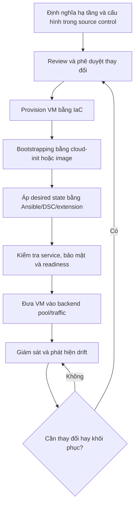
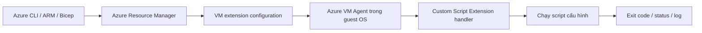

# Tự động hóa cấu hình máy ảo bằng công cụ quản trị

Một Azure Virtual Machine (VM) vừa được tạo chưa chắc đã sẵn sàng phục vụ ứng dụng. Máy có thể cần cài đặt web server, tạo tài khoản dịch vụ, thiết lập cấu hình hệ điều hành, đưa mã ứng dụng vào đúng thư mục, bật giám sát và áp các quy tắc bảo mật. Nếu quản trị viên đăng nhập SSH hoặc RDP để làm từng thao tác bằng tay, môi trường development, staging và production dễ khác nhau; việc tạo lại máy sau sự cố cũng chậm và khó kiểm tra.

**Tự động hóa cấu hình máy ảo** là việc mô tả trạng thái máy cần đạt dưới dạng mã hoặc cấu hình, sau đó sử dụng công cụ quản trị để áp dụng, kiểm chứng và cập nhật trạng thái đó. Azure hỗ trợ nhiều hướng triển khai: **cloud-init**, **VM extensions**, **Azure Run Command**; đồng thời các công cụ như **Ansible**, **PowerShell Desired State Configuration (DSC)** và hệ thống quản lý bản vá giúp quản trị máy qua vòng đời vận hành.

Bài học nằm trong chương **Máy ảo Azure** của module Microsoft Azure. Nội dung liên kết tài nguyên trong subscription/resource group, Microsoft Entra ID, Azure RBAC, VNet/subnet, mạng quản trị, lưu trữ và dữ liệu, giám sát, bảo mật và kiểm soát chi phí. Những lệnh có tác động đến tài nguyên là **ví dụ để thực hành trên môi trường được phép**, không phải thao tác đã được thực thi trên Azure.

## Mục tiêu học tập

Sau bài học, bạn có thể:

- Phân biệt **cấp phát hạ tầng** (provisioning), **cấu hình bên trong guest OS**, **triển khai ứng dụng** và **quản lý bản vá**.
- Chọn công cụ phù hợp giữa cloud-init, Custom Script Extension, Run Command, Ansible và DSC.
- Dùng cloud-init để khởi tạo một VM Linux mới theo kịch bản lặp lại được.
- Mô tả cách Azure VM Agent và extension nhận lệnh cấu hình, xem trạng thái và khắc phục lỗi.
- Dùng Ansible playbook để khai báo trạng thái mong muốn của một nhóm VM và kiểm tra trước khi thay đổi.
- Áp dụng nguyên tắc **idempotency**, immutable image và quản lý sai lệch cấu hình (*configuration drift*).
- Bảo vệ thông tin xác thực, giới hạn mạng quản trị, kết hợp RBAC và managed identity.
- Thiết kế quy trình triển khai có kiểm chứng, rollback, log và kiểm soát chi phí.

## 1. Hiểu các lớp tự động hóa

Không phải công cụ nào có thể tạo VM cũng tự cấu hình ứng dụng trong guest OS. Một kiến trúc có thể chia thành bốn lớp:

| Lớp | Câu hỏi | Công cụ hoặc kỹ thuật |
|---|---|---|
| **Provisioning** | Tạo tài nguyên gì, trong subscription, resource group, region và subnet nào? | Bicep/ARM template, Terraform, Azure CLI |
| **Guest configuration** | VM cần package, service, user, file và chính sách OS nào? | cloud-init, Custom Script Extension, Ansible, DSC |
| **Application deployment** | Phiên bản phần mềm nào chạy trên VM, cấu hình và secrets được lấy từ đâu? | Pipeline, Ansible, extension/script, image đã xây dựng |
| **Operations & compliance** | Máy có còn đúng cấu hình, nhận bản vá và báo lỗi hay không? | Azure Update Manager, Azure Monitor, Azure Policy machine configuration, công cụ quản trị cấu hình |

Ví dụ, **Bicep** có thể tạo VM và NIC trong subnet `snet-app`. **cloud-init** cài Nginx ngay trong lần khởi tạo máy Linux. **Ansible** triển khai nội dung website và đảm bảo dịch vụ chạy. **Azure Monitor** ghi log, còn **Azure Update Manager** hỗ trợ quản lý lịch đánh giá/cài bản vá theo khả năng dịch vụ. Các lớp phối hợp nhưng có trách nhiệm khác nhau.

### Vòng đời cấu hình



Cần tách bước **VM đã tạo thành công** với bước **ứng dụng sẵn sàng nhận traffic**. Đối với hệ thống có load balancer, health probe phải cho thấy ứng dụng thực sự phục vụ được request trước khi đưa máy vào backend pool.

## 2. Chọn công cụ quản trị phù hợp

| Công cụ | Cách vận hành | Điểm mạnh | Giới hạn |
|---|---|---|---|
| **cloud-init** | VM Linux xử lý user-data lúc khởi tạo, chủ yếu ở lần boot đầu theo cấu hình image | Bootstrap nhanh, khai báo package/file/service ngay khi tạo VM | Không phải cơ chế tự điều chỉnh drift liên tục; khả năng tùy image |
| **Custom Script Extension** | Azure VM Agent gọi script/config được khai báo trên VM | Chạy cấu hình sau khi máy đã tạo, tích hợp Azure Resource Manager | Cần VM Agent, điều kiện mạng và script an toàn khi chạy lại |
| **Azure Run Command** | Gửi script qua Azure control plane tới guest OS được hỗ trợ | Chẩn đoán, sửa lỗi hoặc thao tác quản trị có kiểm soát khi không có SSH/RDP trực tiếp | Không nên dùng làm hệ thống quản lý cấu hình thường xuyên; có giới hạn thời gian, output, quyền |
| **Ansible** | Control node kết nối VM qua SSH/WinRM và áp playbook | Quản lý nhiều VM, cấu hình khai báo và idempotent theo module | Cần đường mạng, credential, inventory và runner |
| **PowerShell DSC** | Khai báo trạng thái mong muốn cho Windows theo DSC resources và cơ chế thực thi phù hợp | Tập trung vào trạng thái Windows Server, tính nhất quán | Phụ thuộc phiên bản PowerShell/DSC và cách phân phối cấu hình |
| **Golden image / Azure VM Image Builder** | Tạo image có sẵn package, agent và phần mềm chuẩn | Tăng tốc scale-out, giảm chênh lệch giữa máy | Mỗi thay đổi cần quy trình build, kiểm thử và phát hành image |

**Gợi ý lựa chọn:** với Linux VM mới, cloud-init phù hợp bootstrap; với nhóm VM cần quản lý lâu dài, Ansible hoặc công cụ desired-state phù hợp thường giúp kiểm soát drift tốt hơn. Với thay đổi nhỏ hoặc thao tác chẩn đoán nhất thời, Run Command có thể hữu ích; với hệ thống lớn, kết hợp image chuẩn và pipeline sẽ dễ tái tạo hơn việc chạy chuỗi lệnh thủ công.

Không nên đặt toàn bộ logic triển khai hệ thống phức tạp vào một script chạy một lần rồi không có bước kiểm chứng.

## 3. Điều kiện tiên quyết cho bài thực hành

Ví dụ sử dụng một VM Linux Ubuntu trong Azure:

- Có subscription và resource group lab được phê duyệt.
- Có VNet/subnet riêng cho workload và quy tắc NSG phù hợp.
- Danh tính thực thi có Azure RBAC đủ để tạo VM hoặc quản lý extension nếu thực hiện những thao tác đó.
- Có Azure CLI đã đăng nhập; công cụ Ansible chạy trên máy Linux/runner có kết nối đến VM.
- Có public key SSH dành cho VM; private key chỉ lưu ở client hoặc secret store phù hợp.
- Có ngân sách, giới hạn thời gian lab và quy trình dọn dẹp tài nguyên.

### Bảo mật đường quản trị

Không nhất thiết cấp **public IP** cho VM để tự động hóa cấu hình. Ưu tiên:

- VM dùng private IP trong subnet được phân vùng.
- Quản trị tương tác qua Azure Bastion, VPN/ExpressRoute hoặc một kênh được duyệt.
- Ansible runner chạy trong mạng có đường SSH/WinRM tới VM.
- Azure Run Command khi cần thao tác được hỗ trợ qua control plane và VM Agent.
- Microsoft Entra ID, RBAC, MFA/Conditional Access hoặc PIM để bảo vệ quyền quản trị Azure.

Quyền chỉnh sửa tài nguyên Azure bằng RBAC **khác với quyền sudo/root hoặc quyền Administrator trong guest OS**. Mỗi lớp cần thiết kế và kiểm toán riêng.

### Không đưa secrets vào dữ liệu bootstrap

Các giá trị truyền bằng cloud-init `custom-data`, output script, tham số extension hoặc log có thể được người có quyền phù hợp quan sát qua một số đường quản trị. **Không đặt password, token dài hạn, private key hoặc connection string vào ví dụ hay file cloud-init thông thường.**

Nếu ứng dụng cần secrets, hãy dùng managed identity của VM để truy cập Azure Key Vault theo quyền tối thiểu, hoặc cơ chế bí mật được tổ chức phê duyệt. Việc lưu script trong Git không cho phép lưu credential trong script.

## 4. cloud-init: tự động cấu hình VM Linux lúc khởi tạo

**cloud-init** là cơ chế bootstrap trên nhiều image Linux được hỗ trợ. Khi máy được tạo, cloud-init xử lý cấu hình user-data để cài package, ghi file, chạy lệnh và cấu hình dịch vụ. Khả năng sẵn có phụ thuộc image và cấu hình guest OS; không nên giả định mọi Linux VM đều có cloud-init.

### Ví dụ cloud-init cài Nginx

Tệp minh họa tên `cloud-init.yaml`:

```yaml
#cloud-config
package_update: true
packages:
  - nginx

write_files:
  - path: /var/www/html/index.html
    owner: root:root
    permissions: '0644'
    content: |
      <!doctype html>
      <html lang="vi">
      <head><meta charset="utf-8"><title>Azure VM</title></head>
      <body><h1>Web server da duoc cau hinh tu dong</h1></body>
      </html>

runcmd:
  - [systemctl, enable, --now, nginx]
```

Giải thích:

- `#cloud-config` cho biết đây là cấu hình cloud-init.
- `package_update: true` yêu cầu cập nhật metadata package trước khi cài trên nền tảng hỗ trợ.
- `packages` cài Nginx qua package manager phù hợp với image.
- `write_files` tạo trang HTML mẫu với ownership và permission xác định.
- `runcmd` bật và khởi động service sau khi các thành phần liên quan đã được chuẩn bị.

Ví dụ phù hợp với image Linux dùng systemd và gói Nginx có sẵn. Với distro khác, tên package, trình quản lý gói và service có thể khác; cần xác minh trước khi áp dụng.

### Gắn cloud-init khi tạo VM

Ví dụ Bash trong Azure Cloud Shell, với VNet/subnet lab đã có và khóa SSH do bạn quản lý:

```bash
RG="<RESOURCE_GROUP>"
VM="vm-web-lab"
VNET="<VNET_NAME>"
SUBNET="<SUBNET_NAME>"
REGION="southeastasia"

az account show --output table

az vm create \
  --resource-group "$RG" \
  --name "$VM" \
  --location "$REGION" \
  --image Ubuntu2204 \
  --size Standard_B2s \
  --admin-username azureuser \
  --ssh-key-values "$HOME/.ssh/id_ed25519.pub" \
  --vnet-name "$VNET" \
  --subnet "$SUBNET" \
  --public-ip-address "" \
  --custom-data ./cloud-init.yaml
```

Đây là **ví dụ cho lab**, không phải lệnh đã được chạy. Bạn cần bảo đảm image/SKU khả dụng ở region, đủ quota, tên resource tồn tại đúng như tham chiếu, public key đã có và lệnh tạo VM khớp phiên bản Azure CLI. Một số tham số hay alias image có thể thay đổi; kiểm tra trợ giúp lệnh hiện hành trước khi thực thi.

`--public-ip-address ""` thể hiện ý định **không tạo public IP**. Vì vậy, để kiểm tra HTTP trên VM, cần một client trong VNet, một đường kết nối quản trị phù hợp hoặc một thành phần ingress được thiết kế riêng. Không mở trực tiếp TCP 80 từ Internet chỉ để thử lab nếu không cần.

### Kiểm tra cloud-init trên guest OS

Khi đã có đường đăng nhập Linux được phép:

```bash
cloud-init status --long
sudo tail -n 100 /var/log/cloud-init-output.log
sudo systemctl is-active nginx
curl -I http://127.0.0.1/
```

Kỳ vọng:

- `cloud-init status` báo trạng thái hoàn tất hoặc đưa ra lỗi cần xử lý.
- Nginx đang chạy.
- Request cục bộ đến port 80 nhận phản hồi HTTP thích hợp.

Nếu cloud-init hoàn tất nhưng web không phục vụ, hãy kiểm tra log package installation, tên service, file cấu hình và firewall guest. Một lần `az vm create` báo thành công chưa bảo đảm toàn bộ cấu hình guest đã thành công.

### Hạn chế của cloud-init

cloud-init thường được thiết kế cho giai đoạn khởi tạo VM. Khi sửa `cloud-init.yaml` trên máy người quản trị, VM đã tồn tại **không tự cập nhật**. Một số module có tần suất chạy khác nhau; không nên tái sử dụng `custom-data` như công cụ đảm bảo desired state liên tục.

Nếu muốn ứng dụng thay đổi sau khi VM đã chạy, hãy dùng công cụ quản trị có quy trình cập nhật rõ ràng hoặc thay thế VM bằng một bản image/cấu hình mới theo mô hình immutable infrastructure.

## 5. VM Agent và Custom Script Extension

**Azure VM Agent** là thành phần trong guest OS hỗ trợ Azure quản lý một số tính năng và VM extensions. **Custom Script Extension** cho phép chạy script trên máy khi được cấu hình qua Azure Resource Manager, mà không cần người quản trị SSH/RDP vào từng VM để dán lệnh.

### Đường xử lý cơ bản



Các điều kiện quan trọng:

- Image phải có agent/extension support theo yêu cầu.
- VM cần hoạt động và đáp ứng điều kiện kết nối tới các Azure platform endpoint phục vụ VM Agent/extension.
- Script và nguồn tải tệp phải truy cập được theo network policy.
- Không bật download từ nguồn không được kiểm soát hoặc chạy script chưa kiểm tra integrity.
- Phải có quyền RBAC để cập nhật extension trên VM trong scope tương ứng.

### Ví dụ chạy script Linux qua Azure CLI

Ví dụ **chỉ dành cho VM Ubuntu lab đã được phê duyệt**, cài Nginx bằng Custom Script Extension:

```bash
az vm extension set \
  --resource-group "<RESOURCE_GROUP>" \
  --vm-name "<VM_NAME>" \
  --publisher Microsoft.Azure.Extensions \
  --name CustomScript \
  --settings '{"commandToExecute":"apt-get update && DEBIAN_FRONTEND=noninteractive apt-get install -y nginx && systemctl enable --now nginx"}'
```

Các chuỗi JSON được truyền trực tiếp trong lệnh Bash; nếu dùng PowerShell, quy tắc escape/dấu nháy có thể khác. Không dùng ví dụ này trên VM chạy production nếu không có kiểm thử compatibility, lịch bảo trì và rollback.

Trong môi trường thực, thường nên dùng script phiên bản hóa được kiểm soát, lấy qua kênh đáng tin cậy; xác định checksum nếu cần và không nhúng credential vào `commandToExecute`. Với bí mật cần truyền cho extension, nghiên cứu `protectedSettings` hoặc thiết kế tốt hơn bằng managed identity/Key Vault; dù vậy vẫn không được ghi bí mật ra log.

### Xem trạng thái extension

```bash
az vm extension show \
  --resource-group "<RESOURCE_GROUP>" \
  --vm-name "<VM_NAME>" \
  --name CustomScript \
  --output json
```

Kiểm tra `provisioningState`, status, substatus hoặc thông điệp lỗi được Azure cung cấp. Nếu thất bại, kiểm tra thêm log extension trong guest OS bằng đường truy cập được phép.

**Một VM có thể đã chạy tốt nhưng extension báo lỗi.** Ngược lại, extension thành công không tự đảm bảo ứng dụng đã sẵn sàng: phải có health check, kiểm thử chức năng và bước kiểm chứng sau cấu hình.

### Tính lặp lại và chạy lại extension

Khi extension có settings được thay đổi hoặc triển khai lại theo cơ chế hỗ trợ, script có thể chạy lại. Vì vậy, hãy thiết kế script **idempotent**:

- Không tạo trùng user hoặc thêm trùng dòng cấu hình.
- Cài package về version được quản lý thay vì chạy thao tác không kiểm soát.
- Không ghi đè file cấu hình nếu giá trị đã đúng.
- Khởi động lại service chỉ khi cấu hình thật sự thay đổi.
- Xác minh trạng thái sau mỗi bước và trả exit code khác 0 khi thất bại.

## 6. Azure Run Command cho kiểm tra và thao tác có kiểm soát

Azure Run Command có thể chạy lệnh bên trong guest OS thông qua Azure management plane và các thành phần hỗ trợ trong VM. Công cụ hữu ích khi cần kiểm tra trạng thái service hoặc xử lý tình huống không thể kết nối SSH/RDP trực tiếp.

### Kiểm tra Linux VM

```bash
az vm run-command invoke \
  --resource-group "<RESOURCE_GROUP>" \
  --name "<VM_NAME>" \
  --command-id RunShellScript \
  --scripts "systemctl is-active nginx"
```

### Kiểm tra Windows VM

```bash
az vm run-command invoke \
  --resource-group "<RESOURCE_GROUP>" \
  --name "<WINDOWS_VM_NAME>" \
  --command-id RunPowerShellScript \
  --scripts "Get-Service -Name W32Time"
```

Lệnh kiểm tra dùng trong ví dụ không thay đổi cấu hình. Chúng chỉ hoạt động với image/VM agent, hệ điều hành, quyền quản trị và trạng thái máy đáp ứng điều kiện công cụ.

Run Command **không phải công cụ thay thế hoàn chỉnh cho configuration management**. Có thể có giới hạn thời gian chạy, kích thước output, số lượng lệnh đồng thời và cách lưu log theo loại Run Command. Khi cần quản lý hàng trăm VM, hãy ưu tiên IaC, Ansible/DSC, extensions hoặc pipeline có giám sát thay vì chạy lệnh ad hoc bằng tay.

### Nguyên tắc bảo mật

Đừng truyền password, token hoặc connection string trong `--scripts`, vì tham số, output và hoạt động quản trị có thể xuất hiện trong lịch sử shell/log/audit theo cơ chế hệ thống. Cấp quyền Run Command cho số ít người thực sự cần và kiểm tra nhật ký thay đổi/thiết lập cảnh báo cho hoạt động đặc quyền.

## 7. Ansible: mô tả trạng thái của một nhóm VM

**Ansible** quản lý máy thông qua inventory và playbook. Với Linux, control node thường kết nối SSH; với Windows, có thể sử dụng WinRM/PowerShell Remoting hoặc cơ chế kết nối được hỗ trợ. Không bắt buộc cài một Ansible agent chuyên biệt trong mọi Linux VM.

### Inventory minh họa

Tệp `inventory.ini` nằm trên máy quản trị hoặc trong repository cấu hình được kiểm soát:

```ini
[web]
web01 ansible_host=10.20.10.4 ansible_user=azureuser
web02 ansible_host=10.20.10.5 ansible_user=azureuser
```

Đây là private IP minh họa. Control node phải có đường mạng tới các địa chỉ trên và phương thức SSH hợp lệ. Không đưa private SSH key vào inventory.

### Playbook cài và quản lý Nginx

Tệp `configure-web.yml`:

```yaml
---
- name: Cau hinh web server tren Azure VM
  hosts: web
  become: true
  gather_facts: true

  tasks:
    - name: Cai goi Nginx tren Ubuntu
      ansible.builtin.apt:
        name: nginx
        state: present
        update_cache: true

    - name: Tao trang web trang thai
      ansible.builtin.copy:
        dest: /var/www/html/index.html
        owner: root
        group: root
        mode: '0644'
        content: |
          <!doctype html>
          <html lang="vi">
          <head><meta charset="utf-8"><title>Azure Ansible</title></head>
          <body><h1>Managed by Ansible</h1></body>
          </html>
      notify: Reload nginx

    - name: Bao dam Nginx dang chay
      ansible.builtin.service:
        name: nginx
        state: started
        enabled: true

  handlers:
    - name: Reload nginx
      ansible.builtin.service:
        name: nginx
        state: reloaded
```

Ý nghĩa:

- `hosts: web`: áp dụng lên nhóm máy trong inventory.
- `become: true`: nâng quyền ở guest OS theo cơ chế đã cấu hình.
- `apt state: present`: đảm bảo gói Nginx được cài trên Ubuntu/Debian.
- `copy`: tạo tệp với ownership và mode mong muốn; chỉ báo changed nếu nội dung/thuộc tính khác.
- `service state: started, enabled: true`: đảm bảo Nginx chạy và tự khởi động.
- `notify`: gọi handler reload khi task nội dung trang web thay đổi.

Playbook mô tả **trạng thái mong muốn** thay vì bảo VM thực hiện một chuỗi lệnh không có kiểm tra hiện trạng. Tuy nhiên, idempotency thực tế phụ thuộc từng module và nhiệm vụ; không thể tuyên bố mọi shell command trong Ansible đều tự idempotent.

### Chạy kiểm tra trước khi áp dụng

```bash
ansible-playbook -i inventory.ini configure-web.yml --syntax-check
ansible-playbook -i inventory.ini configure-web.yml --check --diff
```

- `--syntax-check` kiểm tra cú pháp playbook.
- `--check` cố gắng mô phỏng thay đổi theo các module hỗ trợ check mode.
- `--diff` hiển thị sự khác biệt của một số file/cấu hình.

Check mode không bảo đảm mọi task mô phỏng chính xác 100%; cũng không thay thế môi trường staging. Diff có thể chứa dữ liệu cấu hình nhạy cảm nếu playbook xử lý secret, vì vậy cần hạn chế log và dùng `no_log` cho task phù hợp.

Khi đã được phê duyệt:

```bash
ansible-playbook -i inventory.ini configure-web.yml --limit web01
ansible-playbook -i inventory.ini configure-web.yml
```

Chạy trên một VM canary trước giúp giảm tác động nếu playbook có lỗi. Sau đó kiểm tra service và sức khỏe ứng dụng trước khi mở rộng tới toàn bộ nhóm.

## 8. Tự động hóa Windows với PowerShell và DSC

Với Azure Windows VM, các nhiệm vụ phổ biến gồm bật Windows Feature, thiết lập IIS, quản lý service, registry, certificate và các cấu hình bảo mật.

**PowerShell Desired State Configuration (DSC)** sử dụng resource mô tả trạng thái cần có của Windows. Ví dụ cấu trúc DSC cho Windows Server cài IIS:

```powershell
Configuration WebServerConfiguration {
    Node 'localhost' {
        WindowsFeature WebServer {
            Ensure = 'Present'
            Name   = 'Web-Server'
        }
    }
}

WebServerConfiguration -OutputPath '.\MofOutput'
Start-DscConfiguration -Path '.\MofOutput' -Wait -Verbose
```

Ví dụ minh họa mô hình **compile configuration → áp desired state**, cần hệ điều hành, module DSC resource và phiên bản PowerShell tương thích. Không nên mặc định mọi VM Windows và mọi thế hệ DSC đều dùng cùng lệnh hoặc có cùng cơ chế phân phối configuration.

Với Windows VM, Azure cũng có **Custom Script Extension for Windows** do `Microsoft.Compute` cung cấp theo cách đặt tên và tham số riêng; khác Linux Custom Script Extension. Nếu muốn chạy PowerShell ad hoc bằng Azure Run Command, dùng `RunPowerShellScript` như ví dụ trước.

### Công cụ nào phù hợp Windows?

| Nhu cầu | Hướng thường gặp |
|---|---|
| Bootstrap nhỏ khi tạo VM | Custom Script Extension/VM provisioning workflow phù hợp |
| Cài đặt và kiểm soát role/service lâu dài | DSC hoặc công cụ configuration management của tổ chức |
| Chạy chẩn đoán/đọc trạng thái một lần | Azure Run Command |
| Duy trì phiên bản base image chuẩn | Azure VM Image Builder và Azure Compute Gallery |
| Lập lịch đánh giá/cài patch | Azure Update Manager cùng chính sách bảo trì |
| Giám sát tuân thủ cấu hình guest | Azure Policy machine configuration khi policy, image và điều kiện hỗ trợ |

Không nhầm **quản lý bản vá Windows Update** với **cài đặt và cấu hình ứng dụng**. Hai nhiệm vụ có thể được điều phối chung nhưng có quy trình kiểm thử/rollback khác nhau.

## 9. Idempotency, immutable infrastructure và configuration drift

### Idempotency là gì?

Một thao tác **idempotent** cho cùng một đầu vào sẽ dẫn tới cùng trạng thái mong muốn khi được áp dụng lặp lại, thay vì tích lũy thay đổi ngoài ý muốn.

Ví dụ:

- “Đảm bảo package Nginx hiện diện” là cách khai báo trạng thái có thể chạy nhiều lần.
- “Thêm dòng này vào file cấu hình bằng lệnh echo >>” có thể tạo nhiều dòng trùng sau mỗi lần chạy.
- “Đảm bảo service đang chạy” an toàn hơn lệnh “khởi động lại service bất kể trạng thái” trong nhiều tình huống.

### Configuration drift

Drift xảy ra khi VM thực tế khác với cấu hình trong source control. Nguyên nhân có thể là:

- Nhân viên SSH vào sửa file trực tiếp.
- Bản vá hoặc package tự động thay đổi cấu hình.
- VM bị khôi phục từ snapshot hoặc image cũ.
- Một instance không nhận được phiên bản cấu hình mới.
- Playbook chỉ chạy trên một số máy do lỗi inventory hoặc mạng.

Để giảm drift, nên coi repository cấu hình là **nguồn chuẩn**, rà soát thay đổi qua pull request, áp tự động qua pipeline, kiểm tra định kỳ và báo cáo sai lệch.

### Immutable VM

Với immutable infrastructure, thay vì sửa một VM chạy lâu ngày, tổ chức build **golden image** mới chứa phiên bản phần mềm được phê duyệt, sau đó thay instance thông qua VM Scale Sets hoặc quy trình rollout. Cách này giảm khác biệt tích lũy nhưng yêu cầu thiết kế stateless hoặc quản lý dữ liệu ngoài VM.

### Chọn mô hình vận hành

| Tình huống | Mô hình phù hợp |
|---|---|
| VM nhỏ, cấu hình đơn giản lúc tạo | cloud-init/bootstrap |
| Máy cần thay cấu hình định kỳ và nhiều instance | Ansible/DSC hoặc cấu hình được pipeline hóa |
| Nhiều instance giống nhau, scale nhanh | Golden image + VMSS, có thể thêm bootstrap tối thiểu |
| Cần chứng minh tuân thủ cấu hình | Machine configuration/Azure Policy và quy trình kiểm tra |
| Cần một lệnh chẩn đoán guest OS | Run Command có kiểm soát |

Không có mô hình nào thay thế hoàn toàn kiểm thử ứng dụng, backup hoặc quy trình khôi phục.

## 10. Pipeline cấu hình VM an toàn

Một pipeline mẫu từ thay đổi code tới production:

1. **Thiết kế:** xác định mục tiêu cấu hình, hệ điều hành, phiên bản package và các phụ thuộc.
2. **Version control:** lưu IaC, cloud-init/playbook, script và kiểm thử trong repository được kiểm soát.
3. **Review:** kiểm tra quyền, secrets, NSG, port, tác động downtime và rollback.
4. **Staging:** tạo máy thử nghiệm tương đương production để chạy cấu hình.
5. **Preflight:** xác minh subscription, resource group, inventory, quota, runner network, health hiện tại và backup.
6. **Canary:** triển khai lên một VM hoặc nhóm nhỏ.
7. **Validation:** kiểm tra package/service, HTTP readiness, agent trạng thái và log.
8. **Rollout:** áp dụng tới những VM còn lại theo lô có giới hạn concurrency.
9. **Monitoring:** theo dõi lỗi, latency, CPU, memory, disk và drift.
10. **Rollback:** quay lại image/cấu hình phiên bản trước hoặc thay instance theo runbook khi cần.

### Không triển khai đồng loạt khi có stateful workload

Với database trên VM hoặc máy giữ session/local files, một thao tác cài package và restart service có thể ảnh hưởng dữ liệu đang ghi. Cần xác định chiến lược backup, quorum/replication, maintenance window và thứ tự cập nhật từng node.

Tương tự, khi VM nằm sau Azure Load Balancer hoặc Application Gateway, cần đưa instance ra khỏi luồng traffic hoặc bảo đảm health probe tự loại instance không sẵn sàng trong lúc cấu hình.

## 11. Secrets, danh tính và quyền tối thiểu

Quy trình tự động hóa thường có cả **quyền Azure control plane** lẫn **quyền trong guest OS**.

| Thao tác | Cần quản lý quyền gì? |
|---|---|
| Tạo VM, NIC, disk | Azure RBAC trên resource group/subscription thích hợp |
| Cài/update VM extension | Azure RBAC cho thao tác quản lý extension |
| Run Command | Quyền thực thi Run Command trên VM theo vai trò được giao |
| Ansible SSH | Danh tính SSH và quyền sudo trong guest OS |
| DSC trên Windows | Quyền chạy cấu hình trong Windows và quản lý resource phù hợp |
| Ứng dụng đọc secret từ Key Vault | Managed identity/service principal cùng quyền Key Vault phù hợp |
| Ứng dụng đọc blob | Storage Blob Data role và đường mạng phù hợp |

### Managed identity và Key Vault

Một VM có managed identity có thể lấy token cho dịch vụ Azure hỗ trợ mà không cần lưu client secret dài hạn vào script. Nếu cần lấy bí mật từ Key Vault, danh tính đó phải có quyền đọc đúng secret được phê duyệt và có đường mạng hợp lệ.

Đừng nhầm **có managed identity** với **đã có quyền truy cập mọi dịch vụ**. Managed identity chỉ là danh tính; vẫn cần Azure RBAC/data-plane authorization hoặc access policy tương ứng.

### Tối thiểu hóa thông tin trong log

- Không in environment variables chứa token, khóa hoặc password.
- Không lưu secret vào user-data, pipeline log hay source code.
- Hạn chế `--diff` khi playbook cấu hình tệp nhạy cảm.
- Dùng certificate/SSH key và cơ chế xoay vòng được tổ chức phê duyệt.
- Giới hạn thời gian cấp quyền đặc quyền, cân nhắc PIM cho quản trị viên.
- Xác minh tệp script tải về và quyền truy cập nguồn script.

## 12. Giám sát sau tự động hóa

Các lớp log và bằng chứng khác nhau phục vụ mục tiêu khác nhau:

| Nguồn | Cung cấp gì? | Điểm cần chú ý |
|---|---|---|
| Azure Activity Log | Thao tác control plane như tạo/sửa VM, extension | Không tự ghi mọi thao tác bên trong guest |
| VM Agent/extension status | Trạng thái provisioning và thông báo của extension | Không thay thế health check ứng dụng |
| `/var/log/cloud-init.log`, `cloud-init-output.log` | Quá trình cloud-init trên Linux | Có thể chứa thông tin cấu hình, cần kiểm soát truy cập |
| Ansible play recap/log | Task changed/ok/failed/unreachable và host liên quan | Bảo vệ thông tin nhạy cảm và lưu audit |
| Windows Event Log / PowerShell logs | Trạng thái thay đổi trong Windows | Phụ thuộc chính sách logging của tổ chức |
| Azure Monitor / VM Insights | Metrics, log hệ điều hành/ứng dụng khi agent được cấu hình | Cần triển khai rule/agent và chi trả lưu trữ phù hợp |
| Azure Policy machine configuration | Đánh giá trạng thái guest theo policy được hỗ trợ | Không bảo đảm tự sửa mọi sai lệch |

### Lệnh kiểm tra Azure CLI

```bash
az vm show \
  --resource-group "<RESOURCE_GROUP>" \
  --name "<VM_NAME>" \
  --show-details \
  --output json

az vm get-instance-view \
  --resource-group "<RESOURCE_GROUP>" \
  --name "<VM_NAME>" \
  --output json
```

Từ các kết quả, đối chiếu provisioning state, VM power state, extension status và những thông tin lỗi hiển thị. Lệnh chỉ **đọc** control plane; muốn biết ứng dụng Nginx chạy tốt còn cần health request hoặc kiểm tra guest OS.

### Tín hiệu nên cảnh báo

- VM được tạo nhưng extension/cloud-init thất bại.
- Nhiều instance báo Unhealthy sau một rollout.
- Không thể kết nối quản trị hoặc runner không truy cập được VM.
- Cấu hình khác với baseline đã phê duyệt.
- Bản vá quan trọng chưa áp trong thời hạn chính sách.
- CPU, disk, memory hoặc chi phí tăng bất thường sau thay đổi.
- Tài khoản quản trị thực hiện Run Command/extension không theo lịch dự kiến.

## 13. Khắc phục lỗi thường gặp

| Triệu chứng | Nguyên nhân thường gặp | Hướng xử lý |
|---|---|---|
| VM được tạo nhưng Nginx không chạy | cloud-init/package install lỗi, service chưa bật | Xem cloud-init log, service status, network package repo |
| Sửa cloud-init rồi VM cũ không cập nhật | cloud-init không phải agent desired-state liên tục | Dùng Ansible/extension hoặc triển khai VM mới |
| Extension báo provisioning failed | VM Agent, mạng, URL script, syntax hoặc exit code lỗi | Đọc extension status/log, thử script trên staging |
| Extension chạy lại gây lỗi/trùng cấu hình | Script không idempotent | Chuyển sang desired-state task và kiểm tra trước khi thay |
| Run Command không nhận output | VM Agent không hoạt động, OS lỗi, thời gian chạy/giới hạn output | Kiểm tra trạng thái VM/agent và giới hạn tính năng |
| Ansible báo UNREACHABLE | Sai private IP, NSG/route/VPN, SSH key hoặc inventory | Kiểm tra đường mạng và cơ chế xác thực từ runner |
| Ansible báo FAILED vì permission | Thiếu sudo hoặc quyền OS | Xác minh `become`, user và quyền được duyệt |
| Playbook cứ báo changed mỗi lần | Task không idempotent, timestamp, shell command | Chọn module stateful, kiểm tra logic `creates`/`changed_when` khi thích hợp |
| Windows DSC lỗi compile/apply | Thiếu resource, sai phiên bản hoặc quyền Windows | Kiểm tra module DSC và log phù hợp |
| VM có extension thành công nhưng ứng dụng 502 | Nginx/backend/app không ready, NSG hoặc health probe sai | Kiểm tra ứng dụng, DNS, route, health probe |
| Không lấy được secret Key Vault | Managed identity thiếu quyền hoặc Key Vault firewall chặn | Kiểm tra identity, scope data role, private endpoint/DNS |
| Triển khai xong chi phí cao | VM, disk, runner, monitoring hoặc số instance tăng | Kiểm tra Cost Management, tag, SKU và lịch lab |

**Không giải quyết nhanh bằng cách mở SSH/RDP ra toàn Internet, tắt NSG, cấp Owner toàn subscription hoặc ghi secret trực tiếp vào script.** Những cách này có thể che mất nguyên nhân và làm giảm mức bảo vệ của hệ thống.

## 14. Bài thực hành tổng hợp: từ VM trống tới web server quản lý được

**Tình huống:** nhóm phát triển cần hai Ubuntu VM có Nginx, cùng nội dung website và khả năng cập nhật cấu hình lặp lại. VMs nằm trong một subnet riêng; quản trị viên không muốn mở public SSH.

### Bước 1: chuẩn bị mạng và quyền

- Chọn subscription/resource group thử nghiệm.
- Có VNet/subnet không trùng dải IP với mạng quản trị.
- Thiết kế kết nối từ Ansible runner tới VM qua private network hoặc kênh quản trị được duyệt.
- Chuẩn bị SSH key, hạn chế quyền sudo và xác nhận ai được phép sửa NSG/VM.
- Có cách kiểm tra website từ VNet hoặc một ingress có kiểm soát.

### Bước 2: bootstrap VM Linux đầu tiên

Tạo `cloud-init.yaml` theo phần 4 và dùng `--custom-data` khi tạo VM. Xác minh `cloud-init status`, Nginx và trang mẫu khi VM được khởi động.

### Bước 3: tạo VM thứ hai

Dùng cùng image và nội dung cloud-init được quản lý phiên bản. Đặt tên, địa chỉ IP và nhóm inventory khác nhau, nhưng giữ cấu hình nền tảng nhất quán.

### Bước 4: quản lý với Ansible

Đưa hai VM vào `inventory.ini`, chạy:

```bash
ansible-playbook -i inventory.ini configure-web.yml --syntax-check
ansible-playbook -i inventory.ini configure-web.yml --check --diff
ansible-playbook -i inventory.ini configure-web.yml --limit web01
ansible-playbook -i inventory.ini configure-web.yml
```

Xem kết quả từng host. Lặp lại playbook để quan sát số lượng task báo `changed`. Mục tiêu là lần chạy tiếp theo không tạo thay đổi không cần thiết nếu cấu hình vẫn giống desired state.

### Bước 5: kiểm thử bằng HTTP và trạng thái VM

Từ một máy có đường mạng tới backend:

```bash
curl -I http://10.20.10.4/
curl -I http://10.20.10.5/
```

Xem HTTP status và trang hiển thị. Kiểm tra qua Azure CLI trạng thái VM/extension nếu có. Hai IP chỉ là ví dụ; cần dùng IP thật của máy lab.

### Bước 6: kiểm thử drift

Trên một máy thí nghiệm, thay nội dung `/var/www/html/index.html` bằng cách được phê duyệt, rồi chạy lại Ansible playbook. Quan sát Ansible phát hiện khác biệt, khôi phục nội dung mong muốn và báo cáo changed.

Không sửa trực tiếp file production chỉ để minh họa drift.

### Bước 7: mô phỏng cấu hình lỗi có kiểm soát

Trong staging, thử một phiên bản playbook có task không hợp lệ hoặc hostname không khớp. Xem cách pipeline dừng, ghi trạng thái thất bại và không áp tiếp lên toàn bộ VM. Sửa lỗi và chạy lại sau khi xác minh.

### Bước 8: dọn dẹp

Khi không dùng nữa, kiểm tra các tài nguyên thuộc riêng resource group lab trước khi xóa. Ví dụ:

```bash
az group list --output table
az group show --name "<LAB_RESOURCE_GROUP>" --output json
```

Chỉ người có quyền quản lý và đã xác minh resource group thuộc riêng lab mới thực hiện thao tác xóa theo quy trình. Việc dừng VM không đồng nghĩa mọi disk, IP hoặc dịch vụ phụ trợ ngừng phát sinh chi phí.

### Kết quả kiểm thử mong đợi

| Phép thử | Kỳ vọng |
|---|---|
| VM tạo từ cùng cloud-init | Có Nginx và trang mặc định giống thiết kế |
| SSH từ Ansible runner có quyền | Truy cập được qua mạng được duyệt |
| SSH từ Internet không được phép | Không thể truy cập cổng quản trị theo chính sách |
| Ansible chạy lần đầu | Có thể báo changed ở những task cần thiết |
| Ansible chạy lại khi không đổi | Phần lớn task ổn định, không tạo thay đổi thừa |
| Sửa sai trang HTML ở VM lab | Playbook phát hiện và khôi phục desired state |
| Health check web | HTTP trả kết quả hợp lệ khi Nginx đang chạy |
| Một VM lỗi cấu hình | Pipeline báo lỗi, không tự coi toàn bộ rollout thành công |

## 15. Checklist áp dụng production

- [ ] Đã tách provisioning, guest configuration, application deployment và patch management.
- [ ] Có source control, người sở hữu và review cho script/playbook/cloud-init.
- [ ] Đã xác minh VM image, distro/Windows version và công cụ quản trị tương thích.
- [ ] Đã giới hạn Azure RBAC và quyền sudo/Administrator theo nhiệm vụ.
- [ ] Đã dùng SSH key/managed identity, không nhúng password/token vào user-data hoặc log.
- [ ] Đã thiết kế đường mạng quản trị riêng, NSG/route và DNS phù hợp.
- [ ] Đã kiểm tra cloud-init/VM Agent và điều kiện network/extension support.
- [ ] Đã áp dụng cấu hình idempotent, có kiểm tra lỗi và exit code.
- [ ] Có staging, syntax check/check mode, canary và phê duyệt production.
- [ ] Đã thiết kế rollback và backup với VM có trạng thái dữ liệu.
- [ ] Đã đo readiness ứng dụng trước khi nhận traffic.
- [ ] Có giám sát, log, cảnh báo và cơ chế phát hiện drift.
- [ ] Có lịch bản vá, phương án maintenance window và kiểm thử sau patch.
- [ ] Có tag, budget, kiểm soát SKU/VM size, disk, log và thời gian chạy.
- [ ] Đã ghi nhận quy trình khôi phục, quyền thực thi và lịch rà soát định kỳ.

## 16. Câu hỏi tự kiểm tra

1. Vì sao tạo VM bằng Bicep hoặc Azure CLI chưa đồng nghĩa đã tự động hóa cấu hình ứng dụng?
2. cloud-init khác Ansible ở giai đoạn và khả năng điều chỉnh cấu hình như thế nào?
3. Vì sao Custom Script Extension cần Azure VM Agent và điều kiện kết nối phù hợp?
4. Run Command phù hợp nhất với những công việc nào, và khi nào không nên dùng nó?
5. Idempotency là gì? Hãy nêu một script không idempotent và cách cải thiện.
6. Nếu Ansible báo UNREACHABLE nhưng VM đang chạy, bạn sẽ kiểm tra lớp nào trước?
7. Tại sao không nên lưu password hoặc connection string trong cloud-init/custom data?
8. Vai trò Azure RBAC và quyền sudo/root trong guest OS khác nhau ra sao?
9. Golden image giúp giảm drift như thế nào, và đổi lại cần quy trình gì?
10. Vì sao cần triển khai canary và health check trước khi cấu hình toàn bộ VM production?
11. Azure Update Manager và Ansible có thể phối hợp trong quản lý vòng đời VM như thế nào?
12. Khi VM extension báo thành công nhưng Application Gateway trả 502, cần kiểm tra những gì?
13. Nếu job tự động hóa chạy từ runner ngoài VNet, những giải pháp kết nối nào có thể áp dụng?
14. Khi kết thúc lab, những tài nguyên nào ngoài VM có thể vẫn tiếp tục phát sinh chi phí?

## Kết luận

Tự động hóa cấu hình Azure VM không chỉ là chạy script nhanh hơn việc đăng nhập thủ công. Mục tiêu là tạo ra **trạng thái máy có thể tái lập, kiểm chứng, theo dõi và khôi phục**. cloud-init phù hợp với bootstrap Linux; VM extensions và Run Command hỗ trợ thao tác từ Azure control plane; Ansible/DSC quản lý desired state theo quy trình; golden image và pipeline giúp nhân rộng môi trường nhất quán.

Khi kết hợp cấu hình dạng mã với Microsoft Entra ID, Azure RBAC, mạng quản trị riêng, managed identity, Key Vault, Azure Monitor và kiểm soát chi phí, tổ chức có thể vận hành nhóm máy ảo Azure an toàn, hạn chế drift và giảm thời gian phục hồi sự cố.
