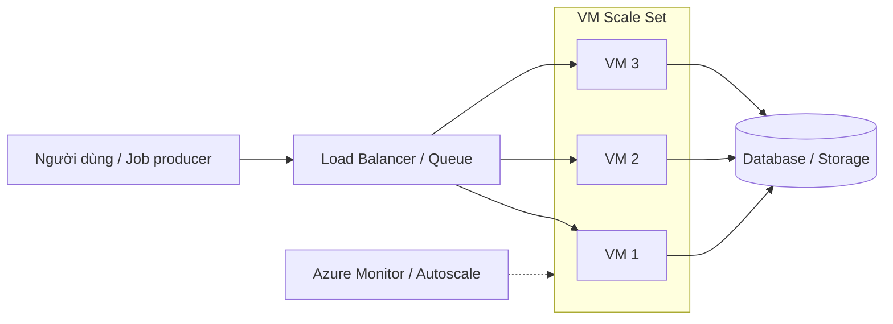
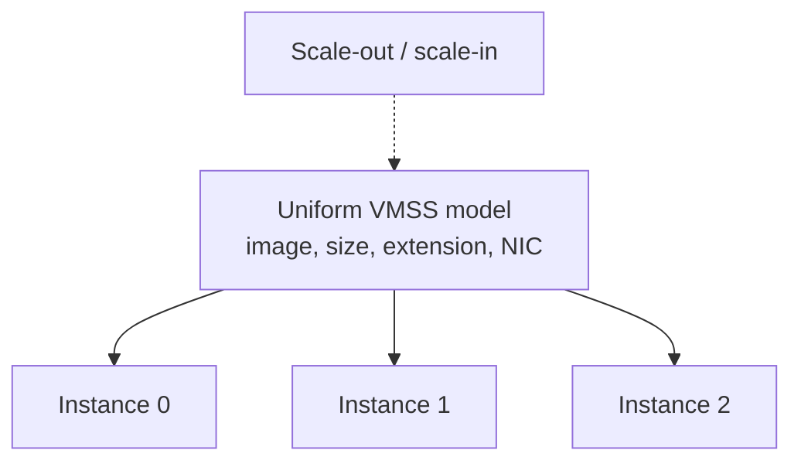
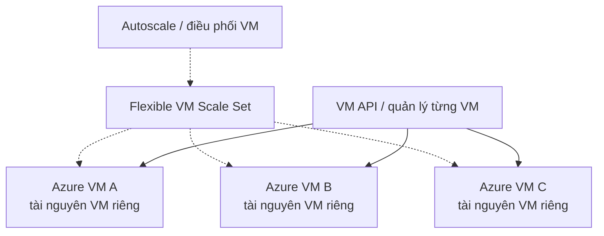
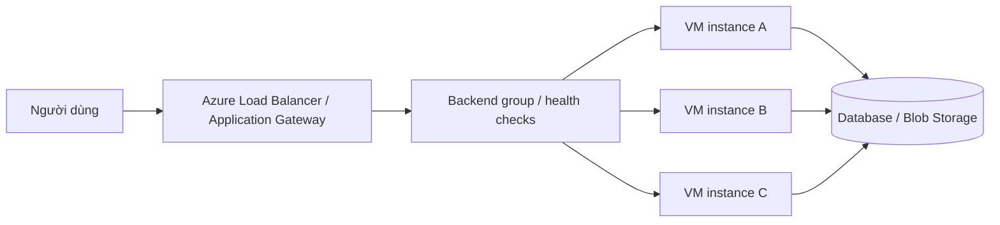
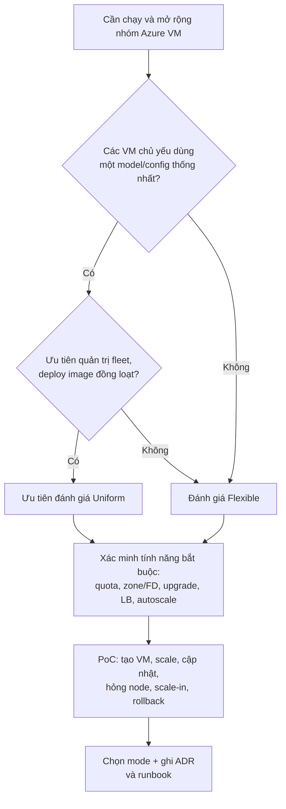
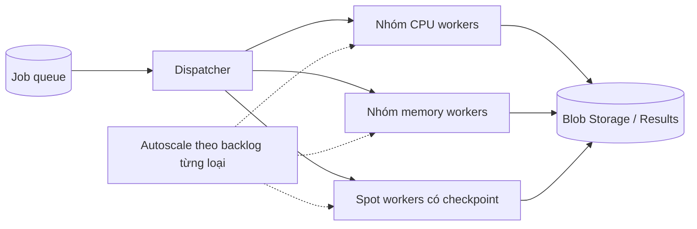

# Lựa chọn orchestration mode cho Scale Sets

Một nền tảng thương mại điện tử cần bổ sung máy ảo khi lưu lượng tăng vào giờ cao điểm, trong khi một đội xử lý ảnh lại cần chạy các máy ảo có kích thước và vai trò không hoàn toàn giống nhau. Cả hai có thể xem xét **Azure Virtual Machine Scale Sets (VMSS)**, nhưng cách Azure quản lý từng máy ảo trong nhóm, phân bố máy qua các miền lỗi và thực hiện vòng đời triển khai phụ thuộc vào **orchestration mode**.

Bài học thuộc chương **Compute co giãn và xử lý theo lô** của module **CLOUD_PROVIDERS_AZURE**. Module khám phá hệ sinh thái Azure từ subscription, resource group và Microsoft Entra ID đến mạng ảo, dịch vụ tính toán, lưu trữ và dữ liệu; đồng thời hướng dẫn triển khai, giám sát, bảo vệ và kiểm soát chi phí một kiến trúc ứng dụng. Bài này tập trung vào hai orchestration mode của Virtual Machine Scale Sets: **Uniform** và **Flexible**, giúp bạn chọn theo yêu cầu thực tế thay vì chỉ dựa trên số lượng VM.

Sau bài học, bạn có thể:

- Giải thích vai trò của VMSS và sự khác nhau giữa **Uniform orchestration** và **Flexible orchestration**.
- So sánh khả năng quản lý VM riêng lẻ, chuẩn hóa cấu hình, mở rộng/thu hẹp, triển khai phiên bản và phân bố lỗi.
- Thiết kế cơ chế autoscale, health check, load balancing, cập nhật image và xử lý scale-in.
- Chọn mode phù hợp cho web API stateless, ứng dụng có VM cần quản trị độc lập hoặc worker xử lý batch.
- Kiểm tra thuộc tính `orchestrationMode` qua Azure Portal, Azure CLI và mô hình Infrastructure as Code.
- Lập kế hoạch chuyển đổi kiến trúc khi yêu cầu thay đổi, tránh hiểu sai rằng có thể đổi mode tùy ý trên một scale set đang chạy.

## 1. VM Scale Sets giải quyết vấn đề gì?

**Azure Virtual Machine Scale Sets** là tài nguyên giúp quản lý một tập hợp VM có liên hệ với nhau, đáp ứng các bài toán như:

- Chạy nhiều instance của cùng ứng dụng để tăng năng lực phục vụ.
- Tạo thêm hoặc giảm bớt VM theo nhu cầu, thời gian hoặc chỉ số giám sát.
- Phân bố VM trên những miền lỗi/availability zone được hỗ trợ.
- Áp dụng image, extension, cấu hình triển khai và chiến lược cập nhật.
- Tích hợp với Azure Load Balancer, Azure Monitor, mạng ảo và các công cụ quản trị.

VMSS không tự biến ứng dụng thành **stateless**, không tự đồng bộ dữ liệu trong RAM hay database và không tự làm cho mọi yêu cầu có thể chạy trên bất kỳ VM nào. Các quyết định về session, external state, queue, database, file storage và idempotency vẫn thuộc tầng ứng dụng.

### 1.1. VMSS không phải một VM có nhiều CPU

Khi scale out từ hai VM lên năm VM, Azure tạo thêm các máy ảo **độc lập về compute**. Mỗi VM có hệ điều hành, tiến trình, NIC và vòng đời riêng theo mô hình orchestration đang sử dụng. Load balancer hoặc bộ phân phối công việc sẽ quyết định request/job đi đến đâu.



Sơ đồ là mô hình tổng quan. Với ứng dụng nhận HTTP, có thể dùng load balancer/ingress; với xử lý theo lô, hàng đợi công việc và cơ chế điều phối job thường quan trọng hơn load balancer.

## 2. Orchestration mode là gì?

**Orchestration mode** xác định cách VMSS biểu diễn, phân bố, tạo và quản lý các instance.

Hai mode chính:

1. **Uniform orchestration**: tối ưu mô hình nhóm VM có cấu hình cơ sở tương đối giống nhau, quản lý nhiều instance theo một scale set model.
2. **Flexible orchestration**: đặt trọng tâm vào các VM có **tài nguyên và vòng đời dễ quản trị riêng**, nhưng vẫn thuộc một nhóm dùng cho scale, availability và orchestration.

Cả hai có thể phục vụ kiến trúc co giãn. Sự khác biệt nằm ở **mức độ đồng nhất được kỳ vọng, trải nghiệm quản lý từng VM và khả năng tích hợp các tính năng Azure VM**. Mức hỗ trợ cụ thể của autoscale, image upgrade, repair, extensions, Spot, availability zone và disk tùy phiên bản dịch vụ/CLI/API, khu vực và VM SKU; không nên coi mọi cờ cấu hình của mode này tương đương mode kia.

### 2.1. Uniform: một mô hình instance chung

Trong **Uniform**, một VMSS model mô tả hình ảnh VM, kích thước máy, cấu hình OS, network profile và nhiều thuộc tính khác của nhóm. Azure tạo các instance theo model đó. Các thao tác scale, cập nhật model, rolling upgrade và điều phối thường được xây dựng quanh scale set.



**Ưu điểm điển hình:** hợp với fleet VM đồng nhất, quy trình deploy theo image chung, quản trị quy mô và các cơ chế nâng cấp model theo tính năng được hỗ trợ.

**Đổi lại:** khả năng sử dụng mọi thao tác/tính năng của một VM đơn lẻ có thể khác so với VM Azure bình thường. Khi cần cấu hình rất khác nhau giữa các VM, phải đánh giá xem một scale set Uniform còn đúng kiến trúc hay nên tách workload.

### 2.2. Flexible: VM có danh tính quản trị riêng

Trong **Flexible**, các instance có thể được quản lý như tài nguyên **Microsoft.Compute/virtualMachines** thông thường trong khi scale set cung cấp lớp nhóm/orchestration. Điều này thuận tiện cho nhiều tác vụ quản trị VM và cho các kịch bản không muốn tất cả instance bị bó buộc vào một model hoàn toàn đồng nhất.



**Ưu điểm điển hình:** thuận lợi khi dùng VM API, quản lý VM riêng lẻ, kết hợp nhiều cấu hình máy trong phạm vi hỗ trợ, tích hợp quy trình vận hành VM hiện có và yêu cầu về availability.

**Đổi lại:** nhiều công cụ, truy vấn và chính sách cần hiểu rằng instance là VM resource riêng; không thể giả định mọi thao tác ở cấp scale set sẽ áp dụng cho toàn bộ máy theo cùng cách như Uniform.

## 3. Bảng so sánh Uniform và Flexible

| Tiêu chí | **Uniform** | **Flexible** |
|---|---|---|
| Triết lý | Fleet dựa trên **VMSS model** chung | Nhóm VM có khả năng **quản lý riêng lẻ** cao |
| Biểu diễn instance | VMSS instance, quản lý chủ yếu qua VMSS VM APIs | VM resource thông thường liên kết với scale set |
| Mức đồng nhất | Thường ưu tiên image, size, cấu hình nhất quán | Thuận lợi hơn cho cấu hình VM có khác biệt trong phạm vi hỗ trợ |
| Scale out/in | Dựa trên capacity và model của VMSS | Có khả năng scale/orchestrate nhưng cần hiểu cách quản lý các VM thành viên |
| Autoscale | Hỗ trợ kịch bản mở rộng theo lịch/metric trong cấu hình tương thích | Có thể dùng autoscale trong cấu hình tương thích; kiểm tra cách tạo/loại bỏ VM |
| Nâng cấp, vá hệ điều hành | Các chính sách image/model upgrade theo khả năng Uniform | Tận dụng trải nghiệm VM và cơ chế cập nhật phù hợp; không sao chép nguyên giả định về policy Uniform |
| API/CLI quản trị instance | Thường qua `az vmss ...` | Thường qua `az vm ...` cho VM thành viên |
| Fault domain, availability zone | Phân bố theo placement group/zone của Uniform trong khả năng hỗ trợ | Phân bố theo fault domain/zone theo khả năng của Flexible |
| Cấu hình network | Profile/tích hợp network theo mô hình scale set | Có thể quản lý network resource của các VM như VM riêng |
| Tích hợp VM features | Một số tính năng có ràng buộc theo mode | Hướng đến tương thích rộng với quản trị tính năng VM |
| Công việc phù hợp | Web/API/worker đồng nhất, triển khai theo model | Hệ VM đa dạng, cần quản trị độc lập hoặc cấu hình linh hoạt |

Bảng mô tả **định hướng quyết định**, không phải một ma trận hỗ trợ đầy đủ của mọi tính năng. Đối với workload đòi hỏi backup cụ thể, encryption, proximity placement group, Spot mix, acceleration networking, ultra disk hoặc custom image, phải xác minh mode cùng SKU/region và phiên bản API/CLI được sử dụng.

### 3.1. Tránh kết luận “Flexible luôn tốt hơn”

Flexible mang lại nhiều thuận lợi cho quản lý từng VM, nhưng Uniform vẫn phù hợp khi tổ chức muốn vận hành một fleet đồng nhất bằng model và quy trình upgrade có thể lặp lại. Ngược lại, không nên chọn Uniform chỉ vì tên gọi “đồng nhất” nếu nghiệp vụ cần một số instance khác nhau hoặc thao tác VM resource độc lập.

**Chọn mode theo hoạt động cần thực hiện**, không theo thứ tự “mới/cũ” hoặc vì mặc định của một nút bấm Azure Portal.

## 4. Các yếu tố quyết định trước khi triển khai

### 4.1. Workload giống nhau đến mức nào?

Hãy trả lời:

- Mọi instance có chạy **cùng application image và phiên bản** không?
- Cấu hình VM size, disk, extension, NIC, image và security baseline có giống nhau?
- Có máy cần GPU, máy cần CPU lớn và máy cần RAM lớn trong cùng nhóm không?
- Có cần quản lý một VM đặc biệt theo tên, resource ID hoặc công cụ Azure VM không?

Nếu **các VM chủ yếu đồng nhất**, Uniform có thể giảm phức tạp. Nếu **cần quản trị và định dạng VM riêng lẻ**, Flexible đáng ưu tiên đánh giá. Tuy nhiên, một nhóm máy có **vai trò khác nhau về mặt nghiệp vụ** không nhất thiết nên đặt chung trong một scale set: có thể tốt hơn khi tách các nhóm worker theo vai trò và nhu cầu scale.

### 4.2. Scale theo mức sử dụng hay scale theo kế hoạch?

Với ứng dụng web stateless, số lượng VM có thể tăng theo CPU, lượng request, độ dài hàng đợi hoặc custom metric. Với batch, scale theo **backlog** và tốc độ xử lý thường chính xác hơn CPU trung bình.

Điều cần quyết định:

1. Metric nào phản ánh nhu cầu phục vụ?
2. Mất bao lâu để VM mới khởi động, bootstrap và trở thành healthy?
3. Có bao nhiêu instance tối thiểu để chịu lỗi?
4. Khi scale in, job/session trên VM bị loại bỏ sẽ ra sao?
5. Scale set có quota VM/vCPU, giới hạn mạng và khả năng cấp phát VM SKU cần dùng không?

Mode không giải quyết thay ứng dụng việc lưu state hay cơ chế dừng một job đang chạy.

### 4.3. Có cần “một nhóm VM” hay “một tài nguyên VMSS model”?

Nếu công cụ quản trị hiện tại thường xuyên gọi **Azure VM REST API** để thay disk, network, extension, identity hoặc cấu hình từng máy, Flexible có thể thuận lợi hơn.

Nếu đội vận hành muốn đẩy một version image chung, tạo/loại instance đồng loạt và coi mỗi VM là thành phần có thể thay thế, Uniform thường là mô hình rõ ràng.

Đánh giá cả **hệ thống IaC**, inventory, monitoring, patching, backup, role assignments và CMDB đang dùng, vì khác biệt biểu diễn instance ảnh hưởng đến cách thu thập dữ liệu và cấp quyền.

## 5. Availability: availability zone, fault domain và placement

### 5.1. Các khái niệm

- **Availability zone (AZ):** miền hạ tầng có tính độc lập trong một Azure region hỗ trợ availability zones.
- **Fault domain (FD):** nhóm tài nguyên có chung một số thành phần hạ tầng dễ cùng bị ảnh hưởng khi xảy ra lỗi.
- **Placement group:** cách Azure tổ chức/đặt các instance của VMSS Uniform trong các giới hạn hạ tầng.
- **Platform fault domain count:** thuộc tính liên quan phân bố fault domain, có điều kiện hỗ trợ và giới hạn khác nhau theo mode/region/zone.

Chọn Uniform hay Flexible **không tự bảo đảm** mọi máy đều nằm trên zone khác nhau; phải cấu hình topology và quan sát kết quả thực tế.

### 5.2. Thiết kế cho hai loại sự cố

| Sự cố | Cần kiểm tra | Ví dụ biện pháp |
|---|---|---|
| Một host lỗi | Instance có được đặt ở miền lỗi phù hợp và thay thế được không? | Phân bố qua fault domain, health detection, auto repair nếu hỗ trợ |
| Một availability zone lỗi | Có VM healthy trong zone khác, load balancing và dữ liệu còn truy cập được không? | Trải VM qua nhiều zone, thiết kế dữ liệu và network phù hợp |
| Region lỗi | Có workload/data ở region khác, DNS/traffic failover và runbook không? | Kiến trúc đa region; không chỉ dựa vào một VMSS |
| Lỗi ứng dụng trên mọi VM | Cùng bản build lỗi, image sai, secret bị thu hồi | Canary/rolling deploy, quan sát lỗi và rollback |

Ví dụ, ba VM ở ba zone vẫn không làm API sẵn sàng nếu tất cả gọi cùng một database không có phương án chịu lỗi tương ứng. High availability là thuộc tính **end-to-end**, gồm load balancer, DNS, storage, database, identity và ứng dụng.

### 5.3. Không tự giả định số FD và giới hạn instance

Giới hạn fault domain, số lượng VM, zone hỗ trợ và placement group có thể thay đổi theo mode, VM SKU, region, OS image và thời điểm phát hành tính năng. Khi thiết kế production, hãy kiểm tra:

- Số FD được hỗ trợ tại region/zone đã chọn.
- Tham số `platformFaultDomainCount` có hợp lệ cho mode hiện tại không.
- Kích thước tối đa, quota và khả năng cấp phát VM ở mỗi zone.
- Cấu hình Uniform single/multiple placement group nếu có yêu cầu quy mô.
- Hành vi phân bố VM mới và tình huống scale in sau lỗi zone.

Không mặc định `instanceCount=3` nghĩa là có ba FD hoặc ba AZ khác nhau.

## 6. Quản lý image, extensions và cập nhật phiên bản

### 6.1. Golden image và bootstrap

Một VMSS thường sử dụng image có hệ điều hành, agent và application dependencies theo một chuẩn đã kiểm thử. Có thể dùng image Azure Marketplace hoặc image từ **Azure Compute Gallery** tùy yêu cầu.

Các yếu tố cần quản trị:

- Version image và cách pin/roll forward rõ ràng.
- VM extension, cloud-init/Custom Script và khả năng chạy lại an toàn.
- Managed identity và cách đọc secret từ Key Vault thay vì nhúng khóa.
- Application health probe trước khi nhận request.
- Quy trình thay VM bị lỗi, không phụ thuộc thao tác sửa thủ công trên một instance.

Với Uniform, việc cập nhật scale set model và đưa thay đổi xuống instance phải dùng **upgrade policy phù hợp**; không cho rằng sửa model có nghĩa mọi VM đang chạy lập tức được áp dụng. Với Flexible, cấu hình của VM riêng có thể có vòng đời khác và cũng cần kế hoạch triển khai nhất quán.

### 6.2. Rolling deployment và health

Một chiến lược triển khai an toàn thường có:

1. Kiểm tra image/build trên môi trường thử nghiệm.
2. Tạo VM mới hoặc cập nhật một phần nhỏ instance.
3. Đợi application health probe cho biết VM thực sự sẵn sàng.
4. Tăng phạm vi rollout theo batch/đợt nếu công cụ và mode hỗ trợ.
5. Theo dõi latency, tỉ lệ lỗi, queue backlog và tài nguyên.
6. Dừng rollout hoặc khôi phục image trước nếu có regression.

Các tính năng **automatic OS image upgrade, rolling upgrades, automatic instance repair và orchestration policy** không có cùng cách cấu hình hay mức hỗ trợ cho mọi mode. Khi chuyển từ Uniform sang Flexible phải xác minh phương án tương ứng, không copy nguyên tham số IaC rồi giả định sẽ được chấp nhận.

### 6.3. Tránh “configuration drift”

Với bất kỳ mode nào, nếu đội vận hành SSH/RDP và sửa một máy đơn lẻ bằng tay, instance mới tạo từ image cũ có thể không có thay đổi đó. Với Flexible, việc quản trị VM cá biệt thuận lợi **không có nghĩa nên để fleet sai khác không kiểm soát**.

Đối với workload cần scale, ưu tiên xây image, policy và cấu hình bằng IaC/pipeline. Những ngoại lệ ở một VM phải có owner, lý do, thời hạn và cách đưa trở lại trạng thái chuẩn.

## 7. Network, load balancing và điểm truy cập dịch vụ

### 7.1. Đường vào cho web API



VMSS cung cấp compute capacity; **load balancing không mặc nhiên được thiết kế hoàn chỉnh** chỉ vì đã tạo scale set. Cần xác minh:

- VM/NIC tham gia đúng backend pool theo mode đang dùng.
- Health probe kiểm tra một endpoint thể hiện ứng dụng sẵn sàng, không chỉ kiểm tra cổng đang mở.
- NSG, route, firewall và subnet cho phép traffic cần thiết.
- Application Gateway hoặc Load Balancer có đủ năng lực và cấu hình zone/redundancy phù hợp.
- Khi scale out/in, thành viên backend pool được cập nhật đúng và kết nối đến VM đã drain không bị ngắt ngoài ý muốn.

Với Flexible, cần đặc biệt kiểm tra **NIC và backend pool membership của các VM thực tế** theo cách model/triển khai tạo chúng. Đừng giả định cách cấu hình network profile và truy vấn instance của Uniform luôn áp dụng.

### 7.2. Outbound traffic và private resources

Đối với workload truy cập Azure SQL, Storage hoặc Key Vault qua private endpoint:

1. VM phải có route/DNS phù hợp trong VNet.
2. Managed identity hoặc credential được cấp quyền tới dịch vụ đích.
3. Firewall/NSG không chặn đường kết nối.
4. Scale-out VM mới vẫn nhận đúng cấu hình DNS, network và identity.

Nếu ứng dụng gọi Internet qua NAT Gateway hoặc firewall, phải kiểm tra outbound connectivity và giới hạn kết nối khi số VM tăng; không chỉ theo dõi traffic inbound.

## 8. Autoscale, scale-in và tính an toàn của ứng dụng

### 8.1. Autoscale theo metric

Một kế hoạch mẫu cho web API:

```text
Minimum instances:  2
Default instances:  2
Maximum instances:  8

Scale out:  CPU trung bình cao liên tục trong cửa sổ đo
Scale in:   CPU thấp liên tục trong cửa sổ dài hơn
Cooldown:   Có thời gian chờ để tránh dao động lên/xuống
```

Đây là định hướng, không phải tham số khuyến nghị cho mọi ứng dụng. Khi chọn ngưỡng, phải xét thời gian VM bootstrap, metric aggregation, phân phối request và khả năng backend.

Với hệ thống xử lý batch:

```text
Queue có 10.000 job
Mỗi worker xử lý khoảng 100 job/phút (giả định)
Cần hoàn thành trong 20 phút
Tối thiểu worker lý thuyết = 10.000 / (100 × 20) = 5
```

Số tính ra chưa tính bootstrap, retry, job không đồng đều, rate limit của database và quota VM. Trong thực tế cần dự phòng và giới hạn concurrency để không làm quá tải hệ thống phụ thuộc.

### 8.2. Scale-in nguy hiểm hơn scale-out ở chỗ nào?

Scale out tạo thêm capacity; scale in **xóa hoặc giải phóng capacity**. Nếu worker đang xử lý một job dài, VM bị loại bỏ có thể làm job dở dang. Nếu web API giữ session hoặc file tạm trong VM local, người dùng có thể mất trạng thái.

Các yêu cầu quan trọng:

- **Drain** kết nối/job khi biết VM sắp bị thu hồi, theo khả năng tích hợp và tín hiệu lifecycle.
- Lưu trạng thái bền vững ở database/queue/storage, không chỉ trên local disk của VM.
- Job có **checkpoint** hoặc idempotency để retry an toàn.
- Thiết lập graceful shutdown và thời gian xử lý phù hợp.
- Đặt min/max capacity và điều kiện bảo vệ VM đặc biệt nếu kiến trúc yêu cầu.

Chọn Flexible không tự giải quyết graceful shutdown; Uniform cũng có thể xử lý workload stateful nếu ứng dụng và công cụ vận hành được thiết kế đúng, nhưng thường cần thêm coordination.

### 8.3. VMSS, Azure Batch và các dịch vụ khác

Nếu workload chủ yếu là **hàng nghìn tác vụ tính toán độc lập**, hãy cân nhắc liệu Azure Batch, container orchestration hoặc các dịch vụ managed compute khác có giảm gánh nặng vận hành hơn tự quản VMSS không. VMSS phù hợp khi ứng dụng cần quyền kiểm soát VM/OS/image/network và có pipeline quản lý fleet rõ ràng.

Không để việc chọn mode khiến đội ngũ bỏ qua câu hỏi quan trọng hơn: “Có thực sự cần quản lý VM hay dịch vụ PaaS đáp ứng đủ?”

## 9. Azure Spot VMs và chiến lược chi phí

Azure Spot VM có thể giảm chi phí compute trong phạm vi giá/khả năng dịch vụ nhưng có nguy cơ bị **evict** khi Azure cần capacity hoặc theo chính sách đã cấu hình.

Khi thiết kế với Spot:

- Dùng cho job retry được, worker stateless, rendering hoặc xử lý batch có checkpoint.
- Không dựa hoàn toàn vào Spot để giữ tối thiểu capacity của dịch vụ quan trọng.
- Kiểm tra cách cấu hình phối hợp **Spot và standard/on-demand VM** trong mode và phiên bản Azure VMSS đang dùng.
- Tính chi phí của retry, khởi động lại, dữ liệu tạm, thời gian chờ cấp phát VM và quota.
- Lưu ý **eviction policy** và giới hạn hỗ trợ theo mode, SKU/region.

Flexible thường đáng xem xét khi workload cần quản lý các VM với thuộc tính và loại capacity khác nhau; nhưng việc hỗ trợ mix cụ thể phải được kiểm tra, không nên mặc định mọi tổ hợp Spot/on-demand đều hợp lệ.

### 9.1. Đừng chỉ đo giá VM/giờ

```text
TCO vận hành VMSS =
    chi phí VM (size, số lượng, thời gian chạy, Spot nếu dùng)
  + managed disks, image/storage, snapshot/backup
  + outbound data transfer, load balancer, NAT, public IP
  + Azure Monitor/Log Analytics và telemetry
  + license OS/application và bảo mật
  + chi phí vận hành, triển khai, khắc phục sự cố
```

Một mode “dễ tạo hơn” không nhất thiết rẻ hơn tổng thể nếu dẫn tới quy trình cập nhật thủ công, VM cấu hình lệch hoặc lỗi scale-in. Ngược lại, không nên chọn mode phức tạp khi workload đồng nhất và có thể tái tạo hoàn toàn từ image.

## 10. Quy trình chọn mode theo yêu cầu



Đây là cây quyết định **hướng dẫn đánh giá**, không phải thuật toán bắt buộc. Kết luận cuối phải dựa vào yêu cầu cứng của ứng dụng và ma trận hỗ trợ thực tế.

### 10.1. Bảng chấm điểm tham khảo

Bạn có thể cho điểm từ 1 (ít phù hợp) đến 5 (rất phù hợp) với các tiêu chí có trọng số:

| Tiêu chí | Trọng số ví dụ | Câu hỏi khi chấm |
|---|---:|---|
| Tương thích công cụ VM hiện có | 25% | Có cần VM API, VM backup hoặc inventory như máy ảo độc lập không? |
| Đồng nhất triển khai image | 20% | Các instance có cùng model và nâng cấp theo lô không? |
| Khả năng chịu lỗi | 20% | Mode đáp ứng AZ/FD và health repair theo topology yêu cầu không? |
| Autoscale/scale-in | 15% | Có kiểm soát lifecycle và job/session an toàn không? |
| Network/security | 10% | VM/NIC, LB backend, identity, NSG, private connection phù hợp không? |
| Vận hành và chi phí | 10% | IaC, metrics, quota, nhân sự, TCO có phù hợp không? |

Ví dụ trọng số chỉ để bắt đầu thảo luận. Những tiêu chí bắt buộc như hỗ trợ loại disk hoặc VM feature của workload là **điều kiện loại trừ**, không nên bù bằng điểm cao ở mục khác.

## 11. Tình huống A: Web API stateless phục vụ người dùng

**Bối cảnh:** API giao dịch cần 3–12 VM trong giờ cao điểm. Tất cả VM chạy cùng image đã kiểm thử, truy cập Azure SQL và Blob Storage; session ở cache/database, không lưu trên VM. Ứng dụng được phân phối qua gateway có health check.

**Lựa chọn hợp lý để đánh giá:** **Uniform** nếu đội vận hành ưu tiên model đồng nhất, triển khai theo image và các tính năng upgrade/autoscale mà mode này hỗ trợ trong thiết kế. **Flexible** cũng có thể đáp ứng nhưng cần có lý do như tích hợp quản trị VM hoặc placement cụ thể.

**Thiết kế triển khai:**

1. Xây image chuẩn, cấu hình cloud-init/extension không chứa secret.
2. Phân bố instance qua zone/FD theo khả năng region/SKU.
3. Dùng health check kiểm tra readiness ứng dụng.
4. Dùng autoscale theo request/CPU trong giới hạn min/max đã tính.
5. Dùng managed identity, network access và dữ liệu bền vững ngoài VM.
6. Test rolling deployment, rollback, mất một instance và scale-in lúc còn kết nối.

**Điểm cần nhớ:** lựa chọn Uniform xuất phát từ **yêu cầu đồng nhất**, không phải quy tắc “cứ có nhiều VM là phải Uniform”.

## 12. Tình huống B: Nhóm worker xử lý dữ liệu có nhu cầu VM khác nhau

**Bối cảnh:** một pipeline xử lý hình ảnh có nhóm công việc cần CPU lớn, nhóm cần nhiều RAM và một số công việc có thể dùng Spot. Đội vận hành còn cần quản lý/điều tra VM riêng bằng các công cụ VM hiện tại.

**Lựa chọn hợp lý để đánh giá:** **Flexible** khi muốn VM có đặc tính riêng trong một mô hình orchestration có thể hỗ trợ. Tuy nhiên, nếu worker có vai trò và metric scale khác hẳn nhau, đôi khi **tách thành nhiều scale set** (mỗi nhóm có mục tiêu scale riêng) lại dễ kiểm soát hơn.



**Bài học:** flexibility của VM không có nghĩa nên trộn mọi thứ vào một autoscale policy. Hệ thống vẫn cần queue riêng, rate limit, metric theo loại job và checkpoint để tránh mất tiến độ khi VM bị loại bỏ.

## 13. Thực hành kiểm tra orchestration mode bằng Azure CLI

Các lệnh sau **chỉ đọc cấu hình**, không tạo VM hoặc xóa tài nguyên. Trước khi chạy, đăng nhập và chọn subscription phù hợp; caller cần quyền đọc ở scope. Ví dụ Bash:

### 13.1. Xác nhận ngữ cảnh và danh sách VMSS

```bash
az account show \
  --query "{subscription:name,subscriptionId:id,tenantId:tenantId}" \
  -o table

az vmss list \
  --query "[].{name:name,resourceGroup:resourceGroup,mode:orchestrationMode,sku:sku.name,capacity:sku.capacity}" \
  -o table
```

Đừng dựa vào tên scale set để đoán mode. Hãy xem trực tiếp thuộc tính `orchestrationMode` và thông tin mà Azure trả về.

### 13.2. Xem mode của một scale set

```bash
RG="rg-compute-lab"
VMSS="vmss-workers"

az vmss show \
  --resource-group "$RG" \
  --name "$VMSS" \
  --query "{name:name,orchestrationMode:orchestrationMode,sku:sku.name,capacity:sku.capacity,zones:zones,upgradePolicy:upgradePolicy,platformFaultDomainCount:platformFaultDomainCount}" \
  -o json
```

Một số thuộc tính có thể nằm trong `virtualMachineProfile` hoặc các trường khác tùy API/mode; field không xuất hiện không tự động nghĩa là dịch vụ thiếu tính năng đó. Cần đối chiếu JSON trả về và mode thật.

### 13.3. Quan sát instance theo mode

Với **Uniform**, thường dùng nhóm lệnh `az vmss` để xem instance:

```bash
az vmss list-instances \
  --resource-group "$RG" \
  --name "$VMSS" \
  -o table
```

Với **Flexible**, các instance là VM resource: có thể liệt kê VM trong resource group rồi xem VM cụ thể cùng thuộc tính liên kết scale set:

```bash
az vm list \
  --resource-group "$RG" \
  --query "[].{name:name,id:id,size:hardwareProfile.vmSize,scaleSet:virtualMachineScaleSet.id}" \
  -o json

az vm show \
  --resource-group "$RG" \
  --name "<flexible-vm-name>" \
  --query "{name:name,id:id,scaleSet:virtualMachineScaleSet.id,vmSize:hardwareProfile.vmSize,networkInterfaces:networkProfile.networkInterfaces}" \
  -o json
```

Nếu VMSS và VM thành viên không nằm cùng resource group, cần liệt kê đúng scope và dùng resource ID thay vì chỉ tên. Khi xem VM của Flexible, không nhầm mọi VM trong resource group đều là thành viên của một scale set; hãy kiểm tra thuộc tính liên kết.

### 13.4. Ý tưởng khai báo mode khi tạo mới

Đối với CLI hoặc IaC, xác định mode **từ lúc thiết kế** bằng giá trị:

```yaml
# Thuộc tính khái niệm của Azure VMSS; không phải ARM/Bicep hoàn chỉnh.
orchestrationMode: Flexible
# Hoặc:
# orchestrationMode: Uniform
```

Ví dụ có tính minh họa về cú pháp Azure CLI tạo VMSS (các thành phần network, identity, image, SSH và region cần điền theo môi trường):

```bash
# Lệnh THAY ĐỔI TRẠNG THÁI, chỉ dùng sau phê duyệt trong môi trường lab.
az vmss create \
  --resource-group "<resource-group>" \
  --name "<vmss-name>" \
  --orchestration-mode Flexible \
  --image Ubuntu2204 \
  --vm-sku Standard_D2s_v5 \
  --instance-count 2 \
  --admin-username azureuser \
  --generate-ssh-keys
```

Đây là ví dụ hướng dẫn ý tưởng thiết lập mode, **không phải cấu hình production**. Khả năng cấp phát và các tham số CLI cần xác minh theo bản Azure CLI/extension, region, VM quota, image, network và chính sách tổ chức. Lệnh có thể tạo resource và chi phí; không chạy nếu chưa xác minh. Khi tạo Uniform, đổi mode thành `Uniform` và kiểm tra lại những tham số network/upgrade mặc định liên quan.

### 13.5. Các thuộc tính quan trọng khi đọc JSON

| Thuộc tính / nhóm thông tin | Câu hỏi cần kiểm tra |
|---|---|
| `orchestrationMode` | Scale set thuộc Uniform hay Flexible? |
| `sku`, `capacity` | Cấu hình, capacity hiện tại và phạm vi quản lý của scale set là gì? |
| `zones` | Scale set được yêu cầu đặt ở zone nào? |
| `platformFaultDomainCount` | Fault domain có phù hợp mode và vùng không? |
| `upgradePolicy`, image/extension | Cập nhật instance diễn ra theo chính sách nào? |
| `virtualMachineProfile` | Model VM mặc định gồm những gì, có áp dụng cho mode này thế nào? |
| `virtualMachineScaleSet.id` trên VM | VM resource có thực sự thuộc Flexible scale set dự kiến không? |
| NIC, load balancer backend pool | Instance mới có nằm sau đúng điểm truy cập và health check không? |

Không dùng sự tồn tại/không tồn tại của **một field** để suy ra SLA hoặc chức năng khi chưa kiểm tra API version và cấu hình thực tế.

## 14. Thay đổi mode có phải chỉ sửa một thuộc tính?

**Không nên thiết kế với giả định có thể đổi `Uniform` ↔ `Flexible` trực tiếp, không gián đoạn, trên một VMSS đã chạy.** Orchestration mode là một lựa chọn nền tảng khi tạo scale set. Trong nhiều trường hợp, chuyển mode phải thực hiện bằng **triển khai scale set mới và chuyển workload**, không phải đổi một trường trên model hiện hữu.

### 14.1. Chiến lược chuyển kiến trúc

1. **Kiểm kê**: image, instance count, VM sizes, zone/FD, disks, identities, NICs, load balancing, NSG, autoscale, alert, tags và permissions.
2. **Lựa chọn mode mới**: xác minh tính năng bắt buộc, hạn chế migration và quota.
3. **Tạo nhóm VMSS mới bằng IaC**: triển khai môi trường song song (blue-green) với network và bảo mật được kiểm thử.
4. **Đưa ứng dụng lên**: xác minh bootstrap, secret access, health probes, logs và database connectivity.
5. **Chuyển lưu lượng/job từng bước**: dùng gateway/queue, quan sát latency, lỗi, capacity và tác động tới session.
6. **Drain và dừng scale set cũ**: đảm bảo công việc chưa hoàn tất có checkpoint/idempotent retry.
7. **Kiểm tra chi phí và rollback**: giữ kế hoạch quay lại nếu mode mới không đáp ứng.

Nếu hệ thống giữ state trên local disk của VM, migration cần kế hoạch chuyển dữ liệu riêng. Không giả định xóa instance hoặc scale set cũ sẽ bảo toàn mọi local file và disk theo cách mong muốn.

### 14.2. Checklist kiểm thử trước khi chuyển production

- [ ] Đã xác minh mode được hỗ trợ cho region, VM SKU, image và tính năng bắt buộc.
- [ ] Autoscale có thể tạo và loại bỏ VM theo metric/kịch bản thực.
- [ ] VM mới có image, extension, identity, NSG, DNS và route chính xác.
- [ ] Backend load balancer/gateway chỉ nhận VM healthy.
- [ ] Khả năng chịu lỗi host/zone và phục hồi instance được kiểm thử.
- [ ] Quy trình image/OS update và rollback có thể lặp lại.
- [ ] Graceful shutdown/queue checkpoint hoạt động khi scale-in hoặc Spot eviction.
- [ ] Metrics, logs, alert và inventory nhìn thấy instance đúng theo mode.
- [ ] Đã đo chi phí của VM, disk, network, monitoring và phần capacity dự phòng.
- [ ] Có tài liệu vận hành và người chịu trách nhiệm khi xảy ra sự cố.

## 15. Lỗi phổ biến và cách chẩn đoán

| Triệu chứng | Nguyên nhân có thể | Hướng kiểm tra |
|---|---|---|
| Script `az vmss ...` không thấy instance mong đợi | Script viết cho Uniform nhưng scale set là Flexible | Kiểm tra `orchestrationMode`; truy vấn VM resources cho Flexible |
| Scale-out không tạo VM | Quota/capacity region, image, policy, network hoặc autoscale rule | Azure Activity Log, deployment operations, autoscale history và quota |
| VM được tạo nhưng không nhận request | NIC chưa vào backend pool, health probe fail, NSG/firewall chặn | Kiểm tra LB/gateway backend, VM extension/health, network |
| VM mới khác phiên bản ứng dụng | Image/model không cập nhật hoặc bootstrap có drift | So image version, VM instance configuration và deployment pipeline |
| Đổi model mà instance cũ chưa đổi | Upgrade policy hoặc quy trình áp dụng thay đổi chưa chạy | Kiểm tra mode, upgrade settings và trạng thái instance |
| Scale-in gây mất job hoặc session | Ứng dụng stateful, chưa drain/không có checkpoint | Thiết kế external state, graceful termination và retry |
| Chỉ một availability zone có VM | Cấu hình zone, quota hoặc cấp phát không như dự kiến | Xem `zones`, placement, phân bố VM thực tế và lỗi provisioning |
| Autoscale dao động liên tục | Metric ngưỡng quá sát, cooldown ngắn, bootstrap trễ | Xem biểu đồ CPU/queue, thời gian tạo VM, tối ưu rule |
| Không gắn được disk/không dùng được VM feature | Hạn chế theo mode/VM size/API/region | Xác minh ma trận hỗ trợ, disk SKU và deployment error |
| Chi phí tăng dù tải giảm | Min capacity quá cao, disk còn tồn tại, autoscale bị chặn | Cost Management, capacity history, disk/IP/log usage |

### 15.1. Quy trình xử lý theo từng lớp

1. **Xác định mode và cấu hình nguồn**: lấy `orchestrationMode`, model, image, zones, quota.
2. **Xem trạng thái triển khai**: deployment failures, provisioning state, hoạt động autoscale.
3. **Kiểm tra VM thật**: đã được tạo, vào đúng nhóm, nhận cấu hình và identity chưa?
4. **Kiểm tra ứng dụng**: log bootstrap, health endpoint, secret access, dependency reachability.
5. **Kiểm tra ingress/egress**: load balancing, backend pool, NSG, firewall, DNS và route.
6. **Kiểm tra vòng đời**: image update, repair, scale-in, Spot eviction và giới hạn capacity.
7. **Kiểm tra ngân sách/chi phí**: VM+disk+network, quota, cost alerts và capacity dự phòng.

Không thay nhiều policy cùng lúc trước khi biết lỗi thuộc mode, network, VM provisioning hay ứng dụng.

## 16. Bài tập vận dụng

**Bài 1 — Chọn mode cho API.** Một dịch vụ web dùng image giống nhau cho 20 VM, mọi VM stateless, cần scale theo lưu lượng và triển khai đồng loạt. Nêu lý do ưu tiên đánh giá Uniform và những điều kiện vẫn phải xác minh.

**Bài 2 — Quản trị từng VM.** Một đội có nhiều VM cần cấu hình và công cụ quản trị riêng, nhưng vẫn muốn phân bố theo fault domain và nhóm vận hành. Vì sao Flexible đáng xem xét? Cần tránh giả định gì về tính đồng nhất?

**Bài 3 — Spot và batch.** Một hệ xử lý video có worker Spot và on-demand, job kéo dài 30 phút. Hãy thiết kế checkpoint, queue và quy tắc scale-in/eviction.

**Bài 4 — Availability.** Một VMSS có ba VM trong cùng một zone nhưng dùng database đặt ở một zone khác. Chọn Uniform hay Flexible có tự giải quyết tất cả rủi ro zone failure không?

**Bài 5 — Truy vấn CLI.** Lệnh `az vmss list-instances` không trả các VM Flexible mong đợi. Nêu các bước xác định mode và truy vấn VM member theo tài nguyên Azure VM.

**Bài 6 — Cập nhật model.** Đội ngũ đã sửa image version của Uniform VMSS và nghĩ rằng mọi instance đang chạy được cập nhật ngay. Cần kiểm tra chính sách gì và kiểm thử rollout như thế nào?

**Bài 7 — Lựa chọn kiến trúc.** Một pipeline có worker CPU, memory và GPU với ba metric queue khác nhau. Vì sao có thể hợp lý hơn khi chia thành nhiều VMSS, ngay cả khi Flexible cho phép quản lý VM đa dạng?

**Bài 8 — Thay mode.** Một hệ thống Uniform cần chuyển sang Flexible để dùng công cụ quản lý VM cụ thể. Hãy mô tả phương án tạo nhóm mới, chuyển traffic, xác minh dữ liệu, rollback và dừng nhóm cũ.

## Kết luận

Azure Virtual Machine Scale Sets có hai mô hình orchestration: **Uniform** phù hợp với fleet VM có cấu hình chung và cách quản trị dựa trên một scale set model; **Flexible** thuận lợi khi cần quản lý VM như những tài nguyên riêng, đồng thời sử dụng khả năng nhóm, phân bố lỗi và mở rộng trong phạm vi tính năng được hỗ trợ. Chọn mode dựa trên **mức đồng nhất workload, công cụ quản trị, yêu cầu cập nhật, autoscale, placement, mạng và chi phí**, không dựa trên tên gọi hay mặc định công cụ. Dù chọn mode nào, hệ thống vẫn cần health probes, dữ liệu bền vững bên ngoài VM, kế hoạch scale-in an toàn, giám sát, kiểm thử failure và runbook. Orchestration mode là quyết định kiến trúc nên được xác minh sớm bằng một proof of concept và ghi lại rõ ràng trước khi triển khai production.
